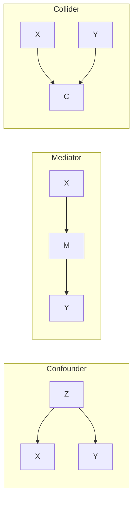

# 4 — Correlation, Confounding and Causation

Larkspur's marketing team has good news: customers who opted in to the loyalty email placed 1.21 more orders this year than those who did not. The email costs almost nothing, so they propose emailing everybody by default. That number is real and it is close to useless, because the people who opt in are the people who were already keen. In the simulation in this chapter, the true effect is 0.30. A/B tests dodge this problem by construction, but plenty of questions come to you after the fact, or concern things you cannot randomise. This chapter is about reading observational data without fooling yourself: what a correlation does and doesn't say, how a third variable can create or reverse one, and the designs that recover a causal answer when randomisation is off the table.

## Measuring association

Start with the description. These coefficients all measure how strongly two variables move together, for different kinds of data.

| Coefficient | Measures | Sensitive to outliers | Use when |
|---|---|---|---|
| Pearson r | linear association | very | both variables roughly Normal, relationship linear |
| Spearman ρ | monotonic association (Pearson on ranks) | no | ordinal data, skew, outliers, curved but monotonic |
| Kendall τ | concordant vs discordant pairs | no | small samples, many ties |
| Point-biserial | one binary, one continuous | yes | equivalent to a t-test |
| Cramér's V | two categorical | no | derived from [chi-square](../../02-probability-and-statistics/notes/05-hypothesis-testing.md) |

One point can wreck Pearson, a demonstration taken from the [statistics practice notebook](../../02-probability-and-statistics/practice/5_Statistical_Analysis.ipynb):

```python
import numpy as np
import pandas as pd
from scipy import stats
from scipy.optimize import minimize
import statsmodels.formula.api as smf

rng = np.random.default_rng(304)
x = np.linspace(1, 10, 30)
y_clean = x + rng.normal(0, 0.5, 30)
y_out = y_clean.copy()
y_out[-1] = 50
print(f"clean:        Pearson {stats.pearsonr(x, y_clean)[0]:.3f}  Spearman {stats.spearmanr(x, y_clean)[0]:.3f}")
print(f"one outlier:  Pearson {stats.pearsonr(x, y_out)[0]:.3f}  Spearman {stats.spearmanr(x, y_out)[0]:.3f}")
```

```text
clean:        Pearson 0.985  Spearman 0.983
one outlier:  Pearson 0.583  Spearman 0.983
```

Spearman barely notices, because the outlier was already the largest rank. And no single coefficient describes a relationship's shape, which is the point of [Anscombe's 1973 paper](https://doi.org/10.1080/00031305.1973.10478966). His four small datasets share almost the same summary statistics:

```python
x123 = [10, 8, 13, 9, 11, 14, 6, 4, 12, 7, 5]
quartet = {
    "I": (x123, [8.04, 6.95, 7.58, 8.81, 8.33, 9.96, 7.24, 4.26, 10.84, 4.82, 5.68]),
    "II": (x123, [9.14, 8.14, 8.74, 8.77, 9.26, 8.10, 6.13, 3.10, 9.13, 7.26, 4.74]),
    "III": (x123, [7.46, 6.77, 12.74, 7.11, 7.81, 8.84, 6.08, 5.39, 8.15, 6.42, 5.73]),
    "IV": ([8, 8, 8, 8, 8, 8, 8, 19, 8, 8, 8], [6.58, 5.76, 7.71, 8.84, 8.47, 7.04, 5.25, 12.50, 5.56, 7.91, 6.89]),
}
for name, (a, b) in quartet.items():
    fit = stats.linregress(a, b)
    print(f"{name:<3} mean y {np.mean(b):.2f}  r {fit.rvalue:.3f}  line y = {fit.intercept:.2f} + {fit.slope:.3f} x")
```

```text
I   mean y 7.50  r 0.816  line y = 3.00 + 0.500 x
II  mean y 7.50  r 0.816  line y = 3.00 + 0.500 x
III mean y 7.50  r 0.816  line y = 3.00 + 0.500 x
IV  mean y 7.50  r 0.817  line y = 3.00 + 0.500 x
```

Plotted, they are a noisy line, a clean curve, a straight line with one outlier, and a vertical stack with one far-off point that creates the whole correlation. So plot before you correlate. `sns.heatmap(df.corr(), annot=True, center=0)` is the quickest overview of a feature table, and [chapter 1 of the statistics pillar](../../02-probability-and-statistics/notes/01-descriptive-statistics-and-eda.md) shows how to read one, but treat a heatmap as a list of things to investigate.

## Confounding

A confounder Z causes both X and Y, so X and Y correlate even when neither touches the other.

```text
      temperature
       /       \
      v         v
 ice cream    drownings
```

```python
rng = np.random.default_rng(1)
temperature = rng.normal(20, 8, 365)
ice_cream = 100 + 3 * temperature + rng.normal(0, 10, 365)
drownings = 2 + 0.1 * temperature + rng.normal(0, 1, 365)
print(f"r(ice cream, drownings) = {stats.pearsonr(ice_cream, drownings)[0]:.3f}, p = {stats.pearsonr(ice_cream, drownings)[1]:.1e}")
```

```text
r(ice cream, drownings) = 0.517, p = 2.2e-26
```

The correlation is strong and highly significant, and it is meaningless as a statement about ice cream.

### Partial correlation and regression

To control for Z, regress it out of both variables and correlate what is left. A regression with Z included does the same thing in one step, because the coefficient on X in `y ~ x + z` is the association holding Z fixed:

```python
def residuals(y, z):
    fit = stats.linregress(z, y)
    return y - (fit.slope * z + fit.intercept)

r, p = stats.pearsonr(residuals(ice_cream, temperature), residuals(drownings, temperature))
print(f"partial r given temperature = {r:.3f}, p = {p:.2f}")
days = pd.DataFrame({"drownings": drownings, "ice_cream": ice_cream, "temperature": temperature})
print("regression, no control:  ", round(smf.ols("drownings ~ ice_cream", days).fit().params["ice_cream"], 4))
print("regression, with control:", round(smf.ols("drownings ~ ice_cream + temperature", days).fit().params["ice_cream"], 4))
```

```text
partial r given temperature = 0.027, p = 0.61
regression, no control:   0.0269
regression, with control: 0.0026
```

Once temperature is held fixed, the link vanishes. Both methods remove only confounders you measured. An unmeasured confounder is untouched, which is why randomisation is the gold standard: it breaks the arrow from every confounder into treatment, measured or not.

### Bad controls

"Control for everything" sounds cautious, and it is wrong. Whether a variable belongs in the model depends on the causal story, which is why you draw the graph first. [Hernán and Robins (*What If*, §7.4)](https://miguelhernan.org/whatifbook) show why association cannot decide it: the traditional test for a confounder, built on associations with treatment and outcome, "misleads investigators into adjusting for variables when adjustment is harmful". [Pearl's survey](https://doi.org/10.1214/09-ss057) gives the formal rules for reading a graph to choose controls, and the [section below](#the-backdoor-and-front-door-criteria) states the two you will use most.



| Variable type | Path | Control for it? |
|---|---|---|
| Confounder | Z → X, Z → Y | yes |
| Mediator | X → M → Y | no, if you want the total effect of X |
| Collider | X → C ← Y | **no**: conditioning on it creates a spurious X–Y link |

A collider produces a correlation out of nothing. Take a selective programme that admits people on the sum of two independent scores:

```python
rng = np.random.default_rng(2)
test = rng.normal(0, 1, 20_000)
interview = rng.normal(0, 1, 20_000)                # independent by construction
admitted = test + interview > 1.5
print(f"everyone:  r = {np.corrcoef(test, interview)[0, 1]:+.3f}")
print(f"admitted:  r = {np.corrcoef(test[admitted], interview[admitted])[0, 1]:+.3f}  ({admitted.mean():.0%} of applicants)")
```

```text
everyone:  r = -0.013
admitted:  r = -0.682  (15% of applicants)
```

Among those admitted, a strong interview implies a weaker test, because you needed one or the other to get in. Any analysis limited to survivors of a filter has this risk: reviewers of purchased products, users who finished onboarding, customers still active.

A mediator gives a different error. Controlling for it removes the part of the effect you came to measure:

```python
rng = np.random.default_rng(3)
n = 50_000
coupon = rng.integers(0, 2, n)                      # randomised
visits = 1 + 0.8 * coupon + rng.normal(0, 1, n)     # the coupon brings people back
spend = 2 * visits + 0.3 * coupon + rng.normal(0, 3, n)
m = pd.DataFrame({"coupon": coupon, "visits": visits, "spend": spend})
print("total effect, y ~ coupon:             ", round(smf.ols("spend ~ coupon", m).fit().params["coupon"], 3), "(true 1.9)")
print("controlling for the mediator, visits: ", round(smf.ols("spend ~ coupon + visits", m).fit().params["coupon"], 3), "(direct only)")
```

```text
total effect, y ~ coupon:              1.921 (true 1.9)
controlling for the mediator, visits:  0.331 (direct only)
```

The coupon works mainly by bringing people back, and the model that holds visits fixed reports only the small direct part. Anything measured after treatment deserves suspicion as a control, for this reason and because it may also be a collider.

### The backdoor and front-door criteria

The table above gives three cases. The **backdoor criterion** is the rule that covers any graph. This section follows Pearl, Glymour and Jewell's [*Causal Inference in Statistics: A Primer*](https://web.cs.ucla.edu/~kaoru/primer-complete-2019.pdf) (Wiley, 2016). We read sections 3.3 and 3.4 and part of 3.6, not the whole book, and the page numbers are the printed ones. A backdoor path is any path between X and Y that starts with an arrow into X. Definition 3.3.1 (p. 61):

> Given an ordered pair of variables (X, Y) in a directed acyclic graph G, a set of variables Z satisfies the backdoor criterion relative to (X, Y) if no node in Z is a descendant of X, and Z blocks every path between X and Y that contains an arrow into X.

The primer gives the logic in three steps: block all the spurious paths, leave the directed paths from X to Y unperturbed, and create no new spurious paths. If Z passes, the effect comes from observational data alone:

P(Y = y | do(X = x)) = Σ_z P(Y = y | X = x, Z = z) P(Z = z)

Here do(X = x) means setting X, rather than observing it. Three consequences matter in practice:

- **Only a sufficient set is required.** An unmeasured variable need not end the analysis if another measured variable blocks its path (Figure 3.6, p. 62).
- **The set is not simply "all confounders".** A collider sometimes has to be adjusted, along with whatever blocks the path that adjustment opens (Figure 3.7, p. 63).
- **Any valid set gives the same answer** (p. 64). When two defensible sets disagree in a real analysis, at least one of them is wrong or the estimator is struggling.

The propensity score does not relax any of this. Inverse probability weighting is valid only when the covariates in the weight satisfy the criterion, and otherwise it may add bias (§3.6, p. 75). Weighting without the graph is still an assumption.

Sometimes the confounder can't be measured and no set will work. The **front-door criterion** can still identify the effect if a mediator carries it. A set Z satisfies the criterion relative to (X, Y) under three conditions (Definition 3.4.1, p. 69):

1. Z intercepts all directed paths from X to Y.
2. There is no backdoor path from X to Z.
3. All backdoor paths from Z to Y are blocked by X.

The idea is to chain two effects that can each be estimated: X on Z, which has no open backdoor, and Z on Y, whose backdoor is blocked by adjusting for X. The formula is P(y | do(x)) = Σ_z P(z | x) Σ_x' P(y | x', z) P(x'), given P(x, z) > 0 (Theorem 3.4.1). The primer's example is smoking, tar and cancer, using hypothetical data (pp. 66-69). In a linear model with a binary treatment, the chain reduces to a product of two slopes:

```python
rng = np.random.default_rng(406)
n_fd = 50_000
hidden = rng.normal(0, 1, n_fd)                                # never logged
treat = (rng.random(n_fd) < 1 / (1 + np.exp(-hidden))).astype(int)
middle = 0.5 * treat + rng.normal(0, 1, n_fd)                  # all of treat's effect runs through here
outcome = 0.8 * middle + 1.5 * hidden + rng.normal(0, 1, n_fd)  # true effect of treat: 0.5 * 0.8 = 0.40
f = pd.DataFrame({"treat": treat, "middle": middle, "outcome": outcome})
step1 = smf.ols("middle ~ treat", f).fit().params["treat"]
step2 = smf.ols("outcome ~ middle + treat", f).fit().params["middle"]
print(f"naive difference {f.outcome[f.treat == 1].mean() - f.outcome[f.treat == 0].mean():.3f}")
print(f"front-door: {step1:.3f} x {step2:.3f} = {step1 * step2:.3f} (true 0.40)")
```

```text
naive difference 1.649
front-door: 0.498 x 0.794 = 0.396 (true 0.40)
```

It works here because we wrote the graph to fit. In practice the conditions are rarely believable: the hidden cause must have no direct link to the mediator, and the mediator must carry all of the effect. It is rarer in analytics than the backdoor criterion, which every chapter on observational data relies on. [Chapter 5](05-matching-and-weighting.md) applies the backdoor rule to a real-shaped table, and shows what happens when an unlogged trait leaves the rule unmet.

## Simpson's paradox

Simpson's paradox is when a trend in aggregated data reverses within every subgroup. Here is the notebook's synthetic table:

| | Control | Treatment |
|---|---|---|
| Mild | 90 / 100 = 90.0% | 39 / 40 = 97.5% |
| Severe | 30 / 100 = 30.0% | 80 / 160 = 50.0% |
| **Overall** | 120 / 200 = **60.0%** | 119 / 200 = **59.5%** |

```python
trial = pd.DataFrame({
    "severity": ["mild", "mild", "severe", "severe"], "arm": ["control", "treatment"] * 2,
    "recovered": [90, 39, 30, 80], "patients": [100, 40, 100, 160],
})
rate = trial.pivot(index="severity", columns="arm", values="recovered") / trial.pivot(index="severity", columns="arm", values="patients")
print(rate.round(3))
total = trial.groupby("arm")[["recovered", "patients"]].sum()
print((total.recovered / total.patients).round(3).to_dict())
```

```text
arm       control  treatment
severity
mild          0.9      0.975
severe        0.3      0.500
{'control': 0.6, 'treatment': 0.595}
```

Treatment is better for mild patients and for severe patients, and worse overall, because treatment went mostly to severe cases. Arithmetic can't say which table to trust; only the causal story can. Severity affects both who was treated and who recovered, so it is a confounder and you stratify. If the subgroup had been something the treatment changed, the pooled table would be the right one. That was the deeplink case in [the metrics chapter](02-metrics-and-kpi-design.md).

The classic real case is graduate admissions at Berkeley in 1973. Women were admitted less often overall, but when [Bickel, Hammel and O'Connell (Science, 1975)](https://doi.org/10.1126/science.187.4175.398) looked department by department they found little sign of bias against women, because women had applied more often to departments that were harder to get into.

It also appears in A/B tests, when allocation shifts during a test and days differ. Suppose a ramp ran A heavy on a strong day and B heavy on a weak one:

```python
ab = pd.DataFrame({
    "day": ["Mon", "Mon", "Sat", "Sat"], "arm": ["A", "B", "A", "B"],
    "users": [9_000, 3_000, 3_000, 9_000], "buyers": [900, 330, 150, 495],
})
ab["rate"] = (ab.buyers / ab.users).round(3)
print(ab.pivot(index="day", columns="arm", values="rate"))
pooled = ab.groupby("arm")[["buyers", "users"]].sum()
print("pooled:", (pooled.buyers / pooled.users).round(4).to_dict())
```

```text
arm     A      B
day
Mon  0.10  0.110
Sat  0.05  0.055
pooled: {'A': 0.0875, 'B': 0.0688}
```

B wins on both days and loses when pooled. A constant split stops this, because each day then contributes equally to both arms. If the split did change, stratify by period and report a weighted average.

## The question in potential outcomes

Back to the loyalty email. Every customer has two potential outcomes, Y(1) with the email and Y(0) without, and we only ever see one. This framing goes back to [Rubin (1974)](https://doi.org/10.1037/h0037350). The naive comparison splits into two parts:

```text
E[Y | email] − E[Y | no email]
   = E[Y(1) − Y(0) | email]                    effect on those who opted in
   + E[Y(0) | email] − E[Y(0) | no email]      selection bias
```

Randomisation makes the second line zero. Opting in does not:

```python
rng = np.random.default_rng(404)
n = 30_000
past = rng.gamma(1.0, 2.0, n)                                    # orders last year
p_opt = 1 / (1 + np.exp(1.2 - 0.5 * past))                       # keen customers opt in
email = (rng.random(n) < p_opt).astype(int)
orders = 0.5 + 0.6 * past + 0.30 * email + rng.normal(0, 1.2, n)  # true effect 0.30
u = pd.DataFrame({"past": past, "email": email, "orders": orders})
naive = u[u.email == 1].orders.mean() - u[u.email == 0].orders.mean()
print(f"opt-in rate {email.mean():.1%}")
print(f"naive difference {naive:.2f}, true effect 0.30")
print(f"past orders: opted in {u[u.email == 1].past.mean():.2f}, did not {u[u.email == 0].past.mean():.2f}")
```

```text
opt-in rate 44.2%
naive difference 1.21, true effect 0.30
past orders: opted in 2.84, did not 1.34
```

So 0.91 of the 1.21 orders is selection. If past orders explain why people opt in, controlling for them recovers the answer:

```python
print("regression on past orders:", round(smf.ols("orders ~ email + past", u).fit().params["email"], 3))
```

```text
regression on past orders: 0.311
```

That "if" is the assumption of **no unmeasured confounders**, and the rest of the chapter is about designs for when you don't believe it.

## When you cannot randomise

| Method | Idea | Key assumption | Analytics example |
|---|---|---|---|
| **Matching and weighting** | build a comparison group that matches the treated on X; propensity weighting is below, and [chapter 5](05-matching-and-weighting.md) has the full set | no unmeasured confounders; overlap | users who opted into a feature |
| **Difference-in-differences (DiD)** | compare the before/after change in a treated group with the change in an untreated group | parallel trends: without treatment both groups would have moved together | a feature launched in one country but not another |
| **Instrumental variables (IV)** | find Z that moves X but affects Y only through X | exclusion restriction (untestable) | a randomised invitation to a loyalty scheme |
| **Regression discontinuity (RD)** | units just above and just below a cutoff are comparable | no manipulation of the running variable at the cutoff | a loyalty tier at 1,000 points; a credit score threshold |
| **Synthetic control** | build a weighted combination of untreated units that tracks the treated one before treatment | the pre-period fit carries forward | one city gets a policy change |

Cunningham's [*Causal Inference: The Mixtape*](https://mixtape.scunning.com/) has a full treatment of each design, free online. The rest of this section runs each one on a small simulated case with a known answer.

### Propensity weighting

Model the probability of treatment given covariates, and weight each user by the inverse of the probability of what they actually received. The weighted sample behaves as though treatment were independent of the covariates ([Rosenbaum and Rubin, Biometrika, 1983](https://doi.org/10.1093/biomet/70.1.41)).

```python
ps = smf.logit("email ~ past", u).fit(disp=0).predict(u)
w = np.where(u.email == 1, 1 / ps, 1 / (1 - ps))
ate = np.average(u.orders[u.email == 1], weights=w[u.email == 1]) - np.average(u.orders[u.email == 0], weights=w[u.email == 0])
print(f"propensity range {ps.min():.3f} to {ps.max():.3f}; largest weight {w.max():.1f}")
print(f"weighted effect {ate:.3f}")
bal = lambda wt: np.average(u.past[u.email == 1], weights=wt[u.email == 1]) - np.average(u.past[u.email == 0], weights=wt[u.email == 0])
print(f"gap in past orders: before weighting {bal(np.ones(n)):.2f}, after {bal(w):.3f}")
```

```text
propensity range 0.232 to 1.000; largest weight 48.3
weighted effect 0.336
gap in past orders: before weighting 1.50, after 0.042
```

Check balance first, because that is what the method promises. The gap in past orders went from 1.50 to 0.04. The estimate is near the truth, but the largest weight is 48, which means one user who almost certainly should have opted in, and didn't, counts as 48 people. Propensities close to 0 or 1 signal poor overlap, so trim them or report an effect only for the population with overlap.

The method can't help with something you did not log. Add an unmeasured cause of both opting in and ordering, and the same control leaves the estimate biased:

```python
rng = np.random.default_rng(405)
life = rng.normal(0, 1, n)                                      # something we never logged
p2 = 1 / (1 + np.exp(1.2 - 0.5 * past - 0.8 * life))
email2 = (rng.random(n) < p2).astype(int)
orders2 = 0.5 + 0.6 * past + 0.5 * life + 0.30 * email2 + rng.normal(0, 1.2, n)
h = pd.DataFrame({"past": past, "email": email2, "orders": orders2, "life": life})
print("controlling for past orders only:", round(smf.ols("orders ~ email + past", h).fit().params["email"], 3), "(true 0.30)")
print("if we had logged the hidden cause:", round(smf.ols("orders ~ email + past + life", h).fit().params["email"], 3))
```

```text
controlling for past orders only: 0.642 (true 0.30)
if we had logged the hidden cause: 0.3
```

Nothing in the data warns you. That is why a good observational analysis ends with a sensitivity analysis asking how strong a hidden confounder would need to be to change the conclusion. [Chapter 5](05-matching-and-weighting.md) compares this method with matching and entropy balancing on one table, checks balance and overlap first, and runs that sensitivity analysis.

### Difference-in-differences

Larkspur launches same-day delivery in half its stores in month 6. Those stores were already better, and everything grows over time, so neither obvious comparison works:

```python
rng = np.random.default_rng(5)
def panel(treated_drift=0.0, effect=0.4, stores=400, months=12, launch=6):
    rows = []
    for s in range(stores):
        treated = s < stores // 2
        level = rng.normal(5 + 1.0 * treated, 0.5)
        for t in range(months):
            post = t >= launch
            y = level + 0.05 * t + treated * treated_drift * t + effect * (treated and post) + rng.normal(0, 0.5)
            rows.append((s, t, int(treated), int(post), y))
    return pd.DataFrame(rows, columns=["store", "month", "treated", "post", "y"])

ok = panel()
fit = smf.ols("y ~ treated * post", ok).fit(cov_type="cluster", cov_kwds={"groups": ok.store})
print(f"parallel trends:  DiD {fit.params['treated:post']:.3f} (SE {fit.bse['treated:post']:.3f}), true 0.400")
print(f"after minus before in treated only: {ok[(ok.treated == 1) & (ok.post == 1)].y.mean() - ok[(ok.treated == 1) & (ok.post == 0)].y.mean():.3f}")
print(f"treated minus control after launch: {ok[(ok.treated == 1) & (ok.post == 1)].y.mean() - ok[(ok.treated == 0) & (ok.post == 1)].y.mean():.3f}")
```

```text
parallel trends:  DiD 0.426 (SE 0.028), true 0.400
after minus before in treated only: 0.720
treated minus control after launch: 1.480
```

"After minus before" contains the growth trend, and "treated minus control" contains the level gap. Subtracting one difference from the other removes both, and the coefficient on `treated:post` is that double difference. Cluster the errors by store, since months from one store are not independent.

All of this rests on parallel trends. You can't test that directly, because it concerns what would have happened, but you can test whether the trends agreed before launch:

```python
bad = panel(treated_drift=0.06)
fit_bad = smf.ols("y ~ treated * post", bad).fit(cov_type="cluster", cov_kwds={"groups": bad.store})
print(f"trends differ:  DiD {fit_bad.params['treated:post']:.3f}, true 0.400")
for name, df_ in [("parallel", ok), ("diverging", bad)]:
    pre = df_[df_.post == 0]
    t = smf.ols("y ~ treated * month", pre).fit(cov_type="cluster", cov_kwds={"groups": pre.store})
    print(f"pre-trend test, {name:<9} slope gap {t.params['treated:month']:+.3f}, p = {t.pvalues['treated:month']:.3f}")
```

```text
trends differ:  DiD 0.762, true 0.400
pre-trend test, parallel  slope gap -0.010, p = 0.415
pre-trend test, diverging slope gap +0.091, p = 0.000
```

With diverging trends, the estimate almost doubles and looks just as confident. The pre-trend test flags it in this simulation. In real data a pass is supportive and is not proof, because a small pre-period has little power. Plot the two series first, as the eye often sees what the test does not.

### Instrumental variables

Joining a loyalty scheme is self-selected, and "keenness" is unmeasured. But Larkspur randomly showed half its users a banner inviting them to join. The banner changes who joins, and it can reasonably affect spending only through joining. That makes it an instrument:

```python
rng = np.random.default_rng(6)
n = 40_000
keen = rng.normal(0, 1, n)                               # unobserved
invite = rng.integers(0, 2, n)                           # randomised banner
join = (0.2 + 0.5 * invite + 0.2 * keen + rng.normal(0, 0.25, n) > 0.5).astype(int)
spend = 20 + 3.0 * join + 8.0 * keen + rng.normal(0, 5, n)
iv = pd.DataFrame({"invite": invite, "join": join, "spend": spend})
print(f"OLS spend on join {smf.ols('spend ~ join', iv).fit().params['join']:.2f} (true 3.00)")
first = smf.ols("join ~ invite", iv).fit()
print(f"first stage: invite raises joining by {first.params['invite']:.3f}, F = {first.fvalue:,.0f}")
reduced = smf.ols("spend ~ invite", iv).fit().params["invite"]
reduced_se = smf.ols("spend ~ invite", iv).fit().bse["invite"]
print(f"reduced form {reduced:.3f}; Wald ratio {reduced / first.params['invite']:.2f} (SE about {reduced_se / first.params['invite']:.2f})")
iv["join_hat"] = first.predict(iv)
print(f"second stage, on fitted join: {smf.ols('spend ~ join_hat', iv).fit().params['join_hat']:.2f}")
```

```text
OLS spend on join 8.80 (true 3.00)
first stage: invite raises joining by 0.558, F = 18,372
reduced form 1.557; Wald ratio 2.79 (SE about 0.18)
second stage, on fitted join: 2.79
```

OLS is badly inflated by keenness. The Wald ratio divides the banner's effect on spend by its effect on joining, and it lands at 2.79, within noise of 3.00, with a standard error of about 0.18. The second-stage regression gives the same point estimate, but its reported standard errors are wrong, so use a proper 2SLS routine for inference.

Two warnings apply. A weak first stage makes the ratio unstable, so report the F statistic. And IV estimates the effect only for **compliers**, the people the instrument actually moves, which is the local average treatment effect of [Angrist, Imbens and Rubin (JASA, 1996)](https://doi.org/10.1080/01621459.1996.10476902). People who would join anyway, or never, tell you nothing here. The exclusion restriction can't be tested, and it must be argued from how the world works.

### Regression discontinuity

Gold status starts at 1,000 points. People at 999 and at 1,001 are nearly identical, and only one of them gets the perks:

```python
rng = np.random.default_rng(7)
n = 30_000
points = rng.uniform(0, 2_000, n)
gold = (points >= 1_000).astype(int)
spend = 40 + 0.02 * points + 2.5 * gold + rng.normal(0, 8, n)
r = pd.DataFrame({"run": (points - 1_000) / 100, "gold": gold, "spend": spend})
print(f"gold vs not, raw: {r[r.gold == 1].spend.mean() - r[r.gold == 0].spend.mean():.2f} (true 2.50)")
for bw in (100, 300, 1_000):
    w_ = r[np.abs(r.run) * 100 <= bw]
    f = smf.ols("spend ~ gold * run", w_).fit()
    print(f"bandwidth ±{bw:<5} n {len(w_):>6,}  effect {f.params['gold']:.2f}  SE {f.bse['gold']:.2f}")
bins = np.histogram(points, bins=[900, 950, 1_000, 1_050, 1_100])[0]
print("users per 50 points around the cutoff:", bins)
```

```text
gold vs not, raw: 22.54 (true 2.50)
bandwidth ±100   n  2,855  effect 3.41  SE 0.60
bandwidth ±300   n  8,833  effect 2.69  SE 0.35
bandwidth ±1000  n 30,000  effect 2.17  SE 0.19
users per 50 points around the cutoff: [657 706 749 743]
```

The raw gap is nine times the truth, because gold members simply spend more. Fit a line on each side and read off the jump. Narrow bandwidths have less bias and more noise, and wide ones the reverse, so report several. The counts on the last line are the standard check: a pile-up just above the cutoff would suggest people are gaming the score, which breaks the comparison. The estimate applies only to people near the cutoff.

### Synthetic control

One city gets a policy. No single other city is a good match, but a weighted mix may be ([Abadie, Diamond and Hainmueller, JASA, 2010](https://doi.org/10.1198/jasa.2009.ap08746)). Fit non-negative weights summing to one on the pre-period, then compare after launch:

```python
rng = np.random.default_rng(8)
months, launch = 36, 24
common = np.cumsum(rng.normal(0.2, 0.3, months))
loadings = rng.uniform(0.5, 1.5, 12)
donors = np.array([20 + l * 5 + l * common + rng.normal(0, 0.3, months) for l in loadings]).T
city = 0.5 * donors[:, 1] + 0.3 * donors[:, 4] + 0.2 * donors[:, 7] + rng.normal(0, 0.2, months)
city[launch:] += 2.0
def loss(w_):
    return ((city[:launch] - donors[:launch] @ w_) ** 2).sum()
res = minimize(loss, np.ones(12) / 12, bounds=[(0, 1)] * 12, constraints={"type": "eq", "fun": lambda w_: w_.sum() - 1}, method="SLSQP")
synthetic = donors @ res.x
print("largest donor weights:", {int(i): round(float(res.x[i]), 2) for i in np.argsort(-res.x)[:4]})
print(f"pre-launch fit RMSE {np.sqrt(np.mean((city[:launch] - synthetic[:launch]) ** 2)):.2f}")
print(f"effect after launch {np.mean(city[launch:] - synthetic[launch:]):.2f} (true 2.00)")
print(f"naive before/after in the city {city[launch:].mean() - city[:launch].mean():.2f}")
```

```text
largest donor weights: {1: 0.55, 4: 0.21, 7: 0.14, 9: 0.05}
pre-launch fit RMSE 0.17
effect after launch 2.01 (true 2.00)
naive before/after in the city 6.09
```

The optimiser puts most of its weight on the three donors the simulation used (1, 4 and 7). The weights are sparse and readable, which is an advantage over a regression with many controls. With one treated unit, conventional standard errors do not apply. Inference comes from placebo runs, which treat each donor in turn as if it had been the treated unit and ask whether the real gap is unusually large.

### Choosing

| Situation | First choice |
|---|---|
| You control assignment | [A/B test](01-ab-testing.md) |
| A rollout hit some units and not others, with pre-period data | DiD; plot the pre-trends |
| Treatment assigned by a threshold | RD |
| A randomised nudge exists, and treatment is self-selected | IV |
| Self-selected treatment, rich covariates | [matching or weighting](05-matching-and-weighting.md), plus a sensitivity analysis |
| One treated unit, many controls | synthetic control |

### DoWhy

[DoWhy](https://www.pywhy.org/dowhy/) forces the order this chapter recommends: state the graph, identify the estimand, estimate, then try to refute it. Run it with `uv run --with dowhy`:

```python
import dowhy
data = u.assign(email=u.email.astype(bool))
model = dowhy.CausalModel(data=data, treatment="email", outcome="orders", common_causes=["past"])
estimand = model.identify_effect(proceed_when_unidentifiable=True)
est = model.estimate_effect(estimand, method_name="backdoor.linear_regression", test_significance=False)
print(f"DoWhy estimate {est.value:.3f}")
check = model.refute_estimate(estimand, est, method_name="random_common_cause", num_simulations=10)
print(f"after adding a random common cause {check.new_effect:.3f}")
```

```text
DoWhy estimate 0.311
after adding a random common cause 0.310
```

The estimate matches the regression above. Adding a random extra cause leaves it where it was, as it should. A refuter passing is only a basic check and can't detect a confounder you never considered.

## Regression as the bridge

A regression coefficient is a conditional association: the change in Y per unit of X, holding the other regressors fixed. It becomes a causal effect only with one of the designs above, or when X was randomised. Regression carries on into two places. [Regression and GLMs](../../02-probability-and-statistics/notes/06-regression-and-glms.md) gives its mechanics, and [the priors chapter](../../04-bayesian-analysis/notes/03-priors-and-bandits.md) shows that ridge and lasso are Bayesian regression with Normal and Laplace priors.

---

## Pitfalls

- **Reporting Pearson's r without a plot.** Anscombe's four datasets have the same r.
- **Controlling for everything.** Mediators remove the effect, and colliders create false ones.
- **Using a post-treatment variable as a control or segment.** It can be a mediator or a collider, and the treatment has already moved it.
- **Trusting regression to remove unobserved confounding.** It removes only what you measured, and nothing in the output warns you.
- **Skipping the pre-trend plot in DiD.** Diverging trends almost doubled the estimate above.
- **Claiming an IV effect for everybody.** It applies to compliers.
- **Extrapolating an RD result.** It applies near the cutoff.
- **Ignoring extreme weights.** A propensity near 0 or 1 signals poor overlap, and one user can dominate the result.
- **Reading a passed refuter as proof.** It tests the model you wrote, and not the confounder you forgot.

---

## Try it

1. In `collider`, change the admission cutoff from 1.5 to −10. What happens to the correlation among those admitted, and why?
2. In `traffic_mix`, make every row 6,000 users, keeping the same rates. Which arm wins overall?
3. By hand: treated stores went from 10 to 14, and control stores went from 8 to 10. What is the DiD estimate, and what must you assume?
4. A randomised invitation raises joining by 10 points and raises spend by $0.50. What is the IV estimate? What would change if the first stage were only 1 point?

<details>
<summary>Answers</summary>

1. Nearly everyone is admitted, so there is no selection, and the correlation returns to about −0.01, its value in the full population.
2. Arm B: A is 7.5% and B is 8.25%. With an equal split on each day, B's advantage on both days carries through to the total.
3. (14 − 10) − (10 − 8) = 2, assuming that treated stores would otherwise have grown by the same 2 as the control stores.
4. 0.50 / 0.10 = $5 per joiner, for compliers. With a 1-point first stage the same spend effect would imply $50, an unstable ratio, since any small error in either number moves it a lot. That is the weak-instrument problem, which an F statistic exposes.

</details>

---

## Interview checklist

| Prompt | Answer |
|---|---|
| What is a confounder? | A variable that causes both treatment and outcome, creating an association between them. |
| Confounder, mediator or collider? | Control for the first. Leave the second out for the total effect. Never condition on the third. |
| Pearson or Spearman? | Pearson for linear and clean. Spearman for monotonic, ranks, skew or outliers. |
| What is Simpson's paradox? | A trend that reverses within all subgroups, because of different sizes and baselines. Causal reasoning says which table applies. |
| Opt-in users do better. Does the feature work? | Unknown, because of selection. Find an instrument, a rollout for DiD, or at least weight on observables and run a sensitivity analysis. |
| How do you validate parallel trends? | You can't prove it. Plot the pre-period, test for a slope gap, and try placebo dates. |
| What are IV's assumptions? | Relevance (testable), exclusion and independence. It estimates the effect for compliers. |
| What does RD estimate? | The effect at the cutoff. Check for manipulation with a count around it. |
| What does a propensity score do? | It balances observed covariates, and nothing about unobserved ones. |
| When is synthetic control the right tool? | One treated unit, many donors, a long pre-period. Inference comes from placebo runs. |

---

## Further reading

Cunningham's [Mixtape](https://mixtape.scunning.com/) is the natural next read, and [Brady Neal's course](https://www.bradyneal.com/causal-inference-course) is the video version. Everything is listed in [references](../references.md).

---

## Next

[Matching and weighting](05-matching-and-weighting.md) takes the no-unmeasured-confounders route further: one observational question answered six ways on Fernhill's loyalty club, scored against a known truth.
