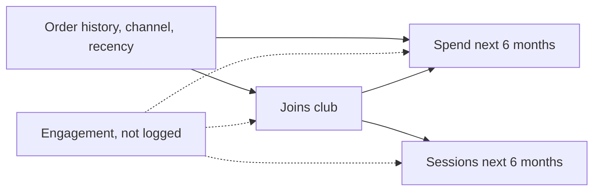
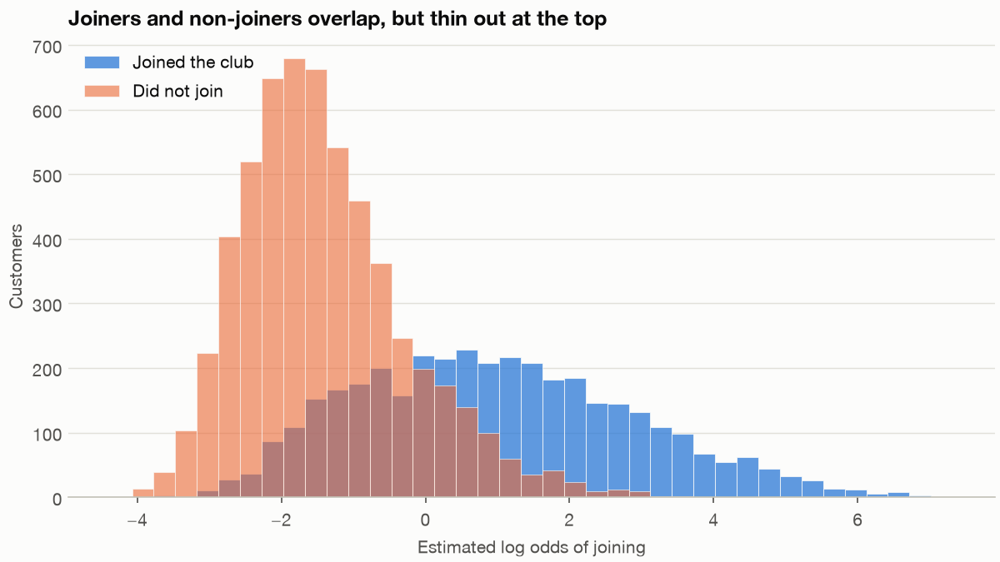
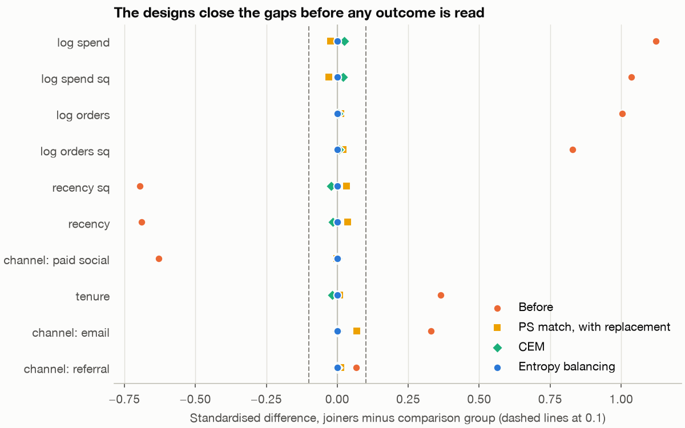
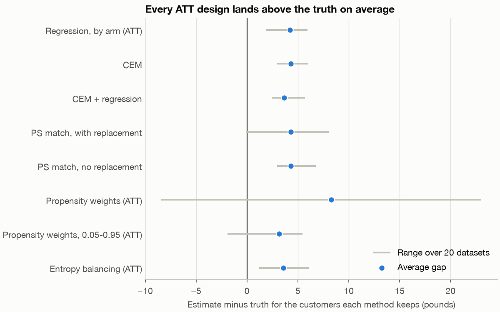

# 5 — Matching and Weighting

Fernhill Home opened a loyalty club on 1 July 2024, and customers chose whether to join. Six months later, members had spent £95.54 more than non-members, and the marketing team would like that number on a slide. The people who join a club were already the keen ones, so the number cannot be the effect of the club. This chapter answers the question six ways on one table, checks that the groups are comparable before looking at any outcome, and then does what real analysis never can: it scores every answer against the truth the generator kept back. The best answers land near £26 when the truth is £23.38, and we show where the remaining £3 comes from and which sensitivity checks could and could not have warned you.

---

## The question and the data

Chapter 4 ran propensity weighting on Larkspur's loyalty email, with one covariate and a tidy result. Here the same question has the shape it takes at work: many covariates, poor overlap at one end, an effect that differs between customers, and a confounder nobody logged.

The data is `load_club()` from the [shared retail generator](../../06-applied-analyses/practice/retail.py), the same Fernhill Home used across [Applied Analyses](../../06-applied-analyses/README.md). It has one row per recently active customer on the opening date. The covariates are prior orders, prior spend, days since last order, tenure and acquisition channel. The treatment is `club`, and the outcome is `spend_next_6m`. Columns starting `true_` are hidden truth, which the estimators never see. They appear only in sections of the script marked SCORING. The club spend is an overlay on the generator's order history: it does not feed back into `load_orders`, so it will not reconcile with the order tables used in other chapters.

Two questions could be asked, so name them first. The **ATE** (average treatment effect) is the effect across everyone. The **ATT** (average treatment effect on the treated) is the effect on those who actually joined. They differ here because the club does more for people who already order often, and those are the people who join. "Should we have run this club for the people in it?" is an ATT question, so the ATT is our main target.

```python
def design_matrix(d):
    """Pre-treatment covariates, standardised. No outcome and no true_ column gets in."""
    x = pd.DataFrame({"log_orders": np.log1p(d.prior_orders), "log_spend": np.log1p(d.prior_spend),
                      "recency": d.recency_days.astype(float), "tenure": d.tenure_days.astype(float)})
    x["log_orders_sq"] = x.log_orders ** 2
    x["log_spend_sq"] = x.log_spend ** 2
    x["recency_sq"] = x.recency ** 2
    for c in ["paid_social", "email", "referral"]:
        x[f"ch_{c}"] = (d.channel == c).astype(float)
    return (x - x.mean()) / x.std()
```

## The rule for choosing covariates

Every method below adjusts for a set of covariates, so the set needs a justification. [Chapter 4](04-correlation-and-causation.md#the-backdoor-and-front-door-criteria) states the **backdoor criterion** in full. In short, a set Z works if nothing in Z is a descendant of the treatment and Z blocks every path into the treatment from behind ([Pearl, Glymour and Jewell, *Primer*, Wiley, 2016](https://web.cs.ucla.edu/~kaoru/primer-complete-2019.pdf), Definition 3.3.1, p. 61).

Draw Fernhill's graph as an analyst would, with one honest addition: something about a customer's interest in the brand that no column records.



The rule gives two instructions before any code runs. Do not put sessions in the set, because the club causes them. And the path through engagement stays open whatever we do, so the logged covariates do not satisfy the criterion. Every estimator below assumes they do. The primer makes the same point for weighting: the weights are "only valid when the set Z entering the factor 1/P(X = x|Z = z) satisfies the backdoor criterion" (§3.6, p. 75). The propensity score is not a way round this. [Rosenbaum and Rubin (Biometrika, 1983)](https://www.stat.cmu.edu/~ryantibs/journalclub/rosenbaum_1983.pdf) show that adjusting for it removes the bias from observed covariates, and they say that the covariates observed need not be all of them.

## Balance first, and no outcome yet

Separate the design from the analysis. Until the groups look comparable, there is no reason to read the outcome, and if you have not read it you cannot tune the design towards the answer you were hoping for.

The usual measure is the **standardised mean difference** (SMD): the treated mean minus the control mean, over the standard deviation in the treated group ([Stuart, Statistical Science, 2010](https://pmc.ncbi.nlm.nih.gov/articles/PMC2943670/)). Unlike a t test, it does not grow with the sample size. Next to it goes the **variance ratio**, treated variance over control variance, since two groups can share a mean and differ in shape.

```python
def smd(X, D, w, sd=None):
    """Standardised mean difference: weighted treated mean minus weighted control mean, over the raw treated SD."""
    sd = X[D == 1].std() if sd is None else sd
    t = np.average(X[D == 1], axis=0, weights=w[D == 1])
    c = np.average(X[D == 0], axis=0, weights=w[D == 0])
    return pd.Series((t - c) / sd, index=X.columns)
```

```text
customers 9456, joined 3746 (39.6%)

Balance before any adjustment (standardised units):
                treated  control   smd  var_ratio
log_orders         0.70    -0.46  1.00       5.02
log_spend          0.65    -0.43  1.12       1.56
recency           -0.37     0.24 -0.69       0.78
tenure             0.24    -0.16  0.36       1.47
log_orders_sq      0.64    -0.42  0.83      10.73
log_spend_sq       0.66    -0.43  1.03       2.37
recency_sq        -0.34     0.22 -0.70       0.57
ch_paid_social    -0.29     0.19 -0.63       0.49
ch_email           0.23    -0.15  0.33       1.75
ch_referral        0.04    -0.03  0.07       1.13
```

Joiners sit a full standard deviation above non-joiners on orders and spend. Stuart reports Rubin's (2001) guideline that regression adjustment can be trusted when the absolute SMD is below 0.25 and the variance ratio lies between 0.5 and 2. Nine of the ten covariates fail on SMD and four fail on variance ratio, so a regression here would extrapolate. We use a stricter line of 0.1 for the designs below.

## Overlap

The **propensity score** is the probability of joining given the covariates. We fit it with a logistic regression and look at the two distributions. Matching and weighting can only compare customers who could plausibly have gone either way, and the region where both groups exist is the **common support**.

```python
def propensity(X, D):
    return sm.Logit(D, sm.add_constant(X)).fit(disp=0).predict(sm.add_constant(X)).to_numpy()
```

```text
Estimated propensity: treated 0.024 to 0.999, control 0.012 to 0.997
Treated above the highest control score: 29; controls with score over 0.9: 40; treated with score over 0.9: 970
```



The chart is the warning for the rest of the chapter. There are 970 joiners with a score above 0.9, and only 40 non-joiners to stand in for them. Any method that keeps all the joiners must lean hard on those 40, and any method that does not lean on them has to drop joiners, which changes the question. [Hernán and Robins (*What If*, §15.4)](https://miguelhernan.org/whatifbook) note the catch: "individuals do not come with a propensity score tattooed on their forehead", so when you restrict, use real variables such as age to say who is left.

## Six ways to build a comparison group

Each design below returns a weight per customer, and none of them reads the outcome. **Regression adjustment**, the sixth way, needs no design step, and we come back to it when we read the outcome.

### Exact and coarsened exact matching

**Exact matching** compares a joiner only with non-joiners who have the same value on every covariate. On every covariate, it found no matches at all for any of the 3,746 joiners, because prior spend and recency are close to continuous. On channel and prior orders only, it keeps most joiners and leaves everything else out of balance.

**Coarsened exact matching** (CEM) is the repair. Coarsen each variable into bins you could defend to a colleague, match exactly on the bins, and throw away any stratum that lacks one group or the other ([Iacus, King and Porro, Political Analysis, 2012](https://gking.harvard.edu/files/political_analysis-2011-iacus-pan_mpr013.pdf)). The appeal is that the analyst sets the largest allowed imbalance up front by choosing the bins, rather than finding out afterwards. Common support is enforced automatically. In a stratum, each joiner gets weight 1 and each non-joiner gets a weight that makes the stratum's two groups count equally (their equation 6).

```python
def stratum_weights(strata, D):
    """Exact matching on a stratum label, weighted as in Iacus, King and Porro (2012), equation 6."""
    s = pd.DataFrame({"s": strata, "D": D})
    n = s.groupby("s").D.agg(["sum", "count"])
    n["ctrl"] = n["count"] - n["sum"]
    n = n[(n["sum"] > 0) & (n.ctrl > 0)]
    mT, mC = n["sum"].sum(), n.ctrl.sum()
    keep = s.s.isin(n.index).to_numpy()
    w = np.zeros(len(s))
    w[keep & (D == 1)] = 1
    ratio = (mC / mT) * (n["sum"] / n.ctrl)
    w[keep & (D == 0)] = s.s[keep & (D == 0)].map(ratio).to_numpy()
    return w


def cem_strata(d):
    """Coarsen by choices a retailer could defend, then glue the bins into one label."""
    orders = pd.cut(d.prior_orders, [0, 1, 2, 3, 5, 9, np.inf], labels=False)
    spend = pd.cut(d.prior_spend, [-1, 25, 50, 75, 100, 150, 200, 300, 500, np.inf], labels=False)
    recency = pd.cut(d.recency_days, [-1, 30, 60, 90, 180, 270, np.inf], labels=False)
    tenure = pd.cut(d.tenure_days, [-1, 90, 180, 365, np.inf], labels=False)
    return (d.channel.astype(str) + "|" + orders.astype(str) + "|" + spend.astype(str) + "|"
            + recency.astype(str) + "|" + tenure.astype(str)).to_numpy()
```

### Nearest-neighbour propensity matching

Pair each joiner with the non-joiner nearest on the log odds of joining, and refuse any pair further apart than a **caliper**. We use 0.2 standard deviations of the log odds. Without replacement, each non-joiner is used once. With replacement, one non-joiner can serve many joiners, which keeps more joiners and costs precision.

```python
def nearest_neighbour(lp, D, caliper, replace, seed=SEED):
    """1:1 nearest neighbour on the log odds. Returns weights and the matched pairs."""
    t, c = np.flatnonzero(D == 1), np.flatnonzero(D == 0)
    w, pairs = np.zeros(len(D)), []
    if replace:
        c = c[np.argsort(lp[c])]
        hi_i = np.searchsorted(lp[c], lp[t]).clip(1, len(c) - 1)
        nearest = np.where(np.abs(lp[c][hi_i - 1] - lp[t]) <= np.abs(lp[c][hi_i] - lp[t]), hi_i - 1, hi_i)
        ok = np.abs(lp[c][nearest] - lp[t]) <= caliper
        w[t[ok]] = 1
        np.add.at(w, c[nearest[ok]], 1)
        return w, np.c_[t[ok], c[nearest[ok]]]
    free = np.ones(len(c), bool)
    for i in np.random.default_rng(seed).permutation(t):
        gaps = np.abs(lp[c] - lp[i])
        gaps[~free] = np.inf
        j = gaps.argmin()
        if gaps[j] <= caliper:
            free[j] = False
            w[i], w[c[j]] = 1, 1
            pairs.append((i, c[j]))
    return w, np.array(pairs)
```

### Propensity weighting

This is the method from [chapter 4](04-correlation-and-causation.md#propensity-weighting). For the ATT, every joiner gets weight 1 and every non-joiner gets p/(1−p), so non-joiners who look like joiners count for more. A non-joiner with a score of 0.997 counts as about 330 people.

### Entropy balancing

Propensity weighting models who joined and hopes that balance follows. **Entropy balancing** skips the model: it asks directly for the weights on the non-joiners that make their covariate means equal the joiners' means exactly, while staying as close to equal weights as possible ([Hainmueller, Political Analysis, 2012](https://www.mit.edu/~jhainm/Paper/eb.pdf)). The optimisation looks large, but the dual has one parameter per covariate, so `scipy.optimize` handles it in a few lines. Hainmueller warns that limited overlap produces extreme weights, and the method's balance says nothing about what it did to the effective sample size, so check both.

```python
def entropy_balance(C, target):
    """Hainmueller's dual: find the weights nearest to uniform whose moments hit the target exactly."""
    C = C - target
    f = lambda z: np.log(np.exp(-C @ z).sum())
    def grad(z):
        w = np.exp(-C @ z)
        return -(C.T @ (w / w.sum()))
    fit = minimize(f, np.zeros(C.shape[1]), jac=grad, method="BFGS", options={"gtol": 1e-8, "maxiter": 5000})
    w = np.exp(-C @ fit.x)
    return w / w.sum()
```

### Judging the designs

Here is every design on the same scorecard. `control_eff_n` is the effective number of controls, (Σw)² / Σw², which says how many equally weighted customers the weights are worth.

```text
Designs, judged before any outcome is read:
                            treated_kept  controls_used  control_eff_n  max_control_wt_share  max_abs_smd  n_over_.1
design
Exact: every covariate                 0              0              0                 0.000          NaN          0
Exact: channel and orders           3369           5710            696                 0.011        0.433          5
CEM                                 2202           5342           1106                 0.011        0.024          0
PS match, with replacement          3682           1462            246                 0.031        0.069          0
PS match, no replacement            1972           1972           1972                 0.001        0.018          0
Propensity weights                  3746           5710            107                 0.086        0.167          2
Entropy balancing                   3746           5710            267                 0.043        0.000          0
```



This chart is a **Love plot**: one row per covariate and one mark per design, with the before-and-after visible at a glance. Read the table with it, because it shows the trade that the plot hides.

- Exact matching on channel and orders fails on balance, with recency still 0.43 apart. On this evidence alone, you would reject it before reading the outcome.
- CEM and no-replacement matching have the best balance among those that drop joiners, and they keep only 59% and 53% of joiners.
- Propensity weighting keeps everyone, leaves two covariates over the line, and gives one non-joiner 8.6% of all control weight. Its 5,710 controls are worth 107.
- Entropy balancing keeps everyone with no imbalance at all on these ten covariates, and its controls are worth 267.

## Now read the outcome

The last of the six is **regression adjustment**: model spend on the covariates. We fit it two ways: one coefficient on `club`, and a separate model per arm, which lets the effect vary and so can target the ATE or the ATT. The one-coefficient model targets neither cleanly, and it is what most analysts run. Below, we score it against the ATE for want of a better target.

```text
One dataset, every estimator (pounds over six months):
                                       targets estimate
Naive difference                           ATT    95.54
Regression, one coefficient               none    17.59
Regression, by arm (ATE)                   ATE    18.21
Regression, by arm (ATT)                   ATT    26.44
Exact: channel and orders            local ATT    32.06
CEM                                  local ATT    20.96
CEM + regression                     local ATT    20.19
PS match, with replacement           local ATT    22.74
PS match, no replacement             local ATT    18.26
Propensity weights (ATE)                   ATE    14.82
Propensity weights (ATT)                   ATT    18.75
Propensity weights, 0.05-0.95 (ATT)  local ATT    20.73
Entropy balancing (ATE)                    ATE    18.62
Entropy balancing (ATT)                    ATT    26.49
```

Adjusting removes about £70 of the £95.54. The remaining estimates run from £15 to £32, and a stakeholder would ask which one is right. Most of that spread has nothing to do with bias, as the `targets` column hints.

## Scoring against the truth

An analyst never gets the next table. The generator knows each customer's spend with and without the club, so it can give the true effect for whichever customers each method kept.

```text
SCORING. True ATE 15.96, true ATT 23.38, true ATC 11.10
                                       targets estimate  truth    gap
Naive difference                           ATT    95.54  23.38  72.16
Regression, one coefficient               none    17.59  15.96   1.63
Regression, by arm (ATE)                   ATE    18.21  15.96   2.24
Regression, by arm (ATT)                   ATT    26.44  23.38   3.06
Exact: channel and orders            local ATT    32.06  20.85  11.21
CEM                                  local ATT    20.96  17.31   3.64
CEM + regression                     local ATT    20.19  17.31   2.88
PS match, with replacement           local ATT    22.74  22.86  -0.11
PS match, no replacement             local ATT    18.26  15.32   2.94
Propensity weights (ATE)                   ATE    14.82  15.96  -1.15
Propensity weights (ATT)                   ATT    18.75  23.38  -4.63
Propensity weights, 0.05-0.95 (ATT)  local ATT    20.73  19.62   1.11
Entropy balancing (ATE)                    ATE    18.62  15.96   2.65
Entropy balancing (ATT)                    ATT    26.49  23.38   3.11
```

### Different methods answer different questions

CEM's £20.96 and the no-replacement match's £18.26 look far below the £26 from entropy balancing. They are not disagreeing about the club's effect. CEM dropped 41% of joiners, and the true effect for the customers it kept is £17.31, against £23.38 for all joiners. The no-replacement match kept the 53% with the true effect of £15.32. Since the club does more for frequent buyers, dropping them moves the target down. Measured against their own targets, all three miss by about £3.

Iacus, King and Porro call the result of pruning treated units a local SATT and ask authors to be transparent about it (§2.6). Hainmueller's reason for keeping every treated unit is the same (§3.5). The trap is that £18.26 happens to look close to the true ATE of £15.96, which it is not estimating. So a report of a matched estimate must say who was kept.

### One dataset is one draw

Propensity matching with replacement looks perfect at −£0.11, and propensity weighting looks low at −£4.63. To see how much of that is luck, we generate 19 more customer bases. `load_club(seed=s)` redraws the customers and everything downstream, so these are new datasets, with 9,108 to 9,482 customers.

```text
SCORING. Gap from the truth for each estimator's own target, over 20 generated datasets:
                                     mean_gap  se_of_mean  sd_across_runs   rmse
Naive difference                        73.25        0.24            1.09  73.26
Regression, one coefficient              2.50        0.16            0.72   2.60
Regression, by arm (ATE)                 3.11        0.17            0.77   3.19
Regression, by arm (ATT)                 4.20        0.27            1.21   4.36
Exact: channel and orders               13.99        0.38            1.70  14.08
CEM                                      4.29        0.20            0.91   4.38
CEM + regression                         3.64        0.20            0.89   3.74
PS match, with replacement               4.31        0.54            2.42   4.92
PS match, no replacement                 4.30        0.20            0.88   4.38
Propensity weights (ATE)                 5.70        0.89            3.97   6.89
Propensity weights (ATT)                 8.27        1.74            7.76  11.21
Propensity weights, 0.05-0.95 (ATT)      3.15        0.43            1.91   3.66
Entropy balancing (ATE)                  3.36        0.15            0.69   3.42
Entropy balancing (ATT)                  3.59        0.30            1.36   3.82
```



Four things stand out.

1. **Every design lands high.** That is the signature of a shared bias, and no amount of method choice removes it. The sound ATT designs average £3.15 to £4.31 above their truth. When we planned this chapter we expected £4 to £6, so the bias is somewhat smaller than our story, and the qualitative point stands.
2. **The perfect score was luck.** Matching with replacement averages £4.31 like the others, and its −£0.11 is a good draw from a spread with a standard deviation of £2.42.
3. **Plain propensity weights are the worst sound option here**, because their effective sample is so small: the mean gap is £8.27 and the standard deviation £7.76, and one dataset misses by more than £20. That −£4.63 on the first dataset was noise pointing the wrong way. It was not evidence that the method beats the bias. Trimming to scores between 0.05 and 0.95 brings the gap down to £3.15, at the price of changing the target.
4. **Entropy balancing and regression by arm are close**, and both are far steadier than the other two designs that keep nearly all joiners, matching with replacement and plain weights. With a different overlap, the ranking could change. Twenty datasets from one generator do not make a general ranking of methods.

## Where the £3 comes from

The generator lets us run the world an analyst wishes for: the same estimators, with the unlogged `true_engagement` added to the covariates. To test a second suspect, we also redraw spend from the generator's published equation with and without its floor at zero. The floor exists because spend without the club cannot be negative, so the true relationship between covariates and spend is not linear at the low end.

```text
SCORING. ATT gap by world and adjustment set, mean over 20 datasets (standard error of the mean in brackets):
                                            regression      entropy      weights
world               adjust
generator's table   observed                4.2 (0.27)   3.59 (0.3)  8.27 (1.74)
                    observed + engagement  1.19 (0.29)  0.15 (0.34)  3.01 (2.29)
redrawn, with floor observed               4.55 (0.36)  3.48 (0.52)  8.23 (1.85)
                    observed + engagement  1.51 (0.37)   0.07 (0.6)  3.34 (2.22)
redrawn, no floor   observed               4.23 (0.35)  3.73 (0.53)  8.44 (1.85)
                    observed + engagement  0.39 (0.37)   0.13 (0.6)  3.38 (2.22)
Floor minus no floor, same customers and same noise, paired over 20 datasets (standard error in brackets):
                        regression       entropy       weights
observed               0.32 (0.04)  -0.25 (0.02)  -0.21 (0.02)
observed + engagement  1.12 (0.05)  -0.06 (0.02)  -0.04 (0.02)

Engagement gap in SD over 20 datasets: before 0.29, after entropy balancing 0.48 (SE 0.02)
Planted 8 pounds per SD times that gap = 3.81, against the mean entropy gap 3.59
```

So the gap has a named cause, and we can split it.

- **Most of it is the hidden confounder.** Add engagement and entropy balancing's gap falls from £3.59 to £0.15, inside its standard error.
- **The floor matters for regression only, and only once engagement is in.** With engagement included, regression's remaining £1.19 is mostly the floor: the paired difference is £1.12 (standard error 0.05), and without the floor the gap is £0.39. A linear model is the wrong shape for floored spend. Entropy balancing doesn't model the outcome, so the floor barely touches it. For the observed covariates, the floor moves each estimator by £0.21 to £0.32 and is not what is keeping them high.
- **Plain weights stay noisy either way.** Their £3.01 with engagement has a standard error of 2.29, which is not distinguishable from zero.

The third line of arithmetic is the most useful. Omitted-variable bias is approximately the effect of the hidden trait on spend multiplied by how far out of balance it stays: £8 per SD times 0.48 SD gives £3.81, close to the £3.59 we measured.

Note also that the imbalance got worse. Engagement differed by 0.29 SD before adjustment and 0.48 after. Balancing the logged history moved the groups further apart on the thing nobody logged. A plausible reading is that once history accounts for much of who joins, the hidden trait explains more of the choice that remains. We measured the change but did not prove that mechanism. In this data, then, adjustment shrinks the visible imbalance and grows the invisible one, and a perfect Love plot says nothing about it. Iacus, King and Porro say as much of their own method: CEM will not rescue an analysis that leaves out an important covariate, unless that covariate is closely related to one that was matched on (§7).

## The bad control that helped

`sessions_next_6m` is measured after the club opens and the club raises it, so the backdoor criterion excludes it. We expected adding it to make things worse. It did the opposite.

```text
SCORING. Bad control. Regression ATT without sessions_next_6m 26.44, with it 24.17; truth 23.38
One-coefficient regression without it 17.59, with it 15.62; true ATE 15.96
Entropy balancing ATT without it 26.49, with it 24.59
Regression ATT gap over 20 datasets: {'without': 4.2, 'with': 2.01}
Mediator world, 14.1 pounds per session, true ATT 23.38: regression without sessions 31.60, with sessions 0.79
```

The gap halves, from £4.20 to £2.01. Sessions are partly caused by engagement, so they act as a proxy for the confounder, and in this generator sessions do not cause spend, so controlling for them blocks nothing of the effect. An analyst could look at this and conclude that the rule is too cautious.

The last line shows why the rule stands. We built a second world from the same customers, where the club works *through* sessions: spend gains £14.10 per session, and the true ATT is the same £23.38. The same control now takes the estimate to £0.79 and erases almost all of a real effect. (Without the control it reads £31.60, because engagement now also pushes spend through sessions, so the hidden bias is larger.)

The data can't tell these worlds apart: both have a column that moves with the club and with spend. Whether adding it helps or destroys the answer depends on the arrow from sessions to spend, which the analyst has to assume. A pre-treatment proxy for engagement, such as sessions before the opening date, gives the benefit without the risk. Fernhill's table does not have one, so the better fix is a change to what gets logged.

## DoWhy as the cross-check

[DoWhy](https://www.pywhy.org/dowhy/) implements the same estimators, so it can catch a mistake in hand-written code. It did the opposite first: it surfaced two behaviours of its own that we had to understand.

```text
DoWhy 0.14. Backdoor set: 10 variables
  linear regression          ate     17.59
  weighting, defaults        ate     26.02
  weighting, defaults        att     39.24
  weighting, clipping off    ate     14.03
  weighting, clipping off    att     17.01
  matching                   att     23.47
  stratification             att     20.60
  by hand, scores clipped to 0.05-0.95: ATE 26.00, ATT 39.42; balance after clipped ATT weights, largest |SMD| 0.21
  by hand, matching with no caliper, on log odds: 23.66, on the score: 23.83
  random common cause refuter: 17.59 becomes 17.59
  placebo treatment refuter: 17.59 becomes 0.18
```

- Linear regression matches our one-coefficient model exactly.
- DoWhy's weighting estimator by default **clips** scores to 0.05–0.95 (read in its source). It keeps every customer and caps their weight, which is different from the trimming above, which drops them. Capping undercounts the high-score non-joiners, who are the big spenders, so the control mean falls and the ATT rises to £39.24. Clipping by hand reproduces it at £39.42. Turning the clip off gives £17.01 against our £18.75. DoWhy's default score model is scikit-learn's regularised logistic regression, which is the likely source of that remaining difference, though we did not test it separately.
- DoWhy writes the clipped score into the model's data frame, and the next estimator reuses it. In our first run, on one shared model, matching read £26.58 and stratification £27.60. With a fresh frame per estimator they read £23.47 and £20.60. Build a new model for each estimator.
- Matching without a caliper agrees with our hand version to within £0.40. Stratification has no direct counterpart here and we did not score it.

**Both refuters passed**, on an estimate we know is biased. The random common cause and placebo tests can catch a broken pipeline, but neither can see a confounder missing from the data. `proceed_when_unidentifiable=True`, in the script's `identify_effect` call, is where the analyst assumes that nothing is missing.

## Sensitivity: what would it take?

Nothing in the observed data reveals engagement, so the last step asks how strong a hidden trait would have to be. We ran three checks, and they have to be read for what they actually claim.

### The E-value

The **E-value** is the minimum association, on the ratio scale, that a hidden confounder would need with both treatment and outcome, above the measured covariates, to explain the result away ([VanderWeele and Ding, Annals of Internal Medicine, 2017](https://doi.org/10.7326/M16-2607); definition as restated by [Mathur et al., Epidemiology, 2018](https://pmc.ncbi.nlm.nih.gov/articles/PMC6066405/)). For a ratio RR above 1 it is RR + √(RR(RR−1)). Spend is non-negative rather than a risk, and [Ding and VanderWeele (Epidemiology, 2016)](https://pmc.ncbi.nlm.nih.gov/articles/PMC4820664/) cover that case by reading the confounder-outcome association as the largest ratio by which the confounder could increase expected spend. So we apply it to the ratio of means.

```text
Entropy balancing ATT 26.49, bootstrap 95% interval 20.81 to 29.81
Ratio of means 136.13 / 109.64 = 1.242, bootstrap lower limit 1.181
E-value for the estimate 1.79, for the interval's lower limit 1.64
```

To reduce the effect to nothing, a hidden trait would need a ratio of at least 1.79 with joining and at least 1.79 with expected spend, over and above the ten covariates. The interval, as it happens, covers the truth, but it measures sampling noise only and carries no allowance for bias.

### Rosenbaum bounds

**Rosenbaum bounds** work on matched pairs. Suppose a hidden trait could make one member of a pair up to Γ times as likely in odds to join as the other. The bound then asks how large Γ must be before the signed-rank test of no effect could lose significance ([Liu, Kuramoto and Stuart, Prevention Science, 2013](https://pmc.ncbi.nlm.nih.gov/articles/PMC3800481/)). The arithmetic is short: at worst, each pair's sign is positive with probability Γ/(1+Γ), and a normal approximation to the Wilcoxon statistic does the rest. In R, [rbounds](https://cran.r-project.org/package=rbounds) has `psens` for this.

```python
def wilcoxon_upper_p(diff, gamma):
    """Upper bound on the one-sided signed-rank p value when hidden bias can tilt each pair's odds by gamma."""
    diff = diff[diff != 0]
    r = rankdata(np.abs(diff))
    stat = r[diff > 0].sum()
    pplus = gamma / (1 + gamma)
    return norm.sf((stat - pplus * r.sum()) / np.sqrt(pplus * (1 - pplus) * (r ** 2).sum()))
```

```text
Rosenbaum bounds on 1972 matched pairs (treated minus control, mean 18.26, median 17.59):
1.00    0.0000
1.25    0.0000
1.50    0.0000
1.75    0.0000
2.00    0.0000
2.50    0.4058
3.00    0.9983
Smallest gamma with upper p above 0.05: 2.35
```

The test of no effect holds until Γ reaches 2.35, so a hidden trait would have to shift the odds of joining within a pair by more than that to overturn it, on this bound's assumptions.

### The arithmetic you can do on a whiteboard

The third check is the one from the previous section, run forwards: bias ≈ γ × δ, where γ is the hidden trait's pounds per SD and δ is the imbalance that remains. A grid shows what combinations matter, and the observed covariates provide a benchmark for what counts as large.

```text
ATT if a hidden trait moves spend by gamma pounds per SD and stays delta SD out of balance after weighting:
          delta 0.1  delta 0.25  delta 0.5  delta 1
gamma 5        26.0        25.2       24.0     21.5
gamma 10       25.5        24.0       21.5     16.5
gamma 20       24.5        21.5       16.5      6.5
gamma 30       23.5        19.0       11.5     -3.5

Benchmarks from what is observed, control-group spend per SD of each main covariate, and its imbalance before weighting:
                pounds_per_sd  smd_before
log_orders              34.72        1.00
log_spend                8.68        1.12
recency                -12.02       -0.69
tenure                   0.02        0.36
ch_paid_social          -2.55       -0.63
ch_email                 1.31        0.33
ch_referral              0.73        0.07
```

Benchmark with care. Covariates are correlated, so these coefficients share credit. Still, a hidden trait about as strong as prior orders and fully out of balance would remove the effect. One like recency, at half an SD out of balance, leaves about £20.

### How the checks score

Now the part an analyst never sees: the planted confounder against each check.

```text
SCORING. Engagement imbalance in SD: before 0.32, after entropy balancing 0.52
Planted gamma 8.0 times remaining delta 0.52 = 4.16; actual gap 3.11
True ratio of means 1.207. E-value to move the estimate to the null 1.79, to the truth 1.20
Hidden odds ratio inside matched pairs from engagement: median 1.68, 90th percentile 3.34, 99th 6.38
```

- **The E-value and the Rosenbaum bound answered a question that wasn't the one that mattered.** Both ask what it takes to erase the effect entirely. They returned 1.79 and 2.35, and the honest reading is "the club probably does something". The real bias overstated the effect by about 15%, and moving the estimate to the truth needs an E-value of just 1.20. A confounder with associations as weak as that is entirely plausible, so a "robust" E-value of 1.79 gives no assurance about the size. To ask about the size, compute the E-value for a smaller effect you would care about.
- **Γ is a worst case, and exceeding it does not mean the effect is gone.** Engagement pushed the odds within matched pairs by a median of 1.68, and by 3.34 at the 90th percentile, which is more than Γ = 2.35. Yet the true effect is well above zero. This form of the bound varies only the confounder's link with treatment and sets its link with the outcome at infinity (Liu et al.), so it describes a trait that also fully decides the outcome's direction in each pair. Engagement does not.
- **γ × δ got the size right**: £4.16 against £3.11 on this dataset, and £3.81 against £3.59 on average. But it did so with the true γ and δ plugged in. An analyst has to guess them, and the grid shows only what follows from a guess.

Report the estimate, the balance table, who was kept, and these checks together. Say that the estimate assumes nothing important was left unlogged, and say which trait you worry about.

## Pitfalls

| Pitfall | What goes wrong | Fix |
|---|---|---|
| Choosing the design after reading the outcome | You pick whichever method confirms the hoped-for answer, and the spread here was £15 to £32 | Fix the design on balance alone, then read the outcome once |
| Reporting a balance table as proof of no bias | Love plot perfect, and the estimate still about £3.60 high; hidden imbalance rose from 0.29 to 0.48 SD | Balance covers observed covariates only. Say so |
| Comparing a local ATT with an ATT | CEM's £20.96 and entropy balancing's £26.49 look like disagreement, but they target different customers | Report who was kept, and describe them |
| Trusting a large control count | 5,710 weighted controls were worth 107 | Report the effective sample and the largest weight |
| Library defaults | DoWhy's clipping turned £18.75 into £39.24 | Read what the estimator does; replicate one number by hand |
| Treating one dataset's success as evidence | Matching with replacement scored −£0.11 by luck | Use a simulation with known truth to judge a method; a single real dataset can't |
| Adjusting for something measured after treatment | Sessions halved the bias in one world and erased the effect in another | Pre-treatment covariates only, or a pre-treatment proxy |
| Treating a passed refuter as a validity check | DoWhy's placebo and random cause tests both passed on a biased estimate | They find pipeline errors. They cannot see a missing confounder |
| "E-value of 1.79, so it's robust" | Real bias of 15% needed an E-value of only 1.20 | State what the check refutes: a zero effect, or an effect of a given size |

## Try it

Exercises 1 to 3 have answers printed at the end of [ch05_matching_weighting.py](../practice/ch05_matching_weighting.py).

1. Change the caliper for no-replacement matching to 0.05, 0.5 and 1.0 SD. What happens to the joiners kept, the balance and the gap?

<details><summary>Answer</summary>

```text
Try it 1. Caliper width against who is kept, no replacement:
  caliper 0.05 SD: treated kept 1942, estimate 17.25, truth for those kept 15.16, largest |SMD| 0.016
  caliper 0.20 SD: treated kept 1972, estimate 18.26, truth for those kept 15.32, largest |SMD| 0.018
  caliper 0.50 SD: treated kept 2138, estimate 22.61, truth for those kept 15.96, largest |SMD| 0.079
  caliper 1.00 SD: treated kept 2512, estimate 34.46, truth for those kept 17.36, largest |SMD| 0.248
```

A narrower caliper barely changes who is kept, because without replacement the limit is the supply of non-joiners with high scores. Widening it keeps more joiners, but they are paired with weaker matches: at 1.0 SD the gap is about £17 and the largest SMD is 0.25. The balance column warned about this before any outcome was read.
</details>

2. Pretend prior orders were never logged: drop `log_orders` and its square from entropy balancing. What happens to the estimate? Does γ × δ predict the move?

<details><summary>Answer</summary>

```text
Try it 2. Hide prior orders from entropy balancing, as if it had never been logged:
  ATT 32.93 against 26.49 with it; log_orders left out of balance by 0.21 SD
  benchmark 34.72 pounds per SD times that gap = 7.16
```

The estimate rises by £6.44, and the arithmetic predicts £7.16. The match is reasonable because spend and the channel are in the set and already absorb much of the hidden gap, leaving only 0.21 SD out of the original 1.00. This is the experiment a sensitivity analysis imagines, run on a variable you can actually see.
</details>

3. Compute the E-value by hand for a ratio of 1.10 and of 2.00. What do you notice about small effects?

<details><summary>Answer</summary>

```text
Try it 3. E-value for a ratio of 1.10: 1.43; for a ratio of 2.00: 3.41
```

1.10 + √(1.10 × 0.10) = 1.43, and 2 + √(2 × 1) = 3.41. A 10% effect can be explained away by a confounder with associations of 1.43 with both joining and spend, far weaker than the 3.41 needed for a doubling. Small effects are the ones most exposed to hidden bias.
</details>

4. Apply the backdoor criterion to Fernhill's graph. Should tenure go in the set? Sessions before the club opened? Sessions after it? Whether a customer used a club discount?

<details><summary>Answer</summary>

Tenure is pre-treatment, and including it can't open a path unless it is a collider, so it is likely harmless, and its benchmark of £0.02 per SD among controls suggests it does little. Pre-club sessions are pre-treatment and a proxy for engagement, so they belong in the set if you can get them. Later sessions are a descendant of the treatment, so they fail the criterion. So does discount use, which only members can have, and which therefore is also a violation of overlap: no non-member has a discount to match on.
</details>

## Interview checklist

| Question | Answer |
|---|---|
| Why check balance before reading the outcome? | It lets you fix the design without being able to steer towards an answer |
| What is a standardised mean difference, and why not a t test? | The mean gap over the treated SD. It doesn't grow with n, so it measures imbalance rather than sample size |
| What is the propensity score? | P(treated given X). Adjusting for it removes bias from the observed covariates, not from unobserved ones |
| Matching or weighting? | Matching drops units and can change the target. Weighting keeps units and can lose effective sample. Look at balance, overlap and effective n |
| What does a caliper do? | Refuses poor matches, trading bias for dropped treated units, and so moves the target |
| What is CEM's appeal? | The analyst sets the largest imbalance up front through the bins, and support is automatic. It needs a lot of data |
| What does entropy balancing do? | It finds the weights closest to uniform that match the treated group's moments exactly. Limited overlap shows up as extreme weights |
| ATE, ATT, local ATT? | Everyone; those treated; those treated who were kept. When effects vary, they are different numbers |
| Why not put everything in the model? | Post-treatment variables can erase the effect, and colliders can create bias. Use the backdoor criterion |
| What does an E-value of 1.79 mean? | A hidden confounder would need associations of at least 1.79 with both treatment and outcome to remove the effect. It says nothing about smaller biases |
| What does Γ = 2.35 mean? | The signed-rank test of no effect survives hidden bias of up to 2.35 in the odds of treatment within a pair, in the worst case |
| Can DoWhy's refuters detect an unobserved confounder? | No. Placebo and random-cause tests check the pipeline. They both passed here on a biased estimate |
| Which method do you trust when all of them land high? | None more than the others: a shared bias is an assumption failure, which better covariates fix and better estimators don't |

## Further reading

[*The Effect*, chapter 14](https://theeffectbook.net/ch-Matching.html) and [Facure's handbook](https://matheusfacure.github.io/python-causality-handbook/10-Matching.html) cover this ground at a gentler pace, and Stuart's review is the map of the matching literature. Everything is listed in [references](../references.md).

---

## Next

[Bayesian inference](../../04-bayesian-analysis/notes/01-bayesian-inference.md) opens the next pillar with a different way of answering "what do the data say": probability as belief, priors and posteriors, and the first PyMC models.
