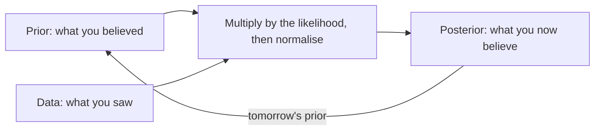
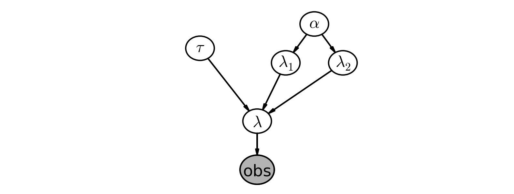

# 1 — Bayesian Inference

Larkspur's checkout test ended with a lift of 0.64 points and a p-value of 0.00003 ([A/B testing](../../03-experimentation-and-causality/notes/01-ab-testing.md)). The head of product then asks the obvious question: so how likely is it that the new checkout is better? The p-value cannot say. It is the probability of data this extreme if the two checkouts were equal, and that is a statement about data, assuming a hypothesis. She wants the reverse, a statement about the hypothesis, given the data. Getting from one to the other takes one extra ingredient, what you believed before you looked, and one line of algebra. This chapter is that ingredient and that line, worked through a coin, a phone bill, a survey nobody wants to answer honestly, a launch decision and a count of enemy tanks.

## Two views of probability

The two schools disagree about what a probability is, and everything else follows.

| | Frequentist ([statistics pillar](../../02-probability-and-statistics/README.md)) | Bayesian (this pillar) |
|---|---|---|
| Probability is | long-run frequency of an event | degree of belief in an event |
| Parameters are | fixed, unknown constants | random variables with distributions |
| Output | point estimate, confidence interval, p-value | posterior distribution, credible interval |
| A 95% interval means | 95% of intervals built this way contain the true value | 95% probability the value is in this interval, given model and data |
| Prior knowledge | not formally used | encoded as the prior |
| Small N | wide intervals, unstable tests | prior regularises; posterior stays honest about uncertainty |
| Large N | | converges to the frequentist answer, because the likelihood swamps the prior |

*Bayesian Methods for Hackers* (BMH) frames the split this way: the frequentist asks how often data like this would turn up if the null were true, and the Bayesian asks what to believe given the data ([Davidson-Pilon, ch. 1](https://github.com/CamDavidsonPilon/Probabilistic-Programming-and-Bayesian-Methods-for-Hackers)). Both are useful. Bayesian methods earn their extra machinery when N is small, when you hold real prior knowledge, or when the decision needs a probability, as the head of product's does.

Every example here runs on the same versions, and a run takes seconds.

```python
import numpy as np, pymc as pm, arviz as az
from scipy import stats
SAMPLE = dict(chains=4, cores=1, progressbar=False, random_seed=7)
```

```python
print("pymc", pm.__version__, "arviz", az.__version__)
```

```text
pymc 6.4.0 arviz 1.3.0
```

## Bayes' theorem

Bayes' theorem is the conditional-probability identity from [the statistics pillar](../../02-probability-and-statistics/README.md), read as a rule for changing your mind:

```text
P(A | X) = P(X | A) · P(A) / P(X)

posterior ∝ likelihood × prior
```



The loop in the diagram matters. Today's posterior is tomorrow's prior, so belief accumulates across experiments without any special machinery.

BMH's example makes it concrete. Your code passes all its tests (X). What is the probability it has no bugs (A)? Let p = P(A) be your prior. Bug-free code always passes, so P(X | A) = 1. Suppose buggy code still passes half the time, so P(X | ¬A) = 0.5. Then P(X) = 1·p + 0.5·(1 − p) = 0.5(1 + p), and

```text
P(A | X) = p / (0.5(1 + p)) = 2p / (1 + p)
```

```python
for p in (0.20, 0.50, 0.80):
    print(f"prior {p:.2f}  posterior {2 * p / (1 + p):.2f}")
```

```text
prior 0.20  posterior 0.33
prior 0.50  posterior 0.67
prior 0.80  posterior 0.89
```

Passing the tests raises your belief, but how far depends on where you started. That is the whole method in one line.

## The coin: Beta-Binomial

The cleanest Bayesian model, and the one under every Bayesian A/B test ([chapter 4](04-bayesian-ab-testing.md)).

| Piece | Choice |
|---|---|
| Unknown | θ = P(heads) |
| Prior | θ ~ Beta(α, β); Beta(1, 1) is uniform |
| Likelihood | n heads in N flips ~ Binomial(N, θ) |
| Posterior | θ given data ~ Beta(α + n, β + N − n) |

The Beta prior is **conjugate** to the Binomial: the posterior is another Beta, so no sampling is needed and the update is addition. Read α and β as counts: Beta(α, β) behaves as if you had already seen α − 1 heads and β − 1 tails. BMH's first experiment watches the posterior sharpen as flips of a fair coin arrive.

```python
rng = np.random.default_rng(0)
flips = rng.binomial(1, 0.5, size=500)
for N in (0, 1, 5, 15, 50, 500):
    heads = flips[:N].sum()
    post = stats.beta(1 + heads, 1 + N - heads)     # uniform prior
    lo, hi = post.ppf([0.025, 0.975])
    print(f"N={N:3d} heads={heads:3d}  mean {post.mean():.3f}  95% interval [{lo:.3f}, {hi:.3f}]")
```

```text
N=  0 heads=  0  mean 0.500  95% interval [0.025, 0.975]
N=  1 heads=  1  mean 0.667  95% interval [0.158, 0.987]
N=  5 heads=  2  mean 0.429  95% interval [0.118, 0.777]
N= 15 heads= 10  mean 0.647  95% interval [0.413, 0.848]
N= 50 heads= 29  mean 0.577  95% interval [0.442, 0.707]
N=500 heads=277  mean 0.554  95% interval [0.510, 0.597]
```

At N = 1 the data says "all heads" and the posterior says "probably above a half, but who knows", which is the right response to one flip. By N = 500 the interval is about 0.09 wide, and it still does not contain the true 0.5, by a small margin: a 95% interval misses about one time in twenty, and Bayesian ones are no exception.

The talk repeats the coin with a Beta(4, 4) prior, a mild belief that it is fair, and N = 50 flips, 32 of them heads. The analytic posterior is Beta(36, 22). It then fits the same model in PyMC to show the point of the exercise: MCMC reproduces the closed form when one exists, so you can trust it when one does not ([talk repository](https://github.com/prasoon2211/bayesian_inference_talk)).

```python
post = stats.beta(4 + 32, 4 + 18)                   # Beta(4, 4) prior, 32 heads in 50
print(f"closed form: mean {post.mean():.4f}  sd {post.std():.4f}")
with pm.Model():
    p = pm.Beta("p", 4, 4)
    pm.Binomial("y", n=50, p=p, observed=32)
    idata = pm.sample(1000, tune=1000, **SAMPLE)
draws = idata.posterior["p"].values.flatten()
print(f"NUTS:        mean {draws.mean():.4f}  sd {draws.std():.4f}  ({draws.size} draws)")
```

```text
closed form: mean 0.6207  sd 0.0632
NUTS:        mean 0.6190  sd 0.0638  (4000 draws)
```

Three point summaries of that one posterior are worth separating, because later chapters treat them as different answers to different questions. The **maximum likelihood estimate** ignores the prior. The **maximum a posteriori (MAP)** estimate is the posterior's peak. The **posterior mean** averages over it.

```python
a, b = 36, 22
print(f"MLE {32/50:.3f}  flat-prior MAP {32/50:.3f}")
print(f"Beta(4,4) prior: MAP {(a-1)/(a+b-2):.3f}  mean {a/(a+b):.3f}")
```

```text
MLE 0.640  flat-prior MAP 0.640
Beta(4,4) prior: MAP 0.625  mean 0.621
```

The prior pulls both Bayesian summaries toward 0.5. With a flat prior the posterior is the likelihood rescaled, so its peak is the MLE. That is the first of several places where a frequentist procedure turns out to be a Bayesian one with a particular prior: [chapter 3](03-priors-and-bandits.md) shows ridge and lasso are the same kind of thing.

## What a credible interval buys you

A **credible interval** is an interval of the posterior: 95% of the probability lies inside. It says what people wish a confidence interval said. Numerically, at Larkspur's sample sizes, nobody could tell them apart. On 20 visits they differ in a way you can see:

```python
post = stats.beta(1 + 2335, 1 + 41859 - 2335)        # Larkspur's new checkout
lo, hi = post.ppf([0.025, 0.975])
rate = 2335 / 41859
se = (rate * (1 - rate) / 41859) ** 0.5
print(f"credible   [{lo:.5f}, {hi:.5f}]")
print(f"confidence [{rate - 1.96 * se:.5f}, {rate + 1.96 * se:.5f}]")
small = stats.beta(1 + 1, 1 + 19)                    # 1 conversion in 20 visits
rate = 1 / 20
se = (rate * (1 - rate) / 20) ** 0.5
print(f"1 of 20 credible   [{small.ppf(.025):.3f}, {small.ppf(.975):.3f}]")
print(f"1 of 20 confidence [{rate - 1.96 * se:.3f}, {rate + 1.96 * se:.3f}]")
```

```text
credible   [0.05363, 0.05802]
confidence [0.05358, 0.05798]
1 of 20 credible   [0.012, 0.238]
1 of 20 confidence [-0.046, 0.146]
```

The Wald confidence interval for 1 conversion in 20 goes below zero, which no conversion rate can do. The credible interval cannot leave [0, 1], because the posterior lives there. So the difference between the two views shows up in two places: the sentence you may say about the interval, and the behaviour at small N.

## Thinking in generative stories

BMH's method for building any model is to write the story of how the data could have been generated, from the top down, then translate each line into a distribution. If you can simulate fake data from the story, you can fit it.

BMH's first example is one user's text messages: daily counts over 74 days. Did the rate change at some point?

| Story | Distribution |
|---|---|
| Texts on day i | C_i ~ Poisson(λ_i) |
| Rate before day τ is λ₁, after is λ₂ | λ_i = λ₁ if i < τ else λ₂ |
| Rates are positive, near the observed mean | λ₁, λ₂ ~ Exponential(1 / mean(counts)) |
| The switch could be any day | τ ~ DiscreteUniform(0, n_days − 1) |


*Image Source: Davidson-Pilon, Bayesian Methods for Hackers, ch. 2 (MIT)*

The model code reads like the table, and the counts are the book's own `txtdata.csv`.

```python
count_data = np.array([
    13, 24, 8, 24, 7, 35, 14, 11, 15, 11, 22, 22, 11, 57, 11, 19, 29, 6, 19, 12,
    22, 12, 18, 72, 32, 9, 7, 13, 19, 23, 27, 20, 6, 17, 13, 10, 14, 6, 16, 15,
    7, 2, 15, 15, 19, 70, 49, 7, 53, 22, 21, 31, 19, 11, 18, 20, 12, 35, 17, 23,
    17, 4, 2, 31, 30, 13, 27, 0, 39, 37, 5, 14, 13, 22])
n_days = len(count_data)
alpha = 1.0 / count_data.mean()
with pm.Model() as sms:
    lambda_1 = pm.Exponential("lambda_1", alpha)
    lambda_2 = pm.Exponential("lambda_2", alpha)
    tau = pm.DiscreteUniform("tau", lower=0, upper=n_days - 1)
    lambda_ = pm.math.switch(tau > np.arange(n_days), lambda_1, lambda_2)
    pm.Poisson("obs", lambda_, observed=count_data)
    trace = pm.sample(5000, tune=5000, step=pm.Metropolis(), **SAMPLE)
l1 = trace.posterior["lambda_1"].values.flatten()
l2 = trace.posterior["lambda_2"].values.flatten()
t = trace.posterior["tau"].values.flatten()
print(f"days {n_days}  mean count {count_data.mean():.2f}")
print(f"lambda_1 {l1.mean():.2f}  lambda_2 {l2.mean():.2f}")
print(f"P(lambda_2 > lambda_1) = {(l2 > l1).mean():.4f}")
days, n = np.unique(t, return_counts=True)
top = np.argsort(-n)[:4]
print("tau:", {int(days[i]): round(float(n[i] / t.size), 3) for i in top})
print("share in top 4 days:", round(n[top].sum() / t.size, 3))
```

```text
days 74  mean count 19.74
lambda_1 17.76  lambda_2 22.68
P(lambda_2 > lambda_1) = 0.9994
tau: {45: 0.489, 44: 0.354, 43: 0.117, 42: 0.037}
share in top 4 days: 0.997
```

The rate moves from about 18 texts a day to about 23, almost certainly (P = 0.9994), and almost all the mass on τ sits on four days. A changepoint test would give you one date. This gives you a ranking of dates, and the ranking itself is the honest answer: the data cannot quite tell day 44 from day 45.

Questions a point estimate cannot answer become averages over samples. What is the expected count on a given day? Per sample, use λ₁ or λ₂ according to whether the day falls before that sample's τ, then average:

```python
def expected_on(day):
    return np.where(day < t, l1, l2).mean()         # per sample, then average
print({d: round(float(expected_on(d)), 1) for d in (10, 44, 45, 60)})
```

```text
{10: 17.8, 44: 20.2, 45: 22.7, 60: 22.7}
```

Day 44 comes out between the two rates because the model is unsure which side of the switch it falls on.

## PyMC building blocks

Those lines used most of what you need. BMH ch. 2 lists the pieces, here in current PyMC:

| Concept | PyMC | Note |
|---|---|---|
| Model context | `with pm.Model() as model:` | every variable declared inside belongs to it |
| Stochastic variable | `pm.Normal("x", mu, sigma)` | random even if parents are known |
| Deterministic variable | `pm.Deterministic("d", a - b)` | a function of parents; stored in the trace |
| Vector of variables | `pm.Normal("x", 0, 1, shape=N)` | one call, N independent variables |
| Starting value | `initval=...` | was `testval` in PyMC3 |
| Observed data | `observed=data` | turns a prior into a likelihood |
| Prior draws | `pm.draw(x, draws=1000)` | simulate from the prior before fitting |
| Lazy maths | `pm.math`, `pytensor.tensor as pt` | builds a compiled graph, not NumPy values |
| Stack scalars | `pt.stack([p1, 1 - p1])` | needed for Categorical probabilities |

## The survey nobody answers honestly

You want the share of students who cheat, but nobody will admit it. **Randomised response** ([Warner, JASA, 1965](https://doi.org/10.1080/01621459.1965.10480775)) gives each respondent cover. In BMH's version, each student privately flips a coin. Heads: answer honestly. Tails: flip again and say "yes" on heads, "no" on tails. The interviewer cannot tell which "yes" is a confession, but the population rate still leaves a trace:

```text
P("yes") = 0.5 · p_cheat + 0.5 · 0.5 = 0.5 p + 0.25
```

With 100 students and 35 "yes" answers, the mechanism goes straight into the model as a deterministic node:

```python
with pm.Model():
    p = pm.Uniform("freq_cheating", 0, 1)
    p_yes = pm.Deterministic("p_yes", 0.5 * p + 0.25)
    pm.Binomial("n_yes", 100, p_yes, observed=35)
    idata = pm.sample(2000, tune=1000, **SAMPLE)
s = idata.posterior["freq_cheating"].values.flatten()
print(f"mean {s.mean():.3f}  95% interval {np.percentile(s, [2.5, 97.5]).round(3)}")
print(f"P(p < 0.02) = {(s < 0.02).mean():.3f}   P(p > 0.5) = {(s > 0.5).mean():.3f}")
direct = stats.beta(1 + 35, 1 + 65)
print(f"same 100 asked directly: 95% interval {direct.ppf([.025, .975]).round(3)}")
```

```text
mean 0.207  95% interval [0.035 0.392]
P(p < 0.02) = 0.013   P(p > 0.5) = 0.000
same 100 asked directly: 95% interval [0.264 0.448]
```

The last line is what the mechanism costs. Had the same 100 answered directly, and truthfully, 35 "yes" answers would put the rate between 0.26 and 0.45, an interval 0.18 wide. Through the coins it is about 0.36 wide: half the students are answering noise, so the same sample carries much less information. It still all but rules out "nobody cheats" and "most people cheat". The general lesson is that a known measurement process belongs in the model, not in a correction applied afterwards.

## Challenger: logistic regression with uncertainty

Twenty-three shuttle launches before 1986 have a temperature and a record of whether an O-ring was damaged. The night before Challenger the forecast was 31°F, far below anything flown. BMH fits a logistic regression to this. [Dalal, Fowlkes and Hoadley (JASA, 1989)](https://doi.org/10.1080/01621459.1989.10478858) made the same data famous with a formal risk analysis.

BMH uses Metropolis with 120,000 draws on raw temperatures and vague priors. Standardising the input and letting NUTS sample takes 1,000 draws per chain after 1,000 of tuning, and about a second, and [chapter 2](02-mcmc-and-pymc.md) shows why.

```python
temperature = np.array([66, 70, 69, 68, 67, 72, 73, 70, 57, 63, 70, 78, 67,
                        53, 67, 75, 70, 81, 76, 79, 75, 76, 58], dtype=float)
damage = np.array([0, 1, 0, 0, 0, 0, 0, 0, 1, 1, 1, 0, 0,
                   1, 0, 0, 0, 0, 0, 0, 1, 0, 1])
t_mean, t_sd = temperature.mean(), temperature.std()
z = (temperature - t_mean) / t_sd
with pm.Model():
    alpha = pm.Normal("alpha", 0, 5)
    beta = pm.Normal("beta", 0, 5)
    pm.Bernoulli("obs", logit_p=alpha + beta * z, observed=damage)
    idata = pm.sample(1000, tune=1000, **SAMPLE)
    ppc = pm.sample_posterior_predictive(idata, progressbar=False, random_seed=7)
a = idata.posterior["alpha"].values.flatten()
b = idata.posterior["beta"].values.flatten()
print(f"launches {len(damage)}  failures {damage.sum()}  mean temp {t_mean:.1f}")
print(f"P(beta < 0) = {(b < 0).mean():.4f}")
def p_fail(temp):
    return 1 / (1 + np.exp(-(a + b * (temp - t_mean) / t_sd)))
for temp in (31, 50, 65, 80):
    lo, hi = np.percentile(p_fail(temp), [2.5, 97.5])
    print(f"{temp}F  mean {p_fail(temp).mean():.3f}  95% interval [{lo:.3f}, {hi:.3f}]")
```

```text
launches 23  failures 7  mean temp 69.6
P(beta < 0) = 0.9985
31F  mean 0.989  95% interval [0.900, 1.000]
50F  mean 0.942  95% interval [0.637, 1.000]
65F  mean 0.515  95% interval [0.226, 0.821]
80F  mean 0.036  95% interval [0.000, 0.174]
```

| Output | Reading |
|---|---|
| P(β < 0) | near 1: colder means more likely to fail |
| Interval at 65°F | 0.23 to 0.82: 23 launches do not pin down the middle of the curve |
| Interval at 31°F | 0.90 to 1.00: very likely, but 22°F beyond the coldest launch on record |

The band matters more than the line. Reading the failure probability at 65°F as "about 50%" hides that the data allow anything from one in four to four in five, and a decision should use the whole band.

### Is the model any good? Posterior predictive checks

A posterior can be precise and wrong. A **posterior predictive check** simulates new datasets from the fitted model and asks whether they look like the real one.

```python
sim = ppc.posterior_predictive["obs"].values.reshape(-1, len(damage))
total = sim.sum(axis=1)
print(f"simulated failures: mean {total.mean():.2f}  95% interval {np.percentile(total, [2.5, 97.5])}  observed {damage.sum()}")
cold = temperature < 65
print(f"failures below 65F: simulated mean {sim[:, cold].sum(axis=1).mean():.2f}  observed {damage[cold].sum()} of {cold.sum()}")
print(f"failures at 65F+:   simulated mean {sim[:, ~cold].sum(axis=1).mean():.2f}  observed {damage[~cold].sum()} of {(~cold).sum()}")
pred = sim.mean(axis=0)
order = np.argsort(pred)
print("sorted by predicted p:", "".join(str(d) for d in damage[order]))
```

```text
simulated failures: mean 7.04  95% interval [ 3. 12.]  observed 7
failures below 65F: simulated mean 3.25  observed 4 of 4
failures at 65F+:   simulated mean 3.80  observed 3 of 19
sorted by predicted p: 00000100010010000001111
```

The total number of failures is matched, but the fit is built to do that, so the check to trust is one the model was not tuned on. Splitting at 65°F shows the model expects about 3.3 cold failures against the 4 of 4 observed, and about 3.8 warm ones against 3. That is close, given how few launches there are. The last line is a rough form of BMH's **separation plot**: launches sorted by predicted probability, with 1 marking a real failure. A good model piles the 1s on the right. Here, most of them are, but three sit among the warm launches where it expected few, so the model is useful and not sharp.

## German tanks: when the posterior is one line

Captured tanks carry serial numbers 1…N. From 15 captured serials, estimate N.

| Estimator | Formula | Property |
|---|---|---|
| Max seen | m | biased low: always ≤ N |
| Max plus average gap | m + m/k − 1 | unbiased; minimum variance among unbiased estimators |
| Bayesian | posterior over N | full distribution, honest about uncertainty |

The likelihood of k serials given N is (1/N)^k for any N at least as large as the largest serial, so a flat prior gives a posterior you can compute on a list of integers.

```python
captured = np.array([499, 505, 190, 427, 185, 572, 818, 721, 912, 302, 765, 231, 547, 410, 884])
m, k = captured.max(), len(captured)
print(f"max seen {m}   unbiased {m + m / k - 1:.1f}")
N = np.arange(m, 2001)
log_post = -k * np.log(N)                           # likelihood (1/N)^k, flat prior
post = np.exp(log_post - log_post.max())
post /= post.sum()
cdf = post.cumsum()
print(f"posterior mean {(N * post).sum():.0f}  median {N[cdf.searchsorted(0.5)]}  MAP {N[post.argmax()]}")
print(f"95% interval [{N[cdf.searchsorted(0.025)]}, {N[cdf.searchsorted(0.975)]}]")
print(f"P(N > 1100) = {post[N > 1100].sum():.3f}")
```

```text
max seen 912   unbiased 971.8
posterior mean 982  median 958  MAP 912
95% interval [913, 1186]
P(N > 1100) = 0.071
```

PyMC gets there by sampling, as the talk does. The discrete uniform means NUTS cannot run, so PyMC assigns Metropolis itself:

```python
with pm.Model():
    num_tanks = pm.DiscreteUniform("num_tanks", lower=int(m), upper=2000)
    pm.DiscreteUniform("observed", lower=1, upper=num_tanks, observed=captured)
    idata = pm.sample(5000, tune=1000, **SAMPLE)
s = idata.posterior["num_tanks"].values.flatten()
print(f"Metropolis mean {s.mean():.0f}  median {np.median(s):.0f}  95% interval {np.percentile(s, [2.5, 97.5])}")
```

```text
Metropolis mean 980  median 957  95% interval [ 913. 1175.]
```

Now the Bayesian summaries visibly disagree. The MAP is 912, the largest serial you saw. Every larger N is less likely, because it makes this particular collection of serials less probable. The mean is 982 and the median 958, because the posterior has a long right tail. Which one is "the" estimate depends on what a wrong answer costs, which is the subject of [chapter 5](05-loss-functions-and-decisions.md). In this data, as in the talk, N = 1,000 is the truth.

The talk's other point is a bias-variance trade. Simulating many captures with N = 1,000:

```python
rng = np.random.default_rng(1)
sim = np.array([rng.choice(1000, size=15, replace=False).max() + 1 for _ in range(20000)])
for name, est in (("max seen", sim), ("max + gap", sim + sim / 15 - 1)):
    print(f"{name:10s} mean {est.mean():7.1f}  sd {est.std():5.1f}  rmse {np.sqrt(((est - 1000) ** 2).mean()):5.1f}")
```

```text
max seen   mean   938.3  sd  58.4  rmse  85.0
max + gap  mean   999.8  sd  62.3  rmse  62.3
```

The unbiased estimator is centred on the truth and spreads slightly wider than the maximum, and it still has the smaller overall error, because the maximum's bias of about 62 tanks costs more than the extra spread saves.

## Pitfalls

| Pitfall | What goes wrong | Fix |
|---|---|---|
| Reading a confidence interval as a credible interval | "95% chance the lift is in here" is not what a confidence interval says, even when the numbers match | Say which one you computed |
| Treating the prior as a hidden knob | A prior chosen after seeing the result can produce any conclusion | State it, justify it, show the result under a sceptic's prior ([chapter 3](03-priors-and-bandits.md)) |
| Zero prior mass | A DiscreteUniform with `upper=2000` can never conclude N > 2000, however strong the data | Keep supports wider than anything plausible |
| Reporting only the posterior mean | Throws away the distribution you paid for; the tank example has three summaries spanning 70 tanks | Report an interval, and the decision quantity |
| Extrapolating with a confident band | The Challenger band at 31°F is narrow because the logistic form assumes the curve continues; no launch tested that | Mark the observed range, and say the band is conditional on the form |
| Trusting a fit without a predictive check | Convergence says the sampler worked, not that the model describes the world | Simulate from the posterior and compare, on a quantity not used to fit it |

---

## Try it

1. Redo the bug example with P(X | ¬A) = 0.2, a stronger test suite, and a prior of 0.5. What is the posterior, and what does the comparison with 0.67 say?
2. A Beta(2, 2) prior meets 3 conversions in 10 visits. Write the posterior, then its mean and MAP.
3. In the cheating survey, suppose 25 of 100 students say "yes". What does the mechanism imply for p, and what would you expect of the posterior?
4. Explain to the head of product why the posterior probability of "B is better" can be high while the lift is too small to care about.

<details>
<summary>Answers</summary>

1. P(X) = 0.5 + 0.2·0.5 = 0.6, so the posterior is 0.5 / 0.6 = 0.83. A test suite buggy code passes less often is stronger evidence, so the same pass moves you further than the 0.67 from the weaker suite.
2. Beta(2 + 3, 2 + 7) = Beta(5, 9). Mean 5/14 = 0.357; MAP (5 − 1)/(5 + 9 − 2) = 4/12 = 0.333. Both sit between the prior's 0.5 and the data's 0.3.
3. Solving 0.5p + 0.25 = 0.25 gives p = 0, on the edge of the support. The posterior piles up near zero with a right tail. It does not conclude p is exactly 0, because 25 "yes" answers are also likely from a small positive p.
4. P(B > A) only asks about the sign. With enough traffic a lift of 0.01 points can have P(B > A) near 1. Report the posterior of the lift and an expected loss as well ([chapter 4](04-bayesian-ab-testing.md)).

</details>

---

## Interview checklist

| Prompt | Answer |
|---|---|
| State Bayes' theorem in words | Posterior is proportional to likelihood times prior; the evidence P(X) only normalises it |
| Credible vs confidence interval? | Credible: probability the parameter lies inside, given model and data. Confidence: the procedure covers the true value 95% of the time across repeats |
| What is a conjugate prior? | A prior whose posterior is in the same family, such as Beta for Binomial, so the update is closed-form |
| MLE vs MAP vs posterior mean? | MLE maximises the likelihood; MAP maximises the posterior; the mean averages over it. MAP equals MLE under a flat prior |
| When do Bayesian and frequentist answers agree? | Large N with a prior that does not exclude the truth: the likelihood dominates |
| What is a posterior predictive check? | Simulate data from the fitted model and compare with real data on a quantity of interest |
| Why does the prior not make it all subjective? | It is stated and can be challenged, it fades with data, and any frequentist procedure also makes choices, less visibly |

---

## Further reading

The talk's recommended path is BMH, then McElreath's *Statistical Rethinking* ([local PDF](../../sources/RM-StatRethink-Bayes.pdf)), then Gelman et al., [*Bayesian Data Analysis*](https://sites.stat.columbia.edu/gelman/book/). For the same ideas in plain Python, read Downey's [*Think Bayes*](https://greenteapress.com/wp/think-bayes/). All are listed in the pillar's [references](../references.md).

---

## Next

[Chapter 2: MCMC and PyMC](02-mcmc-and-pymc.md) opens the box. `pm.sample` has been doing the work here; next you write a sampler by hand, learn to tell whether one worked, and port old PyMC3 code.
