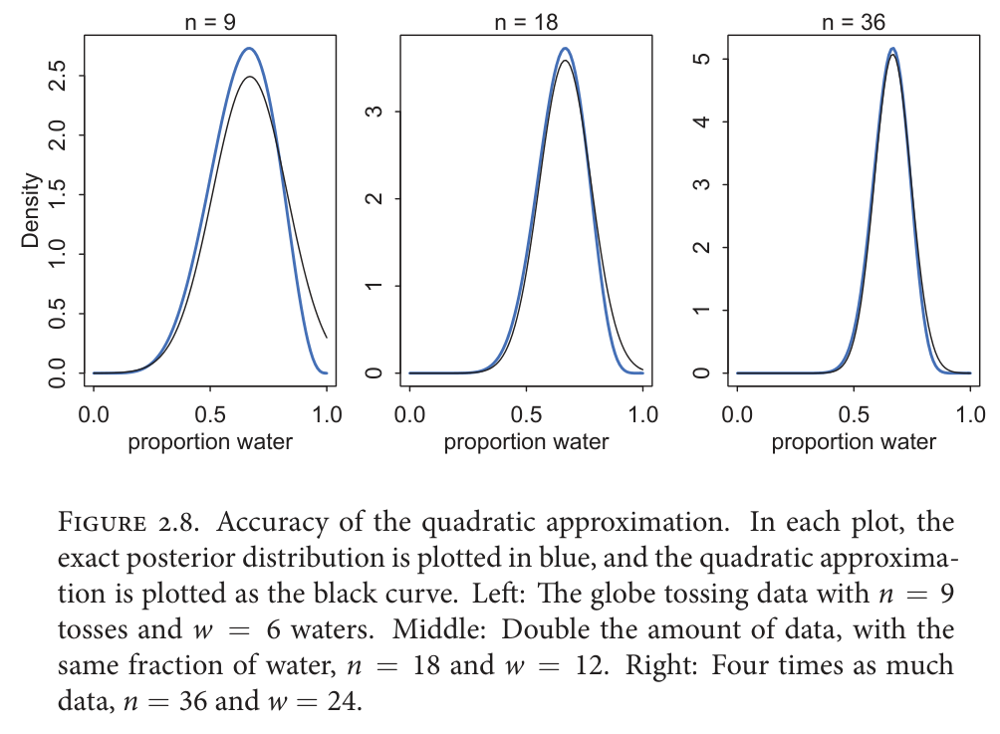
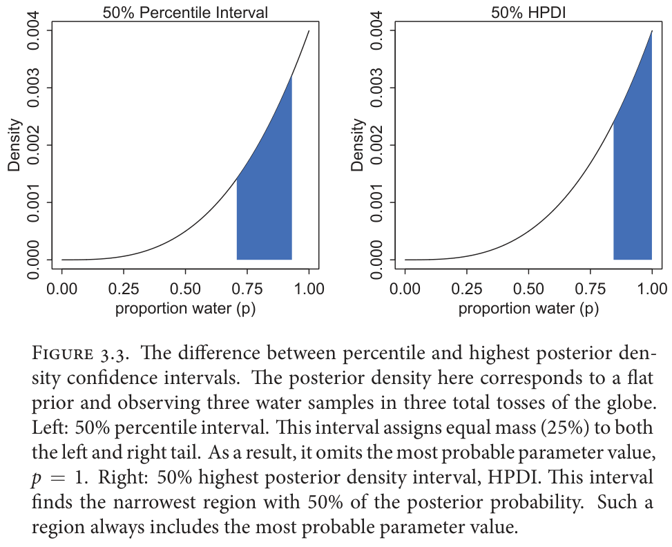
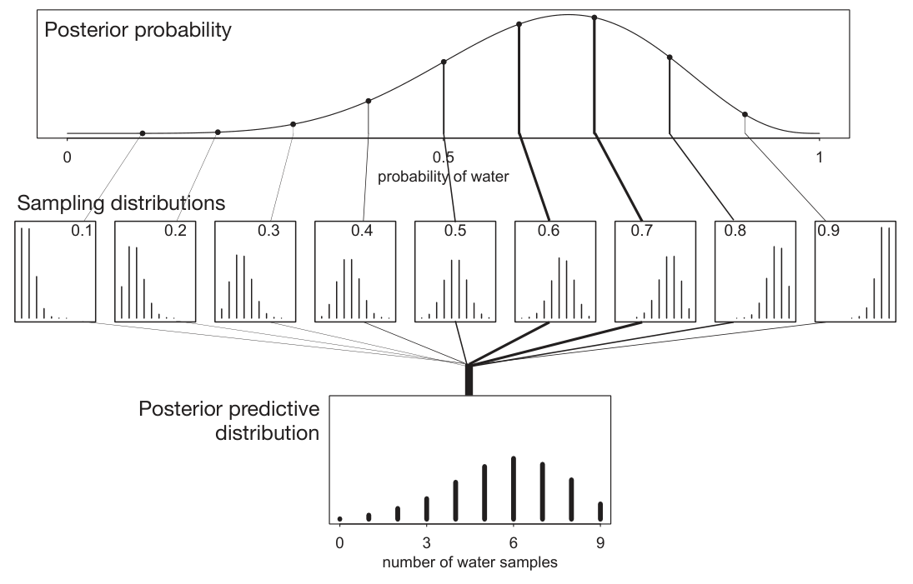

# 1b — Grids, hypotheses and simulation

Larkspur's analyst has now met the update, the Beta-Binomial and a sampler, and then a question arrives that none of them answers directly. Two parameters at once, and the data say nothing about how they trade off. A claim that the new checkout "changed" things, with no definition of what the alternative looks like. Two candidates compared on one noisy score. A quantity nobody can observe, only simulate forwards. Each is the same update with a bigger hypothesis space, and each has a trap: marginals that hide a dependence, a Bayes factor that depends on a definition, a nuisance parameter forgotten, a prior range that quietly decides the answer. This part works through them on small grids, and every number below was re-run.

> The second half of the inference chapter. [01](01-bayesian-inference.md) covered the update, the Beta-Binomial, generative stories, PyMC, the predictive mixture, observer bias and German tanks. Here: two-parameter grids and their dependence, Bayes factors and what they hinge on, comparing two people, simulating a joint distribution, a hierarchy of parameters, unseen categories, and the locomotive estimators. Examples are Downey's (*Think Bayes*, ch. 9 to 15), and the code is rewritten in NumPy.

---

## Two parameters on a grid, and what the marginals hide

Downey's paintball problem: a shooter stands somewhere in a 30 by 50 ft room and fires at a wall, hitting at positions along it. Hypotheses are the shooter's position (alpha along the wall, beta distance from it). Four spatters land at 15, 16, 18 and 21 ft. The likelihood of a hit at x is the chance the turret's angle sends a shot there: with x − alpha = beta·tan(theta), the density of hits at x is proportional to 1 / strafing speed, beta / cos²(theta) (*Think Bayes*, ch. 9). A grid over every integer (alpha, beta) pair, a uniform prior, and the four updates multiply in:

```python
import numpy as np

alphas, betas, xs = np.arange(0, 31), np.arange(1, 51), np.arange(0, 31)

def loc_pmf(a, b):                      # where a shot from (a, b) lands
    p = np.cos(np.arctan2(xs - a, b)) ** 2 / b       # 1 / strafing speed
    return p / p.sum()

post = np.ones((len(alphas), len(betas)))
for x in (15, 16, 18, 21):
    post *= np.array([[loc_pmf(a, b)[x] for b in betas] for a in alphas])
post /= post.sum()

m_alpha, m_beta = post.sum(axis=1), post.sum(axis=0)         # marginals
def interval(vals, pmf, pct):
    c = np.cumsum(pmf)
    return vals[np.searchsorted(c, (1 - pct) / 2)], vals[np.searchsorted(c, 1 - (1 - pct) / 2)]
print("alpha 50%:", interval(alphas, m_alpha, .5), " beta 50%:", interval(betas, m_beta, .5))
for b in (10, 20, 40):                                       # conditionals
    cond = post[:, b - 1] / post[:, b - 1].sum()
    mean = (alphas * cond).sum()
    print(f"sd of alpha given beta={b}: {np.sqrt(((alphas - mean) ** 2 * cond).sum()):.1f}")
```

```text
alpha 50%: (14, 21)  beta 50%: (5, 31)
sd of alpha given beta=10: 5.3
sd of alpha given beta=20: 7.9
sd of alpha given beta=40: 8.8
```

The book prints the same two 50% intervals, (14, 21) for alpha and (5, 31) for beta, and a median alpha of 18 near the centre of the spatters. A first-index-at-or-above-0.5 median gives 17 here, so read the median as 17 to 18, depending on the convention for an even-weight tie. Beyond about 10 ft from the wall the beta marginal is almost flat: the data do not separate a shooter 20 ft away from one 40 ft away.

The conditionals carry what the marginals cannot. Given beta = 10, alpha is narrow, and it widens as beta grows (sd 5.3, 7.9, 8.8 above). If alpha and beta were independent every conditional would look the same. Marginals lose the dependence, so two marginals cannot recreate the joint; conditionals at a few values of the other variable recover it approximately (*Think Bayes*, ch. 9). Report both, or keep the joint.

The price is n^d: d parameters with n values each. A million hypotheses allow 1,000 values in two dimensions, 100 in three or 10 in six. That is the grid's limit and the reason [chapter 2](02-mcmc-and-pymc.md) exists. Past two or three parameters the grid needs tricks (the species problem below) or a sampler.

---

## A Bayes factor depends on how the alternative is defined

The Euro problem again: a Belgian one-euro coin spun on edge 250 times, 140 heads and 110 tails. The Guardian reported that a fair coin would give a result this extreme with probability under 7%. Is the coin biased? The Bayes factor compares F (fair) with B (biased), and B must be a distribution over the head probability x. The data cannot pick it for you (*Think Bayes*, ch. 11).

```python
from scipy import stats
like = lambda x: stats.binom.pmf(140, 250, x)
fair = like(0.5)
xg = np.arange(101) / 100
w = np.ones(101); w[50] = 0; w /= w.sum()                  # uniform, fair value removed
defs = {"cheat (x = 140/250)": like(140 / 250),
        "two (x = .4 or .6)": .5 * like(.4) + .5 * like(.6),
        "uniform": (w * like(xg)).sum()}
for name, v in defs.items():
    print(f"B = {name:20s} Bayes factor vs fair {v / fair:.2f}")
```

```text
B = cheat (x = 140/250)   Bayes factor vs fair 6.08
B = two (x = .4 or .6)    Bayes factor vs fair 1.33
B = uniform               Bayes factor vs fair 0.47
```

The ratios match the book's 6.1, 1.3 and 0.47. (The book's likelihood of the data under F is 5.5×10⁻⁷⁶ because it scores one ordered sequence; the binomial pmf used here is larger, and the factors are ratios, so they agree.) The book's triangular prior peaking at 50% gives 0.84.

Three points follow.

- **A composite hypothesis scores as its prior-weighted average likelihood.** That is what a Suite's `Update` returns as its normalising constant, so the marginal likelihood is already computed (*Think Bayes*, ch. 11).
- **B_cheat is bogus.** Setting x to the observed 140/250 favours B at 6.1, but any dataset would favour a B built from it unless the heads were exactly 50%.
- **Every definition that does not peek gives weak evidence.** The factors run from 1.3 for B to 2.1 (that is, 1/0.47) for F, and the verdict flips with the definition, which depends on background about coins. A factor of 2 from prior odds of 1:1 gives posterior odds 2:1, a move from 50% to 66%. For most real problems that is small against modelling error. A factor of 100 gives 100:1, over 99%. Downey cites Jeffreys' scale (1 to 3 barely worth mentioning, 3 to 10 substantial, 10 to 30 strong, 30 to 100 very strong, over 100 decisive) and prefers to think in odds than to argue about the adjectives. [Chapter 1](01-bayesian-inference.md#the-odds-form-and-the-bayes-factor) has the odds form. The scale and the p-value can disagree: in a logistic regression on 39 patients, a slope with z = 2.36 sits between substantial and strong on Fisher's scale, but its BIC-approximated Bayes factor is 5.49, only "substantial" on Jeffreys'. At n = 10,000 a slope with z = 3.29 (p = 0.001) has a BIC Bayes factor of 2.24, below "substantial", though it is far past Fisher's usual cutoffs (*Computer Age Statistical Inference*, ch. 13, Table 13.5).

The same trap lives in A/B work: "the new checkout is different" has no Bayes factor until you say how different, and the prior on the effect size decides the number ([chapter 4](04-bayesian-ab-testing.md#priors-for-ab-tests)).

---

## Comparing two people: nuisance parameters

Alice scored 780 and Bob 740 on the 2009 SAT math section (54 questions). Who is better at answering SAT questions? Treat each score as 54 Bernoulli trials with an unknown success rate and compare the two posteriors (*Think Bayes*, ch. 12).

The simple model gives every question the same difficulty, the likelihood is binomial, and the wrong-answer penalty is ignored. Summing the joint posterior mass on each side of the diagonal (ties split evenly) gives P(Alice's rate is higher) = 0.79 and Bob 0.21, a Bayes factor of 3.8. A better model gives each question a difficulty and each person an efficacy, with P(correct) = 1 / (1 + exp(−(efficacy − difficulty))). With efficacy Gaussian (mean 0, sd 1.5, which Downey calls mostly arbitrary) and difficulty uniform around −0.05 with width 1.8, calibrated by eye to the raw-score CDF, the Bayes factor is 3.4 and A gets 77% against equal priors. The modelling error is small here.

The efficacy parameter is the thing that cannot be observed, and the book's second result shows why it matters. The posterior odds are about 3:1 that Alice's efficacy is higher, but a retake predicts only a 63% chance that she scores higher, so Bob has 37% to do as well or better. A parameter you do not care about but must estimate (here the question difficulties) is a **nuisance parameter**. You get the answer by averaging it out. The retake prediction is the only validation offered, since efficacy is not observable.

---

## Simulate the joint, then slice it

Some problems have a cheap forward model and no usable likelihood. A kidney tumour of 15.5 cm is found 3,291 days after a scan that showed none. How old is it? Growth is measured as the doubling time of volume; the median in the Zhang et al. series of 53 patients is 811 days, and Downey read the data off a printed graph (*Think Bayes*, ch. 13). Back-calculating at the median rate:

```python
import numpy as np
days, vdt, final_cm = 3291, 811, 15.5
doublings = days / (3 * vdt)                       # linear doubling time = 3 x volume's
print(f"diameter at discharge {final_cm / 2 ** doublings:.1f} cm")
n = np.log2(final_cm / 0.1)                        # growth from a 0.1 cm start
print(f"linear doublings {n:.1f}, volume doublings per year {3 * n / (days / 365):.1f}")
```

```text
diameter at discharge 6.1 cm
linear doublings 7.3, volume doublings per year 2.4
```

At the median rate the tumour was already about 6 cm at discharge. To grow from 0.1 cm it needs a rate of 2.4 volume doublings a year, which only 20% of the 53 patients reached in their observation windows. So either it was there already or it grew unusually fast.

The ch. 13 method skips an explicit Bayes update. Simulate many tumours forward at growth rates drawn from the measured distribution (initial size 0.3 cm, steps of 245 days, the median gap between scans, 1,000 simulations for the joint), record (age, size) pairs, and read the posterior for age off a slice of that joint at the observed size. Conditioning the simulated joint is the update. Results for the 15.5 cm tumour: P(older than 8 years) is 0.999 with no serial correlation between successive growth rates, 0.995 at correlation 0.4 and 0.978 at 0.8. Even for a smaller (flatter) tumour with correlation 0.8 it stays 95%. Serial correlation widens the age range, since a fast grower tends to stay fast.

The limits are the model's: 53 patients, spherical tumours, growth independent of size and grade, and sizes outside the observed 1 to 12 cm range extrapolated. Simulation moves the work from the likelihood to the forward model, and [chapter 10 of the book](02-mcmc-and-pymc.md#when-the-likelihood-is-costly-summaries-instead-of-data) takes the same idea to its limit. Downey's own summary: "we side-stepped Bayes, but he was with us in spirit."

---

## Parameters of parameters

Jaynes' Geiger counter: a source emits particles at an unknown rate r per second, the counter detects each with probability f = 0.1, and it clicked k = 15 times in a second. The number emitted n is also unknown. Two levels: r is Poisson-distributed into n, n is binomial-thinned into k (*Think Bayes*, ch. 14).

```text
r  (long-run rate)  --Poisson-->  n  (emitted this second)  --Binomial(f)-->  k  (clicks)
        <-- inference flows up                    causal information flows down -->
```

The posterior for n peaks at k / f = 150, and so does the posterior for r. The long-run rate is the more certain of the two: "we can be more certain about the long-range emission rate, r, than about the number of particles emitted in any particular second, n." The implementation is a meta-suite of one detector per r, where each detector's update returns its normalising constant as the likelihood of that r. Downey's line is that causal information flows down the hierarchy and inference flows up. Hyperpriors over groups, shrinkage and pooling are a different matter, and [chapter 7](07-multilevel-models-and-partial-pooling.md) takes them; this chapter has one group and no pooling.

---

## Many unknown categories: the species problem

How many bacterial species live in one gut sample, and how many more would more reads find? With three known categories (3 lions, 2 tigers, 1 bear) the right prior is a Dirichlet, not independent Betas, because the prevalences must sum to one. With Dirichlet(1, 1, 1) the posterior means are 44%, 33% and 22%, where the naive maximum likelihoods are 50%, 33% and 17% (*Think Bayes*, ch. 15):

```python
counts = np.array([3, 2, 1])
print((counts + 1) / (counts.sum() + 3))      # posterior mean of Dirichlet(1+counts)
```

```text
[0.44444444 0.33333333 0.22222222]
```

The hard part is that the number of species n is itself unknown, so the prior becomes a hierarchy: a uniform prior on n, then a Dirichlet over n prevalences, then the reads. Each update compares the count of an observed species against n − i + 1 species not yet seen, and the grid is cut from cost proportional to km² to km for k hypotheses and m observed species, by updating one species at a time with a correction for the unseen ones.

On a real sample of 400 reads with 61 species observed (subject B1242, Belly Button Biodiversity pilot data), the posterior for n has its mode at 72 with a 90% credible interval of 66 to 79, so 87 species is unlikely and exactly 61 nearly impossible. The most abundant species holds 23% of the reads but is estimated at 20% (90% interval 17% to 23%), since unseen species take part of the share. Forward simulation then answers the planning question: after 100 more reads the median number of new species is 2 (90% interval 0 to 5); 200 reads give about a 40% chance of seeing 90% of the species, and 1,000 reads give a 90% chance. Two caveats from the chapter: every organism is assumed equally likely to be sampled, which swabbing and amplification may violate, and the upper bound of the prior on n is a judgment call that you check by looking at the posterior tail. Fisher's frequentist answer to the same question of how many new species more trapping would reveal is empirical Bayes, in [chapter 3](03-priors-and-bandits.md#empirical-bayes-without-a-prior-family-robbins-formula).

---

## Four estimators for one train

The locomotive problem from [chapter 1](01-bayesian-inference.md#german-tanks-when-the-posterior-is-one-line), with a smaller prior: one train numbered 60, uniform prior on 1 to 200 (*Think Stats*, ch. 8). Posterior mass is proportional to 1/N for N of at least 60, and the 90% credible interval is [63, 189], "still quite wide": one sighting is weak evidence. (Chapter 1's prior on 1 to 1,000 gave a mean of 333; here the mean is 116, from the prior alone, which is the same lesson about the bound.)

Point estimators from the same sighting i answer different questions:

| Estimator | For i = 60 | Optimises |
|---|---|---|
| i | 60 | maximum likelihood |
| 3i/2 | 90 | minimum mean squared error (a = 3N/(2N+1), tending to 3/2) |
| 2i | 120 | zero mean error (unbiased) |
| 2i − 1 | 119 | population mean equals the sample mean |

The book prints the unbiased multiplier as 2N/(N−1); setting the mean error (1/N)Σ(a·i − N) to zero gives 2N/(N+1). Both tend to 2, so the conclusion holds. Each estimator behaves as if it carried its own prior, and they converge only when the evidence swamps it.

---

## One parameter: grid, quadratic approximation, then samples

The one-parameter case is where the whole workflow fits on a page. McElreath's globe toss: 6 water in 9 tosses, flat prior (*Statistical Rethinking*, ch. 2). A grid of 20 points is already usable and little changes after the first 100; the cost is 100^2 = 10,000 evaluations for two parameters at 100 values each. The quadratic approximation replaces the posterior by a Gaussian at its mode, here mean 0.67 and sd 0.16, and at n = 9 it is visibly wrong: it puts mass at p = 1, which the data rule out. The same water fraction at n = 18 and n = 36 closes the gap (see the figure), which is why classical procedures are nervous at small N. McElreath adds that the rate of improvement varies by model, and for some it stays poor with thousands of observations. He also calls the "30 observations" rule a superstition: a posterior is valid at any N, and the price of small N is dependence on the prior.



*Image Source: McElreath, *Statistical Rethinking* (CRC Press), Fig. 2.8*

Once a grid posterior exists, stop integrating and sample from it (*Statistical Rethinking*, ch. 3). Every summary becomes counting:

```python
import numpy as np
from scipy import stats

g = np.linspace(0, 1, 1000)
post = stats.binom.pmf(6, 9, g); post /= post.sum()          # 6 water in 9, flat prior
rng = np.random.default_rng(0)
s = rng.choice(g, size=100_000, p=post)
print((s < 0.5).mean(), np.percentile(s, [10, 90]))           # mass below .5; middle 80%

q = stats.binom.pmf(3, 3, g); q /= q.sum()                    # 3 water in 3 tosses
s3 = rng.choice(g, size=100_000, p=q)
lo, hi = np.percentile(s3, [25, 75])                          # 50% percentile interval
ss = np.sort(s3); k = len(ss) // 2; i = (ss[k:] - ss[:-k]).argmin()   # narrowest 50%: HPDI
print((lo, hi), (ss[i], ss[i + k]))
```

```text
0.174 [0.446 0.812]
(0.708, 0.931) (0.839, 0.999)
```

The grid itself gives 0.172 below 0.5; the book prints 0.1718746 for the grid and 0.1726 for 10,000 samples, so the sampling noise is in the third decimal. The middle 80% runs from 0.446 to 0.812. With 3 of 3 water the posterior is piled against p = 1, and the two 50% intervals disagree: the percentile interval (0.71 to 0.93, width 0.22) excludes the mode, and the highest-posterior-density interval (0.84 to 1.00, width 0.16) contains it. McElreath's advice is that if the choice of interval changes the inference, plot the whole posterior; with the 6-of-9 posterior the two are nearly identical. He also prefers nested 67, 89 and 97% intervals to 95%, which he calls a convention with no defence.



*Image Source: McElreath, *Statistical Rethinking* (CRC Press), Fig. 3.3*

A point estimate is a loss-function decision. Expected absolute loss for the 3-of-3 posterior is minimised at the median (0.84) and expected quadratic loss at the mean (0.80); the maximum a posteriori value is 1.0. Reporting the decision of p = 0.5 costs 0.313 in expected absolute loss. [Chapter 5](05-loss-functions-and-decisions.md) takes this up properly.

Samples also do the predictive step. Draw `rng.binomial(9, s)` for each sampled p and the counts follow the posterior predictive distribution. Plugging in one value understates the spread: at the plug-in p = 0.67, 6 of 9 has probability 0.273, but the posterior predictive gives it 0.20, because the uncertainty about p spreads the counts out.



*Image Source: McElreath, *Statistical Rethinking* (CRC Press), Fig. 3.6*

Check the model against more than one feature of the data. McElreath's toss sequence W L W W W L W L W has 6 water, which sits in the middle of the predictions, but 6 switches between water and land in 9 tosses is more than most simulated sequences produce. Each toss was modelled as independent, and the data hint at negative serial correlation. The count was the wrong summary to check. The same chapter's base-rate example is worth keeping as a drill: a test with 0.95 sensitivity and a 1% false-positive rate on a condition with prevalence 0.001 gives Pr(condition given positive) = 0.087, which is 95 true cases among 95 + 999 = 1,094 positives in 100,000 people. Counting people is easier than applying the formula.

---

## Pitfalls

| Symptom | Cause | Fix |
|---|---|---|
| Two clean marginals, then a wrong joint | Dependence lost in the marginalising | Keep the joint, or plot conditionals at several values |
| A Bayes factor of 6 for a hypothesis written after the data | The alternative was set to the observed value | Define B before looking, as a distribution |
| "Weak evidence" read as "no effect" | A factor near 1 is equally compatible with both | Report posterior odds and a Jeffreys-style label with the setup |
| Posterior depends on the grid's upper bound | Prior range quietly sets the answer | Re-run with a larger bound and compare tails |
| Underflow on a few thousand data points | Multiplying densities | Work in log-likelihood, or use a summary statistic |
| 50% intervals that disagree on a skewed posterior | Percentile interval leaves out the mode | Plot the whole posterior; report the HPDI or say which interval |
| Predictions that look too tight | One plug-in p, not the posterior | Simulate with a sampled p per draw |
| Simulated posterior with no sensitivity check | One growth model, one correlation | Vary the serial correlation or growth model and report the range |

## Try it

1. In the paintball code, add a fifth spatter at 25. Does the 50% interval for alpha move, and does the conditional spread at beta = 10 change?
2. Re-run the Euro Bayes factors with the uniform prior restricted to x between 0.4 and 0.6. What does the factor do, and why?
3. Alice gets 14 of 20 on a quiz and Bob 11 of 20. With the simple binomial model and Beta(1, 1) priors, compute P(Alice's rate is higher) by sampling.
4. The locomotive posterior mean (116) sits between 3i/2 (90) and 2i (120). Which prior change would raise it, and what does that say about each estimator?

<details>
<summary>Answers</summary>

1. The alpha interval moves right and widens, from (14, 21) to (15, 23), and the beta interval from (5, 31) to (8, 33). The conditional sd of alpha at beta = 10 falls from 5.3 to 4.9. Re-run, not argued: the spatters now stretch over 15 to 25 ft.
2. It rises from 0.47 to about 2.16, now weak evidence for B. Concentrating B near the data raises its average likelihood, and narrowing it further toward 0.56 pushes the factor toward the bogus B_cheat value of 6.1.
3. Draw 100,000 from Beta(15, 7) and Beta(12, 10) and average the indicator. It comes to about 0.83 (0.830 with a million draws).
4. A larger upper bound, since the 1/N likelihood leaves a long right tail (chapter 1 shows 207, 333 and 552 for bounds of 500, 1,000 and 2,000). Each estimator is a different loss, so none is "the" answer, which is the case for choosing the estimator from the decision ([chapter 5](05-loss-functions-and-decisions.md)).

</details>

## Interview checklist

| Question | Answer |
|---|---|
| Why can't two marginals recreate a joint? | The dependence between the variables is lost; conditionals recover it |
| What does a grid cost in d dimensions? | n^d evaluations; a million hypotheses is 1,000 in 2-D, 100 in 3-D, 10 in 6-D |
| How is a Bayes factor for a composite hypothesis computed? | The prior-weighted average likelihood, which `Update` returns as its normalising constant |
| Why can a Bayes factor of 3 be a weak result? | 1:1 prior odds become 3:1, a move from 50% to 75%, small against modelling error |
| What is a nuisance parameter? | Something you must estimate to answer the question but do not care about; average it out |
| When do you simulate instead of writing a likelihood? | When the forward model is cheap and the likelihood is not; condition the simulated joint |
| Why a Dirichlet and not independent Betas? | Prevalences must sum to one, so the posterior means do too |

---

## Next

[Chapter 2: MCMC and PyMC](02-mcmc-and-pymc.md) opens the box. The grid stops at a few parameters; next you write a sampler by hand and learn to tell whether it worked.
