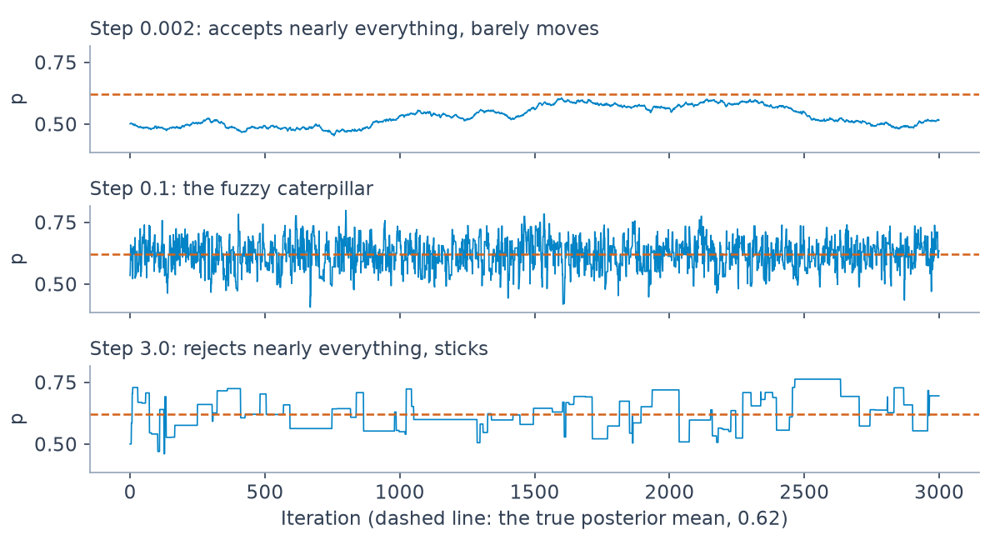

# 2 — MCMC and PyMC

The Challenger model in [chapter 1](01-bayesian-inference.md) has two parameters and the sampler returned an answer in a second. That hides what could go wrong. A sampler always returns numbers, including when those numbers describe where it happened to start rather than the posterior, and nothing on the screen will look like an error. This chapter opens the box: why we sample at all, what one step does, how to write a sampler in twenty lines, and how to tell a chain that has explored the posterior from one that has only wandered. It ends with the map from old PyMC3 code, because most of what you will find on the web is written in it.

## Why sample at all

With one or two conjugate parameters the posterior has a formula. With more, the posterior is a surface over many dimensions, and normalising it means integrating over all of them. A grid does not survive the arithmetic:

```python
import numpy as np, pymc as pm, arviz as az, pytensor.tensor as pt
from scipy import stats
SAMPLE = dict(chains=4, cores=1, progressbar=False, random_seed=7)
```

```python
for dims in (1, 2, 5, 10, 20):
    print(f"{dims:2d} parameters, 100 grid points each: {100.0 ** dims:.0e} evaluations")
```

```text
 1 parameters, 100 grid points each: 1e+02 evaluations
 2 parameters, 100 grid points each: 1e+04 evaluations
 5 parameters, 100 grid points each: 1e+10 evaluations
10 parameters, 100 grid points each: 1e+20 evaluations
20 parameters, 100 grid points each: 1e+40 evaluations
```

BMH's picture is useful here ([Davidson-Pilon, ch. 3](https://github.com/CamDavidsonPilon/Probabilistic-Programming-and-Bayesian-Methods-for-Hackers)). The prior is a landscape over parameter space, and the likelihood warps it, pulling up the regions consistent with the data. We need to explore the warped landscape without mapping all of it.

> **MCMC returns samples from the posterior, not the posterior itself.** Every summary (mean, interval, P(B > A), expected loss) is then an average over samples, by the Law of Large Numbers.

Two consequences follow, and BMH stresses both:

- **A prior of zero stays zero.** If the prior assigns no mass to a region, no amount of data can move the posterior there. Choose supports generously ([chapter 3](03-priors-and-bandits.md)).
- **Thousands of samples, not tens.** Summaries are Monte Carlo estimates, and their error shrinks like 1/√(effective samples).

### When the likelihood is costly: summaries instead of data

Two cheaper routes sit between a full grid and a sampler, and both appear in Downey's height example (*Think Bayes*, ch. 10): a grid over (mean, sigma) for the BRFSS self-reported heights of 154,407 men (mean 178 cm, sd 7.7) and 254,722 women (163 cm, 7.3). Multiplying a density per datum underflows to zero by 1,000 values, so work in log-likelihood, and sum the squared deviations once instead of looping over the data; that made the exact grid about 100 times faster, under a minute for the full data.

The second route is approximate Bayesian computation. Replace the data with summary statistics whose sampling distributions are known (the sample mean m ~ Normal(mu, sigma/√n) and the sample sd s ~ Normal(sigma, sigma/√(2(n−1)))) and score each grid point on those two numbers. It handled the whole dataset in about a second and matched the exact posterior to about five digits. With robust summaries (the median and the 68% inter-percentile range, num_sigmas = 1) the posterior mean coefficient of variation was 0.0410 for men and 0.0429 for women with no overlap, so women looked more variable. With num_sigmas = 2 the same code concluded, with equal confidence, that men were. The answer depended on the summary chosen, and the chapter gives no rule for choosing it. Raw CVs were 0.0433 and 0.0444. The grid range was set at four standard errors around the sample mean, which uses the data twice and is harmless only because the prior is effectively flat there.

Use summaries when the exact likelihood is costly, check that two reasonable summaries agree, and treat disagreement as the result.

## What one MCMC step does

1. Start at the current position, a vector of parameter values.
2. **Propose** a nearby position.
3. **Accept** it with a probability that depends on how much higher or lower the posterior density is there. Always accept uphill; sometimes accept downhill.
4. Record the position, the new one if accepted and the old one if not, and repeat.

The chain is memoryless: the next step depends only on the current position. After a warm-up, the positions are distributed like the posterior. Rejected proposals are not wasted, because staying put is how the chain spends more time in high-density regions. The acceptance step also uses only a ratio of densities, so the normalising constant we could not compute cancels. That cancellation is why any of this is possible.

Here it is on chapter 1's coin, where we know the answer: Beta(36, 22).

```python
def log_post(p, heads=32, tails=18, a=4, b=4):
    if not 0 < p < 1:
        return -np.inf                                  # outside the support
    return (heads + a - 1) * np.log(p) + (tails + b - 1) * np.log(1 - p)

def metropolis(n, step, start=0.5, seed=1):
    rng = np.random.default_rng(seed)
    chain, p, lp, accepted = np.empty(n), start, log_post(start), 0
    for i in range(n):
        proposal = p + rng.normal(0, step)              # 1. propose nearby
        lp_new = log_post(proposal)
        if np.log(rng.random()) < lp_new - lp:          # 2. accept uphill always,
            p, lp, accepted = proposal, lp_new, accepted + 1   # downhill sometimes
        chain[i] = p                                    # 3. record, moved or not
    return chain, accepted / n

chain, rate = metropolis(20000, step=0.1)
kept = chain[1000:]
print(f"accepted {rate:.0%}  mean {kept.mean():.4f}  sd {kept.std():.4f}")
print(f"closed form  mean {36 / 58:.4f}  sd {stats.beta(36, 22).std():.4f}")
```

```text
accepted 58%  mean 0.6201  sd 0.0628
closed form  mean 0.6207  sd 0.0632
```

The twenty lines reproduce the closed form to two decimal places. The proposal width is the one knob, and it decides everything:

```python
for step in (0.002, 0.1, 3.0):
    chain, rate = metropolis(20000, step=step)
    kept = chain[1000:]
    ess = float(az.ess(kept[None, :], chain_axis=0, draw_axis=1))
    print(f"step {step:<5}  accepted {rate:5.1%}  mean {kept.mean():.3f}  effective samples {ess:7.0f} of {kept.size}")
```

```text
step 0.002  accepted 98.7%  mean 0.565  effective samples      11 of 19000
step 0.1    accepted 57.6%  mean 0.620  effective samples    3594 of 19000
step 3.0    accepted  2.8%  mean 0.625  effective samples     278 of 19000
```


*Image Source: generated for this chapter from the code above*

The small step accepts nearly every proposal and is the worst of the three: after 20,000 iterations it has about 11 effective samples, and its mean of 0.565 is wrong in the second decimal. A high acceptance rate is not a sign of health. The large step rejects 97% of proposals and sits still between rare jumps. Only the middle one looks like what a working chain should.

The gap between iterations and **effective sample size** (ESS) is the core diagnostic idea. Correlated draws carry less information than independent ones, and ESS is how many independent draws yours are worth.

### The samplers

| Sampler | PyMC | Good for |
|---|---|---|
| NUTS (Hamiltonian Monte Carlo) | default for continuous variables | almost everything continuous; uses gradients to make long, well-directed moves |
| Metropolis | `pm.Metropolis()` | discrete variables, quick experiments; BMH uses it heavily |
| CategoricalGibbsMetropolis | `pm.CategoricalGibbsMetropolis()` | Categorical assignments (replaced `ElemwiseCategorical`) |
| Compound | `step=[step1, step2]` | NUTS or Metropolis for continuous, a discrete sampler for the rest |

Random-walk Metropolis struggles because it proposes blindly, and in high dimensions almost every direction leads downhill. Hamiltonian Monte Carlo uses the gradient to simulate a particle gliding across the surface, so a proposal can land far away and still be accepted. Its catch is sensitivity to two settings, the step size ε and the number of leapfrog steps L. The **No-U-Turn Sampler** removes both by hand: it keeps doubling the trajectory until it starts to turn back on itself, and it tunes ε during warm-up by dual averaging ([Hoffman and Gelman, JMLR, 2014](https://arxiv.org/abs/1111.4246)). The paper's aim was a sampler that runs without user tuning, and that is why `pm.sample()` works unattended for continuous models. The paper's evidence is modest and specific: on four targets (a 250-dimensional normal, two logistic regressions and a 3,001-parameter stochastic volatility model) NUTS with target acceptance 0.6 beat the best HMC setting (over ten trajectory lengths and eight acceptance targets) by about a factor of three in effective samples per gradient evaluation on the normal and stochastic volatility models, and matched it on the logistic regressions. The best HMC length itself varied about 100-fold across the four, from 0.17 to 17.62. It compared NUTS only with basic HMC, with an identity mass matrix, and counted gradient evaluations rather than wall-clock time (the arXiv v1 preprint, 2011; the note cites the 2014 JMLR version).

The same data under different samplers and scalings makes the case. This is Challenger again:

```python
temperature = np.array([66, 70, 69, 68, 67, 72, 73, 70, 57, 63, 70, 78, 67,
                        53, 67, 75, 70, 81, 76, 79, 75, 76, 58], dtype=float)
damage = np.array([0, 1, 0, 0, 0, 0, 0, 0, 1, 1, 1, 0, 0,
                   1, 0, 0, 0, 0, 0, 0, 1, 0, 1])
def fit(temps, step=None):
    with pm.Model():
        alpha = pm.Normal("alpha", 0, 100 if temps is temperature else 5)
        beta = pm.Normal("beta", 0, 100 if temps is temperature else 5)
        pm.Bernoulli("obs", logit_p=alpha + beta * temps, observed=damage)
        return pm.sample(1000, tune=1000, step=step() if step else None, **SAMPLE)
z = (temperature - temperature.mean()) / temperature.std()
rows = {"Metropolis, raw F": fit(temperature, pm.Metropolis),
        "NUTS, raw F": fit(temperature),
        "NUTS, standardised": fit(z)}
for name, idata in rows.items():
    s = az.summary(idata, var_names=["beta"])
    n = idata.sample_stats["n_steps"].mean().item() if "n_steps" in idata.sample_stats else float("nan")
    print(f"{name:20s} beta ess_bulk {float(s['ess_bulk'].iloc[0]):6.0f}  r_hat {float(s['r_hat'].iloc[0]):.2f}  leapfrog steps/draw {n:5.1f}")
```

```text
Metropolis, raw F    beta ess_bulk      5  r_hat 2.16  leapfrog steps/draw   nan
NUTS, raw F          beta ess_bulk    304  r_hat 1.01  leapfrog steps/draw  18.8
NUTS, standardised   beta ess_bulk   2591  r_hat 1.00  leapfrog steps/draw   3.1
```

Metropolis on raw Fahrenheit has an ESS of 5 and an R-hat above 2 after 4,000 draws, which is why BMH runs it for 120,000. NUTS copes, but spends 19 gradient steps per draw on a long narrow ridge, because the intercept and slope are almost perfectly correlated when the temperature is far from zero. Standardising removes the ridge: three steps per draw, and about 2,600 effective samples. Scale your inputs before reaching for more draws.

Other approximations to MCMC exist. The **Laplace approximation** fits a Normal at the MAP, and **variational inference** (`pm.fit(method="advi")`) fits a simple distribution by optimisation. Both are faster and less exact, and [chapter 6](06-bayesian-machine-learning.md) measures how much less. [Blei, Kucukelbir and McAuliffe (JASA, 2017)](https://arxiv.org/abs/1601.00670) illustrate the choice with two scenarios, not experiments: MCMC for a small, expensive dataset where you trust the model and need precise inferences, VI for a text model on a billion documents. Size isn't the only factor. For mixture models where Gibbs sampling is not an option, they note VI may do better than Hamiltonian Monte Carlo even on small data.

## Worked example: a two-cluster mixture

BMH's example is 300 values that look bimodal. Its CSV is not vendored here, so we simulate a similar set, with a known answer: 40% of points around 120 with sd 12, the rest around 200 with sd 22.

```python
rng = np.random.default_rng(3)
labels = rng.random(300) < 0.4
data = np.where(labels, rng.normal(120, 12, 300), rng.normal(200, 22, 300))
print(f"n {data.size}  mean {data.mean():.1f}  sd {data.std():.1f}  share below 160: {(data < 160).mean():.2f}")
```

```text
n 300  mean 170.6  sd 42.3  share below 160: 0.38
```

| Story | Distribution |
|---|---|
| Each point belongs to cluster 0 with probability p | p ~ Uniform(0, 1) |
| Its cluster label | assignment_i ~ Categorical([p, 1 − p]) |
| Each cluster has a centre and a spread | centers ~ Normal([120, 190], σ = 10); sds ~ Uniform(0, 100), shape 2 |
| The observed value | x_i ~ Normal(centers[assignment_i], sds[assignment_i]) |

Labels are discrete, so NUTS cannot move them, and BMH mixes two samplers.

```python
with pm.Model():
    p1 = pm.Uniform("p", 0, 1)
    assignment = pm.Categorical("assignment", pt.stack([p1, 1 - p1]), shape=data.size)
    sds = pm.Uniform("sds", 0, 100, shape=2)
    centers = pm.Normal("centers", mu=[120, 190], sigma=10, shape=2)
    pm.Normal("obs", mu=centers[assignment], sigma=sds[assignment], observed=data)
    labelled = pm.sample(1000, tune=1000,
                         step=[pm.Metropolis(vars=[p1, sds, centers]),
                               pm.CategoricalGibbsMetropolis(vars=[assignment])], **SAMPLE)
print(az.summary(labelled, var_names=["p", "centers", "sds"], round_to=2)[["mean", "sd", "ess_bulk", "r_hat"]])
```

```text
              mean    sd  ess_bulk  r_hat
p             0.36  0.03    616.47   1.01
centers[0]  120.59  1.12    749.40   1.00
centers[1]  198.92  1.64    807.87   1.00
sds[0]       11.46  0.89    574.56   1.01
sds[1]       22.39  1.42    429.06   1.00
```

The parameters come back close to the truth, and the run takes about half a minute for 1,000 draws. Those 300 discrete labels are costing a lot. Summing them out of the likelihood gives the same model with no discrete variables at all, which NUTS can sample. `pm.NormalMixture` does the sum.

```python
with pm.Model():
    w = pm.Dirichlet("w", a=np.ones(2))
    sds = pm.HalfNormal("sds", 50, shape=2)
    centers = pm.Normal("centers", mu=[120, 190], sigma=10, shape=2)
    pm.NormalMixture("obs", w=w, mu=centers, sigma=sds, observed=data)
    mix = pm.sample(1000, tune=1000, **SAMPLE)
print(az.summary(mix, round_to=2)[["mean", "sd", "ess_bulk", "r_hat"]])
```

```text
              mean    sd  ess_bulk  r_hat
centers[0]  120.58  1.17   4642.83    1.0
centers[1]  199.02  1.68   4946.69    1.0
w[0]          0.37  0.03   4094.82    1.0
w[1]          0.63  0.03   4094.82    1.0
sds[0]       11.49  0.87   5102.91    1.0
sds[1]       22.33  1.31   5135.92    1.0
```

The estimates agree, the ESS rises from hundreds to thousands, and the run takes a sixth of the time. Marginalise discrete variables whenever you can.

### Using the posterior

To classify a new point, compare each cluster's weighted likelihood sample by sample, then average.

```python
w0 = mix.posterior["w"].values.reshape(-1, 2)[:, 0]
cent = mix.posterior["centers"].values.reshape(-1, 2)
sd = mix.posterior["sds"].values.reshape(-1, 2)
def p_cluster0(x):
    a = w0 * stats.norm.pdf(x, cent[:, 0], sd[:, 0])         # within each joint draw
    b = (1 - w0) * stats.norm.pdf(x, cent[:, 1], sd[:, 1])
    return (a / (a + b)).mean()
for x in (140, 150, 160, 175):
    print(f"x={x}: P(cluster 0) = {p_cluster0(x):.3f}")
print(f"midpoint of the centres: {cent.mean():.1f}")
```

```text
x=140: P(cluster 0) = 0.888
x=150: P(cluster 0) = 0.327
x=160: P(cluster 0) = 0.019
x=175: P(cluster 0) = 0.000
midpoint of the centres: 159.8
```

Nearest centre would split at 159.8. The posterior puts the even odds near 147, because cluster 1 has about twice the spread and nearly twice the weight, so it reaches well into the gap. Reasoning with centres alone ignores both.

> **Do not mix posterior samples across indices.** Each sample is a joint draw. If x + y = 10 is a constraint, pairing x from sample 3 with y from sample 900 breaks it. Compute derived quantities within a sample, then summarise.

```python
rng = np.random.default_rng(0)
x = rng.normal(5, 1, 4000)
y = 10 - x                                                   # a constraint in every draw
print("within a draw:   ", np.round(np.std(x + y), 3))
print("shuffled pairing:", np.round(np.std(x + rng.permutation(y)), 3))
```

```text
within a draw:    0.0
shuffled pairing: 1.4
```

### Label switching

Cluster "0" and cluster "1" have no meaning the model can see. With the same prior on both centres, chains can land on either labelling:

```python
with pm.Model():
    w = pm.Dirichlet("w", a=np.ones(2))
    sds = pm.HalfNormal("sds", 50, shape=2)
    centers = pm.Normal("centers", mu=160, sigma=60, shape=2)      # same prior for both
    pm.NormalMixture("obs", w=w, mu=centers, sigma=sds, observed=data)
    switched = pm.sample(500, tune=1000, **SAMPLE)
print(switched.posterior["centers"].mean("draw").values.round(1))
print("r_hat:", az.rhat(switched)["centers"].values.round(2))
```

```text
[[120.6 199.3]
 [120.6 199.1]
 [199.3 120.6]
 [120.6 199.3]]
r_hat: [1.53 1.53]
```

Each chain is fine, and they disagree, so R-hat is 1.73 and the mean of `centers` across chains is nonsense. BMH's informative priors (120 and 190) stopped this. An ordering constraint stops it without assuming where the clusters are:

```python
with pm.Model():
    w = pm.Dirichlet("w", a=np.ones(2))
    sds = pm.HalfNormal("sds", 50, shape=2)
    centers = pm.Normal("centers", mu=160, sigma=60, shape=2,
                        transform=pm.distributions.transforms.ordered,
                        initval=[100.0, 200.0])
    pm.NormalMixture("obs", w=w, mu=centers, sigma=sds, observed=data)
    ordered = pm.sample(500, tune=1000, **SAMPLE)
print(ordered.posterior["centers"].mean("draw").values.round(1))
print("r_hat:", az.rhat(ordered)["centers"].values.round(2))
```

```text
[[120.5 199.3]
 [120.5 199.3]
 [120.6 199.3]
 [120.6 199.2]]
r_hat: [1. 1.]
```

## Is the sampler working? Diagnostics

| Check | Tool | Healthy |
|---|---|---|
| Trace plot | `az.plot_trace(idata)` | "fuzzy caterpillar": no trends, chains overlap |
| R-hat | `az.summary(idata)["r_hat"]` | ≤ 1.01 |
| Effective sample size | `ess_bulk`, `ess_tail` in `az.summary` | hundreds or more per parameter |
| Autocorrelation | `az.plot_autocorr(idata)` | drops to near zero within a few lags |
| Divergences (NUTS) | `idata.sample_stats["diverging"].sum()` | zero; otherwise reparameterise |
| Posterior | `az.plot_dist(idata)` | shows the shape and an interval |

**Burn-in.** Early samples reflect the starting point, not the posterior. PyMC handles this with `tune=` and discards tuning draws by default. PyMC3-era code sliced `trace[1000:]` by hand.

**Autocorrelation and thinning.** Consecutive samples are correlated. Thinning, keeping every k-th sample, reduces storage and the correlation between the samples you keep, but it does not add information. ESS is what matters.

**HDI vs equal-tailed interval.** The highest-density interval (`az.hdi`) is the narrowest interval containing a given share of the mass. The equal-tailed interval cuts the same probability from each tail. They match for symmetric posteriors and differ for skewed ones. Current ArviZ's `az.summary` reports an 89% equal-tailed interval by default (columns `eti89_lb`, `eti89_ub`), so state which you are quoting.

### Divergences: when the geometry fights back

Rubin's **eight schools** data has become the standard test of this, and [*Bayesian Data Analysis*](https://sites.stat.columbia.edu/gelman/book/) works through it: estimated coaching effects with known standard errors, and a hierarchical prior tying them together. Written the obvious way:

```python
y = np.array([28, 8, -3, 7, -1, 1, 18, 12], dtype=float)
sigma = np.array([15, 10, 16, 11, 9, 11, 10, 18], dtype=float)
with pm.Model():
    mu = pm.Normal("mu", 0, 5)
    tau = pm.HalfCauchy("tau", 5)
    theta = pm.Normal("theta", mu, tau, shape=8)
    pm.Normal("obs", theta, sigma, observed=y)
    centred = pm.sample(1000, tune=1000, **SAMPLE)
print("divergences:", int(centred.sample_stats["diverging"].sum()))
print(az.summary(centred, var_names=["mu", "tau"], round_to=2)[["mean", "ess_bulk", "r_hat"]])
```

```text
divergences: 88
     mean  ess_bulk  r_hat
mu   4.20    788.41   1.01
tau  4.28     63.63   1.04
```

NUTS reports divergences: trajectories where the numerical simulation blew up, which means it could not follow the surface. Here the surface is a funnel. When τ is small, the θs must crowd together, so the valid region narrows as τ falls, and no single step size suits both the wide top and the narrow neck. The chain stops visiting the neck, which is why τ's estimate is too high and its ESS is 64. The fix changes the coordinates, not the model:

```python
with pm.Model():
    mu = pm.Normal("mu", 0, 5)
    tau = pm.HalfCauchy("tau", 5)
    raw = pm.Normal("raw", 0, 1, shape=8)
    theta = pm.Deterministic("theta", mu + tau * raw)        # same model, new geometry
    pm.Normal("obs", theta, sigma, observed=y)
    noncentred = pm.sample(1000, tune=1000, **SAMPLE)
print("divergences:", int(noncentred.sample_stats["diverging"].sum()))
print(az.summary(noncentred, var_names=["mu", "tau"], round_to=2)[["mean", "ess_bulk", "r_hat"]])
```

```text
divergences: 2
     mean  ess_bulk  r_hat
mu   4.32   4138.61    1.0
tau  3.63   2142.69    1.0
```

Divergences fall from 88 to 2, and τ's ESS rises from 64 to over 2,000. The two remaining would be worth clearing with a higher `target_accept` in real work. The non-centred trick is the first thing to try in any hierarchical model. [Multilevel models and partial pooling](07-multilevel-models-and-partial-pooling.md) teaches the model itself, using this non-centred form.

## Making MCMC converge

| Tip | How |
|---|---|
| Start in a sensible place | `initvals=pm.find_MAP()` (was `start=` in PyMC3) or the data's sample statistics |
| Use priors that rule out nonsense | bounded supports, weakly informative scales |
| Run several chains | `chains=4`; disagreement reveals multimodality |
| Prefer NUTS | let PyMC choose unless you have discrete variables |
| Rescale inputs | mean 0, sd 1, as Challenger shows |
| When it will not converge | reconsider the model |

> **The Folk Theorem of Statistical Computing, as BMH ch. 3 states it: "If you are having computational problems, probably your model is wrong."**

## PyMC3 to current PyMC

BMH's notebooks, the talk and most posts before 2022 use PyMC3 on a Theano backend. So does the BayesianML week 4 coursework, pinned at `pymc3==3.11.4 theano-pymc==1.1.2` (see [practice/BayesianML/](../practice/BayesianML)). The code in this pillar runs on PyMC 6.4 and ArviZ 1.3. There the return value is an xarray `DataTree` with the same `posterior` access as the older `InferenceData`:

```python
print(type(mix).__name__, list(mix.posterior.data_vars))
```

```text
DataTree ['centers', 'w', 'sds']
```

| PyMC3 | Current PyMC |
|---|---|
| `import pymc3 as pm` | `import pymc as pm` |
| `import theano.tensor as tt` | `import pytensor.tensor as pt` |
| `sd=` | `sigma=` |
| `testval=` | `initval=` |
| `start=` / `init='MAP'` | `initvals=pm.find_MAP()` |
| `pm.traceplot`, `pm.summary`, `pm.plot_posterior` | `az.plot_trace`, `az.summary`, `az.plot_dist` |
| `trace["x"]` (MultiTrace) | `idata.posterior["x"]` |
| `trace.varnames` | `list(idata.posterior.data_vars)` |
| `trace[1000:]` for burn-in | `tune=1000` (tuned draws discarded) |
| `pm.ElemwiseCategorical` | `pm.CategoricalGibbsMetropolis` |
| `pm.glm.GLM.from_formula` | [bambi](https://bambinos.github.io/bambi/), or write the model out |
| `pm.iter_sample` | removed |
| `pm.sample_posterior_predictive(trace, samples=n)` | `pm.sample_posterior_predictive(idata)`, then `.posterior_predictive` |

**Shape gotcha.** Samples have dimensions `(chain, draw, ...)`. Flatten with `.values.flatten()` for scalars, or `.values.reshape(-1, k)` for a vector of length k, before NumPy maths written for PyMC3's flat arrays. A flat `.flatten()` of a vector parameter mixes its elements together.

## Pitfalls

| Pitfall | What goes wrong | Fix |
|---|---|---|
| One chain | A single chain cannot disagree with anything, so R-hat means little and missed modes go unseen | Run four from dispersed starts |
| Reading a high acceptance rate as good | The 0.002 step accepted 98.7% and had 11 effective samples | Look at ESS and R-hat |
| More draws instead of a better model | Metropolis needs 120,000 draws on a problem NUTS with scaled inputs solves in 1,000 | Rescale, reparameterise, marginalise |
| Ignoring a few divergences | They mark regions the sampler cannot enter, which biases the results | Raise `target_accept`, then reparameterise |
| Shuffling draws between variables | Breaks the joint distribution, as the `x + y` demo shows | Derive quantities within each sample |
| Quoting a default interval as 95% | `az.summary` here reports 89% | Compute the interval you say you report |
| Averaging across chains in a mixture | Label switching makes it meaningless | Order the parameters, then check R-hat |

---

## Try it

1. Change `metropolis` to start at 0.99 with step 0.002. Roughly how long is the burn-in, and what would a trace plot show?
2. In the mixture, why does `chains=1` hide the label problem shown above?
3. A model's summary shows `r_hat = 1.00` and `ess_bulk = 40` for one parameter. Is it fine?
4. Write the non-centred form of `y ~ Normal(mu, sigma)` for a hierarchical intercept.

<details>
<summary>Answers</summary>

1. The chain must travel about 0.37 in steps of size 0.002 while being pushed uphill, so it takes thousands of iterations, far more than the 1,000 discarded here. The trace shows a long smooth descent before any fuzz, which is the sign you have not reached the posterior yet.
2. One chain stays in one labelling, so its means look clean, and there is nothing to compare it against. The problem still exists, as a second mode you never saw.
3. No. R-hat near 1 says the chains agree. An ESS of 40 means estimates such as tail quantiles are still noisy, so run longer or improve the geometry.
4. `raw ~ Normal(0, 1)`, then `y = mu + sigma * raw` as a deterministic. It is the same distribution for y, and the sampler sees a round surface in `raw`.

</details>

---

## Interview checklist

| Prompt | Answer |
|---|---|
| What does MCMC produce? | Correlated samples whose long-run distribution is the posterior; summaries are averages over them |
| Why does Metropolis not need the normalising constant? | Acceptance uses a ratio of densities, so P(X) cancels |
| What is R-hat? | Compares between-chain and within-chain variance; near 1 means chains agree. It does not prove they found the whole posterior |
| What is effective sample size? | The number of independent draws with the same information as your correlated ones |
| Why NUTS over Metropolis? | Gradients give distant moves that are still accepted, so far less autocorrelation. It needs no hand-tuning, but cannot handle discrete variables directly |
| What is a divergence? | The numerical integrator failed, usually on sharp curvature. The sampler cannot explore that region, so estimates can be biased |
| What is a non-centred parameterisation? | Sampling a standard Normal and scaling it, which removes the funnel between a hierarchical scale and its group effects |
| What is label switching? | Symmetric mixture components swap identities across chains; fix with an order constraint or informative priors |

---

## Next

[Chapter 3: Priors and Bandits](03-priors-and-bandits.md) takes up what the sampler has been given to work with: how to choose a prior, why it stops mattering at large N, why ridge and lasso are priors in disguise, and how Thompson sampling turns a posterior into an allocation rule.
