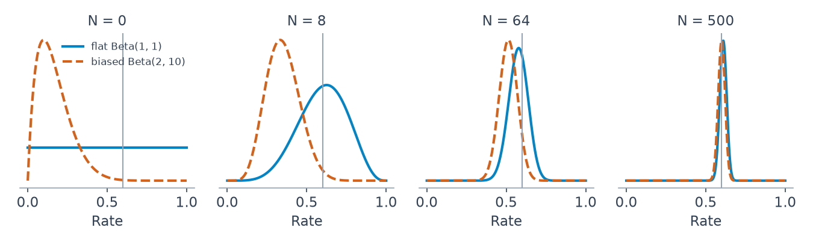

# 3 — Priors and Bandits

The first complaint anyone makes about Bayesian analysis is that the prior is subjective. The more useful complaint is that the "objective" default is often worse: a Normal(0, 100) on a logistic slope looks like modest ignorance and actually says the failure rate is almost certainly 0% or 100%. This chapter is about choosing a prior deliberately. It covers the kinds on offer, how to check one by simulating from it, when the data will overrule it, and why ridge and lasso were priors all along. Then it follows the same posterior into a different job: in a bandit, the posterior decides which option to try next, and that makes it an A/B test which stops wasting traffic as it learns.

```python
import numpy as np, pymc as pm, arviz as az
from scipy import stats, optimize
SAMPLE = dict(chains=4, cores=1, progressbar=False, random_seed=7)
```

## Kinds of prior

| Kind | What it is | Example | Caveat |
|---|---|---|---|
| Objective / flat | spread evenly over the support | Uniform(0, 1) for a rate | flat is not uninformative after a transform (see below) |
| Weakly informative | rules out absurd values, otherwise vague | Cauchy(0, 2.5) or Normal(0, 1.5) on a standardised log-odds coefficient | the modern default (Gelman, McElreath); check it on the outcome scale |
| Subjective / informative | encodes real domain knowledge | Beta(30, 970) for a conversion rate known to be about 3% | must be defensible to a sceptic |
| Empirical Bayes | prior parameters fitted from the data | centre the prior on the sample mean | BMH calls this double-counting the data, which understates uncertainty; the [winner's curse](#the-winners-curse-shrinkage-as-a-prior-on-experiments) section shows the safe form |
| Conjugate | prior chosen so the posterior has the same family | Beta for Binomial, Gamma for Poisson | convenience, not insight; rarely exists for big models |
| Jeffreys | invariant under reparameterisation, ∝ √(Fisher information) | Beta(½, ½) for a Bernoulli rate | can be improper |

BMH ch. 6's practical advice:

- **Revise a prior that gives nonsense.** BMH quotes Gelman and Shalizi: if the posterior does not make sense after fitting, additional prior knowledge is available that the model has not used. Choosing a prior is part of model checking, not a one-shot act of faith.
- **Never put zero prior mass where the truth could be.** Bounds like Uniform(0, 100) on a standard deviation are fine only if 100 is far beyond plausible.
- **Watch for priors that become informative after a transform.** That is the motivation for Jeffreys priors, and it deserves numbers.

### Flat is a choice

A flat prior on a rate is not flat on log-odds, and a wide prior on log-odds is not wide on the rate.

```python
rng = np.random.default_rng(0)
p = rng.uniform(0, 1, 200_000)
logit = np.log(p / (1 - p))
print(f"flat on p: logit sd {logit.std():.2f}, share of logit within +/-1: {(abs(logit) < 1).mean():.2f}")
for name, s in (("Normal(0, 10)", rng.normal(0, 10, 200_000)),
                ("Normal(0, 1.5)", rng.normal(0, 1.5, 200_000)),
                ("Cauchy(0, 2.5)", 2.5 * rng.standard_cauchy(200_000))):
    q = 1 / (1 + np.exp(-s))
    print(f"{name:15s} on logit: P(p<0.01 or p>0.99) = {((q < 0.01) | (q > 0.99)).mean():.2f}")
```

```text
flat on p: logit sd 1.81, share of logit within +/-1: 0.46
Normal(0, 10)   on logit: P(p<0.01 or p>0.99) = 0.65
Normal(0, 1.5)  on logit: P(p<0.01 or p>0.99) = 0.00
Cauchy(0, 2.5)  on logit: P(p<0.01 or p>0.99) = 0.32
```

The first line says a uniform p is a bell shape on the logit, with nearly half its mass between −1 and +1. The next says that Normal(0, 10) on the logit, which looks harmless, puts 65% of its mass on rates below 1% or above 99%. It is a strong prior that the outcome is nearly deterministic. Normal(0, 1.5) puts almost none there. Cauchy(0, 2.5) sits between, with heavy tails on purpose.

Picking a Beta is the same exercise with an easier scale. Read its pseudo-counts as evidence you claim already to have:

```python
for a, b in ((1, 1), (3, 97), (30, 970), (0.5, 0.5)):
    d = stats.beta(a, b)
    lo, hi = d.ppf([0.025, 0.975])
    print(f"Beta({a}, {b}): mean {d.mean():.3f}, 95% of mass in [{lo:.3f}, {hi:.3f}]")
```

```text
Beta(1, 1): mean 0.500, 95% of mass in [0.025, 0.975]
Beta(3, 97): mean 0.030, 95% of mass in [0.006, 0.071]
Beta(30, 970): mean 0.030, 95% of mass in [0.020, 0.041]
Beta(0.5, 0.5): mean 0.500, 95% of mass in [0.002, 0.998]
```

Beta(3, 97) says "around 3%, give or take". Beta(30, 970) has the same mean and claims ten times the evidence. Beta(½, ½) is the Jeffreys prior and piles its mass at the edges.

### Useful distributions for priors

| Distribution | Support | Prior for |
|---|---|---|
| Beta(α, β) | [0, 1] | rates and probabilities; α − 1 prior successes, β − 1 prior failures |
| Gamma(α, β) | (0, ∞) | positive rates and scales; Exp(β) = Gamma(1, β) |
| Half-Normal, Half-Cauchy, Exponential | (0, ∞) | standard deviations (preferred over Uniform(0, big)) |
| Normal(0, s) | ℝ | regression coefficients |
| Wishart / LKJ | positive-definite matrices | covariance matrices; prefer LKJ in PyMC |

**Conjugate update for a rate:** a Beta(1, 1) prior and X successes in N trials give Beta(1 + X, 1 + N − X). This one line powers the bandit below and the Bayesian A/B test in [chapter 4](04-bayesian-ab-testing.md).

## Prior predictive checks

You cannot judge a prior by looking at its parameters when the model transforms them. Simulate outcomes from the prior and ask whether they are the sort of thing you would believe. Here is Challenger from [chapter 1](01-bayesian-inference.md), on standardised temperature: of 23 launches, how many fail?

```python
temperature = np.array([66, 70, 69, 68, 67, 72, 73, 70, 57, 63, 70, 78, 67,
                        53, 67, 75, 70, 81, 76, 79, 75, 76, 58], dtype=float)
damage = np.array([0, 1, 0, 0, 0, 0, 0, 0, 1, 1, 1, 0, 0,
                   1, 0, 0, 0, 0, 0, 0, 1, 0, 1])
z = (temperature - temperature.mean()) / temperature.std()
for scale in (100, 5, 1.5):
    with pm.Model():
        alpha = pm.Normal("alpha", 0, scale)
        beta = pm.Normal("beta", 0, scale)
        pm.Bernoulli("obs", logit_p=alpha + beta * z, observed=damage)
        prior = pm.sample_prior_predictive(1000, random_seed=7)
    total = prior.prior_predictive["obs"].values.reshape(1000, -1).sum(axis=1)
    print(f"Normal(0, {scale:<3}) on both: P(0 or 23 failures of 23) = {np.isin(total, (0, 23)).mean():.2f}")
```

```text
Normal(0, 100) on both: P(0 or 23 failures of 23) = 0.29
Normal(0, 5  ) on both: P(0 or 23 failures of 23) = 0.18
Normal(0, 1.5) on both: P(0 or 23 failures of 23) = 0.02
```

Under the "uninformative" Normal(0, 100), the model expects all 23 launches to fail, or none, about 29% of the time. A team that knew nothing about O-rings would still doubt that. Normal(0, 1.5) gives it 2%. This is a check you do before seeing any outcome data, and it costs one line: `pm.sample_prior_predictive`. It pairs with the posterior predictive check from chapter 1, which asks the same question after fitting.

## A default for logistic regression

Gelman, Jakulin, Pittau and Su proposed the default that the table above names ([*Annals of Applied Statistics*, 2008](https://arxiv.org/abs/0901.4011)). Scale non-binary inputs to mean 0 and standard deviation 0.5. Put independent Cauchy(0, 2.5) priors on the coefficients and a Cauchy(0, 10) on the intercept. Their case for the scale is that on this input scale a move from low to high by more than 5 log-odds is rare, and that this prior keeps a small amount of information everywhere. In their cross-validation across a corpus of datasets, the Cauchy beat Gaussian and Laplace alternatives. The practical gain is stability under **complete separation**, where one side of a line holds all the 1s and the other all the 0s. Maximum likelihood has no finite answer there:

```python
x = np.array([-1.0, -0.6, -0.2, 0.2, 0.6, 1.0]) / 2       # inputs on Gelman's sd-0.5 scale
y = np.array([0, 0, 0, 1, 1, 1])                           # complete separation
def neg_log_post(b, log_prior):
    eta = b[0] + b[1] * x
    return np.sum(np.logaddexp(0, -(2 * y - 1) * eta)) - log_prior(b[1])
priors = {"flat (maximum likelihood)": lambda b: 0.0,
          "Normal(0, 100)": lambda b: stats.norm.logpdf(b, 0, 100),
          "Normal(0, 10)": lambda b: stats.norm.logpdf(b, 0, 10),
          "Cauchy(0, 2.5)": lambda b: stats.cauchy.logpdf(b, 0, 2.5)}
for name, lp in priors.items():
    fit = optimize.minimize(neg_log_post, [0.0, 1.0], args=(lp,), method="BFGS", options=dict(maxiter=500))
    p_hat = 1 / (1 + np.exp(-(fit.x[0] + fit.x[1] * x[-1])))
    print(f"{name:26s} slope {fit.x[1]:8.1f}   P(y=1 at largest x) {p_hat:.6f}")
```

```text
flat (maximum likelihood)  slope    100.3   P(y=1 at largest x) 1.000000
Normal(0, 100)             slope     39.1   P(y=1 at largest x) 1.000000
Normal(0, 10)              slope      9.6   P(y=1 at largest x) 0.991752
Cauchy(0, 2.5)             slope      3.6   P(y=1 at largest x) 0.859439
```

The flat fit stops at a slope of 100 only because the optimiser gives up, and it claims certainty at the edge of the data. [Chapter 6 of the statistics pillar](../../02-probability-and-statistics/notes/06-regression-and-glms.md) showed the same failure as an enormous coefficient with an absurd standard error. Each prior gives a finite answer and each encodes a different belief: Normal(0, 100) still claims certainty, Normal(0, 10) gives 99%, and Gelman's default gives 86% from six observations, which is about what six observations are worth.

## The prior washes out

The log posterior is log-likelihood + log-prior. The log-likelihood is a sum over data points, so it grows with N, and the log-prior does not. As N grows, any two priors with the same support give the same posterior. BMH's example pits a flat Beta(1, 1) against a biased Beta(2, 10), with a true rate of 0.6:

```python
rng = np.random.default_rng(1)
data = rng.binomial(1, 0.6, size=500)
for N in (0, 4, 8, 32, 64, 128, 500):
    s = data[:N].sum()
    m1 = (1 + s) / (2 + N)
    m2 = (2 + s) / (12 + N)
    print(f"N={N:3d}  flat Beta(1,1) {m1:.3f}   biased Beta(2,10) {m2:.3f}   gap {abs(m1 - m2):.3f}")
```

```text
N=  0  flat Beta(1,1) 0.500   biased Beta(2,10) 0.167   gap 0.333
N=  4  flat Beta(1,1) 0.500   biased Beta(2,10) 0.250   gap 0.250
N=  8  flat Beta(1,1) 0.600   biased Beta(2,10) 0.350   gap 0.250
N= 32  flat Beta(1,1) 0.676   biased Beta(2,10) 0.545   gap 0.131
N= 64  flat Beta(1,1) 0.576   biased Beta(2,10) 0.513   gap 0.063
N=128  flat Beta(1,1) 0.585   biased Beta(2,10) 0.550   gap 0.035
N=500  flat Beta(1,1) 0.610   biased Beta(2,10) 0.600   gap 0.010
```


*Image Source: generated for this chapter, using the same setup as the code above*

So the prior matters most exactly when Bayesian methods matter most: at small N. The gap in the table does not fall smoothly, because each N is one stretch of one data stream. The 32-observation row overshoots 0.6 under the flat prior: priors wash out toward what the data says, not toward the truth. A prior with zero mass at the truth never washes out at all.

Downey's locomotive problem shows both halves with a count instead of a rate. With one sighting of train number 60 and a flat prior on the fleet size N, the posterior mean is 207, 333 or 552 when the prior's upper bound is 500, 1,000 or 2,000. With three sightings (30, 60, 90) the three means are 152, 164 and 171: more data pulls the priors together, but not all the way. The other fix is better background information. Firm sizes follow roughly a power law (many small firms, few large ones), so a prior proportional to N^-1 is more realistic than a flat one, and with all three sightings its means are 131, 133 and 134 for the same three bounds, with a 90% credible interval of 91 to 243 at a bound of 1,000. The power-law posterior is also nearly insensitive to the arbitrary bound, which a flat prior on an open-ended quantity is not (*Think Bayes*, ch. 3).

| Prior on N | Upper bound 500 | 1,000 | 2,000 |
|---|---|---|---|
| Flat, train 60 only | 207 | 333 | 552 |
| Flat, trains 30, 60, 90 | 152 | 164 | 171 |
| Power law N^-1, trains 30, 60, 90 | 131 | 133 | 134 |

Downey draws the practical rule from this: with a lot of data an informative and an uninformative prior agree, and with little data, or with a decision at stake, use the background information you have rather than pretend to know less (*Think Bayes*, ch. 3). The cells above are posterior means; I re-ran them and they match the book.

The same swamping shows up on the Euro coin (140 heads in 250 spins, [chapter 1](01-bayesian-inference.md#the-coin-beta-binomial)). Downey compares a uniform prior over x = 0 to 100 with a triangular prior peaking at 50, which believes a lopsided coin less. After the 250 spins the medians (56) and the 90% credible intervals (51 to 61) are identical, and the means are 55.95 and 55.74, within 0.5% (*Think Bayes*, ch. 4; I re-ran both and the numbers match). He adds two caveats. Convergence needs the two people to agree on the model as well as the data, since a different likelihood moves the posterior however much data arrives. And a hypothesis given prior probability 0 keeps posterior probability 0 whatever is observed, which is the reasoning behind **Cromwell's rule**: never assign 0 to anything remotely possible (*Think Bayes*, ch. 4). That is the same warning as "never put zero prior mass where the truth could be" above, with a name.

With little data the prior can decide the answer. In Downey's Boston Bruins series forecast, four games of scores and a prior on goals per game with sd 0.3 give the Bruins a 57% chance of the series, and the same data with a prior of sd 0.85 (the spread of pair-by-pair averages rather than team averages) give 80%. [Chapter 1](01-bayesian-inference.md#predicting-a-game-the-posterior-predictive-as-a-mixture) has the code (*Think Bayes*, ch. 7).

## Regularisation is a prior

BMH ch. 6 derives the link between penalised regression and Bayesian MAP estimates.

| Frequentist | Bayesian equivalent |
|---|---|
| Ordinary least squares | maximum likelihood with Normal noise, flat prior on β |
| Ridge (L2 penalty λ‖β‖²) | MAP with a Normal(0, τ) prior on each β |
| Lasso (L1 penalty λ‖β‖₁) | MAP with a Laplace prior on each β |
| Penalty strength λ | prior precision (tighter prior = larger λ) |

The claim is exact and easy to check. With unit noise, a Normal(0, τ) prior corresponds to a ridge penalty of 1/τ². We use 60 rows and six inputs, of which only two matter.

```python
from sklearn.linear_model import Ridge, Lasso
rng = np.random.default_rng(2)
n, k = 60, 6
X = rng.normal(size=(n, k))
true = np.array([1.5, -1.0, 0, 0, 0, 0])
y_reg = X @ true + rng.normal(0, 1, n)                     # noise sd fixed at 1
```

```python
tau = 0.3                                                  # prior sd on each coefficient
with pm.Model():
    b = pm.Normal("b", 0, tau, shape=k)
    pm.Normal("y", X @ b, 1, observed=y_reg)
    ridge_map = pm.find_MAP(progressbar=False)["b"]
ridge = Ridge(alpha=1 / tau**2, fit_intercept=False).fit(X, y_reg).coef_
print("MAP  ", ridge_map.round(3))
print("Ridge", ridge.round(3))
```

```text
MAP   [ 1.263 -0.979 -0.114  0.115 -0.092 -0.088]
Ridge [ 1.263 -0.979 -0.114  0.115 -0.092 -0.089]
```

The MAP matches scikit-learn's ridge to within a unit in the third decimal. A Laplace prior with scale b corresponds to a lasso penalty of 1/b (scikit-learn divides the loss by n, hence `alpha = 1 / (n * scale)`).

```python
scale = 0.1                                                # Laplace prior scale
with pm.Model():
    b = pm.Laplace("b", 0, scale, shape=k)
    pm.Normal("y", X @ b, 1, observed=y_reg)
    lasso_map = pm.find_MAP(progressbar=False)["b"]
    idata = pm.sample(1000, tune=1000, **SAMPLE)
lasso = Lasso(alpha=1 / (n * scale), fit_intercept=False).fit(X, y_reg).coef_
draws = idata.posterior["b"].values.reshape(-1, k)
print("Lasso         ", lasso.round(3))
print("MAP           ", lasso_map.round(3))
print("Posterior mean", draws.mean(axis=0).round(3))
print("Draws exactly 0:", int((draws == 0).sum()), "of", draws.size)
```

```text
Lasso          [ 1.349 -0.987 -0.     0.006 -0.    -0.   ]
MAP            [ 1.337 -1.001 -0.     0.012 -0.    -0.   ]
Posterior mean [ 1.345 -0.988 -0.053  0.065 -0.047 -0.038]
Draws exactly 0: 0 of 24000
```

Lasso and the MAP agree on which coefficients vanish and are close on the rest, though not exact, because a gradient optimiser is working on a kink in the surface. The last two lines make BMH's point: lasso's sparsity comes from the geometry of the L1 penalty at the MAP, not from a prior belief in sparsity. The posterior mean under the same prior is not sparse, and not one of the 24,000 draws is exactly zero. If you want a Bayesian to say "this coefficient is zero", the Laplace prior is not doing it.

## The winner's curse: shrinkage as a prior on experiments

A team that ships every significant win will overstate its gains. [Experimentation at scale](../../03-experimentation-and-causality/notes/03-experimentation-at-scale.md) measured the inflation, and a prior is how to remove it. Suppose a platform runs 2,000 experiments whose true lifts are mostly tiny, Normal(0, 0.2) points, each measured with a standard error of 0.3:

```python
rng = np.random.default_rng(4)
n_exp = 2000
true_lift = rng.normal(0.0, 0.2, n_exp)                    # percentage points
se = 0.3
observed = true_lift + rng.normal(0, se, n_exp)
winners = observed > 1.96 * se
print(f"significant wins {winners.sum()} of {n_exp}")
print(f"mean observed lift among winners {observed[winners].mean():.3f}")
print(f"mean true lift among winners     {true_lift[winners].mean():.3f}")
prior_var = observed.var() - se**2                         # estimated across all experiments
weight = prior_var / (prior_var + se**2)
shrunk = weight * observed
print(f"estimated prior sd {prior_var ** 0.5:.3f}   shrink factor {weight:.3f}")
print(f"mean shrunken estimate among winners {shrunk[winners].mean():.3f}")
```

```text
significant wins 91 of 2000
mean observed lift among winners 0.759
mean true lift among winners     0.246
estimated prior sd 0.192   shrink factor 0.290
mean shrunken estimate among winners 0.220
```

Conditioning on significance selects the experiments whose noise pointed up, so winners report a lift three times their true one. The prior is estimated across all experiments: the variance of the observed lifts, less the known noise. Multiply each estimate by the resulting factor, and the mean among winners falls from 0.759 to 0.220, against a truth of 0.246.

This is empirical Bayes in the form that avoids BMH's objection. The prior comes from the whole population of 2,000, in which any one experiment's own result is a tiny share, so its data is not meaningfully counted twice. The simulation is ideal in having a known noise and a truly Normal population, and real programmes need the second checked.

## Eliciting priors from experts

- **Trial roulette:** give the expert a grid of bins and twenty chips, and have them place chips to show where they think the value lies. Fit a distribution to the chip histogram. It works with people who would never write down a Beta.
- **BMH's stock-returns example:** expert beliefs about four stocks' daily returns become Normal priors on the means, and a Wishart prior on the covariance. Posterior means and correlations then feed a mean-variance portfolio optimiser. The warning is that finance has a very low signal-to-noise ratio, and that with N assets the covariance has N(N−1)/2 correlations to estimate, so start from the sample covariance, or drop correlations you do not need.

## Bayesian bandits (Thompson sampling)

The multi-armed bandit: N slot machines with unknown payout rates. Each pull earns a reward and also teaches you about that arm. Pull the best-looking arm too early and you may never discover the real best one. Keep pulling all arms equally and you waste pulls on losers. An A/B test is a bandit that explores uniformly until a fixed N and then exploits.

### The algorithm

For each round:

1. For each arm b, draw a sample X_b from its posterior Beta(1 + wins_b, 1 + losses_b).
2. Pull the arm with the largest sample.
3. Observe the reward and update that arm's posterior.


Uncertain arms produce widely spread samples, so they still win the draw sometimes. Exploration happens automatically and fades as evidence accumulates. Losers are never discarded, only chosen at a decreasing rate. The rule is due to Thompson in 1933, and it spent decades in the shade until empirical work such as [Chapelle and Li (NeurIPS, 2011)](https://proceedings.neurips.cc/paper/2011/hash/e53a0a2978c28872a4505bdb51db06dc-Abstract.html) found it highly competitive and argued it should be a standard baseline.

```python
rng = np.random.default_rng(5)
class Bandits:
    def __init__(self, p_array):
        self.p = np.asarray(p_array)
    def pull(self, i):
        return rng.random() < self.p[i]
    def __len__(self):
        return len(self.p)

class BayesianStrategy:
    def __init__(self, bandits):
        self.bandits = bandits
        self.wins = np.zeros(len(bandits))
        self.trials = np.zeros(len(bandits))
    def sample_bandits(self, n=1):
        for _ in range(n):
            draw = rng.beta(1 + self.wins, 1 + self.trials - self.wins)
            choice = np.argmax(draw)
            self.wins[choice] += self.bandits.pull(choice)
            self.trials[choice] += 1

strat = BayesianStrategy(Bandits([0.85, 0.60, 0.75]))
strat.sample_bandits(1000)
print("pulls   ", strat.trials.astype(int))
print("post sd ", np.round(stats.beta(1 + strat.wins, 1 + strat.trials - strat.wins).std(), 3))
```

```text
pulls    [926  26  48]
post sd  [0.011 0.091 0.061]
```

After 1,000 pulls the 0.85 arm has 926 of them and a tight posterior. The others have wide posteriors, which is correct: the strategy has learned just enough about them to stop paying for more.

### Measuring a strategy: regret

```text
R_T = Σ_{i=1..T} (w_opt − w_{B(i)})
```

Here w_opt is the best arm's true rate and w_B(i) the rate of the arm chosen in round i. Zero regret means you always picked the best arm. [Lai and Robbins (*Advances in Applied Mathematics*, 1985)](https://doi.org/10.1016/0196-8858(85)90002-8) proved that any good strategy's regret must grow at least logarithmically in T, so a strategy matching that rate has "solved" the problem in BMH's phrase. Thompson sampling was shown to be logarithmic by [Agrawal and Goyal (COLT, 2012)](https://proceedings.mlr.press/v23/agrawal12.html), and [Bayes-UCB](http://proceedings.mlr.press/v22/kaufmann12/kaufmann12.pdf) has finite-time bounds that imply asymptotic optimality for binary rewards (Kaufmann, Cappé and Garivier, AISTATS 2012).

| Strategy | Rule | Expected regret |
|---|---|---|
| Random | pick uniformly | linear in T |
| Max mean | pick the highest posterior mean | can lock onto a wrong arm |
| Upper credible bound | pick the highest 95th percentile of the posterior | fixed quantile: no guarantee claimed here, measured below |
| Bayes-UCB | pick the highest posterior quantile, with the level rising over time | logarithmic, optimal for binary rewards |
| Thompson | sample and take the max | logarithmic |

BMH estimates expected regret by repeating the simulation 500 times, the Law of Large Numbers again. Here are 300 runs on low rates more like a checkout than a slot machine:

```python
def run(rule, p, T, rng):
    wins, trials = np.zeros(len(p)), np.zeros(len(p))
    regret = np.empty(T)
    for t in range(T):
        i = rule(wins, trials, t, rng)
        wins[i] += rng.random() < p[i]
        trials[i] += 1
        regret[t] = p.max() - p[i]
    return regret.cumsum()

rules = {
    "random": lambda w, n, t, r: r.integers(len(w)),
    "max mean": lambda w, n, t, r: np.argmax((1 + w) / (2 + n)),
    "95% upper bound": lambda w, n, t, r: np.argmax(stats.beta.ppf(0.95, 1 + w, 1 + n - w)),
    "Thompson": lambda w, n, t, r: np.argmax(r.beta(1 + w, 1 + n - w)),
}
p = np.array([0.15, 0.20, 0.10])                           # checkout-style low rates
rng = np.random.default_rng(6)
for name, rule in rules.items():
    runs = np.array([run(rule, p, 2000, rng)[[99, 499, 1999]] for _ in range(300)])
    print(f"{name:16s} regret at 100 {runs[:, 0].mean():5.1f}   500 {runs[:, 1].mean():6.1f}   2000 {runs[:, 2].mean():6.1f}")
```

```text
random           regret at 100   5.0   500   24.9   2000  100.0
max mean         regret at 100   2.9   500    8.8   2000   28.3
95% upper bound  regret at 100   3.3   500    8.6   2000   14.6
Thompson         regret at 100   3.8   500   12.4   2000   22.8
```

Random pays at a constant rate. Thompson's regret climbs from 12 to 23 while pulls quadruple. In this setup, over this horizon, the plain 95% bound beats it, at 14.6, and at 500 pulls max mean is level with the bound. Do not read this as a ranking, because the ordering depends on the gaps and the horizon, and with 300 runs the means still carry noise. Run your own simulation with your rates and horizon before you commit to a rule. Thompson's appeal is that it has no quantile to choose and extends directly to the cases below.

### Extensions from BMH

| Extension | Change |
|---|---|
| Minimise instead (prizes are bad) | take `argmin` of the samples |
| Non-stationary arms | learning rate: `wins = rate * wins + result`, `trials = rate * trials + 1`; `rate < 1` forgets old evidence faster |
| Non-binary rewards | sample from the posterior of each arm's expected reward; needs MCMC if not conjugate |
| Comment ranking | treat each comment as an arm with Beta(1 + U, 1 + D); on each page load, sample a score per comment and sort. New comments still get seen, unlike ranking by the lower bound ([chapter 4](04-bayesian-ab-testing.md)) |

The non-stationary row is one line of change, and it pays when the world moves. Two arms swap their rates halfway through 4,000 pulls:

```python
rng = np.random.default_rng(8)
def forget(rate, T=4000):
    w, n, reward = np.zeros(2), np.zeros(2), 0
    for t in range(T):
        p = np.array([0.20, 0.10]) if t < T // 2 else np.array([0.10, 0.20])   # arms swap
        i = np.argmax(rng.beta(1 + w, 1 + n - w))
        r = rng.random() < p[i]
        w, n = rate * w, rate * n
        w[i] += r
        n[i] += 1
        reward += r
    return reward / T
for rate in (1.0, 0.99):
    print(f"rate {rate}: mean reward per pull {np.mean([forget(rate) for _ in range(100)]):.3f}")
```

```text
rate 1.0: mean reward per pull 0.162
rate 0.99: mean reward per pull 0.179
```

The forgetful strategy reacts to the swap and earns about 10% more per pull. On a stationary problem it would cost a little, because forgetting throws away evidence.

### Sutton and Barto's testbed, and the exact Bayesian answer

The standard benchmark is the 10-armed testbed: 2,000 random bandits, each arm's true value drawn from Normal(0, 1), each reward Normal(true value, 1), 1,000 steps per run, sample-average estimates starting at 0 (*Reinforcement Learning: An Introduction*, ch. 2). A purely greedy learner levelled off near 1 reward per step against about 1.54 for always pulling the best arm, and found the best arm in only about a third of the runs: in the rest, disappointing early draws from the best arm sent it elsewhere for good. Epsilon-greedy at 0.1 found the best arm sooner but never chose it more than 91% of the time, and 0.01 improves more slowly but is expected to end higher, which the authors state and the 1,000 plotted steps do not show.

Thompson sampling above is the posterior-sampling version of the same trade. Two points from the chapter sharpen it:

- **Non-stationarity.** Sample averages assume arms do not change. If they drift, a constant step size weights recent rewards more, which is the "forgetful strategy" above, and the authors note that effectively non-stationary problems are the most common in reinforcement learning.
- **The exact answer is intractable.** Treating the posterior as the problem's information state gives the Bayes-optimal exploration, but even with two actions and two rewards a 1,000-step horizon has 2^2000 leaves in its tree. Thompson sampling and UCB are the feasible stand-ins, which is why the chapter's "Bayesian" bandit is an approximation.

### Bandit or A/B test?

| Use a bandit when | Use a fixed-horizon A/B test when |
|---|---|
| the cost of showing a loser is high (ads, recommendations, promotions) | you need an unbiased effect estimate to report |
| arms change over time | the decision is a one-off ship or no-ship |
| there are many arms | you need to measure guardrail and long-term metrics |

Allocation that responds to outcomes is why the left column cannot report a clean effect. The arm that looked bad early stops getting traffic, so its estimate stays noisy and tends to stay low. Larkspur would not have used a bandit for checkout: it wanted a number to report and guardrail metrics it could read at the end.

## Pitfalls

| Pitfall | What goes wrong | Fix |
|---|---|---|
| Calling a wide prior uninformative | On the logit, Normal(0, 10) puts 65% on p < 1% or p > 99% | Simulate outcomes from the prior |
| Fitting the prior on the same data | Double-counts it and understates uncertainty | Use earlier data, or a population of other units |
| Zero mass at the truth | The posterior can never move there | Use generous supports |
| Unscaled inputs with a default prior | Cauchy(0, 2.5) means little if the input is in pounds or milliseconds | Scale first, as Gelman et al. specify |
| Reading lasso as a sparsity belief | The Laplace posterior is not sparse | Use MAP if you want zeros, and say that's what you did |
| Reporting a bandit's arm means as an effect | Adaptive allocation biases them | Run a fixed split, or a holdout, for the number you report |
| Trusting a published regret ranking | The order depends on gaps and horizon | Simulate with your own rates |

---

## Try it

1. Your prior for a checkout rate is "about 5%, and I'd be surprised outside 3–8%". Find a Beta that says so.
2. Without running anything: Normal(0, 1) or Normal(0, 10) on a slope, which gives the stronger ridge penalty, and by what factor in λ?
3. In `washout`, would Beta(2, 10) converge to the flat prior's answer faster or slower than Beta(200, 1000)? Why?
4. A Thompson bandit runs a week on a price test where weekend buyers convert differently. What goes wrong, and which row of the extensions table helps?

<details>
<summary>Answers</summary>

1. Beta(25, 475) has mean 0.05 and pseudo-count 500. Checking with `stats.beta(25, 475).ppf([.025, .975])` gives about 0.033 to 0.071. That is close to the stated range, so a slightly smaller count would widen it a little and is also defensible.
2. Normal(0, 1), by a factor of 100, since λ = 1/τ² with unit noise.
3. Slower for Beta(200, 1000). Its pseudo-count is 1,200 against 12, so it takes a hundred times the data to be overruled.
4. The early arm's data comes from a different mix of days, so the posterior reflects timing as well as price, and it shifts traffic on that basis. The learning rate helps it recover, but the honest answer for a price decision is usually a fixed split across whole weeks.

</details>

---

## Interview checklist

| Prompt | Answer |
|---|---|
| Is a flat prior uninformative? | Only on the scale it is flat on. A uniform p is a bell shape on log-odds |
| What is a weakly informative prior? | One that rules out absurd values and otherwise lets the data speak, such as Gelman's Cauchy(0, 2.5) on scaled inputs |
| How do you check a prior? | Prior predictive simulation: generate outcomes and ask if they are believable |
| How does ridge relate to Bayes? | Ridge is the MAP under Normal priors; lasso is the MAP under Laplace priors. λ is the prior precision |
| Does a Laplace prior give sparsity? | Only at the MAP. Posterior draws are not zero |
| What is the winner's curse? | Selecting on significance inflates reported effects. Shrinking toward a prior fit across experiments removes most of it |
| How does Thompson sampling work? | Draw from each arm's posterior, pull the highest draw, and update. Uncertainty drives exploration |
| What is regret, and what is the bound? | The cumulative gap to the best arm. Lai and Robbins' lower bound is logarithmic in T |
| Why not always use a bandit? | Adaptive allocation biases effect estimates, and it is poorly suited to long-term and guardrail metrics |

---

## Further reading

- BMH ch. 6 for the Jeffreys derivation, the stock example and more bandit extensions.
- Gelman et al. (2008), above, is short and worth reading for its section on separation.
- [Statistical Rethinking 2023](https://www.youtube.com/playlist?list=PLDcUM9US4XdPz-KxHM4XHt7uUVGWWVSus) for prior predictive simulation throughout.

---

## Next

[Chapter 4: Bayesian A/B Testing](04-bayesian-ab-testing.md) takes the Beta posterior back to Larkspur's checkout: P(B > A), expected loss, what peeking does and does not cost, and ranking by a lower credible bound.
