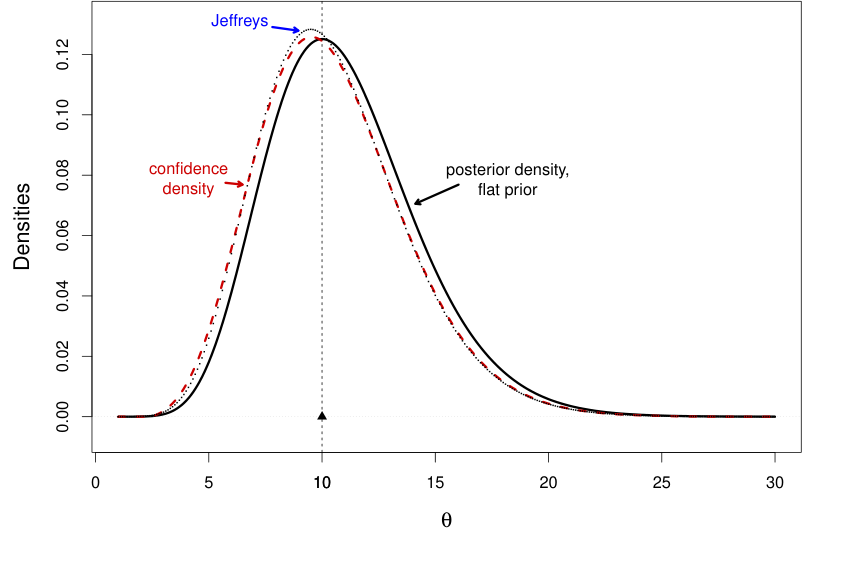
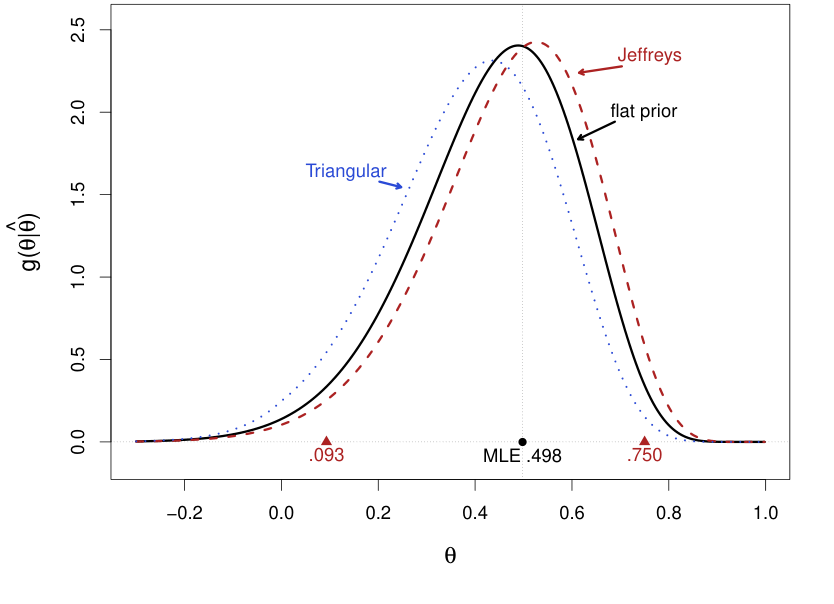
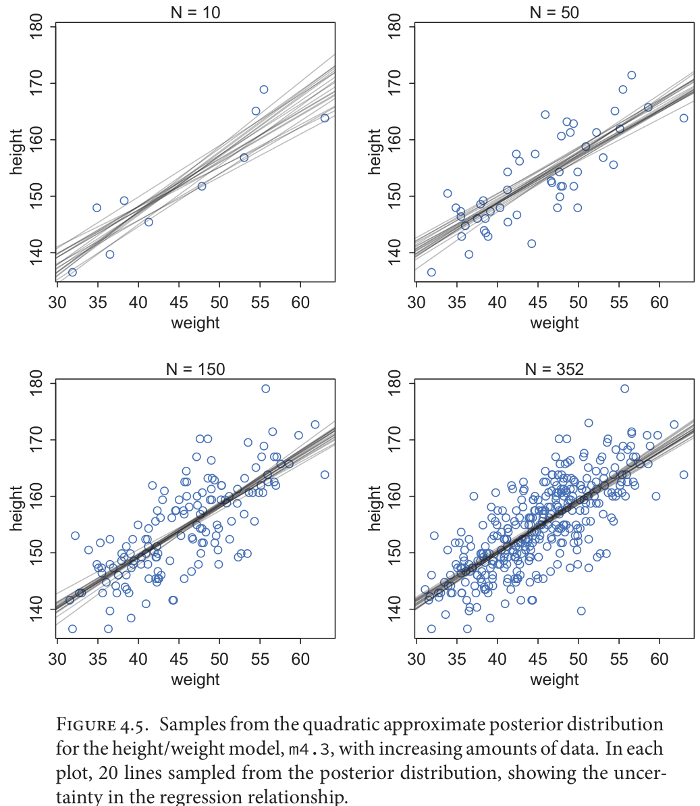
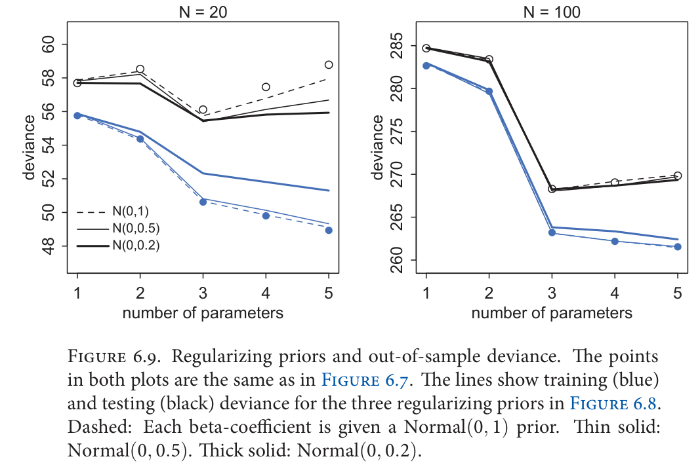
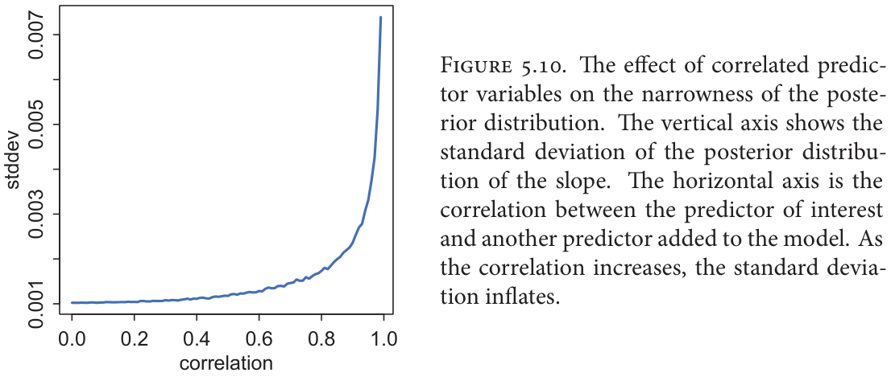
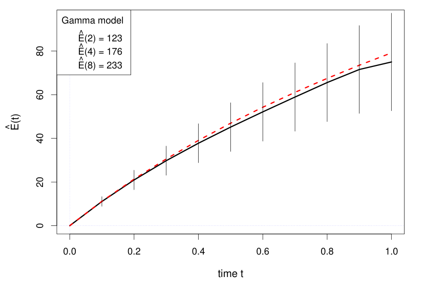
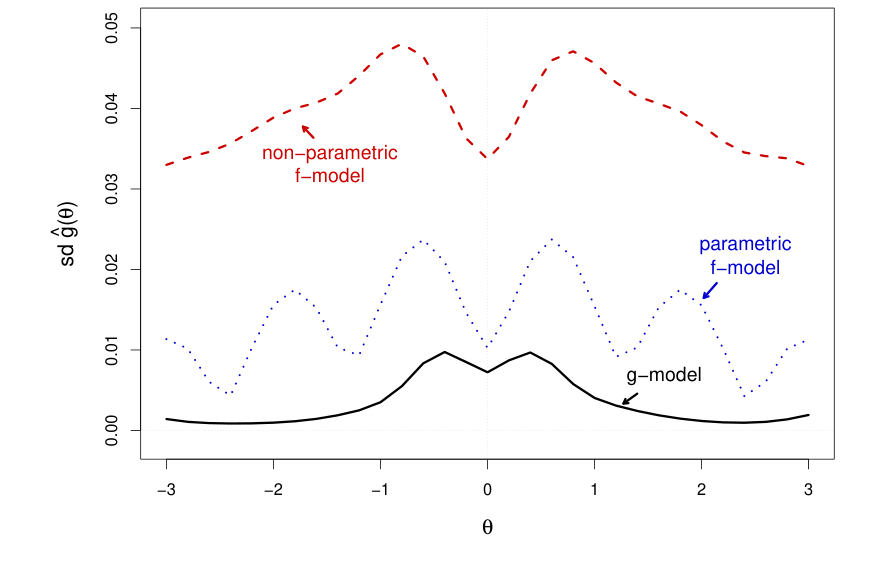

# 3 — Priors and Empirical Bayes

The first complaint anyone makes about Bayesian analysis is that the prior is subjective. The more useful complaint is that the "objective" default is often worse: a Normal(0, 100) on a logistic slope looks like modest ignorance and actually says the failure rate is almost certainly 0% or 100%. This chapter is about choosing a prior deliberately. It covers the kinds on offer, how to check one by simulating from it, when the data will overrule it, and why ridge and lasso were priors all along, then how a prior fitted across many experiments (empirical Bayes) takes back the winner's curse. The bandit half of the story, where the same posterior decides which option to try next, is in [3b](03b-bandits-and-thompson-sampling.md).

```python
import numpy as np, pymc as pm, arviz as az
from scipy import stats, optimize
SAMPLE = dict(chains=4, cores=1, progressbar=False, random_seed=7)
```

## Kinds of prior

| Kind | What it is | Example | Caveat |
|---|---|---|---|
| Objective / flat | spread evenly over the support | Uniform(0, 1) for a rate | flat is not uninformative after a transform (see below) |
| Weakly informative | rules out absurd values, otherwise vague | Cauchy(0, 2.5) or Normal(0, 1.5) on a standardised log-odds coefficient | the modern default (Gelman, McElreath); check it on the outcome scale |
| Subjective / informative | encodes real domain knowledge | Beta(30, 970) for a conversion rate known to be about 3% | must be defensible to a sceptic |
| Empirical Bayes | prior parameters fitted from the data | centre the prior on the sample mean | BMH calls this double-counting the data, which understates uncertainty; the [winner's curse](#the-winners-curse-shrinkage-as-a-prior-on-experiments) section shows the safe form |
| Conjugate | prior chosen so the posterior has the same family | Beta for Binomial, Gamma for Poisson | convenience, not insight; rarely exists for big models |
| Jeffreys | invariant under reparameterisation, ∝ √(Fisher information) | Beta(½, ½) for a Bernoulli rate | can be improper |

BMH ch. 6's practical advice:

- **Revise a prior that gives nonsense.** BMH quotes Gelman and Shalizi: if the posterior does not make sense after fitting, additional prior knowledge is available that the model has not used. Choosing a prior is part of model checking, not a one-shot act of faith.
- **Never put zero prior mass where the truth could be.** Bounds like Uniform(0, 100) on a standard deviation are fine only if 100 is far beyond plausible.
- **Watch for priors that become informative after a transform.** That is the motivation for Jeffreys priors, and it deserves numbers.

### Flat is a choice

A flat prior on a rate is not flat on log-odds, and a wide prior on log-odds is not wide on the rate.

```python
rng = np.random.default_rng(0)
p = rng.uniform(0, 1, 200_000)
logit = np.log(p / (1 - p))
print(f"flat on p: logit sd {logit.std():.2f}, share of logit within +/-1: {(abs(logit) < 1).mean():.2f}")
for name, s in (("Normal(0, 10)", rng.normal(0, 10, 200_000)),
                ("Normal(0, 1.5)", rng.normal(0, 1.5, 200_000)),
                ("Cauchy(0, 2.5)", 2.5 * rng.standard_cauchy(200_000))):
    q = 1 / (1 + np.exp(-s))
    print(f"{name:15s} on logit: P(p<0.01 or p>0.99) = {((q < 0.01) | (q > 0.99)).mean():.2f}")
```

```text
flat on p: logit sd 1.81, share of logit within +/-1: 0.46
Normal(0, 10)   on logit: P(p<0.01 or p>0.99) = 0.65
Normal(0, 1.5)  on logit: P(p<0.01 or p>0.99) = 0.00
Cauchy(0, 2.5)  on logit: P(p<0.01 or p>0.99) = 0.32
```

The first line says a uniform p is a bell shape on the logit, with nearly half its mass between −1 and +1. The next says that Normal(0, 10) on the logit, which looks harmless, puts 65% of its mass on rates below 1% or above 99%. It is a strong prior that the outcome is nearly deterministic. Normal(0, 1.5) puts almost none there. Cauchy(0, 2.5) sits between, with heavy tails on purpose.

Picking a Beta is the same exercise with an easier scale. Read its pseudo-counts as evidence you claim already to have:

```python
for a, b in ((1, 1), (3, 97), (30, 970), (0.5, 0.5)):
    d = stats.beta(a, b)
    lo, hi = d.ppf([0.025, 0.975])
    print(f"Beta({a}, {b}): mean {d.mean():.3f}, 95% of mass in [{lo:.3f}, {hi:.3f}]")
```

```text
Beta(1, 1): mean 0.500, 95% of mass in [0.025, 0.975]
Beta(3, 97): mean 0.030, 95% of mass in [0.006, 0.071]
Beta(30, 970): mean 0.030, 95% of mass in [0.020, 0.041]
Beta(0.5, 0.5): mean 0.500, 95% of mass in [0.002, 0.998]
```

Beta(3, 97) says "around 3%, give or take". Beta(30, 970) has the same mean and claims ten times the evidence. Beta(½, ½) is the Jeffreys prior and piles its mass at the edges.

### Jeffreys: a flat prior that survives a transform

Jeffreys' rule sets the prior proportional to the square root of the Fisher information, g(θ) ∝ I(θ)^½, and the result transforms correctly: reparametrise to φ = t(θ) and the rule applied to φ gives the same posterior. That removes the objection to flat priors above. For a Poisson count x with rate θ the rule gives g(θ) ∝ θ^(−½), so observing x = 10 gives a Gamma(10.5) posterior with mean 10.5, against Gamma(11) and mean 11.0 under a flat prior (recomputed here). Efron and Hastie's Fig. 13.1 shows the flat-prior posterior sitting about 0.5 to the right of the confidence density for the same data, with the Jeffreys posterior nearly on top of it (*Computer Age Statistical Inference*, ch. 13).



*Image Source: Efron and Hastie, *Computer Age Statistical Inference* (Cambridge University Press, 2016), Fig. 13.1*

The book's second case is a sample correlation of 0.498 from n = 22 students' mechanics and vectors scores, assuming a bivariate normal. The Jeffreys posterior gives a 95% credible interval of [0.093, 0.750], nearly the Neyman confidence interval, while the flat and a triangular shrinkage prior g(θ) = 1 − |θ| give visibly different curves (ch. 3, Fig. 3.2).



*Image Source: Efron and Hastie, *Computer Age Statistical Inference* (Cambridge University Press, 2016), Fig. 3.2*

Two limits come with it. In one parameter Jeffreys tends to match frequentist coverage, but with ten normal means xᵢ ~ N(θᵢ, 1) the joint Jeffreys prior is flat and "can produce disastrous overall results" (ch. 3, pointing to ch. 13), and no single prior is uninformative for every target t(θ). The flat default is also where the winner's curse below begins: for the top gene of 6,033 in a prostate study (x = 5.29), a flat prior returns 5.29, while the empirical Bayes prior the book builds later returns 4.11 (ch. 3).

### Useful distributions for priors

| Distribution | Support | Prior for |
|---|---|---|
| Beta(α, β) | [0, 1] | rates and probabilities; α − 1 prior successes, β − 1 prior failures |
| Gamma(α, β) | (0, ∞) | positive rates and scales; Exp(β) = Gamma(1, β) |
| Half-Normal, Half-Cauchy, Exponential | (0, ∞) | standard deviations (preferred over Uniform(0, big)) |
| Normal(0, s) | ℝ | regression coefficients |
| Wishart / LKJ | positive-definite matrices | covariance matrices; prefer LKJ in PyMC |

**Conjugate update for a rate:** a Beta(1, 1) prior and X successes in N trials give Beta(1 + X, 1 + N − X). This one line powers the bandit in [3b](03b-bandits-and-thompson-sampling.md) and the Bayesian A/B test in [chapter 4](04-bayesian-ab-testing.md).

## Prior predictive checks

You cannot judge a prior by looking at its parameters when the model transforms them. Simulate outcomes from the prior and ask whether they are the sort of thing you would believe. Here is Challenger from [chapter 1](01-bayesian-inference.md), on standardised temperature: of 23 launches, how many fail?

```python
temperature = np.array([66, 70, 69, 68, 67, 72, 73, 70, 57, 63, 70, 78, 67,
                        53, 67, 75, 70, 81, 76, 79, 75, 76, 58], dtype=float)
damage = np.array([0, 1, 0, 0, 0, 0, 0, 0, 1, 1, 1, 0, 0,
                   1, 0, 0, 0, 0, 0, 0, 1, 0, 1])
z = (temperature - temperature.mean()) / temperature.std()
for scale in (100, 5, 1.5):
    with pm.Model():
        alpha = pm.Normal("alpha", 0, scale)
        beta = pm.Normal("beta", 0, scale)
        pm.Bernoulli("obs", logit_p=alpha + beta * z, observed=damage)
        prior = pm.sample_prior_predictive(1000, random_seed=7)
    total = prior.prior_predictive["obs"].values.reshape(1000, -1).sum(axis=1)
    print(f"Normal(0, {scale:<3}) on both: P(0 or 23 failures of 23) = {np.isin(total, (0, 23)).mean():.2f}")
```

```text
Normal(0, 100) on both: P(0 or 23 failures of 23) = 0.29
Normal(0, 5  ) on both: P(0 or 23 failures of 23) = 0.18
Normal(0, 1.5) on both: P(0 or 23 failures of 23) = 0.02
```

Under the "uninformative" Normal(0, 100), the model expects all 23 launches to fail, or none, about 29% of the time. A team that knew nothing about O-rings would still doubt that. Normal(0, 1.5) gives it 2%. This is a check you do before seeing any outcome data, and it costs one line: `pm.sample_prior_predictive`. It pairs with the posterior predictive check from chapter 1, which asks the same question after fitting.

## A default for logistic regression

Gelman, Jakulin, Pittau and Su proposed the default that the table above names ([*Annals of Applied Statistics*, 2008](https://arxiv.org/abs/0901.4011)). Scale non-binary inputs to mean 0 and standard deviation 0.5. Put independent Cauchy(0, 2.5) priors on the coefficients and a Cauchy(0, 10) on the intercept. Their case for the scale is that on this input scale a move from low to high by more than 5 log-odds is rare, and that this prior keeps a small amount of information everywhere. In their cross-validation across a corpus of datasets, the Cauchy beat Gaussian and Laplace alternatives. The practical gain is stability under **complete separation**, where one side of a line holds all the 1s and the other all the 0s. Maximum likelihood has no finite answer there:

```python
x = np.array([-1.0, -0.6, -0.2, 0.2, 0.6, 1.0]) / 2       # inputs on Gelman's sd-0.5 scale
y = np.array([0, 0, 0, 1, 1, 1])                           # complete separation
def neg_log_post(b, log_prior):
    eta = b[0] + b[1] * x
    return np.sum(np.logaddexp(0, -(2 * y - 1) * eta)) - log_prior(b[1])
priors = {"flat (maximum likelihood)": lambda b: 0.0,
          "Normal(0, 100)": lambda b: stats.norm.logpdf(b, 0, 100),
          "Normal(0, 10)": lambda b: stats.norm.logpdf(b, 0, 10),
          "Cauchy(0, 2.5)": lambda b: stats.cauchy.logpdf(b, 0, 2.5)}
for name, lp in priors.items():
    fit = optimize.minimize(neg_log_post, [0.0, 1.0], args=(lp,), method="BFGS", options=dict(maxiter=500))
    p_hat = 1 / (1 + np.exp(-(fit.x[0] + fit.x[1] * x[-1])))
    print(f"{name:26s} slope {fit.x[1]:8.1f}   P(y=1 at largest x) {p_hat:.6f}")
```

```text
flat (maximum likelihood)  slope    100.3   P(y=1 at largest x) 1.000000
Normal(0, 100)             slope     39.1   P(y=1 at largest x) 1.000000
Normal(0, 10)              slope      9.6   P(y=1 at largest x) 0.991752
Cauchy(0, 2.5)             slope      3.6   P(y=1 at largest x) 0.859439
```

The flat fit stops at a slope of 100 only because the optimiser gives up, and it claims certainty at the edge of the data. [Chapter 6 of the statistics pillar](../../02-probability-and-statistics/notes/06b-logistic-regression-and-poisson-glms.md#separation) showed the same failure as an enormous coefficient with an absurd standard error. Each prior gives a finite answer and each encodes a different belief: Normal(0, 100) still claims certainty, Normal(0, 10) gives 99%, and Gelman's default gives 86% from six observations, which is about what six observations are worth.

## The prior washes out

The log posterior is log-likelihood + log-prior. The log-likelihood is a sum over data points, so it grows with N, and the log-prior does not. As N grows, any two priors with the same support give the same posterior. BMH's example pits a flat Beta(1, 1) against a biased Beta(2, 10), with a true rate of 0.6:

```python
rng = np.random.default_rng(1)
data = rng.binomial(1, 0.6, size=500)
for N in (0, 4, 8, 32, 64, 128, 500):
    s = data[:N].sum()
    m1 = (1 + s) / (2 + N)
    m2 = (2 + s) / (12 + N)
    print(f"N={N:3d}  flat Beta(1,1) {m1:.3f}   biased Beta(2,10) {m2:.3f}   gap {abs(m1 - m2):.3f}")
```

```text
N=  0  flat Beta(1,1) 0.500   biased Beta(2,10) 0.167   gap 0.333
N=  4  flat Beta(1,1) 0.500   biased Beta(2,10) 0.250   gap 0.250
N=  8  flat Beta(1,1) 0.600   biased Beta(2,10) 0.350   gap 0.250
N= 32  flat Beta(1,1) 0.676   biased Beta(2,10) 0.545   gap 0.131
N= 64  flat Beta(1,1) 0.576   biased Beta(2,10) 0.513   gap 0.063
N=128  flat Beta(1,1) 0.585   biased Beta(2,10) 0.550   gap 0.035
N=500  flat Beta(1,1) 0.610   biased Beta(2,10) 0.600   gap 0.010
```


*Image Source: generated for this chapter, using the same setup as the code above*

So the prior matters most exactly when Bayesian methods matter most: at small N. The gap in the table does not fall smoothly, because each N is one stretch of one data stream. The 32-observation row overshoots 0.6 under the flat prior: priors wash out toward what the data says, not toward the truth. A prior with zero mass at the truth never washes out at all.

Downey's locomotive problem shows both halves with a count instead of a rate. With one sighting of train number 60 and a flat prior on the fleet size N, the posterior mean is 207, 333 or 552 when the prior's upper bound is 500, 1,000 or 2,000. With three sightings (30, 60, 90) the three means are 152, 164 and 171: more data pulls the priors together, but not all the way. The other fix is better background information. Firm sizes follow roughly a power law (many small firms, few large ones), so a prior proportional to N^-1 is more realistic than a flat one, and with all three sightings its means are 131, 133 and 134 for the same three bounds, with a 90% credible interval of 91 to 243 at a bound of 1,000. The power-law posterior is also nearly insensitive to the arbitrary bound, which a flat prior on an open-ended quantity is not (*Think Bayes*, ch. 3).

| Prior on N | Upper bound 500 | 1,000 | 2,000 |
|---|---|---|---|
| Flat, train 60 only | 207 | 333 | 552 |
| Flat, trains 30, 60, 90 | 152 | 164 | 171 |
| Power law N^-1, trains 30, 60, 90 | 131 | 133 | 134 |

Downey draws the practical rule from this: with a lot of data an informative and an uninformative prior agree, and with little data, or with a decision at stake, use the background information you have rather than pretend to know less (*Think Bayes*, ch. 3). The cells above are posterior means; I re-ran them and they match the book.

The same swamping shows up on the Euro coin (140 heads in 250 spins, [chapter 1](01-bayesian-inference.md#the-coin-beta-binomial)). Downey compares a uniform prior over x = 0 to 100 with a triangular prior peaking at 50, which believes a lopsided coin less. After the 250 spins the medians (56) and the 90% credible intervals (51 to 61) are identical, and the means are 55.95 and 55.74, within 0.5% (*Think Bayes*, ch. 4; I re-ran both and the numbers match). He adds two caveats. Convergence needs the two people to agree on the model as well as the data, since a different likelihood moves the posterior however much data arrives. And a hypothesis given prior probability 0 keeps posterior probability 0 whatever is observed, which is the reasoning behind **Cromwell's rule**: never assign 0 to anything remotely possible (*Think Bayes*, ch. 4). That is the same warning as "never put zero prior mass where the truth could be" above, with a name.

With little data the prior can decide the answer. In Downey's Boston Bruins series forecast, four games of scores and a prior on goals per game with sd 0.3 give the Bruins a 57% chance of the series, and the same data with a prior of sd 0.85 (the spread of pair-by-pair averages rather than team averages) give 80%. [Chapter 1](01-bayesian-inference.md#predicting-a-game-the-posterior-predictive-as-a-mixture) has the code (*Think Bayes*, ch. 7).

## Regularisation is a prior

BMH ch. 6 derives the link between penalised regression and Bayesian MAP estimates.

| Frequentist | Bayesian equivalent |
|---|---|
| Ordinary least squares | maximum likelihood with Normal noise, flat prior on β |
| Ridge (L2 penalty λ‖β‖²) | MAP with a Normal(0, τ) prior on each β |
| Lasso (L1 penalty λ‖β‖₁) | MAP with a Laplace prior on each β |
| Penalty strength λ | prior precision (tighter prior = larger λ) |

James et al. state the same pairing: under independent Gaussian priors ridge is both the posterior mode and mean, and under a Laplace prior lasso is the posterior mode (*An Introduction to Statistical Learning with Applications in Python*, ch. 6, Fig. 6.11). In their orthonormal special case ridge divides each least-squares coefficient by 1 + λ, while the lasso subtracts λ/2 and clips at zero (eqs. 6.14 and 6.15, "soft thresholding"), which is the mechanism behind lasso's exact zeros.

The claim is exact and easy to check. With unit noise, a Normal(0, τ) prior corresponds to a ridge penalty of 1/τ². We use 60 rows and six inputs, of which only two matter.

```python
from sklearn.linear_model import Ridge, Lasso
rng = np.random.default_rng(2)
n, k = 60, 6
X = rng.normal(size=(n, k))
true = np.array([1.5, -1.0, 0, 0, 0, 0])
y_reg = X @ true + rng.normal(0, 1, n)                     # noise sd fixed at 1
```

```python
tau = 0.3                                                  # prior sd on each coefficient
with pm.Model():
    b = pm.Normal("b", 0, tau, shape=k)
    pm.Normal("y", X @ b, 1, observed=y_reg)
    ridge_map = pm.find_MAP(progressbar=False)["b"]
ridge = Ridge(alpha=1 / tau**2, fit_intercept=False).fit(X, y_reg).coef_
print("MAP  ", ridge_map.round(3))
print("Ridge", ridge.round(3))
```

```text
MAP   [ 1.263 -0.979 -0.114  0.115 -0.092 -0.088]
Ridge [ 1.263 -0.979 -0.114  0.115 -0.092 -0.089]
```

The MAP matches scikit-learn's ridge to within a unit in the third decimal. A Laplace prior with scale b corresponds to a lasso penalty of 1/b (scikit-learn divides the loss by n, hence `alpha = 1 / (n * scale)`).

```python
scale = 0.1                                                # Laplace prior scale
with pm.Model():
    b = pm.Laplace("b", 0, scale, shape=k)
    pm.Normal("y", X @ b, 1, observed=y_reg)
    lasso_map = pm.find_MAP(progressbar=False)["b"]
    idata = pm.sample(1000, tune=1000, **SAMPLE)
lasso = Lasso(alpha=1 / (n * scale), fit_intercept=False).fit(X, y_reg).coef_
draws = idata.posterior["b"].values.reshape(-1, k)
print("Lasso         ", lasso.round(3))
print("MAP           ", lasso_map.round(3))
print("Posterior mean", draws.mean(axis=0).round(3))
print("Draws exactly 0:", int((draws == 0).sum()), "of", draws.size)
```

```text
Lasso          [ 1.349 -0.987 -0.     0.006 -0.    -0.   ]
MAP            [ 1.337 -1.001 -0.     0.012 -0.    -0.   ]
Posterior mean [ 1.345 -0.988 -0.053  0.065 -0.047 -0.038]
Draws exactly 0: 0 of 24000
```

Lasso and the MAP agree on which coefficients vanish and are close on the rest, though not exact, because a gradient optimiser is working on a kink in the surface. The last two lines make BMH's point: lasso's sparsity comes from the geometry of the L1 penalty at the MAP, not from a prior belief in sparsity. The posterior mean under the same prior is not sparse, and not one of the 24,000 draws is exactly zero. If you want a Bayesian to say "this coefficient is zero", the Laplace prior is not doing it.

### Priors as imagined data, and what regularising buys out of sample

McElreath gives a way to read a Gaussian prior's strength: a Normal(mu, sd) prior on a mean is worth about n = 1/sd^2 observations of the outcome. On adult heights (!Kung census, n = 352), Normal(178, 0.1) equals 100 observed heights and Normal(178, 20) equals 0.0025 of one (*Statistical Rethinking*, ch. 4). The narrow prior wins: the posterior for mu stays at 177.86, against 154.61 under the weak prior, and sigma, whose prior did not change, jumps from 7.73 to 24.52 to absorb the misfit. A prior on one parameter moves the others, so sensitivity checks have to refit the whole model. With a sensible prior, the posterior over a regression line tightens as data arrive: 20 lines sampled from the posterior of the height-on-weight fit fan out at N = 10 and nearly coincide at N = 352, where the slope is 0.90 cm per kg (sd 0.04).



*Image Source: McElreath, *Statistical Rethinking* (CRC Press), Fig. 4.5*

The out-of-sample case for tight priors comes from a simulation in chapter 6. The outcome is Normal(mu, 1) with mu = 0.15 x1 - 0.4 x2, so the true model has three parameters, and models with one to five parameters are fitted to 10,000 simulated training sets and scored on fresh data from the same process. Training deviance falls with every added parameter. Test deviance is lowest at three. Normal(0, 1) on a standardised slope puts only 5% of its mass beyond 2 sd; tightening to Normal(0, 0.5) and Normal(0, 0.2) makes training deviance worse and test deviance better for the over-parameterised models. At N = 20 with Normal(0, 0.2), the four- and five-parameter models are barely worse than the true three-parameter one, and at N = 100 the data overwhelm even Normal(0, 0.2) (*Statistical Rethinking*, ch. 6). That is the ridge result from above, measured on held-out data: regularisation is the prior, and its value depends on N. McElreath calls multilevel models "adaptive regularisation", because they learn the prior's strength from the data ([chapter 7](07-multilevel-models-and-partial-pooling.md)).



*Image Source: McElreath, *Statistical Rethinking* (CRC Press), Fig. 6.9*

The opposite problem is two near-duplicate predictors. In a simulation (N = 100, leg lengths of one person with noise sd 0.02, priors Normal(2, 10) on each leg's slope), the two slopes come out at -0.43 (sd 2.18) and 2.48 (sd 2.19), uninterpretable on their own, while their sum is 2.05, the slope the one-leg model recovers with sd 0.07. For milk fat and lactose across 29 primate species (r = -0.94), the joint model roughly doubles both standard deviations. In McElreath's sweep (100 flat-prior fits per correlation) the slope's sd rises from about 0.001 at zero correlation to about 0.007 at 0.99, most of it past 0.9, and he notes flat priors exaggerate this and informative ones slow it (*Statistical Rethinking*, ch. 5). A posterior is always proper, so "weakly identified" is the right phrase. A wide posterior is the model answering the question you asked.



*Image Source: McElreath, *Statistical Rethinking* (CRC Press), Fig. 5.10*

## The winner's curse: shrinkage as a prior on experiments

A team that ships every significant win will overstate its gains. [Experimentation at scale](../../03-experimentation-and-causality/notes/03-experimentation-at-scale.md) measured the inflation, and a prior is how to remove it. Suppose a platform runs 2,000 experiments whose true lifts are mostly tiny, Normal(0, 0.2) points, each measured with a standard error of 0.3:

```python
rng = np.random.default_rng(4)
n_exp = 2000
true_lift = rng.normal(0.0, 0.2, n_exp)                    # percentage points
se = 0.3
observed = true_lift + rng.normal(0, se, n_exp)
winners = observed > 1.96 * se
print(f"significant wins {winners.sum()} of {n_exp}")
print(f"mean observed lift among winners {observed[winners].mean():.3f}")
print(f"mean true lift among winners     {true_lift[winners].mean():.3f}")
prior_var = observed.var() - se**2                         # estimated across all experiments
weight = prior_var / (prior_var + se**2)
shrunk = weight * observed
print(f"estimated prior sd {prior_var ** 0.5:.3f}   shrink factor {weight:.3f}")
print(f"mean shrunken estimate among winners {shrunk[winners].mean():.3f}")
```

```text
significant wins 91 of 2000
mean observed lift among winners 0.759
mean true lift among winners     0.246
estimated prior sd 0.192   shrink factor 0.290
mean shrunken estimate among winners 0.220
```

Conditioning on significance selects the experiments whose noise pointed up, so winners report a lift three times their true one. The prior is estimated across all experiments: the variance of the observed lifts, less the known noise. Multiply each estimate by the resulting factor, and the mean among winners falls from 0.759 to 0.220, against a truth of 0.246.

This is empirical Bayes in the form that avoids BMH's objection. The prior comes from the whole population of 2,000, in which any one experiment's own result is a tiny share, so its data is not meaningfully counted twice. The simulation is ideal in having a known noise and a truly Normal population, and real programmes need the second checked.

### Empirical Bayes without a prior family: Robbins' formula

The simulation above assumed a Normal prior. Robbins' formula needs none. If x is a count drawn from Poisson(θ) with θ from an unknown prior, then E{θ | x} = (x + 1) y(x+1) / y(x), where y(x) is the number of cases that showed count x, because the observed counts already carry the prior's information. Efron and Hastie's table is one year of claims on 9,461 automobile policies: 7,840 had no claims, 1,317 had one and 239 had two. For a customer with no claims the formula gives 1 × 1,317 / 7,840 = 0.168 expected claims next year. It is erratic where counts are thin: at x = 5 it returns 6.00 (recomputed from the book's table), while a gamma prior fitted by maximum likelihood gives about 1.34 (*Computer Age Statistical Inference*, ch. 6).

The same idea predicts what has not been seen yet. Corbet trapped butterflies for two years in Malaya: 118 species were caught once, 74 twice, 44 three times. Fisher's missing-species estimate of the number of new species in a further t units of trapping time (one unit being the original two years) is Ê(t) = y₁t − y₂t² + y₃t³ − …, which gives Ê(½) = 45.2 ± 11.2 new species (*Computer Age Statistical Inference*, ch. 6, Table 6.3 and Fig. 6.2). The series fails for t > 1, and the gamma-prior version gives Ê(2) = 123 as educated guessing. On Shakespeare's 884,647 words, with 14,376 words used once and 31,534 distinct, a new canon of equal size would bring 11,430 ± 178 unseen words (t = 1; re-summing the printed counts up to x = 100 gives about 11,490, the tail being unprinted).



*Image Source: Efron and Hastie, *Computer Age Statistical Inference* (Cambridge University Press, 2016), Fig. 6.2*

Both cases estimate the marginal counts and read the prior off them, which the book later calls f-modelling. Its alternative is g-modelling: fit the prior g(θ) itself, usually a spike at zero plus a smooth slab, and deconvolve. In a 1,000-case simulation with X ~ N(θ, 1), the standard deviation of the estimated g from nonparametric f-modelling averaged more than 20 times that of the g-model at similar bias, and a parametric f-model reduced it without reaching the g-model (ch. 21, Fig. 21.11). On the 6,033-gene prostate data the g-model puts the null probability at 0.946 against 0.984 from the f-model locfdr.



*Image Source: Efron and Hastie, *Computer Age Statistical Inference* (Cambridge University Press, 2016), Fig. 21.11*

## Eliciting priors from experts

- **Trial roulette:** give the expert a grid of bins and twenty chips, and have them place chips to show where they think the value lies. Fit a distribution to the chip histogram. It works with people who would never write down a Beta.
- **BMH's stock-returns example:** expert beliefs about four stocks' daily returns become Normal priors on the means, and a Wishart prior on the covariance. Posterior means and correlations then feed a mean-variance portfolio optimiser. The warning is that finance has a very low signal-to-noise ratio, and that with N assets the covariance has N(N−1)/2 correlations to estimate, so start from the sample covariance, or drop correlations you do not need.

Thompson sampling, regret, the 10-armed testbed and the bandit-or-A/B question are in [3b](03b-bandits-and-thompson-sampling.md).

## Pitfalls

| Pitfall | What goes wrong | Fix |
|---|---|---|
| Calling a wide prior uninformative | On the logit, Normal(0, 10) puts 65% on p < 1% or p > 99% | Simulate outcomes from the prior |
| Fitting the prior on the same data | Double-counts it and understates uncertainty | Use earlier data, or a population of other units |
| Zero mass at the truth | The posterior can never move there | Use generous supports |
| Unscaled inputs with a default prior | Cauchy(0, 2.5) means little if the input is in pounds or milliseconds | Scale first, as Gelman et al. specify |
| Reading lasso as a sparsity belief | The Laplace posterior is not sparse | Use MAP if you want zeros, and say that's what you did |

---

## Try it

1. Your prior for a checkout rate is "about 5%, and I'd be surprised outside 3–8%". Find a Beta that says so.
2. Without running anything: Normal(0, 1) or Normal(0, 10) on a slope, which gives the stronger ridge penalty, and by what factor in λ?
3. In `washout`, would Beta(2, 10) converge to the flat prior's answer faster or slower than Beta(200, 1000)? Why?

<details>
<summary>Answers</summary>

1. Beta(25, 475) has mean 0.05 and pseudo-count 500. Checking with `stats.beta(25, 475).ppf([.025, .975])` gives about 0.033 to 0.071. That is close to the stated range, so a slightly smaller count would widen it a little and is also defensible.
2. Normal(0, 1), by a factor of 100, since λ = 1/τ² with unit noise.
3. Slower for Beta(200, 1000). Its pseudo-count is 1,200 against 12, so it takes a hundred times the data to be overruled.

</details>

---

## Interview checklist

| Prompt | Answer |
|---|---|
| Is a flat prior uninformative? | Only on the scale it is flat on. A uniform p is a bell shape on log-odds |
| What is a weakly informative prior? | One that rules out absurd values and otherwise lets the data speak, such as Gelman's Cauchy(0, 2.5) on scaled inputs |
| How do you check a prior? | Prior predictive simulation: generate outcomes and ask if they are believable |
| How does ridge relate to Bayes? | Ridge is the MAP under Normal priors; lasso is the MAP under Laplace priors. λ is the prior precision |
| Does a Laplace prior give sparsity? | Only at the MAP. Posterior draws are not zero |
| What is the winner's curse? | Selecting on significance inflates reported effects. Shrinking toward a prior fit across experiments removes most of it |

---

## Further reading

- BMH ch. 6 for the Jeffreys derivation and the stock example.
- Gelman et al. (2008), above, is short and worth reading for its section on separation.
- [Statistical Rethinking 2023](https://www.youtube.com/playlist?list=PLDcUM9US4XdPz-KxHM4XHt7uUVGWWVSus) for prior predictive simulation throughout.

---

## Next

[Chapter 3b: Bandits and Thompson Sampling](03b-bandits-and-thompson-sampling.md) follows the same Beta posterior into a different job: choosing the next arm to pull. Chapter 4 then takes it back to Larkspur's checkout.
