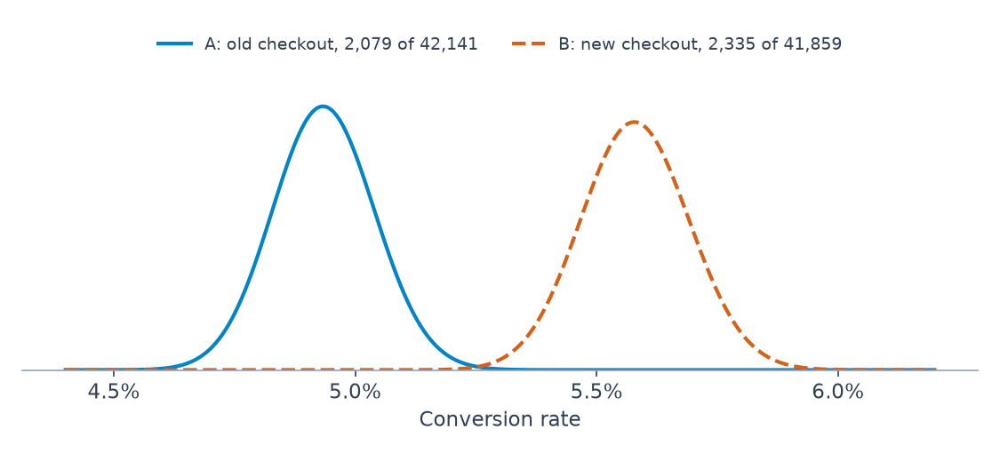

# 4 — Bayesian A/B Testing

Larkspur's head of product wanted two things from the checkout test: how likely is it that the new checkout is better, and what do we lose if we ship it and we are wrong? [The frequentist analysis](../../03-experimentation-and-causality/notes/01-ab-testing.md) gave a lift, an interval and a p-value, and none of those is either answer. This chapter computes both, in a few lines, from the same counts. It also tests the claim that often comes attached, that Bayesian tests are immune to peeking. A simulation shows they are not, and shows that a popular stopping rule does something you may not expect. The last section uses the same lower-bound idea to rank items with few ratings, including prompts by eval pass rate.

```python
import numpy as np, pymc as pm
from scipy import stats
from scipy.special import betaln
SAMPLE = dict(chains=4, cores=1, progressbar=False, random_seed=7)
```

## The question changes

| [Frequentist A/B](../../03-experimentation-and-causality/notes/01-ab-testing.md) | Bayesian A/B |
|---|---|
| "If A and B were equal, how surprising is this data?" (p-value) | "Given the data, what is P(B > A)?" |
| fixed N set in advance | any N; unequal arms are fine |
| reject / fail to reject | a probability and an expected loss to act on |
| lift with a confidence interval | full posterior of the lift; credible interval |
| peeking inflates false positives | peeking also inflates them under a probability rule; see below |

The AB notebook in the experimentation pillar ([practice/AB-Bayes/AB_Testing_with_Python.ipynb](../../03-experimentation-and-causality/practice/AB-Bayes/AB_Testing_with_Python.ipynb)) is, despite its folder name, entirely frequentist. A comment in it ("check out bayesian recursive learning method of adjusting proportions after establishing prior") is the pointer to this chapter, and the code below works on the kind of counts it computes.

## The PyMC model

BMH ch. 2 simulates two sites with true rates of 5% and 4%, deliberately giving B half the traffic.

```python
rng = np.random.default_rng(11)
true_p_A, true_p_B = 0.05, 0.04
N_A, N_B = 1500, 750
obs_A = rng.binomial(1, true_p_A, size=N_A)
obs_B = rng.binomial(1, true_p_B, size=N_B)
print(f"observed A {obs_A.mean():.4f}  B {obs_B.mean():.4f}")
with pm.Model():
    p_A = pm.Uniform("p_A", 0, 1)
    p_B = pm.Uniform("p_B", 0, 1)
    pm.Deterministic("delta", p_A - p_B)            # the quantity we care about
    pm.Bernoulli("obs_A", p_A, observed=obs_A)
    pm.Bernoulli("obs_B", p_B, observed=obs_B)
    trace = pm.sample(1000, tune=1000, **SAMPLE)
delta = trace.posterior["delta"].values.flatten()
print(f"sd p_A {trace.posterior['p_A'].values.std():.4f}  sd p_B {trace.posterior['p_B'].values.std():.4f}")
print(f"P(A better than B) = {(delta > 0).mean():.3f}")
print(f"closed form        = {(rng.beta(1 + obs_A.sum(), 1 + N_A - obs_A.sum(), 200_000) > rng.beta(1 + obs_B.sum(), 1 + N_B - obs_B.sum(), 200_000)).mean():.3f}")
```

```text
observed A 0.0380  B 0.0467
sd p_A 0.0049  sd p_B 0.0078
P(A better than B) = 0.169
closed form        = 0.157
```

The sampled answer agrees with the closed form to within a percentage point, and three things are worth reading off it:

- The posterior of p_B is wider than p_A's (sd 0.0078 against 0.0049), because B had half the traffic. The model handles unequal N without any correction.
- The simulated draw reversed the truth: A really is better, yet B's observed rate is higher, so P(A better than B) is only about 0.17. That is a correct report of this data and a wrong guess about the world. Small samples at low rates do this, which is why the sample-size calculation from the experimentation pillar still matters here.
- If N_B rises, p_B's posterior narrows and the probability firms up. More data, more certainty, no change in method.

## Skip the sampler: Beta closed form

Conversion data is Binomial and Beta is conjugate, so each arm's posterior is known exactly ([chapter 1](01-bayesian-inference.md)):

```text
p_A | data ~ Beta(α₀ + conversions_A, β₀ + visitors_A − conversions_A)
```

Draw from both posteriors and compare. It is fast enough to run on every dashboard refresh.

```python
rng = np.random.default_rng(0)
a0, b0 = 1, 1                                        # uniform prior; see "priors" below
conv_A, n_A = 120, 1000
conv_B, n_B = 140, 1000
post_A = rng.beta(a0 + conv_A, b0 + n_A - conv_A, 200_000)
post_B = rng.beta(a0 + conv_B, b0 + n_B - conv_B, 200_000)
lift = (post_B - post_A) / post_A
print(f"P(B > A)           {(post_B > post_A).mean():.3f}")
print(f"relative lift 95%  {np.percentile(lift, [2.5, 97.5]).round(3)}")
print(f"loss if choose B   {np.maximum(post_A - post_B, 0).mean():.5f}")
print(f"loss if choose A   {np.maximum(post_B - post_A, 0).mean():.5f}")
```

```text
P(B > A)           0.908
relative lift 95%  [-0.07   0.462]
loss if choose B   0.00064
loss if choose A   0.02058
```

P(B > A) also has an exact finite sum ([Evan Miller](https://www.evanmiller.org/bayesian-ab-testing.html)), and it confirms the Monte Carlo figure:

```python
def prob_b_beats_a(a_a, b_a, a_b, b_b):             # Evan Miller's finite sum
    i = np.arange(a_b)
    return np.exp(betaln(a_a + i, b_a + b_b) - np.log(b_b + i)
                  - betaln(1 + i, b_b) - betaln(a_a, b_a)).sum()
print(f"exact P(B > A) = {prob_b_beats_a(121, 881, 141, 861):.4f}")
```

```text
exact P(B > A) = 0.9079
```

Monte Carlo generalises to any function of the rates, such as relative lift or revenue, which is why it is the habit worth keeping.

## Larkspur, answered

The checkout test ended with 2,079 of 42,141 converting on A and 2,335 of 41,859 on B.

```python
rng = np.random.default_rng(1)
post_A = rng.beta(1 + 2079, 1 + 42141 - 2079, 400_000)
post_B = rng.beta(1 + 2335, 1 + 41859 - 2335, 400_000)
diff = post_B - post_A
print(f"A {2079 / 42141:.4f}   B {2335 / 41859:.4f}")
print(f"P(B > A)        {(diff > 0).mean():.5f}")
print(f"exact           {prob_b_beats_a(2080, 40063, 2336, 39525):.5f}")
print(f"lift 95%        [{np.percentile(diff, 2.5) * 100:+.2f}, {np.percentile(diff, 97.5) * 100:+.2f}] pp")
print(f"loss if ship B  {np.maximum(-diff, 0).mean() * 100:.6f} pp")
print(f"loss if keep A  {np.maximum(diff, 0).mean() * 100:.3f} pp")
print(f"P(lift > 0.5pp) {(diff > 0.005).mean():.3f}")
print(f"P(lift > 1.0pp) {(diff > 0.010).mean():.3f}")
```

```text
A 0.0493   B 0.0558
P(B > A)        0.99999
exact           0.99999
lift 95%        [+0.34, +0.95] pp
loss if ship B  0.000001 pp
loss if keep A  0.645 pp
P(lift > 0.5pp) 0.827
P(lift > 1.0pp) 0.011
```


*Image Source: generated for this chapter from the Larkspur counts*

So here is what the head of product asked for. The new checkout is better with probability above 0.9999. If it is shipped and turns out to be worse, the expected cost is negligible, while keeping the old checkout gives up 0.645 points in expectation. The lift probably clears the half-point the team set as the minimum worth shipping (0.83), and is very unlikely to reach a full point (0.01). This last pair is what the business case uses, and the frequentist output could not state it directly.

The credible interval of +0.34 to +0.95 points matches the confidence interval from [the frequentist analysis](../../03-experimentation-and-causality/notes/01-ab-testing.md). At this sample size, with a flat prior, the two calculations agree numerically and differ in what they permit you to say.

## Expected loss: the decision rule

Take the 1,000-visitor example above. P(B > A) = 0.91 does not say how bad the other 9% is. Expected loss does.

```text
E[loss | choose B] = E[ max(p_A − p_B, 0) ]
```

It is the average conversion rate you give up by shipping B, counting only the worlds where A was actually better. It is a loss function in the sense of [chapter 5](05-loss-functions-and-decisions.md).

| Rule | Ship B when |
|---|---|
| Probability threshold | P(B > A) > 0.95 |
| **Expected-loss threshold** ([Stucchio](https://www.chrisstucchio.com/blog/2014/bayesian_ab_decision_rule.html)) | E[loss given B] < ε, with ε the smallest difference you care about (for example 0.1 points) |
| Credible interval | the 95% interval of the lift excludes 0 |

The expected-loss rule stops early when B is clearly better, and also when the arms are so close that choosing wrong costs almost nothing. It keeps running only when the choice still matters. That second behaviour is the point, and the source of the surprise in the simulation below.

### Priors for A/B tests

| Prior | Effect |
|---|---|
| Beta(1, 1) | uniform; fine once each arm has a few hundred visitors |
| Weakly informative from history, such as Beta(5, 95) for a 5% baseline | stabilises the first days a little; washes out quickly ([chapter 3](03-priors-and-bandits.md)) |
| Strong prior from history, such as Beta(500, 9500) | demands real evidence before believing a big lift; guards against early-noise "wins" |

Use the *same* prior for both arms. The prior encodes what you knew about conversion rates before the test, not which arm you hope wins. Here is what the choice does, on a hypothetical first day with 42 against 58 conversions per 900 visitors, and on the whole test:

```python
rng = np.random.default_rng(2)
def compare(c_a, n_a, c_b, n_b, a0, b0):
    pa = rng.beta(a0 + c_a, b0 + n_a - c_a, 400_000)
    pb = rng.beta(a0 + c_b, b0 + n_b - c_b, 400_000)
    return (pb > pa).mean(), (pb - pa).mean() * 100
print("first day, 900 visitors per arm: A 42 conversions, B 58")
for name, a0, b0 in (("Beta(1, 1)", 1, 1), ("Beta(5, 95)", 5, 95), ("Beta(500, 9500)", 500, 9500)):
    day1, lift1 = compare(42, 900, 58, 900, a0, b0)
    full, lift2 = compare(2079, 42141, 2335, 41859, a0, b0)
    print(f"{name:16s} day one P(B>A) {day1:.3f} lift {lift1:+.2f}pp   full test P(B>A) {full:.5f} lift {lift2:+.2f}pp")
```

```text
first day, 900 visitors per arm: A 42 conversions, B 58
Beta(1, 1)       day one P(B>A) 0.950 lift +1.77pp   full test P(B>A) 0.99999 lift +0.64pp
Beta(5, 95)      day one P(B>A) 0.943 lift +1.60pp   full test P(B>A) 0.99998 lift +0.64pp
Beta(500, 9500)  day one P(B>A) 0.689 lift +0.15pp   full test P(B>A) 0.99992 lift +0.52pp
```

On day one the flat prior reports a 1.77-point lift, nearly three times what the whole test would find, and a probability of 0.95. The prior built on 10,000 past visitors says 0.15 points and 0.69. By the end of the test all three agree on the decision. The strong prior still pulls the lift to +0.52 points, because both arms carry the same 10,000 pseudo-visitors at 5%, which dilutes the difference a little.

## Is peeking safe?

Not automatically. The posterior is a valid summary at any N, and it is often said that this makes Bayesian tests free to peek. Run the experiment: 30 days at 500 visitors per arm per day, a 5% base rate, 4,000 simulated tests per row, using a Normal approximation to the posteriors so thousands of runs are cheap.

```python
def simulate(p_a, p_b, stop_rule, sims=4000, days=30, per_day=500, seed=3):
    """Normal approximation to both Beta posteriors, so thousands of runs are cheap."""
    rng = np.random.default_rng(seed)
    ca = rng.binomial(per_day, p_a, (sims, days)).cumsum(axis=1)
    cb = rng.binomial(per_day, p_b, (sims, days)).cumsum(axis=1)
    n = per_day * np.arange(1, days + 1)
    ra, rb = (ca + 1) / (n + 2), (cb + 1) / (n + 2)
    d, sd = rb - ra, np.sqrt(ra * (1 - ra) / n + rb * (1 - rb) / n)
    ship = stop_rule(d, sd)
    return ship.any(axis=1).mean(), ship.argmax(axis=1)[ship.any(axis=1)].mean() + 1 if ship.any() else np.nan

def prob_rule(d, sd):
    return stats.norm.cdf(d / sd) > 0.95
def loss_rule(d, sd, eps=0.0005):
    u = d / sd                                       # E[max(A - B, 0)] for Normal differences
    return sd * (stats.norm.pdf(u) - u * stats.norm.cdf(-u)) < eps
def last_look(rule):
    def f(d, sd):
        m = np.zeros_like(d, dtype=bool)
        m[:, -1] = rule(d[:, -1], sd[:, -1])
        return m
    return f
rows = (("P(B>A) > 0.95, last day only", last_look(prob_rule)),
        ("P(B>A) > 0.95, checked daily", prob_rule),
        ("Expected loss < 0.05pp, daily", loss_rule),
        ("Expected loss < 0.05pp, day 14 on",
         lambda d, sd: loss_rule(d, sd) & (np.arange(d.shape[1]) >= 13)))
for name, rule in rows:
    aa, day_aa = simulate(0.05, 0.05, rule)
    ab, day_ab = simulate(0.05, 0.06, rule)
    bad, _ = simulate(0.05, 0.045, rule)
    print(f"{name:34s} ship: no effect {aa:.3f}  -0.5pp {bad:.3f}  +1pp {ab:.3f}  (mean day {day_ab:.1f})")
```

```text
P(B>A) > 0.95, last day only       ship: no effect 0.047  -0.5pp 0.000  +1pp 0.987  (mean day 30.0)
P(B>A) > 0.95, checked daily       ship: no effect 0.238  -0.5pp 0.046  +1pp 0.995  (mean day 6.2)
Expected loss < 0.05pp, daily      ship: no effect 0.589  -0.5pp 0.143  +1pp 1.000  (mean day 3.9)
Expected loss < 0.05pp, day 14 on  ship: no effect 0.482  -0.5pp 0.038  +1pp 1.000  (mean day 14.1)
```

The columns give how often each rule ships B when B has no effect, when it costs half a point, and when it adds a full point.

**Row 1 against row 2.** Checked once, P(B > A) > 0.95 ships a no-effect change 4.7% of the time. With a flat prior that threshold is close to a one-sided p < 0.05, and this is the same number you would expect from one. Checked daily, it ships 23.8%, in line with the inflation for repeated p-values in [experimentation at scale](../../03-experimentation-and-causality/notes/03-experimentation-at-scale.md) (about 25% over twenty looks). The posterior was not wrong on any given day. It is calibrated averaged over the prior, and a simulation fixing the effect at exactly zero is not that average. A rule that takes the first favourable look still selects on noise.

**Row 3.** The expected-loss rule ships 59% of no-effect changes, and ships quickly. That looks like a disaster until you read what the rule promises: the loss from shipping a change with no effect is zero, so it is doing its job, and a no-effect change is a safe thing to ship. The number that matters is the −0.5 point column. Checked daily, the rule ships a harmful change 14.3% of the time, because early on the posterior is wide and a lucky start can make the expected loss small.

**Row 4.** A minimum sample size is what protects you. Waiting until day 14 and then applying the same rule drops harmful shipping to 3.8%, about what the daily probability rule manages, while still shipping real wins essentially always. Running full weeks also handles day-of-week effects.

The rule is therefore: an expected-loss threshold, a minimum sample size set in advance, and full weeks. Also, don't call the test "immune to peeking" in a planning meeting, because the second row of this table says it isn't. These figures depend on this setup (effect sizes, traffic, ε), and you should rerun `simulate` with yours.

McElreath's closing chapter makes the same argument from the other side: an analysis plan fixed before the data arrives (a mock analysis, registered publicly, with any later changes documented and justified) is the part of the pipeline that a researcher controls, and an analysis designed after seeing the data can overfit in ways that priors and regularisation cannot reliably repair (*Statistical Rethinking*, ch. 15). It is an essay, with no numbers of its own to test.

## Ranking with few observations

The same machinery fixes a small-N trap ([sampling distributions](../../02-probability-and-statistics/notes/03-distributions-and-sampling.md) raises it for ratings). Sorting by raw upvote ratio puts a comment with 1 upvote and 0 downvotes (100%) above one with 999 and 1 (99.9%).

BMH ch. 4's fix is to give each comment a posterior over its true upvote ratio and sort by the **95% least plausible value**, the 5th percentile of the posterior. A comment ranks high only if we are confident its ratio is high. The fast form is a Normal approximation to the Beta posterior:

```python
def lower_bound(u, d):
    a, b = 1 + u, 1 + d
    return a / (a + b) - 1.65 * np.sqrt((a * b) / ((a + b) ** 2 * (a + b + 1)))
for u, d in ((999, 1), (60, 40), (6, 4), (1, 0)):
    exact = stats.beta(1 + u, 1 + d).ppf(0.05)
    print(f"{u:4d} up {d:3d} down  raw {u / (u + d):.3f}  normal bound {lower_bound(u, d):.3f}  exact 5th pct {exact:.3f}")
```

```text
 999 up   1 down  raw 0.999  normal bound 0.996  exact 5th pct 0.995
  60 up  40 down  raw 0.600  normal bound 0.518  exact 5th pct 0.517
   6 up   4 down  raw 0.600  normal bound 0.358  exact 5th pct 0.350
   1 up   0 down  raw 1.000  normal bound 0.278  exact 5th pct 0.224
```

The approximation sits close to the exact percentile except at the smallest count. There 1/0 has a very skewed posterior, so if you can call `stats.beta(...).ppf(0.05)`, prefer it. BMH's original uses PyMC, which you only need when the model is not conjugate:

```python
def posterior_upvote_ratio(upvotes, downvotes, draws=2000):
    with pm.Model():
        ratio = pm.Uniform("ratio", 0, 1)
        pm.Binomial("obs", upvotes + downvotes, ratio, observed=upvotes)
        idata = pm.sample(draws, tune=1000, **SAMPLE)
    return idata.posterior["ratio"].values.flatten()
print(f"6 up 4 down, 5th percentile by NUTS: {np.percentile(posterior_upvote_ratio(6, 4), 5):.3f}")
```

```text
6 up 4 down, 5th percentile by NUTS: 0.357
```

**Star ratings** work the same way. Map n stars out of N to n/N, sum the scores into S over all ratings, and use a = 1 + S, b = 1 + (count − S) in the same formula.

```python
ratings = np.array([5, 5, 4, 3, 5, 4, 5])            # seven ratings out of 5 stars
S = (ratings / 5).sum()
print(f"S {S:.2f}  mean {ratings.mean():.2f}  lower bound on the 0-1 scale {lower_bound(S, len(ratings) - S):.3f}")
```

```text
S 6.20  mean 4.43  lower bound on the 0-1 scale 0.591
```

### Where else to use it

| Ranking | Successes | Trials |
|---|---|---|
| products by rating | sum of normalised stars | number of ratings |
| sellers by on-time delivery | on-time orders | orders |
| ads by click-through | clicks | impressions |
| LLM prompts or models by eval pass rate | passes | eval cases |

The last row deserves a run, since it is a common mistake with small eval sets:

```python
for name, passes, cases in (("prompt A", 19, 20), ("prompt B", 170, 200)):
    print(f"{name}: raw {passes / cases:.3f}  lower bound {lower_bound(passes, cases - passes):.3f}")
```

```text
prompt A: raw 0.950  lower bound 0.810
prompt B: raw 0.850  lower bound 0.805
```

Prompt A looks ten points better. With 20 cases its lower bound is 0.81, about the same as prompt B on 200. A 95% on a small suite doesn't yet beat 85% on a large one.

BMH ch. 6's limitation: the lower bound favours old items with many votes. Ranking by a *sample* from each item's posterior (the comment-ranking bandit in [chapter 3](03-priors-and-bandits.md)) gives new items a chance to be seen.

A test read across many segments or markets has the same problem at a larger scale: the small segments hold the extreme numbers, and the segment that wins was picked partly for its luck. [Chapter 7](07-multilevel-models-and-partial-pooling.md) estimates all the segments together, and measures how much that shrinks the winner's exaggeration and when it doesn't help.

## Pitfalls

| Pitfall | What goes wrong | Fix |
|---|---|---|
| "Bayesian tests are immune to peeking" | Daily P(B > A) > 0.95 ships 23.8% of no-effect changes in the simulation above | Set a minimum sample, then use an expected-loss threshold |
| Reading P(B > A) as the size of the win | 0.99999 says nothing about the lift being large; here it is about 0.6 points | Report the lift interval and P(lift > a business threshold) |
| Different priors per arm | Builds your hope into the answer | Use the same prior for both |
| A flat prior on day one | A lift of 1.77 points on 900 visitors | Use a historical prior, or wait |
| Using P(B > A) when the change costs money | The probability ignores the cost and the size | Compute expected value in [chapter 5](05-loss-functions-and-decisions.md) |
| Ignoring novelty and guardrails | The posterior only answers what you measured | Everything in the experimentation pillar still applies |

---

## Try it

1. Without running code, roughly what is P(B > A) with 0 of 100 conversions on A and 0 of 100 on B?
2. Larkspur's team set its bar at half a point. With `larkspur`, compute the probability that the lift exceeds 0.3 points instead. Would a lower bar change the decision?
3. Change `eps` in `loss_rule` to 0.0001 (0.01 points). What happens to each column of the daily row, and why?
4. Evan Miller's sum needs integer α for one arm. Why doesn't this matter for star ratings if you use Monte Carlo?

<details>
<summary>Answers</summary>

1. 0.5. The two posteriors are the same Beta(1, 101), so by symmetry neither arm is favoured. The probability says nothing about the fact that both rates are tiny.
2. `(diff > 0.003).mean()` is about 0.99, against 0.83 at half a point, which fits an interval starting at +0.34 points. The decision to ship stands either way. The bar sets how much risk you are stating, not the direction.
3. On this setup no-effect shipping falls from 0.589 to 0.251 and harmful shipping from 0.143 to 0.028, because the bar for "the loss is small" is five times tighter, so early lucky looks clear it less often. Shipping a real win stays near 1 (0.997), because a real win keeps pulling expected loss toward zero.
4. Monte Carlo draws from a Beta with any positive real parameters, so S = 6.2 is fine. The finite sum in `prob_b_beats_a` loops over `arange(a_b)`, which assumes an integer.

</details>

---

## Interview checklist

| Prompt | Answer |
|---|---|
| How do you compute P(B > A)? | Sample from each arm's Beta posterior and take the share of draws where B wins, or use the finite sum |
| What is expected loss? | E[max(p_A − p_B, 0)]: the average you give up by shipping B, counting worlds where A was better |
| Is a Bayesian test safe to peek at? | Not with a probability threshold. An expected-loss rule stops for a different reason, and it still needs a minimum sample size |
| Why does the expected-loss rule ship null changes often? | Shipping a no-effect change costs nothing, so the rule has no reason to resist. The harmful-change rate is the thing to check |
| Do Bayesian and frequentist intervals disagree? | With large N and a flat prior they are numerically close. The difference is the interpretation |
| How do priors matter in an A/B test? | Most at the start; they tame early noise and wash out with traffic. Use the same one on each arm |
| How would you rank products with few ratings? | Sort by a lower credible bound of the posterior, not the raw mean |
| How would you compare prompts on eval suites of different sizes? | Lower credible bound of the pass rate, or better, the same suite on both |

---

## Further reading

- [Chris Stucchio's decision rule post](https://www.chrisstucchio.com/blog/2014/bayesian_ab_decision_rule.html), for expected loss.
- [Evan Miller's formulas](https://www.evanmiller.org/bayesian-ab-testing.html), for the closed forms.

---

## Next

[Chapter 5: Loss Functions and Bayesian Decisions](05-loss-functions-and-decisions.md) generalises expected loss: squared, absolute and asymmetric losses, why the Bayes action is rarely the posterior mean, and whether Larkspur's lift justifies what the new checkout costs to run.
