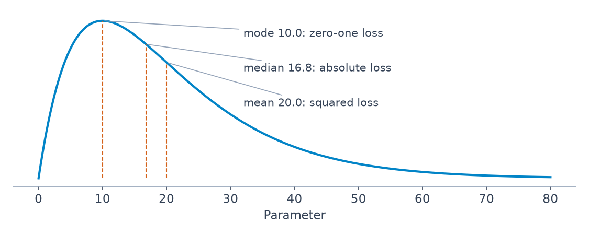
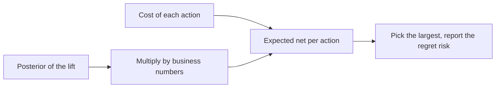

# 5 — Loss Functions and Bayesian Decisions

Larkspur now has a posterior for the checkout lift, and a posterior is not a decision. The redesign costs money to run, the finance lead wants to know if it pays, and the honest answer depends on how much a wrong call costs in each direction. That cost is something the analysis has been leaving out. This chapter puts it in. Write down what each wrong answer costs, average that cost over the posterior, and pick the action that minimises it. Squared loss then gives the posterior mean, absolute loss the median, and the asymmetric losses of real decisions give answers no point estimate would. We work through a game show, a stock signal, a stocking decision and a fraud threshold, then return to Larkspur's launch.

```python
import numpy as np, pymc as pm, scipy.optimize as sop
from scipy import stats
SAMPLE = dict(chains=4, cores=1, progressbar=False, random_seed=7)
```

## Why accuracy is not enough

BMH ch. 5 opens with a meteorologist who is 95% confident that the chance of a hurricane *not* striking is between 99% and 100%, and so advises no evacuation. By the measure of accuracy that sounds like a fine forecast. A 1% hurricane is not a rounding error, though. Accuracy measures how close the estimate is. A **loss function** measures how bad acting on it would be.

```text
L(θ, θ̂)  =  cost of estimating θ̂ when the truth is θ
```

## A catalogue of loss functions

| Loss | Formula | Behaviour | Typical use |
|---|---|---|---|
| Squared error | (θ − θ̂)² | punishes large errors heavily; outlier-sensitive | regression, most of ML |
| Asymmetric squared | (θ − θ̂)² if θ̂ < θ, else c(θ − θ̂)² with 0 < c < 1 | underestimating costs more | capacity planning: over-provisioning beats outages |
| Absolute error | \|θ − θ̂\| | linear, robust to outliers | forecasting with heavy tails |
| Zero-one | 1 if θ̂ ≠ θ | right or wrong | classification accuracy |
| Log loss | −θ log θ̂ − (1 − θ) log(1 − θ̂) | punishes confident wrong probabilities | probabilistic classifiers |
| Bounded | 1 − exp(−(θ − θ̂)²) | indifferent once far enough off | when "wrong is wrong" past a point |
| Pundit | \|θ − θ̂\| / (θ(1 − θ)) | huge near 0 and 1 | someone paid to give confident yes/no calls |
| Sign-sensitive (custom) | see the stock example below | wrong direction costs far more than wrong size | trading, any bet on a direction |

**Losses can be bent for good or ill.** BMH cites Silver's *The Signal and the Noise*: The Weather Channel reports a 20% chance of rain when it believes 5 or 10%, since people notice a missed rain forecast more than a false alarm. The loss being minimised is the forecaster's, not yours. Whenever you are handed a forecast, ask whose loss it is.

## Expected loss and the Bayes action

We never know θ, but we have samples from its posterior. The **expected loss** (Bayesian risk) of an estimate is the average loss over the posterior:

```text
l(θ̂) = E_θ[ L(θ, θ̂) ]  ≈  (1/N) Σ L(θ_i, θ̂)      θ_i ~ posterior
```

The **Bayes action** is the θ̂ that minimises it. With posterior samples this is a vectorised loss and an optimiser. On a skewed posterior:

```python
rng = np.random.default_rng(0)
posterior_samples = rng.gamma(2.0, 10.0, 100_000)    # a right-skewed posterior
losses = {"squared": lambda t, g: (t - g) ** 2,
          "absolute": lambda t, g: np.abs(t - g)}
for name, loss in losses.items():
    best = sop.minimize_scalar(lambda g: loss(posterior_samples, g).mean(),
                               bounds=(0, 100), method="bounded").x
    print(f"{name:9s} Bayes action {best:6.2f}")
print(f"posterior mean {posterior_samples.mean():.2f}  median {np.median(posterior_samples):.2f}  mode {(2.0 - 1) * 10.0:.2f}")
```

```text
squared   Bayes action  20.03
absolute  Bayes action  16.85
posterior mean 20.03  median 16.85  mode 10.00
```

The optimiser finds the mean for squared loss and the median for absolute loss, with neither formula given to it.

### Closed forms worth memorising

| Loss | Bayes action |
|---|---|
| squared error | posterior **mean** |
| absolute error | posterior **median** |
| zero-one (limit) | posterior **mode** (MAP) |

Zero-one needs a limit, because on a continuous posterior every exact guess misses. So count a miss as being further than some width, and shrink the width:

```python
for width in (5.0, 1.0, 0.2):
    grid = np.linspace(0, 60, 1201)
    miss = [(np.abs(posterior_samples - g) > width).mean() for g in grid]
    print(f"miss if further than {width}: best guess {grid[int(np.argmin(miss))]:.2f}")
```

```text
miss if further than 5.0: best guess 10.95
miss if further than 1.0: best guess 9.60
miss if further than 0.2: best guess 9.30
```

The best guess moves toward the mode of 10 as the width falls, and turns noisy once few samples fall in the window. That is one more reason a mode is hard to estimate from samples.


*Image Source: generated for this chapter, Gamma(2, scale 10) as in the code above*

This is why the mean, median and MAP are the usual summaries: each is optimal for a particular loss. When your loss is none of these, none of them is your answer.

## Example: The Price is Right showcase

BMH's game: you must bid on a showcase of two prizes, a snowblower and a trip to Toronto. Bid over the true total and you get nothing. Bid within $250 under and you win both showcases.

| Belief | Distribution |
|---|---|
| Historical showcase totals | true_price ~ Normal(35,000, 7,500) (prior) |
| Your guess at the snowblower | Normal(3,000, 500) |
| Your guess at the trip | Normal(12,000, 3,000) |
| How well your guesses add up to the price | Normal(prize_1 + prize_2, 3,000) |

```python
with pm.Model():
    true_price = pm.Normal("true_price", mu=35e3, sigma=75e2)
    prize_1 = pm.Normal("first_prize", mu=3e3, sigma=5e2)
    prize_2 = pm.Normal("second_prize", mu=12e3, sigma=3e3)
    price_estimate = prize_1 + prize_2
    logp = pm.logp(pm.Normal.dist(mu=price_estimate, sigma=3e3), true_price)
    pm.Potential("error", logp)                      # any extra log-probability term
    trace = pm.sample(2000, tune=1000, **SAMPLE)
price_trace = trace.posterior["true_price"].values.flatten()
print(f"posterior mean {price_trace.mean():,.0f}  sd {price_trace.std():,.0f}")
v_guess = 500**2 + 3000**2 + 3000**2                 # Normal-Normal closed form
w = 7500**2 / (7500**2 + v_guess)
print(f"closed form    {w * 15000 + (1 - w) * 35000:,.0f}  sd {(1 / (1 / 7500**2 + 1 / v_guess)) ** 0.5:,.0f}")
```

```text
posterior mean 20,000  sd 3,677
closed form    19,899  sd 3,712
```

`pm.Potential` adds an arbitrary term to the log posterior, for when the built-in distributions cannot say what you mean. The model has a closed form, because Normal priors and Normal evidence combine by precision, and the sampled answer sits within Monte Carlo noise of it. The posterior mean drops to about $20,000, some $15,000 below the prior, because the two prizes look cheap.

Someone adding point guesses would bid $15,000 regardless of uncertainty. A naive Bayesian would bid the posterior mean. Neither accounts for the payoff, which has a cliff in it: one dollar over and you get nothing.

```python
def showdown_loss(guess, true_price, risk=80000):
    loss = np.abs(guess - true_price)                # underbid: lose the gap
    loss[true_price < guess] = risk                  # overbid: costs 'risk'
    close = (true_price >= guess) & (true_price - guess <= 250)
    loss[close] = -2 * true_price[close]             # within 250 under: win both
    return loss

grid = np.arange(5000, 40000, 50)
for risk in (30000, 54000, 78000, 102000, 126000, 150000):
    expected = [showdown_loss(g, price_trace, risk).mean() for g in grid]
    best = grid[int(np.argmin(expected))]
    print(f"risk {risk:>7,}: bid {best:,}   P(overbid) {(price_trace < best).mean():.3f}")
```

```text
risk  30,000: bid 14,700   P(overbid) 0.070
risk  54,000: bid 13,200   P(overbid) 0.029
risk  78,000: bid 13,200   P(overbid) 0.029
risk 102,000: bid 12,200   P(overbid) 0.016
risk 126,000: bid 12,200   P(overbid) 0.016
risk 150,000: bid 11,800   P(overbid) 0.013
```

`risk` is what the contestant says an overbid costs. The answer falls from about $14,700 to $11,800 as `risk` rises, all well below the posterior mean of $20,000, and the chance of overbidding falls from 7% to about 1%. The answer sits so far below the mean because of the shape of the loss. The expected loss is spiky, since the $250 window pays out only for the rare draws inside it. BMH uses a general optimiser on it, and we search a grid, which is why the bids move in steps.

The book's own run, with PyMC2 and scipy's `fmin` from a start of 15,000 (50,000 samples, 10,000 burn-in), lands in the same place: its minimum is 14,189.08 at a risk of 30,000, then 13,236.61, 12,771.73, 11,540.84 and 11,534.79 at 54,000, 78,000, 102,000 and 126,000, and 11,265.78 at 150,000 (*Bayesian Methods for Hackers*, ch. 5). Those are a few hundred dollars from the grid above, which is the Monte Carlo and optimiser tolerance, and `fmin` only finds a local minimum, so start it near the grid's answer. One slip in the chapter's prose: it says a frequentist bids the sum of the prize means as $35,000, but 3,000 + 12,000 is $15,000 (the 35,000 is the prior's mean).

### Downey's version: an empirical prior and a rival

*Think Bayes* works the same game from the show's records (*Think Bayes*, ch. 6). The prior is not a guessed Normal. It is a kernel density estimate over 313 past prices for the first showcase, smoothed from 2011 and 2012 data, with its main mode near $28,000 and a second near $50,000. The likelihood treats the contestant as a price-guessing instrument: the error, price minus guess, is Gaussian with mean 0 and the standard deviation of `diff = price - bid` from past episodes. That substitutes bids for guesses, which Downey admits is imperfect because bids are partly strategic. A density is a perfectly good likelihood here, since only proportionality matters once you normalise.

Two results are worth keeping. First, a best guess of $20,000 moves the posterior mean to $25,096, not to $20,000: the history is a prior, and it pulls a low guess upward. Second, the payoff depends on the rival, because you win when the opponent overbids or lands further from the price than you do. Historical `diff` gives the overbid rate (25% for the first contestant, 29% for the second), and the expected gain of a bid is the posterior-weighted payoff:

```python
def gain(bid, price):                       # posterior-weighted over price gives expected gain
    if bid > price:
        return 0                            # overbid: nothing
    diff = price - bid
    prob = opponent_overbids + opponent_worse_than(diff)
    return (2 if diff <= 250 else 1) * price * prob
```

With guesses of $20,000 and $40,000, the optimal bids are $21,000 (expected gain about $16,700, unusually above the guess) and $31,500 (about $19,400, the typical case below it) (*Think Bayes*, ch. 6). I could not re-run these: the showcase CSVs are not in the repo, so they are the book's numbers. The `risk` parameter above stands in for what Downey computes explicitly from the opponent's record. His argument for the whole exercise is the one of this chapter: the payoff is asymmetric and discontinuous, so summarising the posterior by its mean or MLE throws away what you need, and a decision needs the whole distribution (*Think Bayes*, ch. 6).

## Example: predicting stock returns with a sign-sensitive loss

Squared error says predicting −0.01 and predicting +0.03 for a true return of +0.01 are equally bad. A trader disagrees, because the first loses money. (The book prints the squared losses of those two guesses as 0.004 each; (0.01 − (−0.01))² and (0.01 − 0.03)² are 0.0004 and 0.0004. The point stands, since both are equal.)

```python
def stock_loss(true_return, yhat, alpha=100.0):
    wrong_way = true_return * yhat < 0
    return np.where(wrong_way,
                    alpha * yhat**2 - np.sign(true_return) * yhat + np.abs(true_return),
                    np.abs(true_return - yhat))
print("true +0.01, predict -0.01:", round(float(stock_loss(0.01, -0.01)), 4))
print("true +0.01, predict +0.03:", round(float(stock_loss(0.01, 0.03)), 4))
print("true +0.01, predict  0.00:", round(float(stock_loss(0.01, 0.00)), 4))
```

```text
true +0.01, predict -0.01: 0.03
true +0.01, predict +0.03: 0.02
true +0.01, predict  0.00: 0.01
```

The wrong-sign prediction now costs more than the overshoot, and making no call costs least of the three. Now use it on BMH's artificial trading signal. Fit a Bayesian linear regression of return on signal, simulate possible returns for each signal value, and minimise the expected loss:

```python
rng = np.random.default_rng(1)
X = 0.025 * rng.standard_normal(100)                 # BMH's artificial trading signal
Y = 0.5 * X + 0.01 * rng.standard_normal(100)
with pm.Model():
    std = pm.Uniform("std", 0, 100)
    beta = pm.Normal("beta", 0, 100)
    alpha = pm.Normal("alpha", 0, 100)
    pm.Normal("obs", alpha + beta * X, std, observed=Y)
    trace = pm.sample(1000, tune=1000, **SAMPLE)
a_s = trace.posterior["alpha"].values.flatten()
b_s = trace.posterior["beta"].values.flatten()
s_s = trace.posterior["std"].values.flatten()
ols = np.polyfit(X, Y, 1)
print(f"beta {b_s.mean():.3f}  alpha {a_s.mean():.4f}  std {s_s.mean():.4f}   least squares slope {ols[0]:.3f}")
noise = s_s * rng.standard_normal(s_s.size)
yhat_grid = np.linspace(-0.04, 0.04, 801)
for signal in (-0.05, -0.02, -0.005, 0.0, 0.005, 0.02, 0.05):
    outcomes = a_s + b_s * signal + noise
    expected = [stock_loss(outcomes, p).mean() for p in yhat_grid]
    print(f"signal {signal:+.3f}: Bayes action {yhat_grid[int(np.argmin(expected))]:+.4f}   least squares {np.polyval(ols, signal):+.4f}")
```

```text
beta 0.487  alpha -0.0007  std 0.0101   least squares slope 0.487
signal -0.050: Bayes action -0.0245   least squares -0.0251
signal -0.020: Bayes action -0.0076   least squares -0.0105
signal -0.005: Bayes action -0.0017   least squares -0.0032
signal +0.000: Bayes action -0.0004   least squares -0.0008
signal +0.005: Bayes action +0.0007   least squares +0.0017
signal +0.020: Bayes action +0.0060   least squares +0.0090
signal +0.050: Bayes action +0.0228   least squares +0.0236
```

Near a zero signal, where the return could go either way, the Bayes action is close to zero: take almost no position. At ±0.005 it is about half the least-squares prediction or less. As the signal grows more extreme, predictions converge to the line, since by then the sign is no longer in doubt. The model does not fit the data better than least squares, and the slope is the same 0.487. It makes better *decisions* under this loss.

## Example: Observing Dark Worlds

BMH's last example is Tim Salimans' winning entry in Kaggle's dark-matter contest, which followed the full Bayesian workflow. It serves as a template for any messy prediction problem:

1. **Prior** over the unknown (halo positions).
2. **Likelihood**: a physical model of how halos distort galaxy ellipticities.
3. **Posterior** via MCMC.
4. **Bayes action**: choose predictions that minimise the expected value of the contest's own metric, about 160 lines of code, over the posterior.

Step 4 is the lesson: optimise for the metric you are scored on, under uncertainty, rather than for parameter accuracy.

The chapter's two worked skies show the gap between a posterior mean and a random guess, and a caveat on how it was scored (*Bayesian Methods for Hackers*, ch. 5). On training sky 3, with one halo, the posterior mean landed 31.15 pixels from the true halo against 1,773.43 for one random guess, scores of 1.031 against 2.773 (lower is better; 200,000 MCMC samples, 140,000 burn-in, thin 3). On sky 215, with three halos, the first halo was 37.40 pixels off against 3,756.54, scores of 1.037 against 4.757, and the sampler "took a long time" to converge (10.5×10⁵ samples). The scoring call is given one halo, so the sky 215 score covers only the first of three, and each comparison is a single random guess on two skies, so read it as an illustration and not a benchmark.

## In analytics practice

| Decision | Loss to write down | Bayes action |
|---|---|---|
| Ship B or keep A | conversion lost if wrong: max(p_A − p_B, 0) | ship if expected loss < ε ([chapter 4](04-bayesian-ab-testing.md)) |
| Inventory or capacity forecast | stock-outs cost more than surplus | an upper quantile, not the mean |
| Fraud threshold | cost of a missed fraud vs cost of a blocked customer | threshold where expected costs balance |
| Price or bid | asymmetric payoff around a cutoff | shade toward the safe side, as in the showcase |
| Model selection | the business metric, not log-likelihood | the model minimising expected business loss |

Two of these are short enough to do in full.

**Stocking.** Suppose you sold 1,200 units over 30 days, with a Gamma posterior on the daily rate. Running out costs five times what a surplus unit does. The Bayes action is the classic newsvendor answer, the quantile short / (short + over):

```python
rng = np.random.default_rng(2)
rate = rng.gamma(1 + 1200, 1 / (0.03 + 30), 8000)    # Gamma posterior on daily orders
demand = rng.poisson(rate)                           # posterior predictive for tomorrow
print(f"predictive mean {demand.mean():.1f}  sd {demand.std():.1f}")
def stock_cost(q, short=5.0, over=1.0):
    return (short * np.maximum(demand - q, 0) + over * np.maximum(q - demand, 0)).mean()
grid = np.arange(20, 70)
best = grid[int(np.argmin([stock_cost(q) for q in grid]))]
print(f"best stock {best}   critical quantile {5 / (5 + 1):.3f} -> {np.quantile(demand, 5 / 6):.0f}")
print(f"cost at the mean {stock_cost(round(demand.mean())):.2f}   cost at the Bayes action {stock_cost(best):.2f}")
```

```text
predictive mean 40.0  sd 6.5
best stock 46   critical quantile 0.833 -> 46
cost at the mean 15.26   cost at the Bayes action 9.92
```

Stocking the mean costs about 54% more than stocking the quantile.

**A threshold.** Suppose a blocked good customer costs 2 and a missed fraud costs 80, both hypothetical. Block when the expected cost of blocking is below the expected cost of allowing:

```python
cost_block, cost_miss = 2.0, 80.0
threshold = cost_block / (cost_block + cost_miss)
print(f"block when P(fraud) > {threshold:.3f}")
for p in (0.01, 0.03, 0.2):
    print(f"P(fraud)={p}: cost of blocking {(1 - p) * cost_block:.2f}, cost of allowing {p * cost_miss:.2f}")
```

```text
block when P(fraud) > 0.024
P(fraud)=0.01: cost of blocking 1.98, cost of allowing 0.80
P(fraud)=0.03: cost of blocking 1.94, cost of allowing 2.40
P(fraud)=0.2: cost of blocking 1.60, cost of allowing 16.00
```

A 2.4% threshold looks absurd on a classifier report, where people default to 0.5. It is what the costs imply. It relies on the probability being well calibrated, which [the data-science track](../../../data-science/README.md) covers.

## Larkspur: should it ship?

Chapter 4 said the new checkout is better and the lift is probably above half a point. Finance wants dollars. The figures here are hypothetical: 480,000 visitors a year, $30 per order, and a redesign costing $25,000 a year to maintain.

```python
rng = np.random.default_rng(1)
a = rng.beta(1 + 2079, 1 + 42141 - 2079, 400_000)
b = rng.beta(1 + 2335, 1 + 41859 - 2335, 400_000)
visitors, value = 40_000 * 12, 30.0                  # visitors a year, dollars per order
run_cost = 25_000                                    # a year to maintain the new checkout
gain = (b - a) * visitors * value
print(f"yearly gain: mean {gain.mean():,.0f}  95% [{np.percentile(gain, 2.5):,.0f}, {np.percentile(gain, 97.5):,.0f}]")
print(f"P(gain < run cost) {(gain < run_cost).mean():.3f}")
print(f"expected net of shipping {(gain - run_cost).mean():,.0f}   of keeping A 0")
for cost in (25_000, 45_000, 60_000, 90_000):
    print(f"cost {cost:>6,}: net {(gain - cost).mean():>8,.0f}   P(regret shipping) {(gain < cost).mean():.3f}")
```

```text
yearly gain: mean 92,906  95% [49,559, 136,395]
P(gain < run cost) 0.001
expected net of shipping 67,906   of keeping A 0
cost 25,000: net   67,906   P(regret shipping) 0.001
cost 45,000: net   47,906   P(regret shipping) 0.015
cost 60,000: net   32,906   P(regret shipping) 0.069
cost 90,000: net    2,906   P(regret shipping) 0.448
```

Everything comes from the posterior draws, multiplied by the business numbers. Shipping is clearly right at $25,000. The table shows how far that holds: at $60,000 the expected net is still positive, with a 7% chance of regret, and at $90,000 the expected net is near zero and it is close to a coin flip.

So the decision is now a statement anyone at the table can argue with: *at a yearly cost below about $93,000, shipping has positive expected value.* An engineer can check the run cost and finance can check the order value, and neither needs to understand a p-value.



## Pitfalls

| Pitfall | What goes wrong | Fix |
|---|---|---|
| Reporting the posterior mean by habit | It answers squared loss, whether or not that is your loss | Write the loss down first |
| Using accuracy on asymmetric costs | A 0.5 threshold ignores what errors cost | Set the threshold from the costs |
| Treating the loss as objective | Costs are estimates and they have owners | Show results across a range of costs, as `ship` does |
| Optimising a spiky expected loss with a smooth optimiser | `fmin` can stop at a local bump, as the $250 window invites | Use a grid or restarts |
| Averaging outcomes before applying the loss | L(E[θ]) is not E[L(θ)], and the non-linear loss is the point | Apply the loss per draw, then average |
| Forgetting to include predictive noise | A posterior on the mean alone understates the risk | Draw outcomes, as `stock_fit` adds `noise` and `newsvendor` adds `poisson` |

---

## Try it

1. A loss is 3 per unit of underestimate and 1 per unit of overestimate. Which quantile of the posterior is the Bayes action?
2. In `threshold`, the cost of a blocked customer rises to 20. What is the new threshold?
3. Why is the Bayes action near zero for a zero signal in `stock_fit`, when the posterior mean of the return is also near zero? Does this make the loss pointless there?
4. In `ship`, what yearly cost makes expected net exactly zero?

<details>
<summary>Answers</summary>

1. The 0.75 quantile: 3 / (3 + 1), from the same formula as the newsvendor.
2. 20 / (20 + 80) = 0.2.
3. It is not pointless. The two agree at zero, but move a little from zero: at a signal of +0.005 the least-squares prediction is +0.0017, and the Bayes action is +0.0007. The loss tells you to hold back while the sign is in doubt.
4. The mean gain, about $92,900.

</details>

---

## Interview checklist

| Prompt | Answer |
|---|---|
| What is a Bayes action? | The action minimising posterior expected loss |
| Which loss gives the mean, median and mode? | Squared, absolute and zero-one in the limit |
| How do you find it for a custom loss? | Compute the loss over posterior samples, average, minimise, by grid if it is spiky |
| How do you set a classification threshold from costs? | Flag when P(positive) > cost_FP / (cost_FP + cost_FN) |
| What is the newsvendor quantile? | short / (short + over) of the predictive distribution |
| Why might a forecast be biased on purpose? | The forecaster minimises its own loss; Silver's Weather Channel example |
| What does `pm.Potential` do? | Adds any term to the model's log posterior |
| How would you state a ship decision? | Expected net value with its uncertainty, and the regret risk across plausible costs |

---

## Further reading

- BMH ch. 5, including the loss code for Dark Worlds.

---

## Next

[Chapter 6: Bayesian Machine Learning](06-bayesian-machine-learning.md) is where the Bayesian track meets machine learning: EM, MCMC at scale, variational inference, Gaussian processes and the BayesianML coursework.
