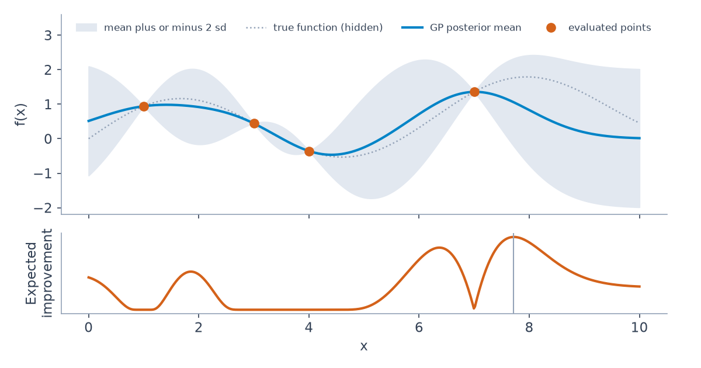

# 6 — Bayesian Machine Learning

The earlier chapters of this pillar estimate a handful of parameters and make a decision. Machine learning asks the same questions at a different scale: thousands of parameters, a hidden variable for every data point, and posteriors far too large for the sampler of [chapter 2](02-mcmc-and-pymc.md). Three ideas handle that. Expectation-maximisation gives up the posterior over parameters and keeps a point estimate. Variational inference replaces the posterior with something simple, turning integration into optimisation. Gaussian processes keep an exact posterior over functions, and you can use one to choose the next expensive experiment. This chapter builds each small enough to run, and it maps them onto the BayesianML coursework in this pillar.

```python
import numpy as np, pymc as pm, arviz as az
from scipy import stats
SAMPLE = dict(chains=4, cores=1, progressbar=False, random_seed=7)
```

## Where this sits

The coursework is HSE's *Bayesian Methods for Machine Learning*, taken on Coursera. BMH's own ch. 7 was never finished. Its outline (Bayesian answers to overfitting, Salimans' *Don't Overfit* Kaggle solution, predictive distributions, model fitting with BIC, Gaussian processes) is close to the syllabus below.

| Coursework | Topic | Inference method | Key idea |
|---|---|---|---|
| [week_2](../practice/BayesianML/week_2) | Gaussian mixture model | Expectation-maximisation | latent cluster labels, soft assignments |
| [week_4](../practice/BayesianML/week_4) | Markov chains, Bayesian logistic regression | MCMC (Metropolis, NUTS) in PyMC3 | odds ratio with a credible interval |
| [week_5](../practice/BayesianML/week_5) | Variational autoencoder on MNIST | variational inference (ELBO) | amortised posterior via an encoder network |
| [week_6](../practice/BayesianML/week_6) | Gaussian processes, Bayesian optimisation | exact GP posterior, acquisition functions | tune hyperparameters with few evaluations |
| [final_assignment](../practice/BayesianML/final_assignment) | "Finding the suspect": VAE + Bayesian optimisation | both | search a VAE's latent space with human feedback |

**Runnability:** the coursework is legacy. The environment in `bayesian.yml` pins Python 3.7, TensorFlow 1.15, Keras 2.3.1, `pymc3==3.11.4` and `theano-pymc==1.1.2`, and week 6 adds GPy, GPyOpt and xgboost by pip. Every notebook imports the Coursera `grader` module, which is not included, and none has saved outputs. Read them for the method, and port to current PyMC with [chapter 2's map](02-mcmc-and-pymc.md#pymc3-to-current-pymc) before running. The code in this chapter runs on current NumPy, PyMC and scikit-learn; blocks marked `# illustrative` show the coursework's pinned libraries, and need that conda environment.

## EM for Gaussian mixtures (week 2)

Take [chapter 2's mixture](02-mcmc-and-pymc.md#worked-example-a-two-cluster-mixture), fitted by optimisation instead of sampling. Each point x_i has a hidden label t_i ∈ {1..C}, and the parameters are mixture weights π, means μ_c and covariances Σ_c. If you knew the labels, the parameters would be simple averages. If you knew the parameters, the labels would follow from Bayes' rule. Expectation-maximisation ([Dempster, Laird and Rubin, *JRSS B*, 1977](https://doi.org/10.1111/j.2517-6161.1977.tb01600.x)) alternates between the two.

| Step | Computes | Formula |
|---|---|---|
| E-step | responsibilities γ_ic = P(t_i = c given x_i) | γ_ic ∝ π_c · N(x_i; μ_c, Σ_c), normalised over c |
| M-step | parameters given responsibilities | π_c = mean of γ_·c; μ_c = Σ γ_ic x_i / Σ γ_ic; Σ_c the γ-weighted covariance |
| Loss | lower bound on the log-likelihood | rises monotonically; stop when it plateaus |

The week 2 notebook leaves these as graded functions. Here they are in NumPy, in log space to avoid underflow:

```python
def log_gauss(X, mu, cov):
    d = X - mu
    sign, logdet = np.linalg.slogdet(cov)
    return -0.5 * (np.sum(d * np.linalg.solve(cov, d.T).T, axis=1) + logdet + X.shape[1] * np.log(2 * np.pi))

def e_step(X, pi, mu, cov):
    log_r = np.stack([np.log(pi[c]) + log_gauss(X, mu[c], cov[c]) for c in range(len(pi))], axis=1)
    log_norm = np.logaddexp.reduce(log_r, axis=1, keepdims=True)    # log space avoids underflow
    return np.exp(log_r - log_norm), log_norm.sum()                 # responsibilities, log-likelihood

def m_step(X, r):
    Nk = r.sum(axis=0)
    pi = Nk / len(X)
    mu = (r.T @ X) / Nk[:, None]
    cov = [((r[:, c, None] * (X - mu[c])).T @ (X - mu[c])) / Nk[c] + 1e-6 * np.eye(X.shape[1])
           for c in range(r.shape[1])]
    return pi, mu, np.array(cov)

def train_em(X, C, seed, tol=1e-4, max_iter=200):
    rng = np.random.default_rng(seed)
    pi = np.ones(C) / C
    mu = X[rng.choice(len(X), C, replace=False)]
    cov = np.array([np.cov(X.T)] * C)
    trace = []
    for _ in range(max_iter):
        r, ll = e_step(X, pi, mu, cov)
        trace.append(ll)
        if len(trace) > 1 and abs(trace[-1] - trace[-2]) < tol * abs(trace[-1]):
            break
        pi, mu, cov = m_step(X, r)
    return pi, mu, cov, trace
```

Now fit three clusters of unequal size, from ten random starts:

```python
rng = np.random.default_rng(0)
true_mu = np.array([[0, 0], [6, 1], [1, 6]])
X = np.vstack([rng.multivariate_normal(m, np.eye(2) * s, n)
               for m, s, n in zip(true_mu, (1.0, 0.5, 2.0), (150, 100, 50))])
fits = [train_em(X, C=3, seed=s) for s in range(10)]
final = [f[3][-1] for f in fits]
print("final log-likelihood by restart:", np.round(final, 1))
pi, mu, cov, trace = fits[int(np.argmax(final))]
print("always rising:", all(np.diff(trace) >= -1e-8), " iterations:", len(trace))
print("weights", pi.round(2))
print("means  ", mu.round(2).tolist())
```

```text
final log-likelihood by restart: [-1107.8 -1107.8 -1107.8 -1107.8 -1107.8 -1107.8 -1186.9 -1268.1 -1107.8
 -1107.8]
always rising: True  iterations: 28
weights [0.33 0.5  0.17]
means   [[5.99, 1.01], [-0.14, 0.09], [1.1, 5.85]]
```

Eight restarts agree, and two end far lower, stuck in local optima with different clusters. The log-likelihood rises at every step, as the theory promises, but it only promises a local peak. So run several restarts and keep the best. The fitted weights match the 150, 100 and 50 points by share (0.5, 0.33 and 0.17), and the means are close to those simulated, though the labels are in a different order, which is the label problem from chapter 2 again.

EM vs MCMC on the same model:

| | EM | MCMC ([chapter 2](02-mcmc-and-pymc.md)) |
|---|---|---|
| Output | a point estimate (MAP or MLE) of the parameters | samples from the full posterior |
| Speed | fast, deterministic per restart | slower |
| Uncertainty | none on the parameters | full |
| Failure | local optima, collapsing covariances | slow mixing, label switching |

The `1e-6 * np.eye` in `m_step` guards against the collapsing-covariance failure, where a component shrinks onto a single point and the likelihood rises without limit.

## MCMC and Bayesian logistic regression (week 4)

**Task 1, Alice and Bob.** Two sellers set prices from each other's last price plus Gaussian noise. Simulate it from very different starts, discard a burn-in, and compare:

```python
def run_simulation(alice=300.0, bob=300.0, seed=42, hours=10000, burnin=1000):
    rng = np.random.default_rng(seed)
    a_all, b_all = [], []
    for _ in range(burnin + hours):
        alice = 0.6 * bob + 90 + rng.normal(0, 20)         # uses Bob's previous price
        bob = 1.2 * alice - 20 + rng.normal(0, 10)         # uses Alice's current price
        a_all.append(alice); b_all.append(bob)
    return np.array(a_all[burnin:]), np.array(b_all[burnin:])
for start, seed in ((300, 42), (1000, 7), (10, 99)):
    a, b = run_simulation(start, start, seed)
    print(f"start {start:>4}  Alice {a.mean():.1f} (sd {a.std():.1f})  Bob {b.mean():.1f} (sd {b.std():.1f})  corr {np.corrcoef(a, b)[0, 1]:.2f}")
print(f"long-run mean by algebra: Alice {(90 - 0.6 * 20) / (1 - 0.6 * 1.2):.1f}  Bob {1.2 * (90 - 0.6 * 20) / (1 - 0.6 * 1.2) - 20:.1f}")
```

```text
start  300  Alice 279.2 (sd 30.1)  Bob 315.2 (sd 37.6)  corr 0.96
start 1000  Alice 277.9 (sd 30.1)  Bob 313.5 (sd 37.5)  corr 0.96
start   10  Alice 279.0 (sd 29.6)  Bob 314.8 (sd 36.8)  corr 0.96
long-run mean by algebra: Alice 278.6  Bob 314.3
```

Starting at 10 or at 1,000 makes no difference once burn-in is discarded, and the long-run means match the algebra. A stationary distribution that does not depend on where you start is exactly what makes MCMC valid.

**Task 2, logistic regression on US census income.** Does sex affect P(income > $50K), controlling for age, age², education and hours? The coursework's file, `adult_us_postprocessed.csv`, is not included, so we simulate 2,000 rows with a known true odds ratio.

```python
rng = np.random.default_rng(1)
n = 2000
male = rng.binomial(1, 0.6, n)
age = rng.uniform(18, 70, n)
educ = rng.normal(11, 2.5, n)
hours = rng.normal(40, 10, n)
age_z, educ_z, hours_z = [(v - v.mean()) / v.std() for v in (age, educ, hours)]
log_odds = -1.8 + 0.7 * male + 0.9 * age_z - 0.5 * age_z**2 + 0.8 * educ_z + 0.5 * hours_z
y = rng.binomial(1, 1 / (1 + np.exp(-log_odds)))
print(f"simulated rows {n}, share above the line {y.mean():.2f}, true odds ratio {np.exp(0.7):.2f}")
design = np.column_stack([male, age_z, age_z**2, educ_z, hours_z])
```

The week 4 notebook writes the model in PyMC3 through a formula interface that no longer exists:

```python
# illustrative: week_4 coursework, needs the pinned conda env (pymc3==3.11.4, theano-pymc==1.1.2)
with pm.Model() as logistic_model:
    pm.glm.GLM.from_formula(
        "income_more_50K ~ sex + age + age_squared + educ + hours",
        data, family=pm.glm.families.Binomial())
    trace = pm.sample(4000)                      # NUTS chosen automatically

# odds ratio for sex = exp(coefficient); credible interval from the samples
b = trace["sex[T. Male]"][100:]                # short burn-in: sampling started at the MAP
lb, ub = np.percentile(b, 2.5), np.percentile(b, 97.5)
np.exp(lb), np.exp(ub)
```

Current PyMC writes it out directly. [bambi](https://bambinos.github.io/bambi/) offers a formula interface again, though we have not run it here.

```python
def logistic(step=None, draws=1000):
    with pm.Model():
        b0 = pm.Normal("b0", 0, 5)
        b = pm.Normal("b", 0, 2.5, shape=design.shape[1])
        pm.Bernoulli("y", logit_p=b0 + design @ b, observed=y)
        return pm.sample(draws, tune=1000, step=step() if step else None, **SAMPLE)
nuts = logistic()
s = nuts.posterior["b"].sel(b_dim_0=0).values.flatten()
lo, hi = np.exp(np.percentile(s, [2.5, 97.5]))
print(f"odds ratio for male: {np.exp(s).mean():.2f}, 95% interval [{lo:.2f}, {hi:.2f}]")
```

```text
odds ratio for male: 1.65, 95% interval [1.27, 2.12]
```

The true odds ratio is 2.01, and this interval misses it. That isn't a bug. A 95% interval from one simulated dataset leaves out the truth sometimes, and quoting the interval without knowing that would be overconfident. Simulation is the one place you get to see it happen.

The exercise compares Metropolis-Hastings with NUTS:

```python
metro = logistic(step=pm.Metropolis)
for name, idata in (("Metropolis", metro), ("NUTS", nuts)):
    e = az.ess(idata, var_names=["b"])["b"].values
    r = az.rhat(idata, var_names=["b"])["b"].values
    print(f"{name:10s} min ESS {e.min():6.0f} of 4000   max r_hat {r.max():.3f}")
```

```text
Metropolis min ESS    155 of 4000   max r_hat 1.041
NUTS       min ESS   3306 of 4000   max r_hat 1.001
```

From the same number of draws, NUTS has about twenty times the effective samples. It is the same comparison as Challenger in chapter 2, with more dimensions. The coursework ends on the point [chapter 1](01-bayesian-inference.md) makes: a credible interval can be read the way people wish they could read a confidence interval.

## Variational inference and the VAE (week 5)

When the posterior is too big to sample, approximate it with a simpler distribution q, and make q as close as possible. [Blei, Kucukelbir and McAuliffe (JASA, 2017)](https://arxiv.org/abs/1601.00670) frame the method and its trade-off well: it turns inference into optimisation over a KL divergence, tends to be faster and scale better than MCMC, and generally underestimates the variance of the posterior. KL to the true posterior needs the evidence we could not compute, so we maximise an equivalent quantity, the **evidence lower bound (ELBO)**:

```text
log p(x) ≥ E_q[ log p(x | z) ] − KL( q(z | x) ‖ p(z) )
          reconstruction        regulariser
```

The gap in that inequality is exactly the KL from q to the true posterior. That is easy to see on a model small enough to have an exact answer: a single observation x = 2, with x ~ N(z, 1) and z ~ N(0, 1).

```python
x_obs, sigma, s0 = 2.0, 1.0, 1.0                    # one point, x ~ N(z, 1), z ~ N(0, 1)
log_evidence = stats.norm.logpdf(x_obs, 0, np.sqrt(s0**2 + sigma**2))
post_mean, post_sd = x_obs / 2, np.sqrt(0.5)         # exact posterior
def elbo(m, s, n=200_000, seed=0):
    z = m + s * np.random.default_rng(seed).standard_normal(n)     # reparameterised draws
    recon = stats.norm.logpdf(x_obs, z, sigma).mean()
    kl = np.log(s0 / s) + (s**2 + m**2) / (2 * s0**2) - 0.5
    return recon, kl, recon - kl
print(f"log evidence {log_evidence:.4f}")
for m, s in ((0.0, 1.0), (0.5, 1.0), (1.0, 1.0), (post_mean, post_sd)):
    r, k, e = elbo(m, s)
    print(f"q=N({m:.2f}, {s:.2f}^2): reconstruction {r:7.4f}  KL {k:.4f}  ELBO {e:7.4f}  gap {log_evidence - e:.4f}")
```

```text
log evidence -2.2655
q=N(0.00, 1.00^2): reconstruction -3.4199  KL 0.0000  ELBO -3.4199  gap 1.1544
q=N(0.50, 1.00^2): reconstruction -2.5449  KL 0.1250  ELBO -2.6699  gap 0.4044
q=N(1.00, 1.00^2): reconstruction -1.9200  KL 0.5000  ELBO -2.4200  gap 0.1545
q=N(1.00, 0.71^2): reconstruction -1.6694  KL 0.5966  ELBO -2.2660  gap 0.0005
```

Starting from the prior, the KL term is zero and the reconstruction is poor. Moving q toward the data costs some KL and gains more reconstruction. At the exact posterior, N(1, 0.71²), the ELBO reaches the log evidence, up to Monte Carlo noise in the fourth decimal. The gap you can't measure directly in a real model is visible here.

To maximise the ELBO by gradient ascent we need a gradient through a sampling step. The **reparameterisation trick** gets one by writing z = m + s·ε with ε ~ N(0, 1), so the randomness no longer depends on what we are differentiating:

```python
def grad_m(m, s, seed=1, n=200_000):
    eps = np.random.default_rng(seed).standard_normal(n)
    z = m + s * eps
    return ((x_obs - z) / sigma**2).mean() - m / s0**2   # d/dm of reconstruction minus KL
m, s = 0.0, post_sd
for step in range(40):
    m += 0.2 * grad_m(m, s, seed=step)
print(f"gradient ascent on the ELBO: m {m:.3f}   exact {post_mean:.3f}")
```

```text
gradient ascent on the ELBO: m 1.000   exact 1.000
```

Forty noisy steps reach the exact mean. This is the core of the method in Blei et al., and of a VAE.

PyMC's `pm.fit(method="advi")` is the same idea, with a Normal q per parameter. Compare it to NUTS when two inputs are nearly collinear, so the posterior over their coefficients is a narrow diagonal ridge:

```python
rng = np.random.default_rng(2)
x = rng.normal(size=80)
x2 = 0.95 * x + np.sqrt(1 - 0.95**2) * rng.normal(size=80)   # two nearly collinear inputs
y_vi = 1.0 * x + 1.0 * x2 + rng.normal(0, 1, 80)
with pm.Model():
    a = pm.Normal("a", 0, 5)
    b = pm.Normal("b", 0, 5)
    pm.Normal("y", a * x + b * x2, 1, observed=y_vi)
    mcmc = pm.sample(1000, tune=1000, **SAMPLE)
    approx = pm.fit(20000, method="advi", progressbar=False, random_seed=7)
    vi = approx.sample(4000, random_seed=7)
for name, idata in (("NUTS", mcmc), ("ADVI", vi)):
    a_s, b_s = [idata.posterior[v].values.flatten() for v in ("a", "b")]
    print(f"{name}: mean a {a_s.mean():.3f} b {b_s.mean():.3f}  sd a {a_s.std():.3f} b {b_s.std():.3f}  sd of a+b {(a_s + b_s).std():.3f}  corr {np.corrcoef(a_s, b_s)[0, 1]:+.2f}")
```

```text
NUTS: mean a 1.218 b 0.960  sd a 0.390 b 0.397  sd of a+b 0.113  corr -0.96
ADVI: mean a 1.153 b 1.018  sd a 0.127 b 0.130  sd of a+b 0.181  corr -0.01
```

The means are close. The marginal standard deviations are about 0.39 under NUTS and 0.13 under ADVI, which is the underestimation Blei et al. warn about, and here it is threefold. Mean-field q has no way to express the correlation of −0.96, and that also misstates the sum: the well-determined a + b gets an sd of 0.181 against 0.113. If you need intervals rather than a prediction, check VI against MCMC on a sample of the data first.

### The VAE

A variational autoencoder ([Kingma and Welling, 2013](https://arxiv.org/abs/1312.6114)) learns both halves of the ELBO with neural networks:

| Part | Role |
|---|---|
| Encoder | outputs the mean and log-variance of q(z given x): an amortised posterior |
| Reparameterisation | z = μ + σ ⊙ ε with ε ~ N(0, I), so gradients flow through the sampling |
| Decoder | p(x given z); Bernoulli per pixel for binarised MNIST |
| Prior | p(z) = N(0, I); sampling from it and decoding "hallucinates" new digits |
| Conditional VAE | condition encoder and decoder on the label to generate a chosen digit |

ADVI fits one q per model, and a VAE fits one encoder that outputs a q per data point. It is why a VAE can handle a new image without refitting. Week 5 builds this for MNIST in Keras 2.3 on TensorFlow 1.15, with the pinned environment above.

## Gaussian processes and Bayesian optimisation (week 6)

A **Gaussian process** is a prior over functions: any finite set of function values is jointly Normal, with covariance given by a kernel such as the RBF, k(x, x') = σ² exp(−‖x − x'‖² / 2ℓ²). Conditioning on observed points gives a posterior mean and a variance at every x: a prediction with an error bar. [Rasmussen and Williams](http://gaussianprocess.org/gpml/) is the standard text. The algebra is a Normal conditional, which takes a few lines:

```python
def rbf(a, b, var=1.0, ell=1.0):
    return var * np.exp(-0.5 * (a[:, None] - b[None, :]) ** 2 / ell**2)
def gp_posterior(X, y, X_new, noise=1e-6, **kw):
    K = rbf(X, X, **kw) + noise * np.eye(len(X))
    Ks = rbf(X_new, X, **kw)
    alpha = np.linalg.solve(K, y)
    mean = Ks @ alpha
    var = np.diag(rbf(X_new, X_new, **kw)) - np.sum(Ks * np.linalg.solve(K, Ks.T).T, axis=1)
    return mean, np.sqrt(np.maximum(var, 0))
X_t = np.array([1.0, 3.0, 4.0])
y_t = np.sin(X_t)
X_new = np.array([1.0, 2.0, 3.5, 6.0])
m_hand, s_hand = gp_posterior(X_t, y_t, X_new)
for x_, m_, s_ in zip(X_new, m_hand, s_hand):
    print(f"x={x_}: mean {m_:+.3f}  sd {s_:.3f}  truth {np.sin(x_):+.3f}")
```

```text
x=1.0: mean +0.841  sd 0.001  truth +0.841
x=2.0: mean +0.768  sd 0.540  truth +0.909
x=3.5: mean -0.365  sd 0.171  truth -0.351
x=6.0: mean -0.160  sd 0.987  truth -0.279
```

At an observed point, the sd is effectively zero. Between points, it grows. Far from the data at x = 6, the mean drifts to the prior's 0 and the sd reaches nearly 1, the prior's own. An honest model says it does not know there, and acquisition functions exploit this. As a check on the algebra, scikit-learn gives the same answer:

```python
from sklearn.gaussian_process import GaussianProcessRegressor
from sklearn.gaussian_process.kernels import RBF, ConstantKernel, WhiteKernel
gp = GaussianProcessRegressor(ConstantKernel(1.0, "fixed") * RBF(1.0, "fixed"), alpha=1e-6)
gp.fit(X_t[:, None], y_t)
m_sk, s_sk = gp.predict(X_new[:, None], return_std=True)
print("largest difference from the hand-written version:", round(float(np.abs(m_sk - m_hand).max() + np.abs(s_sk - s_hand).max()), 8))
```

```text
largest difference from the hand-written version: 0.0
```

The week 6 notebook uses GPy, which fits the kernel's hyperparameters by marginal likelihood:

```python
# illustrative: week_6 coursework, needs GPy in the pinned conda env
import GPy
kernel = GPy.kern.RBF(input_dim=1, variance=1.5, lengthscale=2.)
model = GPy.models.GPRegression(X, y, kernel)
model.optimize()                      # fit kernel hyperparameters by marginal likelihood
mean, var = model.predict(X_new)
# sparse GPs (inducing points) cut the O(n^3) cost for large n
```

**Bayesian optimisation** uses the GP as a cheap surrogate for an expensive black-box function, such as a model's validation score as a function of its hyperparameters. An acquisition function picks the next point to evaluate, trading off exploration and exploitation, as the bandits in [chapter 3](03-priors-and-bandits.md) do. [Snoek, Larochelle and Adams (NeurIPS, 2012)](https://proceedings.neurips.cc/paper/2012/hash/05311655a15b75fab86956663e1819cd-Abstract.html) made this a standard approach for tuning models.

| Acquisition | Picks the point with |
|---|---|
| Expected improvement | the largest expected gain over the best value so far |
| Upper confidence bound | the highest mean + κ · standard deviation |
| Probability of improvement | the highest chance of beating the best so far (GPyOpt's `MPI`, used in week 6) |


*Image Source: generated for this chapter, a GP on four points with its expected-improvement curve*

The notebook tunes XGBoost with GPyOpt, and repeats it for an SVR:

```python
# illustrative: week_6 coursework, needs GPyOpt and xgboost in the pinned conda env
import GPyOpt
bounds = [  # continuous variables first, then discrete
    {"name": "learning_rate", "type": "continuous", "domain": (0, 1)},
    {"name": "gamma", "type": "continuous", "domain": (0, 5)},
    {"name": "max_depth", "type": "discrete", "domain": (1, 50)},
    {"name": "n_estimators", "type": "discrete", "domain": (1, 300)},
    {"name": "min_child_weight", "type": "discrete", "domain": (1, 10)},
]
optimizer = GPyOpt.methods.BayesianOptimization(
    f=f, domain=bounds, acquisition_type="MPI", acquisition_par=0.1, exact_eval=True)
optimizer.run_optimization(max_iter=50)
```

The same loop in current scikit-learn, tuning a gradient-boosted model's learning rate and leaf count on a small built-in dataset, with expected improvement chosen over 2,000 random candidates each round:

```python
from sklearn.datasets import load_breast_cancer
from sklearn.ensemble import HistGradientBoostingClassifier
from sklearn.model_selection import cross_val_score
data_X, data_y = load_breast_cancer(return_X_y=True)
def objective(u):
    log_lr, leaves = u
    model = HistGradientBoostingClassifier(learning_rate=10**log_lr, max_leaf_nodes=int(round(leaves)),
                                           max_iter=60, random_state=0)
    return cross_val_score(model, data_X, data_y, cv=3, scoring="neg_log_loss").mean()

low, high = np.array([-3.0, 2]), np.array([0.0, 40])
def expected_improvement(mean, sd, best):
    z = (mean - best) / sd
    return (mean - best) * stats.norm.cdf(z) + sd * stats.norm.pdf(z)

def bayes_opt(n_iter=20, n_init=4, seed=0):
    rng = np.random.default_rng(seed)
    U = rng.uniform(low, high, (n_init, 2))
    y_u = np.array([objective(u) for u in U])
    kernel = ConstantKernel(1.0) * RBF([1.0, 10.0], (1e-2, 1e3)) + WhiteKernel(1e-4, (1e-8, 1e-1))
    for _ in range(n_iter - n_init):
        gp = GaussianProcessRegressor(kernel, normalize_y=True, n_restarts_optimizer=2, random_state=0).fit(U, y_u)
        candidates = rng.uniform(low, high, (2000, 2))
        mean, sd = gp.predict(candidates, return_std=True)
        next_u = candidates[np.argmax(expected_improvement(mean, sd + 1e-9, y_u.max()))]
        U = np.vstack([U, next_u])
        y_u = np.append(y_u, objective(next_u))
    return U, y_u
U, y_u = bayes_opt()
best = np.maximum.accumulate(y_u)
print("best log loss after 4, 8, 12, 20 fits:", (-best[[3, 7, 11, 19]]).round(4))
print(f"best learning rate {10 ** U[y_u.argmax(), 0]:.3f}, leaves {int(round(U[y_u.argmax(), 1]))}")
```

```text
best log loss after 4, 8, 12, 20 fits: [0.1148 0.1065 0.1065 0.1016]
best learning rate 0.447, leaves 3
```

Is that better than guessing? Compare with random search over the same box, and read the same columns. It takes about two minutes to run.

```python
rng = np.random.default_rng(1)
curves = []
for _ in range(5):
    r_u = rng.uniform(low, high, (20, 2))
    curves.append(np.maximum.accumulate([objective(u) for u in r_u]))
print("random search, mean of 5 runs:        ", (-np.mean(curves, axis=0)[[3, 7, 11, 19]]).round(4))
```

```text
random search, mean of 5 runs:         [0.1233 0.1193 0.1164 0.112 ]
```

The GP's best log loss beats the random-search average at each checkpoint, by 0.01 or so. That comparison is one Bayesian optimisation run against five random runs, on a dataset where each evaluation takes about a second, so it shows the shape of the method rather than measuring its advantage. The case for Bayesian optimisation grows as each fit gets more expensive. If a fit takes a second, random search with more fits is often simpler.

The final project combines both: train a VAE on faces, then use Bayesian optimisation over its latent space, with a human rating each generated face, to converge on a target face (darkest hair, widest smile, a specific person) in a few dozen evaluations.

## Pitfalls

| Pitfall | What goes wrong | Fix |
|---|---|---|
| One EM start | Two of ten restarts above ended in worse optima | Restart and keep the best bound |
| Quoting mean-field VI intervals | Threefold too narrow on the collinear example | Check against MCMC on a sample |
| Assuming ELBO comparisons rank models safely | It is a bound, and the gap differs across models | Use held-out predictive scores |
| A GP on large n | Cost grows as n³ | Sparse GPs, or a different surrogate |
| Bayesian optimisation on cheap fits | Random search with more trials can be simpler | Reserve it for expensive functions |
| Running the coursework on current packages | PyMC3, Theano, TF 1 and `grader` are not there | Use the pinned environment, or port with chapter 2's map |

---

## Try it

1. In `em_run`, change `C` to 4. What should happen to the final log-likelihood, and does that mean four clusters is correct?
2. In `elbo`, what are the reconstruction and KL when q is the prior, and why is the KL zero?
3. Change `advi` so the inputs are uncorrelated. What should happen to ADVI's standard deviations?
4. Raise `ell` to 3 in `gp_hand`. Does the sd at x = 6 go up or down?

<details>
<summary>Answers</summary>

1. The best log-likelihood can only stay the same or rise, since a fourth component can do no worse. That doesn't make four correct. A rising training likelihood cannot choose C. Use held-out likelihood or BIC.
2. KL(prior ‖ prior) is zero by definition. The ELBO is then just the expected reconstruction (−3.42), and it is the worst of the four.
3. They should move close to NUTS's. With an uncorrelated posterior, mean-field can represent it, so its main error goes away.
4. Down. A longer lengthscale means distant points are more correlated, so x = 4 tells you more about x = 6.

</details>

---

## Interview checklist

| Prompt | Answer |
|---|---|
| What does EM do? | Alternates between computing responsibilities and re-fitting parameters; the likelihood never falls, but it finds a local optimum |
| EM or MCMC for a mixture? | EM for a fast point estimate; MCMC when you need parameter uncertainty |
| What is the ELBO? | A lower bound on log evidence: reconstruction minus KL from the prior. The gap to log evidence is the KL to the true posterior |
| Why the reparameterisation trick? | It moves the randomness out of the parameters so gradients can pass through sampling |
| VI or MCMC? | VI scales and is fast, and it tends to underestimate variance. MCMC is slower and asymptotically exact |
| What makes a VAE amortised? | One encoder network outputs a posterior for any input, rather than fitting one per data point |
| What is a Gaussian process? | A distribution over functions where any finite set of values is jointly Normal; a kernel sets the covariance |
| What does an acquisition function do? | Turns a surrogate's mean and uncertainty into the next point to try, trading exploration against exploitation |

---

## Further reading

| Topic | Source |
|---|---|
| EM, VI and GPs alongside the frequentist toolkit | Efron and Hastie, *Computer Age Statistical Inference* ([book site](https://hastie.su.domains/CASI/)) |
| Bayesian regression and multilevel models in depth | McElreath, [*Statistical Rethinking* lectures](https://www.youtube.com/playlist?list=PLDcUM9US4XdPz-KxHM4XHt7uUVGWWVSus) |
| Modern PyMC | [pymc.io examples gallery](https://www.pymc.io/projects/examples/en/latest/gallery.html), [bambi](https://bambinos.github.io/bambi/) |

---

## Next

[Chapter 7: Multilevel Models and Partial Pooling](07-multilevel-models-and-partial-pooling.md) returns to the Larkspur experiment with many markets in it: how much to trust each market's own number, what partial pooling does to the winning segment's effect, when it does not help, and when clustered standard errors or fixed effects are the better tool.
