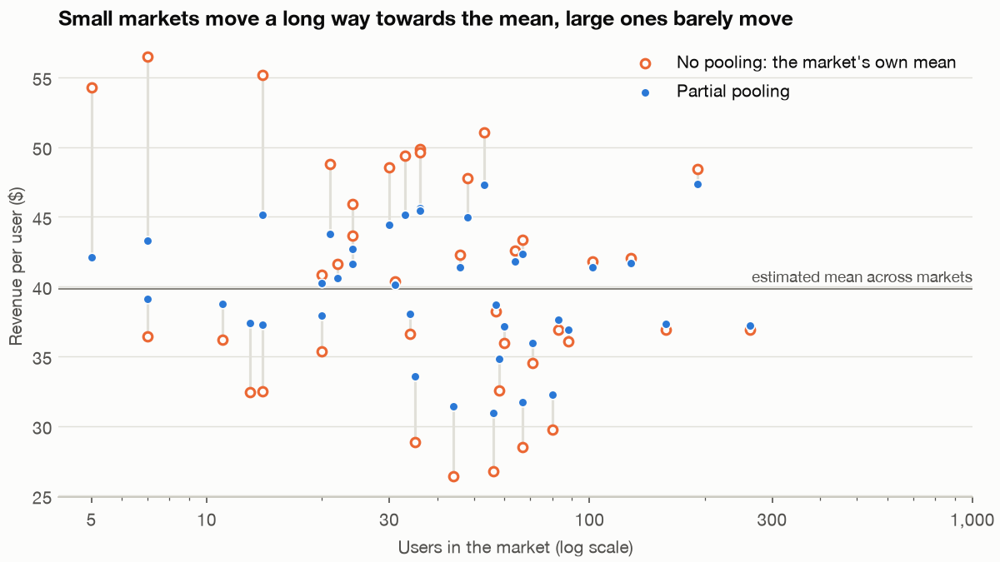
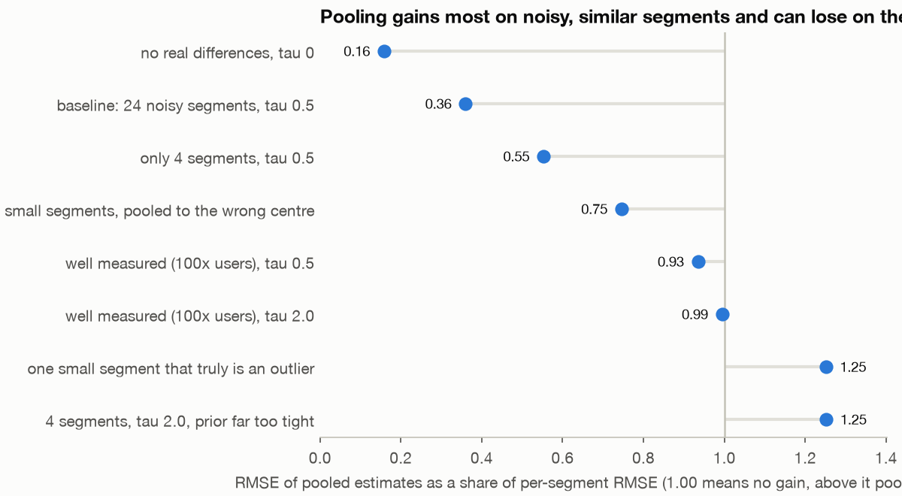
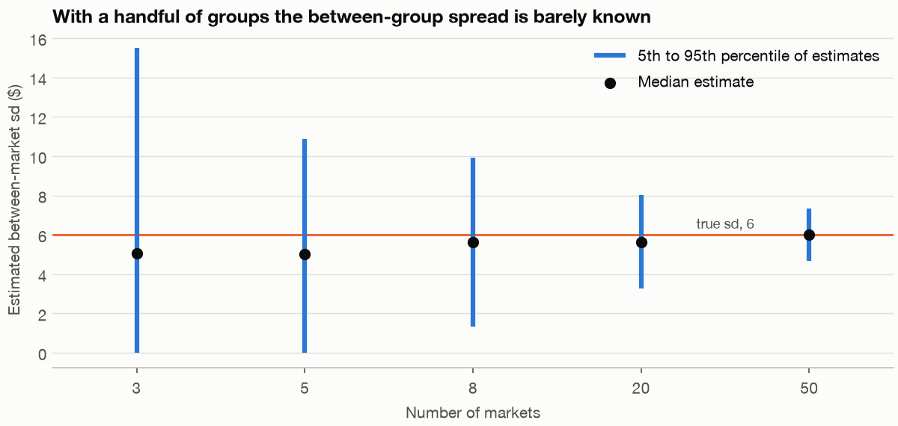

# 7 — Multilevel Models and Partial Pooling

Suppose Larkspur runs its checkout test in 24 markets, and the dashboard shows one market with a lift three times the average. That market may be special, or it may be small and lucky. Treating every market alone believes the luck, and averaging them all ignores any real difference. A multilevel model estimates all the markets together and lets each one borrow strength from the others in proportion to how little data it has. This chapter measures what that buys, on simulated data where the truth is known, and then measures where it buys nothing.

Run the whole chapter with `uv run ch07_multilevel_models.py` from [practice/](../practice/ch07_multilevel_models.py). That script is what runs top to bottom, in several minutes. The blocks below show each model and the core of each simulation, and the replication loops and figure code are only in the script. The output is pasted from it.

```python
import warnings
import arviz as az, numpy as np, pandas as pd, pymc as pm
import statsmodels.api as sm, statsmodels.formula.api as smf
from scipy.special import expit, logit
from statsmodels.tools.sm_exceptions import ConvergenceWarning
warnings.filterwarnings("ignore", category=ConvergenceWarning)   # the replication loops hit the boundary often; counted below
warnings.filterwarnings("ignore", category=RuntimeWarning, module="statsmodels")
warnings.filterwarnings("ignore", category=UserWarning, module="statsmodels")
pd.set_option("display.width", 120, "display.max_columns", 20)
SAMPLE = dict(chains=4, cores=1, progressbar=False, random_seed=7)

def rmse(a, b):
    return float(np.sqrt(np.mean((np.asarray(a) - np.asarray(b)) ** 2)))

def sampler_report(idata, names):
    """The numbers you check before believing a posterior."""
    s = az.summary(idata, var_names=names)
    return (f"max r_hat {s['r_hat'].astype(float).max():.3f}, "
            f"min ess_bulk {s['ess_bulk'].astype(float).min():.0f}, "
            f"min ess_tail {s['ess_tail'].astype(float).min():.0f}, "
            f"divergences {int(idata.sample_stats['diverging'].sum())}")
```

## Three ways to estimate one number per group

Each user belongs to one market. There are three ways to estimate revenue per user for a market:

- **No pooling:** use the market's own mean. Unbiased, and noisy when the market is small.
- **Complete pooling:** give every market the overall mean. Stable, and it erases every real difference.
- **Partial pooling:** take a weighted average of the two.

Write τ (tau) for the standard deviation of true market means and σ (sigma) for the standard deviation of users within a market. A market with n users gets this weight on its own mean, with the rest going to the overall mean:

> weight = τ² / (τ² + σ²/n)

The term σ²/n is how noisy the market's own mean is. Noisy markets get little weight, and precise ones keep nearly all of theirs. The model estimates τ and σ from the data, which is the difference between this and a shrinkage factor you pick by hand. `MixedLM` fits it with REML (restricted maximum likelihood, the usual way to estimate variances without the bias from also estimating the means). Its estimate for each market is called a BLUP, the best linear unbiased prediction.

```python
def simulate_markets(seed, J=40, mu=40.0, tau=6.0, sigma=30.0):
    """Revenue per user, users nested in markets of very different sizes."""
    rng = np.random.default_rng(seed)
    n = np.clip(rng.lognormal(np.log(60), 1.1, J).astype(int), 5, 1500)
    truth = mu + tau * rng.normal(size=J)
    market = np.repeat(np.arange(J), n)
    y = truth[market] + sigma * rng.normal(size=n.sum())
    return pd.DataFrame({"market": market, "y": y}), truth, n

def three_estimates(df):
    """No pooling, complete pooling and partial pooling, one number per market."""
    fit = smf.mixedlm("y ~ 1", df, groups="market").fit(reml=True)
    groups = sorted(df["market"].unique())
    partial = np.array([fit.fe_params["Intercept"] + fit.random_effects[g].iloc[0] for g in groups])
    none = df.groupby("market")["y"].mean().to_numpy()
    complete = np.full_like(none, df["y"].mean())
    return none, complete, partial, fit

df, truth, n = simulate_markets(seed=7)
none, complete, partial, fit = three_estimates(df)
tau2, sigma2 = float(fit.cov_re.iloc[0, 0]), float(fit.scale)
print(f"{len(n)} markets, {n.sum()} users, smallest {n.min()}, median {int(np.median(n))}, largest {n.max()}")
print(f"between-market sd: true 6.0, estimated {np.sqrt(tau2):.2f}")
print(f"within-market sd:  true 30.0, estimated {np.sqrt(sigma2):.2f}")
weight = tau2 / (tau2 + sigma2 / n)      # the share of a market's own mean that survives
show = np.argsort(n)[[0, 3, 20, 36, 39]]
print(pd.DataFrame({"users": n[show], "true": truth[show], "no_pooling": none[show],
                    "partial": partial[show], "weight_on_own_mean": weight[show]}).round(2).to_string(index=False))
```

```text
40 markets, 2221 users, smallest 5, median 40, largest 262
between-market sd: true 6.0, estimated 5.77
within-market sd:  true 30.0, estimated 29.74
 users  true  no_pooling  partial  weight_on_own_mean
     5 45.39       54.26    42.10                0.16
    11 43.88       36.16    38.74                0.29
    44 32.65       26.39    31.44                0.62
   128 44.10       42.03    41.65                0.83
   262 40.72       36.91    37.18                0.91
```

The five-user market measured $54.26 against a true $45.39. Its weight is 0.16, so the model pulls it to $42.10. The 262-user market has a weight of 0.91 and barely moves.


*Image Source: generated by `practice/ch07_multilevel_models.py` from its simulated markets.*

Score each method against the truth with RMSE (root mean squared error), on this dataset and on 200 new ones:

```text
              this dataset  no_pooling  complete  partial
               all markets        5.69      5.47     3.54
small (under 30 users), 13        8.21      4.61     4.17
                middle, 24        4.11      5.95     3.32
    large (150 or more), 3        2.31      4.82     2.06

RMSE over 200 new datasets: no pooling 5.13, complete 5.98, partial 3.47
partial beat no pooling in 96% of datasets, and beat complete pooling in 100%
```

Partial pooling wins in every size band of this dataset, and in 96% of 200 new datasets against no pooling. The bands show why it does. For small markets no pooling is the worst choice (8.21) and complete pooling is close to the best (4.61). For large markets the order reverses (2.31 against 4.82). Partial pooling behaves like the better of the two at each size without being told which that is. McElreath's framing in ch. 12.2 of the [*Statistical Rethinking*](https://xcelab.net/rm/) draft of 2015 fits this table: complete pooling underfits and no pooling overfits. The chapter numbers here are that draft's, and published editions may differ.

Every example in this chapter is nested, meaning each user sits in exactly one market. A user who appears in several markets is a crossed design. The [statsmodels docs](https://www.statsmodels.org/stable/mixed_linear.html) say `MixedLM` handles most non-crossed models and some crossed ones, which it fits by treating the entire dataset as a single group with variance components. That workaround is awkward enough that the chapter leaves it out, and PyMC is the easier route if you need crossed effects.

## Intraclass correlation is the design effect's input

The **intraclass correlation** (ICC) is the share of total variance that lies between groups: τ² / (τ² + σ²). It is also the correlation between two users in the same market. [Probability foundations](../../02-probability-and-statistics/notes/02-probability-foundations.md) used it to build the design effect, 1 + (m − 1)ρ, how much clustering inflates the variance of a mean. Here ρ is a parameter the model estimates.

```python
icc = tau2 / (tau2 + sigma2)
m_bar, m_weighted = n.mean(), (n ** 2).sum() / n.sum()
naive = smf.ols("y ~ 1", df).fit().bse["Intercept"]
clustered = smf.ols("y ~ 1", df).fit(cov_type="cluster", cov_kwds={"groups": df["market"]}).bse["Intercept"]
print(f"ICC: true {6 ** 2 / (6 ** 2 + 30 ** 2):.3f}, estimated {icc:.3f}")
print(f"design effect with the mean market size ({m_bar:.0f}): {1 + (m_bar - 1) * icc:.2f}")
print(f"design effect with the user-weighted size ({m_weighted:.0f}): {1 + (m_weighted - 1) * icc:.2f}")
print(f"SE of the mean: naive {naive:.3f}, clustered {clustered:.3f}, so (clustered/naive)^2 = {(clustered / naive) ** 2:.2f}")
N = n.sum()
exact = (6.0 ** 2 * (n ** 2).sum() / N ** 2 + 30.0 ** 2 / N) / (30.0 ** 2 / N + 6.0 ** 2 / N)
print(f"exact design effect from the true variances and these sizes: {exact:.2f}")
```

```text
ICC: true 0.038, estimated 0.036
design effect with the mean market size (56): 2.98
design effect with the user-weighted size (104): 4.74
SE of the mean: naive 0.642, clustered 1.258, so (clustered/naive)^2 = 3.85
exact design effect from the true variances and these sizes: 4.95
```

An ICC of 0.036 sounds ignorable, but it multiplies the variance of the overall mean by about five, because 3.6% applies to every pair of users in a market. The market sizes matter too. The textbook formula assumes equal groups, and with the plain mean size it says 2.98. Weighting by users, the size the average user sees, gives 4.74, close to the exact 4.95. The clustered standard error from this one dataset implies 3.85, which shows how noisy that single estimate is with 40 markets.

## Random intercepts, then random slopes

A **random intercept** gives each group its own level. A **random slope** also gives each group its own effect of a predictor. Take weekly revenue for 150 users over 6 weeks, where each user has their own level and their own trend. In `mixedlm`, `groups` names the grouping and `re_formula` names what varies by group.

```python
def simulate_users(seed=11, users=150, weeks=6, sd_slope=2.5):
    """Weekly revenue for each user: everyone has their own level and their own trend."""
    rng = np.random.default_rng(seed)
    off_diagonal = 0.3 * 8.0 * sd_slope
    effects = rng.multivariate_normal([0, 0], [[8.0 ** 2, off_diagonal], [off_diagonal, sd_slope ** 2]], users)
    user, week = np.repeat(np.arange(users), weeks), np.tile(np.arange(weeks), users)
    y = 40 + effects[user, 0] + (1.5 + effects[user, 1]) * week + 10 * rng.normal(size=users * weeks)
    return pd.DataFrame({"user": user, "week": week, "y": y}), effects

def fit_slopes(data):
    """Random intercepts and slopes, keeping any warning statsmodels raises."""
    with warnings.catch_warnings(record=True) as caught:
        warnings.simplefilter("always")
        fit = smf.mixedlm("y ~ week", data, groups="user", re_formula="~week").fit(reml=True)
    return fit, sorted({str(w.message).split(".")[0][:70] for w in caught})

panel, true_effects = simulate_users()
ols = smf.ols("y ~ week", panel).fit()
intercepts = smf.mixedlm("y ~ week", panel, groups="user").fit(reml=True)
slopes, slope_warnings = fit_slopes(panel)
print(f"naive OLS:         week {ols.params['week']:.3f}, SE {ols.bse['week']:.3f}")
print(f"random intercepts: week {intercepts.fe_params['week']:.3f}, SE {intercepts.bse['week']:.3f}")
print(f"+ random slopes:   week {slopes.fe_params['week']:.3f}, SE {slopes.bse['week']:.3f}")
clustered_week = smf.ols("y ~ week", panel).fit(cov_type="cluster", cov_kwds={"groups": panel["user"]})
print(f"OLS, clustered:    week {clustered_week.params['week']:.3f}, SE {clustered_week.bse['week']:.3f}")
print("the slopes model's warnings:", slope_warnings or "none")
```

```text
naive OLS:         week 1.300, SE 0.296
random intercepts: week 1.300, SE 0.222
+ random slopes:   week 1.300, SE 0.276
OLS, clustered:    week 1.300, SE 0.277
the slopes model's warnings: none
```

The point estimate is the same in all four rows, because the panel is balanced. The standard errors differ. Random intercepts alone say 0.222, about 20% below the 0.276 from the model with slopes, because that model assumes every user shares one trend when they do not. [McNeish, Stapleton and Silverman (Psychological Methods, 2017)](https://doi.org/10.1037/met0000078) make the same point: a random intercept alone may not account for the clustering if slopes vary. Clustered OLS reaches 0.277 without modelling the slopes at all.

Naive OLS is at 0.296, higher than the rest. Ignoring clustering does not always make a standard error too small. The inflation in the last section is for a predictor that varies between groups, and `week` varies only within a user.

A warning on the word: in psychology, "hierarchical regression" often means adding blocks of predictors in stages and watching R² change, which is a different thing from modelling nested data.

## The same model in two toolkits

The PyMC version uses the non-centred form from [chapter 2](02-mcmc-and-pymc.md#is-the-sampler-working-diagnostics), where eight schools showed why the sampler needs it. `MixedLM` is linear only, so this comparison is on a continuous metric.

```python
def fit_pymc(data):
    """The same model with the non-centred form from chapter 2."""
    user, week = data["user"].to_numpy(), data["week"].to_numpy()
    with pm.Model():
        intercept = pm.Normal("intercept", 40, 20)
        trend = pm.Normal("trend", 0, 5)
        chol, corr, sds = pm.LKJCholeskyCov("chol", n=2, eta=2, sd_dist=pm.HalfNormal.dist(10), compute_corr=True)
        pm.Deterministic("sd_intercept", sds[0]); pm.Deterministic("sd_slope", sds[1]); pm.Deterministic("rho", corr[0, 1])
        raw = pm.Normal("raw", 0, 1, shape=(user.max() + 1, 2))
        u = pm.Deterministic("u", pm.math.dot(chol, raw.T).T)
        sigma = pm.HalfNormal("sigma", 20)
        pm.Normal("y", intercept + u[user, 0] + (trend + u[user, 1]) * week, sigma, observed=data["y"].to_numpy())
        return pm.sample(1000, tune=1000, target_accept=0.95, **SAMPLE)
```

```text
max r_hat 1.004, min ess_bulk 819, min ess_tail 1037, divergences 0
   parameter  truth  MixedLM  PyMC
   intercept   40.0    40.12 40.12
       trend    1.5     1.30  1.30
sd_intercept    8.0     6.87  6.90
    sd_slope    2.5     2.25  2.28
         rho    0.3     0.33  0.33
       sigma   10.0    10.58 10.61
PyMC rho, 90% interval: -0.00 to 0.69
user effects, MixedLM against PyMC: correlation 1.000 (level), 1.000 (trend)
largest gap for any user: 0.17 dollars (level), 0.04 dollars a week (trend)
each user's trend against the truth, RMSE: their own OLS line 2.27, MixedLM 1.30, PyMC 1.30
```

They agree. The diagnostics are clean, with r_hat at or below 1.01 and no divergences. Every parameter matches to within 0.03, each user's trend correlates at 1.000, and the largest gap for any user is 17 cents. Pooling also cuts the error on each user's trend from 2.27 to 1.30. The trend estimate of 1.30 is below the true 1.5 in both, by less than one standard error.

Agreement depends on the data carrying the signal. Shrink the true slope spread from 2.5 to 1.0, on otherwise the same design:

```text
the slopes model's warnings: none
max r_hat 1.009, min ess_bulk 266, min ess_tail 503, divergences 0
   parameter  truth  MixedLM  PyMC
   intercept   40.0    40.12 40.16
       trend    1.5     1.33  1.33
sd_intercept    8.0     6.92  7.49
    sd_slope    1.0     0.46  0.68
         rho    0.3     1.00  0.28
       sigma   10.0    10.55 10.52
PyMC rho, 90% interval: -0.27 to 0.79
```

The fixed effects still agree, and the variance parts now do not. `MixedLM` reports a slope sd of 0.46 and a correlation of 1.00, with no warning. A correlation of exactly 1 is a boundary estimate: the data cannot separate the two random effects, and the optimiser has stopped at the edge. PyMC's mean of 0.28 is close to the true 0.3, but its 90% interval runs from −0.27 to 0.79, so the data has said little, and the LKJ prior pulls towards zero. The sampler also has less margin here, with a minimum bulk ESS of 266 and r_hat at 1.009. Read a correlation of ±1 as "this model is too rich for this data".

## Which tool: the decision table

| The question | Use | Why | Watch for |
|---|---|---|---|
| A population-average effect, and the groups are a nuisance | Clustered standard errors | Coefficients unchanged, standard errors honest, few assumptions | Too few clusters |
| An effect within groups, and the group effect may be correlated with the predictor | [Fixed effects](../../02-probability-and-statistics/notes/08-panel-data-and-fixed-effects.md), or a within-between random-effects model | Compares each group only with itself, so a fixed difference between groups cannot bias it | Cannot estimate anything constant within a group, and still needs clustered SEs |
| The group-level estimates themselves, or the spread between groups | Multilevel model | Gives a stabilised number for each group and an estimate of τ | Needs exchangeable groups and enough of them |

Run them on one design, over 400 datasets. The predictor is a discount with a true effect of 2 within a market. In the second block, markets with a higher underlying level also get bigger discounts.

```python
def four_ways(d):
    d = d.assign(x_mean=d.groupby("market")["x"].transform("mean"))
    d["x_within"] = d["x"] - d["x_mean"]
    cl = dict(cov_type="cluster", cov_kwds={"groups": d["market"]})
    pooled = smf.ols("y ~ x", d).fit(**cl)
    fixed = smf.ols("y ~ x + C(market)", d).fit(**cl)
    random = smf.mixedlm("y ~ x", d, groups="market").fit(reml=True)
    within = smf.mixedlm("y ~ x_within + x_mean", d, groups="market").fit(reml=True)
    return ([pooled.params["x"], fixed.params["x"], random.fe_params["x"], within.fe_params["x_within"]],
            [pooled.bse["x"], fixed.bse["x"], random.bse["x"], within.bse["x_within"]])
```

```text
market effect correlated with discount: False (true within-market effect 2.0)
                       estimator  mean_estimate  median_SE  actual_sd  SE_missing
        pooled OLS, clustered SE          2.004      0.232      0.257           0
     fixed effects, clustered SE          1.988      0.313      0.266           0
               random intercepts          2.001      0.214      0.213           0
within-between random intercepts          1.988      0.299      0.266           0

market effect correlated with discount: True (true within-market effect 2.0)
                       estimator  mean_estimate  median_SE  actual_sd  SE_missing
        pooled OLS, clustered SE          3.042      0.181      0.193           0
     fixed effects, clustered SE          1.988      0.313      0.266           0
               random intercepts          2.826      0.202      0.208           7
within-between random intercepts          1.988      0.300      0.266           0

the within-market estimator alone, 10,000 datasets: actual sd 0.297; theory 5 / sqrt(40 x 7) = 0.299
```

When the market effect is unrelated to the discount, all four are centred on 2, and random intercepts are the most precise (actual sd 0.213 against 0.266 for fixed effects). When it is related, pooled OLS reports 3.04 and plain random intercepts 2.83, both wrong, and neither their standard errors nor a larger sample would warn you. Fixed effects and within-between stay at 1.99. In 7 of the 400 runs the random-intercept fit returned a missing standard error without raising an error, so check `bse` in any loop.

The fourth row is the point of [Bell and Jones (Political Science Research and Methods, 2015)](https://eprints.whiterose.ac.uk/89757). Standard random effects assume within and between effects are equal, and otherwise give what they call an uninterpretable weighted average. Split the predictor into a group mean and a deviation from it, and the within coefficient equals fixed effects, as the table shows to three decimals. The model can also still estimate things that do not vary within a group, which fixed effects cannot. The 0.266 in those rows comes from only 400 datasets. The run of 10,000 gives 0.297, matching the theoretical 0.299, so don't read 0.31 against 0.27 as evidence that these standard errors are too large.

McNeish et al. give the case for the simpler tool. Clustered data does not by itself call for a multilevel model. In their count a multilevel model makes 10 assumptions and clustered standard errors 3, and if you are fitting random intercepts only to account for clustering, clustered SEs or GEE (generalised estimating equations) do that more simply. They add that the multilevel model is warranted when the specific clusters or their variability are relevant, which is the third row. [Cameron and Miller (J. Human Resources, 2015)](https://doi.org/10.3368/jhr.50.2.317) add two cautions, read in the authors' draft: fixed effects do not fully remove within-cluster correlation, so cluster anyway, and there is no clear definition of "few" clusters, which may range from under 20 to under 50 when balanced and more when not. The [regression chapter](../../02-probability-and-statistics/notes/06-regression-and-glms.md) has the clustered-SE mechanics.

## The A/B application: reading many segments

Now the case this pillar cares about. An experiment reports a lift and a standard error for each of 24 segments, with true lifts around +1.0 with τ = 0.5 and a noisy measurement on top. Conditional on τ the normal model has a closed form, so `pool` integrates τ over a grid, which makes thousands of replications cheap. PyMC checks it on one dataset. As in chapter 2, check the shortcut against the sampler before you trust it.

```python
def pool(y, se, prior="halfnormal", scale=2.0, X=None):
    """Exact normal-normal partial pooling: flat prior on the mean, integrate tau on a grid."""
    y, se = np.asarray(y, float), np.asarray(se, float)
    X = np.ones((len(y), 1)) if X is None else X
    taus = np.geomspace(1e-3, 40, 300)
    log_prior = -0.5 * (taus / scale) ** 2 if prior == "halfnormal" else -np.log1p((taus / scale) ** 2)
    V = se ** 2 + taus[:, None] ** 2                                   # (tau, segment)
    XtWX = np.einsum("tj,ja,jb->tab", 1 / V, X, X)
    XtWy = np.einsum("tj,ja,j->ta", 1 / V, X, y)
    cov = np.linalg.inv(XtWX)
    beta = np.einsum("tab,tb->ta", cov, XtWy)
    fitted = beta @ X.T
    log_post = log_prior + 0.5 * np.linalg.slogdet(cov)[1] - 0.5 * (np.log(V) + (y - fitted) ** 2 / V).sum(1)
    w = np.exp(log_post - log_post.max()) * np.gradient(taus)
    w /= w.sum()
    shrink = se ** 2 / V                                               # how far each segment moves
    cond_mean = shrink * fitted + (1 - shrink) * y
    cond_var = (1 - shrink) * se ** 2 + shrink ** 2 * np.einsum("ja,tab,jb->tj", X, cov, X)
    mean = w @ cond_mean
    var = w @ cond_var + w @ (cond_mean - mean) ** 2
    return mean, np.sqrt(var), taus, w

with pm.Model():
    mu = pm.Normal("mu", 0, 10)
    tau = pm.HalfNormal("tau", 2)
    raw = pm.Normal("raw", 0, 1, shape=24)
    eff = pm.Deterministic("theta", mu + tau * raw)
    pm.Normal("y", eff, se, observed=y)
    segment_fit = pm.sample(1000, tune=1000, target_accept=0.95, **SAMPLE)
```

```text
max r_hat 1.002, min ess_bulk 1030, min ess_tail 884, divergences 0
PyMC against the exact grid: largest gap in a segment's mean 0.014
RMSE against truth: per segment 1.109, partially pooled 0.291
raw winner: segment 6, 672 users an arm, measured +3.17, pooled +1.27, true +1.25
pooled winner: segment 3, 8102 users an arm, measured +2.42, pooled +1.69, true +1.79
truly best: segment 3, true +1.79
```

The grid and PyMC differ by at most 0.014 in any segment's mean. In this dataset the raw winner is a segment with 672 users an arm, measured at +3.17 with a true lift of +1.25. Pooling takes it to +1.27 and instead picks the segment with 8,102 users an arm, which is truly best. One dataset can flatter, so here are 1,000 of them:

```text
RMSE: per segment 1.357, pooled 0.489
winner's estimate minus its true lift: per segment +2.93, pooled +0.09
true lift of the segment you pick: per segment 1.26, pooled 1.46, truly best 1.98
90% interval coverage: per segment 0.90, pooled 0.90
```

The winner's raw number overstates its true lift by 2.93 on average, and the pooled number by 0.09. This is the exaggeration from [hypothesis testing](../../02-probability-and-statistics/notes/05-hypothesis-testing.md#significant-results-exaggerate), which a pooled estimate largely removes in this design. The decision itself improves less: the segment you pick has a true lift of 1.46 instead of 1.26, against 1.98 for the truly best. Pooling mostly fixes how much you claim, and only partly which segment you pick. The 90% intervals cover at 0.90 in both, so the narrower pooled intervals are not bought by overconfidence here.

[Gelman, Hill and Yajima (J. Research on Educational Effectiveness, 2012)](https://arxiv.org/abs/0907.2478) make the argument behind this. Classical corrections such as Bonferroni keep estimates where they are and widen intervals. Partial pooling moves the estimates towards each other, more for uncertain ones. They reframe the concern as Type S errors (the wrong sign) and Type M errors (the wrong magnitude), and in their eight-schools simulation with a group sd of 5, the classical analysis called 7% of comparisons significant with 63% in the right direction, where the Bayesian one called 0.5% with 89%. As they put it, "the price to pay for more reliable comparisons is to claim confidence in fewer of them".

This simulation is close to a best case, though. The segments are exchangeable by construction, meaning nothing known distinguishes them in advance, and the prior on τ suits the truth. The next two sections take those supports away.

## Where partial pooling does not help

The first block runs the same simulation under five settings. The next two break its assumptions, one with a true outlier and one with small segments that differ from large ones.

```text
                                       raw  pooled  ratio  raw_winner_gap  pooled_winner_gap  raw_cover  pooled_cover
baseline: 24 noisy segments, tau 0.5  1.36    0.49   0.36            2.93               0.09       0.90          0.90
no real differences, tau 0            1.36    0.21   0.16            3.05               0.29       0.90          1.00
well measured (100x users), tau 0.5   0.14    0.13   0.93            0.07              -0.01       0.90          0.90
well measured (100x users), tau 2.0   0.14    0.13   0.99            0.02              -0.00       0.90          0.90
only 4 segments, tau 0.5              1.22    0.67   0.55            1.25               0.32       0.91          0.94

one small segment truly at +5.0: per-segment mean error -0.06, RMSE 3.01; pooled mean error -3.74, RMSE 3.76
the other 23 segments: per segment 1.249, pooled 0.490

small segments truly at +3.0, large at +0.5 (errors for the small segments):
per segment                   mean error +0.01, RMSE 1.73
pooled to one centre          mean error -1.10, RMSE 1.29
pooled, size as a predictor   mean error +0.01, RMSE 0.49
```


*Image Source: generated by `practice/ch07_multilevel_models.py`. The outlier and wrong-centre rows score only the affected segments, and the too-tight prior row comes from the next section.*

- **Well-measured segments.** With 100 times the users, the ratio is 0.93, and 0.99 when segments truly differ by τ = 2. There the model is expensive machinery for no gain, and the raw numbers are fine.
- **A real outlier.** One small segment truly at +5.0 is pulled down by 3.74 on average, and its RMSE rises from 3.01 to 3.76. The other 23 improve, from 1.25 to 0.49. If you are hunting for the rare real winner, shrinkage works against you on the one segment you most wanted to find.
- **The wrong centre.** When small segments truly respond more, one common mean pulls them down by 1.10 on average. Their RMSE still improves on raw, 1.29 against 1.73, but the estimate is now biased. Add size as a group-level predictor and the bias goes and the RMSE falls to 0.49. GHY say the same: known structure belongs in the model, and they would not model a 2×3×4×5 structure as 120 exchangeable groups.
- **A population-average question.** If only the overall effect matters, group estimates are beside the point, and the first row of the decision table is enough.

With no real differences at all, the ratio is 0.16, and the 90% intervals cover 100% of the time, which means they are too wide. That is the safe direction, but it is a miss in calibration all the same.

## Few groups: the spread itself is barely known

τ is estimated from the groups, so the number of groups is its sample size, however many users each has.

```text
true tau is 6.0; REML estimates over 300 simulated datasets
 markets  median_tau   p5   p95  share_at_zero
       3        5.06 0.00 15.53           0.11
       5        5.02 0.00 10.87           0.08
       8        5.64 1.31  9.91           0.02
      20        5.64 3.25  8.02           0.00
      50        5.99 4.67  7.34           0.00
```


*Image Source: generated by `practice/ch07_multilevel_models.py` from 300 simulated datasets at each size.*

With 3 or 5 markets, a true τ of 6 could come back as 0 or as 15 or 11. At zero the model pools completely and every group gets the same estimate. That happened in 11% of datasets with 3 markets and 8% with 5. McNeish et al. report published rules of thumb that run from at least 20 clusters (Snijders and Bosker) to 30 clusters of 30 (Kreft), and higher for variance components.

With few groups the prior on τ does real work, so it needs testing:

```python
theta4, y4, se4, _ = segments(seed=33, J=4)
print("four segments, measured:", y4.round(2), "se:", se4.round(2), "truth:", theta4.round(2))
for label, kw in [("half-normal(0.25)", dict(scale=0.25)), ("half-normal(2)", dict(scale=2.0)),
                  ("half-Cauchy(5)", dict(prior="cauchy", scale=5.0))]:
    mean, sd, taus, w = pool(y4, se4, **kw)
    cdf = np.cumsum(w)
    print(f"{label:18s} tau 90% interval {taus[np.searchsorted(cdf, .05)]:.2f} to {taus[np.searchsorted(cdf, .95)]:.2f}, pooled estimates {mean.round(2)}")
```

```text
four segments, measured: [1.86 1.89 0.07 0.58] se: [0.9  1.45 0.82 1.07] truth: [0.21 1.5  0.95 1.31]
half-normal(0.25)  tau 90% interval 0.02 to 0.49, pooled estimates [1.   0.97 0.88 0.93]
half-normal(2)     tau 90% interval 0.07 to 2.35, pooled estimates [1.34 1.22 0.57 0.83]
half-Cauchy(5)     tau 90% interval 0.08 to 3.35, pooled estimates [1.39 1.28 0.52 0.81]
```

The first segment's estimate runs from 1.00 to 1.39 depending on the prior, and its truth is 0.21, so none of these rescued it. Over many datasets:

```text
 true_tau             prior  per_segment  pooled  ratio  pooled_cover
      0.5 half-normal(0.25)         1.22    0.60   0.49          0.82
      0.5    half-normal(2)         1.22    0.67   0.55          0.94
      0.5    half-Cauchy(5)         1.22    0.73   0.60          0.95
      2.0 half-normal(0.25)         1.22    1.52   1.25          0.48
      2.0    half-normal(2)         1.22    1.04   0.85          0.87
      2.0    half-Cauchy(5)         1.22    1.05   0.86          0.89
```

This cuts against the usual warning. With 4 segments and a sensible prior, pooling still beat the raw numbers on RMSE (ratios 0.55 and 0.85 for half-normal(2)), so few groups does not by itself make it lose. What it does is hand control to the prior. A half-normal(0.25) prior when τ is really 2 makes the estimates worse than raw (ratio 1.25), and its 90% intervals cover only 48%. You cannot detect this from four segments, because the data barely informs τ. Treat the result as a sensitivity range, and report the range.

The two toolkits now part ways for a reason worth seeing:

```text
max r_hat 1.006, min ess_bulk 743, min ess_tail 1025, divergences 1
five markets, sizes [42, 71, 74, 264, 281], sd of their true means 5.69
tau: MixedLM 2.52 (a single number), PyMC mean 3.91, 90% interval 0.37 to 9.74
grand mean: MixedLM 42.46 (SE 1.72), PyMC 42.35 (sd 2.54)
```

`MixedLM` gives τ as 2.52 with no interval, and its standard error for the mean, 1.72, treats that τ as known. PyMC reports τ between 0.37 and 9.74, and a posterior sd for the mean of 2.54. That is the honest amount of ignorance, and it depends on the half-normal(10) prior. This run had one divergence at `target_accept=0.95`, which is a small warning rather than a clean bill of health. Check it again on a real dataset before relying on the tail of τ.

**The caveat on the 2012 paper.** Gelman has qualified it himself. [Gelman and Loken's *The garden of forking paths*](https://sites.stat.columbia.edu/gelman/research/unpublished/p_hacking.pdf) (unpublished working paper, 2013) says: "We have elsewhere argued that multilevel modeling can resolve multiple-comparisons issues (Gelman, Hill, and Yajima, 2012) but the practical difficulties of such an approach are not trivial. When the number of comparisons is small or the problem is highly structured, inference can be sensitive to model assumptions." A year later he titled a blog post "In one of life's horrible ironies, I wrote a paper 'Why we (usually) don't have to worry about multiple comparisons' but now I spend lots of time worrying about multiple comparisons". [Mayo reproduces that post](https://errorstatistics.com/2014/10/14/gelman-recognizes-his-error-statistical-bayesian-foundations/), and that is where it was read. Pooling also analyses only the comparisons you put in the model, so segments chosen after seeing the data still need counting. The paper's own limit applies too: "multilevel modeling can prove to be more of a challenge for complicated structures". The sensible reading is that partial pooling is a better default than either raw per-segment numbers or Bonferroni, not a licence to stop worrying.

## A conversion outcome, in PyMC only

`MixedLM` is linear, so a yes-or-no outcome goes to PyMC alone, with a logit link and the same non-centred form. There are 30 markets, each with its own base rate and its own lift. A random effect now lives on the log-odds scale.

```python
with pm.Model():
    alpha = pm.Normal("alpha", -3, 1.5)
    beta = pm.Normal("beta", 0, 0.5)
    sd_alpha = pm.HalfNormal("sd_alpha", 1)
    sd_beta = pm.HalfNormal("sd_beta", 0.5)
    raw_a = pm.Normal("raw_a", 0, 1, shape=M)
    raw_b = pm.Normal("raw_b", 0, 1, shape=M)
    a = pm.Deterministic("a", alpha + sd_alpha * raw_a)
    b = pm.Deterministic("b", beta + sd_beta * raw_b)
    pm.Binomial("c", users, pm.math.invlogit(a), observed=control)
    pm.Binomial("t", users, pm.math.invlogit(a + b), observed=treated)
    conv = pm.sample(1000, tune=1000, target_accept=0.95, **SAMPLE)
```

```text
30 markets, 156 to 6637 users an arm; markets with zero control conversions: 1
max r_hat 1.008, min ess_bulk 565, min ess_tail 873, divergences 0
         truth   mean     sd
alpha     -3.0  -2.98  0.163
beta      0.15  0.164  0.045
sd_alpha   0.7  0.895  0.132
sd_beta   0.15  0.179  0.049

control rate RMSE, percentage points: raw 0.83, pooled 0.71
lift RMSE, percentage points:         raw 1.01, pooled 0.68
raw winner: 3146 users an arm, measured +5.28 points, true +6.42
pooled winner: 3146 users an arm, pooled +5.09 points, true +6.42
```

The diagnostics pass, with r_hat 1.008 at the worst, a minimum ESS of 565 and no divergences. Pooling cuts the error on each market's lift from 1.01 to 0.68 points, and on its control rate from 0.83 to 0.71.  A market with zero conversions shows the other benefit, since its raw rate of 0% is a claim nobody believes, and the pooled rate is not zero. In this one dataset, both methods pick the same winner and both understate it (+5.28 and +5.09 against a true +6.42), so this run does not show the exaggeration. It is a single dataset, too slow in PyMC to replicate here, and the replicated evidence is the 1,000 runs above. A lift in points also grows with the base rate, so a market can win on points for that reason alone.

The logit link adds a trap. A coefficient in a multilevel logit describes a change **within a market** (cluster-specific). A pooled logit with clustered SEs describes a change **across the population** (population-averaged). McNeish et al. report that these differ for discrete outcomes with the population-averaged one smaller, and that the two are close for continuous outcomes. In their religion example, the multilevel coefficient times about 0.82 gave the GEE one.

```text
invlogit(alpha), a typical market:     4.89%
average across the market population:  6.71%
pooled treatment log-odds, clustered SE: 0.183 (SE 0.036)
multilevel treatment log-odds, beta:     0.164 (sd 0.045)
true parameters, effect varying by market: within a market 0.150, population-averaged 0.154
true parameters, effect fixed at 0.15:     within a market 0.150, population-averaged 0.145
common outcome (intercept -1, sd 2, effect 0.5): within a market 0.500, population-averaged 0.306
```

Base rates first. The rate for a typical market, invlogit(α), is 4.89%, but the average across markets is 6.71%, because high-rate markets pull up the mean on the probability scale. Say which you are reporting.

For the coefficient, the true-parameter lines show the gap can be small or large, and it can even reverse. With a rare outcome and a fixed effect the shrinkage is slight (0.145 against 0.150). With a common outcome and a large market spread it is large (0.306 against 0.500). With the effect varying by market in this simulation, the population-averaged value was slightly larger (0.154). So "population-averaged is smaller" describes a fixed effect, not every model. The two fitted estimates, 0.183 and 0.164, are also not in the order the general rule predicts. Their uncertainty is larger than the gap, and the pooled fit weights markets by users.

## Pitfalls

| Pitfall | What goes wrong | Fix |
|---|---|---|
| Reading each segment's raw effect and shipping the winner | The winner's number is exaggerated: by 2.93 here against a true average lift of 1.0 | Partially pool first, and report the pooled number |
| Fitting a multilevel model only "to handle clustering" | Extra assumptions for an answer clustered SEs give directly | Cluster when groups are a nuisance, model them when they are the question |
| Plain random intercepts when the group effect correlates with the predictor | Biased: 2.83 against a true 2 here, with nothing in the output to warn you | Fixed effects, or add the group mean of the predictor |
| Random intercepts when slopes vary | Standard error about 20% too small here | Add `re_formula`, or cluster |
| Trusting a correlation of ±1 or a τ of 0 | Boundary estimates, reported without a warning | Simplify the model, or use PyMC with a prior and report the interval |
| Pooling with a handful of groups and one prior | τ is barely known, so the prior sets the answer | Run several priors and report the range |
| Pooling groups that are known to differ | Shrinks them to the wrong centre: −1.10 here | Add a group-level predictor |
| Expecting pooling to find the rare real winner | A true outlier gets pulled down by 3.74 here | Follow up large raw effects with a new test instead of trusting either number |
| Reading logit coefficients across model types | Within-market and population-averaged are different quantities | Name the scale, and convert to probabilities |
| Skipping the diagnostics because the model is familiar | A posterior you cannot trust, as in chapter 2 | Check r_hat, ESS and divergences on every fit, and use the non-centred form |

## Try it

1. Using τ² and σ² from the markets fit, what weight does a 20-user market put on its own mean?
2. Rerun the winner cell with 8 segments instead of 24. Does the exaggeration still shrink?
3. An experiment randomises by city, with 25 users per city and an ICC of 0.2. What is the design effect, and what is the effective sample size of 2,500 users?
4. Set τ to 3.0 with the baseline's segment sizes. How much does pooling still help on RMSE, and why?

<details><summary>Answers</summary>

```text
exercise 1: weight on a 20-user market's own mean 0.43
exercise 2: eight segments, RMSE 1.29 against 0.57, winner gap +1.86 against +0.23
exercise 3: design effect, ICC 0.2, 25 users a cluster 5.8
exercise 4: tau 3.0, RMSE 1.36 against 1.17, ratio 0.86
```

1. 0.43, so a little under half.
2. Yes. RMSE goes from 1.29 to 0.57, and the winner's gap from +1.86 to +0.23. The raw gap is smaller than with 24 segments, because the maximum of fewer noisy numbers is less extreme.
3. 5.8, so 2,500 users carry about the information of 2,500 / 5.8 ≈ 431 independent ones.
4. A ratio of 0.86. The true spread is now large against the noise in most segments, so each keeps most of its own number, and only the small segments still gain much.

</details>

## Interview checklist

| Prompt | Answer |
|---|---|
| What is partial pooling? | Each group's estimate is a weighted average of its own mean and the overall mean, with weights set by its noise and the estimated between-group spread |
| What is the weight? | τ² / (τ² + σ²/n). More users or more real spread means more weight on the group's own mean |
| What is the ICC? | The share of variance between groups, τ² / (τ² + σ²). It feeds the design effect 1 + (m − 1)ρ, so even a small ICC inflates variance a lot with large clusters |
| Clustered SEs, fixed effects or multilevel? | Clustered when groups are a nuisance and the effect is a population average, fixed effects when the group effect may correlate with the predictor, multilevel when group estimates are the question |
| Can random effects do what fixed effects do? | Yes, if you split the predictor into a group mean and a deviation. The within coefficient then equals fixed effects (Bell and Jones) |
| Why does a segment winner look too good? | It was selected for being high, so it holds positive noise. Pooling removes most of that, and in this chapter's simulation the overstatement fell from 2.93 to 0.09 |
| Does partial pooling replace Bonferroni? | It moves estimates rather than widening intervals, and GHY argue for it. It still depends on the model, particularly with few or structured comparisons, and Gelman says so too |
| When does it not help? | Well-measured groups, a true outlier, groups known to differ with no predictor for that, and questions only about the overall average |
| What goes wrong with few groups? | τ is barely estimated, the REML fit can hit zero, and the prior decides the answer |
| Why not `MixedLM` for conversion? | It is linear only. Use a logit multilevel model in PyMC, and be clear whether you report a within-market or a population-averaged effect |
| What does "hierarchical regression" mean in psychology? | Often adding blocks of predictors in stages, which has nothing to do with nested data |

---

## Further reading

- [Gelman, Hill and Yajima](https://arxiv.org/abs/0907.2478) with [Gelman and Loken](https://sites.stat.columbia.edu/gelman/research/unpublished/p_hacking.pdf), read as a pair.
- [McNeish, Stapleton and Silverman](https://doi.org/10.1037/met0000078) with [Bell and Jones](https://eprints.whiterose.ac.uk/89757), for when not to fit this model and what a good one can do.
- Gelman and Hill, [*Data Analysis Using Regression and Multilevel/Hierarchical Models*](https://sites.stat.columbia.edu/gelman/arm/) (Cambridge, 2007), and Snijders and Bosker, *Multilevel Analysis*, 2nd ed. (SAGE, 2012), the standard texts. Neither is held here, and no claim in this chapter rests on them directly.
- Freeman, [*An Introduction to Hierarchical Modeling*](https://mfviz.com/hierarchical-models/), a scrolling picture of intercepts and slopes varying by group.
- [Quantitude S2E29](https://quantitude.org/s2e29-multilevel-models-the-often-unnecessary-green-monster), a podcast with McNeish on the same argument.

---

## Next

That closes the pillar. [Visualisation and storytelling](../../05-visualisation-and-storytelling/README.md) is how you present these answers to the people who decide. Model building continues in [data-science](../../../data-science/README.md), pipelines in [data-engineering](../../../data-engineering/README.md), and LLM applications in [generative-ai](../../../generative-ai/README.md).
