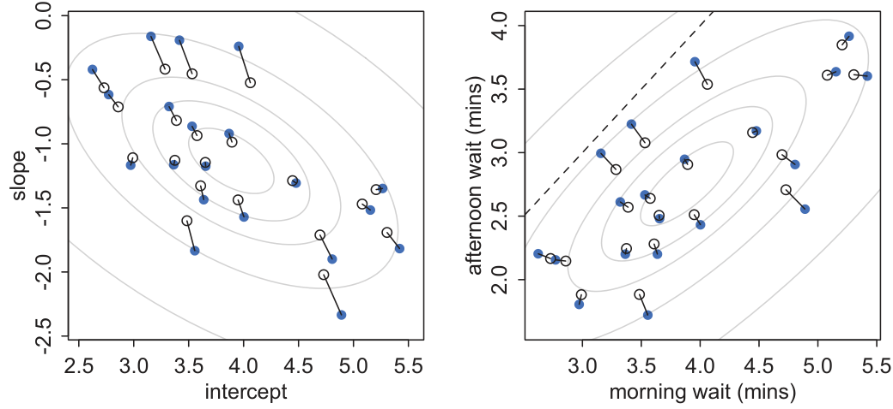
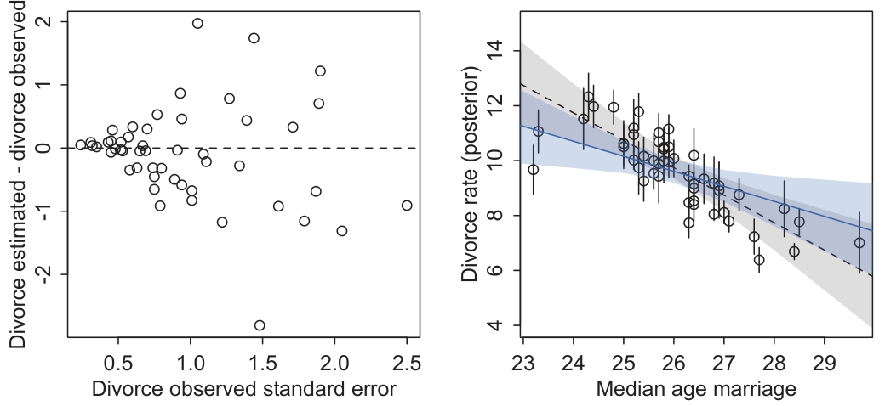

# 7b — Varying slopes, effective parameters, measurement error and missing data

Chapter 7 gave every market its own intercept and measured what borrowing strength buys. Larkspur's analysts hit four questions it did not answer. A market with a high baseline may also respond less to a promotion, so intercepts and slopes should be modelled together, not shrunk one at a time. A multilevel model has 48 intercepts and the criteria say it uses fewer, which is odd. The sampler that handled chapter 7's models starts throwing divergences when markets barely differ. And the numbers going in are not clean: segment rates arrive with standard errors, and a third of one covariate is missing. Ignoring any of these gives a confident wrong answer. This chapter runs each on simulated data where the truth is known, and says where the run differs from McElreath's.

```python
import numpy as np, pandas as pd, pymc as pm, arviz as az
from scipy.special import logsumexp
SAMPLE = dict(chains=4, cores=1, progressbar=False, random_seed=5, target_accept=0.9)
```

`az.summary` and `az.compare` are the current ArviZ (1.x) interface. That version has no `az.waic`, so WAIC below is computed by hand from the pointwise log-likelihood.

## Fewer effective parameters than actual

A multilevel model with a free intercept per tank has as many intercepts as the fixed-effects model, but the intercepts are not free: sigma ties them together. WAIC's penalty, pWAIC, counts how flexible the fit really was (*Statistical Rethinking*, ch. 12). McElreath's 48 tadpole tanks give pWAIC 49.4 for fixed intercepts and 38.0 for the multilevel model, a WAIC difference of 13.1 (standard error 6.54), and a learned sigma of about 1.6. A re-run on simulated tanks, 16 each of 10, 25 and 35 tadpoles, true intercepts Normal(1.3, 1.6):

```python
rng = np.random.default_rng(12)
T = 48
size = np.repeat([10, 25, 35], 16)
true_a = rng.normal(1.3, 1.6, T)
surv = rng.binomial(size, 1 / (1 + np.exp(-true_a)))
tank = np.repeat(np.arange(T), size)       # one row per tadpole: WAIC is pointwise, so the unit matters
lived = np.concatenate([np.r_[np.ones(s), np.zeros(n - s)] for s, n in zip(surv, size)]).astype(int)

def tanks(multilevel):
    with pm.Model():
        if multilevel:
            a, s = pm.Normal("abar", 0, 1), pm.Exponential("sigma", 1)
            at = pm.Deterministic("at", a + s * pm.Normal("z", 0, 1, shape=T))
        else:
            at = pm.Normal("at", 0, 5, shape=T)
        pm.Bernoulli("s", logit_p=at[tank], observed=lived)
        return pm.sample(1000, tune=1000, idata_kwargs={"log_likelihood": True}, **{**SAMPLE, "target_accept": 0.95})

for name, ml in (("fixed intercepts", False), ("multilevel", True)):
    i = tanks(ml)
    ll = i.log_likelihood["s"].stack(n=("chain", "draw")).transpose("n", ...).values
    lppd, p_waic = (logsumexp(ll, axis=0) - np.log(ll.shape[0])).sum(), ll.var(axis=0).sum()
    print(f"{name:17s} pWAIC {p_waic:5.1f}  WAIC {-2 * (lppd - p_waic):7.1f}")
```

```text
fixed intercepts  pWAIC  48.3  WAIC  1115.2
multilevel        pWAIC  36.9  WAIC  1105.6   (sigma 1.39, true 1.6)
```

Same shape as the book: 48 free intercepts cost 48.3 effective parameters, and tying them together drops that to 36.9 and improves WAIC by 9.6. The difference is smaller than McElreath's 13.1, and this is one simulated dataset against his real one. Two details of his that matter here. The prior on sigma: he warns that the half-Cauchy can be risky with few clusters (he suggests Exponential(1) for around five), and the code above uses Exponential(1). And the unit: the same fixed-intercept model scored on the 48 aggregated binomial rows, not the tadpoles, gave pWAIC 22.7 in this run, because WAIC is pointwise and a "point" is whatever row you define. McElreath makes the same point for aggregated binomials (ch. 10), and says not to use WAIC on beta-binomial or gamma-Poisson models at all, since their row-level latent parameter ties the likelihood to how the data were aggregated (ch. 11).

A new cluster is predicted by drawing a fresh intercept from the fitted population, `Normal(a, sigma)`, not by reusing any tank's estimate. Interval widths then include the between-cluster spread, which is the quantity chapter 7's "few groups" section showed is barely known with few groups (*Statistical Rethinking*, ch. 12).

## Varying slopes: model the correlation too

In chapter 7 `re_formula="~week"` gave each user a slope and an intercept. The model underneath draws the pair from a two-dimensional population with a correlation, so a cafe with a surprisingly large slope pulls its intercept as well. McElreath's coffee-robot cafes make it concrete: morning wait averages 3.5 minutes, the afternoon change averages -1, standard deviations are 1 and 0.5, and the correlation is -0.7, so busy cafes (long mornings) have more to gain in the afternoon (*Statistical Rethinking*, ch. 13). The prior on the correlation is LKJ, with eta = 2 skeptical of extreme values. Re-running his setup, 20 cafes, 5 morning and 5 afternoon visits each, noise sd 0.5:

```python
def simulate_cafes(J, pairs, sds, rho, seed=5):
    rng = np.random.default_rng(seed)
    cov = [[sds[0] ** 2, rho * sds[0] * sds[1]], [rho * sds[0] * sds[1], sds[1] ** 2]]
    eff = rng.multivariate_normal([3.5, -1.0], cov, J)
    cafe = np.repeat(np.arange(J), 2 * pairs)
    pm_ = np.tile([0, 1], J * pairs)
    wait = rng.normal(eff[cafe, 0] + eff[cafe, 1] * pm_, 0.5)
    return eff, cafe, pm_, wait

def fit_cafes(J, cafe, pm_, wait, noncentered):
    with pm.Model():
        mu = pm.Normal("mu", [3, -1], [3, 1.5], shape=2)
        chol, corr, sds = pm.LKJCholeskyCov("chol", n=2, eta=2, sd_dist=pm.Exponential.dist(1.0), compute_corr=True)
        if noncentered:                       # v = mu + L z, with z standard normal
            v = pm.Deterministic("v", mu + pm.Normal("z", 0, 1, shape=(J, 2)) @ chol.T)
        else:                                 # v drawn directly from the correlated population
            v = pm.MvNormal("v", mu, chol=chol, shape=(J, 2))
        pm.Normal("wait", v[cafe, 0] + v[cafe, 1] * pm_, pm.Exponential("sigma", 1.0), observed=wait)
        return pm.sample(1000, tune=1000, **SAMPLE)
```

```text
correlation: true -0.7, posterior mean -0.42, 89% interval [-0.74 -0.03]
RMSE against truth (intercept, slope): unpooled [0.233 0.316] partially pooled [0.192 0.253]
```

Partial pooling cuts the error on both parameters, by 18% on intercepts and 20% on slopes, and the posterior correlation points the right way. It also lands well short of the true -0.7, because 20 cafes is a small sample for a correlation and the LKJ prior pulls toward zero. The interval nearly reaches zero, so with this many groups the sign is learned and the size is not. This is one dataset (McElreath uses one seed too).


*Image Source: McElreath, *Statistical Rethinking* (CRC Press), Fig. 13.5*

His figure shows the point to carry away. Shrinkage does not run straight at the centre. A cafe with an average intercept and an unusually high slope is pulled down on the slope, and because the two are negatively correlated that also moves its intercept, hence the angled lines. On the outcome scale the same pooling shrinks predicted waits where you care about them. The same chapter fits UC Berkeley admissions with a varying slope for gender by department: the varying-slopes model has the lowest WAIC (5191.4, weight 0.99, against 5201.2 and 5201.9 for the models without or with a constant gender term), even though the average gender slope is near zero. Department B, with 25 female applications, has its sex-specific slope pooled hard, and department F, with hundreds of each, barely at all (*Statistical Rethinking*, ch. 13).

## Non-centring

When groups barely differ or data per group is thin, the funnel from [chapter 2](02-mcmc-and-pymc.md) returns: the sampler cannot tell a small sigma from a large one and wanders between them. The cure is the same, move the scale out of the prior: draw standard-normal `z` and compute `mu + L z`, where L is the Cholesky factor of the covariance. McElreath's chimpanzee model with three varying effects over actors and blocks has 54 nominal parameters and about 18 effective (pWAIC 18.3), and the centred version raised 559 divergent iterations until he non-centred it (*Statistical Rethinking*, ch. 13). The re-run uses his cafes, once with plenty of data and once with 30 cafes seen twice each that barely differ (true sds 0.15 and 0.1, no correlation):

```text
20 cafes x 10 visits, centred      divergences   1  min ess_bulk  1210  max r_hat 1.003
20 cafes x 10 visits, non-centred  divergences   0  min ess_bulk   811  max r_hat 1.004
30 cafes x 2 visits, centred       divergences 203  min ess_bulk    25  max r_hat 1.130
30 cafes x 2 visits, non-centred   divergences   8  min ess_bulk   270  max r_hat 1.014
```

With plenty of data the two forms are equivalent, and the non-centred one is not better: its minimum ESS is lower (811 against 1,210). With thin data the centred model fails outright, and the non-centred model improves it by a wide margin without fully curing it, still eight divergences. McElreath's non-centred chimp model had none. So treat the form as one lever: raise `target_accept`, tighten the sigma prior or simplify the model as well. Neither form is the default to apply blindly.

## Measurement error

Larkspur's segment conversion rates arrive with standard errors, large for small segments. Treating them as exact has two costs. A noisy outcome is handled by regression anyway, but a noisy predictor attenuates the slope toward zero. McElreath's states data, divorce rate with a known standard error against age at marriage, gives an age-at-marriage slope of -0.55 (sd 0.21) once the divorce error is modelled, roughly half the slope of the version that ignores it, and "ignoring measurement error tends to exaggerate associations between outcomes and predictors" (*Statistical Rethinking*, ch. 14). The mechanism is the shrinkage of chapter 7: each observation is a draw around an unknown true value with known sd, the true values become parameters, and the regression line and the estimates pull on each other. The rule he gives is "do not average, model". On simulated data with a true slope of 1.0, 50 units, known standard errors on both variables:

```python
rng = np.random.default_rng(14)
N = 50
x_true = rng.normal(0, 1, N)
y_true = 1.0 * x_true + rng.normal(0, 0.5, N)
y_se, x_se = rng.uniform(0.1, 1.5, N), rng.uniform(0.1, 1.0, N)
y_obs, x_obs = rng.normal(y_true, y_se), rng.normal(x_true, x_se)

with pm.Model():
    a, b = pm.Normal("a", 0, 1), pm.Normal("b", 0, 1)
    xt = pm.Normal("xt", 0, 1, shape=N)                         # the true values are parameters
    yt = pm.Normal("yt", a + b * xt, pm.Exponential("s", 1), shape=N)
    pm.Normal("xo", xt, x_se, observed=x_obs)
    pm.Normal("yo", yt, y_se, observed=y_obs)
    me = pm.sample(1000, tune=1000, **SAMPLE)
# the naive model is pm.Normal("y", a + b * x_obs, s, observed=y_obs)
```

```text
ignores error  slope 0.81 (sd 0.14), divergences 0
models error   slope 0.94 (sd 0.10), divergences 9
```

The naive slope is attenuated to 0.81 and its interval would miss the truth by more than one sd; modelling the error recovers 0.94 with a smaller sd. The measurement-error model raised 9 divergences here, the same warning as above, and needs a non-centred form or a higher `target_accept` before you rely on it. McElreath's own example sets the predictor-error model against an outcome-error model and finds the coefficients on age at marriage and marriage rate essentially unchanged, so the benefit depends on which cases carry the error and how large it is against the variation (*Statistical Rethinking*, ch. 14).


*Image Source: McElreath, *Statistical Rethinking* (CRC Press), Fig. 14.2*

In his figure, the left panel is shrinkage again: states with larger standard errors move further. The right panel shows the fitted line moving as well, gray without error and blue with it, with a wider band.

## Missing predictors: impute inside the model

Deleting rows with a missing value throws away the other columns. McElreath's primate milk data keeps 17 of 29 species and drops 12 perfectly good mass and energy values (*Statistical Rethinking*, ch. 14). The Bayesian fix treats each missing value as a parameter with a prior, and the model for the predictor does the imputing. A simple imputation model, one common mean, assumes the missing predictor is unrelated to everything else, and it weakens the estimated slope (his neocortex coefficient falls from 2.77, sd 0.87, in the complete cases to 1.93, sd 0.73). Letting the predictor depend on body mass restores it to 2.44 (sd 0.75) and tightens the imputed values from about 0.05 to 0.03-0.04. He works only the missing-completely-at-random case and gives missing-not-at-random one paragraph, so everything below is MCAR too. Re-running the idea, 29 species, 12 values missing at random, true slope 0.5:

```python
rng = np.random.default_rng(3)
n = 29
m = rng.normal(0, 1, n)
nco = 0.7 * m + rng.normal(0, 0.5, n)                 # the predictor depends on mass
k = 0.5 * nco - 0.3 * m + rng.normal(0, 0.5, n)
miss = np.zeros(n, bool); miss[rng.choice(n, 12, replace=False)] = True

with pm.Model():
    a, bn, bm = pm.Normal("a", 0, 1), pm.Normal("bn", 0, 1), pm.Normal("bm", 0, 1)
    an, g, sn = pm.Normal("an", 0, 1), pm.Normal("g", 0, 1), pm.Exponential("sn", 1)
    nc = pm.Normal("nc", an + g * m, sn, observed=np.where(miss, np.nan, nco))   # PyMC imputes the NaNs
    pm.Normal("k", a + bn * nc + bm * m, pm.Exponential("s", 1), observed=k)
    imp = pm.sample(1000, tune=1000, **SAMPLE)
```

```text
complete cases (17)       bn 0.49 (sd 0.31)   true 0.50
impute, no link to mass   bn 0.26 (sd 0.22)   true 0.50
impute, N ~ mass          bn 0.41 (sd 0.26)   true 0.50
```

The direction matches the book. The naive imputation model, which ignores the link to mass, pulls the slope to 0.26 and shrinks the standard error to 0.22, which is more confident and more wrong than the complete cases. Letting the predictor depend on mass moves it back to 0.41. In this draw the complete cases happened to land on the truth (0.49, with a wider sd of 0.31), so one run does not show imputation winning on accuracy. What it shows is the sd falling from 0.31 to 0.26 when the imputation model is right, and the estimate going wrong when it is not.

## Pitfalls

| Pitfall | Symptom | Fix |
|---|---|---|
| Counting parameters by the model's size | A multilevel model reported as "50 parameters" when WAIC's pWAIC says 37 here | Report pWAIC, and say which rows WAIC treats as points |
| Comparing WAIC across likelihoods or aggregations | Aggregated binomial and Bernoulli rows give pWAIC 22.7 and 48.3 for the same model | Compare models with the same likelihood and the same data rows |
| Fitting slopes and intercepts as independent | Shrinkage pulls each straight to the centre and ignores a -0.7 correlation | Draw the pair from a multivariate population with an LKJ prior |
| Reading the correlation posterior as a measurement | Mean -0.42 for a true -0.7, with 20 groups | Report the interval, and expect the prior to pull |
| Centred form with thin data | 203 divergences and ESS 25 here | Non-centre, raise `target_accept`, simplify, and check again |
| Believing non-centring always cures divergences | 8 divergences left after it | Treat it as one lever among several |
| Treating a noisy predictor as exact | Slope 0.81 against a true 1.0 | Model the measurement error, with its known sd |
| Imputing with a mean-only model | Slope halved with a confident sd | Give the imputation model the covariates that predict the variable |
| Dropping incomplete rows silently | 12 of 29 rows gone | Impute inside the model, and say the missingness assumption |

## Try it

1. In the tanks run, replace the multilevel model's `Exponential(1)` on sigma with `HalfNormal(5)`. Does pWAIC move?
2. Set the cafe correlation to 0 and refit with the same `eta`. What does the posterior correlation interval look like?
3. Double every `x_se` in the measurement-error run. What happens to the naive and to the corrected slope?
4. Make the missingness depend on the outcome. Does the imputation model still help?

<details><summary>Answers</summary>

1. It should move little. Both priors place most mass below 3, and with 48 tanks the data identify sigma, so pWAIC is dominated by the likelihood. The prior matters at five clusters, not 48.
2. A wide interval around zero, roughly symmetric. With 20 groups a correlation of 0 and one of -0.4 are hard to tell apart.
3. The naive slope drops further, since attenuation grows with the share of variance that is noise. The corrected slope stays near 1.0 with a wider sd, and divergences are likelier.
4. No. That is missing not at random: the model for the predictor does not see the process that removed the values, and McElreath names the case without working it. A model of the missingness itself is needed.

</details>

## Interview checklist

| Prompt | Answer |
|---|---|
| Why does a multilevel model have fewer effective parameters than actual ones? | The varying effects share a learned sigma, so they are not free. pWAIC fell from 48.3 to 36.9 on 48 simulated tanks |
| Why model intercepts and slopes together? | They can covary, and a shrunk slope shifts its intercept. Shrinkage then runs at an angle, not straight to the centre |
| What is non-centring? | Draw standard-normal z and compute mu + L z, so the sampler explores z instead of a funnel |
| Does it always fix divergences? | No. With thin data it cut 203 to 8 here, and the centred form is fine with plenty of data |
| What does ignoring predictor error do? | Attenuates the slope. 0.81 against a true 1.0 here |
| How do you handle a missing predictor? | Give it a prior and a model on the other covariates, and let the model impute. Complete-case analysis is the alternative, at the cost of rows |
| What does imputation assume? | That values are missing at random given what the model sees. Not-at-random missingness needs a model of the missingness |
| Why not compare WAIC for a beta-binomial and a binomial? | WAIC is pointwise and the beta-binomial's latent row-level parameter ties it to the aggregation |

---

## Next

That closes the pillar. [Visualisation and storytelling](../../05-visualisation-and-storytelling/README.md) is how you present these answers to the people who decide. Model building continues in [data-science](../../../data-science/README.md), pipelines in [data-engineering](../../../data-engineering/README.md), and LLM applications in [generative-ai](../../../generative-ai/README.md).
