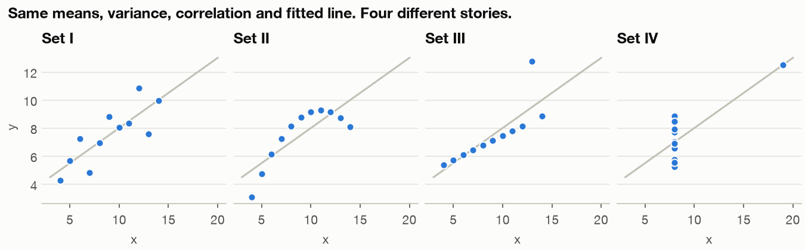
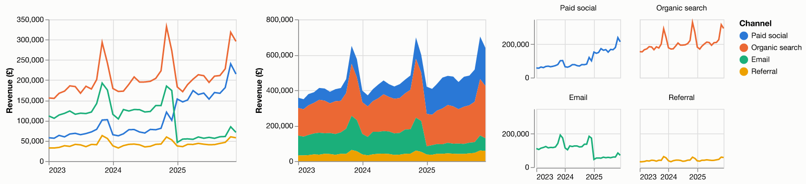
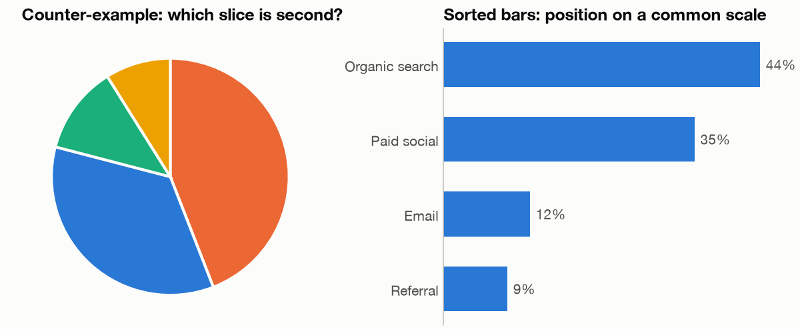
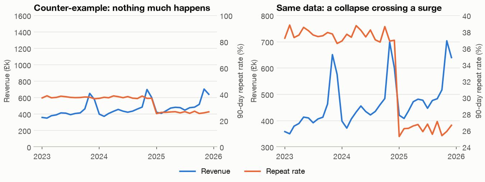
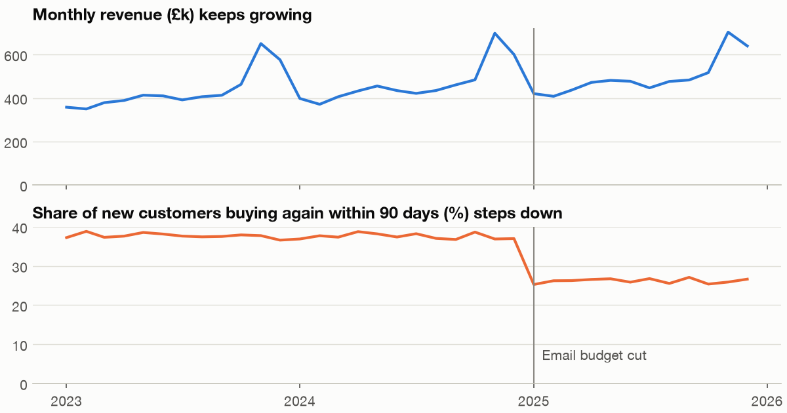
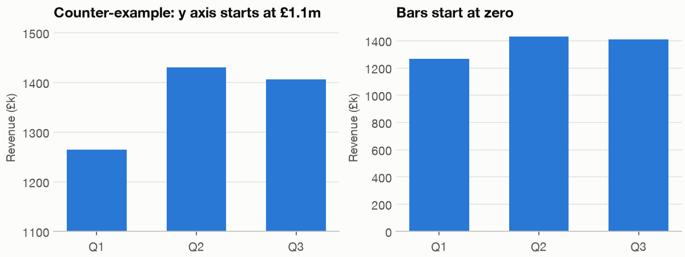

# Grammar of graphics and chart choice

A chart is an argument made with geometry, and a reader believes geometry faster than they believe prose. That is why a bad chart is worse than no chart: it misleads before anyone has read a label. This chapter gives you the two tools that stop most bad charts before they are drawn. One is a way to describe any chart as a small set of independent decisions. The other is a ranked list of how accurately people read each visual encoding.

---

## The company we will follow

Every chapter in this pillar works on the same fictional shop, because the point of learning five charting tools is to compare them on one question. Fernhill Home sells homewares online. In January 2025 it cut its email budget from £14k to £4k a month and spent more on paid social. Finance is pleased: revenue kept rising. A retention analyst suspects something else is happening underneath. By chapter 5 we will have to tell the leadership team whether to restore the budget.

The data comes from `practice/fernhill.py`, a seeded generator. It is synthetic, so the story was planted and the numbers prove nothing about real email marketing. What it gives us is a dataset where we can check what each chart reveals against what we know is true.

```python
import fernhill

monthly = fernhill.load_monthly()
print(monthly.head(4).to_string(index=False))
print(len(monthly), "rows")
yearly = monthly.assign(year=monthly.month.dt.year).groupby("year")[["revenue", "spend"]].sum()
print(yearly)
print(fernhill.total_by_month().assign(year=lambda d: d.index.year)
      .groupby("year")["repeat_rate"].mean().round(3))
```

```text
     month     channel  sessions  orders  revenue  spend
2023-01-01 paid_social     51993     919    57782  26000
2023-01-01     organic     77715    2118   155989      0
2023-01-01       email     29227    1362   111609  14000
2023-01-01    referral     15505     470    32427      0
144 rows
      revenue   spend
year
2023  5197998  480000
2024  5596149  480000
2025  5960289  624000
year
2023    0.377
2024    0.376
2025    0.262
Name: repeat_rate, dtype: float64
```

Two tables, two different moods. Revenue rose from £5.60m to £5.96m. The share of new customers who bought again within 90 days fell from about 38% to 26%. Hold on to those two lines, because most of this chapter is about how to draw them honestly.

## Why plot at all

Before grammar, the reason. Frank Anscombe built four small datasets in 1973 to argue with the belief that calculations are exact and graphs are rough ([Anscombe, The American Statistician 1973](https://www.jstor.org/stable/2682899)). Here are his numbers and the summary statistics an analyst would normally report.

```python
import numpy as np
import pandas as pd

# The four datasets exactly as published in Anscombe (1973).
x123 = [10, 8, 13, 9, 11, 14, 6, 4, 12, 7, 5]
x4 = [8, 8, 8, 8, 8, 8, 8, 19, 8, 8, 8]
quartet = {
    "I": (x123, [8.04, 6.95, 7.58, 8.81, 8.33, 9.96, 7.24, 4.26, 10.84, 4.82, 5.68]),
    "II": (x123, [9.14, 8.14, 8.74, 8.77, 9.26, 8.10, 6.13, 3.10, 9.13, 7.26, 4.74]),
    "III": (x123, [7.46, 6.77, 12.74, 7.11, 7.81, 8.84, 6.08, 5.39, 8.15, 6.42, 5.73]),
    "IV": (x4, [6.58, 5.76, 7.71, 8.84, 8.47, 7.04, 5.25, 12.50, 5.56, 7.91, 6.89]),
}
rows = []
for name, (x, y) in quartet.items():
    slope, intercept = np.polyfit(x, y, 1)
    rows.append({"set": name, "mean_x": np.mean(x), "mean_y": np.mean(y),
                 "var_y": np.var(y, ddof=1), "corr": np.corrcoef(x, y)[0, 1],
                 "slope": slope, "intercept": intercept})
print(pd.DataFrame(rows).round(2).to_string(index=False))
```

```text
set  mean_x  mean_y  var_y  corr  slope  intercept
  I     9.0     7.5   4.13  0.82    0.5        3.0
 II     9.0     7.5   4.13  0.82    0.5        3.0
III     9.0     7.5   4.12  0.82    0.5        3.0
 IV     9.0     7.5   4.12  0.82    0.5        3.0
```

To two decimal places the four sets are the same dataset. Now draw them.

```python
import matplotlib.pyplot as plt
import chartstyle as cs

cs.apply()
fig, axes = plt.subplots(1, 4, figsize=(9, 2.8), sharex=True, sharey=True)
for ax, (name, (x, y)) in zip(axes, quartet.items()):
    slope, intercept = np.polyfit(x, y, 1)
    line_x = np.array([3, 20])
    ax.plot(line_x, slope * line_x + intercept, color=cs.BASELINE, linewidth=1.5)
    ax.scatter(x, y, s=34, color=cs.BLUE, edgecolor=cs.SURFACE, linewidth=1, zorder=3)
    ax.set_title(f"Set {name}")
    ax.set_xlabel("x")
axes[0].set_ylabel("y")
fig.suptitle("Same means, variance, correlation and fitted line. Four different stories.",
             x=0.01, ha="left", fontsize=12, fontweight="bold")
cs.save(fig, "viz-anscombe-quartet.png")
```



*Image Source: generated by `practice/ch01_grammar_and_choice.py` from the values in Anscombe (1973).*

Set I is the picture the summary implies. Set II is a clean curve that a line should never have been fitted to. Set III is a tight line with one outlier dragging it. Set IV has no relationship at all except a single point that manufactures the whole slope. Each one calls for a different next step, and the table could not have told you which. So there are two separate jobs for charts, and Knaflic's opening distinction is worth learning early: **exploratory** charts are the many you make to find out what is true, and **explanatory** charts are the few you make to tell someone else ([Knaflic, Wiley 2015](https://www.storytellingwithdata.com/books)). This chapter and the next two are mostly about the first. Chapter 5 is about the second.

## A chart is a set of independent decisions

The instinct is to think in chart types: a line chart, a stacked area, a pie. Chart types are a menu, and a menu limits you to what is on it. Leland Wilkinson's *The Grammar of Graphics* ([Springer, 1999; 2nd ed. 2005](https://link.springer.com/book/10.1007/0-387-28695-0)) replaced the menu with a grammar: a statistical graphic is a composition of independent parts, the way a sentence is a composition of parts of speech. Hadley Wickham turned this into a practical system for ggplot2, built around layers ([Wickham, JCGS 2010](https://vita.had.co.nz/papers/layered-grammar.html)). Vega-Lite brought the same idea to JSON and added interaction ([Satyanarayan et al., IEEE TVCG 2017](https://idl.uw.edu/papers/vega-lite)), and Altair is that grammar with a Python API. To see the layers built up by hand, Healy teaches them step by step in R ([Healy, Princeton UP 2018](https://socviz.co/)), and the [ggplot2 book](https://ggplot2-book.org/) is the full reference.

The parts are these.

| Part | The question it answers | Fernhill example |
|---|---|---|
| Data | Which rows, at what grain? | One row per month and channel |
| Mark (geom) | What shape stands for a row? | Line, area, bar, point |
| Encoding (aesthetic) | Which column drives which visual channel? | Month to x, revenue to y, channel to colour |
| Statistic | Is anything computed first? | Sum revenue by month |
| Scale | How do values map to pixels and colours? | Zero-based linear y, fixed channel colours |
| Coordinates | Which space are we in? | Cartesian; polar would give a pie |
| Facet | Do we repeat the chart per group? | One small panel per channel |

The payoff is that each decision can change while the others stay still. Watch the mark change, and then a facet appear, with the data and the encoding untouched.

```python
import altair as alt

data = monthly.assign(channel=monthly.channel.map(fernhill.LABELS))
order = [fernhill.LABELS[c] for c in fernhill.CHANNELS]
colour = alt.Color("channel:N", sort=order, title="Channel",
                   scale=alt.Scale(domain=order, range=cs.CATEGORICAL))
x = alt.X("yearmonth(month):T", title=None, axis=alt.Axis(format="%Y", tickCount="year"))
y = alt.Y("sum(revenue):Q", title="Revenue (£)")

base = alt.Chart(data).properties(width=250, height=190)          # data
lines = base.mark_line(strokeWidth=2).encode(x=x, y=y, color=colour)  # geom + aesthetics
areas = base.mark_area().encode(x=x, y=y, color=colour)           # change only the mark
small = (base.properties(width=112, height=78).mark_line(strokeWidth=2)
         .encode(x=x, y=alt.Y("sum(revenue):Q", title=None), color=colour)
         .facet(facet=alt.Facet("channel:N", sort=order, title=None), columns=2))  # add a facet
grammar = (alt.hconcat(lines, areas, small).resolve_scale(color="shared")
           .configure_view(stroke=None).configure_axis(gridColor=cs.GRID, domainColor=cs.BASELINE)
           .configure(background=cs.SURFACE, font="Helvetica Neue"))
grammar.save(cs.IMAGES / "viz-grammar-one-spec-three-marks.png", scale_factor=1.5)
print(sorted(lines.to_dict()["encoding"]), lines.to_dict()["mark"]["type"])
```

```text
['color', 'x', 'y'] line
```



*Image Source: generated by `practice/ch01_grammar_and_choice.py` with Altair.*

Three charts, one specification with a word changed. They answer three different questions. The lines let you compare the channels month by month and show paid social crossing email in January 2025. The stack shows the total, and it makes the middle channels hard to read because each one sits on a moving baseline. The small multiples show each channel's own shape, at the cost of cross-channel comparison.

So when someone asks "what chart should this be?", translate it into the grammar's question: "which encoding will make the comparison I care about easiest to read?" That has an answer based on evidence.

## Encodings have a ranking

William Cleveland and Robert McGill ran experiments in which people judged the relative size of two values shown by different elementary encodings, and they ordered those encodings by accuracy ([Cleveland & McGill, JASA 1984](https://doi.org/10.1080/01621459.1984.10478080)). From best to worst:

```text
position on a common scale          dot plot, line, bar tip
position on non-aligned scales      the same value across small multiples
length, direction, angle            stacked segments, slopes, pie slices
area                                bubbles, treemaps
volume, curvature                   3D shapes
shading, colour saturation          heatmaps, choropleths
```

Jeffrey Heer and Michael Bostock replicated earlier spatial encoding and luminance contrast studies with Mechanical Turk workers and reported that crowdsourced perception experiments are viable, so the ordering is not an artefact of one laboratory ([Heer & Bostock, CHI 2010](https://idl.uw.edu/papers/crowdsourcing-graphical-perception)). Tamara Munzner builds the same evidence into a design principle: put the most important attribute on the most accurately perceived channel ([Munzner, CRC Press 2014, ch. 5](https://www.cs.ubc.ca/~tmm/vadbook/)).

This is the real reason for the common advice about pie charts. A pie asks the reader to compare angles and areas, which sit below position on that list.

```python
share = (monthly[monthly.month.dt.year == 2025].groupby("channel")["revenue"].sum()
         .sort_values(ascending=False))
share = share / share.sum()
print(share.round(3).to_string())

fig, (left, right) = plt.subplots(1, 2, figsize=(8, 3.3))
colours = [cs.CHANNEL_COLOUR[c] for c in share.index]
names = [fernhill.LABELS[c] for c in share.index]
left.pie(share, colors=colours, startangle=90, counterclock=False,
         wedgeprops={"edgecolor": cs.SURFACE, "linewidth": 2})
left.set_title("Counter-example: which slice is second?")
right.barh(names[::-1], share.values[::-1] * 100, color=cs.BLUE, height=.6)
for i, value in enumerate(share.values[::-1] * 100):
    right.text(value + .8, i, f"{value:.0f}%", va="center", color=cs.SECONDARY)
right.set_title("Sorted bars: position on a common scale")
right.grid(False)
right.set_xticks([])
right.spines["bottom"].set_visible(False)
right.spines["left"].set_visible(True)
right.tick_params(left=False)
cs.save(fig, "viz-pie-vs-sorted-bars.png")
```

```text
channel
organic        0.441
paid_social    0.350
email          0.120
referral       0.089
saved viz-pie-vs-sorted-bars.png (43 KB)
```



*Image Source: generated by `practice/ch01_grammar_and_choice.py`. The pie is a labelled counter-example.*

Sorted bars win here because the question is comparison. But "never use a pie" is a slogan and not a finding. Wilke's table of proportion charts is more careful: pies are good at showing that the parts make a whole and at emphasising simple fractions such as a half or a quarter, while side-by-side bars are better for comparing the parts and for many pieces ([Wilke, O'Reilly 2019, ch. 10](https://clauswilke.com/dataviz/visualizing-proportions.html)). If your point is "organic is nearly half of revenue", a two-slice pie is a defensible chart. Knaflic takes the harder line and advises avoiding pies altogether. Both agree on what matters, which is that the comparison the reader must make decides the form.

## Choose by the question

With the ranking in hand, chart choice stops being taste. Start from the sentence you want the reader to be able to say.

| The reader needs to see | Use | Avoid | Why |
|---|---|---|---|
| Change over time | Line | Stacked area for individual series | Position on a common scale; slope carries the rate |
| A comparison across categories | Sorted bars or dots | Pie with many slices, unsorted bars | Length from a shared baseline; sorting gives rank free |
| Parts of a whole, simple fractions | Single stacked bar, small pie | Many-slice pie, 3D pie | Reader needs "how much of the total" only |
| A distribution | Histogram, box plot, density | Mean-only bar | The shape is the message; see Anscombe |
| A relationship | Scatter | Two lines on two axes | Both variables get position |
| Many groups at once | Small multiples | Spaghetti lines, more than eight hues | Each panel gets its own uncluttered read |
| Two values in a grid | Heatmap with one-hue scale | Rainbow scale | Lowest accuracy channel, so use it for pattern and annotate values |
| One number that matters | The number, in large type | A chart of one point | Sometimes the answer is not a chart |

Knaflic's own short list of visuals she relies on covers simple text, tables, heatmaps, lines, slopegraphs and bars, which makes the same point another way: a small vocabulary used precisely beats a large one used loosely. Wilke's [directory of visualizations](https://clauswilke.com/dataviz/directory-of-visualizations.html) is the place to look when you need a form you have forgotten the name of.

## Two ways an honest dataset gets misrepresented

Now the two lines from the start. They have different units and different scales, and the tempting move is to give each its own y axis.

```python
story = fernhill.total_by_month()


def dual(ax, revenue_limits, rate_limits, title):
    """A deliberately bad chart: two y scales the author can slide independently."""
    ax.plot(story.index, story.revenue / 1000, color=cs.BLUE, label="Revenue")
    ax.set_ylim(revenue_limits)
    ax.set_ylabel("Revenue (£k)")
    twin = ax.twinx()
    twin.plot(story.index, story.repeat_rate * 100, color=cs.ORANGE, label="Repeat rate")
    twin.set_ylim(rate_limits)
    twin.set_ylabel("90-day repeat rate (%)")
    twin.grid(False)
    ax.set_title(title)
    cs.year_ticks(ax)
    ax.figure.legend(handles=[*ax.get_lines(), *twin.get_lines()], loc="outside lower center",
                     ncols=2) if ax is a else None


fig, (a, b) = plt.subplots(1, 2, figsize=(9, 3.4))
dual(a, (0, 1600), (0, 100), "Counter-example: nothing much happens")
dual(b, (300, 800), (24, 40), "Same data: a collapse crossing a surge")
cs.save(fig, "viz-dual-axis-two-stories.png")
```



*Image Source: generated by `practice/ch01_grammar_and_choice.py`. Both panels are labelled counter-examples.*

Both panels plot exactly the same data. On the left, the repeat rate drifts across the bottom and appears to matter little. On the right it plunges through revenue like a crash. Nothing in the data decides where the two scales should sit relative to each other, so the crossing points and the apparent gap are inventions of whoever set the limits. Knaflic lists secondary y axes among the things to avoid for this reason. The fix is cheap: give each measure its own panel on a shared time axis.

```python
fig, (top, bottom) = plt.subplots(2, 1, figsize=(8, 4.2), sharex=True, height_ratios=[1, 1])
top.plot(story.index, story.revenue / 1000, color=cs.BLUE)
top.set_ylim(0)
top.set_title("Monthly revenue (£k) keeps growing")
bottom.plot(story.index, story.repeat_rate * 100, color=cs.ORANGE)
bottom.set_ylim(0, 40)
bottom.set_title("Share of new customers buying again within 90 days (%) steps down")
for ax in (top, bottom):
    ax.axvline(fernhill.CUT, color=cs.MUTED, linewidth=1)
cs.year_ticks(bottom)
bottom.annotate("Email budget cut", (fernhill.CUT, 6), xytext=(6, 0),
                textcoords="offset points", color=cs.SECONDARY)
cs.save(fig, "viz-two-panels-instead-of-dual-axis.png")
```



*Image Source: generated by `practice/ch01_grammar_and_choice.py`.*

The relationship in time is still visible, since both panels share the x axis and the marker for the budget cut, and no one can argue about where the scales were placed. This chart is the first honest statement of Fernhill's problem. If the two measures genuinely share a base, a third option is to index both to 100 at a chosen date.

The second distortion is a truncated bar.

```python
quarter = (story.revenue[story.index.year == 2025].groupby(lambda d: d.quarter).sum() / 1000)
print(quarter.round(0).to_string())
q = quarter.iloc[:3]  # Q4 is the Christmas peak, so compare the three ordinary quarters
fig, (a, b) = plt.subplots(1, 2, figsize=(8, 3))
for ax, bottom_limit, title in ((a, 1100, "Counter-example: y axis starts at £1.1m"),
                                (b, 0, "Bars start at zero")):
    ax.bar([f"Q{i}" for i in q.index], q.values, color=cs.BLUE, width=.6)
    ax.set_ylim(bottom_limit, q.max() * 1.06)
    ax.set_title(title)
    ax.set_ylabel("Revenue (£k)")
print(f"real Q3 vs Q1: {q.iloc[2] / q.iloc[0] - 1:+.0%}, "
      f"bar heights on the left: {(q.iloc[2] - 1100) / (q.iloc[0] - 1100) - 1:+.0%}")
cs.save(fig, "viz-bar-baseline-truncated-vs-zero.png")
```

```text
month
1    1264.0
2    1430.0
3    1406.0
4    1860.0
real Q3 vs Q1: +11%, bar heights on the left: +86%
saved viz-bar-baseline-truncated-vs-zero.png (29 KB)
```



*Image Source: generated by `practice/ch01_grammar_and_choice.py`. The left panel is a labelled counter-example.*

Q3 revenue is 11% above Q1, and on the left it is drawn 86% taller. Wilke names the rule behind this the principle of proportional ink: the size of a shaded area has to be proportional to the value it represents ([Wilke, O'Reilly 2019, ch. 17](https://clauswilke.com/dataviz/proportional-ink.html)). A bar's length is its message, so bars start at zero on a linear scale. A line or dot encodes value by position alone, which is why a line chart can sometimes zoom in without breaking the rule, provided the axis says so plainly. Knaflic's example of the genre is a tax-rate bar chart whose cut axis made a rise of about 13% look like about 460%. We drew the repeat rate from zero anyway, because the honest size of the fall matters more here than the month-to-month wiggle.

## Colour has a job too

Colour is near the bottom of the accuracy list, so spend it on identity, not quantity, unless a grid leaves you nothing else. There are three common jobs, and each has one rule. **Categorical** colour says which thing: use a fixed order of distinct hues, keep a colour attached to its entity across every chart, and stop before you need a ninth. **Sequential** colour says how much: use one hue from light to dark. **Diverging** colour says above or below a meaningful midpoint: use two hues with a neutral grey in the middle. The Fernhill palette in `practice/chartstyle.py` was checked with a colour-vision-deficiency validator before use. Two of its four hues have less than 3:1 contrast against the background, so charts using them must also carry direct labels or a table. A contrast check is a calculation, and you should run one rather than judge by eye.

## Pitfalls

- **Picking the chart before the question.** "We need a dashboard with a pie" is a decision made in the wrong order. Write the sentence the reader should be able to say first.
- **Two y axes.** The relative placement of the scales is arbitrary, so any crossing or gap is authored. Use aligned panels or an index.
- **Bars or areas from a non-zero baseline.** Length and area are the message. If you must show small differences, plot the differences, or use dots.
- **Stacking to compare.** Only the bottom segment has a shared baseline. Use stacks for totals and lines or panels for parts.
- **Summaries without a plot.** Anscombe's four sets match on every headline number. Plot before you report.
- **Colour for its own sake.** A different colour per bar in a single-series chart invents a category that does not exist.
- **Rotated tick labels on vertical bars.** Swap to horizontal bars. Knaflic cites work finding that 45-degree text was read about 52% slower than horizontal, and 90-degree text about 205% slower (Wigdor & Balakrishnan, 2005, as cited by Knaflic).

## Try it

1. Change one thing in the `grammar` block so paid social appears at the bottom of the stack, and say what became easier and harder to read.

   <details><summary>Answer</summary>

   Add an `order` encoding, for example `order=alt.Order("channel:N", sort="descending")`, or reorder the colour domain. The series nearest the x axis gets a shared baseline, so its own trend becomes readable and the others do not. It is a statement of priority: put the series you care about most at the bottom.
   </details>

2. Index revenue and repeat rate to 100 at December 2024 and plot both on one axis. Why is this fairer than a dual axis, and what is lost?

   <details><summary>Answer</summary>

   `story / story.loc["2024-12-01"] * 100` puts both on one scale whose meaning (percent of the base month) is the same for both. The scale is no longer chosen freely. What is lost is the absolute level, so a reader cannot see that the rate started at 37%, and the choice of base month still matters: December is a seasonal revenue peak, so a fairer base would be a whole year's average.
   </details>

3. For each sentence, name the form: (a) "Email is 12% of revenue"; (b) "Email fell in the same month as the budget cut"; (c) "Order values are right-skewed with a long tail"; (d) "Repeat rate fell in all four channels".

   <details><summary>Answer</summary>

   (a) A single number, or one stacked bar if the whole matters. (b) A line with the event marked. (c) A histogram or box plot, on a log scale here. (d) Small multiples, or a two-column slopegraph with one line per channel, which is what chapter 2 draws.
   </details>

## Interview checklist

| Question | Answer |
|---|---|
| What does the grammar of graphics give you that chart types do not? | A chart is a composition of data, marks, encodings, statistics, scales, coordinates and facets, so you can vary one decision at a time and describe charts no menu names. |
| Which encodings are read most accurately? | Position on a common scale, then position on non-aligned scales, then length, angle and slope, then area, then volume, then shading and saturation (Cleveland and McGill, 1984). |
| Why avoid dual y axes? | The relative placement of two independent scales is arbitrary, so any crossing or correlation it suggests is the author's choice. Use aligned panels or index both series to one base. |
| Must every y axis start at zero? | Bars and areas must, because length and area encode the value. Lines and dots encode by position and may zoom if the axis is plain about it. |
| Is a pie chart ever right? | Yes, for a small number of parts where the message is a simple fraction of a whole. For comparing the parts, sorted bars are more accurate. |
| What does Anscombe's quartet show? | Four datasets share means, variance, correlation and fitted line and look nothing alike. Summaries alone can hide curvature, outliers and leverage. |
| Exploratory versus explanatory? | Exploratory charts are many and help you find out; explanatory charts are few and tell someone else one thing. |

## Next

The grammar tells you what to draw. Next we do it by hand in Python, where you control every pixel: [Matplotlib and seaborn](02-matplotlib-and-seaborn.md).
