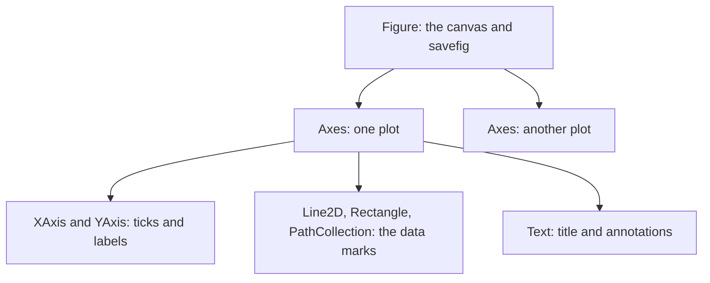
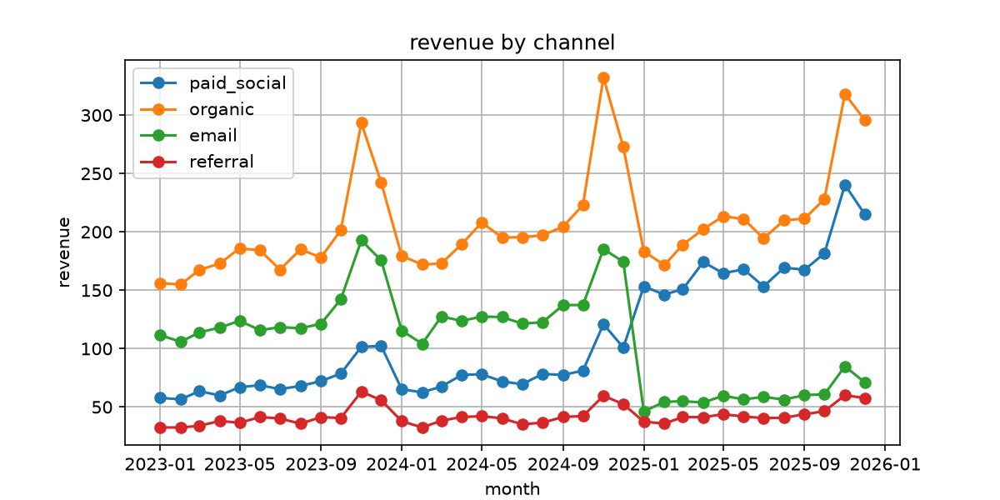
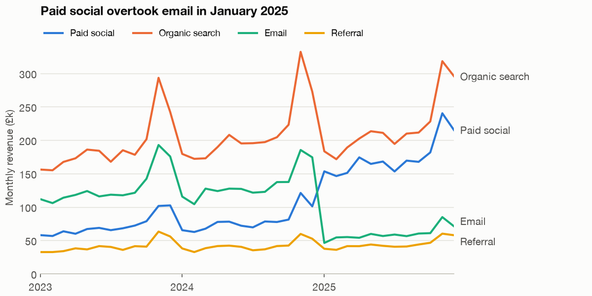
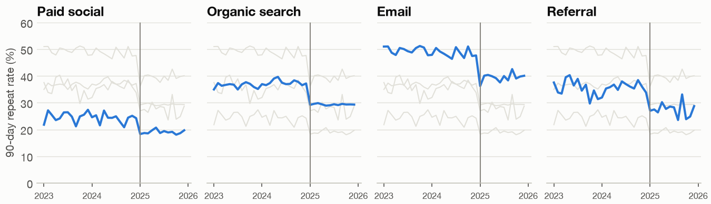
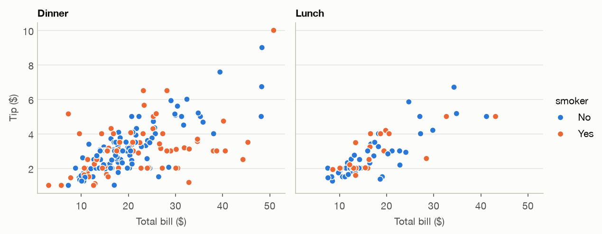
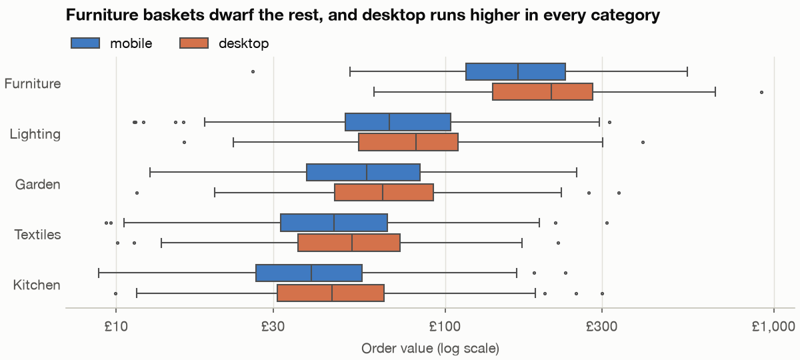
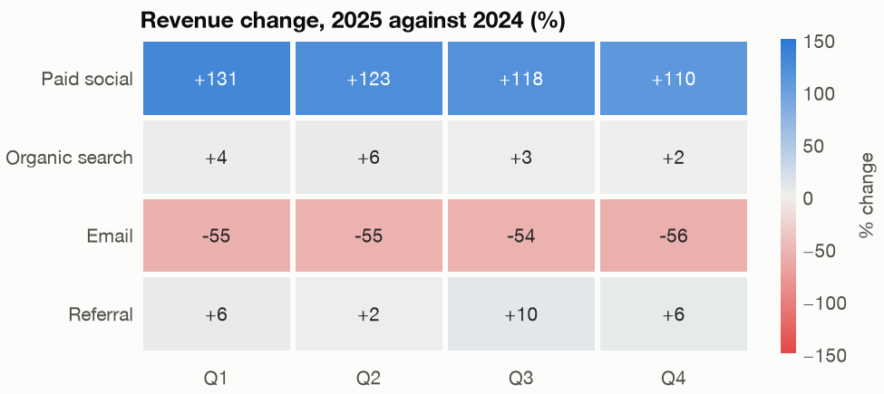

# Matplotlib and seaborn

Almost every static chart in the Python world is drawn by matplotlib, even when the code says seaborn or pandas. Its defaults are famously unpersuasive and its API has two personalities, which is why many people copy snippets for years without forming a mental model. This chapter builds that model, then uses it to strip a default chart down to what it needs to say. Then it shows when seaborn saves you the work.

---

## The object model

Matplotlib is a tree of objects. A `Figure` is the whole canvas. It contains one or more `Axes`, each of which is a single plot with its own coordinate system (the plural is a historical name, and it does not mean the x and y axes). An `Axes` contains `Line2D`, `Text`, `Rectangle` and other artists. Everything you see is an artist, and everything can be reached and changed.



The two personalities are the `pyplot` state machine (`plt.plot`, which acts on "the current axes") and the object-oriented API (`ax.plot`, which acts on the axes you name). The [matplotlib quick start](https://matplotlib.org/stable/users/explain/quick_start.html) documents both. Use the object-oriented one for anything you will keep. Once a figure has two panels, "current" stops being a safe idea, and every helper function you write will want an `ax` argument anyway.

Here is Fernhill's revenue by channel as matplotlib draws it if you take everything it offers.

```python
import matplotlib.pyplot as plt
import numpy as np
import pandas as pd
import chartstyle as cs
import fernhill

monthly = fernhill.load_monthly()
wide = monthly.pivot(index="month", columns="channel", values="revenue")[fernhill.CHANNELS] / 1000

plt.rcdefaults()                        # matplotlib's own defaults, for the "before" picture
fig, ax = plt.subplots(figsize=(8, 4))  # a Figure holding one Axes
for channel in fernhill.CHANNELS:
    ax.plot(wide.index, wide[channel], marker="o", label=channel)
ax.set_title("revenue by channel")
ax.set_xlabel("month")
ax.set_ylabel("revenue")
ax.grid(True)
ax.legend()
fig.savefig(cs.IMAGES / "viz-matplotlib-default-chart.png", dpi=150)
plt.close(fig)
print(type(fig).__name__, type(ax).__name__, len(ax.get_lines()), "Line2D artists")
```

```text
Figure Axes 4 Line2D artists
```



*Image Source: generated by `practice/ch02_matplotlib_seaborn.py` with matplotlib's defaults, as the "before" picture.*

Nothing here is wrong, and everything competes. Thirty-six markers per line say "these are months", which the axis already says. The grid and box are as dark as the data. The legend sits on top of the lines and asks the reader to shuttle back and forth. The title describes the chart without saying anything. The x labels say `2023-05` when the only structure that matters is the year. And the most important event in the data, the moment green and blue cross, has no more visual weight than the rest.

## Declutter: every element must earn its place

Knaflic's framing for what to do next is cognitive load. Each thing on the page costs the reader some effort, and elements that add effort without adding understanding are clutter. Her declutter sequence removes the border, drops or fades gridlines, removes data markers, cleans up axis labels, labels the data directly and uses colour with intent ([Knaflic, Wiley 2015, ch. 3](https://www.storytellingwithdata.com/books)). It is a checklist you can apply mechanically before you have had a single design thought.

Doing it chart by chart would be tedious, and it would drift. Matplotlib stores its defaults in `rcParams`, so we set them once. Most of `practice/chartstyle.py` is one `rcParams.update` call, and each line in it is a declutter decision:

```python
plt.rcParams.update({
    "axes.spines.top": False, "axes.spines.right": False, "axes.spines.left": False,
    "axes.grid": True, "axes.grid.axis": "y", "axes.axisbelow": True,
    "grid.color": "#e1e0d9", "grid.linewidth": .7, "grid.linestyle": "-",
    "ytick.major.size": 0, "lines.linewidth": 2, "legend.frameon": False,
    "axes.titlelocation": "left", "figure.constrained_layout.use": True,
})
```

Spines go, except the baseline. The grid survives only as a horizontal hairline behind the data, because it helps the reader read values and has no reason to be noticed. Titles align left because that is where a reader starts. Constrained layout keeps labels from colliding. (This block needs `matplotlib.pyplot` imported as `plt`, as in every other block here.) Now the same chart again, with the same data:

```python
cs.apply()
fig, ax = plt.subplots(figsize=(8, 4))
for channel in fernhill.CHANNELS:
    ax.plot(wide.index, wide[channel], color=cs.CHANNEL_COLOUR[channel],
            label=fernhill.LABELS[channel])
    ax.annotate(fernhill.LABELS[channel], (wide.index[-1], wide[channel].iloc[-1]),
                xytext=(6, 0), textcoords="offset points", va="center",
                color=cs.SECONDARY)                 # text wears ink, not the series colour
ax.set_ylim(0)
ax.margins(x=0)
cs.year_ticks(ax)
ax.set_title("Paid social overtook email in January 2025", pad=26)
ax.set_ylabel("Monthly revenue (£k)")
ax.legend(ncols=4, loc="lower left", bbox_to_anchor=(0, 1), fontsize=9, borderaxespad=0)
fig.get_layout_engine().set(rect=(0, 0, .9, 1))     # leave room for the end labels
cs.save(fig, "viz-matplotlib-decluttered-chart.png")
```

```text
saved viz-matplotlib-decluttered-chart.png (91 KB)
```



*Image Source: generated by `practice/ch02_matplotlib_seaborn.py`.*

Notice the new title. "Revenue by channel" labels the chart, and "Paid social overtook email in January 2025" says what it shows. The direct labels mean the reader never has to leave the data to learn what a line is. They use ink colour and not the line's colour, because yellow text on a pale background is hard to read. A small legend stays for two reasons: readers who cannot separate the hues get a second cue from position, and it costs a thin strip of space. Many storytelling guides would remove it once direct labels are there, and for a slide with two or three lines you could.

The `annotate` call is the single most useful line in matplotlib. Its `xytext` with `textcoords="offset points"` places text a fixed distance from a data point, so the label stays put when the figure changes size. Two line ends landed close together, so a small `nudge` separates their labels. You will have to do this by eye: no library knows your labels are about to collide.

## Small multiples

The chart above can't answer the retention question, so let us ask it directly. First the numbers.

```python
repeat = fernhill.load_repeat()
repeat["period"] = np.where(repeat.month >= fernhill.CUT, "after", "before")
table = (repeat.groupby(["channel", "period"])[["repeat_90d", "new_customers"]].sum()
         .eval("rate = repeat_90d / new_customers")["rate"].unstack()[["before", "after"]])
table["change_pts"] = (table.after - table.before) * 100
print(table.loc[fernhill.CHANNELS].round(3).to_string())
```

```text
period       before  after  change_pts
channel
paid_social   0.246  0.190      -5.531
organic       0.370  0.294      -7.641
email         0.491  0.395      -9.555
referral      0.356  0.274      -8.171
```

The fall shows up in every channel, between about 5.5 and 9.6 points. That matters later, because it means the overall fall is not only a change in which channels customers came from. Four lines on one axis would be readable here, but small multiples are the general answer and worth knowing by hand. The trick that makes them work is to draw every other series in pale grey behind the highlighted one, so each panel keeps the context of the group.

```python
rate = repeat.assign(rate=repeat.repeat_90d / repeat.new_customers * 100)
fig, axes = plt.subplots(1, 4, figsize=(9, 2.6), sharex=True, sharey=True)
for ax, channel in zip(axes, fernhill.CHANNELS):
    for other in fernhill.CHANNELS:                 # every other channel, quietly, for context
        if other != channel:
            part = rate[rate.channel == other]
            ax.plot(part.month, part.rate, color=cs.GRID, linewidth=1)
    part = rate[rate.channel == channel]
    ax.plot(part.month, part.rate, color=cs.BLUE)
    ax.axvline(fernhill.CUT, color=cs.MUTED, linewidth=1)
    ax.set_title(fernhill.LABELS[channel])
    ax.set_ylim(0, 60)
    cs.year_ticks(ax)
    ax.tick_params(axis="x", labelsize=8)
axes[0].set_ylabel("90-day repeat rate (%)")
cs.save(fig, "viz-small-multiples-repeat-rate.png")
```



*Image Source: generated by `practice/ch02_matplotlib_seaborn.py`.*

`sharex=True, sharey=True` is what makes this one chart rather than four: the panels are comparable because the scale does not change. Once more this puts the value on position, the top of the perceptual ranking from chapter 1, and it scales gracefully to a dozen panels where a single chart with a dozen hues would be unreadable.

## Seaborn: statistics and facets for free

Seaborn is a layer over matplotlib that takes tidy data and thinks in the grammar: you name columns, it does the grouping, the statistics and the legend. The [function overview](https://seaborn.pydata.org/tutorial/function_overview.html) explains the split that trips up most newcomers. **Figure-level** functions (`relplot`, `displot`, `catplot`) create their own figure and return a `FacetGrid`, which is why they can do `col=` and `row=`. **Axes-level** functions (`scatterplot`, `boxplot`, `heatmap`) draw into an `ax` you pass, so they compose with everything above. If `ax=` raises an error, you called a figure-level function.

Here is a figure-level call on real data, the tips dataset already in this subject's repo (244 restaurant bills, used across [the pandas pillar](../../01-python-for-data-analysis/README.md)).

```python
import seaborn as sns

tips = pd.read_csv("../../01-python-for-data-analysis/practice/data/tips.csv")
print(tips.shape, list(tips.columns))
print(tips.assign(pct=tips.tip / tips.total_bill).groupby(["time", "smoker"])["pct"]
      .median().round(3).to_string())
grid = sns.relplot(data=tips, x="total_bill", y="tip", col="time", hue="smoker",
                   palette=[cs.BLUE, cs.ORANGE], s=36, height=3.4, aspect=1.15,
                   edgecolor=cs.SURFACE, linewidth=.8)
grid.set_axis_labels("Total bill ($)", "Tip ($)")
grid.set_titles("{col_name}")
grid.savefig(cs.IMAGES / "viz-seaborn-tips-facets.png")
plt.close("all")
print(type(grid).__name__, len(grid.axes.flat), "axes")
```

```text
(244, 6) ['total_bill', 'tip', 'smoker', 'day', 'time', 'size']
time    smoker
Dinner  No        0.156
        Yes       0.149
Lunch   No        0.153
        Yes       0.154
FacetGrid 2 axes
```



*Image Source: generated by `practice/ch02_matplotlib_seaborn.py` from `tips.csv`.*

One function call gave two panels with a shared scale and a legend. The medians agree with what the picture hints: tip percentage hardly differs, staying around 15% in all four groups, while the larger bills show wider scatter. Note that `chartstyle` still applies, because seaborn draws through matplotlib, and that the marks get a thin surface-coloured edge so overlapping points stay separate.

Distributions are where seaborn saves the most code. Fernhill's order values are skewed, and a box plot on a log scale shows five categories and two devices in one view.

```python
orders = fernhill.load_orders()
sorted_categories = orders.groupby("category")["value"].median().sort_values(ascending=False).index
print(orders.groupby("category")["value"].describe()[["count", "50%", "mean", "max"]]
      .loc[sorted_categories].round(1).to_string())
fig, ax = plt.subplots(figsize=(8, 3.6))
sns.boxplot(data=orders, x="value", y="category", hue="device", order=sorted_categories,
            hue_order=["mobile", "desktop"], palette=[cs.BLUE, cs.ORANGE], fliersize=1.5,
            log_scale=True, linewidth=1, gap=.15, ax=ax)
ax.set_xlabel("Order value (£, log scale)")
ax.set_ylabel(None)
ax.grid(axis="x")
ax.grid(axis="y", visible=False)
ax.set_title("Furniture baskets dwarf the rest, and desktop runs higher in every category", pad=26)
ax.legend(ncols=2, loc="lower left", bbox_to_anchor=(0, 1), borderaxespad=0, title=None)
cs.save(fig, "viz-seaborn-order-value-distribution.png")
```

```text
            count    50%   mean    max
category
Furniture   419.0  175.9  203.4  918.7
Lighting    660.0   71.0   86.4  398.4
Garden      557.0   59.8   69.5  337.7
Textiles   1018.0   48.4   56.1  309.7
Kitchen    1346.0   41.6   47.5  300.8
saved viz-seaborn-order-value-distribution.png (36 KB)
```



*Image Source: generated by `practice/ch02_matplotlib_seaborn.py`.*

The mean sits above the median in every category, which is the signature of right skew, and furniture's maximum is more than four times its mean. A bar chart of means would have hidden all of it. Log scale matters here for the reason Wilke gives: on a log scale a bar has no honest starting point, since its baseline would have to be 1 rather than 0, so a box or a dot is the right mark ([Wilke, O'Reilly 2019, ch. 17](https://clauswilke.com/dataviz/proportional-ink.html)).

## Heatmaps and colour scales

A heatmap trades accuracy for density. Colour is the least accurate channel, so write the values in the cells whenever the grid is small enough. The rule from chapter 1 tells you which scale to use. A count or a rate needs sequential. A change has a meaningful zero, so it needs diverging, with the neutral colour pinned to that zero.

```python
from matplotlib.colors import LinearSegmentedColormap

m = monthly.assign(year=monthly.month.dt.year, quarter=monthly.month.dt.quarter)
by_quarter = m.groupby(["channel", "year", "quarter"])["revenue"].sum().unstack("year")
change = ((by_quarter[2025] / by_quarter[2024] - 1) * 100).unstack("quarter").loc[fernhill.CHANNELS]
change.index = [fernhill.LABELS[c] for c in change.index]
change.columns = [f"Q{q}" for q in change.columns]
print(change.round(0).to_string())
diverging = LinearSegmentedColormap.from_list("blue_red", ["#e34948", "#f0efec", "#2a78d6"])
fig, ax = plt.subplots(figsize=(6.5, 2.9))
sns.heatmap(change, annot=True, fmt="+.0f", cmap=diverging, center=0, vmin=-150, vmax=150,
            linewidths=2, linecolor=cs.SURFACE, cbar_kws={"label": "% change"}, ax=ax)
ax.tick_params(left=False, bottom=False, rotation=0)
ax.set_title("Revenue change, 2025 against 2024 (%)")
ax.grid(False)
cs.save(fig, "viz-seaborn-diverging-heatmap.png")
```

```text
                   Q1     Q2     Q3     Q4
Paid social     131.0  123.0  118.0  110.0
Organic search    4.0    6.0    3.0    2.0
Email           -55.0  -55.0  -54.0  -56.0
Referral          6.0    2.0   10.0    6.0
saved viz-seaborn-diverging-heatmap.png (39 KB)
```



*Image Source: generated by `practice/ch02_matplotlib_seaborn.py`.*

The important argument is `center=0`. Without it, seaborn would set the midpoint of the colours halfway between the most extreme values, and a +2% change would look like growth or decline depending on the rest of the table. Fixing `vmin` and `vmax` symmetrically stops the colours from changing meaning between refreshes.

## Choosing a file format

```python
from pathlib import Path

Path("output").mkdir(exist_ok=True)
fig, ax = plt.subplots(figsize=(8, 4))
ax.plot(wide.index, wide["email"], color=cs.AQUA)
for suffix in ("png", "svg", "pdf"):
    path = Path(f"output/format-test.{suffix}")
    fig.savefig(path)
    print(suffix, path.stat().st_size // 1024, "KB")
plt.close(fig)
```

```text
png 50 KB
svg 24 KB
pdf 8 KB
```

Those sizes are for one simple line chart. PNG has a fixed pixel count and suits slides and documents, and its size depends on the resolution. SVG and PDF are vector, so they stay sharp at any zoom and are small for simple charts, but they grow with the number of marks: a 100,000-point scatter is many megabytes of SVG and a modest PNG. For print or a paper, use PDF. For the web, use SVG unless there are many marks.

## Pitfalls

- **Mixing `plt.` and `ax.`.** It works until a second panel appears. Use `fig, ax = plt.subplots()` from the first line.
- **Forgetting `plt.close(fig)`.** In a loop, every open figure holds memory, and matplotlib warns after 20. The `save` helper closes each one.
- **Passing `ax=` to a figure-level seaborn function.** `relplot` and `catplot` make their own figure. Use the axes-level function for composition.
- **Letting seaborn choose the category order.** It follows the data's order by default. Pass `order=` and `hue_order=` so that a filter or a refresh cannot reorder or recolour the chart.
- **Colour that follows rank.** If "paid social" is blue in one chart and orange in the next, readers learn the wrong thing. Fix a mapping such as `CHANNEL_COLOUR` and always use it.
- **Saving at the wrong size.** Set `figsize` for the final display size and `dpi` for the pixel density. Scaling a small PNG up in a slide is what makes charts look blurred.
- **Title as label.** "Revenue by channel" repeats the axes. State the finding if you know it.

## Try it

1. Extend the small multiples to mark each panel's before and after averages with short horizontal lines.

   <details><summary>Answer</summary>

   Inside the loop, compute `pre = part[part.month < fernhill.CUT].rate.mean()` and `post` likewise, then `ax.hlines(pre, part.month.min(), fernhill.CUT, color=cs.INK, linewidth=1)` and the same for `post` from the cut to `part.month.max()`. It works because the level change is the message, and the monthly noise makes it harder to see without a reference.
   </details>

2. Rebuild the tips chart using axes-level `sns.scatterplot` in two axes you create. What did `relplot` do for you?

   <details><summary>Answer</summary>

   Make `fig, axes = plt.subplots(1, 2, sharex=True, sharey=True)`, filter `tips` by `time` for each, and pass `ax=`. `relplot` did the subsetting, shared the axes, kept the hue mapping consistent, and placed one legend for the whole figure. When you do it yourself, you have to build a single figure-level legend by hand.
   </details>

3. Change the heatmap to remove `center=0` and set `vmin=-60, vmax=135`. What does Organic search look like, and why is that dishonest?

   <details><summary>Answer</summary>

   The midpoint of the colour range moves to about +37%, so a small rise of +2% to +6% is now drawn in reddish tones, as though organic search were declining. The numbers in the cells still say the opposite. A diverging scale makes a claim about where zero is.
   </details>

## Interview checklist

| Question | Answer |
|---|---|
| What is the difference between a Figure and an Axes? | A Figure is the canvas and owns saving. An Axes is one plot with its own coordinates, and a Figure can hold many. |
| Why prefer `ax.plot` over `plt.plot`? | It names its target, so it stays correct with several panels and inside functions, rather than relying on a hidden current axes. |
| How do you apply a consistent style across charts? | Set `rcParams` once, in a shared module or a style file, and use a fixed colour mapping per entity. |
| Figure-level versus axes-level seaborn? | Figure-level (`relplot`, `displot`, `catplot`) builds its own figure with facets and returns a `FacetGrid`. Axes-level (`scatterplot`, `boxplot`) draws into an `ax` you give it. |
| When would you use small multiples? | When several groups would overlap on one chart and the comparison is of shape over a shared scale. They trade a little comparison accuracy for far less clutter. |
| Sequential or diverging for a heatmap? | Sequential for magnitude from low to high. Diverging for a change or anything with a meaningful midpoint, with the neutral colour pinned to it. |
| PNG or SVG? | PNG for fixed-size output and for many marks. SVG or PDF for sharp scaling when marks are few. |

## Next

A static chart makes every decision for the reader. When the reader needs to ask their own questions, hand them the controls: [Plotly and interactive charts](03-plotly-and-interactive.md).
