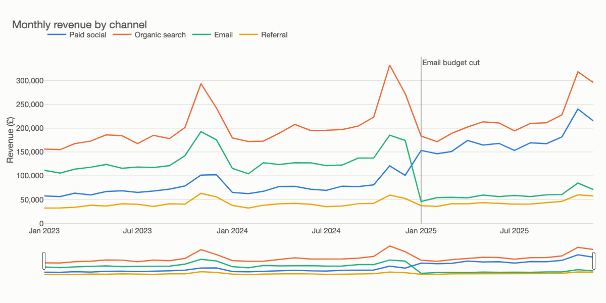

# Plotly and interactive charts

A chart with hover, zoom and a filter feels more powerful than a picture, and in the right hands it is. It also moves work from you to the reader, who may not do it. The people who asked for your Fernhill analysis will not brush a time range to find the January drop. A marketing manager going through her own channel next week very well might. So this chapter is about when an interaction earns its cost, as much as how to write one.

---

## What interaction is for

Ben Shneiderman's visual information-seeking mantra is still the best one-line design brief: overview first, zoom and filter, then details on demand ([Shneiderman, IEEE VL 1996](https://doi.org/10.1109/VL.1996.545307)). Read it as a sequence of reader needs. A person opens a view to see the whole, narrows down to the part they care about, and then wants the exact value and its context. Each step suggests an interaction. Munzner's textbook gives the idea a formal home, with a whole chapter on manipulating a view ([Munzner, CRC Press 2014, ch. 11](https://www.cs.ubc.ca/~tmm/vadbook/)). The trade is easy to state: interaction lets one view cover more data than a static one could, but it takes the reader's time and attention, and anything hidden behind a hover may go unseen.

That gives a working rule.

| Your reader | Their question | Medium |
|---|---|---|
| An executive reading your memo | "What happened, what should we do?" | Static chart with the answer in the title |
| An analyst checking your work | "Does this hold in my segment?" | Interactive chart or notebook |
| A manager returning every week | "What is my number, and is it okay?" | Dashboard (chapter 5) |
| A curious member of the public | "Where am I in this?" | Interactive piece, overview first |

Note what is missing: the case where interaction is used because it is available. If you can state the finding, state it. Knaflic's explanatory-versus-exploratory split applies here too: hover is an exploration tool ([Knaflic, Wiley 2015](https://www.storytellingwithdata.com/books)).

## Plotly Express: a chart as a data structure

[Plotly's Python library](https://plotly.com/python/) has two levels. `plotly.express` takes a tidy DataFrame and names columns, like seaborn and like the grammar from chapter 1. `plotly.graph_objects` is the level underneath, where a figure is a list of traces and a layout. Start with Express.

```python
from pathlib import Path

import pandas as pd
import plotly.express as px
import chartstyle as cs
import fernhill

Path("output").mkdir(exist_ok=True)
monthly = fernhill.load_monthly().assign(channel=lambda d: d.channel.map(fernhill.LABELS))
colours = {fernhill.LABELS[c]: v for c, v in cs.CHANNEL_COLOUR.items()}
fig = px.line(monthly, x="month", y="revenue", color="channel",
              color_discrete_map=colours, labels={"revenue": "Revenue (£)", "month": ""},
              custom_data=["sessions", "orders"],
              title="Monthly revenue by channel")
print(type(fig).__name__, len(fig.data), "traces,", fig.data[0].mode, "mode")
print(fig.data[0].hovertemplate)
```

```text
Figure 4 traces, lines mode
channel=Paid social<br>=%{x}<br>Revenue (£)=%{y}<extra></extra>
```

`custom_data` deserves a moment. Hover can show only what the browser has, so any column you may want in a tooltip has to be sent along with the trace. That line of output is the default hover text, and it is what every unconfigured plotly chart in the world shows: raw field names in an order nobody chose. Fixing that is most of the work of making one good.

```python
fig.update_traces(line_width=2, hovertemplate=(
    "%{x|%b %Y}<br><b>£%{y:,.0f}</b><br>%{customdata[0]:,} sessions, "
    "%{customdata[1]:,} orders<extra>%{fullData.name}</extra>"))
fig.update_layout(template="none", paper_bgcolor=cs.SURFACE, plot_bgcolor=cs.SURFACE,
                  font=dict(family="Helvetica Neue, Arial, sans-serif", color=cs.SECONDARY),
                  hovermode="closest", legend=dict(orientation="h", y=1.08, title=None),
                  margin=dict(l=70, r=20, t=90, b=40), width=960, height=480)
fig.update_xaxes(showgrid=False, linecolor=cs.BASELINE, rangeslider_visible=True)
fig.update_yaxes(gridcolor=cs.GRID, zeroline=False, rangemode="tozero", tickformat=",.0f")
fig.add_shape(type="line", x0=fernhill.CUT, x1=fernhill.CUT, yref="paper", y0=0, y1=1,
              line=dict(color=cs.MUTED, width=1))
fig.add_annotation(x=fernhill.CUT, yref="paper", y=1, text="Email budget cut", showarrow=False,
                   xanchor="left", font=dict(color=cs.SECONDARY))
print(sorted(fig.to_dict()), [t["name"] for t in fig.to_dict()["data"]])
```

```text
['data', 'layout'] ['Paid social', 'Organic search', 'Email', 'Referral']
```

The printed keys show what a figure really is: a dictionary with `data` and `layout`. That is why plotly travels so well. Python does not draw anything. It writes JSON, and plotly.js in the browser renders it. A hover template is therefore a small format string interpreted by JavaScript, with [its own syntax](https://plotly.com/python/hover-text-and-formatting/): `%{y:,.0f}` for the value, `%{customdata[0]}` for the extra columns, and the mysterious `<extra>` tag for the secondary box that shows the trace name.

`template="none"` removes plotly's default grey background and white grid, and the other layout lines apply the same declutter rules from chapter 2. The range slider is the "zoom" in the mantra. The vertical marker uses `add_shape` with `yref="paper"`, which means "measure y as a fraction of the plot height", so it spans the chart whatever the data does.

## Exporting: what actually ships

An interactive chart is a web page, so the file you share is HTML, and the first practical question is where the JavaScript comes from.

```python
inline, cdn = Path("output/revenue_inline.html"), Path("output/revenue_cdn.html")
fig.write_html(inline, include_plotlyjs=True)
fig.write_html(cdn, include_plotlyjs="cdn")
for path in (inline, cdn):
    print(path.name, f"{path.stat().st_size / 1024:,.0f} KB")
fig.write_image(cs.IMAGES / "viz-plotly-revenue-by-channel.png", scale=1.25)
print("static copy written")
```

```text
revenue_inline.html 4,713 KB
revenue_cdn.html 10 KB
static copy written
```

The difference is the plotly.js library. With `include_plotlyjs=True` the chart is about 4.7 MB and works offline forever. With `"cdn"` it is about 10 KB and needs a network connection whenever it is opened. Send the inline version as an email attachment, and use the CDN version in pages you host. A page with twenty charts needs the library only once.

The static copy comes from Kaleido, which drives a headless Chrome behind the scenes, so `write_image` fails on a machine with no browser. Here it is:



*Image Source: generated by `practice/ch03_plotly_interactive.py`. Open `practice/output/revenue_inline.html` for the interactive version; a PNG cannot show the hover.*

The picture is the reason to export a static copy every time. Hover is inaccessible on a phone and invisible in print. It is also unreachable from a keyboard unless someone built for it, so anything that matters must also be visible without it. A linked data table does the job for readers who need exact values.

## A filter without a server

Plotly can do more on its own than people expect. A dropdown that shows one channel at a time needs no Python at runtime, because the figure holds every trace and the button only flips their visibility.

```python
import plotly.graph_objects as go

wide = monthly.pivot(index="month", columns="channel", values="revenue")
choice = go.Figure()
names = [fernhill.LABELS[c] for c in fernhill.CHANNELS]
for name in names:
    choice.add_trace(go.Scatter(x=wide.index, y=wide[name], name=name, line_color=colours[name],
                                visible=name == names[0]))
buttons = [dict(label=name, method="update", args=[{"visible": [n == name for n in names]}])
           for name in names]
choice.update_layout(updatemenus=[dict(buttons=buttons, x=0, y=1.15, xanchor="left")],
                     template="none", yaxis_rangemode="tozero")
choice.write_html("output/revenue_dropdown.html", include_plotlyjs="cdn")
print(buttons[2]["label"], buttons[2]["args"][0]["visible"])
```

```text
Email [False, False, True, False]
```

The `visible` list is the whole trick: the Email button says "show the third trace only". The limit is equally plain. All the data ships inside the HTML, so a chart of three years of monthly data is fine and a filter across ten million rows is not. When the user's choice has to trigger a new query, you have outgrown a static file and need a server, which brings us to Streamlit in chapter 5.

## Linked views with Altair

Plotly is strongest at single rich charts. Coordinating several views, where selecting in one changes another, is where the grammar shows its advantage. Vega-Lite made interaction part of the specification rather than a callback: a selection is a declared parameter, and other parts of the chart can use it as a scale domain or a filter ([Satyanarayan et al., IEEE TVCG 2017](https://idl.uw.edu/papers/vega-lite)). [Altair's interaction guide](https://altair-viz.github.io/user_guide/interactions/index.html) exposes that from Python. Here brushing revenue zooms the repeat rate below, using Fernhill's two story lines.

```python
import altair as alt

story = fernhill.total_by_month().reset_index()
story["rate_pct"] = story.repeat_rate * 100
brush = alt.selection_interval(encodings=["x"])
overview = (alt.Chart(story).mark_line(strokeWidth=2, color=cs.BLUE)
            .encode(x=alt.X("month:T", title=None), y=alt.Y("revenue:Q", title="Revenue (£)"))
            .properties(width=640, height=90).add_params(brush))
detail = (alt.Chart(story).mark_line(strokeWidth=2, color=cs.ORANGE, point=True)
          .encode(x=alt.X("month:T", title=None, scale=alt.Scale(domain=brush)),
                  y=alt.Y("rate_pct:Q", title="90-day repeat rate (%)",
                          scale=alt.Scale(domain=[0, 45])),
                  tooltip=[alt.Tooltip("month:T", format="%b %Y"),
                           alt.Tooltip("rate_pct:Q", format=".1f")])
          .properties(width=640, height=220))
linked = alt.vconcat(overview, detail)
linked.save("output/linked_brush.html")
spec = linked.to_dict()
print(spec["params"][0]["select"], Path("output/linked_brush.html").stat().st_size, "bytes")
```

```text
{'type': 'interval', 'encodings': ['x']} 6749 bytes
```

Open `practice/output/linked_brush.html` and drag over the top panel. The only link between the panels is `scale=alt.Scale(domain=brush)`. No event handler is written anywhere. Six or seven kilobytes of specification are all that ship, with the libraries loaded from a CDN, and the data is inline.

Altair's limit is the opposite of plotly's: its specification embeds the data, and it raises `MaxRowsError` above 5,000 rows by default, as a guard. For more than that, aggregate first or pass a URL.

## Which tool, when

| Need | Reach for | Reason |
|---|---|---|
| Quick exploration in a notebook | `plotly.express` | Hover and zoom for one line of code |
| A one-off interactive to email | Plotly with inline JS | One self-contained file |
| Linked brushing across views | Altair | Selections are declared in the grammar |
| Publication or slide figures | Matplotlib | Precise control of every element |
| Custom interaction, new chart forms | D3 | See chapter 4 |
| A filtered view backed by live queries | Streamlit or a BI tool | See chapter 5 |

## Pitfalls

- **Hiding the finding behind hover.** If the reader must discover the point, most will not. Put it in the title, and let hover add details.
- **Default hover text.** `channel=Email<br>=2024-11-01` looks unfinished and leaks column names. Write a template.
- **Emailing a CDN file.** It opens blank on a plane or behind a strict firewall. Use `include_plotlyjs=True` for attachments.
- **Too much data in the page.** Every point ships to the browser, so the file grows with the rows and rendering slows. Aggregate first, and use WebGL traces (`go.Scattergl`) for a large scatter.
- **Relying on the mouse.** Hover does not exist on touch screens in the same way. Tap behaviour differs, so test on a phone, and keep a table view.
- **Forgetting the static version.** Slides, PDFs and printouts cannot run JavaScript. Export a PNG at the same time.
- **Plotly's default `hovermode` on many series.** With four lines, unified hover helps comparison, but with forty it covers the chart. Choose it deliberately.

## Try it

1. Change `hovermode` to `"x unified"` and rewrite the hover template so the unified box stays short. What question does this mode answer better?

   <details><summary>Answer</summary>

   Unified hover puts every channel's value for one month in one box, so it answers "how did the channels compare in November?" rather than "what is this point?" Reduce the template to `"£%{y:,.0f}"`, because the box already carries the date and each trace name.
   </details>

2. Add a dropdown button labelled "All" to the `dropdown` block.

   <details><summary>Answer</summary>

   Append `dict(label="All", method="update", args=[{"visible": [True] * len(names)}])` to `buttons`. Fixing `yaxis_range` is also wise, because otherwise the axis rescales with each choice, which is sometimes useful and sometimes hides that one channel is much smaller than the rest.
   </details>

3. Measure the cost of data in the page: write a bare `px.line` of the 144 monthly rows and a `px.scatter` of the 4,000 rows from `fernhill.load_orders()`, both with `include_plotlyjs="cdn"`, and compare sizes. See `practice/ch03_plotly_interactive.py` for the export code.

   <details><summary>Answer</summary>

   I get about 14 KB for the line chart and about 90 KB for the scatter, because all the points travel inside the HTML. Extrapolate that to your production table and you see why a dashboard with a query layer exists: it sends only the aggregated rows a view needs.
   </details>

## Interview checklist

| Question | Answer |
|---|---|
| When is an interactive chart the wrong choice? | When you already know the finding and the reader needs it stated, for example in a memo or a slide. Interaction hands them work they may not do. |
| What is Shneiderman's mantra? | Overview first, zoom and filter, then details on demand. |
| What is a plotly figure under the hood? | A JSON-serialisable structure of `data` traces and a `layout`, rendered by plotly.js in the browser. |
| What is `include_plotlyjs` for? | It controls whether the library goes inside the HTML (about 4.7 MB here, works offline) or loads from a CDN (about 10 KB, needs network). |
| Why can plotly filter without a server, and what is the limit? | The data ships in the page and the control toggles trace visibility, so it is limited to what fits comfortably in a browser. |
| How does Altair link two charts? | A selection parameter is declared on one chart and used as another's scale domain or filter, with no event-handling code. |
| What accessibility issues come with hover? | It has no touch equivalent, may be unreachable by keyboard and cannot be printed. Anything essential must be visible without it, and a table should be available. |

## Next

Plotly and Altair are generated by Python but run as JavaScript. Time to meet that layer directly and see what you get by writing it yourself: [JavaScript with D3, Vega-Lite and Observable Plot](04-javascript-d3-vega-lite-observable-plot.md).
