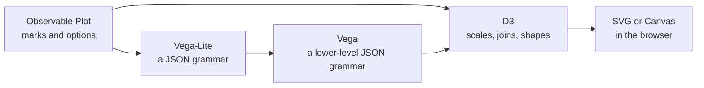
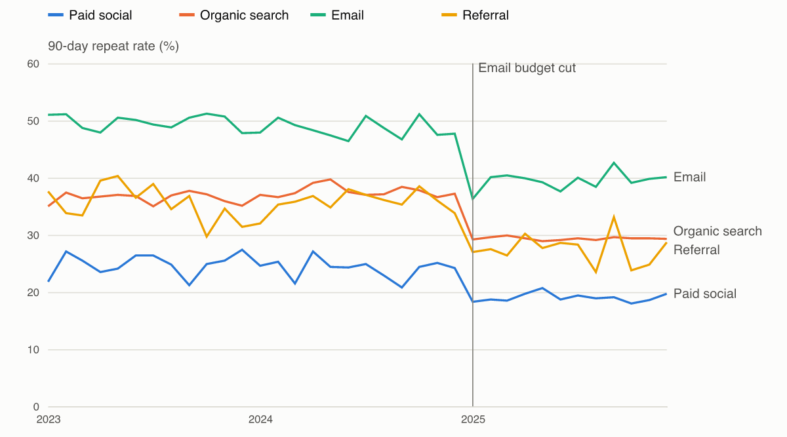
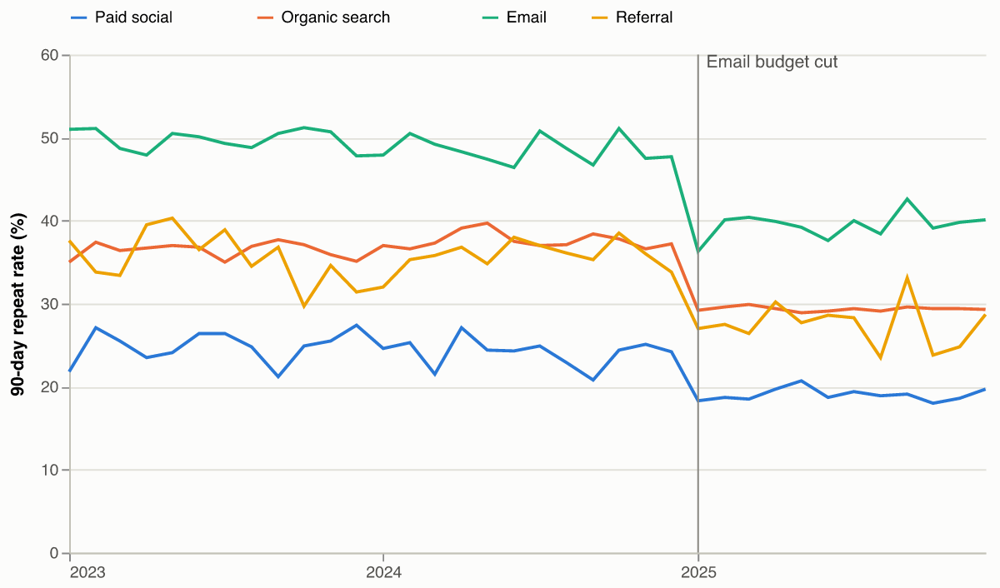
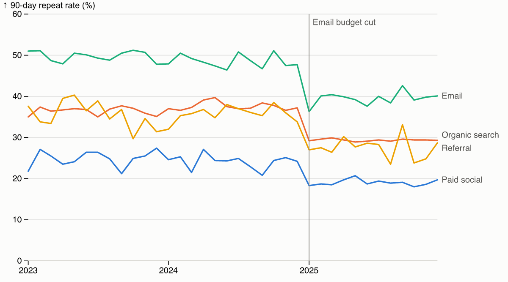

# JavaScript: D3, Vega-Lite and Observable Plot

Every chart you see on a news site or inside a product is JavaScript in a browser, and so was every interactive chart in the last chapter, whatever language wrote its configuration. Python analysts can go a long way without touching that layer. Sooner or later someone asks for a chart no library offers, or for a chart that has to live in a web product and not a notebook. This chapter draws one Fernhill chart three times, at three levels of abstraction, so you can feel what each level gives and costs.

---

## Three levels of abstraction

The three libraries sit on a ladder, and the question at each rung is how much of the chart you have to say.



[D3](https://d3js.org/) is the base. It is not a charting library in the usual sense, since it has no `barChart()`. It is a toolkit for binding data to document elements, and for the geometry around that: scales, axes, line generators, layouts. Its founding paper argued for working directly on the document model rather than inventing a new scene graph, so every standard browser tool works on what it produces ([Bostock, Ogievetsky & Heer, IEEE TVCG 2011](https://idl.uw.edu/papers/d3)).

[Vega-Lite](https://vega.github.io/vega-lite/) is the grammar of chapter 1 written as JSON. You state data, mark and encodings, and it [compiles](https://vega.github.io/vega-lite/usage/compile.html) to a longer Vega specification with the axes, legends and scales filled in. Altair generates this same JSON, so a chart written in Altair is a Vega-Lite chart ([Satyanarayan et al., IEEE TVCG 2017](https://idl.uw.edu/papers/vega-lite)).

[Observable Plot](https://github.com/observablehq/plot) is by the people behind D3, and it applies the grammar as a concise JavaScript API over D3. It is the JavaScript counterpart of seaborn for exploration.

## Running these examples

Everything here runs in Node without a browser, using `jsdom` as a stand-in document and `resvg` to turn SVG into PNG, because a static image is what this note can show. The code is in `practice/js/`, tested on Node 22.

```bash
cd practice/js
npm install
npm run all
```

```text
5 paths, 144 hover targets
saved viz-js-d3-repeat-rate.png (62 KB)
3 Vega mark groups, 3 scales, 3 axes, 1 legend
saved viz-js-vega-lite-repeat-rate.png (66 KB)
svg 14 paths
saved viz-js-observable-plot-repeat-rate.png (62 KB)
Paid social, 2023-01: 21.8%
hover layer ok
```

`repeat_rate.json` holds 144 rows, exported from the Python generator, of the form `{"month": "2023-01-01", "channel": "Paid social", "rate": 21.8}`. The shared helpers are in `render.mjs`:

```javascript
// Shared helpers: read the data and turn an SVG string into a PNG in sources/images.
import { readFileSync, writeFileSync, mkdirSync } from "node:fs";
import { Resvg } from "@resvg/resvg-js";

export const data = JSON.parse(readFileSync(new URL("./repeat_rate.json", import.meta.url)));
export const ORDER = ["Paid social", "Organic search", "Email", "Referral"];
export const COLOURS = ["#2a78d6", "#eb6834", "#1baf7a", "#eda100"];
export const SIZE = { width: 720, height: 400 };

export function savePng(svg, name) {
  const dir = new URL("../../../sources/images/", import.meta.url);
  mkdirSync(dir, { recursive: true });
  const png = new Resvg(svg, {
    background: "#fcfcfb",
    fitTo: { mode: "width", value: 1200 },
    font: { loadSystemFonts: true, defaultFontFamily: "Helvetica" },
  }).render().asPng();
  writeFileSync(new URL(name, dir), png);
  console.log(`saved ${name} (${Math.round(png.length / 1024)} KB)`);
}
```

## D3: every decision is yours

The D3 chart lives in `repeat_chart.mjs`. It takes a container and data, and touches nothing specific to Node, so the same module runs in a browser.

```javascript
// The chart itself in D3. It only needs a DOM, so the same file runs in a browser and in Node.
import * as d3 from "d3";

export function drawRepeatChart(container, data, { order, colours, width, height }) {
  const margin = { top: 58, right: 110, bottom: 28, left: 44 };
  const rows = data.map((d) => ({ ...d, date: new Date(d.month) }));

  // 1. Scales turn data values into pixels and colours.
  const x = d3.scaleUtc(d3.extent(rows, (d) => d.date), [margin.left, width - margin.right]);
  const y = d3.scaleLinear([0, 60], [height - margin.bottom, margin.top]);
  const colour = d3.scaleOrdinal(order, colours);

  const svg = d3.select(container).append("svg")
    .attr("xmlns", "http://www.w3.org/2000/svg")
    .attr("viewBox", [0, 0, width, height]).attr("width", width).attr("height", height)
    .attr("font-family", "Helvetica, Arial, sans-serif").attr("font-size", 12);

  // 2. Axes are drawn from the scales, then styled down until they recede.
  svg.append("g").attr("transform", `translate(0,${height - margin.bottom})`)
    .call(d3.axisBottom(x).ticks(d3.utcYear.every(1)).tickFormat(d3.utcFormat("%Y")).tickSize(0).tickPadding(8))
    .call((g) => g.select(".domain").attr("stroke", "#c3c2b7"))
    .call((g) => g.selectAll("text").attr("fill", "#52514e"));
  svg.append("g").attr("transform", `translate(${margin.left},0)`)
    .call(d3.axisLeft(y).ticks(6).tickSize(-(width - margin.left - margin.right)).tickPadding(8))
    .call((g) => g.select(".domain").remove())
    .call((g) => g.selectAll("line").attr("stroke", "#e1e0d9"))
    .call((g) => g.selectAll("text").attr("fill", "#52514e"));

  svg.append("text").attr("x", margin.left).attr("y", margin.top - 12).attr("fill", "#52514e")
    .attr("text-anchor", "start").text("90-day repeat rate (%)");

  // 3. The data join: one <path> per channel.
  const line = d3.line().x((d) => x(d.date)).y((d) => y(d.rate));
  const series = d3.groups(rows, (d) => d.channel)
    .sort((a, b) => order.indexOf(a[0]) - order.indexOf(b[0]));
  svg.append("g").selectAll("path").data(series).join("path")
    .attr("fill", "none").attr("stroke-width", 2)
    .attr("stroke", ([name]) => colour(name)).attr("d", ([, values]) => line(values));

  // 4. Direct labels at the line ends, in ink rather than the series colour.
  svg.append("g").selectAll("text").data(series).join("text")
    .attr("x", width - margin.right + 6).attr("dy", "0.32em").attr("fill", "#52514e")
    .attr("y", ([name, values]) => y(values.at(-1).rate) + (name === "Referral" ? 7 : name === "Organic search" ? -7 : 0))
    .text(([name]) => name);

  // 5. A legend row, and the event that explains the shape.
  const legend = svg.append("g").selectAll("g").data(order).join("g")
    .attr("transform", (_, i) => `translate(${margin.left + i * 120},14)`);
  legend.append("rect").attr("width", 14).attr("height", 3).attr("y", -2).attr("fill", (d) => colour(d));
  legend.append("text").attr("x", 19).attr("dy", "0.32em").attr("fill", "#0b0b0b").text((d) => d);
  const cut = x(new Date("2025-01-01"));
  svg.append("line").attr("x1", cut).attr("x2", cut).attr("y1", margin.top).attr("y2", height - margin.bottom)
    .attr("stroke", "#898781");
  svg.append("text").attr("x", cut + 5).attr("y", margin.top + 8).attr("fill", "#52514e").text("Email budget cut");

  // 6. Hover layer: a big invisible hit target per point, and one tooltip element.
  const tip = svg.append("text").attr("class", "tip").attr("fill", "#0b0b0b").attr("font-weight", 700)
    .attr("visibility", "hidden");
  svg.append("g").attr("class", "hover").selectAll("circle").data(rows).join("circle")
    .attr("cx", (d) => x(d.date)).attr("cy", (d) => y(d.rate)).attr("r", 8)
    .attr("fill", "transparent")
    .on("mouseover", (_, d) => tip.attr("visibility", "visible")
      .attr("x", x(d.date) + 8).attr("y", y(d.rate) - 8)
      .text(`${d.channel}, ${d.month.slice(0, 7)}: ${d.rate}%`))
    .on("mouseout", () => tip.attr("visibility", "hidden"));
  return svg.node();
}
```

Read it as the grammar spelled out by hand. **Scales** in step 1 are ordinary functions: `y(30)` returns a pixel position, which is exactly the scale part of the grammar. **Axes** in step 2 are generated from scales and then restyled. The `.call((g) => ...)` pattern hands a selection to a function so that you can keep chaining.

Step 3 is the idea that makes D3 D3: the **data join**. `selectAll("path").data(series).join("path")` says "make the set of paths on the page match this list". Elements that are needed get created, extra ones get removed, and existing ones get updated. Run the same code with new data and the page follows. Once you see charts as "a list of data and a matching list of elements", the rest of D3 stops looking like a pile of method chains. Murray's book teaches exactly this, slowly and well, from a blank page ([Murray, O'Reilly 2017](https://alignedleft.com/work/d3-book-2e)), and Meeks and Dufour's third edition goes further with D3 v7 and with using D3 inside modern frameworks ([Meeks & Dufour, Manning 2024](https://www.manning.com/books/d3js-in-action-third-edition)).

Steps 4 and 5 are everything a high-level library would do for you: direct labels, the legend, and the event marker. Step 6 is the hover layer. Rather than attach an event to a 2-pixel line, it draws a large invisible circle at each data point so the target is easy to hit. The Node wrapper is three lines of real work:

```javascript
// D3 in Node: jsdom supplies the document that a browser would.
import { JSDOM } from "jsdom";
import { data, ORDER, COLOURS, SIZE, savePng } from "./render.mjs";
import { drawRepeatChart } from "./repeat_chart.mjs";

const { document } = new JSDOM("<!doctype html><body></body>").window;
const svg = drawRepeatChart(document.body, data, { order: ORDER, colours: COLOURS, ...SIZE });
console.log(`${svg.querySelectorAll("path").length} paths, ${svg.querySelectorAll(".hover circle").length} hover targets`);
savePng(svg.outerHTML, "viz-js-d3-repeat-rate.png");
```



*Image Source: generated by `practice/js/d3_chart.mjs`.*

You can test a hover layer without a browser by firing the events and checking the result, and that test does run as part of `npm run all`:

```javascript
// Prove the hover layer works without a browser: fire the events and read the tooltip.
import assert from "node:assert";
import { JSDOM } from "jsdom";
import { data, ORDER, COLOURS, SIZE } from "./render.mjs";
import { drawRepeatChart } from "./repeat_chart.mjs";

const { window } = new JSDOM("<!doctype html><body></body>");
const svg = drawRepeatChart(window.document.body, data, { order: ORDER, colours: COLOURS, ...SIZE });
const tip = svg.querySelector(".tip");
const first = svg.querySelector(".hover circle");
assert.equal(tip.getAttribute("visibility"), "hidden");
first.dispatchEvent(new window.MouseEvent("mouseover"));
assert.equal(tip.getAttribute("visibility"), "visible");
console.log(tip.textContent);
first.dispatchEvent(new window.MouseEvent("mouseout"));
assert.equal(tip.getAttribute("visibility"), "hidden");
console.log("hover layer ok");
```

For the real thing, `practice/js/index.html` loads the same module in a browser, importing D3 from a CDN. Serve the folder with `python3 -m http.server` and open `localhost:8000`, because ES modules refuse to load from `file://`. I tested that page in headless Chrome and it rendered the chart, but a person hovering in a browser is the part only you can check.

## Vega-Lite: say what, not how

Same chart, as a specification.

```javascript
// Vega-Lite: describe the chart as JSON, compile it to Vega, ask Vega for an SVG string.
import * as vl from "vega-lite";
import * as vega from "vega";
import { data, ORDER, COLOURS, SIZE, savePng } from "./render.mjs";

const spec = {
  $schema: "https://vega.github.io/schema/vega-lite/v6.json",
  width: SIZE.width - 150, height: SIZE.height - 90, background: "#fcfcfb",
  config: { view: { stroke: null }, axis: { gridColor: "#e1e0d9", domainColor: "#c3c2b7", labelColor: "#52514e" } },
  data: { values: data },
  layer: [
    {
      mark: { type: "line", strokeWidth: 2 },
      encoding: {
        x: { field: "month", type: "temporal", title: null, scale: { type: "utc" },
             axis: { format: "%Y", tickCount: "year", grid: false } },
        y: { field: "rate", type: "quantitative", title: "90-day repeat rate (%)", scale: { domain: [0, 60] } },
        color: { field: "channel", type: "nominal", title: null, sort: ORDER,
                 scale: { domain: ORDER, range: COLOURS }, legend: { orient: "top" } },
        tooltip: [{ field: "channel" }, { field: "month", type: "temporal" }, { field: "rate" }],
      },
    },
    { mark: { type: "rule", color: "#898781" }, data: { values: [{ cut: "2025-01-01" }] },
      encoding: { x: { field: "cut", type: "temporal", scale: { type: "utc" } } } },
    { mark: { type: "text", align: "left", dx: 5, dy: -150, color: "#52514e" },
      data: { values: [{ cut: "2025-01-01", label: "Email budget cut" }] },
      encoding: { x: { field: "cut", type: "temporal", scale: { type: "utc" } }, text: { field: "label" } } },
  ],
};
const compiled = vl.compile(spec).spec;
console.log(`${compiled.marks.length} Vega mark groups, ${compiled.scales.length} scales, ${compiled.axes.length} axes, ${compiled.legends.length} legend`);
const view = new vega.View(vega.parse(compiled), { renderer: "none" });
savePng(await view.toSVG(), "viz-js-vega-lite-repeat-rate.png");
```



*Image Source: generated by `practice/js/vegalite_chart.mjs`.*

The scales, axes, grid and legend are gone from the code, because the compiler derives them from the field types. The legend came for free, and so did correct ordering. Tooltips are one line, and they would work in a browser with the `vega-embed` package. The specification is plain JSON, so it can be stored in a database, generated by a server or by an LLM, and validated against a [schema](https://vega.github.io/vega-lite/).

The price is that you can only say what the grammar can say. Note `dy: -150` in the annotation: placing text at a pixel offset is a hack, since the grammar thinks in data, and a chart resize would break it. The `scale: {type: "utc"}` lines exist because Vega-Lite otherwise reads `2023-01-01` in local time, which moved the first January tick on my machine and lost the 2023 label. Date handling is where all three libraries need the most care.

## Observable Plot: the short version

```javascript
// Observable Plot: marks plus options. It needs a document too, so jsdom again.
import * as Plot from "@observablehq/plot";
import { JSDOM } from "jsdom";
import { data, ORDER, COLOURS, SIZE, savePng } from "./render.mjs";

const rows = data.map((d) => ({ ...d, date: new Date(d.month) }));
const nudge = { "Organic search": 1.3, Referral: -1.3 };  // two line ends land together
const figure = Plot.plot({
  document: new JSDOM("").window.document,
  ...SIZE, marginRight: 100, style: { background: "#fcfcfb", fontFamily: "Helvetica", fontSize: "12px" },
  y: { domain: [0, 60], grid: true, ticks: 6, label: "90-day repeat rate (%)" },
  x: { label: null, ticks: "year", tickFormat: "%Y" },
  color: { domain: ORDER, range: COLOURS, legend: false },
  marks: [
    Plot.ruleY([0], { stroke: "#c3c2b7" }),
    Plot.lineY(rows, { x: "date", y: "rate", stroke: "channel", strokeWidth: 2, tip: true }),
    Plot.text(rows, Plot.selectLast({ x: "date", y: (d) => d.rate + (nudge[d.channel] ?? 0), z: "channel", text: "channel", textAnchor: "start", dx: 6, fill: "#52514e" })),
    Plot.ruleX([new Date("2025-01-01")], { stroke: "#898781" }),
    Plot.text([new Date("2025-01-01")], { x: (d) => d, y: 58, text: () => "Email budget cut", textAnchor: "start", dx: 5, fill: "#52514e" }),
  ],
});
figure.setAttribute("xmlns", "http://www.w3.org/2000/svg");
console.log(figure.tagName, `${figure.querySelectorAll("path").length} paths`);
savePng(figure.outerHTML, "viz-js-observable-plot-repeat-rate.png");
```



*Image Source: generated by `practice/js/plot_chart.mjs`.*

`Plot.lineY` groups rows by `stroke` for you, and `Plot.selectLast` is a transform that keeps the last row per group, which makes end-of-line labelling a single mark. `tip: true` adds a tooltip in a browser. It is the shortest of the three.

One detail shows a limit of static rendering. This exhibit relies on direct labels because `legend: true` makes Plot return an HTML `<figure>` with swatches outside the SVG, and `resvg` only renders SVG. In a browser, you would turn the legend on.

## Comparing the three

| | D3 | Vega-Lite | Observable Plot |
|---|---|---|---|
| Chart code in `practice/js/` | 67 lines | 33 lines, mostly styling | 24 lines |
| You describe | Elements and geometry | A JSON specification | Marks and options |
| Good at | Anything, new forms, bespoke transitions | Portable specs, linked views, generated charts | Fast exploration in JavaScript |
| Fights you on | Time; everything is your job | Pixel-level annotation | Bespoke interaction |
| Python route | None, write JavaScript | Altair | None directly |

The line counts are this one chart, as written here, including the styling for this pillar's palette. They are an illustration of the ladder and not a benchmark. The ratio changes with how much you customise, and D3 stops looking expensive at the point where the others cannot do it at all.

The default choice for an analyst is a clear progression. Use Altair or plotly from Python while you can. Use Vega-Lite when a product team needs to embed a chart defined by data. Use Plot when you are already working in JavaScript and want speed. Use D3 for the chart that needs custom design and is worth a few days of someone's time.

## Pitfalls

- **Reaching for D3 first.** It is the most flexible and the slowest. Most business charts do not need it.
- **Local time versus UTC.** `new Date("2023-01-01")` is parsed as UTC, while `d3.scaleTime` and many formatters then work in local time. Pick UTC throughout (`scaleUtc`, `utcFormat`), or labels will drift by a day or a month.
- **Forgetting `xmlns` on standalone SVG.** A browser does not need it, but `resvg` and other SVG tools do. It is set explicitly in both Node paths here.
- **jsdom has no layout engine.** `getBBox()` and text measuring do not work under jsdom, so any chart that measures its own labels needs a real browser.
- **`file://` and modules.** Browsers refuse ES module imports from local files. Serve the folder.
- **Colouring text like the series.** It is tempting in D3 where nothing stops you. Yellow text on a pale surface fails contrast, so use ink colours.
- **Hit targets as thin as the mark.** A 2-pixel line is very hard to hover. Add a larger invisible target, or a Voronoi overlay for dense points.

## Try it

1. In `repeat_chart.mjs`, change the data passed to the chart so only 2025 appears. Which parts of the code had to change, and what does that tell you about the join?

   <details><summary>Answer</summary>

   None of the drawing code changes. Filter before the call, for example `data.filter((d) => d.month >= "2025")`. Scales read their domains from the data, and the join makes the elements match. The "Email budget cut" marker will sit at the left edge, because its position comes from the same x scale.
   </details>

2. Make the Vega-Lite chart a small-multiple chart with one facet per channel.

   <details><summary>Answer</summary>

   Remove the annotation layers (or keep them inside a `spec`), then wrap: `{ data, facet: { field: "channel", type: "nominal", columns: 2 }, spec: { mark: "line", encoding: {...} } }`. Everything else follows from the compiler, which is the benefit of a declarative spec.
   </details>

3. Add a `Plot.dot` layer to the Plot chart that draws only the January 2025 points, and explain why this is simpler than the D3 equivalent.

   <details><summary>Answer</summary>

   Add `Plot.dot(rows.filter((d) => d.month === "2025-01-01"), { x: "date", y: "rate", fill: "channel", r: 4 })` to `marks`. It reuses the chart's existing scales. In D3 you would add a new `selectAll`, a join, and set `cx`, `cy` and `fill` by calling the scales yourself, though each of those lines is equally explicit.
   </details>

See `practice/js/` for all three charts to modify. `npm run all` rebuilds them.

## Interview checklist

| Question | Answer |
|---|---|
| Is D3 a charting library? | Not really. It is a toolkit for binding data to the DOM, with scales, shapes, axes and layouts. You assemble the chart yourself. |
| What is the data join? | Matching a list of data to a set of elements, creating, updating and removing elements so the page reflects the data. |
| What does Vega-Lite compile to? | A full Vega specification with the derived scales, axes and legends, which Vega then renders to SVG or Canvas. |
| How does Altair relate to Vega-Lite? | Altair is a Python API that generates Vega-Lite JSON. The browser or `vl-convert` does the rendering. |
| When would you pick D3 over Vega-Lite? | For new chart forms or custom transitions and interactions the grammar cannot express, when the extra cost is justified. |
| How can you test a chart without a browser? | Render in jsdom and assert on the DOM, including firing events. It has no layout, so anything that measures text needs a real browser. |
| What is the most common JavaScript date bug in charts? | Parsing dates as UTC and formatting them in local time, so that ticks and labels move by a day or a month. |

## Next

We can now draw anything. The last step is deciding what to say with it, and to whom: [Dashboards and storytelling with data](05-dashboards-and-storytelling.md).
