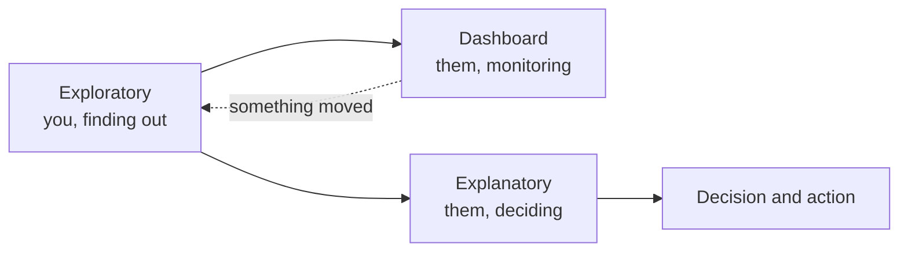
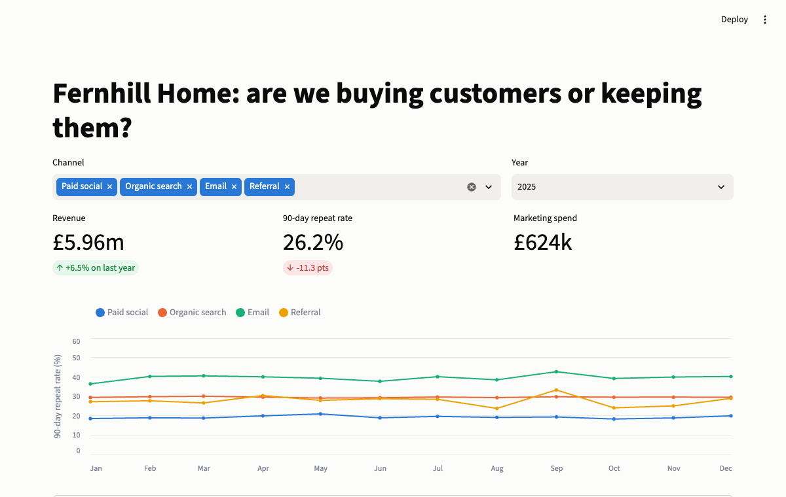
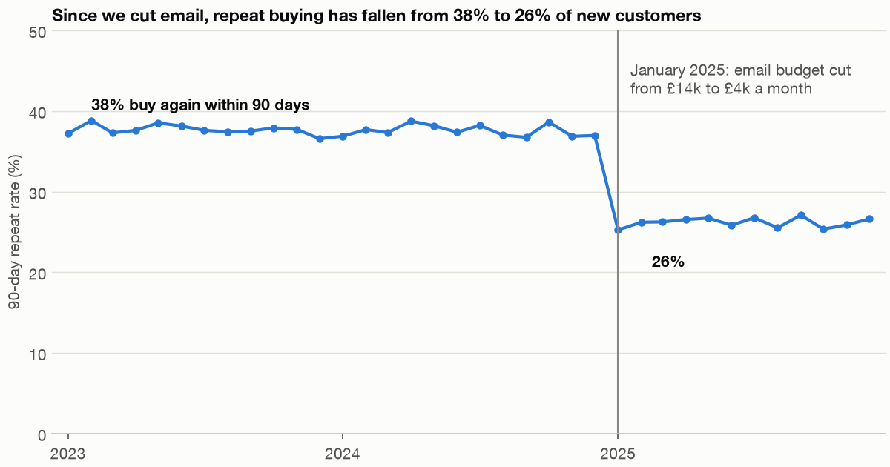
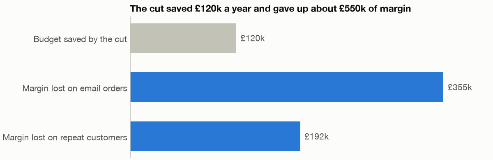

# Dashboards and storytelling with data

Fernhill's marketing team has had a revenue dashboard for three years. Revenue is up, the tile is green, and nobody has noticed that repeat buying fell by nearly a third. The dashboard did not lie. It answered the question it was built to answer, and nobody had asked it the one that mattered. This chapter covers the two jobs at the end of an analysis, which are often confused: building something people monitor, and telling someone what you found so that they act.

---

## Two jobs, two forms

Knaflic draws the line at exploratory versus explanatory. Exploratory work is you going through the data for what is interesting. Explanatory work is you telling a particular audience one particular thing ([Knaflic, Wiley 2015, ch. 1](https://www.storytellingwithdata.com/books)). A dashboard sits between them, because it is a designed tool for people to monitor and explore their own questions. It contains no finding, since it is built before the finding exists.



| | Dashboard | Explanatory story |
|---|---|---|
| Question it answers | "What is my number, is it okay?" | "What happened, and what should we do?" |
| Written | Before the event | After the analysis |
| Lifespan | Months or years | One decision |
| Reader | Returns repeatedly, knows the context | Reads once, may not |
| Form | Several small views and filters | One chart per point, with the answer in the title |

The most common failure in analytics is sending the left column to do the right column's job: pasting a dashboard screenshot into a slide and hoping the executive finds the point.

## What makes a dashboard work

Stephen Few's book is the reference on the form, and his definition is usually summarised as the most important information needed to achieve objectives, arranged on a single screen for monitoring at a glance (Few, O'Reilly 2006). I worked from secondary accounts of the book, including [this review](https://uxmatters.com/mt/archives/2007/04/book-review-information-dashboard-design.php), and did not read it. The words that carry the weight are "most important", "one screen" and "at a glance". Between them, they forbid most dashboards in production.

From there, a working checklist:

1. **Name the decision.** A dashboard belongs to a recurring decision: where next week's marketing money goes, whether to add warehouse shifts. If nobody can name the decision, you are building a report no one will open.
2. **Few metrics, each with context.** A number alone says nothing. Compare it with last year, a target or a threshold. A tile that reads £5.96m says little. A tile that reads £5.96m, +6.5% on last year, says something.
3. **Pair a growth metric with a health metric.** This is the Fernhill failure. Revenue on its own was always going to look fine, because buying more traffic raises revenue. Revenue beside repeat rate tells you what the growth cost. Any metric you can push by spending deserves a partner metric that shows the side effect.
4. **Layout follows reading order.** Summary tiles at the top left, then trends, then detail. This is Shneiderman's sequence again: overview first, filter, then details on demand.
5. **Filters in one row, above the charts.** They should change everything below them, and it should be obvious that they did.
6. **State where the numbers come from and when they were refreshed.** Trust dies the first time a dashboard disagrees with finance and nobody can say why.

## Streamlit: a dashboard as a script

[Streamlit](https://docs.streamlit.io/) turns a Python script into a web app. Its one big idea, and the source of most of its surprises, is the execution model: whenever a user touches a widget, the entire script [reruns from top to bottom](https://docs.streamlit.io/get-started/fundamentals/main-concepts). There are no callbacks to wire up, so a widget is simply a function call that returns the current value. Here is the entire Fernhill dashboard.

```python
# /// script
# requires-python = ">=3.11"
# dependencies = ["numpy", "pandas", "streamlit", "altair"]
# ///
"""Fernhill weekly dashboard. Run: uv run --with numpy --with pandas --with streamlit streamlit run dashboard_app.py"""
import altair as alt
import pandas as pd
import streamlit as st

import fernhill


@st.cache_data
def load():
    """Runs once per session; every widget interaction after that reuses the result."""
    monthly = fernhill.load_monthly().merge(fernhill.load_repeat(), on=["month", "channel"])
    monthly["channel"] = monthly.channel.map(fernhill.LABELS)
    return monthly


st.set_page_config(page_title="Fernhill", layout="wide")
data = load()
st.title("Fernhill Home: are we buying customers or keeping them?")

names = list(fernhill.LABELS.values())
left, right = st.columns([2, 1])
chosen = left.multiselect("Channel", names, default=names)
year = right.selectbox("Year", [2025, 2024, 2023])
view = data[data.channel.isin(chosen) & (data.month.dt.year == year)]
previous = data[data.channel.isin(chosen) & (data.month.dt.year == year - 1)]


def rate(frame):
    return frame.repeat_90d.sum() / max(frame.new_customers.sum(), 1)


tiles = st.columns(3)
tiles[0].metric("Revenue", f"£{view.revenue.sum() / 1e6:.2f}m",
                f"{view.revenue.sum() / max(previous.revenue.sum(), 1) - 1:+.1%} on last year"
                if len(previous) else None)
tiles[1].metric("90-day repeat rate", f"{rate(view):.1%}",
                f"{(rate(view) - rate(previous)) * 100:+.1f} pts" if len(previous) else None)
tiles[2].metric("Marketing spend", f"£{view.spend.sum() / 1000:,.0f}k")

palette = ["#2a78d6", "#eb6834", "#1baf7a", "#eda100"]
colour = alt.Color("channel:N", title=None, legend=alt.Legend(orient="top"),
                   scale=alt.Scale(domain=names, range=palette))
chart = (alt.Chart(view.assign(rate=view.repeat_90d / view.new_customers * 100))
         .mark_line(strokeWidth=2, point=alt.OverlayMarkDef(size=30))
         .encode(x=alt.X("month:T", title=None, axis=alt.Axis(format="%b", tickCount="month")),
                 y=alt.Y("rate:Q", title="90-day repeat rate (%)", scale=alt.Scale(domain=[0, 60])),
                 color=colour, tooltip=["channel", "month:T", alt.Tooltip("rate:Q", format=".1f")])
         .properties(height=300))
st.altair_chart(chart, width="stretch")

with st.expander("Table view"):
    st.dataframe(view[["month", "channel", "revenue", "spend", "new_customers", "repeat_90d"]])
```

Run it from `practice/` with:

```bash
uv run --with numpy --with pandas --with altair --with streamlit streamlit run dashboard_app.py
```

Read it in rerun terms. `left.multiselect` returns a list. The next lines filter the DataFrame with it. The metrics and the chart are drawn from the filtered frame, and that is all the "interactivity" there is. It would be painfully slow if `load()` hit a warehouse on every click, which is why [`@st.cache_data`](https://docs.streamlit.io/develop/concepts/architecture/caching) exists: it stores the return value keyed on the function's code and inputs.



*Image Source: screenshot of `practice/dashboard_app.py` running locally in Chrome.*

Item 3 from the checklist is now visible on screen. Revenue is up 6.5% and green, directly beside a repeat rate down 11.3 points and red, and the headline asks the question the first version never did.

Streamlit apps can be tested without a browser. [`AppTest`](https://docs.streamlit.io/develop/concepts/app-testing) runs the script, lets you set widget values, and exposes what it would have drawn.

```python
from streamlit.testing.v1 import AppTest

app = AppTest.from_file("dashboard_app.py", default_timeout=30).run()
assert not app.exception
print([(m.label, m.value) for m in app.metric])
app.multiselect[0].set_value(["Email"]).run()
print([(m.label, m.value) for m in app.metric])
app.selectbox[0].set_value(2023).run()
print([(m.label, m.value, m.delta) for m in app.metric])
```

```text
[('Revenue', '£5.96m'), ('90-day repeat rate', '26.2%'), ('Marketing spend', '£624k')]
[('Revenue', '£0.72m'), ('90-day repeat rate', '39.5%'), ('Marketing spend', '£48k')]
[('Revenue', '£1.56m', ''), ('90-day repeat rate', '49.8%', ''), ('Marketing spend', '£168k', '')]
```

The last line is the useful regression test. In 2023 there is no prior year in the data, so the deltas come back empty and not as a division-by-zero crash. That edge case exists in every dashboard with a year filter.

## Metabase and Looker Studio: when not to write code

Streamlit is excellent while you are the one maintaining it. It is a Python application, so it needs a place to run, someone to fix it, and an analyst for each change. Often the right answer is a BI tool, which gives other people the ability to change a chart.

[Metabase](https://www.metabase.com/docs/latest/) is open source and self-hostable, with a paid cloud offering. Non-technical people can ask questions through a point-and-click builder, and analysts write SQL with parameters. A variable in double braces becomes a filter widget, and [double square brackets make a clause optional](https://www.metabase.com/docs/latest/questions/native-editor/optional-variables), so the query still runs when the filter is empty.

```sql
-- illustrative: needs a Metabase instance connected to a Fernhill warehouse
SELECT date_trunc('month', first_order_at) AS month,
       sum(repeat_within_90d)::float / count(*) AS repeat_rate
FROM customers
WHERE 1 = 1
  [[AND channel = {{channel}}]]
GROUP BY 1
ORDER BY 1
```

[Field filters](https://www.metabase.com/docs/latest/questions/native-editor/sql-parameters) go one step further by binding the variable to a column, so the widget offers that column's real values.

[Looker Studio](https://cloud.google.com/looker/docs/studio) is Google's free hosted report builder. You work on a canvas in the browser, connect sources such as BigQuery, Sheets and Google Analytics, and share by link as with a Google Doc. Its name causes confusion: it is not the same product as Looker, Google's governed BI platform with a modelling layer. It has no code for us to run here, so it is covered by the table only.

| | Streamlit | Metabase | Looker Studio |
|---|---|---|---|
| Who builds and edits | Python developers | Analysts, plus self-serve users | Anyone with a browser |
| Where the logic lives | Python, in git | SQL and models, in the tool | Calculated fields, in the tool |
| Hosting | You, or Streamlit's cloud | You, or Metabase Cloud | Google |
| Custom chart forms | Anything Python can draw | Its chart types | Its chart types and community add-ons |
| Tests and review | Normal code review, `AppTest` | Limited | Limited |
| Best for | Models, simulators, bespoke tools | A company's standard reporting | Quick marketing reports on Google data |

Before picking, ask who will change this in six months. If the answer is the marketing team, a Streamlit app quietly becomes a queue of tickets for you.

## From a chart to a decision

Now the second job. You have noticed the repeat rate. Knaflic insists the first step does not touch a chart at all: be precise about **who** you are telling, **what** you need them to know or do, and only then **how** data supports that ([Knaflic, Wiley 2015, ch. 1](https://www.storytellingwithdata.com/books)). "Stakeholders" is not an audience. For Fernhill, a fictional retailer, it is Priya, the CMO, who set this year's budget and decides next quarter's.

She offers two compressions that force clarity before you open a slide tool. The first is the **3-minute story**: could you explain the point out loud if your slot shrank to three minutes? The second is the **Big Idea**, which she takes from Nancy Duarte's *Resonate*: a single complete sentence that states your point of view and what is at stake. If you cannot write that sentence, you do not yet know what you are saying.

> Cutting the email budget saved £120k a year and has cost us several times that in margin, so we should restore it and test the effect with a holdout.

Writing that sentence obliges you to know the numbers in it. So do the analysis, separating the two things that happened at once in January 2025: more new customers came from paid social, a low-repeat channel, and every channel's repeat rate fell.

```python
import numpy as np
import pandas as pd
import fernhill

monthly = fernhill.load_monthly()
repeat = fernhill.load_repeat()
y24, y25 = (repeat[repeat.month.dt.year == y] for y in (2024, 2025))
rates24 = y24.groupby("channel")[["repeat_90d", "new_customers"]].sum().eval("repeat_90d / new_customers")
rates25 = y25.groupby("channel")[["repeat_90d", "new_customers"]].sum().eval("repeat_90d / new_customers")
mix25 = y25.groupby("channel")["new_customers"].sum()
actual = (rates25 * mix25).sum() / mix25.sum()
at_old_rates = (rates24 * mix25).sum() / mix25.sum()
overall24 = y24.repeat_90d.sum() / y24.new_customers.sum()
print(f"2024 overall {overall24:.1%}, 2025 overall {actual:.1%}")
print(f"2025 mix at 2024 channel rates {at_old_rates:.1%}")
print(f"mix effect {(at_old_rates - overall24) * 100:+.1f} pts, within-channel effect {(actual - at_old_rates) * 100:+.1f} pts")
```

```text
2024 overall 37.5%, 2025 overall 26.2%
2025 mix at 2024 channel rates 33.3%
mix effect -4.3 pts, within-channel effect -7.1 pts
```

Hold channel rates at 2024 levels and apply the 2025 mix: the rate would have fallen 4.3 points from mix alone. The other 7.1 points happened within channels. Together they make the headline drop of 11.3 points, give or take rounding, which is the check that the split is complete. Only the second part is plausibly about retention marketing. That moves the conversation away from "paid social brings bad customers" and towards "we also stopped talking to the customers we have".

Now size it, with the assumptions named as assumptions.

```python
MARGIN = 0.40             # assumption: gross margin
REPEAT_REVENUE = 110      # assumption: revenue from a repeat customer in the following year
RESTORE_COST = (14_000 - 4_000) * 12

lost_repeaters = (at_old_rates - actual) * mix25.sum()
repeat_margin = lost_repeaters * REPEAT_REVENUE * MARGIN

email = monthly[monthly.channel == "email"].assign(year=lambda d: d.month.dt.year)
email_revenue = email.groupby("year")["revenue"].sum()
email_margin = (email_revenue[2024] - email_revenue[2025]) * MARGIN
print(f"new customers 2025: {mix25.sum():,}; repeat customers lost: {lost_repeaters:,.0f}")
print(f"margin on lost repeat revenue: £{repeat_margin:,.0f}")
print(f"email revenue 2024 £{email_revenue[2024]:,}, 2025 £{email_revenue[2025]:,}")
print(f"margin on lost email revenue:  £{email_margin:,.0f}")
print(f"budget saved by the cut:       £{RESTORE_COST:,}")
print(f"margin lost per pound saved:   {(repeat_margin + email_margin) / RESTORE_COST:.1f}")
lost_revenue = lost_repeaters * REPEAT_REVENUE + email_revenue[2024] - email_revenue[2025]
print(f"break-even gross margin:       {RESTORE_COST / lost_revenue:.1%}")
```

```text
new customers 2025: 61,718; repeat customers lost: 4,373
margin on lost repeat revenue: £192,419
email revenue 2024 £1,603,582, 2025 £717,268
margin on lost email revenue:  £354,526
budget saved by the cut:       £120,000
margin lost per pound saved:   4.6
break-even gross margin:       8.8%
```

Gross margin of 40% and £110 of further revenue per repeat customer are my assumptions, standing in for numbers you would get from finance. The last line is what makes that safe to say out loud. The cut pays for itself only if margin is below 8.8%, so the conclusion survives any plausible margin. The result is not proof of cause: a before-and-after comparison with one change date also picks up anything else that changed in January, and Fernhill's own data is synthetic and built with this effect. That is why the recommendation includes a holdout.

## Making the chart say it

You saw the exploratory view in chapter 2: four channels as small multiples. The explanatory version strips that to the single message:

```python
import matplotlib.pyplot as plt
import chartstyle as cs

cs.apply()
story = fernhill.total_by_month()
before = story.repeat_rate[story.index < fernhill.CUT].mean() * 100
after = story.repeat_rate[story.index >= fernhill.CUT].mean() * 100
print(f"average before {before:.1f}%, after {after:.1f}%")
fig, ax = plt.subplots(figsize=(8, 4.2))
ax.plot(story.index, story.repeat_rate * 100, color=cs.BLUE, marker="o", markersize=4)
ax.set_ylim(0, 50)
ax.margins(x=.02)
cs.year_ticks(ax)
ax.axvline(fernhill.CUT, color=cs.MUTED, linewidth=1)
ax.annotate("January 2025: email budget cut\nfrom £14k to £4k a month", (fernhill.CUT, 44),
            xytext=(8, 0), textcoords="offset points", va="center", color=cs.SECONDARY)
ax.text(pd.Timestamp("2023-02-01"), before + 2.5, f"{before:.0f}% buy again within 90 days",
        color=cs.INK, fontweight="bold")
ax.text(pd.Timestamp("2025-02-15"), after - 5.5, f"{after:.0f}%", color=cs.INK, fontweight="bold")
ax.set_ylabel("90-day repeat rate (%)")
ax.set_title("Since we cut email, repeat buying has fallen from 38% to 26% of new customers",
             fontsize=11)
cs.save(fig, "viz-story-explanatory-repeat-rate.png")
```

```text
average before 37.6%, after 26.2%
saved viz-story-explanatory-repeat-rate.png (56 KB)
```



*Image Source: generated by `practice/ch05_dashboards_and_story.py`.*

Compare it with the small multiples in chapter 2. The title is the finding, as a sentence. Only one series remains, because the audience does not need four to take this in. Direct labels replace the legend, the annotation names the event, and the two values you want remembered are in bold ink. All of these follow Knaflic's sequence: identify the clutter, remove it, then use preattentive attributes such as weight and position to direct attention where you want it.

The decision chart is simpler still, and bars are honest here because the three items share a unit and a zero.

```python
parts = pd.Series({"Budget saved by the cut": RESTORE_COST,
                   "Margin lost on email orders": email_margin,
                   "Margin lost on repeat customers": repeat_margin})
fig, ax = plt.subplots(figsize=(8, 2.6))
colours = [cs.BASELINE, cs.BLUE, cs.BLUE]
ax.barh(parts.index[::-1], parts.values[::-1] / 1000, color=colours[::-1], height=.6)
for i, value in enumerate(parts.values[::-1] / 1000):
    ax.text(value + 5, i, f"£{value:,.0f}k", va="center", color=cs.SECONDARY)
ax.set_xlim(0, parts.max() / 1000 * 1.15)
ax.grid(False)
ax.set_xticks([])
ax.spines["bottom"].set_visible(False)
ax.spines["left"].set_visible(True)
ax.tick_params(left=False)
ax.set_title("The cut saved £120k a year and gave up about £550k of margin", fontsize=11)
cs.save(fig, "viz-story-saved-vs-lost.png")
```



*Image Source: generated by `practice/ch05_dashboards_and_story.py`. The margin and revenue inputs are assumptions stated in the code.*

The grey bar is the saving and the blue bars are the costs, so the colour carries the argument. There is no axis, because each bar is directly labelled.

## Building a story around it

A chart is one beat of a story. Knaflic borrows Aristotle's three acts and asks you to put the audience in the role of protagonist: the setting (what they know), a tension (what is unresolved and why they should care), and a resolution (what they can do about it). Here is Fernhill in that form:

```text
Setup       We cut email from £14k to £4k a month in January 2025 and raised
            acquisition spend. Revenue grew 6.5% that year.
Conflict    Repeat buying within 90 days fell from 38% to 26% of new customers.
            Paid social's mix explains about 4 points; the other 7 are within
            channels. We are spending more to buy customers who come back less.
Resolution  Restore about £10k a month to email for two quarters, hold out 10%
            of customers to measure the effect, and hold paid social flat until
            the result is in. The decision comes back to you in Q3.
```

Notice what the resolution does not say. It does not say cut paid social. Paid-social spend rose separately, from £312k to £576k, and nothing here shows whether that money earned its return. That is a different analysis, and claiming it from this data would be over-reach. A recommendation is stronger for saying what it does not know.

The same discipline scales up to a deck through what Knaflic calls horizontal logic: read only the slide titles in order, and they should tell the whole story without the charts. Vertical logic is the partner rule: everything on a slide supports its own title. Testing both takes a minute, and you can also ask someone who has not seen the work to say what they take from it. Her last device, the "Bing, Bang, Bongo", is older advice: say what you will say, say it, then say what you said.

Alberto Cairo adds the conscience. In *The Truthful Art* he names five qualities that a good visualisation should have: it should be truthful, functional, beautiful, insightful and enlightening ([Cairo, New Riders 2016](https://oreilly.com/library/view/the-truthful-art/9780133440492)). I worked from accounts of the book rather than the book itself. Truthful comes first for a reason. Storytelling is persuasion, and every technique in this section, from cropping the series to highlighting one line, can also mislead. So apply a test before you send it: would this chart still support the sentence if someone else had chosen the axis, the window and the comparison? For our chart, yes. The axis is zero-based and the three-year window is all we have. The rate is flat for two years before the fall, so a small window is not creating the drop.

## Pitfalls

- **A dashboard as the deliverable for a finding.** Nobody finds your insight for you. Write the sentence and send it.
- **A growth metric alone.** Anything you can raise by spending will look healthy until it doesn't. Pair it with a health metric.
- **Tiles with no comparison.** Say compared with what: last year, target or threshold.
- **Red and green as the only signal.** Readers with red-green colour vision deficiency cannot tell them apart reliably. Add an arrow and a sign, as Streamlit's `metric` delta does.
- **Heavy work outside the cache in Streamlit.** The script reruns on every click, so an uncached query reruns too.
- **Building Streamlit for people who will want to edit it.** If the owners cannot write Python, use a BI tool.
- **A before-and-after comparison presented as causal.** Name what else changed, and propose a test.
- **Burying the ask.** State the decision you need on the first slide, not after twelve charts of build-up.
- **False precision in a sizing.** "£546,945 of margin" claims more than the assumptions allow. Say "about £550k" and show the sensitivity.

## Try it

1. Add a fourth tile to the dashboard: revenue per pound of spend, with its change on last year. Test it with `AppTest` for 2023.

   <details><summary>Answer</summary>

   Add a column to `st.columns(4)` and `tiles[3].metric("Revenue per £ spend", f"{view.revenue.sum() / view.spend.sum():.1f}", delta)`, where `delta` is `None` when `previous` is empty. It is worth guarding the division, because an empty channel selection gives zero spend. Selecting no channels in `AppTest` is the test that finds this.
   </details>

2. Rewrite this title so it passes the horizontal-logic test: "Repeat rate by month, 2023 to 2025".

   <details><summary>Answer</summary>

   State the finding as a sentence: "Repeat buying fell from 38% to 26% of new customers when we cut email." Reading it alone tells you what the chart shows and what it relates to. See `practice/ch05_dashboards_and_story.py` for how it is set on the chart.
   </details>

3. How wrong would the gross-margin assumption have to be for the recommendation to flip? Change `MARGIN` and find out, and then do the same for `REPEAT_REVENUE`.

   <details><summary>Answer</summary>

   It flips at 8.8% margin, the break-even printed by the script. `REPEAT_REVENUE` matters less. Even at zero, the email margin alone is £354,526 against a £120,000 saving. Reporting that a decision survives its assumptions is more persuasive than any single estimate, and a good reader will ask.
   </details>

## Interview checklist

| Question | Answer |
|---|---|
| What is the difference between exploratory and explanatory analysis? | Exploratory is you finding out what is interesting. Explanatory is telling a specific audience a specific thing you already found. |
| What makes a metric on a dashboard useful? | It connects to a decision and has a comparison, such as prior period, target or threshold, and ideally a partner metric that exposes side effects. |
| How does Streamlit's execution model work? | The script reruns top to bottom on every widget interaction. Widgets return their current value, and caching prevents repeated expensive work. |
| When would you choose Metabase or Looker Studio over Streamlit? | When non-developers need to edit reports and the content is standard reporting. Streamlit suits bespoke tools maintained by people who write Python. |
| What are Knaflic's who, what and how? | Who is the specific audience and decision maker. What is what they need to know or do. How is the data that makes the point. |
| What is the Big Idea? | One complete sentence that gives your point of view and what is at stake, from Duarte via Knaflic. |
| What is horizontal logic? | Reading the slide titles alone in order tells the whole story. |
| How do you decompose a change in an overall rate? | Apply the old segment rates to the new mix to get the mix effect. The remainder is the within-segment effect. |
| A rate fell after a budget cut. Have you shown the cut caused it? | No. A before-and-after picks up anything else that changed. Propose a holdout, and say what would change your mind. |

## Next

You can now choose a form, draw it in any tool, and argue from it. The next pillar uses all of this on real business questions, starting with one that every operations team asks: [Forecasting](../../06-applied-analyses/notes/01-forecasting.md).
