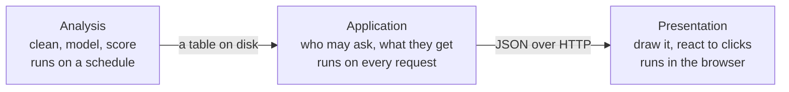
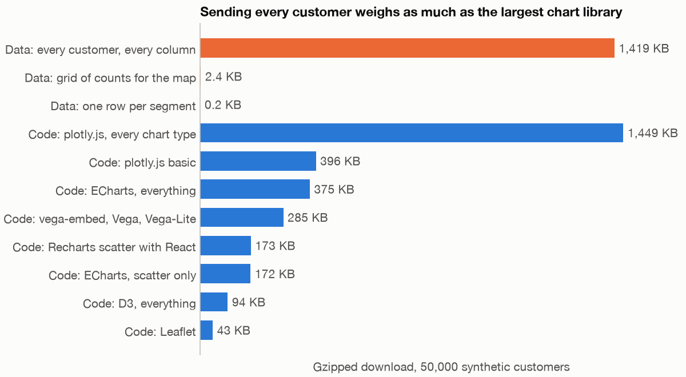
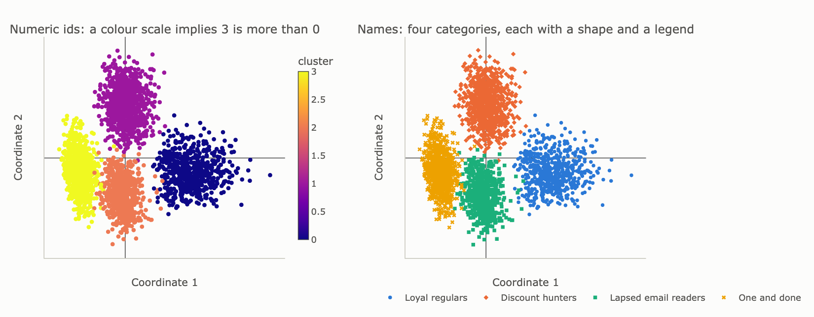
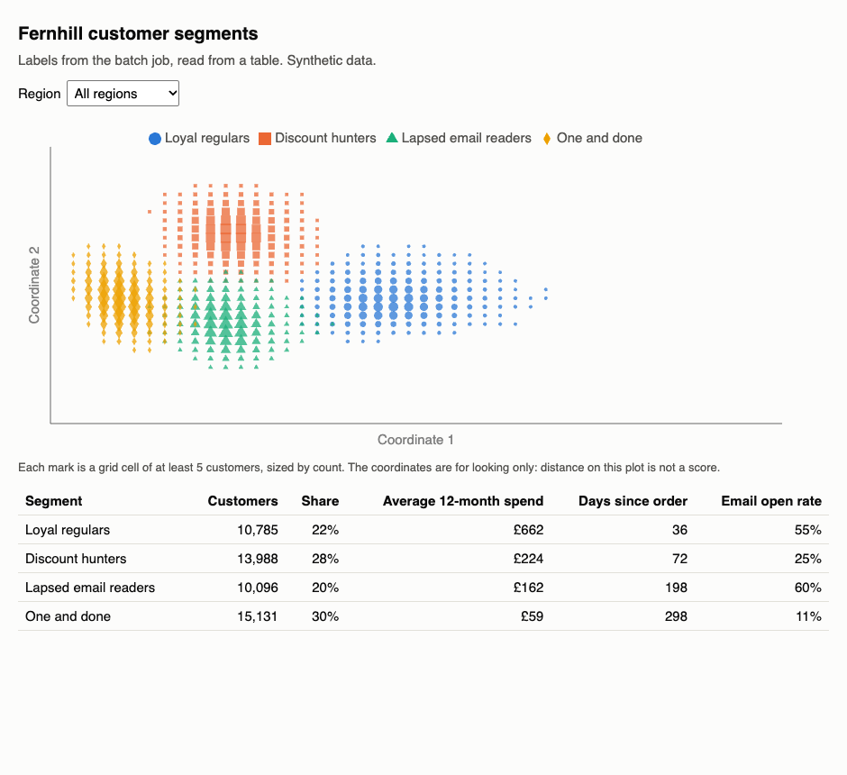
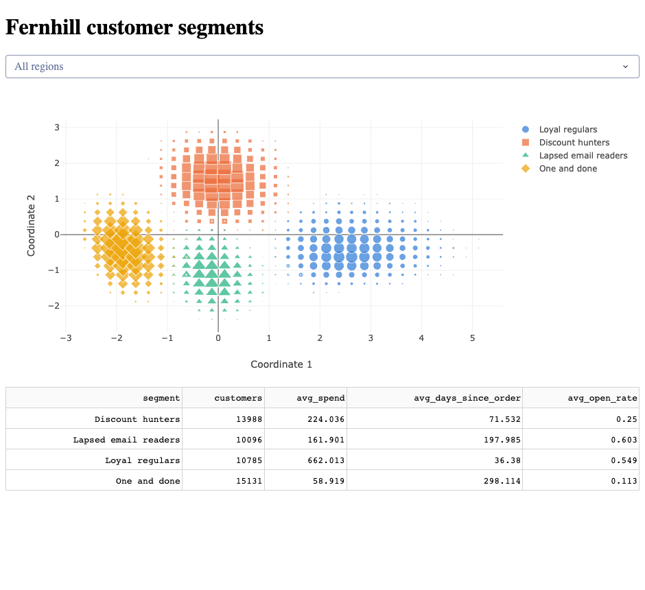

# Dashboard stacks: from Python results to a browser

Fernhill's analysts have given every customer a segment, and the CRM team wants to see them on a dashboard by Friday. The first draft took ten minutes: a web endpoint called `GET /segments` that returns the whole customer table, and a scatter chart coloured by cluster number. It works on a laptop. It also sends 50,000 customers' email addresses to anyone who knows the web address, with no login, in a download as heavy as the largest charting library, and it paints four unrelated groups on a scale that implies group 3 is more than group 0. This chapter answers the question that draft skipped: which stack should this dashboard be built on, and how do Python results reach a browser? You do not need to know React. We measure the costs rather than assert them, on 50,000 synthetic customers.

---

## Three layers, and where a chart library sits

Every dashboard, however it is built, does three jobs.



- **Analysis** produces results: here, one row per customer with a segment name and two coordinates to plot. It runs when the data changes, and nobody is waiting for it.
- **Application** answers requests. It decides who is asking, what they may see and how much to send. It runs every time someone touches a filter.
- **Presentation** turns an answer into marks on a screen and turns clicks into new requests. On the web, this part is JavaScript, whoever wrote it.

Plotly, Altair and D3 are presentation only. A chart library has no notion of a user, a login or a filter that asks a server for new data. Streamlit, Dash, Panel and Shiny are application frameworks, and they use a chart library for the drawing. So "Plotly or Dash?" is not a real choice, because Dash draws with Plotly. FastAPI is an application layer with no presentation at all. A BI tool such as Tableau packages all three.

Our analysis layer is a batch job in [`practice/segments.py`](../practice/segments.py). Its output is the contract the other two layers rely on. Note the email column: it is there on purpose, because real tables have one.

```python
import pandas as pd
import segments

segments.build_table()  # the batch job: fit, name and write one file
table = pd.read_parquet(segments.TABLE)
print(table[["customer_id", "email", "region", "segment", "x", "y"]].head(3).to_string(index=False))
```

```text
 customer_id                 email     region              segment      x      y
           1 customer1@example.com       East Lapsed email readers -0.408 -1.276
           2 customer2@example.com  Yorkshire         One and done -2.004 -0.390
           3 customer3@example.com North West         One and done -2.088 -0.001
```

The labels are a given here. How to choose them, and why the two coordinates are for looking rather than measuring, is in [segmentation and RFM](../../06-applied-analyses/notes/05-segmentation-and-rfm.md#umap-is-for-looking). For customer tables that mix numbers and categories, see [clustering categorical and mixed data](../../../data-science/01-classical-ml/notes/05b-clustering-categorical-and-mixed-data.md).

## Who really draws the chart

When you write `px.scatter` in Python, Python draws nothing in the browser. It writes a description of the chart as JSON, and a JavaScript library draws it. The Plotly project describes plotly.py as ["built on top of plotly.js"](https://github.com/plotly/plotly.py). Altair's documentation is blunter: ["Altair itself cannot render visualizations."](https://altair-viz.github.io/user_guide/internals.html) It generates a Vega-Lite specification instead.

| Python library | What it produces | Drawn in the browser by | Version pairing we measured | Consequence |
|---|---|---|---|---|
| Plotly (`plotly.py`) | A JSON figure | plotly.js | plotly.py 7.1.0 bundles plotly.js 4.1.1 | Every point in the figure travels to the browser |
| Altair | A Vega-Lite specification | Vega-Lite, Vega, vega-embed | Altair 6.3.0 targets Vega-Lite 6.4.1 | It [stops at 5,000 rows by default](https://altair-viz.github.io/user_guide/large_datasets.html), and [VegaFusion](https://vegafusion.io/about/how_it_works.html) can move some work from the browser to a server-side runtime |
| Bokeh | JSON objects that [BokehJS renders](https://docs.bokeh.org/en/latest/docs/user_guide/intro.html) | BokehJS | Bokeh 3.10.1 uses BokehJS 3.10.1 | A Bokeh server can keep Python and the browser in sync |
| Folium | An HTML page | [Leaflet](https://python-visualization.github.io/folium/latest/) | Folium 0.20.0 loads Leaflet 1.9.3 | Each marker is written into the page |
| HoloViews, hvPlot | A declarative object | [Bokeh, Matplotlib or Plotly](https://holoviews.org/user_guide/Plots_and_Renderers.html) | HoloViews 1.23.2 loaded all three | hvPlot's own docs say [support is best for Bokeh](https://hvplot.holoviz.org/en/docs/latest/ref/plotting_extensions.html) |

So you can usually move a chart from notebook to web page without learning JavaScript, and a chart library's limits apply whichever language called it. The versions come from [`practice/ch06_stack_map.py`](../practice/ch06_stack_map.py). Notes [03](03-plotly-and-interactive.md) and [04](04-javascript-d3-vega-lite-observable-plot.md#comparing-the-three) cover the libraries themselves.

## Three routes to a browser

**A BI tool** gives you all three layers in one product, in exchange for working the product's way. Note 05 explains [when not to write code](05-dashboards-and-storytelling.md#metabase-and-looker-studio-when-not-to-write-code). The new questions are who pays per viewer and what limits you hit. This is what each vendor's page said on 2 November 2026; check before quoting it.

| Tool | Who needs what to view | A limit to know | Price or licence, as read 2026-11-02 |
|---|---|---|---|
| Power BI | Free users ["can't use the Power BI sharing or collaborating features"](https://learn.microsoft.com/en-us/power-bi/fundamentals/service-features-license-type), and can consume shared content only from Premium or F64-and-above capacity | DirectQuery: a query or intermediate step [returning more than 1,000,000 rows fails](https://learn.microsoft.com/en-us/power-bi/connect-data/desktop-directquery-about) (Premium capacities can raise this), with a 4-minute timeout | [Pro $14, Premium Per User $24](https://www.microsoft.com/en-us/power-platform/products/power-bi/pricing) a user a month paid yearly, on a page that says its prices are "for marketing purposes only" |
| Tableau | [Roles](https://help.tableau.com/current/online/en-us/users_site_roles.htm): Creator publishes, Explorer can edit on the web but "can't save their work", Explorer (can publish) can save and publish from the web, Viewer can't author | Tableau Cloud: [25 GB suggested for one workbook, data source or flow (site storage 1 TB or 5 TB), refresh limit 120 minutes](https://help.tableau.com/current/online/en-us/to_site_capacity.htm) | Omitted: the pricing page refused our request, so we did not read it |
| Metabase | Row and column security is [only on Pro and Enterprise](https://www.metabase.com/docs/latest/permissions/row-and-column-security) | The table view [shows at most 2,000 rows, or 10,000 for aggregated queries](https://www.metabase.com/docs/latest/questions/query-builder/editor) | [Open Source free](https://www.metabase.com/pricing/), [licensed AGPL](https://www.metabase.com/license); Starter $100 a month including 5 users, then $6 a user; Pro $575 a month including 10 users, then $12 a user |
| Data Studio (note 05's Looker Studio) | Not checked | Not checked | [Self-service tier "at no cost"](https://cloud.google.com/data-studio); Pro $9 per user per project per month |

Google's pages now say Data Studio rather than Looker Studio; we found no announcement to cite. Row-level security matters here, and it has edges: in Power BI, ["RLS only restricts data access for users with **Viewer** permissions"](https://learn.microsoft.com/en-us/fabric/security/service-admin-row-level-security), so workspace editors see everything. Capacity, in the table, is compute an organisation buys for shared use, as opposed to a licence per user. DirectQuery is the mode where Power BI queries the source live instead of importing a copy.

BI tools also sell embedding, for putting their charts inside your own product. Power BI's [embed-for-your-customers (app-owns-data) route](https://learn.microsoft.com/en-us/power-bi/developer/embedded/embedded-analytics-power-bi) says "App users don't need a license", but production embedding needs a capacity.

**A Python app** gives you the application and presentation layers in one Python file, and the analyst keeps ownership. The frameworks differ in what reruns when a filter changes, and that shapes your code.

| Framework | What happens when a control changes | What to watch | Licence, read 2026-11-02 |
|---|---|---|---|
| [Streamlit](05-dashboards-and-storytelling.md) | The script reruns from the top. [Fragments](https://docs.streamlit.io/develop/concepts/architecture/fragments) rerun only part of it | `cache_data` values are [available to all users](https://docs.streamlit.io/develop/concepts/architecture/caching), so never cache per-person data there | Not checked |
| [Dash](https://dash.plotly.com/basic-callbacks) | A callback, ["a function that is automatically called by Dash whenever an input component's property changes"](https://dash.plotly.com/basic-callbacks) | [Workers do not share memory, and modifying globals is unsafe](https://dash.plotly.com/sharing-data-between-callbacks). Open-source Dash has [no built-in authentication](https://plotly.com/dash/) | [MIT](https://raw.githubusercontent.com/plotly/dash/dev/LICENSE) |
| [Shiny for Python](https://shiny.posit.co/py/docs/reactive-foundations.html) | Functions that read the changed control run again; Shiny calls them reactive functions | In [Shinylive](https://shiny.posit.co/py/get-started/shinylive.html), which runs the whole app in the browser, code and data go to the browser, so they "can't be kept secret from the user" | [MIT](https://raw.githubusercontent.com/posit-dev/py-shiny/main/LICENSE) |
| [Panel](https://panel.holoviz.org/) | Functions bound to the control run again, through [reactive APIs built on Param](https://panel.holoviz.org/explanation/api/reactive.html), a library of declared parameters | It [builds on Bokeh's model classes, layouts, widgets and, optionally, its server](https://panel.holoviz.org/explanation/dependencies/bokeh.html), though not on its plotting. It [can display](https://panel.holoviz.org/) Matplotlib, Plotly, Altair, ECharts and others | [BSD-3](https://panel.holoviz.org/) |
| [Bokeh server](https://docs.bokeh.org/en/latest/docs/user_guide/server/server_introduction.html) | Python callbacks, with data kept in sync between Python and BokehJS | [A new document for every browser session](https://docs.bokeh.org/en/latest/docs/user_guide/server/app.html), so each viewer costs server memory | [BSD 3-Clause conditions](https://github.com/bokeh/bokeh/blob/branch-3.9/LICENSE.txt) |

A Dash app's logic sits in a function that takes the filter and returns the new contents. This excerpt from [`practice/segments_dash.py`](../practice/segments_dash.py) needs that file's layout around it to run.

```python
@callback(Output("map", "figure"), Output("summary", "data"), Input("region", "value"))
def update(region):
    """Runs on the server every time the dropdown changes. Reads the labels, never refits."""
    rows = TABLE if region is None else TABLE[TABLE.region == region]
    bins = pd.DataFrame(api.bin_map(rows))
    figure = px.scatter(bins, x="x", y="y", size="customers", color="segment", symbol="segment",
                        category_orders={"segment": segments.NAMES},
                        color_discrete_map=COLOURS, symbol_map=SYMBOLS, template="none",
                        labels={"x": "Coordinate 1", "y": "Coordinate 2", "segment": ""})
    return figure, api.summarise(rows)
```

**A full stack** splits the layers across two programs, a Python API and a JavaScript front end. Here the front end uses React, a JavaScript library for building pages out of components, and [TypeScript](../../../programming/typescript/notes/01-js-for-python-devs.md), JavaScript with type annotations. A build step compiles that code into the files a browser loads. You get complete control over login, layout and behaviour, and you take on a second language and that build.

### Choosing by situation

The answer depends on the situation rather than on what you already know. The maintenance column is our judgement, not a measurement.

| Situation | Audience | Interaction | Data reaching the tool | Who maintains it | Start with |
|---|---|---|---|---|---|
| Recurring reporting on warehouse tables | Many non-technical viewers, some editing | Filters and drill-down | Aggregated by the warehouse | Analysts who write SQL | A BI tool |
| Internal tool around a model's output | A team you can name | Controls a BI tool does not offer | Thousands of precomputed rows | Analysts who write Python | Streamlit, Dash, Shiny or Panel |
| Specialists exploring millions of points | A few experts | Zooming into detail | Millions, rendered on a server | Python-comfortable team | Panel or HoloViews with datashader |
| A feature in a product your customers log in to | Outside users, each seeing only their own data | Designed, branded, on phones | Small per-user slices | Front-end engineers who are on call | FastAPI with React and TypeScript |
| One finding, sent once | A few people | Hover | Small | Nobody | [A self-contained HTML file](03-plotly-and-interactive.md) |

Take the first row that fits, and move to a heavier route only when you can name the requirement forcing it. Hiring pulls the same way: the team that built the analysis can maintain a Python app, and a React front end needs someone who keeps its dependencies and build working after the author moves on. If the team already has front-end engineers, that cost has been paid and the answer changes.

Keeping the layers apart makes this less final than it sounds. Our Dash app and our API call the same `summarise` and `bin_map` functions, so changing route later leaves the numbers alone.

## The full stack, if you do not write React

You can follow this route, and review it, knowing four ideas. The running code is [`practice/segments_api.py`](../practice/segments_api.py) and [`practice/js/segments_app/main.tsx`](../practice/js/segments_app/main.tsx).

**The JSON contract is the real interface.** The API promises a shape, and the front end relies on it. You, the analyst, own that shape. FastAPI publishes it automatically as [an OpenAPI 3.1 document](https://fastapi.tiangolo.com/advanced/generate-clients/) at `/openapi.json`, and tools can generate front-end code from it.

**A component is a function that returns markup.** React's documentation calls it ["a JavaScript function that you can _sprinkle with markup_."](https://react.dev/learn/your-first-component) You [declare what you want to show](https://react.dev/learn/reacting-to-input-with-state) for the current data, and React works out how to update the page. A Dash callback's return value works the same way.

**A fetch is a request, and an effect runs it.** This is the part of our front end that talks to the API. `useEffect` reruns whenever `region` changes:

```tsx
useEffect(() => {
  // Two quick filter changes can answer out of order, so an answer to an old filter is ignored.
  let current = true;
  const query = region ? `?region=${encodeURIComponent(region)}` : "";
  Promise.all([getJson<Summary[]>(`/v1/segments${query}`), getJson<MapBin[]>(`/v1/segments/map${query}`)])
    .then(([s, b]) => { if (current) { setSummary(s); setBins(b); setError(""); } })
    .catch((e) => { if (current) setError(String(e)); });
  return () => { current = false; };
}, [region]);
```

`Promise.all` sends both requests and waits for both; if you know Python, it is [`asyncio.gather`](../../../programming/typescript/notes/06-async.md). `setSummary` and `setBins` store the answers, and React redraws. `[region]` tells React when to rerun the effect. The function returned at the end is cleanup: React calls it before the next run, and that is what turns the older request's `current` to false.

The `current` flag handles something Python apps hide from you: React's documentation warns ["there is no guarantee about which order the responses will arrive in."](https://react.dev/learn/you-might-not-need-an-effect) Without the flag, a slow answer for Wales can overwrite a quick answer for Scotland, and the dropdown would say one thing while the chart showed another.

**TypeScript types describe the API's answer; they do not check it when the page runs.** Our file declares `type Summary = { segment: string; customers: number; ... }`. The handbook is clear that the compiled code ["has no type information"](https://www.typescriptlang.org/docs/handbook/typescript-from-scratch.html), and a type assertion has ["no runtime checking"](https://www.typescriptlang.org/docs/handbook/2/everyday-types.html). So if the API renames a column, the build still passes and the page breaks in front of the user. This is why you test the API's real responses, as below.

For drawing, there are four common choices. Tailwind, which you will hear named too, is [a CSS framework](https://tailwindcss.com/): it changes how the page looks and nothing about the data.

| Library | How it fits React | Reach for it when |
|---|---|---|
| Plotly.js, through [react-plotly.js](https://github.com/plotly/react-plotly.js) | A component wrapping the same library Python uses | You have Plotly figures already, or need its chart range |
| [ECharts](https://echarts.apache.org/handbook/en/basics/import/) ([Apache-2.0](https://raw.githubusercontent.com/apache/echarts/master/LICENSE)) | Not React-specific, and has a tree-shakeable import, so you ship only what you use | Many marks: its handbook [recommends canvas above about 1,000 items](https://echarts.apache.org/handbook/en/best-practices/canvas-vs-svg/) |
| [Recharts](https://recharts.github.io/) | React components, drawn as SVG | Ordinary charts in a React app, in modest numbers. Its guide asks ["Does your chart truly need to display all 50,000 data points?"](https://recharts.github.io/en-US/guide/performance/) |
| [D3](https://d3js.org/getting-started) | Its selection modules manipulate the DOM, which ["competes with React's virtual DOM"](https://d3js.org/getting-started), so use its scales and let React draw, or give D3 a ref inside `useEffect` | A form no library offers. [Note 04](04-javascript-d3-vega-lite-observable-plot.md#d3-every-decision-is-yours) shows the cost |

## What is wrong with the first draft

This is the draft from the opening, as a runnable block. FastAPI turns a Python function into a web address, and `TestClient` calls it without starting a server. For background on HTTP and JSON, see [web data](../../../programming/python/02-informatics/notes/03-web-data-json-xml.md).

```python
import pandas as pd
from fastapi import FastAPI
from fastapi.testclient import TestClient
import segments

table = pd.read_parquet(segments.TABLE)
app = FastAPI()

@app.get("/segments")
def all_customers():
    return table.to_dict("records")

answer = TestClient(app).get("/segments")  # no key sent
print(answer.status_code, f"{len(answer.content) / 1024:,.0f} KB", len(answer.json()), "rows")
print(sorted(answer.json()[0]))
```

```text
200 11,235 KB 50000 rows
['customer_id', 'days_since_order', 'discount_share', 'email', 'email_open_rate', 'orders_12m', 'region', 'segment', 'spend_12m', 'x', 'y']
```

There are four separate faults, and OWASP's API security list has a heading for each.

- **No authentication.** Anyone who can reach the address gets the answer. [API2, Broken Authentication](https://api-security.owasp.org/editions/2023/en/0xa2-broken-authentication/), is the nearest heading, though its list mainly covers weak mechanisms.
- **No per-object permission.** Seeing a segment's size and seeing a named customer are different rights. [API1](https://api-security.owasp.org/editions/2023/en/0xa1-broken-object-level-authorization/) says to "validate that a user can only access the objects that they should have permissions to access."
- **Every column.** The email addresses go along because nobody excluded them. [API3](https://api-security.owasp.org/editions/2023/en/0xa3-broken-object-property-level-authorization/): "APIs tend to expose endpoints that return all object's properties."
- **No limit.** One request does all the work the server can do. [API4](https://api-security.owasp.org/editions/2023/en/0xa4-unrestricted-resource-consumption/) asks for server-side validation of "the number of records to be returned".

The fix is short. `response_model` makes FastAPI ["limit and filter the output data"](https://fastapi.tiangolo.com/tutorial/response-model/) to the fields you named, so an email cannot leave by accident. `Depends` runs the key check before the function. `Query(le=500)` is a cap we chose: [FastAPI's tutorial](https://fastapi.tiangolo.com/tutorial/query-params/) shows defaults for `skip` and `limit`, and enforcing a maximum is your job.

```python
import pandas as pd
from fastapi import Depends, FastAPI, Query
from fastapi.testclient import TestClient
import segments
import segments_api as api

table = pd.read_parquet(segments.TABLE).sort_values("customer_id")
app = FastAPI()

@app.get("/v1/segments", response_model=list[api.SegmentSummary])
def summary(region: str | None = None, _: str = Depends(api.role_of)):
    rows = table if region is None else table[table.region == region]
    return api.summarise(rows)  # one row per segment, whoever asks

@app.get("/v1/customers", response_model=api.CustomerPage)
def customers(segment: str, after: int = 0, limit: int = Query(100, ge=1, le=500),
              _: str = Depends(api.require_crm)):
    rows = table[(table.segment == segment) & (table.customer_id > after)].head(limit)
    last = int(rows.customer_id.iloc[-1]) if len(rows) == limit else None
    return {"rows": rows.to_dict("records"), "next_after": last}

client = TestClient(app)
analyst, crm = {"X-API-Key": "demo-analyst-key"}, {"X-API-Key": "demo-crm-key"}
page = {"segment": "One and done", "limit": 2}
print("no key:", client.get("/v1/segments").status_code)
print("analyst, summary:", client.get("/v1/segments", headers=analyst).json()[0])
print("analyst, customers:", client.get("/v1/customers", params=page, headers=analyst).status_code)
print("crm, 50,000 rows:", client.get("/v1/customers", params=page | {"limit": 50_000}, headers=crm).status_code)
print("crm, customers:", client.get("/v1/customers", params=page, headers=crm).json())
```

```text
no key: 401
analyst, summary: {'segment': 'Discount hunters', 'customers': 13988, 'avg_spend': 224.036, 'avg_days_since_order': 71.532, 'avg_open_rate': 0.25}
analyst, customers: 403
crm, 50,000 rows: 422
crm, customers: {'rows': [{'customer_id': 2, 'segment': 'One and done', 'region': 'Yorkshire', 'spend_12m': 18.88}, {'customer_id': 3, 'segment': 'One and done', 'region': 'North West', 'spend_12m': 61.15}], 'next_after': 3}
```

The email address is absent from that last line even though `rows` contained it, because `response_model` removed it. 401 means no valid key, which `role_of` refuses. 403 means a valid key without the right: `require_crm` admits only the CRM role. 422 means FastAPI rejected the request because 50,000 is over the cap, before your function ran. ([HTTP status codes](../../../programming/python/02-informatics/notes/02-network-and-http.md) has the families.) The demo keys are stand-ins so the code runs. A real deployment uses your single sign-on provider and [verifies a signed token](https://fastapi.tiangolo.com/tutorial/security/oauth2-jwt/). A key compiled into a front-end bundle is public, because every visitor downloads that bundle.

`after` is keyset pagination. Rather than "skip 40,000 rows", the request says "after the last id I saw". PostgreSQL's documentation explains the reason: ["The rows skipped by an OFFSET clause still have to be computed inside the server"](https://www.postgresql.org/docs/current/queries-limit.html), and paging needs a unique sort order. [Winand's talk](https://wiki.postgresql.org/images/3/35/Pagination_Done_the_PostgreSQL_Way.pdf) gives the technique and its price: "You cannot directly navigate to arbitrary pages". For a CRM export, that is no loss.

### What each request costs

We called both APIs in-process from [`practice/ch06_measure_api.py`](../practice/ch06_measure_api.py). The setup is 50,000 synthetic customers on an Apple M4 Pro with 24 GB, Python 3.13.15, FastAPI `TestClient`, no network and no TLS. Latency is the median of repeated calls after one warm-up, measured on 2 November 2026, and is uncompressed. Gzip, a standard compression that browsers undo for you, is applied to each response body separately at level 6.

| Request | Rows sent | JSON KB | Gzip KB | Median ms |
|---|---:|---:|---:|---:|
| First draft: every customer, every column | 50,000 | 11,235.3 | 1,418.7 | 533.8 |
| One row per segment | 4 | 0.5 | 0.2 | 3.8 |
| One row per segment, one region | 4 | 0.5 | 0.2 | 3.2 |
| Map: counts on a grid, cell 0.25 | 442 | 28.8 | 2.4 | 5.3 |
| One page of 100 customers | 100 | 8.5 | 1.1 | 2.2 |

The summary is about 140 times faster than the draft (533.8 / 3.8, our arithmetic), and thousands of times smaller. A real network would add to every row, and most to the largest. Dropping columns is not enough: keeping three columns still sends 2,496 KB (330 KB gzipped), and listing values by column rather than by row 1,520 KB (244 KB gzipped). A chart of groups does not need a row per person.

The map endpoint counts customers in grid cells and drops any cell with fewer than five, so no mark on the page is one person. On the Wales view, the map's cells add up to 1,632 of the region's 2,001 customers, so the table has to carry the total and the caption has to say what the map leaves out. This reduces the risk of picking out one person. It does not remove it, because someone comparing filtered views can still work out small counts.

Two cheap additions finish the job. FastAPI's `GZipMiddleware` compresses answers for you, with [a default minimum size of 500 bytes](https://fastapi.tiangolo.com/advanced/middleware/). An [`ETag`](https://developer.mozilla.org/en-US/docs/Web/HTTP/Reference/Headers/ETag) lets a browser reuse an answer until the batch job writes a new table. If you cache, mark anything per-person [`private`](https://developer.mozilla.org/en-US/docs/Web/HTTP/Reference/Headers/Cache-Control): MDN warns that forgetting it "can cause personal information to leak."

## Precompute the labels, and do not refit on a filter

The tempting design refits the clustering whenever the user filters to a region. We expected refitting to be slow. It isn't, on tidy data: one fit of [k-means](../../06-applied-analyses/notes/05-segmentation-and-rfm.md), the clustering method behind these segments, which groups rows around k centres and is restarted from 10 random starts to keep the best, took 49 ms per request on 50,000 rows and five features. Reading the table from Parquet and aggregating took 4.7 ms, and aggregating a table already in memory 2.7 ms. That is 49 ms of wall-clock time on a 12-core laptop per filter change, with scikit-learn's threads busy for much of it, so the server handles fewer viewers at once, but it would not settle the question alone.

The real argument is what the labels mean afterwards. The published table should say one thing about each customer.

```python
import numpy as np
from sklearn.metrics import adjusted_rand_score
import segments

frame = segments.make_customers(spread=2.5)  # groups that overlap, as real customers do
published, _, _ = segments.fit(frame, seed=0)
new_seed, _, _ = segments.fit(frame, seed=1)
print(f"same cluster id after a new seed: {np.mean(published == new_seed):.1%}")
print(f"same grouping once ids are ignored (ARI): {adjusted_rand_score(published, new_seed):.3f}")
```

```text
same cluster id after a new seed: 49.1%
same grouping once ids are ignored (ARI): 0.994
```

scikit-learn's documentation says [any permutation of the labels gets the same score](https://scikit-learn.org/stable/modules/clustering.html), because the ids are arbitrary. So cluster 2 today has no reason to be cluster 2 tomorrow, and a dashboard or an email list keyed on the number silently changes meaning. The adjusted Rand index (ARI) above compares groupings while ignoring the ids: 1 means identical and about 0 means chance. Fixing `random_state`, as the [KMeans documentation](https://scikit-learn.org/stable/modules/generated/sklearn.cluster.KMeans.html) suggests, makes one fit repeatable. It does not help when the data changes, and filtering changes the data:

| Refit on | Well-separated groups (spread 1) | Overlapping groups (spread 2.5) |
|---|---|---|
| The same 50,000, new seed | ARI 1.000, 0.0% change group | ARI 0.994, 0.2% change group |
| One region (Wales, 2,001 customers) | ARI 0.999, 0.0% change group | ARI 0.932, 2.6% change group |
| Spend above the median (25,000) | ARI 0.799, 14.8% change group | ARI 0.614, 25.3% change group |

"Change group" is after matching each new cluster to its best published counterpart. On a filter that touches a modelled feature, one in seven customers changes segment on clean data and one in four on messier data. These groups are planted and simple, so treat the percentages as an illustration, and measure your own.

Model selection pushes the same way: choosing k, the number of clusters, from 2 to 8 with a silhouette score (a measure of how well separated the clusters are) on a 10,000-row sample took 3.6 s, which nobody should do inside a request. So the rule follows the [precompute-or-compute-on-request](../../../data-engineering/06-ml-platform/notes/03-batch-and-online-serving.md#precompute-or-compute-on-request) reasoning: a job writes labels, names and the model version to a table, and the app only reads. Refitting becomes a decision a person reviews, and between refits the job only assigns new customers to the approved model. Our `segments.py` fits on every run only because its data is seeded and never changes.

## What the browser downloads

The code that draws the data has to arrive too. We bundled each library the way a production build would, with [esbuild](../../../programming/typescript/notes/07-modules-and-tooling.md), a tool that joins code into one file, minified to the fewest characters and then gzipped at level 6, and pinned the versions: [`practice/js/bundle_sizes.mjs`](../practice/js/bundle_sizes.mjs), run 2 November 2026 on Node 22.23.2.



*Image Source: generated by `practice/ch06_figure.py`. Orange bars are data from the table above, blue bars are code.*

| Package and version | Minified KB | Gzip KB |
|---|---:|---:|
| `plotly.js-dist-min` 4.2.0, every chart type | 4,707 | 1,449 |
| `plotly.js-basic-dist-min` 4.2.0, bar, pie and scatter | 1,188 | 396 |
| `echarts` 6.1.0, everything | 1,115 | 375 |
| `vega-embed` 7.3.0 with `vega` 6.4.0 and `vega-lite` 6.5.0 | 820 | 285 |
| `recharts` 3.10.1 scatter, with `react` and `react-dom` 19.3.1 | 576 | 173 |
| `echarts` 6.1.0, scatter only | 506 | 172 |
| `d3` 7.9.0, everything | 277 | 94 |
| `leaflet` 1.9.4 | 147 | 43 |
| `d3` 7.9.0, scale, axis and selection only | 34 | 12 |

The draft's data weighs as much as the largest library here, so fixing the data matters more than choosing the library. What you import matters too: ECharts scatter is less than half of ECharts everything. The basic Plotly bundle does not contain `scattergl`, because its [README lists only `bar`, `pie` and `scatter`](https://www.npmjs.com/package/plotly.js-basic-dist-min), so the smaller file costs you WebGL.

A Python app is not free of this. In Chrome on localhost, on 3 November 2026, our Dash page's first load fetched 21 files totalling 6,716 KB, or about 1,901 KB if gzipped, because Dash sends plotly.js and its component libraries. Our React page fetched 5 files totalling 610 KB, or 177 KB gzipped. That tenfold gap matters for customers on phones, and hardly at all for a CRM team on office broadband.

## When there are many points

Sometimes an analyst does want every point. There are three rungs; climb only as far as you need.

**SVG, then WebGL.** Ordinary Plotly scatter makes one page element per mark, and `scattergl` hands the drawing to the graphics card. Drawn in Chrome 156 with plotly.js 4.2.0 on an Apple M4 Pro, headless at 800 by 500, median of three, until two animation frames had passed:

| Points | SVG `scatter`, ms | WebGL `scattergl`, ms |
|---:|---:|---:|
| 1,000 | 27 | 42 |
| 10,000 | 102 | 46 |
| 50,000 | 476 | 55 |
| 200,000 | not run | 76 |
| 400,000 | not run | 111 |

Reruns moved the WebGL figures by tens of milliseconds, so read the shape and not the digits: WebGL loses slightly at 1,000 points and wins clearly from 10,000. This measures one fast laptop drawing once, and panning and a phone would both differ. WebGL has limits, which the [Plotly performance page](https://plotly.com/python/performance/) sets out: "Most browsers have a limit of between 8 and 16 WebGL contexts per page", which it says generally means "between 4 and 8 figures on one page", and past it "some figures won't render". Plotly Express also switches to WebGL by itself above 1,000 rows. The same page puts the ceiling for WebGL traces at "around a million points".

**Render on the server.** Datashader counts the points into a grid and sends an image, because in its pipeline ["only one stage (Aggregation) requires access to the entire dataset."](https://datashader.org/getting_started/Pipeline.html) So the browser's cost stops depending on the number of points.

```python
import datashader as ds
import numpy as np
import pandas as pd
import time
import segments

table = pd.read_parquet(segments.TABLE)
rng = np.random.default_rng(1)
picks = rng.integers(0, len(table), 5_000_000)
cloud = pd.DataFrame({"x": table.x.values[picks] + rng.normal(0, .05, len(picks)),
                      "y": table.y.values[picks] + rng.normal(0, .05, len(picks))})
canvas = ds.Canvas(plot_width=800, plot_height=500)
for attempt in ("first, compiling", "second"):
    start = time.perf_counter()
    image = ds.tf.shade(canvas.points(cloud, "x", "y")).to_pil()
    print(f"{attempt}: {len(cloud):,} points -> {image.size} image in {(time.perf_counter() - start) * 1000:,.0f} ms")
```

```text
first, compiling: 5,000,000 points -> (800, 500) image in 371 ms
second: 5,000,000 points -> (800, 500) image in 21 ms
```


*Image Source: generated by `practice/ch06_stack_map.py`. 5,000,000 synthetic points, resampled from the 50,000 with noise.*

That image, shaded by segment, is 255 KB. A Plotly figure holding only 50,000 points as NumPy arrays is 362 KB gzipped. The trade-off is in Datashader's own docs: ["you will not be able to see more detail when zooming in unless the Python (and thus Datashader) process is running."](https://datashader.org/getting_started/Interactivity.html) So it needs a running server, which suits Panel or HoloViews and a small audience.

**Ask whether you need the points at all.** For the CRM team, the answer is no, and the grid of counts is 2.4 KB.

## Maps

Fernhill's customers have a region, so someone will ask for a map. Folium is the short route: it writes a page where Leaflet draws.

```python
import folium
import pandas as pd
import segments

table = pd.read_parquet(segments.TABLE)
counts = table.groupby("region").size()
uk = folium.Map(location=[53.5, -2], zoom_start=6, tiles="OpenStreetMap")
for region, (_, lat, lon) in segments.REGIONS.items():
    folium.CircleMarker([lat, lon], radius=counts[region] ** .5 / 8, weight=1, fill=True,
                        tooltip=f"{region}: {counts[region]:,} customers").add_to(uk)
uk.save(segments.OUTPUT / "segments_regions.html")
print(f"{(segments.OUTPUT / 'segments_regions.html').stat().st_size / 1024:,.0f} KB, 10 regions")
```

```text
10 KB, 10 regions
```

The same page with 5,000 individual circle markers was 2,435 KB, from `ch06_stack_map.py`, because each marker is written into the HTML. So aggregate to regions first.

- **A region's size misleads.** On a choropleth, a map with each region shaded by its value, large regions dominate whatever the value is. Wilke notes ["We perceive larger areas as corresponding to larger amounts"](https://clauswilke.com/dataviz/geospatial-data.html), and ["Choropleths work best when the coloring represents a density"](https://clauswilke.com/dataviz/geospatial-data.html). So shade by a density, or by a share only if regions are of similar size or small against the map. To show a count, we chose a sized circle at one point.
- **Tiles are someone else's server.** OpenStreetMap's policy says ["Availability is best-effort: there is no SLA or guarantee"](https://operations.osmfoundation.org/policies/tiles/), asks you to show its licence attribution clearly, and warns that access may be withdrawn from commercial services. For anything a business depends on, arrange your own tiles.
- **A home address is personal data.** Our coordinates are one city per region on purpose. A map of customers' homes is a privacy decision, not a chart choice.

## Colour for categories

The draft coloured by cluster number. Plotly's documentation explains what happens: ["If the data is numeric, the color will automatically be considered continuous."](https://plotly.com/python/discrete-color/) You get a colour bar with values such as 1.5, which is not a group that exists. [Note 01](01-grammar-and-chart-choice.md#colour-has-a-job-too) covers colour's jobs; this is that rule failing silently inside a default.

```python
import pandas as pd
import plotly.express as px
import segments

table = pd.read_parquet(segments.TABLE).sample(3_000, random_state=0)
table["cluster"] = table.segment.map({name: i for i, name in enumerate(segments.NAMES)})

numeric = px.scatter(table, x="x", y="y", color="cluster")
print("numeric ids:", len(numeric.data), "trace, colour bar:", numeric.layout.coloraxis.colorbar.title.text)

COLOURS = dict(zip(segments.NAMES, ["#2a78d6", "#eb6834", "#1baf7a", "#eda100"]))
named = px.scatter(table, x="x", y="y", color="segment", symbol="segment",
                   category_orders={"segment": segments.NAMES}, color_discrete_map=COLOURS)
print("names:", len(named.data), "traces:", [trace.name for trace in named.data])

default = px.scatter(table, x="x", y="y", color="segment")
filtered = px.scatter(table[table.segment != default.data[0].name], x="x", y="y", color="segment")
print("default colours:      ", {t.name: t.marker.color for t in default.data})
print("one segment filtered: ", {t.name: t.marker.color for t in filtered.data})
```

```text
numeric ids: 1 trace, colour bar: cluster
names: 4 traces: ['Loyal regulars', 'Discount hunters', 'Lapsed email readers', 'One and done']
default colours:       {'Discount hunters': '#636efa', 'One and done': '#EF553B', 'Lapsed email readers': '#00cc96', 'Loyal regulars': '#ab63fa'}
one segment filtered:  {'One and done': '#636efa', 'Lapsed email readers': '#EF553B', 'Loyal regulars': '#00cc96'}
```



*Image Source: generated by `practice/ch06_stack_map.py`. Synthetic data.*

The last two lines of output show the less obvious fault. With default colours, colour follows order of appearance, so filtering out one segment repaints every other segment. Fix the mapping by name, with `color_discrete_map` in Plotly and with a lookup table in React, as our `STYLE` object does. Wilke finds that qualitative scales ["work best when there are three to five different categories"](https://clauswilke.com/dataviz/color-pitfalls.html).

## Accessibility is part of the contract

A dashboard is often someone's only route to these numbers. Four checks from [WCAG 2.2](https://www.w3.org/TR/WCAG22/), the W3C's web accessibility guidelines, apply directly to a chart page.

- **Colour is not alone (1.4.1).** Colour must not be "the only visual means of conveying information". This is why our segments also have different shapes. [Wilke's figure](https://clauswilke.com/dataviz/color-pitfalls.html) is about 8% of men and 0.5% of women with some colour-vision deficiency.
- **Contrast (1.4.3 and 1.4.11).** Text needs 4.5:1 (3:1 if large), and graphical marks need "at least 3:1 against adjacent color(s)". Our palette passed a colour-vision check, but aqua (2.74:1) and yellow (2.11:1) fall short of 3:1 on the page's near-white surface, by the validator we ran. WCAG's [non-text contrast guidance](https://www.w3.org/WAI/WCAG22/Understanding/non-text-contrast.html) accepts the information being available in another form, such as a table, so our table is what meets the check. The shapes and legend help, but a low-contrast shape is still low contrast.
- **A table view (1.1.1).** [WCAG's guidance on charts](https://www.w3.org/WAI/WCAG22/Understanding/non-text-content.html) says "Where possible and practical, the actual data is provided in a table." Our page has a caption and the numbers below the chart.
- **Keyboard and hover (2.1.1 and 1.4.13).** Everything must work without a mouse. Our filter is a real `<select>`, which gets this free. Anything found only on hover fails for keyboard and touch users.

We have not tested these pages with a screen reader, so we claim only the checks above.

## Worked example: the Fernhill segments page, twice

The practice folder builds the same page on two routes, from the same table and helpers. Every number below is synthetic.



*Image Source: screenshot from `practice/ch06_browser.py`, the React and FastAPI route. Each mark is a grid cell of at least five customers.*



*Image Source: screenshot from `practice/ch06_browser.py`, the Dash route.*

| | Dash | FastAPI and React |
|---|---|---|
| Our code, lines | 42 of Python | 147 of Python (including the kept first draft), 100 of TypeScript, and a Node toolchain |
| First-load download, gzipped | about 1,901 KB | about 177 KB |
| Login | Bring your own; none in our demo | A key check in the demo, your SSO in production |

So what should Fernhill do? The request comes from a CRM team of a few people, inside the company, with labels that change only when someone approves a refit. That puts it on the Python app row, and the 42-line Dash file is enough if it sits behind the company's login proxy, a service in front of the app that checks the company sign-in before passing any request through. If the same numbers were going into a BI tool the company already pays for, publishing the summary table to it would be cheaper still. The React version earns its extra code on the day these views go into the customer-facing product.

Run the lot from the practice folder. The data is generated, so only packages download.

```bash
cd data-analytics/05-visualisation-and-storytelling/practice
uv run ch06_measure_api.py              # the request, refit and stability tables
uv run ch06_stack_map.py                # versions, colour, datashader, Folium; the PNG needs Chrome
(cd js && npm install && npm run sizes && npm run app)   # Node 22; bundle sizes and the React build
uv run ch06_figure.py                   # the download chart
uv run ch06_browser.py                  # draw times and both screenshots; needs Chrome
uv run segments_dash.py                 # the Dash app on localhost:8050
uv run --with fastapi --with uvicorn --with pandas --with pyarrow --with scikit-learn uvicorn segments_api:app
# then open http://127.0.0.1:8000/?key=demo-analyst-key
```

Your timings will differ. The size of each gap is what to check.

## Pitfalls

- **Choosing the stack by what you know.** The symptom is a React project for six internal readers, or a Streamlit app that outside customers log in to. Start from the situation table.
- **A list endpoint that returns the table.** It looks fine on a demo with 200 rows, and then the page takes half a second to answer and 11 MB to read at 50,000. Return an aggregate by default, and page the row-level route behind a separate permission.
- **A secret or a cap only in the front end.** Anything in the JavaScript bundle is public, and a dropdown limited to 100 rows does nothing against someone calling the address directly. Keep credentials and limits on the server.
- **Refitting on a filter, or keying on a cluster number.** Fast enough to pass a demo, then "Loyal regulars" changes meaning when someone moves a slider, and an email list built on "cluster 2" targets a different group. Read named labels from a table.

## Try it

1. Call the map endpoint with `cell` at 0.05 and at 1, for example with `api.bin_map(table, .05)`. How many rows come back, how many customers do they cover, and which would you ship?

   <details><summary>Answer</summary>

   On the seeded table: cell 0.05 gives 3,472 rows and covers 40,772 customers, and cell 1 gives 57 rows and covers 49,977. Finer cells show more shape, but more of them fall under the five-customer floor, so nearly a fifth of customers vanish from the picture. We ship 0.25, with 442 rows covering 49,657, because it keeps the clusters' shape and loses under 1%.
   </details>

2. Someone says: "refitting takes 49 ms, so let's refit whenever the user filters. It's more accurate." Write the reply, using two numbers from this chapter.

   <details><summary>Answer</summary>

   Speed is not the objection. On the overlapping data, refitting on spend above the median moved 25.3% of customers to a different group, and on separated data 14.8%, so a label would no longer mean one thing across views. A new seed also kept the same cluster id for only about half of customers on overlapping data, so anything keyed on the id breaks. Publish one table and let the filter select rows from it.
   </details>

3. Pick a stack for each. (a) A weekly sales view for 200 managers from warehouse tables. (b) A tool for three analysts to compare model runs with a custom control. (c) Usage charts inside your product, where each customer sees only their own data.

   <details><summary>Answer</summary>

   (a) A BI tool, since the viewers' licensing and the warehouse connection are the real questions: check what 200 viewers cost on each vendor's page first. (b) A Python app, such as Streamlit or Dash, maintained by the analysts. (c) The full stack, or a BI tool's embedded route if the budget allows. Either way, per-customer access has to be enforced on the server.
   </details>

## Interview checklist

| Question | Answer |
|---|---|
| What are the three layers of a dashboard? | Analysis produces results on a schedule, the application answers requests and enforces access, and presentation draws in the browser. Chart libraries are presentation only. |
| What is the difference between Plotly and Dash? | Plotly draws charts. Dash is an application framework that runs Python callbacks on a server and uses Plotly to draw. |
| How do you choose between a BI tool, a Python app and a full stack? | By audience, interaction, data volume and who maintains it. Take the lightest that fits, and move up only for a named requirement, such as outside users with per-person data. |
| What is wrong with an endpoint that returns the customer table? | No authentication, no per-object permission, every property exposed, and no limit. On our setup it also took about 534 ms and 11 MB, against 4 ms and 0.5 KB for a summary. |
| Why not refit the model when a user filters? | Speed is often fine. The issue is meaning: ids are arbitrary, and in our test a filter on spend moved 15 to 25% of customers. Persist labels from a job and read them. |
| Offset or keyset pagination? | Keyset for large exports: it filters on the last id seen, so skipped rows are not computed, but you cannot jump to an arbitrary page. It needs a unique sort order. |
| When do you use WebGL, and when datashader? | WebGL from around 10,000 points, on our measurements, up to around a million by Plotly's documentation, with a limit on figures per page. Datashader beyond that, or when the whole set should stay on a server, accepting a running process and no point-level hover. |

## Next

You can now put a result in front of people, on a stack that fits them, without leaking it or misdrawing it. The next pillar uses these charts on real business questions, starting with one every operations team asks: [Forecasting](../../06-applied-analyses/notes/01-forecasting.md).
