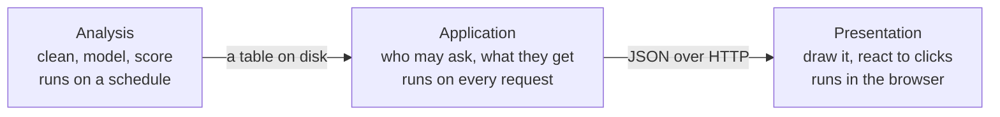

# Dashboard stacks: from Python results to a browser

Fernhill's analysts have given every customer a segment, and the CRM team wants to see them on a dashboard by Friday. The first draft took ten minutes: a web endpoint called `GET /segments` that returns the whole customer table, and a scatter chart coloured by cluster number. It works on a laptop. It also sends 50,000 customers' email addresses to anyone who knows the web address, with no login, in a download as heavy as the largest charting library, and it paints four unrelated groups on a scale that implies group 3 is more than group 0. This chapter answers the question that draft skipped: which stack should this dashboard be built on, and how do Python results reach a browser? You do not need to know React. We measure the costs rather than assert them, on 50,000 synthetic customers.

---

## Three layers, and where a chart library sits

Every dashboard, however it is built, does three jobs.



- **Analysis** produces results: here, one row per customer with a segment name and two coordinates to plot. It runs when the data changes, and nobody is waiting for it.
- **Application** answers requests. It decides who is asking, what they may see and how much to send. It runs every time someone touches a filter.
- **Presentation** turns an answer into marks on a screen and turns clicks into new requests. On the web, this part is JavaScript, whoever wrote it.

Plotly, Altair and D3 are presentation only. A chart library has no notion of a user, a login or a filter that asks a server for new data. Streamlit, Dash, Panel and Shiny are application frameworks, and they use a chart library for the drawing. So "Plotly or Dash?" is not a real choice, because Dash draws with Plotly. FastAPI is an application layer with no presentation at all. A BI tool such as Tableau packages all three.

Our analysis layer is a batch job in [`practice/segments.py`](../practice/segments.py). Its output is the contract the other two layers rely on. Note the email column: it is there on purpose, because real tables have one.

```python
import pandas as pd
import segments

segments.build_table()  # the batch job: fit, name and write one file
table = pd.read_parquet(segments.TABLE)
print(table[["customer_id", "email", "region", "segment", "x", "y"]].head(3).to_string(index=False))
```

```text
 customer_id                 email     region              segment      x      y
           1 customer1@example.com       East Lapsed email readers -0.408 -1.276
           2 customer2@example.com  Yorkshire         One and done -2.004 -0.390
           3 customer3@example.com North West         One and done -2.088 -0.001
```

The labels are a given here. How to choose them, and why the two coordinates are for looking rather than measuring, is in [segmentation and RFM](../../06-applied-analyses/notes/05-segmentation-and-rfm.md#umap-is-for-looking). For customer tables that mix numbers and categories, see [clustering categorical and mixed data](../../../data-science/01-classical-ml/notes/05b-clustering-categorical-and-mixed-data.md).

## Who really draws the chart

When you write `px.scatter` in Python, Python draws nothing in the browser. It writes a description of the chart as JSON, and a JavaScript library draws it. The Plotly project describes plotly.py as ["built on top of plotly.js"](https://github.com/plotly/plotly.py). Altair's documentation is blunter: ["Altair itself cannot render visualizations."](https://altair-viz.github.io/user_guide/internals.html) It generates a Vega-Lite specification instead.

| Python library | What it produces | Drawn in the browser by | Version pairing we measured | Consequence |
|---|---|---|---|---|
| Plotly (`plotly.py`) | A JSON figure | plotly.js | plotly.py 7.1.0 bundles plotly.js 4.1.1 | Every point in the figure travels to the browser |
| Altair | A Vega-Lite specification | Vega-Lite, Vega, vega-embed | Altair 6.3.0 targets Vega-Lite 6.4.1 | It [stops at 5,000 rows by default](https://altair-viz.github.io/user_guide/large_datasets.html), and [VegaFusion](https://vegafusion.io/about/how_it_works.html) can move some work from the browser to a server-side runtime |
| Bokeh | JSON objects that [BokehJS renders](https://docs.bokeh.org/en/latest/docs/user_guide/intro.html) | BokehJS | Bokeh 3.10.1 uses BokehJS 3.10.1 | A Bokeh server can keep Python and the browser in sync |
| Folium | An HTML page | [Leaflet](https://python-visualization.github.io/folium/latest/) | Folium 0.20.0 loads Leaflet 1.9.3 | Each marker is written into the page |
| HoloViews, hvPlot | A declarative object | [Bokeh, Matplotlib or Plotly](https://holoviews.org/user_guide/Plots_and_Renderers.html) | HoloViews 1.23.2 loaded all three | hvPlot's own docs say [support is best for Bokeh](https://hvplot.holoviz.org/en/docs/latest/ref/plotting_extensions.html) |

So you can usually move a chart from notebook to web page without learning JavaScript, and a chart library's limits apply whichever language called it. The versions come from [`practice/ch06_stack_map.py`](../practice/ch06_stack_map.py). Notes [03](03-plotly-and-interactive.md) and [04](04-javascript-d3-vega-lite-observable-plot.md#comparing-the-three) cover the libraries themselves.

## Three routes to a browser

**A BI tool** gives you all three layers in one product, in exchange for working the product's way. Note 05 explains [when not to write code](05-dashboards-and-storytelling.md#metabase-and-looker-studio-when-not-to-write-code). The new questions are who pays per viewer and what limits you hit. This is what each vendor's page said on 2 November 2026; check before quoting it.

| Tool | Who needs what to view | A limit to know | Price or licence, as read 2026-11-02 |
|---|---|---|---|
| Power BI | Free users ["can't use the Power BI sharing or collaborating features"](https://learn.microsoft.com/en-us/power-bi/fundamentals/service-features-license-type), and can consume shared content only from Premium or F64-and-above capacity | DirectQuery: a query or intermediate step [returning more than 1,000,000 rows fails](https://learn.microsoft.com/en-us/power-bi/connect-data/desktop-directquery-about) (Premium capacities can raise this), with a 4-minute timeout | [Pro $14, Premium Per User $24](https://www.microsoft.com/en-us/power-platform/products/power-bi/pricing) a user a month paid yearly, on a page that says its prices are "for marketing purposes only" |
| Tableau | [Roles](https://help.tableau.com/current/online/en-us/users_site_roles.htm): Creator publishes, Explorer can edit on the web but "can't save their work", Explorer (can publish) can save and publish from the web, Viewer can't author | Tableau Cloud: [25 GB suggested for one workbook, data source or flow (site storage 1 TB or 5 TB), refresh limit 120 minutes](https://help.tableau.com/current/online/en-us/to_site_capacity.htm) | Omitted: the pricing page refused our request, so we did not read it |
| Metabase | Row and column security is [only on Pro and Enterprise](https://www.metabase.com/docs/latest/permissions/row-and-column-security) | The table view [shows at most 2,000 rows, or 10,000 for aggregated queries](https://www.metabase.com/docs/latest/questions/query-builder/editor) | [Open Source free](https://www.metabase.com/pricing/), [licensed AGPL](https://www.metabase.com/license); Starter $100 a month including 5 users, then $6 a user; Pro $575 a month including 10 users, then $12 a user |
| Data Studio (note 05's Looker Studio) | Not checked | Not checked | [Self-service tier "at no cost"](https://cloud.google.com/data-studio); Pro $9 per user per project per month |

Google's pages now say Data Studio rather than Looker Studio; we found no announcement to cite. Row-level security matters here, and it has edges: in Power BI, ["RLS only restricts data access for users with **Viewer** permissions"](https://learn.microsoft.com/en-us/fabric/security/service-admin-row-level-security), so workspace editors see everything. Capacity, in the table, is compute an organisation buys for shared use, as opposed to a licence per user. DirectQuery is the mode where Power BI queries the source live instead of importing a copy.

BI tools also sell embedding, for putting their charts inside your own product. Power BI's [embed-for-your-customers (app-owns-data) route](https://learn.microsoft.com/en-us/power-bi/developer/embedded/embedded-analytics-power-bi) says "App users don't need a license", but production embedding needs a capacity.

**A Python app** gives you the application and presentation layers in one Python file, and the analyst keeps ownership. The frameworks differ in what reruns when a filter changes, and that shapes your code.

| Framework | What happens when a control changes | What to watch | Licence, read 2026-11-02 |
|---|---|---|---|
| [Streamlit](05-dashboards-and-storytelling.md) | The script reruns from the top. [Fragments](https://docs.streamlit.io/develop/concepts/architecture/fragments) rerun only part of it | `cache_data` values are [available to all users](https://docs.streamlit.io/develop/concepts/architecture/caching), so never cache per-person data there | Not checked |
| [Dash](https://dash.plotly.com/basic-callbacks) | A callback, ["a function that is automatically called by Dash whenever an input component's property changes"](https://dash.plotly.com/basic-callbacks) | [Workers do not share memory, and modifying globals is unsafe](https://dash.plotly.com/sharing-data-between-callbacks). Open-source Dash has [no built-in authentication](https://plotly.com/dash/) | [MIT](https://raw.githubusercontent.com/plotly/dash/dev/LICENSE) |
| [Shiny for Python](https://shiny.posit.co/py/docs/reactive-foundations.html) | Functions that read the changed control run again; Shiny calls them reactive functions | In [Shinylive](https://shiny.posit.co/py/get-started/shinylive.html), which runs the whole app in the browser, code and data go to the browser, so they "can't be kept secret from the user" | [MIT](https://raw.githubusercontent.com/posit-dev/py-shiny/main/LICENSE) |
| [Panel](https://panel.holoviz.org/) | Functions bound to the control run again, through [reactive APIs built on Param](https://panel.holoviz.org/explanation/api/reactive.html), a library of declared parameters | It [builds on Bokeh's model classes, layouts, widgets and, optionally, its server](https://panel.holoviz.org/explanation/dependencies/bokeh.html), though not on its plotting. It [can display](https://panel.holoviz.org/) Matplotlib, Plotly, Altair, ECharts and others | [BSD-3](https://panel.holoviz.org/) |
| [Bokeh server](https://docs.bokeh.org/en/latest/docs/user_guide/server/server_introduction.html) | Python callbacks, with data kept in sync between Python and BokehJS | [A new document for every browser session](https://docs.bokeh.org/en/latest/docs/user_guide/server/app.html), so each viewer costs server memory | [BSD 3-Clause conditions](https://github.com/bokeh/bokeh/blob/branch-3.9/LICENSE.txt) |

A Dash app's logic sits in a function that takes the filter and returns the new contents. This excerpt from [`practice/segments_dash.py`](../practice/segments_dash.py) needs that file's layout around it to run.

```python
@callback(Output("map", "figure"), Output("summary", "data"), Input("region", "value"))
def update(region):
    """Runs on the server every time the dropdown changes. Reads the labels, never refits."""
    rows = TABLE if region is None else TABLE[TABLE.region == region]
    bins = pd.DataFrame(api.bin_map(rows))
    figure = px.scatter(bins, x="x", y="y", size="customers", color="segment", symbol="segment",
                        category_orders={"segment": segments.NAMES},
                        color_discrete_map=COLOURS, symbol_map=SYMBOLS, template="none",
                        labels={"x": "Coordinate 1", "y": "Coordinate 2", "segment": ""})
    return figure, api.summarise(rows)
```

**A full stack** splits the layers across two programs, a Python API and a JavaScript front end. Here the front end uses React, a JavaScript library for building pages out of components, and [TypeScript](../../../programming/typescript/notes/01-js-for-python-devs.md), JavaScript with type annotations. A build step compiles that code into the files a browser loads. You get complete control over login, layout and behaviour, and you take on a second language and that build.

### Choosing by situation

The answer depends on the situation rather than on what you already know. The maintenance column is our judgement, not a measurement.

| Situation | Audience | Interaction | Data reaching the tool | Who maintains it | Start with |
|---|---|---|---|---|---|
| Recurring reporting on warehouse tables | Many non-technical viewers, some editing | Filters and drill-down | Aggregated by the warehouse | Analysts who write SQL | A BI tool |
| Internal tool around a model's output | A team you can name | Controls a BI tool does not offer | Thousands of precomputed rows | Analysts who write Python | Streamlit, Dash, Shiny or Panel |
| Specialists exploring millions of points | A few experts | Zooming into detail | Millions, rendered on a server | Python-comfortable team | Panel or HoloViews with datashader |
| A feature in a product your customers log in to | Outside users, each seeing only their own data | Designed, branded, on phones | Small per-user slices | Front-end engineers who are on call | FastAPI with React and TypeScript |
| One finding, sent once | A few people | Hover | Small | Nobody | [A self-contained HTML file](03-plotly-and-interactive.md) |

Take the first row that fits, and move to a heavier route only when you can name the requirement forcing it. Hiring pulls the same way: the team that built the analysis can maintain a Python app, and a React front end needs someone who keeps its dependencies and build working after the author moves on. If the team already has front-end engineers, that cost has been paid and the answer changes.

Keeping the layers apart makes this less final than it sounds. Our Dash app and our API call the same `summarise` and `bin_map` functions, so changing route later leaves the numbers alone.

## The full stack, if you do not write React

You can follow this route, and review it, knowing four ideas. The running code is [`practice/segments_api.py`](../practice/segments_api.py) and [`practice/js/segments_app/main.tsx`](../practice/js/segments_app/main.tsx).

**The JSON contract is the real interface.** The API promises a shape, and the front end relies on it. You, the analyst, own that shape. FastAPI publishes it automatically as [an OpenAPI 3.1 document](https://fastapi.tiangolo.com/advanced/generate-clients/) at `/openapi.json`, and tools can generate front-end code from it.

**A component is a function that returns markup.** React's documentation calls it ["a JavaScript function that you can _sprinkle with markup_."](https://react.dev/learn/your-first-component) You [declare what you want to show](https://react.dev/learn/reacting-to-input-with-state) for the current data, and React works out how to update the page. A Dash callback's return value works the same way.

**A fetch is a request, and an effect runs it.** This is the part of our front end that talks to the API. `useEffect` reruns whenever `region` changes:

```tsx
useEffect(() => {
  // Two quick filter changes can answer out of order, so an answer to an old filter is ignored.
  let current = true;
  const query = region ? `?region=${encodeURIComponent(region)}` : "";
  Promise.all([getJson<Summary[]>(`/v1/segments${query}`), getJson<MapBin[]>(`/v1/segments/map${query}`)])
    .then(([s, b]) => { if (current) { setSummary(s); setBins(b); setError(""); } })
    .catch((e) => { if (current) setError(String(e)); });
  return () => { current = false; };
}, [region]);
```

`Promise.all` sends both requests and waits for both; if you know Python, it is [`asyncio.gather`](../../../programming/typescript/notes/06-async.md). `setSummary` and `setBins` store the answers, and React redraws. `[region]` tells React when to rerun the effect. The function returned at the end is cleanup: React calls it before the next run, and that is what turns the older request's `current` to false.

The `current` flag handles something Python apps hide from you: React's documentation warns ["there is no guarantee about which order the responses will arrive in."](https://react.dev/learn/you-might-not-need-an-effect) Without the flag, a slow answer for Wales can overwrite a quick answer for Scotland, and the dropdown would say one thing while the chart showed another.

**TypeScript types describe the API's answer; they do not check it when the page runs.** Our file declares `type Summary = { segment: string; customers: number; ... }`. The handbook is clear that the compiled code ["has no type information"](https://www.typescriptlang.org/docs/handbook/typescript-from-scratch.html), and a type assertion has ["no runtime checking"](https://www.typescriptlang.org/docs/handbook/2/everyday-types.html). So if the API renames a column, the build still passes and the page breaks in front of the user. This is why you test the API's real responses, as below.

For drawing, there are four common choices. Tailwind, which you will hear named too, is [a CSS framework](https://tailwindcss.com/): it changes how the page looks and nothing about the data.

| Library | How it fits React | Reach for it when |
|---|---|---|
| Plotly.js, through [react-plotly.js](https://github.com/plotly/react-plotly.js) | A component wrapping the same library Python uses | You have Plotly figures already, or need its chart range |
| [ECharts](https://echarts.apache.org/handbook/en/basics/import/) ([Apache-2.0](https://raw.githubusercontent.com/apache/echarts/master/LICENSE)) | Not React-specific, and has a tree-shakeable import, so you ship only what you use | Many marks: its handbook [recommends canvas above about 1,000 items](https://echarts.apache.org/handbook/en/best-practices/canvas-vs-svg/) |
| [Recharts](https://recharts.github.io/) | React components, drawn as SVG | Ordinary charts in a React app, in modest numbers. Its guide asks ["Does your chart truly need to display all 50,000 data points?"](https://recharts.github.io/en-US/guide/performance/) |
| [D3](https://d3js.org/getting-started) | Its selection modules manipulate the DOM, which ["competes with React's virtual DOM"](https://d3js.org/getting-started), so use its scales and let React draw, or give D3 a ref inside `useEffect` | A form no library offers. [Note 04](04-javascript-d3-vega-lite-observable-plot.md#d3-every-decision-is-yours) shows the cost |

## Pitfalls

- **Choosing the stack by what you know.** The symptom is a React project for six internal readers, or a Streamlit app that outside customers log in to. Start from the situation table.

## Try it

1. Pick a stack for each. (a) A weekly sales view for 200 managers from warehouse tables. (b) A tool for three analysts to compare model runs with a custom control. (c) Usage charts inside your product, where each customer sees only their own data.

   <details><summary>Answer</summary>

   (a) A BI tool, since the viewers' licensing and the warehouse connection are the real questions: check what 200 viewers cost on each vendor's page first. (b) A Python app, such as Streamlit or Dash, maintained by the analysts. (c) The full stack, or a BI tool's embedded route if the budget allows. Either way, per-customer access has to be enforced on the server.
   </details>

## Interview checklist

| Question | Answer |
|---|---|
| What are the three layers of a dashboard? | Analysis produces results on a schedule, the application answers requests and enforces access, and presentation draws in the browser. Chart libraries are presentation only. |
| What is the difference between Plotly and Dash? | Plotly draws charts. Dash is an application framework that runs Python callbacks on a server and uses Plotly to draw. |
| How do you choose between a BI tool, a Python app and a full stack? | By audience, interaction, data volume and who maintains it. Take the lightest that fits, and move up only for a named requirement, such as outside users with per-person data. |

---

## Next

[Part 2 — the data path, many points, colour and the finished pages](06b-dashboard-data-path-points-colour-and-worked-example.md): the first draft's faults and their fixes, what each request and download costs, precomputed labels, many points, maps, colour for categories, accessibility, and the segments page built twice.
