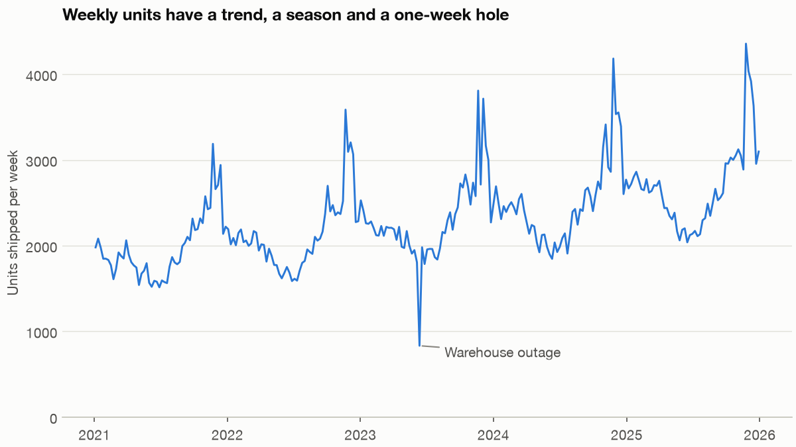
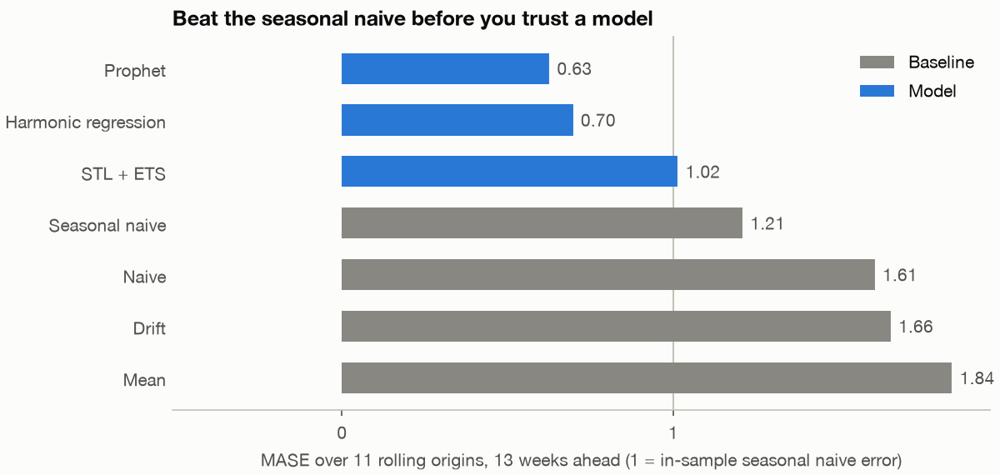
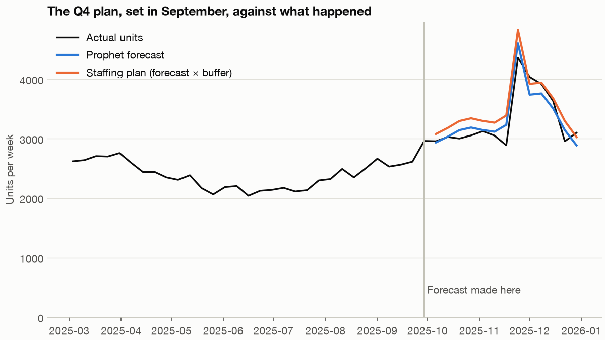

# Forecasting: how many people does the warehouse need?

It is the last Monday of September, and Fernhill's operations manager has to book temporary warehouse staff for the thirteen weeks that hold Black Friday and Christmas. Book too few and parcels go out late at a cost of about £12 a unit. Book too many and she pays £4 a unit for people standing around. She does not want a forecast. She wants a number of people, and she wants to know why she should believe it. This chapter gets her that number, and the part that matters most is the discipline that decides which model has earned the right to supply it.

---

## The question and the data

The business question is **how many units should the warehouse be staffed for, week by week, across Q4?** Everything in the analysis follows from how that question is put: thirteen weeks ahead, at weekly grain, with costs that are not symmetric.

The data is Fernhill Home, the same fictional homewares retailer as the [visualisation pillar](../../05-visualisation-and-storytelling/README.md), and the same plot: an email budget cut in January 2025 and a jump in paid social. This pillar uses a new, customer-level generator, `practice/retail.py`, so its totals are not calibrated to the charts in that pillar. No open dataset gives five years of weekly units with an outage we can point to and a known truth behind it, so the data is synthetic and seeded, and every number below comes out the same on your machine. The honest consequence is that **the results here describe this generator**. When a model beats another below, that is evidence about how to run the comparison, not evidence that one model is better in general.

The code blocks in this chapter are the sections of `practice/ch01_forecasting.py`, in order, and each block relies on those before it. Run the whole thing with `uv run ch01_forecasting.py` from the practice folder. The chart code stays in the script.

```python
import logging
import warnings

import matplotlib.pyplot as plt
import numpy as np
import pandas as pd
from prophet import Prophet
from statsmodels.tsa.exponential_smoothing.ets import ETSModel
from statsmodels.tsa.forecasting.stl import STLForecast
from statsmodels.tsa.statespace.sarimax import SARIMAX

import chartstyle as cs
from retail import load_weekly_units

warnings.filterwarnings("ignore")
logging.getLogger("cmdstanpy").setLevel(logging.ERROR)
logging.getLogger("prophet").setLevel(logging.ERROR)
cs.apply()
```

```python
units = load_weekly_units()
print(units.tail(3).to_string())
print(f"{len(units)} weeks, mean {units.mean():.0f}, max {units.max()} in week of {units.idxmax().date()}")
by_year = units.groupby(units.index.year).sum()
print("growth by year:", (by_year.pct_change().dropna() * 100).round(1).to_dict())
```

```text
week
2025-12-15    3633
2025-12-22    2956
2025-12-29    3099
Freq: W-MON
261 weeks, mean 2311, max 4358 in week of 2025-11-24
growth by year: {2022: 7.3, 2023: 8.1, 2024: 10.8, 2025: 5.9}
```



*Image Source: generated by `practice/ch01_forecasting.py` from the seeded Fernhill data.*

Look before you fit. There are four things in this picture, and each of them will break some method. There is a **trend**, with units growing between 6% and 11% a year. There is a yearly **season**, with a broad autumn hump. There is an **event that moves**: Black Friday is the day after the fourth Thursday of November, so its week does not sit at a fixed distance from last year's. And there is a **hole** in June 2023, when the warehouse was down for a week. That hole is a supply problem, not a demand signal, and a method that copies last year will copy it too.

There is also a problem with the calendar. A year is about 52.18 weeks. FPP3 makes the point directly: the seasonal period of weekly data is both large and not a whole number, which rules out the classic seasonal methods that want a short integer period ([Hyndman and Athanasopoulos, FPP3, section 13.1](https://otexts.com/fpp3/weekly.html)). Its suggestions are STL decomposition with a non-seasonal model on what is left, or dynamic harmonic regression. We will try both, along with Prophet, and we will not trust any of them until they have beaten something simple.

## Baselines come first

A forecast is only good relative to what you could have done with no effort. FPP3 sets out four benchmarks that cost nothing to compute ([section 5.2](https://otexts.com/fpp3/simple-methods.html)): the mean of the history, the last value (naive), the value from one season ago (seasonal naive), and the line from the first point to the last extended forward (drift).

```python
H, SEASON = 13, 52


def mean_method(train, h=H):
    return np.repeat(train.mean(), h)


def naive(train, h=H):
    return np.repeat(train.iloc[-1], h)


def seasonal_naive(train, h=H):
    return train.iloc[-SEASON:-SEASON + h].to_numpy()


def drift(train, h=H):
    slope = (train.iloc[-1] - train.iloc[0]) / (len(train) - 1)
    return train.iloc[-1] + slope * np.arange(1, h + 1)


train = units.iloc[:-H]
print("first three forecast weeks")
for f in (mean_method, naive, seasonal_naive, drift):
    print(f"{f.__name__:15s}", np.round(f(train)[:3]).astype(int))
```

```text
first three forecast weeks
mean_method     [2259 2259 2259]
naive           [2962 2962 2962]
seasonal_naive  [2589 2749 2661]
drift           [2966 2970 2974]
```

The seasonal naive is the one to beat for a series like this. It already knows about the season, it needs no fitting, and any operations team could produce it in a spreadsheet. If your model cannot beat it, the model has added cost and no information, and you should say so. It has two weaknesses that you can read off the method. It ignores growth, so it runs low on a growing series. And it repeats whatever happened last year, including the outage.

## Three models that can handle a 52.18-week year

**STL plus ETS.** STL splits the series into trend, season and remainder with repeated local regressions. We then forecast the seasonally adjusted part with exponential smoothing and add the season back. It is cheap and robust, but it treats the season as a 52-week pattern, so it can only learn about a moving event as a smear across neighbouring weeks.

**Dynamic harmonic regression.** Instead of one parameter per week, model the season as a sum of sines and cosines at the true period of 52.18 weeks, add a trend and a Black Friday flag, and let the errors follow an AR(1). The number of sine and cosine pairs, K, controls how wiggly the season can be, and FPP3 chooses it by minimising AICc. Because we choose K inside the function, each backtest origin makes its choice using only its own past.

**Prophet.** Taylor and Letham frame forecasting as curve fitting: a decomposable model of trend, seasonality and holidays, with yearly seasonality written as a Fourier series, built so that an analyst can adjust it using quantities that make sense in the business ([Taylor and Letham, The American Statistician, 2018](https://doi.org/10.1080/00031305.2017.1380080); [preprint](https://peerj.com/preprints/3190.pdf)). Seen this way it is close to the harmonic regression, with an automatic piecewise trend and no explicit error autocorrelation. We tell it about Black Friday and make the season multiplicative, because the peak grows with the level.

```python
def stl_ets(train, h=H):
    """STL removes the season, ETS forecasts what is left: FPP3's first suggestion for weekly data."""
    model = STLForecast(np.log(train).asfreq("W-MON"), ETSModel, period=SEASON, robust=True,
                        model_kwargs=dict(error="add", trend="add", damped_trend=True)).fit()
    frame = model.get_prediction(start=len(train), end=len(train) + h - 1).summary_frame(alpha=.2)
    return np.exp(frame["mean"]).to_numpy(), np.exp(frame["mean_ci_lower"]).to_numpy(), np.exp(frame["mean_ci_upper"]).to_numpy()


def black_friday(year):
    """The day after the fourth Thursday of November."""
    nov1 = pd.Timestamp(year, 11, 1)
    return nov1 + pd.Timedelta(days=(3 - nov1.dayofweek) % 7 + 22)


def black_friday_weeks(index):
    """1 for the week holding Black Friday, else 0."""
    return np.array([int(w <= black_friday(w.year) < w + pd.Timedelta(days=7)) for w in index])


def harmonic_exog(index, K):
    """Fourier terms at the true period of 52.18 weeks, a trend, and the moving Black Friday."""
    t = (index - pd.Timestamp("2021-01-04")).days.to_numpy() / 7
    terms = {"trend": t / 52.18, "black_friday": black_friday_weeks(index)}
    for k in range(1, K + 1):
        terms[f"sin{k}"] = np.sin(2 * np.pi * k * t / 52.18)
        terms[f"cos{k}"] = np.cos(2 * np.pi * k * t / 52.18)
    return pd.DataFrame(terms, index=index)


def dhr_fit(train, K):
    return SARIMAX(np.log(train).asfreq("W-MON"), exog=harmonic_exog(train.index, K),
                   order=(1, 0, 0), trend="c").fit(disp=False, maxiter=200)


def aicc(res):
    n, k = res.nobs, len(res.params)
    return res.aic + 2 * k * (k + 1) / (n - k - 1)


def best_K(train, candidates=(2, 4, 6, 8, 10, 12)):
    """FPP3 picks the number of Fourier pairs by AICc, so each origin picks its own."""
    return min(candidates, key=lambda K: aicc(dhr_fit(train, K)))


def dhr(train, h=H):
    K = best_K(train)
    future = pd.date_range(train.index[-1] + pd.Timedelta(weeks=1), periods=h, freq="W-MON")
    frame = dhr_fit(train, K).get_forecast(h, exog=harmonic_exog(future, K)).summary_frame(alpha=.2)
    return (np.exp(frame["mean"]).to_numpy(), np.exp(frame["mean_ci_lower"]).to_numpy(),
            np.exp(frame["mean_ci_upper"]).to_numpy())


def prophet(train, h=H):
    # A weekly series is stamped on Mondays, so the event sits on the Monday of the Friday's week.
    mondays = [black_friday(y) - pd.Timedelta(days=4) for y in range(2021, 2027)]
    events = pd.DataFrame({"holiday": "black_friday", "ds": mondays})
    model = Prophet(seasonality_mode="multiplicative", weekly_seasonality=False, daily_seasonality=False,
                    yearly_seasonality=10, holidays=events, interval_width=.8, uncertainty_samples=300)
    model.fit(pd.DataFrame({"ds": train.index, "y": train.to_numpy()}))
    future = pd.DataFrame({"ds": pd.date_range(train.index[-1] + pd.Timedelta(weeks=1), periods=h, freq="W-MON")})
    np.random.seed(7)     # Prophet simulates its intervals; fix them so every run prints the same
    out = model.predict(future)
    return out["yhat"].to_numpy(), out["yhat_lower"].to_numpy(), out["yhat_upper"].to_numpy()


print("AICc picks K =", best_K(units.iloc[:-H]), "on everything before the last 13 weeks")
```

```text
AICc picks K = 6 on everything before the last 13 weeks
```

We fit on the log scale for the first two so that the errors scale with the level and the forecasts stay positive. Note what we are handing the last two models: the true Black Friday rule, which is also how the generator builds the series. A real series gives you no such guarantee. This matters when you read the results below.

## Backtest, because one split is one anecdote

A single train and test split tells you how a model did on one quarter. Rolling-origin evaluation repeats the exercise: fit on everything up to a date, forecast thirteen weeks, step forward, and repeat ([FPP3, section 5.10](https://otexts.com/fpp3/tscv.html)). Only ever train on the past. A random k-fold split would let the model see the future of the series it is forecasting.

```text
origin 1   |=========== train ===========|--- 13 test ---|
origin 2   |============== train ==============|--- 13 test ---|
origin 3   |================= train =================|--- 13 test ---|
...
origin 12  |========================== train ==========================|--- 13 test ---|  <- exam
```

We use twelve origins, thirteen weeks apart. The first eleven are for choosing. The twelfth, the Q4 we are pretending to stand in front of, stays locked until the model and the buffer are chosen, because a test set that has guided a choice is no longer a test set.

```python
METHODS = {"Mean": mean_method, "Naive": naive, "Drift": drift, "Seasonal naive": seasonal_naive,
           "STL + ETS": stl_ets, "Harmonic regression": dhr, "Prophet": prophet}
origins = [len(units) - H * i for i in range(12, 0, -1)]      # train lengths, each 13 weeks apart
rows = []
for n_train in origins:
    train, test = units.iloc[:n_train], units.iloc[n_train:n_train + H]
    # MASE scale: the in-sample seasonal naive MAE, which each origin computes from its own past.
    scale = train.diff(SEASON).abs().mean()
    for name, method in METHODS.items():
        out = method(train)
        point, low, high = out if isinstance(out, tuple) else (out, np.nan, np.nan)
        rows.append(pd.DataFrame({"origin": train.index[-1], "week": test.index, "step": np.arange(1, H + 1),
                                  "model": name, "actual": test.to_numpy(), "forecast": point,
                                  "low": low, "high": high, "scale": scale}))
backtest = pd.concat(rows, ignore_index=True)
backtest["error"] = backtest["actual"] - backtest["forecast"]
print(f"{len(origins)} origins, from {backtest.origin.min().date()} to {backtest.origin.max().date()}")
```

```text
12 origins, from 2023-01-02 to 2025-09-29
```

Which error measure? Each one answers a different question. FPP3 notes that minimising MAE leads to forecasts of the median and minimising RMSE leads to forecasts of the mean ([section 5.8](https://otexts.com/fpp3/accuracy.html)), so the two can legitimately disagree. Percentage errors such as MAPE blow up near zero and penalise over-forecasting and under-forecasting unequally, and this is the reason Hyndman and Koehler proposed scaling instead. MASE divides each error by the in-sample mean absolute error of a naive method, in our case the seasonal naive, so that the number is unit-free and comparable across series ([Hyndman and Koehler, International Journal of Forecasting, 2006](https://doi.org/10.1016/j.ijforecast.2006.03.001)). Be careful with the reading of it. A MASE below 1 means better than the seasonal naive's *one-step, in-sample* error, which is a harder target than its thirteen-week-ahead error. That is why the seasonal naive itself does not score exactly 1.

We also track bias: the mean of actual minus forecast. Positive means we under-forecast. For a warehouse, bias matters more than scatter, because a consistent shortfall means being understaffed every single week.

```python
def score(frame):
    return pd.Series({"MAE": frame.error.abs().mean(), "RMSE": np.sqrt((frame.error ** 2).mean()),
                      "MASE": (frame.error.abs() / frame.scale).mean(),
                      "Bias": frame.error.mean()})


exam_origin = backtest.origin.max()
select = backtest[backtest.origin < exam_origin]       # 11 origins to choose a model
exam = backtest[backtest.origin == exam_origin]        # the last 13 weeks, touched once
order = list(METHODS)
table = select.groupby("model").apply(score, include_groups=False).loc[order]
print(table.round(2).to_string())
```

```text
                        MAE    RMSE  MASE    Bias
model
Mean                 359.04  504.46  1.84  271.42
Naive                313.76  427.83  1.61   27.03
Drift                322.86  432.41  1.66    9.67
Seasonal naive       235.31  315.71  1.21  184.68
STL + ETS            196.55  285.66  1.02   73.29
Harmonic regression  134.85  192.69  0.70   16.06
Prophet              121.59  175.29  0.63   14.00
```



*Image Source: generated by `practice/ch01_forecasting.py`. MASE over eleven rolling origins, thirteen weeks ahead.*

Read the table from the top. Mean, naive and drift score worse than the seasonal naive because they know nothing about the season. The seasonal naive has a bias of about +185 units a week, exactly the failure we predicted: it copies last year into a business that has grown. STL plus ETS beats it on scatter and halves its bias, but still only reaches 1.02. It smears Black Friday. Harmonic regression and Prophet are close together at 0.70 and 0.63, and the gap between them is not large enough to bet much on. Both had the moving event explained to them, and the generator really does behave that way.

## Check the intervals before anyone relies on them

A point forecast cannot price a risk, so we need intervals, and intervals make a claim that you can test. An 80% interval should contain about 80% of the outcomes.

```python
with_pi = select.dropna(subset=["low"])
coverage = with_pi.assign(inside=lambda d: d.actual.between(d.low, d.high)).groupby("model")["inside"].mean()
print("share of actuals inside the nominal 80% interval, 11 origins")
print((coverage * 100).round(1).to_string())
```

```text
share of actuals inside the nominal 80% interval, 11 origins
model
Harmonic regression    93.0
Prophet                74.8
STL + ETS              47.6
```

STL plus ETS misses badly. Its intervals contain under half of the outcomes they promised to contain 80% of, because they are built from a model that cannot see Black Friday. Harmonic regression errs the other way and is too wide. Prophet is a little narrow, though close. Taylor and Letham's intervals come from simulating future trend changes on the assumption that they resemble past ones, so treat them as an estimate, and measure coverage on your own backtest. Never quote an interval you have not tested.

We will not use the model's interval for the staffing decision, as it turns out. We can do better with the backtest errors directly.

## From forecast to decision

The manager's costs are not symmetric. Each unit short costs £12 and each unit over costs £4. These figures are assumptions for the exercise, so replace them with your own. Suppose you are deciding whether to staff for one more unit. It pays off when the unit turns out to be needed, which saves £12, and it wastes £4 otherwise. You should go on adding capacity until the probability that the unit is needed falls to 4/(12+4), that is, until you have covered a share 12/(12+4) = 0.75 of the distribution of demand. This is the newsvendor result, and 0.75 is the critical ratio. The manager should not staff to the expected demand. She should staff to about the 75th percentile. [Operations and supply chain](10-operations-and-supply-chain.md#one-seasons-order-the-newsvendor) runs the same ratio on a season's stock order.

We can read that percentile directly off the backtest: take the ratio of actual to forecast at each week in the eleven selection origins, and use its 75th percentile as a multiplicative buffer. Then we open the exam.

```python
best = table["MASE"].idxmin()
print("selected on 11 origins:", best)
ratio = select[select.model == best].eval("actual / forecast")
cost_short, cost_over = 12.0, 4.0
target = cost_short / (cost_short + cost_over)
buffer = ratio.quantile(target)
print(f"critical ratio {target:.2f}, buffer {buffer:.3f} times the forecast")

def plan_cost(plan, actual):
    short = np.maximum(actual - plan, 0)
    over = np.maximum(plan - actual, 0)
    return (cost_short * short + cost_over * over).sum()


pick = exam[exam.model == best].set_index("week")
snaive = exam[exam.model == "Seasonal naive"].set_index("week")
plans = {"Seasonal naive, no buffer": snaive.forecast, f"{best}, no buffer": pick.forecast,
         f"{best}, buffered": pick.forecast * buffer}
for name, plan in plans.items():
    print(f"{name:34s} cost £{plan_cost(plan, pick.actual):>8,.0f}")
print(exam.groupby("model").apply(score, include_groups=False).loc[order].round(2).to_string())
```

```text
selected on 11 origins: Prophet
critical ratio 0.75, buffer 1.047 times the forecast
Seasonal naive, no buffer          cost £  38,876
Prophet, no buffer                 cost £  13,272
Prophet, buffered                  cost £  11,788
                         MAE     RMSE  MASE     Bias
model
Mean                 1057.65  1158.75  4.86  1057.65
Naive                 367.15   591.22  1.69   354.23
Drift                 351.57   570.53  1.61   326.43
Seasonal naive        269.00   296.93  1.24   209.62
STL + ETS             185.30   224.10  0.85    20.04
Harmonic regression   196.91   261.66  0.90   -53.24
Prophet               139.47   171.92  0.64   -23.70
```



*Image Source: generated by `practice/ch01_forecasting.py`. The forecast is made on 29 September 2025 and scored on the following thirteen weeks.*

Prophet holds up on the exam at 0.64, so the selection did not mislead us. Two other things show up. First, the exam rank is not the selection rank: STL plus ETS beat harmonic regression on this single quarter, 0.85 to 0.90, the reverse of the eleven-origin result. That is exactly why one quarter cannot pick a model. Second, in pounds, the model is worth far more than the buffer. Moving from the seasonal naive to Prophet saves about £25,600 for the quarter, and adding the buffer saves about another £1,500. A small buffer is what we should expect when the model's errors are already small, at under 5% here.

## Recommendation

**Staff Q4 to the Prophet forecast times 1.047, which is the 75th percentile of its backtest errors, and refresh it weekly.** On this one exam quarter, the plan costs about £11,800 in mismatch under the assumed costs, against about £38,900 for planning from last year's numbers. Keep the seasonal naive running next to it as a tripwire. If the model's rolling MASE rises above the benchmark for a few weeks, stop trusting it and find out why.

Say what the number does not cover. The exam is one quarter, and the costs are assumed. The series counts units shipped, so the outage week records what the warehouse could ship rather than what customers wanted. Before you trained in production you would either mark such weeks as missing or give them their own event. Neither model has been told about a new promotion that has no history.

## Pitfalls

- **Skipping the baseline.** A MASE of 0.6 means nothing to a manager until you add "and the thing we do now scores 1.2".
- **Random cross-validation on a time series.** It leaks the future. Use rolling origins, and make every choice, such as K here, inside the fold.
- **MAPE by default.** It is undefined at zero and treats over- and under-forecasting differently. Use a scaled error and report bias separately.
- **Reading MASE as "relative to the benchmark's forecast".** The scale is in-sample and one-season-ahead, so the seasonal naive need not score 1 out of sample.
- **Reusing the exam.** Once the final quarter has chosen a model or a buffer, it is a selection set, and its score is flattering.
- **Selecting on one quarter.** STL plus ETS and harmonic regression swap places on the exam. Eleven origins are what make the ranking trustworthy.
- **Untested intervals.** The nominal 80% of STL plus ETS covers about 48% here. Measure coverage before you quote any band.
- **Staffing to the mean under asymmetric costs.** The right quantile follows from the costs, so ask for them.
- **Treating supply limits as demand.** Sales capped by an outage or a stock-out understate demand. Mark those periods.
- **Comparing models on data the generator was built to suit.** Telling a model the true Black Friday rule is fair here and flattering in general. Be clear what your model was told.

## Try it

Exercises use `practice/ch01_forecasting.py`.

1. Mask the outage week as missing before fitting Prophet (it accepts missing values in `y`) and rerun. Does it help the 2024 forecasts?

   <details><summary>Answer</summary>

   In `prophet()`, fit on `train.where(train.index != pd.Timestamp("2023-06-12"))`. Overall MASE moves only from 0.63 to 0.62, because Prophet fits a smooth season and one low week barely moves it. The method that really suffers from the hole is the seasonal naive, whose June 2024 forecast copies it.
   </details>

2. Swap the costs to £4 short and £12 over. What happens to the buffer, and why?

   <details><summary>Answer</summary>

   The critical ratio becomes 4/16 = 0.25, so the buffer becomes the 25th percentile of actual over forecast, which is below 1. She now staffs under the forecast, because being over is the expensive mistake. Change `cost_short` and `cost_over` in the `plan` section and rerun.
   </details>

3. Remove Black Friday from the harmonic regression's terms. What does that do to MASE and to coverage, and what does this tell you about the comparison?

   <details><summary>Answer</summary>

   Drop `"black_friday"` from `harmonic_exog`. MASE on the eleven origins rises from 0.70 to 0.98, and coverage of the 80% interval rises from 93% to 95%, because the interval has to widen to absorb a spike the model can no longer explain. Most of the model's lead over STL plus ETS came from knowing the calendar, not from the form of the model.
   </details>

## Interview checklist

| Question | Answer |
|---|---|
| Why compare against a seasonal naive? | It costs nothing and already knows about the season. If a model cannot beat it, the model adds cost and no information. |
| Why not use k-fold cross-validation on a time series? | Random folds train on the future. Rolling-origin evaluation trains only on data before each forecast. |
| What does MASE scale by? | The in-sample MAE of a naive method, seasonal naive for seasonal data. It is unit-free and defined at zero. |
| What do MAE and RMSE optimise for? | MAE leads to the median of the forecast distribution and RMSE to the mean. |
| Why is weekly seasonality awkward? | The period is about 52.18 weeks: long and not a whole number. Use Fourier terms at the true period, or STL with a non-seasonal model. |
| How do you choose K in a harmonic regression? | By AICc, inside each backtest fold. |
| How is Prophet structured? | An additive or multiplicative curve fit of piecewise trend, Fourier seasonality and holiday effects. |
| What is the critical ratio? | Cost of being short over the sum of short and over costs. Stock to that quantile of demand. |
| How do you check a prediction interval? | Measure coverage across a backtest and compare it to the nominal level. |
| What is forecast bias, and why report it? | The mean of actual minus forecast. A consistent shortfall has a different cost from scatter, and low error scores can hide it. |

## Next

The warehouse now knows how much to staff. The next analysis moves from how much to who, and from a synthetic retailer to real loans: [Credit scoring](02-credit-scoring.md), where the question is which applicants a bank should accept.
