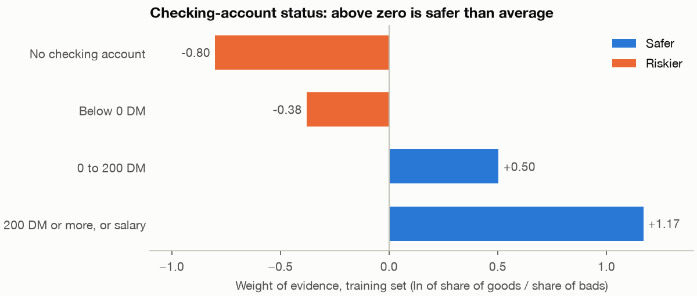
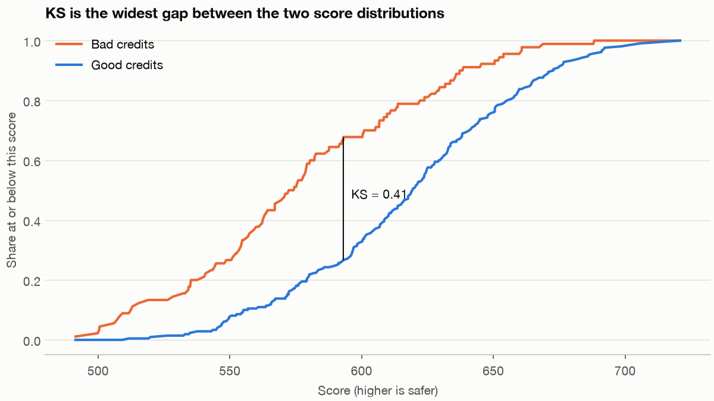
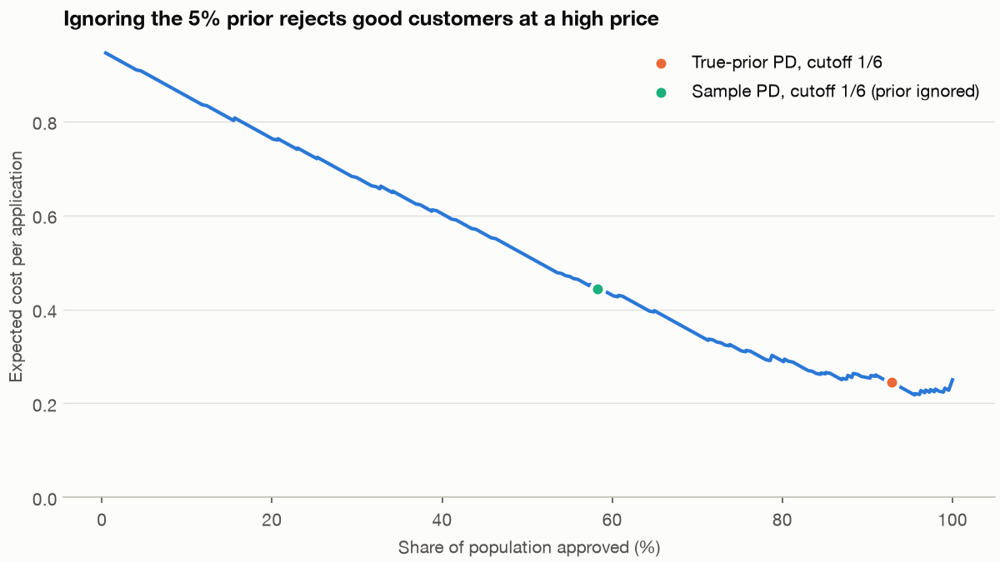

# Credit scoring: which applications should a bank approve?

A loan is an unusual product, because you find out whether the sale was a good one years after making it. A credit analyst has to decide today, on a form and a bureau file, and answer to two audiences who want different things: a credit committee that asks what the policy costs, and a regulator who asks how much capital sits behind the book. This chapter builds the classic tool for both, a logistic scorecard, on real loans. The largest error it finds has nothing to do with the choice of model, and it would have cost the bank more than any modelling decision we make.

---

## The question and the data

The business question is **which applications should the bank approve, and how much capital does the resulting book require?** It has a modelling half, how to rank applicants, and a policy half, where to draw the line. Most courses stop at the first half.

We step out of Fernhill here, because an open dataset of real loans exists. South German Credit is 1,000 consumer loans made between 1973 and 1975 by a large regional bank in southern Germany. It is an old, small dataset, and its history makes it a good teacher. It has circulated for decades as the "German Credit" data from Statlog, with a code table that Grömping showed to be wrong for several variables, and she published a corrected version ([Grömping, Beuth Hochschule report 04/2019](http://www1.beuth-hochschule.de/FB_II/reports/Report-2019-004.pdf); [UCI, South German Credit (UPDATE)](https://archive.ics.uci.edu/dataset/573/south+german+credit+update), CC BY 4.0). The lesson for any analyst is to validate a well-known dataset against its documentation. Grömping's report is also inconsistent on one point: its text gives the target coding as 0 for good, whereas the file has 700 ones, and her R code labels 1 as good. So we check against a published cross-tabulation before doing anything else.

Three more facts from the report change the analysis, so note them now.

- **Bad loans were heavily oversampled.** The sample is 30% bad, and the report gives an actual bad rate of about 5%. Everything calibrated on this file is wrong by a known amount until we correct it.
- **All these loans were approved.** We observe repayment only for people who passed the bank's checks at the time, so the model learns about approved applicants, and we will apply it to all of them. This is the classic selection problem. Practitioners try to patch it with reject inference, but the rejected applicants' outcomes do not exist, and no method can recover them from this file.
- **The credit amount is scrambled** by an unknown monotonic transformation, so its order means something and its absolute values do not.

The code blocks are the sections of `practice/ch02_credit_scoring.py` in order, each relying on those before it. Run them with `uv run ch02_credit_scoring.py` from the practice folder. The data files are in `practice/data/`, with their provenance.

```python
from pathlib import Path

import matplotlib.pyplot as plt
import numpy as np
import pandas as pd
from scipy.stats import norm
from sklearn.ensemble import HistGradientBoostingClassifier
from sklearn.linear_model import LogisticRegression
from sklearn.metrics import roc_auc_score
from sklearn.model_selection import RepeatedStratifiedKFold, train_test_split

import chartstyle as cs

cs.apply()
SEED = 20250101
```

```python
names = {"laufkont": "status", "laufzeit": "duration", "moral": "credit_history", "verw": "purpose",
         "hoehe": "amount", "sparkont": "savings", "beszeit": "employment", "rate": "installment_rate",
         "famges": "personal_status_sex", "buerge": "other_debtors", "wohnzeit": "residence", "verm": "property",
         "alter": "age", "weitkred": "other_plans", "wohn": "housing", "bishkred": "number_credits", "beruf": "job",
         "pers": "people_liable", "telef": "telephone", "gastarb": "foreign_worker", "kredit": "good"}
raw = pd.read_csv(Path("data/SouthGermanCredit.asc"), sep=" ").rename(columns=names)
raw["bad"] = 1 - raw.pop("good")
print(raw.shape, "bad rate", raw.bad.mean())
# Sanity check against Table 1 of Groemping (2019): "no checking account" is 45.00% of bad and 19.86% of good.
print((pd.crosstab(raw.status, raw.bad, normalize="columns") * 100).round(2).head(1).to_string())
train, test = train_test_split(raw, test_size=.3, stratify=raw.bad, random_state=SEED)
print(len(train), "train,", len(test), "test")
```

```text
(1000, 21) bad rate 0.3
bad         0     1
status
1       19.86  45.0
700 train, 300 test
```

The 45.0% and 19.86% match Table 1 of the report, which confirms that we have read the target the right way round.

## Weight of evidence

A scorecard turns every characteristic into points on a shared scale, and to do that it needs a common currency. Weight of evidence (WoE) provides it. Split a characteristic into classes, and for each class compare its share of the good loans with its share of the bad loans:

```text
WoE(class)  = ln( share of goods in class / share of bads in class )
IV          = sum over classes of (share of goods - share of bads) * WoE(class)
```

A positive WoE means the class is safer than average. Why go to this trouble rather than feed the codes to a model? Each class gets its own effect on the log odds, so a non-linear or unordered variable needs no more care than a linear one. Each new value is a known transformation of the raw value, so you can read the model and defend it. And there is a neat reason it suits logistic regression: WoE is the log of the likelihood ratio, the very quantity that Bayes' rule adds to the prior log odds, so a model on WoE terms has coefficients near 1 when the characteristics are independent.

Information value (IV) sums the class evidence into one measure of how well a characteristic separates goods from bads. The usual reading is below 0.02 not predictive, 0.02 to 0.1 weak, 0.1 to 0.3 medium, and above 0.3 strong, and it traces to Siddiqi's book, which we report second-hand through [a conference paper citing it](https://www.mwsug.org/proceedings/2013/AA/MWSUG-2013-AA14.pdf). These are conventions, not theorems.

We learn the classes on the training set only. In real scorecard work an analyst would then adjust the classes by hand to make business sense. Here we use quintiles for the two continuous variables and pool any level under 5%, so that the procedure can be repeated inside cross-validation.

```python
PROTECTED = ["personal_status_sex", "age", "foreign_worker"]    # never used to decide
CONTINUOUS = ["duration", "amount"]
candidates = [c for c in raw.columns if c not in PROTECTED + ["bad"]]


def fit_bins(x, y):
    """Coarse classes learned on training data only, then a weight of evidence for each."""
    if x.name in CONTINUOUS:
        edges = np.unique(np.quantile(x, [0, .2, .4, .6, .8, 1]))
        edges[0], edges[-1] = -np.inf, np.inf
        classes = pd.cut(x, edges)
    else:
        share = x.value_counts(normalize=True)
        rare = share[share < .05].index
        edges = list(rare)
        classes = x.where(~x.isin(rare), -1)        # sparse levels share one class
    good, bad = (y == 0), (y == 1)
    # 0.5 added to each cell so an empty class cannot give an infinite weight
    table = pd.DataFrame({"good": good.groupby(classes, observed=False).sum() + .5,
                          "bad": bad.groupby(classes, observed=False).sum() + .5})
    table["pct_good"] = table.good / table.good.sum()
    table["pct_bad"] = table.bad / table.bad.sum()
    table["woe"] = np.log(table.pct_good / table.pct_bad)
    iv = ((table.pct_good - table.pct_bad) * table.woe).sum()
    return {"edges": edges, "table": table, "iv": iv}


def apply_bins(x, fit):
    if x.name in CONTINUOUS:
        classes = pd.cut(x, fit["edges"])
    else:
        classes = x.where(~x.isin(fit["edges"]), -1)
    prior = 0.0                                      # a level unseen in training has no evidence
    return classes.map(fit["table"].woe).astype(float).fillna(prior)


bins = {c: fit_bins(train[c], train.bad) for c in candidates}
iv = pd.Series({c: f["iv"] for c, f in bins.items()}).sort_values(ascending=False)
print(iv.round(3).to_string())
print(bins["status"]["table"][["good", "bad", "woe"]].round(2).to_string())
```

```text
status              0.641
credit_history      0.289
savings             0.234
duration            0.223
purpose             0.222
employment          0.151
housing             0.110
property            0.097
amount              0.066
installment_rate    0.058
other_plans         0.048
job                 0.027
other_debtors       0.020
number_credits      0.011
residence           0.007
people_liable       0.001
telephone           0.000
         good   bad   woe
status
1        98.5  94.5 -0.80
2       121.5  76.5 -0.38
3        36.5   9.5  0.50
4       235.5  31.5  1.17
```



*Image Source: generated by `practice/ch02_credit_scoring.py` from South German Credit, training set.*

Status of the checking account carries most of the signal, and the classes run in a sensible order, which is the first thing to check. Three characteristics are in the data but never considered: sex and marital status, age, and foreign-worker status. They are left out as a decision, not a statistical finding. Lending law restricts them, and what it says depends on the country. In the US, the Equal Credit Opportunity Act, through [Regulation B](https://www.consumerfinance.gov/rules-policy/regulations/1002/), bars discrimination on grounds including sex, marital status, age and national origin, with some carve-outs for age in validated scoring systems. Removing a column does not remove its proxies, however. Housing or job could carry part of the same signal, so a real deployment also tests outcomes across groups.

## Fit, and check the signs

```python
features = [c for c in iv.index if iv[c] >= .02]


def woe_frame(frame, bin_fits, cols):
    return pd.DataFrame({c: apply_bins(frame[c], bin_fits[c]) for c in cols}, index=frame.index)


model = LogisticRegression(C=1e6, max_iter=1000).fit(woe_frame(train, bins, features), train.bad)
coef = pd.Series(model.coef_[0], index=features)
print(len(features), "of", len(candidates), "candidates pass IV >= 0.02")
# Target is "bad" and a higher WoE is safer, so every coefficient should be negative.
wrong_sign = coef[coef > 0].index.tolist()
print("wrong sign, dropped:", wrong_sign)
features = [c for c in features if c not in wrong_sign]
model = LogisticRegression(C=1e6, max_iter=1000).fit(woe_frame(train, bins, features), train.bad)
coef = pd.Series(model.coef_[0], index=features)
print("intercept", round(model.intercept_[0], 3))
print(coef.round(2).to_string())


def pd_sample(frame):
    return model.predict_proba(woe_frame(frame, bins, features))[:, 1]


def gini(y, p):
    return 2 * roc_auc_score(y, p) - 1


def ks(y, p):
    order = np.argsort(p)
    y = np.asarray(y)[order]
    return np.abs(np.cumsum(y) / y.sum() - np.cumsum(1 - y) / (1 - y).sum()).max()


rng = np.random.default_rng(SEED)
p_test, y_test = pd_sample(test), test.bad.to_numpy()
boot = [gini(y_test[i], p_test[i]) for i in (rng.integers(0, len(test), len(test)) for _ in range(2000))]
print(f"train Gini {gini(train.bad, pd_sample(train)):.3f}, KS {ks(train.bad, pd_sample(train)):.3f}")
print(f"test  Gini {gini(y_test, p_test):.3f}, KS {ks(y_test, p_test):.3f}")
print(f"test Gini 95% bootstrap interval {np.quantile(boot, .025):.3f} to {np.quantile(boot, .975):.3f}")
```

```text
13 of 17 candidates pass IV >= 0.02
wrong sign, dropped: ['job']
intercept -0.871
status             -0.83
credit_history     -0.82
savings            -0.99
duration           -0.94
purpose            -1.07
employment         -0.95
housing            -0.82
property           -0.07
amount             -0.76
installment_rate   -1.71
other_plans        -0.31
other_debtors      -1.33
train Gini 0.678, KS 0.548
test  Gini 0.480, KS 0.411
test Gini 95% bootstrap interval 0.355 to 0.600
```

Two habits are visible in this code. First, the sign check. Our target is "bad" and higher WoE is safer, so all coefficients should be negative. `job` comes out positive: that class of the job variable looks safer, yet the model pushes the other way once the other variables are in. A credit officer cannot defend a card on which better evidence loses points, and with an IV of 0.027 the variable is doing little, so we drop it.

Second, the two standard discrimination measures. **Gini** is 2 × AUC − 1, known to risk teams as the accuracy ratio. **KS** is the largest vertical distance between the score distributions of goods and bads. Both measure ranking and neither cares about the probability's level, a point that matters shortly.



*Image Source: generated by `practice/ch02_credit_scoring.py`. Test set scores.*

The Gini falls from 0.678 on train to 0.480 on test, a large gap and an honest warning about 700 rows. The test figure itself is imprecise, with a bootstrap interval from 0.355 to 0.600 on 300 rows. A single split is one draw, so we compare models with repeated cross-validation.

```python
rows = {"WoE logistic": [], "Raw codes logistic": [], "Gradient boosting": []}
X_raw = raw[candidates]
for fit_i, val_i in RepeatedStratifiedKFold(n_splits=5, n_repeats=4, random_state=SEED).split(X_raw, raw.bad):
    a, b = raw.iloc[fit_i], raw.iloc[val_i]
    fold = {c: fit_bins(a[c], a.bad) for c in candidates}
    keep = [c for c in candidates if fold[c]["iv"] >= .02]
    m = LogisticRegression(C=1e6, max_iter=1000).fit(woe_frame(a, fold, keep), a.bad)
    rows["WoE logistic"].append(gini(b.bad, m.predict_proba(woe_frame(b, fold, keep))[:, 1]))
    m = LogisticRegression(C=1e6, max_iter=5000).fit(a[candidates], a.bad)
    rows["Raw codes logistic"].append(gini(b.bad, m.predict_proba(b[candidates])[:, 1]))
    m = HistGradientBoostingClassifier(max_depth=3, learning_rate=.05, max_iter=150, random_state=SEED)
    m.fit(a[candidates], a.bad)
    rows["Gradient boosting"].append(gini(b.bad, m.predict_proba(b[candidates])[:, 1]))
print("Gini over 5-fold cross-validation, repeated 4 times: mean and sd of the 20 folds")
for name, values in rows.items():
    print(f"{name:20s} {np.mean(values):.3f}  {np.std(values):.3f}")
```

```text
Gini over 5-fold cross-validation, repeated 4 times: mean and sd of the 20 folds
WoE logistic         0.561  0.068
Raw codes logistic   0.550  0.059
Gradient boosting    0.570  0.066
```

The fold standard deviations are about 0.06 and the differences between means about 0.01 to 0.02, so these three models cannot be told apart on this data. The scorecard gives up nothing measurable to gradient boosting, and it can be printed on one page and defended line by line. This is one small dataset, so it is not a general result about boosting. With millions of rows and bureau-level features, tree ensembles often do win, and the choice becomes a real trade-off with explainability.

## The error that matters: the sample is not the population

Our model says the mean PD (probability of default) is about 27%. The real book runs at about 5%. If we use these probabilities to make decisions, we are making decisions about a population that does not exist.

The correction comes straight from Bayes' rule. Posterior odds are prior odds times the likelihood ratio. Oversampling bads changes the prior and leaves the likelihood ratio alone, so all we have to do is replace one prior with the other, which in log odds is a constant shift.

```python
sample_bad, true_bad = raw.bad.mean(), .05
shift = np.log(true_bad / (1 - true_bad)) - np.log(sample_bad / (1 - sample_bad))


def pd_true(frame):
    """Move the log odds by a constant: ranking and Gini do not change, the PD does."""
    logit = np.log(pd_sample(frame) / (1 - pd_sample(frame))) + shift
    return 1 / (1 + np.exp(-logit))


p_true = pd_true(test)
# Population weights undo the stratified sample: each good stands for more goods than each bad does.
w_test = np.where(y_test == 1, true_bad / sample_bad, (1 - true_bad) / (1 - sample_bad))
print(f"log-odds shift {shift:.3f}")
print(f"mean PD before correction {p_test.mean():.3f}, after correction, population weighted {np.average(p_true, weights=w_test):.3f}")
print(f"Gini after correction {gini(y_test, p_true):.3f}")
```

```text
log-odds shift -2.097
mean PD before correction 0.265, after correction, population weighted 0.047
Gini after correction 0.480
```

The Gini has not moved at all, because adding a constant to every log odds preserves the order. This is the trap. **A reviewer who looks only at Gini and KS will never see this error.** The corrected mean of 4.7% is close to 5%, and it comes with a weighting step: to evaluate on the test set as if it were the population, each good must count for more than each bad.

## From probability to points

Scorecards express the log odds on a scale that people can use. Choose a score that corresponds to some reference odds, and a number of points that doubles the odds (PDO). Here 600 means 30 to 1 and every 20 points doubles the odds. Then spread the total across characteristics, so that an applicant's score is the sum of one line from each table.

```text
factor = PDO / ln(2)                            = 28.85
offset = 600 - factor * ln(30)                  = 501.86
score  = offset + factor * ln(good:bad odds)
points = -(coefficient * WoE + intercept / n) * factor + offset / n
```

```python
PDO, BASE_SCORE, BASE_ODDS = 20, 600, 30
factor = PDO / np.log(2)
offset = BASE_SCORE - factor * np.log(BASE_ODDS)


def score(frame):
    return offset + factor * np.log((1 - pd_true(frame)) / pd_true(frame))


n = len(features)
alpha = model.intercept_[0] + shift
print(f"factor {factor:.2f}, offset {offset:.2f}; score = {offset:.0f} + {factor:.1f} ln(good:bad odds)")
for char in ["status", "duration"]:
    t = bins[char]["table"]
    points = -(coef[char] * t.woe + alpha / n) * factor + offset / n
    print(char, {str(k): v for k, v in points.round(0).astype(int).items()})
sample = test.iloc[[0]]
print(f"first test applicant: PD {pd_true(sample)[0]:.3f}, score {score(sample)[0]:.0f}")
s_test = score(test)
```

```text
factor 28.85, offset 501.86; score = 502 + 28.9 ln(good:bad odds)
status {'1': 30, '2': 40, '3': 61, '4': 77}
duration {'(-inf, 12.0]': 64, '(12.0, 15.0]': 66, '(15.0, 24.0]': 43, '(24.0, 30.0]': 50, '(30.0, inf]': 30}
first test applicant: PD 0.014, score 625
```

The status line is clean: 30, 40, 61, 77. The duration line is not. A loan of 24 to 30 months scores 50 and one of 15 to 24 months scores 43, which says that a longer loan is safer than a shorter one. That dip is almost certainly noise from automatic quintiles on 700 rows. In a production card, an analyst would merge those classes until the points run in order, then check that the Gini does not suffer.

## Set the policy

Now the policy half. [Imbalance, errors and drift](../../../data-science/01-classical-ml/notes/10-imbalance-errors-and-drift.md#accuracy-lies-errors-cost) in data science prices the two errors on a much rarer outcome. Grömping's report repeats the long-standing suggestion that accepting a bad loan costs five times as much as rejecting a good one. If so, accept while the expected loss from accepting is below the expected loss from rejecting:

```text
PD * 5 < (1 - PD) * 1     which means     PD < 1/6
```

That line applies only to a calibrated PD, which is where the prior correction pays off.

```python
COST_BAD_ACCEPTED, COST_GOOD_REJECTED = 5, 1
print(f"Bayes cutoff on a calibrated PD: reject above {COST_GOOD_REJECTED / (COST_BAD_ACCEPTED + COST_GOOD_REJECTED):.3f}")


def expected_cost(threshold, pd_used):
    accept = pd_used <= threshold
    per_app = (w_test * ((accept & (y_test == 1)) * COST_BAD_ACCEPTED + (~accept & (y_test == 0)) * COST_GOOD_REJECTED)).sum() / w_test.sum()
    return per_app, np.average(accept, weights=w_test)


cuts = {"Approve everyone": (1.0, p_true), "Sample PD, cutoff 1/6 (prior ignored)": (1 / 6, p_test),
        "True-prior PD, cutoff 1/6": (1 / 6, p_true), "Reject everyone": (-1.0, p_true)}
for name, (th, used) in cuts.items():
    cost, approve = expected_cost(th, used)
    print(f"{name:38s} approve {approve:6.1%}  cost per application {cost:.3f}")

grid_pd = np.quantile(p_true, np.linspace(0, 1, 201))
curve = pd.DataFrame([expected_cost(th, p_true) for th in grid_pd], columns=["cost", "approve"])
best = curve.cost.idxmin()
print(f"lowest test cost {curve.cost[best]:.3f} at PD cutoff {grid_pd[best]:.3f}, approving {curve.approve[best]:.1%}")
```

```text
Bayes cutoff on a calibrated PD: reject above 0.167
Approve everyone                       approve 100.0%  cost per application 0.250
Sample PD, cutoff 1/6 (prior ignored)  approve  58.3%  cost per application 0.444
True-prior PD, cutoff 1/6              approve  92.8%  cost per application 0.245
Reject everyone                        approve   0.0%  cost per application 0.950
lowest test cost 0.218 at PD cutoff 0.183, approving 95.6%
```



*Image Source: generated by `practice/ch02_credit_scoring.py`. Test set, weighted to a 5% bad rate, with a 5:1 cost ratio.*

The uncorrected model rejects 42% of the applicants and costs 0.444 per application, which is far worse than approving everyone at 0.250. The same model with the correct prior approves 93% and costs 0.245. All the ranking work in the world could not have rescued the first version.

Be just as honest about the second line. At a 5% bad rate and a 5:1 cost ratio, approving everyone costs 0.25, and the scorecard improves on that by only 2% at its theoretical cutoff. The minimum of the curve is lower, 0.218 at a PD of 0.183, but that was found by looking at the test set, so don't quote it. A scorecard earns its keep when bads are expensive or common. At 10:1 the same comparison is 0.403 against 0.500, a saving of 19%. So the cost ratio is the first number you should ask the business for.

A cut-off decides who gets declined, and the cost table doesn't say who those people are. [Reading the errors](../../../data-science/01-classical-ml/notes/12-reading-the-errors.md#step-3-read-rows) in data science reads the good customers declined and the defaulters approved, on a larger credit book.

## The Basel vocabulary

A bank has a second reason to care about PD. Under the Basel internal ratings-based (IRB) approach, it feeds the capital requirement. An analyst in a bank needs these words:

| Term | Meaning |
|---|---|
| PD | Probability of default over one year |
| LGD | Loss given default, the share of the exposure lost if default happens |
| EAD | Exposure at default, the amount owed at that point |
| Expected loss | PD × LGD × EAD, covered through pricing and provisions |
| Unexpected loss | The loss in a bad year above that expected figure, covered by capital |
| K | Capital requirement per unit of exposure |
| RWA | Risk-weighted assets, K × 12.5 × EAD, where 12.5 is the reciprocal of 8% |
| F-IRB and A-IRB | Foundation IRB: the bank supplies PD and the regulator sets LGD. Advanced IRB: the bank also supplies LGD and EAD |

The Basel Committee's explanatory note gives the reasoning ([BCBS, An Explanatory Note on the Basel II IRB Risk Weight Functions, 2005](https://www.bis.org/publications/explanatory-note-basel-ii-irb-risk-weight-functions.pdf)). A one-factor model treats all borrowers as exposed to one systematic factor, with correlation R. The formula computes the default rate in a very bad state of that factor, the 99.9th percentile, or about a one-in-a-thousand-year event, and capital covers the loss at that default rate minus the expected loss. Retail exposures have no maturity adjustment, and for other retail the note sets R to decline as PD rises, between 0.16 and 0.03.

The current rules are in the Basel Framework ([CRE31](https://www.bis.org/basel_framework/chapter/CRE/31.htm?inforce=20230101&published=20200327) for the functions, in force since January 2023; [CRE32](https://www.bis.org/basel_framework/chapter/CRE/32.htm?inforce=20230101&published=20200327) for the components), which add floors such as a 0.05% PD floor for most retail exposures and a 30% LGD floor for unsecured other retail.

```python
def irb_other_retail(pd_, lgd):
    """IRB capital requirement K per unit of exposure, other retail (BCBS 2005 explanatory note)."""
    pd_ = max(pd_, .0005)                                 # CRE32 retail PD floor
    share = (1 - np.exp(-35 * pd_)) / (1 - np.exp(-35))
    r = .03 * share + .16 * (1 - share)
    conditional = norm.cdf((norm.ppf(pd_) + np.sqrt(r) * norm.ppf(.999)) / np.sqrt(1 - r))
    return lgd * conditional - pd_ * lgd


EAD, LGD = 5000, .60                                      # assumed: a 5,000 unsecured loan, 60% loss given default
print(f"{'PD':>6} {'EL':>7} {'K':>7} {'capital':>8} {'RWA':>8}")
for p in (.005, .01, .03, .10):
    k = irb_other_retail(p, LGD)
    print(f"{p:6.1%} {p * LGD * EAD:7.0f} {k:7.2%} {k * EAD:8.0f} {k * 12.5 * EAD:8.0f}")
```

```text
    PD      EL       K  capital      RWA
  0.5%      15   3.45%      173     2157
  1.0%      30   4.88%      244     3052
  3.0%      90   6.70%      335     4186
 10.0%     300   8.06%      403     5036
```

The 60% LGD and the 5,000 exposure are assumptions we chose to show the arithmetic. They are not figures from this dataset. Going from a PD of 0.5% to 10% multiplies expected loss by 20 and capital by only 2.3, for two reasons. The loss above expected shrinks in proportion as a high PD moves more of the risk into the expected part, and R falls as PD rises. The practical conclusion is that price has to carry the expected loss, and capital handles what is left. Finally, the scorecard above is not a capital model. Its PDs come from one prior correction on a 1970s sample, and a regulator would ask for long default histories before accepting anything like it.

## Keep watching it

A model stops being valid without anyone touching it, because the population it scores moves. The population stability index (PSI) compares the score distribution you built on with today's. It is calculated bin by bin as (actual − expected) × ln(actual / expected), summed. Yurdakul reports the common rule of thumb, under 0.10 meaning little shift and above 0.25 meaning a significant shift requiring action, and points out that these benchmarks are used without reference to error rates ([Yurdakul, Western Michigan University, 2018](https://scholarworks.wmich.edu/dissertations/3208/)). So treat them as triggers for a review, and remember that PSI grows with sampling noise in small samples.

```python
def psi(expected, actual, n_bins=10):
    edges = np.unique(np.quantile(expected, np.linspace(0, 1, n_bins + 1)))
    edges[0], edges[-1] = -np.inf, np.inf
    e = np.histogram(expected, edges)[0] / len(expected) + 1e-4
    a = np.histogram(actual, edges)[0] / len(actual) + 1e-4
    return ((a - e) * np.log(a / e)).sum()


s_train = score(train)
print(f"PSI train vs test {psi(s_train, s_test):.3f}")
drift = test.assign(status=test.status.replace({4: 1}))     # what if the safest status class vanished
print(f"PSI train vs test with top status class recoded as no account {psi(s_train, score(drift)):.3f}")
```

```text
PSI train vs test 0.043
PSI train vs test with top status class recoded as no account 0.252
```

Train against test sits at 0.043, as it should for a random split. Simulating a shift, where the safest status class disappears from the applicant pool, takes it past 0.25. Note that PSI needs no outcomes, so it warns you years before the defaults arrive.

[Imbalance, errors and drift](../../../data-science/01-classical-ml/notes/10-imbalance-errors-and-drift.md#drift-when-the-world-moves) picks this up on a far larger card book, and its [credit default lab](../../../data-science/01-classical-ml/practice/credit-default-lab/README.md) has the code.

## Recommendation

**Approve applications scoring above 548, which is the score at a corrected PD of 1/6, and treat the cutoff as provisional until the bank confirms the 5:1 cost ratio.** Do not put the uncorrected PDs anywhere near a decision, since they would turn away 42% of applicants at a far higher expected cost. Use the WoE logistic scorecard: it matches gradient boosting within noise on this data and can be explained to a credit committee, an applicant and a regulator.

Three limits come with that advice. The data is from the 1970s and small, so its Gini interval is wide. It only contains approved loans, so its picture of the rejected population is an extrapolation. And at this cost ratio the scorecard barely beats approving everyone, which means the first conversation to have with the business is about the true cost of a bad loan.

## Pitfalls

- **Using oversampled PDs as if they were real.** Gini and KS cannot see it. Compare the mean PD to the known population bad rate.
- **Fitting bins on all the data.** The binning learned from the target is part of the model, so it belongs inside the training fold.
- **Trusting automatic bins.** Non-monotone points, like the duration line here, are usually noise. Merge classes until the card makes sense.
- **Coefficients of the wrong sign.** Usually a sign of collinearity. A card with them cannot be defended, so investigate and drop or re-bin.
- **Taking the cutoff that looked best on test.** That turns the test set into a tuning set.
- **Ignoring selection.** Your data contains only people a previous policy accepted. Reject inference cannot supply outcomes that were never observed.
- **Dropping a protected column and calling it fair.** Other variables can act as proxies. Test outcomes across groups, and take legal advice for your jurisdiction.
- **Treating Basel capital as the expected loss.** Capital covers the unexpected part above the expected loss, which provisions and pricing are meant to cover.
- **Reporting one Gini from one split on a small sample.** Report an interval.
- **Trusting a famous dataset.** The Statlog code table was wrong for decades. Check against a published table.

## Try it

Exercises use `practice/ch02_credit_scoring.py`.

1. What score corresponds to a PD of 1/6, and how many points would take an applicant at that score to a PD of about 1/11? Work it out by hand, then check with the formula.

   <details><summary>Answer</summary>

   A PD of 1/6 is odds of 5 to 1, so the score is 501.86 + 28.85 × ln(5) = 548. A PD of 1/11 is odds of 10 to 1, which is double, so it takes one PDO, 20 points, to reach 568.
   </details>

2. Put the protected columns back: set `PROTECTED = []` and add `age` to `CONTINUOUS`. Does the test Gini improve by enough to matter?

   <details><summary>Answer</summary>

   The test Gini goes from 0.480 to 0.492, well inside the bootstrap interval of 0.355 to 0.600. The cost at the 1/6 cutoff goes from 0.245 to 0.232. So on this sample there is no distinguishable gain to set against the legal and ethical cost. Measuring this does not make it acceptable: the right check is whether the model treats groups differently, not whether it scores well.
   </details>

3. Change the cost ratio to 10:1, and the cutoffs to 1/11. Is the scorecard worth more or less, and why?

   <details><summary>Answer</summary>

   Worth more. Approving everyone now costs 0.500, and the corrected scorecard costs 0.403, a saving of 19% rather than 2%. When bads are costlier, the same ranking prevents more expensive mistakes. The prior-ignored version also gets worse, at 0.654 and only 39% approved.
   </details>

## Interview checklist

| Question | Answer |
|---|---|
| What is weight of evidence? | The log of a class's share of goods over its share of bads. Positive means safer than average. |
| What is information value? | The sum over classes of (share of goods − share of bads) × WoE: one measure of a characteristic's separating power. |
| What are Gini and KS? | Gini is 2 × AUC − 1. KS is the largest gap between the cumulative score distributions of goods and bads. Both only measure ranking. |
| You oversampled defaults. How do you fix the PDs? | Add ln(true prior odds) − ln(sample prior odds) to each log odds. Ranking, and so Gini, is unchanged. |
| How is a score built? | score = offset + factor × ln(odds), with factor = PDO / ln 2. Split the score into per-characteristic points. |
| How do you pick a cutoff? | From the costs, and on a calibrated PD: approve when PD < cost of rejecting a good / (cost of rejecting a good + cost of accepting a bad). |
| What are PD, LGD and EAD? | Probability of default, the share lost if default happens, and the amount owed at default. Their product is the expected loss. |
| What does Basel IRB capital cover? | The unexpected loss at the 99.9th percentile of a one-factor model, above the expected loss. RWA = K × 12.5 × EAD. |
| What is reject inference, and what is its limit? | Attempts to estimate how rejected applicants would have performed. Their outcomes are unobserved, so it rests on assumptions the data cannot check. |
| What does PSI tell you? | How far a score's distribution has moved from development. It needs no outcomes, and the usual 0.10 and 0.25 lines are conventions. |

## Next

Credit asked who to take on. The next analysis asks what happens to customers after that, and shows why an average can hide it: [Cohort and retention](03-cohort-and-retention.md).
