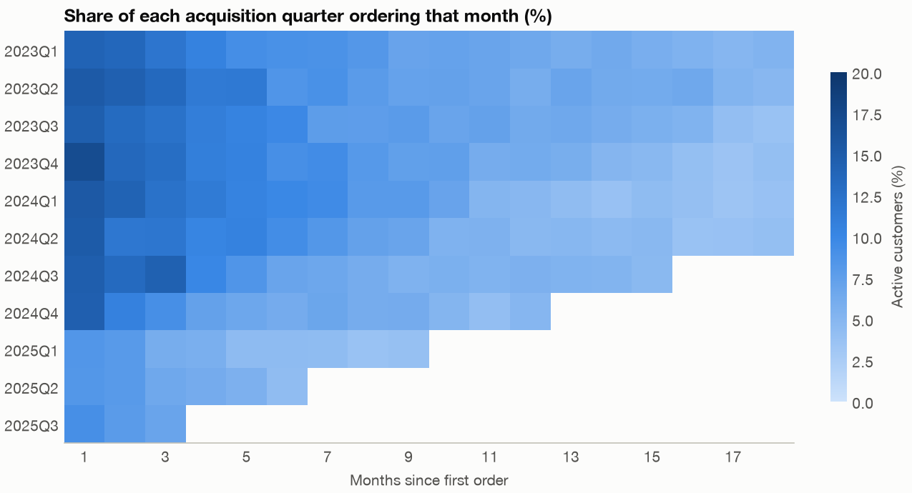
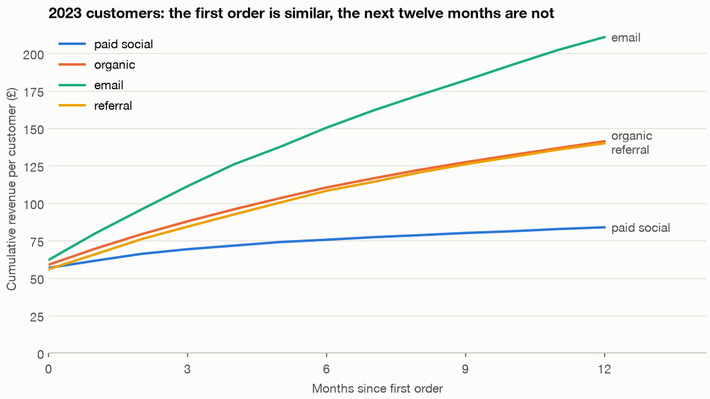
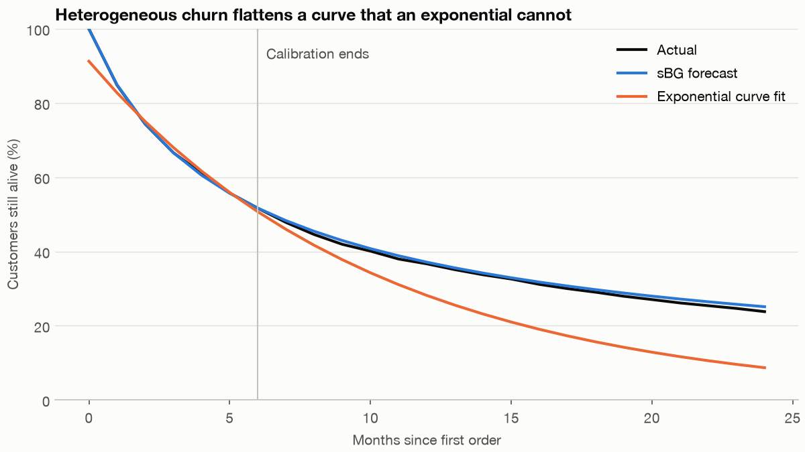

# Cohort and retention: did we lose customers, or buy worse ones?

Fernhill's chief marketing officer has the 2025 numbers. New customers are up, revenue is up, and paid social has scaled to 2.6 times its old size at a cost per customer she is happy with. The finance lead is less cheerful, because the percentage of customers who come back has dropped sharply. So what happened: did the January email cut damage the customers Fernhill already had, or has paid social just brought in customers who never planned to return? The two answers lead to opposite budget decisions, and a single retention percentage cannot tell them apart. Cohorts can.

---

## The question and the data

The business question is **did retention fall because something changed for all customers, or because the mix of new customers changed, and what should the 2026 acquisition budget be?** We use Fernhill's orders from `practice/retail.py`, a seeded, customer-level generator, and the plot of the [visualisation pillar](../../05-visualisation-and-storytelling/README.md): email budget cut in January 2025, paid social scaled up. The generator's totals are not calibrated to the charts there. Because the generator is ours, we know what it did. It removes about a third of repeat orders after the cut, for everyone, and paid social customers buy less and churn faster to begin with. So there *is* a right answer here, and the method can be checked against it.

The code blocks are the sections of `practice/ch03_cohort_retention.py` in order, each relying on those before it. Run them with `uv run ch03_cohort_retention.py` from the practice folder.

```python
import matplotlib.pyplot as plt
import numpy as np
import pandas as pd
from scipy.optimize import minimize
from scipy.special import betaln

import chartstyle as cs
from retail import CHANNELS, load_customers, load_orders

cs.apply()
```

```python
customers, orders = load_customers(), load_orders()
print(len(customers), "customers,", len(orders), "orders,", f"£{orders.value.sum():,.0f} revenue")
customers["cohort"] = customers.acquired.dt.to_period("M")
tagged = orders.merge(customers[["customer_id", "cohort", "channel"]], on="customer_id")
tagged["month"] = tagged.order_date.dt.to_period("M")
tagged["age"] = (tagged.month.dt.year - tagged.cohort.dt.year) * 12 + tagged.month.dt.month - tagged.cohort.dt.month
print(tagged[["customer_id", "cohort", "month", "age", "value"]].head(3).to_string(index=False))
```

```text
26342 customers, 63958 orders, £3,364,669 revenue
 customer_id  cohort   month  age  value
           1 2023-01 2023-01    0  89.47
           2 2023-01 2023-01    0  32.88
           3 2023-01 2023-01    0  80.94
```

A cohort is a group of customers who started in the same period, and **age** is the number of months since then. Each row of orders now knows both. Those two columns are all that a cohort analysis requires.

## The retention triangle

Why not just track one retention rate over time? A blended figure weighs together customers of every age. A young customer base has a high monthly rate because newly acquired customers buy again soon, so growth flatters the figure and slowdown hurts it, even if nobody's behaviour changes. Holding age fixed removes that.

```python
LAST = pd.Period("2025-12", "M")
sizes = customers.groupby("cohort").size()
active = tagged.groupby(["cohort", "age"]).customer_id.nunique().unstack("age")
retention = active.div(sizes, axis=0)
# Quarterly cohorts are easier to read: pool the monthly triangle by acquisition quarter.
customers["quarter"] = customers.acquired.dt.to_period("Q")
tagged = tagged.merge(customers[["customer_id", "quarter"]], on="customer_id")
quarter_sizes = customers.groupby("quarter").size()
q_active = tagged.groupby(["quarter", "age"]).customer_id.nunique().unstack("age")
q_ret = q_active.div(quarter_sizes, axis=0)
# An age is only complete for a quarter if its youngest customers have reached it.
for q in q_ret.index:
    q_ret.loc[q, q_ret.columns > (LAST - q.asfreq("M", "end")).n] = np.nan
print((q_ret[[1, 2, 3, 6, 12]] * 100).round(1).to_string())
```

```text
age        1     2     3    6    12
quarter
2023Q1   14.1  13.6  12.0  9.0  6.5
2023Q2   15.2  14.5  13.4  8.5  6.0
2023Q3   14.6  13.2  12.4  9.8  6.3
2023Q4   17.0  13.6  12.9  9.1  6.2
2024Q1   15.3  14.2  12.4  9.9  4.8
2024Q2   15.1  11.8  11.9  9.4  4.7
2024Q3   14.8  13.2  14.4  6.9  5.6
2024Q4   14.5  10.6   9.1  6.2  5.0
2025Q1    8.4   8.0   6.0  4.4  NaN
2025Q2    8.4   8.0   6.5  4.2  NaN
2025Q3    9.1   7.9   6.9  NaN  NaN
2025Q4    NaN   NaN   NaN  NaN  NaN
```

Those NaNs are honest, and they are important. The 2025Q3 cohort has not reached age 6 for all of its members, so that cell is not low: it does not exist yet. If you fill it with the partial figure or with zero, you will report a collapse every month. In this table, an age is reported only once the cohort's youngest member has reached it.



*Image Source: generated by `practice/ch03_cohort_retention.py`. Share of each acquisition quarter ordering in each month of age.*

Read the triangle in three directions, as each one answers a different question.

- **Across a row** you follow one cohort as it ages. Every row declines and then flattens.
- **Down a column** you compare cohorts at the same age. Age 1 runs at about 15% up to 2024Q4 and then drops to about 8.4%. This is where a cohort effect would show, a change in who arrived, although every 2025 cohort also arrived after the cut, so this column alone cannot separate the two.
- **Along a diagonal** you see one calendar month across all cohorts, of different ages. Age 12 drops at 2024Q1, age 6 at 2024Q3 and age 2 or 3 at 2024Q4, which is what you would see if something happened in early 2025 and hit every customer no matter when they joined. That is a period effect.

So the picture already suggests that both things happened. Be aware of the limit of the method, though: age, period and cohort are linked by the identity *age = period − cohort*, so no regression can separate all three without an extra assumption. Treat the triangle as evidence for a hypothesis you test with something outside it. Here we know the date of the budget cut, and that is what makes the diagonal interpretable.

## Separate rates from mix

The channel mix did change, and by a lot: paid social went from about a quarter of new customers to over half. To find out how much that matters, we want a measure that compares cohorts fairly. We use the 90-day repeat rate, the share of customers ordering again in the 90 days after their first order. To keep the comparison clean, we take 2024 customers only if their whole 90 days finished before the cut (acquired up to 2 October 2024), and 2025 customers only if they have had 90 days to come back (acquired up to 2 October 2025).

Then the decomposition from [chapter 5 of the visualisation pillar](../../05-visualisation-and-storytelling/notes/05-dashboards-and-storytelling.md): apply the new rates to the old mix, which isolates the rate change, and the remainder is the mix change.

```python
c25 = customers[customers.acquired >= "2025-01-01"].channel.value_counts(normalize=True)
c24 = customers[customers.acquired.dt.year == 2024].channel.value_counts(normalize=True)
print(pd.DataFrame({"2024": c24, "2025": c25}).loc[CHANNELS].round(3).to_string())

# Repeat within 90 days: comparable across cohorts, and needs only 90 days of history per customer.
firsts = customers.set_index("customer_id").acquired
gap = (orders.order_date - orders.customer_id.map(firsts)).dt.days
repeaters = orders[(gap > 0) & (gap <= 90)].customer_id.unique()
customers["repeat_90"] = customers.customer_id.isin(repeaters)
complete = customers[customers.acquired <= "2025-10-02"].copy()
complete["period"] = np.select([complete.acquired < "2024-10-03", complete.acquired < "2025-01-01"],
                               ["2024 (to Oct 2)", "exposed"], "2025")
compare = complete[complete.period != "exposed"]
by_channel = compare.groupby(["period", "channel"]).repeat_90.mean().unstack("period").loc[CHANNELS]
print((by_channel * 100).round(1).to_string())

base_period, new_period = "2024 (to Oct 2)", "2025"
mix = compare.groupby("period").channel.value_counts(normalize=True).unstack("period").loc[CHANNELS]
total_old = (by_channel[base_period] * mix[base_period]).sum()
total_new = (by_channel[new_period] * mix[new_period]).sum()
new_rates_old_mix = (by_channel[new_period] * mix[base_period]).sum()
print(f"90-day repeat: {total_old:.1%} -> {total_new:.1%}, change {100 * (total_new - total_old):+.1f} points")
print(f"  everyone got worse (rates change, 2024 mix): {100 * (new_rates_old_mix - total_old):+.1f} points")
print(f"  mix moved to paid social (mix change, 2025 rates): {100 * (total_new - new_rates_old_mix):+.1f} points")
```

```text
              2024   2025
channel
paid_social  0.275  0.538
organic      0.390  0.306
email        0.185  0.047
referral     0.150  0.109
period       2024 (to Oct 2)  2025
channel
paid_social             18.5  13.6
organic                 33.3  27.3
email                   45.1  38.6
referral                33.6  24.8
90-day repeat: 31.6% -> 20.2%, change -11.4 points
  everyone got worse (rates change, 2024 mix): -6.2 points
  mix moved to paid social (mix change, 2025 rates): -5.2 points
```

Both answers are right, in almost equal parts. Every channel got worse, by 5 to 9 points, and that accounts for 6.2 of the 11.4-point fall. The move toward paid social, which starts from a much lower repeat rate, accounts for the other 5.2. The finance lead and the marketing lead were each describing half of it. Decompositions like this are not unique. Reverse the order, using old rates and the new mix for the mix effect, and it comes out at −5.6 for mix and −5.8 for rates. Report the split as "about half and half" and not to the decimal.

## What is a customer worth by channel?

Repeat rate says who comes back. The budget depends on what they are worth. Take the 2023 customers, for whom we can see a full 24 months, and accumulate revenue by age.

```python
def cumulative_rev(frame, members, horizon=12):
    """Mean cumulative revenue per customer by age."""
    by_age = frame[frame.customer_id.isin(members) & (frame.age <= horizon)].groupby("age").value.sum()
    return by_age.reindex(range(horizon + 1), fill_value=0).cumsum() / len(members)


pre = customers[(customers.acquired >= "2023-01-01") & (customers.acquired < "2024-01-01")]
fig, ax = plt.subplots()
ltv = {}
for channel in CHANNELS:
    members = pre[pre.channel == channel].customer_id
    curve = cumulative_rev(tagged, members)
    ltv[channel] = curve
    ax.plot(curve.index, curve, color=cs.CHANNEL_COLOUR[channel], label=channel.replace("_", " "))
    nudge = {"organic": 4, "referral": -4}.get(channel, 0)    # these two nearly coincide
    ax.text(12.15, curve[12] + nudge, channel.replace("_", " "), color=cs.SECONDARY, va="center")
ax.set_xlim(0, 14.2)
ax.set_ylim(0)
ax.set_xticks(range(0, 13, 3))
ax.set_xlabel("Months since first order")
ax.set_ylabel("Cumulative revenue per customer (£)")
ax.set_title("2023 customers: the first order is similar, the next twelve months are not")
ax.legend(loc="upper left")
cs.save(fig, "applied-cohort-ltv-channel.png")
```



*Image Source: generated by `practice/ch03_cohort_retention.py`. Customers acquired in 2023.*

All four channels start from about the same first order, between about £56 and £62. Judged on first-order value, or on a 30-day return on ad spend, paid social looks as good as the others. The lines separate later, and that is why a decision taken at day 30 can be badly wrong at month 24.

To compare with acquisition cost, turn revenue into margin. Fernhill's data does not record what each channel paid for a customer, so we assume figures and mark them. **The 35% margin and the acquisition costs below are assumptions**, set by hand to make the arithmetic concrete.

```python
MARGIN = .35
CAC = {"paid_social": 32, "organic": 6, "email": 9, "referral": 14}    # assumed, in pounds
rows = []
for channel in CHANNELS:
    members = pre[pre.channel == channel].customer_id
    m24 = cumulative_rev(tagged, members, 24)[24] * MARGIN
    rows.append({"channel": channel, "customers": len(members), "margin_12m": ltv[channel][12] * MARGIN,
                 "margin_24m": m24, "cac": CAC[channel], "ltv_24m_to_cac": m24 / CAC[channel]})
print(pd.DataFrame(rows).round(2).to_string(index=False))
```

```text
    channel  customers  margin_12m  margin_24m  cac  ltv_24m_to_cac
paid_social       2100       29.38       32.68   32            1.02
    organic       3155       49.48       62.68    6           10.45
      email       1434       73.82       98.52    9           10.95
   referral       1251       49.00       61.48   14            4.39
```

At these assumed costs, a paid social customer earns back their acquisition cost almost exactly, after two full years, and before overheads. An organic or email customer repays it around ten times over. Note that these customers were acquired in 2023 and cross the budget cut during their second year, so their 24-month figures are, if anything, a little low. Paid social customers of 2025 will not do better, because they lost the reminder emails as well. [States and sequences](08-states-and-sequences.md#markov-clv-and-what-the-pooled-chain-gets-wrong) values a customer another way, from the states they pass through.

## Project the curve, because you cannot wait 24 months

The cohorts you most want to judge are the youngest. How do you estimate a two-year curve from a few months of data? The common approach is to fit some curve, such as an exponential or a polynomial, to the early points and extrapolate. Fader and Hardie showed why this fails ([Fader and Hardie, Journal of Interactive Marketing, 2007](https://doi.org/10.1002/dir.20074); [PDF](https://faculty.wharton.upenn.edu/wp-content/uploads/2012/04/Fader_hardie_jim_07.pdf)). On their High End subscription data, calibrated on seven years, linear and exponential curves fall short of the year 12 survival rate by 81% and 30%, and a quadratic overshoots by 92%. Those curves describe the shape and give no reason for it, and their fit tells you nothing about how they will extrapolate.

They propose a small model with a reason behind it, the shifted-beta-geometric (sBG):

- Each customer has a constant probability θ of leaving in each period, so their lifetime is geometric.
- θ differs across customers, following a beta distribution with parameters α and β.

Averaging over customers gives a survival curve with a closed form:

```text
S(t)  = B(α, β + t) / B(α, β)
r(t)  = (β + t − 1) / (α + β + t − 1)     retention rate from period t−1 to t
```

The formula for r(t) makes the key point. Although each individual's chance of staying is constant, the **aggregate retention rate rises with t**. Nobody grows more loyal. The likely leavers leave first, and those remaining are the sort who stay. Fader and Hardie call this, following Vaupel and Yashin, the ruse of heterogeneity. It also warns against the opposite mistake: an improving retention rate in an old cohort is not evidence that your product is getting better.

We first check our code against theirs, because we can. Their paper gives the data for both segments, so a correct implementation has to reproduce their fit.

```python
def sbg_survival(a, b, t):
    """Shifted-beta-geometric survivor function S(t) = B(a, b + t) / B(a, b)."""
    t = np.asarray(t, dtype=float)
    return np.exp(betaln(a, b + t) - betaln(a, b))


def sbg_fit(survival):
    """Maximum likelihood from an aggregate survival curve S(0)=1, S(1), ..., S(n)."""
    survival = np.asarray(survival, dtype=float)
    n = len(survival) - 1
    died = -np.diff(survival)

    def negative_ll(log_params):
        a, b = np.exp(log_params)
        s = sbg_survival(a, b, np.arange(n + 1))
        return -(died * np.log(-np.diff(s))).sum() - survival[n] * np.log(s[n])

    res = minimize(negative_ll, [0, 0], method="Nelder-Mead", options=dict(xatol=1e-5, fatol=1e-8))
    return np.exp(res.x)


# Table 1 of Fader and Hardie (2007): % surviving, years 0 to 12.
high_end = np.array([100, 86.9, 74.3, 65.3, 59.3, 55.1, 51.7, 49.1, 46.8, 44.5, 42.7, 40.9, 39.4]) / 100
regular = np.array([100, 63.1, 46.8, 38.2, 32.6, 28.9, 26.2, 24.1, 22.3, 20.7, 19.4, 18.3, 17.3]) / 100
for name, curve in {"High End": high_end, "Regular": regular}.items():
    a, b = sbg_fit(curve[:8])
    s12 = sbg_survival(a, b, 12)
    print(f"{name:9s} alpha {a:.3f}  beta {b:.3f}  year 12 forecast {s12:.1%}  actual {curve[12]:.1%}  error {s12 / curve[12] - 1:+.1%}")

# The PDF prints alpha = 0.688 for High End; compare the two values at the printed beta.
def sbg_ll(a, b, survival):
    s = sbg_survival(a, b, np.arange(len(survival)))
    return (-np.diff(survival) * np.log(-np.diff(s))).sum() + survival[-1] * np.log(s[-1])


print(f"High End log likelihood per customer: {sbg_ll(.668, 3.806, high_end[:8]):.5f} at 0.668, {sbg_ll(.688, 3.806, high_end[:8]):.5f} at 0.688")
```

```text
High End  alpha 0.668  beta 3.806  year 12 forecast 37.8%  actual 39.4%  error -4.1%
Regular   alpha 0.704  beta 1.182  year 12 forecast 17.0%  actual 17.3%  error -1.7%
High End log likelihood per customer: -1.61116 at 0.668, -1.61135 at 0.688
```

The Regular segment reproduces exactly (α 0.704, β 1.182). For High End the paper prints α = 0.688, while we get 0.668, and the last line shows that 0.668 fits the printed data better at the printed β, so the printed value looks like a typo. There is a second, smaller mismatch. The paper describes its year-12 forecasts as overestimates of about 4% and 2%, whereas our replication gives errors of the same size *below* the actuals. We cannot resolve that from the paper alone, so report what you can reproduce: about 4% and 2% away from the truth, five years beyond the calibration data, using two parameters. That is the evidence that the model works, on real subscribers.

Now to Fernhill. Here we need a caveat. Fernhill is **non-contractual**: customers never tell us they have left, so we cannot see the lifetimes the sBG needs. Only a generator can reveal those, in the column `true_lifetime_months`, which a real retailer never has. We also built the generator's churn from a beta distribution, so the sBG is correct by construction here. Treat the next block as a picture of the mechanism, and the replication above as the evidence.

```python
# The generator's true lifetimes stand in for what a subscription firm would see. Fernhill cannot.
early = customers[customers.acquired < "2023-07-01"]
months = np.arange(25)
empirical = np.array([(early.true_lifetime_months > t).mean() for t in months])
calibrate = 7
a, b = sbg_fit(empirical[:calibrate])
forecast = sbg_survival(a, b, months)
slope, intercept = np.polyfit(months[1:calibrate], np.log(empirical[1:calibrate]), 1)
exponential = np.exp(intercept + slope * months)
print(f"{len(early)} customers, calibrated on months 0 to {calibrate - 1}; alpha {a:.3f}, beta {b:.3f}")
for t in (6, 12, 18, 24):
    print(f"month {t:2d}  actual {empirical[t]:.3f}  sBG {forecast[t]:.3f}  exponential {exponential[t]:.3f}")
r = (b + months[1:13] - 1) / (a + b + months[1:13] - 1)
print("model retention rate at month 1, 6, 12:", r[[0, 5, 11]].round(3))
```

```text
3936 customers, calibrated on months 0 to 6; alpha 0.689, beta 3.883
month  6  actual 0.517  sBG 0.517  exponential 0.507
month 12  actual 0.367  sBG 0.371  exponential 0.282
month 18  actual 0.290  sBG 0.297  exponential 0.157
month 24  actual 0.238  sBG 0.251  exponential 0.087
model retention rate at month 1, 6, 12: [0.849 0.928 0.956]
```



*Image Source: generated by `practice/ch03_cohort_retention.py`. Calibrated on months 0 to 6 with the generator's true lifetimes.*

Both curves fit the seven calibration points about equally well, and the fit does not tell you which will extrapolate. At month 24 the exponential says 9% and the truth is 24%. If you value a cohort by the exponential, you will underprice its future by almost two-thirds. For a real retailer, the matching tool for non-contractual data is the family of the Pareto/NBD and the BG/NBD model, which infers whether a customer is still alive from their purchase history ([Fader, Hardie and Lee, Marketing Science, 2005](https://brucehardie.com/papers/018/)). We come back to this in [Segmentation and RFM](05-segmentation-and-rfm.md). [Marketing measurement](09-marketing-measurement.md#what-a-customer-is-worth-bgnbd) fits the BG/NBD, and [survival and event history](07-survival-and-event-history.md#the-link-to-the-sbg-curve-of-chapter-3) shows how the sBG curve sits among survival models.

## Recommendation

**Bring back the email reminders for the existing base, with a holdout to measure them, and cap paid social at about its old volume until its true acquisition cost is confirmed.** About half of the fall in repeat buying is every channel getting worse after the cut, and only retention work can reach that part. The other half is the move to paid social, whose customers on assumed costs return only about 1.0 times their acquisition cost in margin over 24 months.

What would change this? The acquisition costs are assumptions, so if paid social really costs £15 per customer, its ratio is about 2.2 and the case for scaling back is much weaker. Get the real number first. The drop in rates coincides with the budget cut, and a before-and-after cannot prove one caused the other, which is why the reinstatement needs a holdout, not just a date. We already covered how to size that test in the [A/B testing note](../../03-experimentation-and-causality/notes/01-ab-testing.md).

## Pitfalls

- **Comparing incomplete cohorts.** The most recent cohorts look terrible, or wonderful, if you don't require them to have reached the age. Mask the triangle.
- **A blended retention rate.** It moves with the age mix of the base even if no customer changes. Hold age fixed.
- **Reading a period effect as a cohort effect.** A shock in January hits all cohorts at different ages. Look along the diagonal.
- **Trying to regress out age, period and cohort.** They are linked by an identity, so a regression needs an assumption you have to state.
- **Mistaking mix for behaviour, and the reverse.** Decompose, and report the sensitivity to the order.
- **Judging a channel on first-order value or 30-day return.** The lines only separate later.
- **Fitting a curve because it fits.** A good fit in the calibration window says little about extrapolation. Compare against held-back periods.
- **Reading a rising retention rate as growing loyalty.** It is usually the less loyal customers having left already.
- **Treating a lapsed customer as lost.** In non-contractual settings you cannot observe churn, only silence.
- **Quoting LTV with invisible assumptions.** Margin and acquisition cost decide the answer, so state them and show the sensitivity.

## Try it

Exercises use `practice/ch03_cohort_retention.py`.

1. Reverse the decomposition: compute the mix effect at old rates first, and rates at the new mix. Does your conclusion change?

   <details><summary>Answer</summary>

   Using `by_channel` and `mix`, the mix effect is `((by_channel[base_period] * mix[new_period]).sum() - total_old)`, or −5.6 points, and the rate effect is the rest, −5.8 points. The order moves a few tenths from one side to the other, and the conclusion, about half and half, does not change. The interaction between mix and rates is what moves.
   </details>

2. What acquisition cost would give paid social a 24-month ratio of 3, and does that seem achievable?

   <details><summary>Answer</summary>

   Its 24-month margin is £32.68, so £32.68 / 3 = £10.89 per customer, about a third of the assumed £32. A ratio of 3 is a common planning rule rather than a law, so choose your own hurdle. If nothing close to that price exists, the channel has to be judged on some other value, or kept small.
   </details>

3. Calibrate the sBG on months 0 to 3 instead of 0 to 6, by setting `calibrate = 4`. How much does the month-24 forecast suffer, compared with the exponential?

   <details><summary>Answer</summary>

   The sBG gives 25.8% against an actual 23.8%, only a little worse than the 25.1% it gives with seven points. The exponential falls from 8.7% to 5.3%. A model with a mechanism degrades gently as you cut the data, though remember that the generator's churn is beta by construction, which flatters the sBG here.
   </details>

## Interview checklist

| Question | Answer |
|---|---|
| What is a cohort? | A group of customers who started in the same period, followed as they age. |
| What do the rows, columns and diagonals of a triangle show? | Rows show a cohort ageing, columns show cohorts compared at one age, and diagonals show one calendar period across all cohorts. |
| Why not separate age, period and cohort by regression? | Age = period − cohort, so the three are perfectly collinear. You need an extra assumption or an outside fact. |
| How do you handle right-censored cohorts? | Report an age only once every member of the cohort has reached it, and mask the rest. |
| How do you split a change into rate and mix? | Apply new rates to old mix to get the rate effect, and the remainder is mix. Report sensitivity to the order. |
| What is the shifted-beta-geometric? | Individual geometric lifetimes with beta-distributed churn across customers. Survival is S(t) = B(α, β + t) / B(α, β). |
| Why does a cohort's retention rate rise with age? | The likely leavers go first. It is a change in who remains, not in any individual's behaviour. |
| When does the sBG not apply? | When churn is unobserved, as in non-contractual retail. Use Pareto/NBD or [BG/NBD](09-marketing-measurement.md#what-a-customer-is-worth-bgnbd), or a repeat window as a proxy. |
| Why not fit an exponential to retention? | It assumes the same churn for everyone, so it falls away too fast and under-values a cohort's future. |
| What is an LTV to CAC ratio? | Margin per customer over some horizon, divided by acquisition cost. State the horizon and the margin, and don't quote a ratio without them. |

## Next

Cohorts tell you that customers came back less. The next analysis follows customers through a single visit, where a flat headline hides a broken page: [Funnel and conversion](04-funnel-and-conversion.md).
