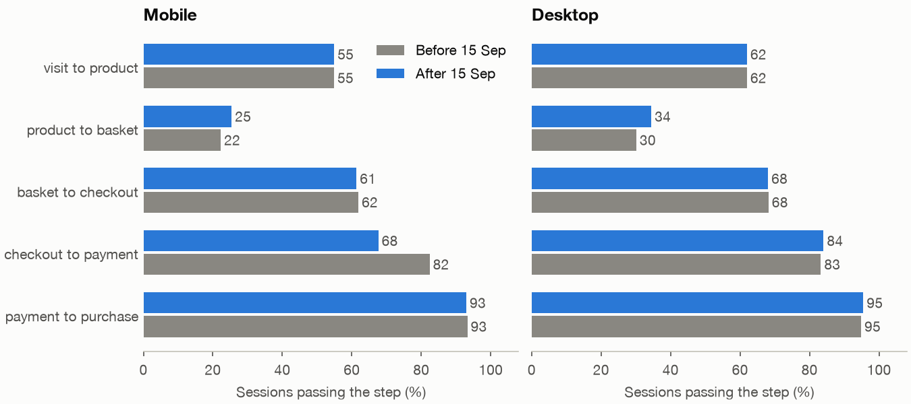
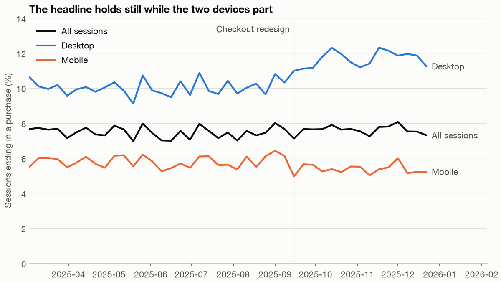

# Funnel and conversion: why a flat headline can hide a broken page

Fernhill shipped a new mobile checkout page on 15 September 2025. Three months later the product manager reports good news: conversion went from 7.48% to 7.60%, so the redesign did no harm and the team should move on. The support lead isn't convinced, because mobile customers keep writing in to say that they gave up at checkout. Both can be right. A single conversion figure averages over devices and over steps, and each of those averages can hide a large loss behind an unrelated gain. This chapter takes the figure apart, finds the loss, puts a price on it, and decides what to do on a Monday morning.

---

## The question and the data

The business question is **did the mobile checkout redesign hurt, and should we roll it back?** We use Fernhill's session log from `practice/retail.py`, a seeded generator of 496,153 sessions by 247,369 users from March to December 2025. Each session has a device, a channel and the furthest step it reached out of six: visit, product, basket, checkout, payment, purchase. The generator is ours, so we know what it does: from 15 September the mobile checkout-to-payment rate drops from 82% to 68%, and separately, from September onward, autumn demand lifts the visit-to-basket stage on every device. A good analysis should find the first and not be fooled by the second.

The code blocks are the sections of `practice/ch04_funnel.py` in order, each relying on those before it. The two chart sections stay in the script. Run it with `uv run ch04_funnel.py` from the practice folder.

```python
import matplotlib.pyplot as plt
import numpy as np
import pandas as pd
from scipy.stats import norm

import chartstyle as cs
from retail import REDESIGN, STEPS, load_orders, load_sessions

cs.apply()
```

```python
sessions = load_sessions()
sessions["period"] = np.where(sessions.date >= REDESIGN, "after", "before")
sessions["purchased"] = sessions.furthest == 5
print(len(sessions), "sessions,", sessions.user_id.nunique(), "users")
print(sessions.head(3).to_string(index=False))
print((sessions.groupby("period").purchased.mean().loc[["before", "after"]] * 100).round(2).to_string())
```

```text
496153 sessions, 247369 users
 session_id  user_id       date  device     channel  furthest period  purchased
          1   130666 2025-03-01  mobile     organic         4 before      False
          2   222084 2025-03-01 desktop paid_social         5 before       True
          3   307094 2025-03-01  mobile       email         2 before      False
period
before    7.48
after     7.60
```

There's the product manager's number. It is correct, and it is the wrong number to stop at.

## Conditional rates, step by step

Why not read the funnel as the share of all sessions reaching each step? Because those shares multiply together, so a problem early in the funnel shows up in every later figure and you can't tell where it began. The **conditional rate**, the share of sessions at one step that reach the next, isolates each step's own performance. It is the number a page's owner can actually change.


Overall conversion is the product of the five arrows. Split them by device, because the two devices are different pages with different habits, and compare before with after.

```python
def funnel(frame):
    """Sessions reaching each step, and the conditional rate from the step before."""
    reached = [(frame.furthest >= i).sum() for i in range(len(STEPS))]
    rate = [np.nan] + [reached[i] / reached[i - 1] for i in range(1, len(STEPS))]
    return pd.DataFrame({"reached": reached, "rate": rate}, index=STEPS)


rates = pd.DataFrame({(device, period): funnel(sessions[(sessions.device == device) & (sessions.period == period)]).rate
                      for device in ("mobile", "desktop") for period in ("before", "after")})
print((rates.iloc[1:] * 100).round(1).to_string())
```

```text
         mobile       desktop
         before after  before after
product    54.9  54.9    62.0  62.0
basket     22.3  25.4    30.1  34.4
checkout   61.9  61.3    68.2  68.0
payment    82.4  67.6    83.2  84.0
purchase   93.3  93.0    94.8  95.5
```



*Image Source: generated by `practice/ch04_funnel.py`. Share of sessions at each step that reach the next, before and after the redesign.*

Scan the columns for the row that behaves differently. Four rows on mobile move in step with desktop: product, checkout and purchase stay flat, and basket lifts on both. The checkout-to-payment row is the exception, falling 14.8 points on mobile while rising 0.8 on desktop. It is also the step the redesign touched.

The basket row explains the flat headline's other half. Product-to-basket rose on both devices, from 22.3 to 25.4 on mobile and from 30.1 to 34.4 on desktop. No page changed there, and a rise on both devices at once looks like a change in the customers. In this case we know that it is, because the generator raises autumn intent. So the good news at the top of the funnel has nothing to do with the redesign, and it is covering up the bad news lower down.

## Why the headline held still

Now the same split for conversion from start to finish, together with the device mix.

```python
share = sessions.groupby(["period", "device"]).size().unstack("device")
share = share.div(share.sum(axis=1), axis=0).loc[["before", "after"]]
conversion = sessions.groupby(["period", "device"]).purchased.mean().unstack("device").loc[["before", "after"]]
print("mobile share of sessions", (share["mobile"] * 100).round(1).to_dict())
print((conversion * 100).round(2).to_string())
```

```text
mobile share of sessions {'before': 60.5, 'after': 64.5}
device  desktop  mobile
period
before    10.03    5.80
after     11.65    5.37
```



*Image Source: generated by `practice/ch04_funnel.py`. Weekly share of sessions ending in a purchase.*

Three things moved at once, and you can put a number on each. Hold the device mix at its old value and let the rates change: 0.605 × (5.37 − 5.80) + 0.395 × (11.65 − 10.03) = +0.38 points, which is desktop's seasonal gain outweighing mobile's fall. Then let the mix move: (0.645 − 0.605) × (5.37 − 11.65) = −0.25 points, as more sessions come from the device that converts worse. The sum, about +0.12 up to rounding, is the whole of the headline's movement.

This is a close relative of [Simpson's paradox](../../03-experimentation-and-causality/notes/04-correlation-and-causation.md), the reversal made famous by [Bickel, Hammel and O'Connell's study of Berkeley admissions](https://doi.org/10.1126/science.187.4175.398) (Science, 1975), where the aggregate pointed one way and most departments did not. Ours is milder. Strictly, the paradox needs every group to move against the total, and here desktop moved with it. The lesson carries over regardless: an aggregate rate is a weighted average, and its weights are changing as well. Whenever you report a rate, ask what the mix did.

## Is the drop real, and is it the redesign?

Two questions remain, and they need different tools. The first is whether a 14.8-point drop could be noise. The second is whether the redesign caused it, since before-and-after comparisons are not experiments. Anything else that changed in September would also show up.

The comparison available to us is desktop. It lived through the same weeks, the same season and the same marketing, but not the new page. Subtracting desktop's change from mobile's gives a **difference in differences**, and it removes whatever hit both devices alike. The [causal inference note](../../03-experimentation-and-causality/notes/04-correlation-and-causation.md) covers the assumption this rests on: that without the redesign, mobile's step would have moved in parallel with desktop's.

```python
def payment_counts(device, period):
    at = sessions[(sessions.device == device) & (sessions.period == period) & (sessions.furthest >= 3)]
    return (at.furthest >= 4).sum(), len(at)


def difference(a, b):
    """Difference in proportions (a minus b) with its standard error, from (passed, n) pairs."""
    pa, pb = a[0] / a[1], b[0] / b[1]
    return pa - pb, np.sqrt(pa * (1 - pa) / a[1] + pb * (1 - pb) / b[1])


z = norm.ppf(.975)
mobile = difference(payment_counts("mobile", "after"), payment_counts("mobile", "before"))
desktop = difference(payment_counts("desktop", "after"), payment_counts("desktop", "before"))
did, did_se = mobile[0] - desktop[0], np.hypot(mobile[1], desktop[1])
print(f"mobile checkout-to-payment   {mobile[0] * 100:+.1f} points, 95% CI {100 * (mobile[0] - z * mobile[1]):+.1f} to {100 * (mobile[0] + z * mobile[1]):+.1f}")
print(f"desktop checkout-to-payment {desktop[0] * 100:+.1f} points, 95% CI {100 * (desktop[0] - z * desktop[1]):+.1f} to {100 * (desktop[0] + z * desktop[1]):+.1f}")
print(f"difference in differences    {did * 100:+.1f} points, 95% CI {100 * (did - z * did_se):+.1f} to {100 * (did + z * did_se):+.1f}")
print("n at step, mobile after:", payment_counts("mobile", "after")[1])
```

```text
mobile checkout-to-payment   -14.8 points, 95% CI -15.9 to -13.7
desktop checkout-to-payment +0.8 points, 95% CI -0.2 to +1.7
difference in differences    -15.5 points, 95% CI -17.0 to -14.1
n at step, mobile after: 10503
```

Noise is out, as the interval is far from zero. Parallel trends is an assumption we can't test directly, but this case gives it unusual support. Desktop's step barely moved, and the drop appears within weeks of the release, at the exact step the release changed. [Exercise 2](#try-it) adds that it appears in every channel.

One more alternative needs ruling out before anyone acts. A new page may simply fire its tracking event differently, in which case the funnel would show a drop that customers never experienced. A tracking bug at this step would, though, leave real purchases untouched. Here mobile's conversion to *purchase* fell from 5.80% to 5.37% even though the steps above it improved, and a purchase is recorded when money moves, not when a page tag fires. In a real investigation, reconcile against the payment provider's count too.

## Sessions or users?

Someone in the meeting will ask for the per-user figure, since one person can visit several times. It's a fair request, and in practice there is a trap in it.

```python
pre = sessions[sessions.period == "before"]
post = sessions[sessions.period == "after"]
for label, frame in {"before": pre, "after": post}.items():
    print(f"{label:6s} per session {frame.purchased.mean():.2%}, per user {frame.groupby('user_id').purchased.max().mean():.2%}, "
          f"sessions per user {len(frame) / frame.user_id.nunique():.2f}, days {frame.date.nunique()}")
```

```text
before per session 7.48%, per user 11.34%, sessions per user 1.57, days 198
after  per session 7.60%, per user 9.94%, sessions per user 1.34, days 108
```

Per-user conversion appears to fall from 11.34% to 9.94%, while per-session rises. Before you tell the room, notice the last column: the two periods run for 198 and 108 days. A longer window gives each user more chances to come back and buy, so it inflates the per-user rate, and sessions per user rises with it. Any metric with the user as the unit depends on the length of the window, so compare equal windows ([Exercise 1](#try-it) does). The same point arises when you read a tool's default "users" report, and it is one reason we compare steps on sessions here, where the unit doesn't grow with the window.

The session choice has its own cost. Sessions from one user aren't independent, so our intervals are slightly too narrow. With an effect 13 times the interval's half-width, that doesn't change anything here. It would matter for a small effect, and there a [user-level analysis](../../03-experimentation-and-causality/notes/01-ab-testing.md) is the correct one.

## What it cost

A rate does not win an argument with a finance lead. To convert the effect into money, multiply the sessions that reached the step by the rate lost, then by the chance that a session past payment ends up buying.

```python
orders = load_orders()
aov = orders.value.mean()
MARGIN = .35
at_step = payment_counts("mobile", "after")[1]
purchase_after_pay = (post[post.device == "mobile"].furthest == 5).sum() / (post[post.device == "mobile"].furthest >= 4).sum()
lost_low, lost_mid, lost_high = [-x * at_step * purchase_after_pay for x in (did + z * did_se, did, did - z * did_se)]
print(f"average order £{aov:.2f}, purchase given payment passed {purchase_after_pay:.3f}")
for label, lost in {"low": lost_low, "mid": lost_mid, "high": lost_high}.items():
    print(f"{label:4s} lost orders {lost:6.0f}  revenue £{lost * aov:9,.0f}  margin £{lost * aov * MARGIN:8,.0f}")
per_week = lost_mid * aov * MARGIN / (post.date.nunique() / 7)
print(f"margin lost per week of delay £{per_week:,.0f}")
```

```text
average order £52.61, purchase given payment passed 0.930
low  lost orders   1378  revenue £   72,467  margin £  25,364
mid  lost orders   1518  revenue £   79,865  margin £  27,953
high lost orders   1659  revenue £   87,263  margin £  30,542
margin lost per week of delay £1,812
```

So the redesign cost about 1,500 orders in 108 days, around £80,000 of revenue, and about £28,000 of margin at an assumed 35%. Set against 190,528 sessions in the period, 1,518 orders is 0.8 points, so headline conversion would have been about 8.4% rather than 7.60%. Note what this estimate assumes: a lost session would have bought at the average order value, and the customer did not simply return on another device. The second assumption is untested and makes the figure an upper-end estimate. Report the range, the margin assumption and the caveat with the number.

## Can we afford to find out?

The size of the loss is known well enough to act, but a good team also wants to know whether the rollback recovers it, and whether a repaired page might do better. Rolling back to half of mobile traffic is itself an experiment. How long would it take? Start from how many sessions reach the step per day. That is the bottleneck, not total traffic.

```python
per_day = at_step / post.date.nunique()
for p0, delta in ((.68, .02), (.68, .05), (.68, .10)):
    p1 = p0 + delta
    n = (norm.ppf(.975) + norm.ppf(.8)) ** 2 * (p0 * (1 - p0) + p1 * (1 - p1)) / delta ** 2
    print(f"to detect +{delta:.0%} on a {p0:.0%} step at 80% power: {n:,.0f} per arm, {2 * n / per_day:.0f} days at 50/50 ({per_day:.0f} sessions a day reach the step)")
```

```text
to detect +2% on a 68% step at 80% power: 8,390 per arm, 173 days at 50/50 (97 sessions a day reach the step)
to detect +5% on a 68% step at 80% power: 1,302 per arm, 27 days at 50/50 (97 sessions a day reach the step)
to detect +10% on a 68% step at 80% power: 305 per arm, 6 days at 50/50 (97 sessions a day reach the step)
```

These are the same sample-size arithmetic as the [A/B testing note](../../03-experimentation-and-causality/notes/01-ab-testing.md), and they sit close to the rule of thumb of 16σ²/δ² per arm in [Kohavi and colleagues' survey](https://doi.org/10.1007/s10618-008-0114-1) (Data Mining and Knowledge Discovery, 2009). At only 97 sessions per day, Fernhill cannot detect a 2-point change in any useful time, since that takes 173 days. It can detect a 10-point recovery in about 6 days. The practical conclusion is a good one to memorise: the effect you can afford to test depends on traffic *at the step*, so low-funnel pages only permit tests of large changes.

## Recommendation

**Roll the mobile checkout page back, in a two-week 50/50 test, then send everyone to the winner, and do not ship a replacement until a test of it can show at least a 5-point gain against the old page.**

- **Why not simply wait?** Each further week costs about £1,800 of margin, and the evidence that the page is at fault is already strong.
- **Why test the rollback at all?** A test costs about half that weekly figure while it runs, and it would catch a large recovery within days. It also guards against a second cause we haven't seen, since a rollback that doesn't recover the step would mean we had the wrong explanation.
- **What this analysis does not establish.** It can't say why customers abandon the new page: a form field, a payment method missing on a phone, a slow load. That takes session recordings, error logs and five customers on a call. Also, the design of a replacement should be judged on the checkout-to-payment step rather than on headline conversion, which we now know would hide it.
- **Limits.** The estimate uses a before-and-after comparison with desktop as the control, not a randomised test, and assumes no cross-device recovery. The figures are synthetic. The method transfers, the numbers do not.

## Pitfalls

- **Reading only end-to-end conversion.** It nets out gains and losses across steps and devices. Always split a change into conditional steps and then into the major segments.
- **Calling a before-and-after an experiment.** Season, marketing and mix all change with the calendar. Find an unaffected comparison group, or randomise.
- **Comparing unequal windows.** Per-user rates rise with the length of the window. Use equal windows, ideally the same weekdays and season.
- **Conditioning on a step the change affects.** A new landing page can bring in people who would never have reached checkout, so a lower checkout rate may be a change in who arrives there. Check the step counts as well as the rates.
- **Trusting one event source.** Page tags change with the page. Reconcile the last step with the payment system.
- **Assuming a strict funnel.** Real sessions skip and repeat steps, and a "furthest step" hides that. Decide the ordering rule first, and write it down.
- **Ignoring the step's own traffic.** Test duration depends on sessions at the step, and low-funnel tests cannot find small effects.
- **Treating lost sessions as lost customers.** Some come back on another device. Count purchases per user across devices, if identity allows it, before quoting a loss as firm.

## Try it

Exercises use `practice/ch04_funnel.py`, after the `load` section.

1. Compare per-session and per-user conversion over equal windows, the 108 days either side of the redesign. Does per-user conversion still fall?

   <details><summary>Answer</summary>

   No. From 30 May to 14 September, per-session is 7.44% and per-user 9.43%, with 1.29 sessions per user. After the redesign the figures are 7.60%, 9.94% and 1.34. The apparent fall from 11.34% came from the longer earlier window. With the windows matched, per-user conversion moves in the same direction as per-session, as the seasonal lift would lead you to expect.
   </details>

2. Split the mobile checkout-to-payment rate by channel, before and after. If paid social were to blame, what would you expect to see, and what do you see?

   <details><summary>Answer</summary>

   A mix story would show a drop mainly in paid social, the channel that grew. Instead, every channel falls by a similar amount: email 82.4 to 69.2, organic 82.9 to 66.5, paid social 81.8 to 67.5, referral 82.8 to 69.2. Differences this small across all channels point at the page, not the traffic.
   </details>

3. Compute the mobile checkout-to-payment rate after the redesign in 28-day blocks. Is this a teething problem that will go away by itself?

   <details><summary>Answer</summary>

   The blocks give 66.9%, 67.2%, 68.8% and 67.3%. The drop arrives in the first block and doesn't recover, so there is no sign of customers learning the new page, and no reason to expect waiting to help. This is also why a slow trend, such as a change in customers, is a poor explanation.
   </details>

## Interview checklist

| Question | Answer |
|---|---|
| Why use conditional step rates? | They isolate each step, so a problem early in the funnel doesn't leak into every later figure. |
| How can conversion stay flat while a page gets worse? | A gain elsewhere, seasonal or on another device, and a change in mix can offset the loss exactly. |
| What is Simpson's paradox? | An aggregate trend that reverses within every subgroup, because the group weights differ or shift. |
| How do you split a change in an aggregate rate? | Hold the mix fixed for the rate effect and apply the mix change to the new rates. The two sum to the total. |
| What does a difference in differences remove? | Anything that hit treatment and comparison groups equally over the period, under the parallel-trends assumption. |
| Why is a before-and-after not an experiment? | Everything else that changed over the same period is mixed in with the change you care about. |
| Should a funnel be per session or per user? | Depends on the decision. Steps within a visit suit sessions. Per-user rates grow with the window and fit a decision about people. |
| Why are session-level intervals too narrow? | Sessions from the same user are correlated, so the effective sample is smaller. Analyse by user for small effects. |
| How do you rule out a tracking bug? | Reconcile with a source that doesn't depend on the changed page, such as payment records. |
| What limits a checkout test's duration? | Sessions per day at that step. Sample size grows with the inverse square of the effect. |

## Next

The funnel found a fault that affected everyone on one device. The next analysis asks a different question: which customers are worth a message at all, and whether scores predict who responds or merely who would buy anyway: [Segmentation and RFM](05-segmentation-and-rfm.md).
