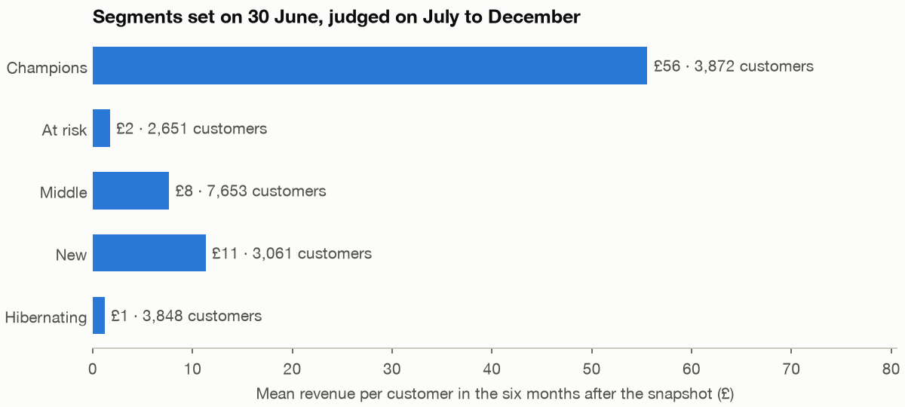
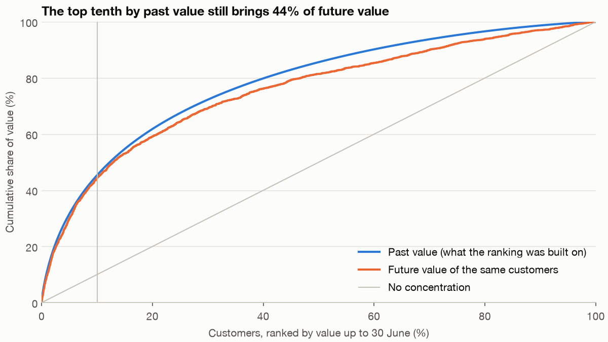
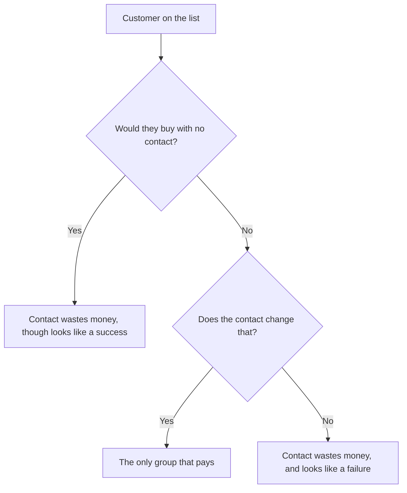
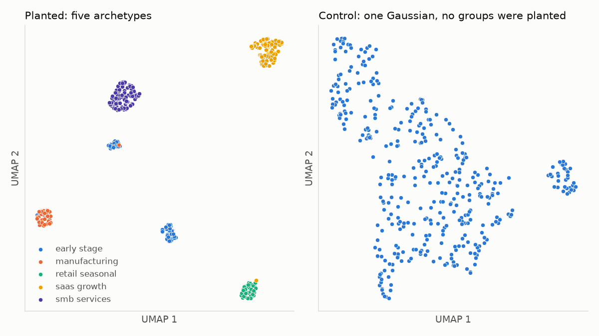

# Segmentation and RFM: who to contact, and who would have bought anyway

Fernhill's customer relationship manager has a budget of about £4,000 for one printed win-back catalogue. The usual plan is ready: score every customer on recency, frequency and monetary value, find the "At risk" segment of former big spenders who have gone quiet, and send them all the catalogue. The plan feels right because these people have clearly been valuable. It also has two untested assumptions, that these customers can still be won back and that the customers who respond wouldn't have bought anyway. This chapter builds the segments and then, the step that is so often skipped, checks them against what those customers did next. The check overturns the plan.

---

## The question and the data

The business question is **which customers should the campaign target, and how will we know it worked?** We use Fernhill's orders from `practice/retail.py`, the seeded generator introduced in the [cohort chapter](03-cohort-and-retention.md).

A segmentation is a prediction in disguise: it says these people will act differently. So test it the way you would test any model, by building it on one period and scoring it on a later one. We take a snapshot on 30 June 2025, compute every feature from the orders up to that date, and keep July to December as a holdout. Nothing after the snapshot touches a feature.

The code blocks are the sections of `practice/ch05_segmentation_rfm.py` in order, each relying on those before it. The two chart sections stay in the script. Run it with `uv run ch05_segmentation_rfm.py` from the practice folder.

```python
import matplotlib.pyplot as plt
import numpy as np
import pandas as pd
from scipy.stats import norm, spearmanr
from sklearn.cluster import KMeans
from sklearn.metrics import silhouette_score
from sklearn.preprocessing import StandardScaler

import chartstyle as cs
from retail import load_orders

cs.apply()
SEED = 20250101
```

```python
orders = load_orders()
snapshot = pd.Timestamp("2025-06-30")
past = orders[orders.order_date <= snapshot]
future = orders[orders.order_date > snapshot]
rfm = past.groupby("customer_id").agg(last=("order_date", "max"), frequency=("order_id", "count"),
                                      monetary=("value", "mean"), past_value=("value", "sum"))
rfm["recency"] = (snapshot - rfm.pop("last")).dt.days
rfm["future_value"] = future.groupby("customer_id").value.sum().reindex(rfm.index, fill_value=0)
rfm["bought_again"] = rfm.future_value > 0
print(len(rfm), "customers at the snapshot")
print(rfm[["recency", "frequency", "monetary", "future_value"]].describe().loc[["mean", "50%", "max"]].round(1).to_string())
```

```text
21085 customers at the snapshot
      recency  frequency  monetary  future_value
mean    343.5        2.4      52.3          15.1
50%     287.0        1.0      44.4           0.0
max     911.0       67.0     567.2         961.5
```

The three columns come with a standard definition: **recency** is days since the last order, **frequency** is the number of orders, and **monetary** is value per order. Note that monetary is the mean and not the sum. The sum would largely repeat frequency and give you the same customers twice.

Look at the medians. The median customer last bought 287 days ago, ordered once, and bought nothing in the holdout. Most of a retailer's customer base is not an active relationship. It is a list of people who bought something once.

## Scores and named segments

Classic RFM cuts each column into quintiles, so a customer becomes a code such as 5-4-2, and then names the regions of the grid. Our names use R and F, for a reason we come to below.

```python
def quintile(series, ascending=True):
    """Scores 1 to 5. Heavily tied columns still split, with ties broken at random, not by row order."""
    shuffled = series.sample(frac=1, random_state=SEED)
    return pd.qcut(shuffled.rank(method="first", ascending=ascending), 5, labels=False) + 1


rfm["R"] = quintile(rfm.recency, ascending=False)       # most recent = 5
rfm["F"] = quintile(rfm.frequency)
rfm["M"] = quintile(rfm.monetary)
print(rfm.frequency.value_counts(normalize=True).sort_index().head(4).round(3).to_string())


def name(row):
    if row.R >= 4 and row.F >= 4:
        return "Champions"
    if row.R <= 2 and row.F >= 4:
        return "At risk"
    if row.R >= 4 and row.F <= 2:
        return "New"
    if row.R <= 2 and row.F <= 2:
        return "Hibernating"
    return "Middle"


rfm["segment"] = rfm.apply(name, axis=1)
ORDER = ["Champions", "At risk", "Middle", "New", "Hibernating"]


def validate(frame, by):
    out = frame.groupby(by).agg(customers=("past_value", "size"), recency=("recency", "median"), frequency=("frequency", "mean"),
                                past_value=("past_value", "mean"), buy_again=("bought_again", "mean"), future_value=("future_value", "mean"))
    out["share_of_future"] = frame.groupby(by).future_value.sum() / frame.future_value.sum()
    return out


print(validate(rfm, "segment").loc[ORDER].round(2).to_string())
```

```text
frequency
1    0.602
2    0.165
3    0.074
4    0.040
             customers  recency  frequency  past_value  buy_again  future_value  share_of_future
segment
Champions         3872     72.0       5.77      306.16       0.45         55.57             0.68
At risk           2651    573.0       3.17      168.03       0.03          1.72             0.01
Middle            7653    296.0       1.76       92.30       0.09          7.64             0.18
New               3061     90.0       1.00       51.42       0.14         11.30             0.11
Hibernating       3848    641.0       1.00       51.64       0.02          1.19             0.01
```

Our first attempt at this code had a bug that's worth showing you. 60.2% of customers have exactly one order, so frequency cannot split into five honest fifths, and `rank(method="first")` breaks the ties by row order. Row order follows customer id, and customer id rises with sign-up date. The result was that nearly every recent one-order customer landed in the upper part of the frequency tie and so in Middle, with just 315 customers in New. Breaking ties at random, as the code above does, puts 3,061 there. [Exercise 1](#try-it) reproduces it. Whenever a score splits a tied column, check what decides the ties, because nothing about the output tells you.

Now the validation, the two columns on the right. Champions are real, buying again at 45% and worth £55.57 per head, 68% of all future revenue from 18% of customers. And At risk, the campaign's target, has a past value of £168 but buys again at 3%, worth £1.72 per head. On the evidence of the next six months, most of these customers have already gone.



*Image Source: generated by `practice/ch05_segmentation_rfm.py`. Mean revenue per customer from July to December 2025, by segment set on 30 June.*

## The shape underneath the names

Named segments are boundaries drawn on a grid, and the boundaries hide its shape. Replace quintiles with round numbers that a manager can read, and look at the grid directly.

```python
grid = rfm.assign(rec=pd.cut(rfm.recency, [-1, 60, 180, 365, 10_000], labels=["0-60", "61-180", "181-365", "366+"]),
                  freq=pd.cut(rfm.frequency, [0, 1, 2, 4, 1_000], labels=["1", "2", "3-4", "5+"]))
print(grid.pivot_table(index="rec", columns="freq", values="future_value", aggfunc="mean", observed=True).round(0).to_string())
print(grid.pivot_table(index="rec", columns="freq", values="future_value", aggfunc="size", observed=True).to_string())
```

```text
freq        1     2   3-4     5+
rec
0-60     18.0  34.0  54.0  113.0
61-180    9.0  21.0  34.0   67.0
181-365   6.0  10.0  17.0   22.0
366+      1.0   2.0   3.0    1.0
freq        1     2  3-4   5+
rec
0-60     1598   479  413  817
61-180   2711   629  503  703
181-365  2300   837  637  549
366+     6091  1537  844  437
```

Value climbs towards the top right, as you would expect. Recency matters a great deal: moving a five-plus customer from the top row to the third reduces £113 to £22. The bottom right is the surprise. A customer silent for over a year is worth about £1 with five or more orders, and £3 with three or four. More orders don't help, and may hurt.

[Fader, Hardie and Lee](https://doi.org/10.1509/jmkr.2005.42.4.415) (Journal of Marketing Research, 2005; [working paper PDF](https://brucehardie.com/papers/rfm_clv_2005-02-16.pdf)) found the same bend in a much larger analysis of 23,560 CDNOW customers. They model purchasing with Pareto/NBD and order value with a gamma-gamma model, then plot **iso-value curves**, lines of equal future value across recency and frequency. In the low-value region the curves bend backwards, which they call the "increasing frequency" paradox. It resolves once you think about what silence means for each customer. A person who bought once a year and has been quiet for a while may simply not have come due yet. A person who bought every week and has been quiet for the same time has probably left. High frequency makes a given silence more informative, not less.

So the raw At risk result is not just a quirk of our generator. It's what a sound model of buying behaviour predicts, and the "former big spenders" campaign walks straight into it.

Their paper makes two further points you can check here. They assume monetary value is independent of the purchase process and support this with data, reporting a correlation of 0.11 between average order value and number of orders (0.06 without one outlier) among 946 repeat buyers. Fernhill's Spearman correlation between frequency and monetary, from `rfm[["frequency", "monetary"]].corr("spearman")`, is 0.09. If that holds in your data, M adds a multiplier to a customer's value but doesn't change who is likely to buy, and it is reasonable to look at R and F first. They also warn that a thorough analysis has to consider the "zero class", the customers with no purchases in the observation window. Each is worth little, but the group is large, as Fernhill's £1 and £2 cells with thousands of customers show.

We use a grid here, not their model, because a grid can be explained to a campaign manager in a minute. Where a real decision depends on individual lifetime value or on forecasting far ahead, use the model, as they show with holdout tests.

## Does clustering do better?

A common suggestion is to drop the hand-drawn rules and let k-means, the [algorithm usually credited to Lloyd](https://doi.org/10.1109/TIT.1982.1056489) (IEEE Transactions on Information Theory, 1982), find the segments. These features are skewed, and k-means works on distances, so log them and standardise them first. Otherwise a single customer with 67 orders dominates the whole space. To choose k, use the [silhouette, due to Rousseeuw](https://doi.org/10.1016/0377-0427(87)90125-7) (Journal of Computational and Applied Mathematics, 1987), which compares each point's distance to its own cluster with its distance to the nearest other.

```python
features = np.column_stack([np.log1p(rfm.recency), np.log(rfm.frequency), np.log(rfm.monetary)])
X = StandardScaler().fit_transform(features)
sample = np.random.default_rng(SEED).choice(len(X), 5000, replace=False)
for k in range(2, 8):
    labels = KMeans(k, n_init=10, random_state=SEED).fit_predict(X)
    print(k, round(silhouette_score(X[sample], labels[sample]), 3))

km = KMeans(4, n_init=10, random_state=SEED).fit(X)
rfm["cluster"] = km.labels_
ordered = validate(rfm, "cluster").sort_values("future_value", ascending=False)
print(ordered.join(rfm.groupby("cluster").monetary.mean().rename("order_value")).round(2).to_string())
print("largest overlap of each cluster with the named segments")
print(pd.crosstab(rfm.cluster, rfm.segment, normalize="index").loc[ordered.index, ORDER].round(2).to_string())
```

```text
2 0.345
3 0.285
4 0.31
5 0.306
6 0.278
7 0.278
         customers  recency  frequency  past_value  buy_again  future_value  share_of_future  order_value
cluster
1             3672    152.0       7.48      395.82       0.36         48.57             0.56        52.49
2             3096     36.0       1.51       74.55       0.26         24.07             0.23        49.61
0             7406    431.5       1.36      104.00       0.06          5.40             0.13        77.19
3             6911    424.0       1.29       34.57       0.06          3.55             0.08        26.65
largest overlap of each cluster with the named segments
segment  Champions  At risk  Middle   New  Hibernating
cluster
1             0.60     0.16    0.23  0.00         0.00
2             0.33     0.00    0.21  0.46         0.00
0             0.05     0.16    0.43  0.11         0.26
3             0.04     0.12    0.43  0.12         0.28
```

Read the silhouettes first. They hover around 0.3, with no clear peak beyond a slight edge for k = 2, as you would expect from a smooth, continuous cloud of customers with no natural groups. Asked for four clusters, k-means will always return four. That doesn't mean there are four kinds of customer. It simply cut the cloud in four, and a different k would be about as defensible.

The holdout then tells you whether those cuts are useful. Cluster 1 corresponds to the frequent buyers, and cluster 2 to recent buyers. Clusters 0 and 3 are the informative pair: they differ mainly by order value, £77 against £27, and yet their future value is about the same, £5.40 against £3.55. K-means has treated monetary as seriously as the other two axes, as it treats all standardised features, whereas the outcome hardly cares. Clustering found structure in the features. It did not find structure that bears on what we want to do.

That isn't a reason never to use clustering. It is a reason to score any segmentation against a holdout before you adopt it, and to prefer the version people can explain when, as here, the two do about the same job. RFM columns are all numbers. If your table also has plan, channel or industry columns, k-means needs more thought: see [clustering categorical and mixed data](../../../data-science/01-classical-ml/notes/05b-clustering-categorical-and-mixed-data.md).

## How concentrated is value?

Before setting the budget, it helps to know how far the top customers carry the business, and whether last year's top customers will be next year's.

```python
ranked = rfm.sort_values("past_value", ascending=False)
top = len(ranked) // 10
past_top = ranked.past_value.iloc[:top].sum() / ranked.past_value.sum()
future_top = ranked.future_value.iloc[:top].sum() / ranked.future_value.sum()
best_future = rfm.future_value.sort_values(ascending=False).iloc[:top].sum() / rfm.future_value.sum()
print(f"top decile by past value holds {past_top:.1%} of past value and {future_top:.1%} of future value")
print(f"the top decile by future value itself holds {best_future:.1%} of future value")
print(f"Spearman, past value vs future value: {spearmanr(rfm.past_value, rfm.future_value)[0]:.3f}")
two = rfm[rfm.bought_again]
later = future.groupby("customer_id").value.mean().reindex(two.index)
print(f"customers who buy in both periods, {len(two)}: Spearman of past and future order value {spearmanr(two.monetary, later)[0]:.3f}")
```

```text
top decile by past value holds 45.4% of past value and 44.3% of future value
the top decile by future value itself holds 91.9% of future value
Spearman, past value vs future value: 0.244
customers who buy in both periods, 3032: Spearman of past and future order value 0.397
```



*Image Source: generated by `practice/ch05_segmentation_rfm.py`. Customers ranked by past value, compared with a ranking by the future value itself.*

The top tenth by past spend holds 45.4% of past value and 44.3% of future value. That's a real and useful concentration. It also falls far short of the 91.9% that the top tenth would hold if we could rank by the future itself, and that gap is a fair measure of how much of next period's buying is unpredictable. Even among customers who buy in both periods, the rank correlation of order value is only 0.40, so a big order last time is a modest guide to the next. Expect the best customers to look less exceptional next period. This is regression to the mean, and it means a campaign aimed at last year's top spenders will appear to reduce their spending, whatever the campaign does.

## The campaign, in money

Now the decision. Every contact costs money, and the campaign only pays if it creates orders that would not otherwise have happened. How many is that?

```python
MARGIN, COST = .35, 1.50
aov = past.value.mean()
print(f"average order £{aov:.2f}, margin per extra order £{aov * MARGIN:.2f}, cost per contact £{COST:.2f}")
print(f"breakeven: {COST / (aov * MARGIN):.1%} extra customers ordering once")
lift = COST / (aov * MARGIN)
lapsing = rfm[rfm.recency.between(61, 180) & (rfm.frequency >= 3)]
groups = {"At risk (R 1-2, F 4-5)": rfm[rfm.segment == "At risk"], "Hibernating": rfm[rfm.segment == "Hibernating"],
          "Lapsing (61-180 days, 3+ orders)": lapsing}
for label, group in groups.items():
    base = group.bought_again.mean()
    n = (norm.ppf(.975) + norm.ppf(.8)) ** 2 * (base * (1 - base) + (base + lift) * (1 - base - lift)) / lift ** 2
    print(f"{label:34s} {len(group):5,} customers, buy again {base:5.1%}, breakeven needs {(base + lift) / base:4.1f}x, n per arm {n:,.0f}")
print(f"cost to contact the lapsing group £{len(lapsing) * COST:,.0f}")
```

```text
average order £52.67, margin per extra order £18.43, cost per contact £1.50
breakeven: 8.1% extra customers ordering once
At risk (R 1-2, F 4-5)             2,651 customers, buy again  2.6%, breakeven needs  4.1x, n per arm 144
Hibernating                        3,848 customers, buy again  1.8%, breakeven needs  5.5x, n per arm 127
Lapsing (61-180 days, 3+ orders)   1,206 customers, buy again 45.2%, breakeven needs  1.2x, n per arm 589
cost to contact the lapsing group £1,809
```

With a margin of £18.43 per order and an assumed cost of £1.50 per contact, a contact pays if it adds 8.1 points to the chance of an order. Now read the base rates. To break even, At risk needs to more than quadruple its buying, and Hibernating needs a 5.5-fold rise. No catalogue is going to do that, so the original plan loses money on its own terms.

The third row is the alternative, the frequent buyers who have started to slow down: three or more orders, last seen 61 to 180 days ago. There are 1,206 of them, with a 45.2% chance of buying and a far lower bar of 1.2 times. But look at what that 45.2% implies. Nearly half of them will buy anyway, and every one of those sends you a bill for £1.50 and looks like a success. **RFM predicts who buys. It doesn't predict who is persuadable**, and persuadable customers are the only ones a campaign is paying for. That distinction is the subject of uplift modelling, which [Gutierrez and Gérardy](https://proceedings.mlr.press/v67/gutierrez17a.html) (PMLR, 2017) review from a causal inference starting point, and the essential requirement is the same in all of it: a randomised group who did not get the treatment.



The sample size column confirms that a clean test is possible, just about: 589 per arm from 1,206 customers forces a split close to 50/50. Half the list gets the catalogue and half gets nothing, and the [A/B testing note](../../03-experimentation-and-causality/notes/01-ab-testing.md) covers the analysis from there. The test should compare order rates between the two arms. Comparing the contacted group's rate with its own past would credit the campaign with everyone who was going to buy.

## Recommendation

**Don't send the win-back catalogue to At risk. Send it to a random half of the 1,206 Lapsing customers, keep the other half as a holdout, and spend about £900, not the full budget.**

- **Decision rule.** The contacted half needs to beat the holdout by at least 8.1 points of order rate over the next six months, the window the base rates come from. If so, extend to the whole group and repeat for later cohorts. If not, drop paid contact to this group and use only email, whose cost is close to zero.
- **Why not At risk?** They bought again at 2.6%, and they'd have to more than quadruple to break even. The backward-bending curves in Fader, Hardie and Lee explain why this isn't an accident.
- **Limits.** The £1.50 cost and 35% margin are assumptions. Breakeven counts one extra order per contact and ignores longer-term value, so it is conservative for a customer who stays. A six-month window is short, and it does not measure anyone's value beyond December. One seasonal half-year also includes Black Friday, so don't expect the same base rates in spring. A segment is also a snapshot, and [states and sequences](08-states-and-sequences.md) follows customers as they move between states.

## Case: segmenting B2B customers by behaviour

The rest of this chapter asks who to contact. This case asks something else, with other data: can a product sort its business customers into cohorts from their transactions alone, and should it trust the cohorts? The question comes from [atlas](https://github.com/ramseywise/atlas), a public project that uses HDBSCAN with an optional UMAP step and falls back to k-means when the silhouette is below 0.25 or noise is above 50%. Those thresholds are atlas's design choices, not evidence. The code isn't part of the Fernhill script. It lives in the [customer segments lab](../../../data-science/05-time-series-and-recommenders/practice/customer-segments-lab/README.md), which produced every number below.

**The data is synthetic, so none of this measures real-world performance.** The lab's generator, written from atlas's idea with seed 42, simulates 400 businesses over three years in three worlds. *Planted* has five tight archetypes, such as growing SaaS firms and seasonal retailers. *Blurred* has the same five with 2.5 times the spread. *Control* draws every customer from one Gaussian with the planted population's mean and covariance, so there is nothing to find. Finding archetypes a generator planted is a weak test, so the control is the one to watch.

[RFM rules](#scores-and-named-segments) don't answer this. On the planted world they score an adjusted Rand index (ARI) of 0.004 against the archetypes. That isn't a fair verdict on RFM, because no customer churns in this generator, so recency carries little. We need features about how cash moves: eight, over the 52 weeks before 19 May 2025, covering inflow, invoice count and spread, growth, Q4 share, burn, reliance on the largest receipt, and recency. They are scaled as in [Does clustering do better?](#does-clustering-do-better).

```python
import sys
sys.path.insert(0, "../../../data-science/05-time-series-and-recommenders/practice/customer-segments-lab")
from forecast import FIRST_ISSUE
from generator import make_world
from segments import behaviour, clustered_silhouette, hdbscan_labels, kmeans_scan, scale, select_best

for world in ("planted", "blurred", "control"):
    tx, truth = make_world(world, 400)
    X = scale(behaviour(tx, FIRST_ISSUE, 400))
    km, k, sil, _ = kmeans_scan(X)
    hd = hdbscan_labels(X, 10)
    _, picked, _, _ = select_best(X, 10)
    print(f"{world:8s} k-means k={k} silhouette {sil:.3f} | HDBSCAN noise {(hd == -1).mean():.1%} silhouette {clustered_silhouette(X, hd):.3f} | rule picks {picked}")
```

```text
planted  k-means k=5 silhouette 0.358 | HDBSCAN noise 32.8% silhouette 0.458 | rule picks hdbscan
blurred  k-means k=2 silhouette 0.299 | HDBSCAN noise 100.0% silhouette -1.000 | rule picks kmeans
control  k-means k=2 silhouette 0.252 | HDBSCAN noise 13.2% silhouette 0.310 | rule picks hdbscan
```

K-means assigns everyone. [HDBSCAN](https://doi.org/10.21105/joss.00205) (McInnes, Healy & Astels, JOSS, 2017) extends [DBSCAN](../../../data-science/01-classical-ml/notes/05-unsupervised-learning.md#dbscan) across densities and keeps the clusters that persist. It can refuse to cluster a point, which McInnes and Healy ([ICDM Workshops, 2017](https://doi.org/10.1109/ICDMW.2017.12)) call the difference between clustering and partitioning: clustering finds subsets that group "naturally" without assigning every point, partitioning forces every point into a cluster, and in the absence of clear clusters "partitioning will simply return a poor solution". Their argument is for exploratory work, where an algorithm should show by itself when the data has no clusters; they also call the elbow and silhouette ways of picking k "subjective" and "hard to apply in practice". Their accelerated HDBSCAN* is benchmarked as comparable in speed to DBSCAN (the benchmark is theirs). The method originates with Campello, Moulavi and Sander ([PAKDD, 2013](https://doi.org/10.1007/978-3-642-37456-2_14)), which we couldn't get an open copy of.

On the blurred world HDBSCAN calls everyone noise (the -1 is the code's marker for no clusters), so the fallback fires as designed. Three other things broke. First, the rule picks HDBSCAN on the planted world even though k-means recovers the truth better, with ARI 0.734 against 0.480. Silhouette leaves noise out, so discarding hard customers raises the score. Second, noise doesn't mean junk: 40 of 54 manufacturers and 52 of 75 early-stage firms are labelled noise, because those archetypes are sparse, and they are real groups. Noise means no dense neighbourhood at this minimum cluster size. Third, the control **passes the gate**. HDBSCAN finds two clusters at silhouette 0.310 where none were planted. The small one, 16 customers, is a feature artefact: firms whose largest single receipt averages 61% of their inflow. With minimum size 15 the same control returns all noise, so the setting decides the answer. Across five fresh control worlds HDBSCAN passes once, and in the other four the fallback hands back two or three k-means clusters, so the rule always returns segments.

### UMAP is for looking

Atlas's optional step runs UMAP, a relative of [t-SNE](../../../data-science/01-classical-ml/notes/05-unsupervised-learning.md#manifold-learning-t-sne), down to two dimensions and then HDBSCAN on the map. At seed 42 with Euclidean distance:

| World | Min size | Clusters | Silhouette on map | Silhouette on features | ARI |
|---|---|---|---:|---:|---:|
| Planted | 10 | 6 | 0.857 | 0.348 | 0.937 |
| Control | 10 | 2 | 0.522 | 0.279 | n/a |
| Control | 3 | 48 | 0.548 | 0.073 | n/a |

UMAP really helps on the planted world: 0.937 is the best recovery in the lab. But it also makes 48 clusters from one Gaussian at atlas's minimum size of 3, and the score on the map clears 0.25 in every row. **A silhouette measured on the map can't separate the two cases**, while the same labels scored on the features fall to 0.073. The authors warn that UMAP "can tend to find manifold structure within the noise of a dataset", and they tie the risk to small noisy samples ([McInnes, Healy & Melville, preprint, 2018](https://arxiv.org/abs/1802.03426)). They give no rate for it and no test for when it has happened. Chari and Pachter ([PLOS Computational Biology, 2023](https://doi.org/10.1371/journal.pcbi.1011288)) report a mean Jaccard distance above 0.7 between each cell's 30 nearest neighbours on a 2-D UMAP or t-SNE map and in the original expression space (Euclidean, six single-cell datasets), on data with far more dimensions than ours. They also note that common single-cell pipelines pass the same nearest-neighbour graph to the clustering step and the embedding step, so a map agreeing with the clusters is not an independent check, and they advise clustering in a higher-dimensional space and treating the 2-D map as a picture for afterwards. Their evidence is single-cell RNA-seq only. Our eight features give 0.492 on the planted map and 0.611 on the control, still a lot of changed neighbours. The figure shows both failures: early-stage firms split into two islands, which is why five archetypes became six clusters, and one Gaussian grows a satellite.



*Image Source: generated by `customer-segments-lab/lab.py`, seed 42, UMAP seed 42, Euclidean distance. Both worlds are synthetic.*

### Stability, and whether anyone can act on it

Stability asks whether a clustering comes back, on an 80% subsample and on the previous year's data.

| World | Method | Subsample ARI | Previous year ARI |
|---|---|---:|---:|
| Planted | k-means, k=5 | 0.999 | 0.902 |
| Planted | HDBSCAN, min size 10 | 0.603 | 0.288 |
| Control | k-means, k=2 | 0.906 | 0.453 |
| Control | HDBSCAN, min size 10 | 0.768 | 0.000 |

K-means with k=2 is very stable on the subsample in a world with no groups. Ben-David, von Luxburg and Pál ([COLT, 2006](https://doi.org/10.1007/11776420_4)) explain why: at large samples stability reflects whether the objective has one minimiser, not whether k is right. Their own example is the same case as our control: a uniform distribution on [0,1] has exactly one k-means optimum for every k, so it is stable at every k. They also show the reverse, instability at the right k when symmetric data gives two equally good optima, and conclude that stability "does NOT reflect the validity or meaningfulness of the choice of the number of clusters". The result is asymptotic, assumes the optimiser finds the exact minimum, and says nothing about the finite-sample resampling checks used here, which the authors leave open. Their theorems cover centre-based and spectral methods, so we apply it to k-means only. The previous year's data tells more here: 0.902 with structure, 0.453 without.

Acting needs a decision, so take this one: who burns cash next quarter? Rank customers by their group's burn rate in the prior quarter and score the ranking by AUC. On the planted world k-means gives 0.692 and the rule's clusters 0.678, against 0.526 for RFM and 0.545 for one line, "costs exceed income". On the control, that one line scores 0.754, beating k-means at 0.744 and the rule's clusters at 0.578. Clusters earn their place only by beating that line. A depth-3 tree reproduces the planted k-means groups with 0.915 accuracy, so someone could apply them as written rules.

**What to do.** Run the pipeline on a control before believing it. Score clusters on the features, and report the noise share. Keep UMAP for the picture. Require a later period to agree, and require the clusters to beat a one-line rule on a real decision. One more thing broke in atlas itself: `umap-learn` is in neither its `pyproject.toml` nor its lockfile and the import failure is caught, so a locked install silently skips the UMAP step its README names.

## Practice

| Lab | Covers | Runs |
|---|---|---|
| [`customer-segments-lab`](../../../data-science/05-time-series-and-recommenders/practice/customer-segments-lab/README.md) | Behavioural features, RFM rules, k-means, HDBSCAN and atlas's fallback rule, UMAP against a control, stability, actionability, per-segment forecasting | One to four minutes on a laptop CPU, from the pillar folder. Commands and pinned versions are in the lab's README |

## Pitfalls

- **Never validating the segments.** A segmentation that wasn't scored on a later period is only a description. Hold out a period, every time.
- **Letting future data into the features.** Build every feature from before the snapshot, and include customers who bought nothing after it.
- **Tie-breaking by row order.** With a heavily tied column, it silently encodes whatever orders the rows, here the sign-up date. Break ties at random, or use fixed bins.
- **Using total spend as M.** It duplicates frequency. Use value per order.
- **Reading high frequency plus long silence as "valuable".** It usually means gone. Those are the backward-bending curves.
- **Reporting the response rate of a campaign without a holdout.** Those customers were going to buy. Only the difference from a randomised holdout measures the campaign.
- **Believing the clusters are real.** K-means always returns k. A flat silhouette says the cloud has no natural groups, so judge the clusters by their use.
- **Clustering unscaled, skewed features.** A single heavy customer can decide the distance. Log and standardise first.
- **Reacting to regression to the mean.** Top customers look worse next period with no intervention at all, and bottom customers look better. Neither result needs an explanation, or credit.

## Try it

Exercises use `practice/ch05_segmentation_rfm.py`.

1. In `quintile`, rank `series` directly, without the shuffled copy. How many customers fall into New now, and where did the rest go?

   <details><summary>Answer</summary>

   New falls from 3,061 to 315 and Hibernating rises from 3,848 to 5,806, while Middle gains. Of the 4,309 customers with one order in the last 180 days, 4,217 land in Middle, because row order follows customer id and later ids get the higher ranks within the tie. The numbers look plausible, and only the shuffled comparison reveals the fault.
   </details>

2. Suppose email replaces the catalogue, at £0.30 per contact. Recompute the breakeven, and the sample per arm for each group. Which can you afford to test?

   <details><summary>Answer</summary>

   Breakeven falls to about 1.6 points. At risk needs 1.6 times its base rate with 1,952 per arm, which is more than its 2,651 customers can supply across two arms. Hibernating needs 1.9 times with 1,516 per arm, which its 3,848 customers can supply. Lapsing has the lowest bar, but it would need 14,720 per arm, as a small lift on a 45% base is hard to see. Cheaper contact doesn't only change the economics, it changes what can be measured.
   </details>

3. Rank customers by recency alone, by frequency alone, and by the sum of the two percentile ranks. What share of future value does each top tenth hold, against 44.3% for past value?

   <details><summary>Answer</summary>

   Recency gives 36.6%, frequency 43.5% and the combination 53.5%. Two simple behavioural columns beat past spend, which supports the earlier suggestion to look at R and F first. Exact frequency shares vary a little with how ties are broken.
   </details>

## Interview checklist

| Question | Answer |
|---|---|
| What are R, F and M? | Days since last order, number of orders, and value per order, all as of a snapshot date. |
| How do you validate a segmentation? | Build it on data up to a snapshot, and measure each segment's behaviour in a later holdout. |
| Why use mean order value rather than total spend for M? | Total spend largely repeats frequency, so it gives one signal twice. |
| What is an iso-value curve? | A line of equal expected future value across recency and frequency. Fader, Hardie and Lee plot them from Pareto/NBD plus gamma-gamma. |
| Why do iso-value curves bend backwards? | A long silence from a frequent buyer suggests they've left. The same silence from an infrequent buyer says less. |
| Why log and scale before k-means? | It uses distances, so a skewed or wide column would dominate the result. |
| What does a low, flat silhouette tell you? | There are no well-separated groups. Clusters are then a convenient partition of a continuum. |
| What is the difference between response and uplift? | Response is the chance of buying. Uplift is the change the contact causes, which needs a randomised holdout to measure. |
| How do you compute a campaign's breakeven? | Cost per contact divided by margin per extra order gives the required rise in order rate. |
| What is regression to the mean in customer data? | Extreme customers in one period tend to be less extreme in the next, without any intervention. |

## Next

Every analysis so far has opened by querying a table, and in most companies that means SQL, written where the data lives. The last chapter rebuilds Fernhill's revenue story as SQL patterns you will reuse: [SQL for analytics](06-sql-for-analytics.md).
