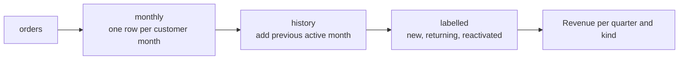
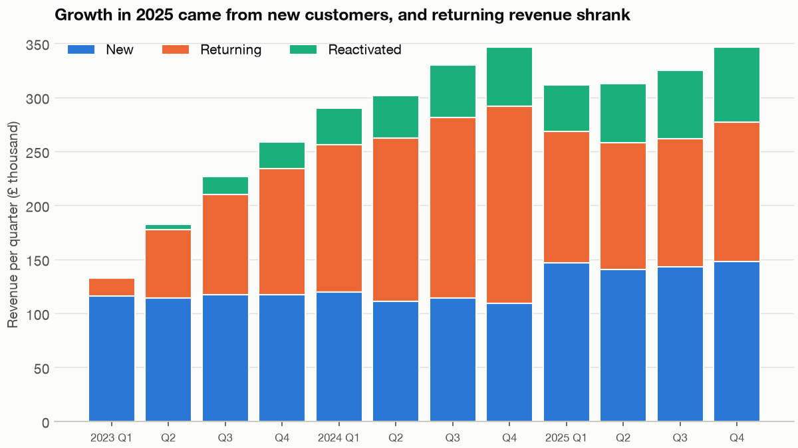

# SQL for analytics: the revenue bridge, and the patterns behind it

Fernhill's 2025 board pack is due on Friday. Revenue is up 2.1%, and the chief executive would like one line that explains why. Marketing says growth came from new customers. Finance says customers are leaving. Each team has its own spreadsheet, each uses its own definition of a returning customer, and the numbers don't reconcile. The real task isn't a statistical one: it is to write one query that everyone agrees defines the terms, show that it adds up, and read off the answer. That query, and the handful of patterns it is made of, is what an analyst writes most days of the working week.

---

## The question and the data

The business question is **where did 2025's revenue change come from: new customers, returning customers, or customers coming back after a gap, and what should the plan for 2026 assume?** We use Fernhill's tables from `practice/retail.py`, the seeded generator from the earlier chapters, and query them with DuckDB, which runs SQL directly on data frames in-process and needs no server. The `refunds` table is one we make up here, for a fan-out example near the end.

This chapter assumes the [SQL module](../../../programming/sql/README.md), which teaches the language. Here we use it on one running problem, and each pattern links back to the note that explains the mechanics.

The code blocks are the sections of `practice/ch06_sql_analytics.py` in order, each relying on those before it. Run it with `uv run ch06_sql_analytics.py` from the practice folder.

```python
import duckdb
import matplotlib.pyplot as plt
import numpy as np
import pandas as pd

import chartstyle as cs
from retail import load_customers, load_events, load_orders, load_sessions

cs.apply()
```

```python
con = duckdb.connect()
customers, orders, sessions, events = load_customers(), load_orders(), load_sessions(), load_events()
# A refunds table with several lines per refunded order, for the fan-out example.
rng = np.random.default_rng(7)
refunded = orders.sample(frac=.08, random_state=7)
refunds = refunded.loc[refunded.index.repeat(rng.integers(1, 4, len(refunded)))][["order_id", "value"]]
refunds["amount"] = (refunds.pop("value") * .3).round(2)
for name, frame in {"customers": customers, "orders": orders, "sessions": sessions, "events": events, "refunds": refunds}.items():
    con.register(name, frame)
print(con.sql("SELECT count(*) AS orders, round(sum(value)) AS revenue, min(order_date)::DATE AS first, max(order_date)::DATE AS last FROM orders").df().to_string(index=False))
```

```text
 orders   revenue      first       last
  63958 3364669.0 2023-01-01 2025-12-31
```

## The revenue bridge

A **bridge** splits one period's total into labelled parts, so that a change in the total becomes changes in the parts. The label is the hard part. To say whether a customer is "returning" we have to look at their earlier rows, and this is exactly what [window functions](../../../programming/sql/notes/06-window-functions.md) are for: they see other rows without collapsing them.

We build it as a chain of [common table expressions](../../../programming/sql/notes/05-subqueries-and-ctes.md), one idea per step, so that each can be run and checked by itself.



```python
BRIDGE = """
WITH monthly AS (                     -- one row per customer per month with an order
    SELECT customer_id,
           date_trunc('month', order_date) AS month,
           sum(value) AS revenue
    FROM orders
    GROUP BY 1, 2
),
history AS (                          -- the customer's previous active month
    SELECT *,
           lag(month) OVER (PARTITION BY customer_id ORDER BY month) AS previous_month
    FROM monthly
),
labelled AS (
    SELECT *,
           CASE WHEN previous_month IS NULL THEN 'new'
                WHEN date_diff('month', previous_month, month) <= 3 THEN 'returning'
                ELSE 'reactivated'
           END AS kind
    FROM history
)
SELECT date_trunc('quarter', month) AS quarter, kind,
       round(sum(revenue)) AS revenue,
       count(*) AS customer_months
FROM labelled
GROUP BY 1, 2
ORDER BY 1, 2
"""
bridge = con.sql(BRIDGE).df()
pivot = bridge.pivot(index="quarter", columns="kind", values="revenue")[["new", "returning", "reactivated"]]
pivot.index = pd.PeriodIndex(pivot.index, freq="Q")
print(pivot.iloc[-8:].astype(int).to_string())
yearly = pivot.groupby(pivot.index.year).sum().astype(int)
print(yearly.assign(total=yearly.sum(axis=1)).to_string())
```

```text
kind        new  returning  reactivated
quarter
2024Q1   119511     136884        33754
2024Q2   110833     151782        38957
2024Q3   114281     167091        48850
2024Q4   109443     182553        54365
2025Q1   146789     121424        43556
2025Q2   140508     117481        54551
2025Q3   143255     118192        63444
2025Q4   147776     129196        69396
kind        new  returning  reactivated    total
quarter
2023     464619     289962        46215   800796
2024     454068     638310       175926  1268304
2025     578328     486293       230947  1295568
```



*Image Source: generated by `practice/ch06_sql_analytics.py`. Fernhill revenue per quarter by customer kind.*

Now the board's line can be written. Between 2024 and 2025, revenue rose by £27,264. New customers added £124,260 and reactivated customers £55,021, while returning customers lost £152,017. So both teams were right, about different rows. A growth figure of 2.1% contains a fall of 24% in the revenue from customers who keep buying.

The definition is doing some work in this. Our CASE statement says that a customer is **returning** if their previous active month was at most three months earlier, and otherwise **reactivated**. Three is a choice, and it must be stated with the result. [Exercise 1](#try-it) checks how much the answer depends on it.

## Prove it adds up

A query that runs is not a query that's correct. SQL will happily give you a number from a wrong join, so before anyone sees this table, check it against the source and against a second implementation.

```python
in_pandas = orders.assign(month=orders.order_date.dt.to_period("M")).groupby(["customer_id", "month"]).value.sum().reset_index()
in_pandas["previous"] = in_pandas.groupby("customer_id").month.shift()
gap = (in_pandas.month.dt.year - in_pandas.previous.dt.year) * 12 + in_pandas.month.dt.month - in_pandas.previous.dt.month
in_pandas["kind"] = np.select([in_pandas.previous.isna(), gap <= 3], ["new", "returning"], "reactivated")
check = in_pandas.groupby("kind").value.sum().round()
in_sql = con.sql(BRIDGE).df().groupby("kind").revenue.sum()
print(pd.DataFrame({"pandas": check, "sql": in_sql, "diff": (check - in_sql).round()}).to_string())
print("revenue in orders:", round(orders.value.sum()), " sum of bridge:", round(in_sql.sum()))
```

```text
                pandas        sql  diff
kind
new          1497017.0  1497015.0   2.0
reactivated   453087.0   453088.0  -1.0
returning    1414565.0  1414565.0   0.0
revenue in orders: 3364669  sum of bridge: 3364668
```

Returning matches exactly, and new and reactivated each differ by one or two pounds, all of it from rounding: the SQL rounds each quarter and kind before we sum them, and pandas rounds the total. Understand any difference before dismissing it. A difference of £2 explained by rounding is fine. An unexplained difference of £2 may be the visible part of a bigger offsetting error. The bridge's total of £3,364,668 against £3,364,669 in the source tells you that no row was dropped or counted twice, and that test is the single most useful one you can run on any report built from joins.

## Running totals and year-on-year

Board packs also want a running year-to-date, a smoothed line, and a comparison with last year. All three are windows over a monthly table, differing only in the frame.

```python
print(con.sql("""
WITH monthly AS (
    SELECT date_trunc('month', order_date)::DATE AS month, round(sum(value)) AS revenue
    FROM orders GROUP BY 1
)
SELECT month, revenue,
       sum(revenue) OVER (PARTITION BY year(month) ORDER BY month) AS ytd,
       round(avg(revenue) OVER (ORDER BY month ROWS BETWEEN 2 PRECEDING AND CURRENT ROW)) AS avg_3m,
       round(100 * (revenue / lag(revenue, 12) OVER (ORDER BY month) - 1), 1) AS yoy_pct
FROM monthly
ORDER BY month DESC
LIMIT 4
""").df().to_string(index=False))
```

```text
     month  revenue       ytd   avg_3m  yoy_pct
2025-12-01 114968.0 1295567.0 115456.0     -0.4
2025-11-01 117454.0 1180599.0 113274.0      1.5
2025-10-01 113945.0 1063145.0 111404.0     -1.1
2025-09-01 108423.0  949200.0 108297.0     -3.8
```

`PARTITION BY year(month)` restarts the running total each January. `ROWS BETWEEN 2 PRECEDING AND CURRENT ROW` makes a three-month average that doesn't depend on the frame's defaults. `lag(revenue, 12)` is last year's month, and it is correct only if the table has no missing months. For a monthly revenue table at this size, it's safe. For a sparse table it would silently compare the wrong months, which is the next pattern's concern. December's year-on-year of −0.4% is the slowing that the bridge explains, and the [window function note](../../../programming/sql/notes/06-window-functions.md) has the full syntax.

## Top N per group

Which two customers spent most in each year? Grouped [aggregation](../../../programming/sql/notes/03-aggregation.md) gives spend, and `rank()` orders within the year. The result of a window can't go in `WHERE`, since `WHERE` runs before windows are computed. [DuckDB's `QUALIFY`](https://duckdb.org/docs/stable/sql/query_syntax/qualify) filters after them.

```python
print(con.sql("""
SELECT year(order_date) AS year, customer_id, round(sum(value)) AS spend,
       rank() OVER (PARTITION BY year(order_date) ORDER BY sum(value) DESC) AS place
FROM orders
GROUP BY 1, 2
QUALIFY place <= 2
ORDER BY year, place
""").df().to_string(index=False))
```

```text
 year  customer_id  spend  place
 2023          851 2229.0      1
 2023         2796 1734.0      2
 2024         6692 2548.0      1
 2024         6549 2385.0      2
 2025         4641 1717.0      1
 2025          948 1463.0      2
```

`QUALIFY` isn't in every database. PostgreSQL doesn't have it, so there you wrap the window in a subquery and filter outside. Choose the ranking function deliberately: `rank()` gives ties the same place and leaves a gap afterwards, `dense_rank()` leaves no gap, and `row_number()` picks a winner arbitrarily, unless you add a tie-breaker to the `ORDER BY`.

## Filling gaps with a date spine

Here's a mistake that survives review because the output looks fine. Group rare events by week, and the weeks with no events don't appear at all. A chart of that table draws a straight line across the gap, and an average over it comes out too high. The fix is to start from a table of every period, a **date spine**, and [left join](../../../programming/sql/notes/04-joins.md) the data to it, with [`coalesce`](../../../programming/sql/notes/02-nulls-and-expressions.md) turning the resulting NULLs to zero.

```python
print(con.sql("""
WITH weeks AS (                                  -- every week, whether or not anything sold
    SELECT unnest(generate_series(DATE '2023-01-02', DATE '2023-02-20', INTERVAL 7 DAY))::DATE AS week
),
sold AS (
    SELECT date_trunc('week', order_date)::DATE AS week, count(*) AS n
    FROM orders
    WHERE category = 'furniture' AND value > 120
    GROUP BY 1
)
SELECT w.week, coalesce(s.n, 0) AS big_furniture_orders
FROM weeks w LEFT JOIN sold s USING (week)
ORDER BY w.week
""").df().to_string(index=False))
```

```text
      week  big_furniture_orders
2023-01-02                     1
2023-01-09                     3
2023-01-16                     0
2023-01-23                     2
2023-01-30                     0
2023-02-06                     2
2023-02-13                     2
2023-02-20                     1
```

The weeks of 16 and 30 January would have vanished from a plain `GROUP BY`. Without them, the average across the eight weeks comes to 1.83 per week rather than the true 1.38. This is a useful rule: count your output rows against the number of periods you meant to report.

## Sessionising events

Web analytics tools hand you sessions, but warehouses often hold only raw page views. A session is usually defined by a gap: a new one begins after 30 minutes without activity. In SQL this is a two-step window. Compare each event with the previous one, flag the starts, and then a running sum of the flags numbers the sessions.

```python
SESSIONISE = """
WITH gaps AS (
    SELECT *, ts - lag(ts) OVER (PARTITION BY user_id ORDER BY ts) AS gap
    FROM events
),
starts AS (
    SELECT *, CASE WHEN gap IS NULL OR gap > INTERVAL 30 MINUTE THEN 1 ELSE 0 END AS is_start
    FROM gaps
)
SELECT user_id, ts, true_session,
       sum(is_start) OVER (PARTITION BY user_id ORDER BY ts) AS session_number
FROM starts
"""
print(con.sql(f"""
SELECT count(*) AS page_views,
       count(DISTINCT (user_id, session_number)) AS sessions_found,
       count(DISTINCT true_session) AS sessions_true
FROM ({SESSIONISE})
""").df().to_string(index=False))
print(con.sql(f"""
SELECT count(*) AS sessions_split_or_merged FROM (
    SELECT user_id, session_number FROM ({SESSIONISE})
    GROUP BY 1, 2 HAVING count(DISTINCT true_session) <> 1
)
""").df().to_string(index=False))
```

```text
 page_views  sessions_found  sessions_true
      29782            5974           5974
 sessions_split_or_merged
                        0
```

The generator knows the true session of each page view, so we can score the query, and it recovers all 5,974 without splitting or merging one. That is only because the generator's sessions are well separated. Real ones are not, and [Exercise 2](#try-it) shows how the count depends on the threshold. This running sum of flags is worth learning by heart, as it solves any problem of the form "group consecutive rows until a condition breaks".

## Gaps and islands

A related problem: how long do customers' buying streaks last? Consecutive months form an "island", and the difficulty is giving each island an identifier without a loop. The trick is a piece of arithmetic. Number each customer's active months with `row_number()`, and subtract that from a running month index. Along an unbroken run both rise by one at a time, so the difference stays constant, and when a month is skipped it jumps.

```text
month index   row_number   difference
  24301            1         24300     island A
  24302            2         24300     island A
  24305            3         24302     island B
  24306            4         24302     island B
```

```python
print(con.sql("""
WITH active AS (
    SELECT DISTINCT customer_id, date_trunc('month', order_date)::DATE AS month FROM orders
),
numbered AS (
    SELECT *,
           (year(month) * 12 + month(month))
             - row_number() OVER (PARTITION BY customer_id ORDER BY month) AS island
    FROM active
),
streaks AS (
    SELECT customer_id, island, count(*) AS months, min(month) AS started
    FROM numbered GROUP BY 1, 2
)
SELECT months AS streak_length, count(*) AS streaks
FROM streaks GROUP BY 1 ORDER BY 1 LIMIT 6
""").df().to_string(index=False))
```

```text
 streak_length  streaks
             1    36135
             2     5046
             3     1301
             4      490
             5      191
             6       87
```

Of the streaks, 36,135 last one month and only 87 run for six. Buying in consecutive months is rare at Fernhill. That's also why a one-month definition of "returning" would have been too strict for the bridge. The same query says that 54,651 active customer-months form 43,370 streaks, and with 26,342 customers that means about 60% of repeat active months follow a gap.

## The funnel in one scan

The [funnel chapter](04-funnel-and-conversion.md) did its counting in pandas. In SQL, each step can be a separate conditional count in a single pass of the table, using the `FILTER` clause, [documented by DuckDB](https://duckdb.org/docs/stable/sql/query_syntax/filter).

```python
print(con.sql("""
SELECT device,
       count(*) AS sessions,
       count(*) FILTER (furthest >= 3) AS at_checkout,
       count(*) FILTER (furthest >= 4) AS reached_payment,
       round(100.0 * count(*) FILTER (furthest >= 4) / count(*) FILTER (furthest >= 3), 1) AS checkout_to_payment_pct,
       round(100.0 * avg((furthest = 5)::INT), 2) AS conversion_pct
FROM sessions
WHERE date >= DATE '2025-09-15'
GROUP BY device ORDER BY device
""").df().to_string(index=False))
```

```text
 device  sessions  at_checkout  reached_payment  checkout_to_payment_pct  conversion_pct
desktop     67668         9824             8254                     84.0           11.65
 mobile    122860        10503             7101                     67.6            5.37
```

These reproduce the funnel chapter's figures exactly: 84.0 and 67.6 at the step, 11.65 and 5.37 at the end. One table scan is much cheaper than one subquery per step, and much easier to read. For databases without `FILTER`, `sum(CASE WHEN ... THEN 1 ELSE 0 END)` does the same job.

## The fan-out

The most common serious bug in analytics SQL deserves its own section. When a join key isn't unique on one side, each row on the other side is repeated once per match, and every sum over that side grows. No error, no warning.

Here, `refunds` can have several lines per order. Join it directly to `orders` and revenue rises.

```python
print(con.sql("""
SELECT round(sum(o.value)) AS revenue_wrong, round(sum(r.amount)) AS refunds
FROM orders o LEFT JOIN refunds r USING (order_id)
""").df().to_string(index=False))
print(con.sql("""
WITH per_order AS (SELECT order_id, sum(amount) AS amount FROM refunds GROUP BY 1)
SELECT round(sum(o.value)) AS revenue_right, round(sum(p.amount)) AS refunds
FROM orders o LEFT JOIN per_order p USING (order_id)
""").df().to_string(index=False))
print("true revenue", round(orders.value.sum()))
```

```text
 revenue_wrong  refunds
     3641037.0 164342.0
 revenue_right  refunds
     3364669.0 164342.0
true revenue 3364669
```

The first query overstates revenue by £276,368, or 8.2%, and nothing about it looks broken. Note that refunds are right in both: the many side of a join is never fanned out, so a spot check on refunds would pass. The fix is to aggregate the many side to the grain of the one side before joining, which is the second query. Think about the grain of every table before you join it, and repeat the test from earlier: does the total match the source? The [joins note](../../../programming/sql/notes/04-joins.md) goes through the mechanics.

## Recommendation

**Put the bridge in the board pack with its definition, publish the query as the single shared view, and plan 2026 on the returning line rather than on the total.**

- **The line for the board.** Revenue rose £27,264 (2.1%). New customers added £124,260 and customers coming back after a gap added £55,021, offsetting a £152,017 fall in returning customers.
- **What to assume for 2026.** Don't project 2.1% forward. That growth was bought with acquisition, and the [cohort chapter](03-cohort-and-retention.md) shows that those customers return less. Restoring returning revenue, and testing whether the email cut caused its fall, deserves the first call on next year's budget.
- **How to stop the argument.** A definition in a query, in version control, with the three-month rule in a comment, replaces the two spreadsheets. Add the reconciliation to source as a scheduled test, so a broken join alerts someone before it reaches a slide.
- **Limits.** A bridge describes where revenue landed. It doesn't say why, and the labels depend on the gap chosen (Exercise 1). Revenue here is before refunds, and the figures are synthetic.

## Pitfalls

- **Joining before aggregating.** Fan-out inflates sums silently. State the grain of each table, and aggregate before you join.
- **Filtering a left join in `WHERE`.** A `WHERE` on the right table discards the unmatched rows and turns it into an inner join. Put that condition in `ON`.
- **Averaging without a spine.** Missing periods vanish, and the average is taken only over the periods with data.
- **Relying on a default window frame.** With `ORDER BY`, the default frame is a range that treats ties as peers. Write `ROWS BETWEEN ...` when you mean rows.
- **Using `lag(x, 12)` on a sparse table.** It counts rows, not months. Build a spine first.
- **Non-deterministic `row_number()`.** Without a unique tie-break, the winner can change between runs. Add one.
- **`NOT IN` over a column with NULLs.** The [NULL logic](../../../programming/sql/notes/02-nulls-and-expressions.md) makes it return nothing. Use `NOT EXISTS`.
- **Assuming that one dialect runs everywhere.** `QUALIFY`, `FILTER` and `date_diff` vary across databases. Check the manual of your target engine.
- **Interpolating values into SQL strings.** Our `f""` strings paste in trusted query text of our own. Anything from a user goes in as a [parameter](../../../programming/sql/notes/09-sql-from-python.md).
- **Treating an unreconciled report as finished.** Check each report's total against the source before anyone reads it.

## Try it

Exercises use `practice/ch06_sql_analytics.py`, after the `setup` section. For a full exercise on SQL as a language, try the module's [capstone](../../../programming/sql/notes/10-capstone-murder-mystery.md).

1. Change the bridge's rule from three months to six. What happens to 2025's returning and reactivated revenue, and does the board's conclusion survive?

   <details><summary>Answer</summary>

   Reactivated falls from £230,947 to £102,942, and returning rises from £486,293 to £614,297. New doesn't change. Levels depend heavily on the rule, but the direction doesn't: returning revenue fell from £753,089 to £614,297 between 2024 and 2025, an 18% fall where the three-month rule gives 24%. The conclusion survives, and a result you can report under both rules is a stronger one.
   </details>

2. Run `SESSIONISE` with gaps of 15 and 60 minutes instead of 30. How many sessions does each find against the true 5,974, and which error does each make?

   <details><summary>Answer</summary>

   15 minutes finds 6,127, because it splits long sessions in two. 60 minutes finds 5,894, because it merges separate sessions from the same user. There's no threshold that's right in general. Real data has no ground truth column, so look at the distribution of gaps and report how sensitive your session count is.
   </details>

3. Write one query that returns revenue net of refunds without any fan-out. What do you get?

   <details><summary>Answer</summary>

   Aggregate refunds per order first and left join to orders, with `sum(o.value - coalesce(p.amount, 0))`, or more simply subtract the two separate totals. Either gives £3,364,669 − £164,342 = £3,200,327. The `coalesce` matters, because without it an order with no refund gives a NULL and drops out of the sum.
   </details>

## Interview checklist

| Question | Answer |
|---|---|
| What's the difference between `GROUP BY` and a window? | `GROUP BY` collapses rows. A window computes across related rows and keeps every row. |
| Why can't you filter on a window function in `WHERE`? | `WHERE` runs before windows are computed. Use `QUALIFY`, or a subquery. |
| `rank`, `dense_rank`, `row_number`? | Ties share a place with a gap after, ties share a place with no gap, and every row gets a unique number. |
| What is a revenue bridge? | A split of revenue into labelled parts, such as new, returning and reactivated, so that a change in the total is explained by changes in the parts. |
| What is a fan-out? | A join to a non-unique key repeats rows, inflating sums on the one side. Aggregate to the right grain first. |
| How do you detect a fan-out? | Compare the row count and the sum after the join with the source. |
| What does a date spine do? | It keeps periods that have no events, so charts and averages see the zeros. |
| How do you sessionise in SQL? | Compare each event with the previous using `lag`, flag gaps over a threshold, and take a running sum of the flags. |
| What is the gaps and islands trick? | A running index minus `row_number()` is constant across a consecutive run, and so serves as a group key. |
| How do you count funnel steps in one scan? | Use `count(*) FILTER (WHERE ...)` or `sum(CASE WHEN ...)` per step. |
| How do you validate a report? | Reconcile its total with the source and, for important ones, with a second implementation. |

## Next

All six chapters so far kept to one shape: a question, a dataset, a check against something known, and a recommendation with its limits. [Survival and event history](07-survival-and-event-history.md) keeps that shape for a harder kind of question: when will a customer leave, given that many of them haven't yet?
