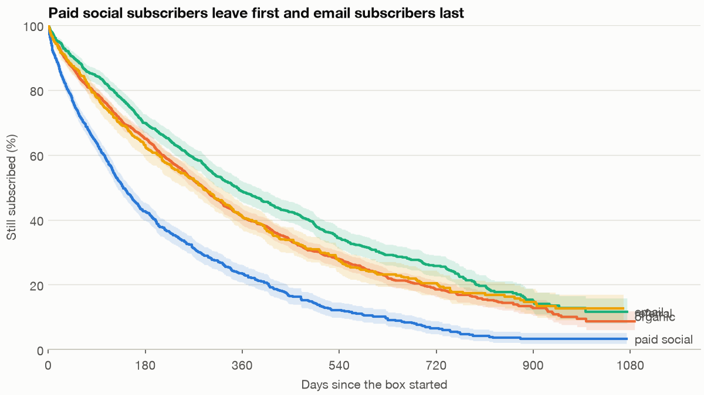
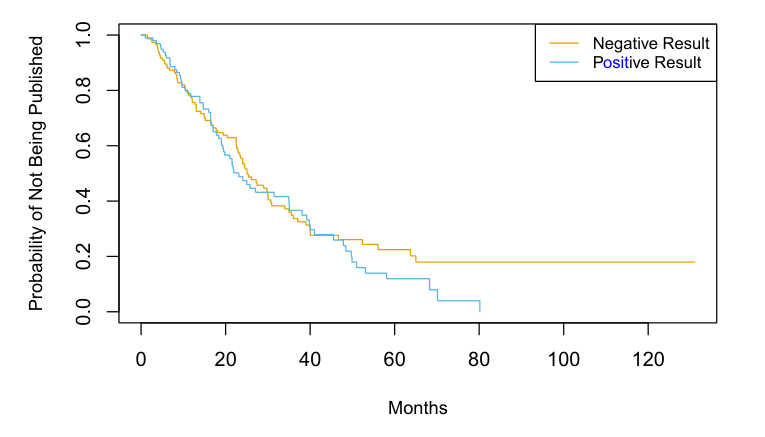
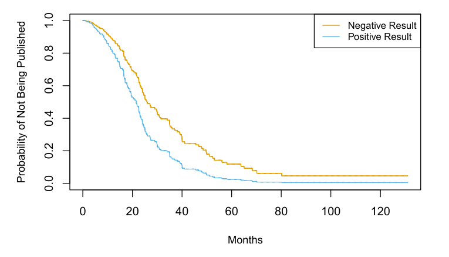
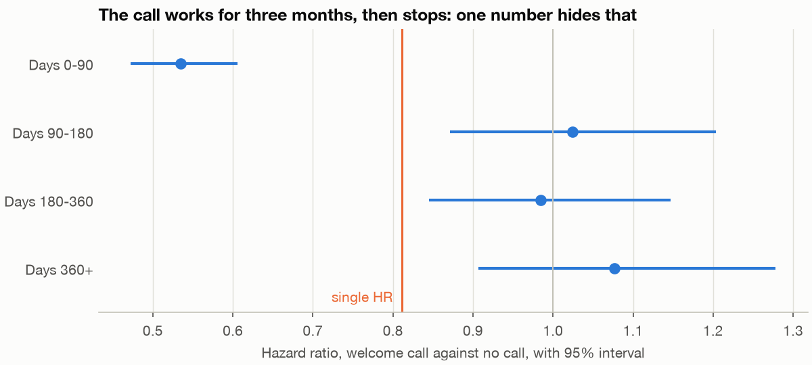
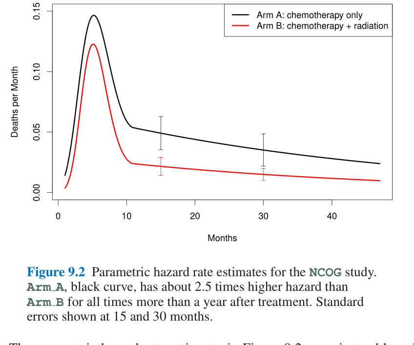
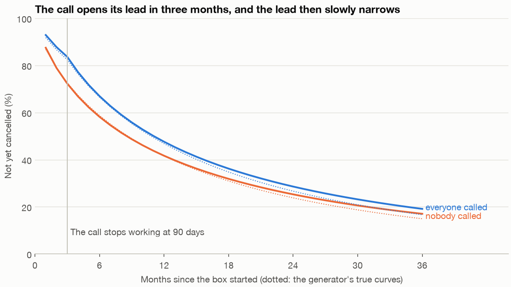

# Survival and event history: when will a customer leave?

Fernhill now sells a monthly subscription box, and new subscribers sometimes get a welcome call. The head of customer success has a chart showing that subscribers who were called stay longer, and she wants the budget to call everybody. A third of subscribers have not left yet, so nobody knows how long they will stay; the people who were called came mostly from the channels that stay longest anyway; and a price rise landed in the middle of everyone's subscription. Each of those three facts breaks the obvious analysis. This chapter handles them in turn and ends with a number she can use.

---

## The question and the data

The business question is **who cancels, when, and does the welcome call delay it by enough to pay for calling everybody?** We use two tables from `practice/retail.py`: `load_subscriptions()` with one row per subscriber, and `load_subscription_periods()` with one row per subscriber per 30 days. Because the data come from a generator, `load_truth("subscriptions")` tells us the right answers, so we can score every method. The subscription tables are an overlay and do not feed back into the order log used in chapters 3 to 6, so don't try to reconcile box revenue with `load_orders()`.

The code blocks are the sections of `practice/ch07_survival.py` in order, each relying on those before it, with the chart code left to the script. Run them with `uv run ch07_survival.py` from the practice folder.

```python
import numpy as np
import pandas as pd
import statsmodels.formula.api as smf
from lifelines import AalenJohansenFitter, CoxPHFitter, CoxTimeVaryingFitter, KaplanMeierFitter
from lifelines.statistics import multivariate_logrank_test
from lifelines.utils import restricted_mean_survival_time
from scipy.optimize import minimize
from scipy.special import betaln

from retail import CHANNELS, PLANS, SEED, load_subscription_periods, load_subscriptions, load_truth
```

```python
subs, periods, truth = load_subscriptions(), load_subscription_periods(), load_truth("subscriptions")
print(len(subs), "subscriptions,", len(periods), "person-periods")
print(subs[["subscription_id", "channel", "plan", "welcome_call", "start_date", "event_type", "duration_days"]].head(3).to_string(index=False))
print(subs.event_type.fillna("still subscribed").value_counts().to_string())
print(subs.groupby("channel").welcome_call.mean().loc[CHANNELS].round(3).to_string())
```

```text
5061 subscriptions, 44840 person-periods
 subscription_id channel  plan  welcome_call start_date event_type  duration_days
               1   email large             1 2023-01-01     cancel            540
               2   email large             1 2023-01-02     cancel            164
               3 organic large             1 2023-01-04     cancel            324
event_type
cancel              2979
still subscribed    1681
downgrade            401
channel
paid_social    0.379
organic        0.574
email          0.782
referral       0.571
```

A subscription can end in a cancel or a downgrade to a cheaper plan, or it can still be running on 31 December 2025. The last row of that table shows the first trap: email subscribers were called 78% of the time and paid social subscribers 38%.

## Censoring: why the obvious average is wrong

A subscriber who is still with us at the end of the data has a lifetime of at least what we saw. Their exact lifetime is unknown. That is **censoring**, and more precisely *administrative* censoring: the data stopped, not the subscriber. Since subscribers joined at different dates, each has a different censoring time (Hernán and Robins, *What If*, chapter 17).

There are two tempting averages, and both are wrong. Dropping the censored keeps only the people who left, and those are the short lifetimes. Counting them as if they left on the last day treats "still here" as "gone".

```python
print(f"mean days, churned only:           {subs[subs.event == 1].duration_days.mean():.1f}")
print(f"mean days, censored counted as end: {subs.duration_days.mean():.1f}")
km_all = KaplanMeierFitter().fit(subs.duration_days, subs.event)
HORIZON = 1080
capped_truth = subs.true_duration_days.clip(upper=HORIZON).mean()
print(f"Kaplan-Meier median:               {km_all.median_survival_time_:.0f}   truth {subs.true_duration_days.median():.0f}")
print(f"Kaplan-Meier mean to day {HORIZON}:      {restricted_mean_survival_time(km_all, t=HORIZON):.1f}   truth {capped_truth:.1f}")
print(f"truth, uncapped mean:              {subs.true_duration_days.mean():.1f}   (longest {subs.true_duration_days.max()} days; the data stop at {subs.duration_days.max()})")
```

```text
mean days, churned only:           212.8
mean days, censored counted as end: 250.9
Kaplan-Meier median:               255   truth 248
Kaplan-Meier mean to day 1080:      361.1   truth 355.0
truth, uncapped mean:              401.8   (longest 10309 days; the data stop at 1088)
```

Both averages fall far short of the true mean of 401.8 days. The **Kaplan-Meier estimator** (Kaplan and Meier, 1958) uses the censored properly. On each day it takes the share of those still at risk who survive that day, which is one minus the **hazard**, the chance of leaving now given you have lasted this far, and multiplies those shares together. A censored subscriber counts as at risk until they drop out of view, then stops counting.

Its median of 255 days is close to the true 248. Notice what it cannot do: the data stop at 1,088 days, while the generator's longest lifetime runs to over 10,000. No method reads a full mean out of three years of data without assuming a shape for the tail, so report the median or a **restricted mean**, the average days subscribed within a stated horizon. Here that is 361 days within the first 1,080, against a truth of 355.

The textbook version of the trap has numbers you can check (*ISLP*, ch. 11). Of 88 brain-tumour patients, 53 were alive when the study ended. The share known to be past 20 months is 48/88 = 55%. Dividing by the 71 not censored before month 20 gives 48/71 = 68%, which throws away the 17 of the 40 early exits who were censored, although someone censored at 19.9 months very likely lasted past 20. Kaplan-Meier gives 71%. All of it assumes *independent* censoring: given the covariates, the time to the event is unrelated to the time of censoring. If the sickest patients drop out early, survival is overstated, and the data cannot say whether that happened, so you argue it from how the data were collected. Censoring at the end of our extract is safe in this sense; dropping records for a reason tied to leaving is not.

The estimator is older than the software. An insurer's life table builds the same product from one year of policy data: at each age the hazard is deaths over policy holders, and multiplying one minus the hazard from age 30 gives a 30-year-old's chance of living past 80 as 0.506, with no need to wait fifty years (*Computer Age*, ch. 9, Table 9.1, a fictitious company with deaths based on 2010 US male rates). It assumes the hazards do not drift over calendar time. The interval around a curve comes from Greenwood's formula: the standard deviation of the survival estimate at time *j* is the estimate times the square root of the sum, over exits up to *j*, of y/(n(n − y)), where n is the number at risk and y the exits at that time (*Computer Age*, ch. 9, eq. 9.18). The shaded bands above are that formula. The book's head and neck cancer trial shows its limit: Kaplan-Meier medians of 324 days for chemotherapy plus radiation against 182 for chemotherapy alone (51 and 45 patients), yet Greenwood bars at any single day overlap enough to leave the comparison unclear. A curve-by-curve interval is a poor test of a difference, which is the reason for the log-rank test below.

Censoring is also a missing-data problem, and the same book makes the link with the EM algorithm (*Computer Age*, ch. 9, section 9.5). Take 40 points from a bivariate normal with the second coordinate missing for the last 20. Fill the gaps with 0, estimate the means, spreads and correlation, replace each missing value by its conditional expectation under that fit, and repeat. The correlation estimate climbs from 0.162 at step 1 to 0.823 by step 20 and is still creeping in the third decimal, so convergence can be slow. The point to keep is that "still here" is one more kind of missing value, which a method must model rather than fill with the last day seen.

## Who leaves first: Kaplan-Meier by channel

```python
curves = {}
for channel in CHANNELS:
    part = subs[subs.channel == channel]
    km = curves[channel] = KaplanMeierFitter().fit(part.duration_days, part.event)
    print(f"{channel:12s} n {len(part):5d}  median {km.median_survival_time_:6.0f}  still subscribed at 360 days {km.predict(360):.1%}")
test = multivariate_logrank_test(subs.duration_days, subs.channel, subs.event)
print(f"log-rank across four channels: chi2 {test.test_statistic:.1f} on {test.degrees_of_freedom} df, p = {test.p_value:.1e}")
```

```text
paid_social  n  1481  median    139  still subscribed at 360 days 23.4%
organic      n  1839  median    288  still subscribed at 360 days 40.8%
email        n  1018  median    350  still subscribed at 360 days 48.8%
referral     n   723  median    286  still subscribed at 360 days 40.9%
log-rank across four channels: chi2 296.7 on 3 df, p = 5.0e-64
```



*Image Source: generated by `practice/ch07_survival.py`. Any exit counts as leaving; shaded bands are 95% intervals.*

The **log-rank test** compares, at each exit, how many exits each group had with how many it would have had if all the curves were the same. It says the channels differ, which we could already see. It doesn't say by how much, and it can't adjust for anything, and this question needs adjusting.

Its mechanics are short (*ISLP*, ch. 11). At each exit time, build a 2×2 table of who left and who stayed in each group. If the curves were equal, group 1 would have its share of the risk set times the exits at that time. Sum observed minus expected over all exit times, then divide by the square root of the summed variances. The result is close to a standard Normal in large samples. On the 88 brain-tumour patients, females against males gives W = 1.2, a p-value of 0.2 by the Normal and 0.25 by 1,000 permutations, so no difference can be claimed.

## The Cox model, and the number that hides the story

From here the event is a cancel, and a downgrade simply ends a subscriber's time at risk, because the question is about cancels. We come back to that choice under competing risks.

The **Cox proportional hazards model** (Cox, 1972) says each subscriber's hazard is a common baseline hazard over tenure, whatever shape that takes, multiplied by a factor for their characteristics. It never estimates the baseline, only the factors. Each factor is a **hazard ratio**: 0.8 means that at any given tenure this group's chance of leaving now is 20% lower. "Proportional" is the assumption that this ratio holds still over tenure.

The estimation trick is worth knowing, because it explains the sentence "never estimates the baseline". At each exit time, the chance that the person who left is subscriber *i*, among everyone still at risk, is proportional to exp(c'β) for their covariates c. Multiply those chances over all exits and the baseline hazard cancels, leaving the **partial likelihood** L(β) = ∏ exp(c_i'β) / Σ_{k at risk} exp(c_k'β), which is then maximised like an ordinary likelihood (*Computer Age*, ch. 9, eq. 9.38). The book's pediatric cancer table shows how to read the output: with 1,620 children and 160 observed deaths, a standardised distance from the treatment centre has a hazard ratio of 1.34 per standard deviation (95% interval 1.17 to 1.55, z = 4.12), calendar date of entry 0.63 (0.54 to 0.74, z = −5.86, which the authors read as a treatment protocol that improved), and age 0.79 (0.67 to 0.94). Sex (0.98) and race (1.33, p = .095) show no clear effect. Only 160 events carry the whole fit, so the count of events, not of rows, sets the precision; the same is true of a churn model with a long list of covariates and few cancels. The authors note that the partial likelihood is highly efficient when proportional hazards holds, which is the assumption the check below tests.

Adjusting can reveal what a log-rank test hides, which is the reverse of the confounding story. In 244 heart-and-lung trials, 156 published during the study period, positive results against negative ones gives a log-rank p of 0.36, and a Cox model with that single covariate agrees (coefficient 0.15, standard error 0.16). With the other covariates in, the coefficient is 0.55 (standard error 0.18, z = 3.02), a hazard ratio of about 1.7: at any point in time, holding the rest fixed, positive trials are published sooner (*ISLP*, ch. 11). The unadjusted test ignored the other covariates, which is the book's whole explanation.



*Image Source: James et al., *An Introduction to Statistical Learning with Applications in Python* (Springer, 2023), Fig. 11.5. Unadjusted; log-rank p = 0.36.*



*Image Source: James et al., *An Introduction to Statistical Learning with Applications in Python* (Springer, 2023), Fig. 11.6. Cox-adjusted curves at mean covariate values.*

To judge a Cox model on held-out people, there is no residual to compute: a censored person has no true time, and the model returns a curve for each person, not one predicted time. The book scores each held-out person by the risk x'β from training-half coefficients and cuts the scores into tertiles, which should give ordered survival curves. A lasso penalty, tuned by cross-validated partial likelihood, kept only budget and impact. It also reports **Harrell's concordance index**: among pairs where the earlier time is an observed exit, the share in which the higher-risk person exits first. A Cox model fitted on one half scored C = 0.733 on the other, so it picked which of two trials would publish first 73.3% of the time, against 0.5 for a coin (*ISLP*, ch. 11).

```python
# From here the event is a cancel, and a downgrade ends a subscriber's time at risk, because the question is about cancels.
subs["cancel"] = (subs.event_type == "cancel").astype(int)
for channel in ("paid_social", "email", "referral"):
    subs[channel] = (subs.channel == channel).astype(int)
subs["large"] = (subs.plan == "large").astype(int)
CONFOUNDERS = ["paid_social", "email", "referral", "large"]

alone = CoxPHFitter().fit(subs[["welcome_call", "duration_days", "cancel"]], "duration_days", "cancel")
single = CoxPHFitter().fit(subs[["welcome_call", *CONFOUNDERS, "duration_days", "cancel"]], "duration_days", "cancel")
print(f"welcome call HR, nothing adjusted:    {alone.hazard_ratios_['welcome_call']:.3f}")
print(f"welcome call HR, channel and plan:    {single.hazard_ratios_['welcome_call']:.3f}")
print(single.summary[["exp(coef)", "exp(coef) lower 95%", "exp(coef) upper 95%"]].round(3).to_string())

# check_assumptions prints a long report: keep its table and the advice line for the failing covariate.
report = io.StringIO()
with contextlib.redirect_stdout(report), warnings.catch_warnings():
    warnings.simplefilter("ignore")
    single.check_assumptions(subs[["welcome_call", *CONFOUNDERS, "duration_days", "cancel"]], p_value_threshold=.01, show_plots=False)
lines = report.getvalue().splitlines()
keep = [line for line in lines if line.strip().startswith(("test_statistic", "email", "large", "paid_social", "referral", "welcome_call", "km", "rank", "1. Variable"))]
print("\n".join(keep))
```

```text
welcome call HR, nothing adjusted:    0.681
welcome call HR, channel and plan:    0.811
              exp(coef)  exp(coef) lower 95%  exp(coef) upper 95%
covariate
welcome_call      0.811                0.753                0.875
paid_social       1.781                1.628                1.949
email             0.794                0.715                0.880
referral          0.990                0.884                1.109
large             0.760                0.699                0.825
                   test_statistic      p  -log2(p)
email        km              0.22   0.64      0.65
             rank            0.17   0.68      0.56
large        km              0.68   0.41      1.29
             rank            0.51   0.47      1.08
paid_social  km              1.54   0.21      2.22
             rank            1.43   0.23      2.11
referral     km              1.11   0.29      1.78
             rank            0.78   0.38      1.41
welcome_call km             36.46 <0.005     29.25
             rank           39.75 <0.005     31.69
1. Variable 'welcome_call' failed the non-proportional test: p-value is <5e-05.
```

Adjusting moves the call from 0.68 to 0.81, because a good part of the raw advantage belonged to the channels and plans that got called. Then `check_assumptions` objects, and only to the call. Don't overreact to that kind of test in general. The lifelines documentation warns that "given a large enough sample size, even very small violations of proportional hazards will show up", and adds that if your goal is prediction you need not care. Our goal is an effect, and this failure turns out to be large. So look at the ratio over tenure, which takes the data in a longer form: one row per stretch of a subscriber's time, with start and stop days. A subscriber counts as at risk from just after `start` up to and including `stop`.

```python
def episodes(frame, cuts=(90,)):
    """Long form for CoxTimeVaryingFitter: split each subscriber at the given days and at their own price rise."""
    rows = []
    for r in frame.itertuples():
        marks = {c for c in cuts if 0 < c < r.duration_days}
        if r.price_rise_day == r.price_rise_day and 0 < r.price_rise_day < r.duration_days:
            marks.add(r.price_rise_day)
        points = [0, *sorted(marks), r.duration_days]
        for a, b in zip(points[:-1], points[1:]):
            rows.append((r.subscription_id, a, b, int(b == r.duration_days and r.cancel), r.welcome_call,
                         int(r.price_rise_day == r.price_rise_day and a >= r.price_rise_day),
                         r.paid_social, r.email, r.referral, r.large))
    return pd.DataFrame(rows, columns=["id", "start", "stop", "cancel", "call", "rise", *CONFOUNDERS])


def fit_tv(long, covariates):
    fitter = CoxTimeVaryingFitter()
    fitter.fit(long[["id", "start", "stop", "cancel", *covariates]], id_col="id", event_col="cancel", start_col="start", stop_col="stop")
    return fitter


BANDS = [(0, 90), (90, 180), (180, 360), (360, 100000)]
long = episodes(subs, cuts=[b[0] for b in BANDS[1:]])
names = []
for low, high in BANDS:
    name = f"call_{low}_{high}"
    long[name] = long.call * ((long.start >= low) & (long.start < high)).astype(int)
    names.append(name)
bands = fit_tv(long, [*names, "rise", *CONFOUNDERS]).summary.loc[names, ["exp(coef)", "exp(coef) lower 95%", "exp(coef) upper 95%"]]
bands.columns = ["hr", "low", "high"]
bands.index = ["0-90", "90-180", "180-360", "360+"]
print(bands.round(3).to_string())
```

```text
hr    low   high
0-90     0.535  0.472  0.606
90-180   1.024  0.871  1.204
180-360  0.984  0.845  1.147
360+     1.076  0.907  1.278
```



*Image Source: generated by `practice/ch07_survival.py`.*

So 0.81 describes no subscriber at any tenure. The call nearly halves the hazard for ninety days and then does nothing. A single Cox ratio is a weighted average of the ratios at each time, as Hernán and Robins explain in their "hazards of hazard ratios" discussion, and here it averages two very different things.

## Time-varying covariates: the price rise and the call's wear-off

The price rise of 1 March 2025 reached each subscriber at a different tenure. A Cox model with a single "had the rise" column would be wrong, because it would count the months before the rise as if the rise had already happened. The covariate has to change partway through a subscriber's life. `CoxTimeVaryingFitter` takes the same long form, so we split each subscriber at day 90 and at their own day of the rise. Subscribers who joined after the rise have no such day: they signed up at the new price, so they stay at `rise = 0`.

```python
long = episodes(subs)
long["call_early"] = long.call * (long.start < 90).astype(int)
long["call_late"] = long.call * (long.start >= 90).astype(int)
tv = fit_tv(long, ["call_early", "call_late", "rise", *CONFOUNDERS])
table = tv.summary[["exp(coef)", "exp(coef) lower 95%", "exp(coef) upper 95%"]].copy()
table.columns = ["estimate", "low", "high"]
table["truth"] = [truth["hr_welcome_early"], truth["hr_welcome_late"], truth["hr_price_rise"],
                  truth["hr_channel"]["paid_social"], truth["hr_channel"]["email"], truth["hr_channel"]["referral"], truth["hr_plan"]["large"]]
print(len(long), "episodes")
print(table.round(3).to_string())
```

```text
10112 episodes
             estimate    low   high  truth
covariate
call_early      0.535  0.472  0.606    0.6
call_late       1.024  0.931  1.126    1.0
rise            1.494  1.357  1.646    1.5
paid_social     1.756  1.604  1.922    1.6
email           0.779  0.702  0.864    0.7
referral        0.994  0.888  1.114    0.9
large           0.757  0.697  0.822    0.8
```

Five of the seven intervals contain the truth. Paid social (lower bound 1.604 against 1.6) and email (0.702 against 0.70) narrowly miss, and referral is also high. All three channel ratios run about 10% above the truth, and that isn't three separate errors: they share organic as their reference group, so a good draw for organic lifts them together. And 0.535 looks a fair way from the true 0.60. Is the method off, or is this one dataset? The generator can answer that, which real data never can, so we refit on twenty other seeds.

```python
def early_late(seed):
    frame = load_subscriptions(seed)
    frame["cancel"] = (frame.event_type == "cancel").astype(int)
    for channel in ("paid_social", "email", "referral"):
        frame[channel] = (frame.channel == channel).astype(int)
    frame["large"] = (frame.plan == "large").astype(int)
    ep = episodes(frame)
    ep["call_early"] = ep.call * (ep.start < 90).astype(int)
    ep["call_late"] = ep.call * (ep.start >= 90).astype(int)
    return fit_tv(ep, ["call_early", "call_late", "rise", *CONFOUNDERS]).hazard_ratios_


runs = pd.DataFrame([early_late(SEED + i) for i in range(1, 21)])
check = pd.DataFrame({"mean of 20 seeds": runs.mean(), "lowest": runs.min(), "highest": runs.max()})
print(check.round(3).to_string())
```

```text
mean of 20 seeds  lowest  highest
covariate
call_early              0.600   0.521    0.689
call_late               1.012   0.914    1.078
rise                    1.494   1.354    1.655
paid_social             1.613   1.506    1.744
email                   0.713   0.627    0.796
referral                0.908   0.800    1.016
large                   0.794   0.718    0.862
```

The method centres on the truth, at 0.600 for the early call against 0.60 and 1.613 for paid social against 1.6. The default dataset just came out a little on the favourable side for the call, and for organic.

Note that `lifelines` offers `check_assumptions` on `CoxPHFitter`. The page on time-varying regression mentions no such check for `CoxTimeVaryingFitter`, so the bands above are our check.

## A survival model is a logistic regression on person-periods

Every 30-day stretch of every subscriber is one row, with `cancel` equal to 1 in the month it happened. That makes a table ready for the [logistic regression of the statistics pillar](../../02-probability-and-statistics/notes/06-regression-and-glms.md): the outcome is "cancelled this month, given still here", which is a hazard. The model is called **discrete-time hazard**, and each person's successive rows multiply back into a survival curve.

Smoothing the hazard over tenure is where this model earns its place. The book fits the same idea to a trial life table with 47 monthly rows, treating the monthly deaths as independent binomials and putting a cubic-linear spline in tenure, with a knot at month 11, on the logit; the hazard view separates the two arms where the survival curves did not (*Computer Age*, ch. 9, Fig. 9.2). Both arms peak at about month 5 and then decline slowly, and after the first year the chemotherapy-only hazard is about 2.5 times the combination arm's, with intervals that do not overlap at months 15 and 30.



*Image Source: Efron & Hastie, *Computer Age Statistical Inference* (Cambridge University Press, 2016), Fig. 9.2. Spline-logistic hazard fits to the NCOG head and neck cancer trial, 47 monthly rows per arm; standard errors shown at months 15 and 30.*

```python
periods["paid_social"] = (periods.channel == "paid_social").astype(int)
periods["email"] = (periods.channel == "email").astype(int)
periods["referral"] = (periods.channel == "referral").astype(int)
periods["large"] = (periods.plan == "large").astype(int)
periods["welcome_late"] = periods.welcome_call - periods.welcome_early
periods["log_month"] = np.log(periods.tenure_month)
FORMULA = "cancel ~ log_month + welcome_early + welcome_late + price_rise_active + paid_social + email + referral + large"
logit = smf.logit(FORMULA, periods).fit(disp=0)
print(f"mean monthly cancel hazard {periods.cancel.mean():.3f}")
compare = pd.DataFrame({"logit odds ratio": np.exp(logit.params)}).drop(["Intercept", "log_month"])
compare["Cox hazard ratio"] = tv.hazard_ratios_.rename({"call_early": "welcome_early", "call_late": "welcome_late", "rise": "price_rise_active"})
print(compare.round(3).to_string())
month = np.arange(1, 37)
binned = np.polyfit(np.log(month), np.log(month ** .75 - (month - 1) ** .75), 1)[0]
print(f"coefficient on log(tenure month) {logit.params['log_month']:.3f}; the generator's Weibull binned into months gives {binned:.3f}")
print("hazard by tenure month:", periods.groupby("tenure_month").cancel.mean().loc[[1, 2, 3, 4, 6, 12, 24]].round(3).to_dict())

# Does the shape of the tenure term move the answer? Give every month its own intercept.
flexible = smf.logit(FORMULA.replace("log_month", "C(tenure_month)"), periods[periods.tenure_month <= 36]).fit(disp=0)
print(f"with a free intercept per month: early {np.exp(flexible.params['welcome_early']):.3f}, late {np.exp(flexible.params['welcome_late']):.3f}, rise {np.exp(flexible.params['price_rise_active']):.3f}")
```

```text
mean monthly cancel hazard 0.066
                   logit odds ratio  Cox hazard ratio
welcome_early                 0.531             0.535
welcome_late                  1.008             1.024
price_rise_active             1.541             1.494
paid_social                   1.771             1.756
email                         0.781             0.779
referral                      0.992             0.994
large                         0.744             0.757
coefficient on log(tenure month) -0.378; the generator's Weibull binned into months gives -0.291
hazard by tenure month: {1: 0.106, 2: 0.072, 3: 0.06, 4: 0.069, 6: 0.063, 12: 0.06, 24: 0.058}
with a free intercept per month: early 0.519, late 1.030, rise 1.472
```

Odds ratios and hazard ratios agree to about 0.05 at worst. Odds approximate hazards when the hazard is small: Hernán and Robins give a rule of thumb of under 0.1 at every time. Month 1 sits just over it at 0.106 and the rest are under it.

The tenure term needs a word of honesty. Its coefficient of −0.378 is steeper than the −0.291 that the generator's Weibull gives when binned into months, so log tenure is a rough fit, as the hazard series shows: the step up in month 4 is the call running out. A free intercept for each month moves the early call from 0.531 to 0.519 and the rise from 1.541 to 1.472, within their intervals, so the conclusions hold. There's also a trap: `price_rise_active` flips only at 30-day boundaries, so it is a coarser version of the day-exact rise used in the Cox model. That may be why they differ most on that row.

## Competing risks

A downgrade is not a cancel, yet it ends the time at risk of a cancel. Treating downgrades as ordinary censoring pretends those people could still go on to cancel at the same rate, on a plan they have left. **Competing risks** methods report the probability of each exit as it really happened, with the other exit allowed. Here the Aalen-Johansen estimator gives that **cumulative incidence**.

```python
rows = []
for plan in PLANS:
    part = subs[subs.plan == plan]
    coded = part.event_type.map({"cancel": 1, "downgrade": 2}).fillna(0).astype(int)
    for code, label in ((1, "cancel"), (2, "downgrade")):
        with warnings.catch_warnings():
            warnings.simplefilter("ignore")
            aj = AalenJohansenFitter(calculate_variance=False).fit(part.duration_days, coded, event_of_interest=code)
        rows.append({"plan": plan, "event": label, "by_day_720": aj.predict(720)})
    km = KaplanMeierFitter().fit(part.duration_days, coded == 1)
    rows.append({"plan": plan, "event": "cancel, 1 - KM with downgrades censored", "by_day_720": 1 - km.predict(720)})
print(pd.DataFrame(rows).round(3).to_string(index=False))
```

```text
plan                                   event  by_day_720
standard                                  cancel       0.769
standard                               downgrade       0.053
standard cancel, 1 - KM with downgrades censored       0.799
   large                                  cancel       0.620
   large                               downgrade       0.208
   large cancel, 1 - KM with downgrades censored       0.726
```

For the large plan, the naive 1 − KM says 72.6% cancel by day 720 when the actual figure is 62.0%, because large-plan subscribers often downgrade instead. Hernán and Robins warn that treating competing events as censoring targets a quantity that is hard to interpret, and they say there is no fully satisfactory answer for causal questions. So we state what the later numbers mean: "not yet cancelled, in a world where nobody can downgrade".

## The link to the sBG curve of chapter 3

[Chapter 3](03-cohort-and-retention.md) fits a shifted-beta-geometric curve to aggregate retention. In that story each customer has a constant chance of leaving, those chances vary between customers, and the aggregate hazard falls because the flighty leave first. Here is the same curve fitted to the first year of the Kaplan-Meier curve.

```python
def sbg_survival(a, b, t):
    """Shifted-beta-geometric survivor function, as in chapter 3."""
    t = np.asarray(t, dtype=float)
    return np.exp(betaln(a, b + t) - betaln(a, b))


def sbg_fit(survival):
    survival = np.asarray(survival, dtype=float)
    n = len(survival) - 1
    died = -np.diff(survival)

    def negative_ll(log_params):
        a, b = np.exp(log_params)
        s = sbg_survival(a, b, np.arange(n + 1))
        return -(died * np.log(-np.diff(s))).sum() - survival[n] * np.log(s[n])

    return np.exp(minimize(negative_ll, [0, 0], method="Nelder-Mead", options=dict(xatol=1e-5, fatol=1e-8)).x)


months = np.arange(37)
actual = km_all.predict(months * 30).to_numpy()
calibrate = 13
a, b = sbg_fit(actual[:calibrate])
forecast = sbg_survival(a, b, months)
print(f"sBG on months 0 to {calibrate - 1}: alpha {a:.3f}, beta {b:.3f}")
for t in (12, 18, 24, 30, 36):
    print(f"month {t:2d}  Kaplan-Meier {actual[t]:.3f}  sBG forecast {forecast[t]:.3f}")
stop = subs.duration_days.where(subs.price_rise_day.isna() | (subs.duration_days <= subs.price_rise_day), subs.price_rise_day)
ended = subs.event.where(stop == subs.duration_days, 0)
before_rise = KaplanMeierFitter().fit(stop[stop > 0], ended[stop > 0])
print("Kaplan-Meier with time after the rise removed:", {t: round(float(before_rise.predict(t * 30)), 3) for t in (12, 18, 24)})
```

```text
sBG on months 0 to 12: alpha 2.079, beta 19.876
month 12  Kaplan-Meier 0.380  sBG forecast 0.382
month 18  Kaplan-Meier 0.253  sBG forecast 0.269
month 24  Kaplan-Meier 0.176  sBG forecast 0.199
month 30  Kaplan-Meier 0.112  sBG forecast 0.153
month 36  Kaplan-Meier 0.087  sBG forecast 0.121
Kaplan-Meier with time after the rise removed: {12: 0.408, 18: 0.285, 24: 0.208}
```

It fits the year it saw, then overshoots by 2.3 points at month 24 and 3.4 at month 36. Removing the time after the rise gives 0.208 at month 24, close to the sBG's 0.199, so most of that gap looks like the rise, which a curve with no covariates can't know about.

The deeper point is that the two models tell different stories with similar shapes. The generator gives each individual a falling hazard (Weibull shape 0.75), while the sBG gives each individual a flat one and lets the mix change. An aggregate curve can't separate them. Use the sBG when aggregates are all you have, and individual data when the question names a cause.

## Standardised survival: what the call is worth

Hazard ratios are awkward to price, and Hernán and Robins prefer survival and risk because a time-specific hazard ratio compares survivors, who are different people in each arm by then. So we turn the logit into curves. Fit the model, predict every subscriber's monthly hazards under "everyone called" and again under "nobody called", multiply through to survival, and average over the subscribers we actually have. This is the **parametric g-formula**, or standardisation, and it keeps the real mix of channels and plans in both arms. We set the price rise to off, to isolate the call. The interval comes from resampling subscribers, not rows, since one person's months belong together.

```python
HOLD = 24


def months_gained(s0, s1, h):
    """Survival summed over months is months subscribed, so the gap between two curves is months gained."""
    return (s1[:h] - s0[:h]).sum()


def standardised(model, frame):
    """Average predicted survival over the subscribers we have, with everyone called and with nobody called."""
    mix = frame.groupby(["paid_social", "email", "referral", "large"]).size().rename("n").reset_index()
    mix["n"] = mix.n / mix.n.sum()
    grid = mix.merge(pd.DataFrame({"tenure_month": np.arange(1, 37)}), how="cross")
    grid["log_month"] = np.log(grid.tenure_month)
    grid["price_rise_active"] = 0
    out = {}
    for call in (0, 1):
        g = grid.assign(welcome_early=call * (grid.tenure_month <= 3).astype(int), welcome_late=call * (grid.tenure_month > 3).astype(int))
        g["survive"] = 1 - model.predict(g)
        g["s"] = g.groupby(["paid_social", "email", "referral", "large"]).survive.cumprod()
        out[call] = g.groupby("tenure_month").apply(lambda x: (x.s * x.n).sum(), include_groups=False).to_numpy()
    return out[0], out[1]


def true_curves(frame):
    """The same two curves from the generator's parameters: no price rise, no downgrades."""
    k, scale = truth["weibull_shape"], truth["weibull_scale_days"]
    days = np.arange(1, 37) * 30
    H0 = (days / scale) ** k
    H90 = (90 / scale) ** k
    called = np.where(days <= 90, truth["hr_welcome_early"] * H0, truth["hr_welcome_early"] * H90 + (H0 - H90))
    base = frame.channel.map(truth["hr_channel"]).to_numpy() * frame.plan.map(truth["hr_plan"]).to_numpy()
    return np.exp(-np.outer(base, H0)).mean(axis=0), np.exp(-np.outer(base, called)).mean(axis=0)


none, called = standardised(logit, subs)
true_none, true_called = true_curves(subs)

rng = np.random.default_rng(SEED)
by_id = periods.groupby("subscription_id").indices
ids = np.array(list(by_id))
boot = []
for _ in range(200):
    pick = rng.choice(ids, len(ids))
    rows = periods.iloc[np.concatenate([by_id[i] for i in pick])]
    s0, s1 = standardised(smf.logit(FORMULA, rows).fit(disp=0), subs.set_index("subscription_id").loc[pick].reset_index())
    boot.append((s1[11] - s0[11], s1[HOLD - 1] - s0[HOLD - 1], months_gained(s0, s1, HOLD)))
low, high = np.percentile(boot, [2.5, 97.5], axis=0)
print(f"{'':28s}{'estimate':>9s}{'95% interval':>18s}{'truth':>8s}")
print(f"{'gain in survival, month 12':28s}{called[11] - none[11]:9.3f}{low[0]:10.3f} to{high[0]:6.3f}{true_called[11] - true_none[11]:8.3f}")
print(f"{'gain in survival, month 24':28s}{called[HOLD - 1] - none[HOLD - 1]:9.3f}{low[1]:10.3f} to{high[1]:6.3f}{true_called[HOLD - 1] - true_none[HOLD - 1]:8.3f}")
gain = months_gained(none, called, HOLD)
print(f"{'box-months gained in 24':28s}{gain:9.2f}{low[2]:10.2f} to{high[2]:6.2f}{months_gained(true_none, true_called, HOLD):8.2f}")
crude = {c: KaplanMeierFitter().fit(g.duration_days, g.cancel).predict(360) for c, g in subs.groupby("welcome_call")}
print(f"crude gap at day 360, no adjustment: {crude[1] - crude[0]:.3f}")
print(f"gain in survival at month 3: {called[2] - none[2]:.3f}; at month 36: {called[35] - none[35]:.3f}")
```

```text
estimate      95% interval   truth
gain in survival, month 12      0.059     0.033 to 0.083   0.053
gain in survival, month 24      0.033     0.007 to 0.056   0.029
box-months gained in 24          1.48      0.91 to  1.95    1.30
crude gap at day 360, no adjustment: 0.131
gain in survival at month 3: 0.114; at month 36: 0.021
```



*Image Source: generated by `practice/ch07_survival.py`. Dotted lines are the generator's true curves, with no price rise and no downgrades.*

The crude gap at day 360 is 13.1 points. The adjusted gain is 5.9, the truth is 5.3. So more than half of what the head of customer success saw on her chart was who got called. The short effect does leave a lasting mark, though: the hazards become equal after day 90, but the extra people kept through those ninety days go on subscribing, which adds up to about 1.5 boxes within two years.

A causal reading needs an assumption the code cannot check: that channel and plan account for everything that decides who gets called. In this generator that is true by construction, which is why the adjusted answer lands on the truth. With real data, subscribers who answer the phone may be more engaged to begin with, and that would flatter the call in a way no column here could fix. [Matching and weighting](../../03-experimentation-and-causality/notes/05-matching-and-weighting.md) covers that assumption, and how to ask what a hidden trait would have to do to undo the result.

## Pricing the call and the price rise

```python
MARGIN = .35                            # as in chapter 3, assumed
CALL_COST = 4.0                         # assumed: fifteen minutes of an agent's time, pounds per call
mean_price = subs.plan.map({p: v[0] for p, v in PLANS.items()}).mean()
print(f"margin per box-month at pre-rise prices £{mean_price * MARGIN:.2f}; gain per call £{gain * mean_price * MARGIN:.2f}, assumed cost £{CALL_COST:.2f}")
print(f"at the interval's ends: £{low[2] * mean_price * MARGIN:.2f} to £{high[2] * mean_price * MARGIN:.2f}")
uncalled = subs[subs.welcome_call == 0].channel.value_counts().loc[CHANNELS]
print(uncalled.to_string())
print(f"{uncalled.sum()} subscribers had no call; net margin if all had, at this estimate: £{uncalled.sum() * (gain * mean_price * MARGIN - CALL_COST):,.0f}")
```

```text
margin per box-month at pre-rise prices £10.03; gain per call £14.85, assumed cost £4.00
at the interval's ends: £9.09 to £19.52
channel
paid_social    920
organic        783
email          222
referral       310
2235 subscribers had no call; net margin if all had, at this estimate: £24,242
```

The call's worth is about £15 of margin against an assumed £4 of cost, and even the bottom of the interval clears it. Both the 35% margin (as in chapter 3) and the £4 are assumptions, so put your own in.

The price rise is the other decision on the table, and a hazard ratio of about 1.5 sounds alarming.

```python
reason = subs[subs.event_type == "cancel"].copy()
reason["after"] = reason.price_rise_day.notna() & (reason.duration_days > reason.price_rise_day)
share = reason.groupby("after").churn_reason.apply(lambda x: (x == "price").mean())
print(f"cancels giving price as the reason: {share[False]:.1%} before the rise, {share[True]:.1%} after")
print(f"HR implied by the reason codes alone: {(1 - share[False]) / (1 - share[True]):.2f}")

at_rise = subs[subs.price_rise_day.notna() & (subs.duration_days > subs.price_rise_day)]
print(len(at_rise), "subscribers on the books on the day of the rise")
rows = []
for h in (6, 12, 24):
    totals = {0: 0.0, 1: 0.0}
    for r in at_rise.itertuples():
        start = int(r.price_rise_day // 30) + 1
        future = pd.DataFrame({"tenure_month": np.arange(start, start + h)})
        future["log_month"] = np.log(future.tenure_month)
        future = future.assign(paid_social=r.paid_social, email=r.email, referral=r.referral, large=r.large, welcome_early=r.welcome_call * (future.tenure_month <= 3), welcome_late=r.welcome_call * (future.tenure_month > 3))
        old, new = PLANS[r.plan]
        for rise, price in ((0, old), (1, new)):
            s = (1 - logit.predict(future.assign(price_rise_active=rise))).cumprod().to_numpy()
            totals[rise] += (s * (price - old * (1 - MARGIN))).sum()
    rows.append({"months": h, "margin_no_rise": totals[0] / len(at_rise), "margin_rise": totals[1] / len(at_rise), "gain": (totals[1] - totals[0]) / len(at_rise)})
print(pd.DataFrame(rows).round(2).to_string(index=False))
```

```text
cancels giving price as the reason: 21.4% before the rise, 44.8% after
HR implied by the reason codes alone: 1.42
1582 subscribers on the books on the day of the rise
 months  margin_no_rise  margin_rise  gain
      6           50.18        67.13 16.95
     12           88.55       112.11 23.56
     24          144.35       168.49 24.14
```

The stated reasons give an independent check. If the extra cancels are those now citing price, the shift from 21% to 45% implies a ratio of 1.42, close to the 1.49 from Cox. And the rise paid: about £24 more margin per subscriber over two years. But the gain has almost stopped growing by month 12 (£23.56, then £24.14 at month 24), because the higher price is being offset by the subscribers it lost. This counts only subscribers on the books that day. It says nothing about new joiners or goodwill.

## Recommendation

- **Extend the welcome call, as a randomised rollout.** Hold back a random share of new subscribers, sized as in [the A/B testing chapter](../../03-experimentation-and-causality/notes/01-ab-testing.md). Our estimate is 1.5 boxes over two years (0.9 to 2.0), or about £15 of margin a call against an assumed £4. On 2,235 uncalled subscribers that would have been about £24,000, if the estimate is causal. Randomising is what makes it so, since the table can't rule out that the answerers were keener anyway.
- **Judge it on survival at 12 months and box-months, not on a hazard ratio.** Because the effect stops at day 90, the single ratio drifts towards 1 the longer you follow people, without anything having changed.
- **Don't target by channel on this evidence.** The call's early effect does not differ clearly by channel (see Try it), so the case for paid social first is only that most of the uncalled are there.
- **Don't take the price rise as a mistake.** It lost subscribers and made money. Repeating it is a separate question, and this analysis doesn't extrapolate to a second rise.

What would change this: a randomised gain below about 0.4 box-months, where the assumed £4 stops paying at £10.03 a box-month, or a call that costs much more than £4.

## Pitfalls

- **Averaging over those who left.** The symptom is a lifetime that seems short and improves as data grow, because the longest stayers are the ones missing. Use Kaplan-Meier, and report a median or restricted mean.
- **Assuming censoring is harmless.** The symptom is dropouts that look like the sickest, or the unhappiest, leaving the file early. The data cannot test independent censoring, so check how records were removed.
- **Counting the future as the present.** A "had the price rise" flag that applies to a subscriber's whole life gives them credit for months before it happened. Split the time at the change.
- **Quoting one hazard ratio when it moves.** The symptom is a failed proportional hazards check, on a covariate that matters. Report bands, or better, curves.
- **Reading a p-value from `check_assumptions` as a size.** Large samples flag tiny departures. Plot the ratio over tenure before you change the model.
- **Censoring competing events without saying so.** The symptom is "probability of cancel" figures that add with downgrades to more than the real exits. Use cumulative incidence for a business count.
- **Reading a hazard ratio as a share of customers saved.** A ratio of 0.53 for three months turned into about 6 points at a year. Convert to survival before pricing.
- **Taking an adjusted estimate for an experiment.** The answer here lands on the truth only because the generator has no hidden reason for who gets called.

## Try it

Exercises use `practice/ch07_survival.py`.

1. Refit the single-ratio Cox with any exit as the event (`subs.event`) rather than cancels. What happens to the large plan's ratio, and why?

   <details><summary>Answer</summary>

   It moves from 0.760 to 0.944, close to no effect. Large-plan subscribers cancel less but downgrade much more, so "any exit" nets those together. Which number you want depends on whether a downgrade is a loss you care about, which is the competing-risks point again.
   </details>

2. Move the split in `episodes` and the early and late terms from day 90 to 60, 120 and 180. What do you see?

   <details><summary>Answer</summary>

   Early and late ratios are 0.540 and 0.949 at day 60, 0.535 and 1.024 at 90, 0.623 and 1.000 at 120, 0.681 and 1.024 at 180. Stretching the early window past day 90 dilutes it, while cutting at 60 leaves some of the effect in the late term. In real data the wear-off date is unknown, so this scan is how you would find it, and it needs a warning about scanning for the best cut.
   </details>

3. Add early call × channel terms to the time-varying model. Does the call work differently by channel?

   <details><summary>Answer</summary>

   The interactions are 1.097 for paid social, 0.926 for email and 1.112 for referral, all with intervals spanning 1 (for example 0.848 to 1.418). These data show no clear difference, and that isn't the same as showing there is none: intervals this wide leave room for one.
   </details>

## Interview checklist

| Question | Answer |
|---|---|
| What is censoring? | Knowing only that the event had not happened by some time. Most often the data simply stop |
| Why not average lifetimes over those who churned? | That keeps the short ones and drops those still going, so it is biased low: 213 days here against a true 402 |
| What does Kaplan-Meier do? | Multiplies, over time, the share of those at risk who survive each moment, so the censored count until they leave view |
| What does a hazard ratio of 0.8 mean? | At any tenure, this group's chance of leaving now, among those still here, is 20% lower |
| What does the proportional hazards assumption say, and what if it fails? | The ratio is constant over tenure. If it fails, the single number is a weighted average, so use bands, time-varying terms or survival curves |
| How do you handle a price rise mid-subscription? | A time-varying covariate: split each person's time at the change, so only the time after it counts as exposed |
| What is the link between survival and logistic regression? | One row per person per period, outcome "left in this period": a logit models the discrete hazard, and approximates Cox when hazards are small |
| What are competing risks? | Other exits that stop the one you study. Censoring them gives a hard-to-interpret number, so report cumulative incidence |
| How does this relate to an sBG curve? | Similar shape, different story: individual flat hazards with heterogeneity against individual falling hazards. Aggregate data can't separate them |
| Why turn hazards into survival curves? | Survival differences can be priced, and they don't compare survivor groups that have become different people |

## Next

Survival treats leaving as one event. [States and sequences](08-states-and-sequences.md) follows customers through several states over time, asking which journeys lead to a second order and what a customer in each state is worth.
