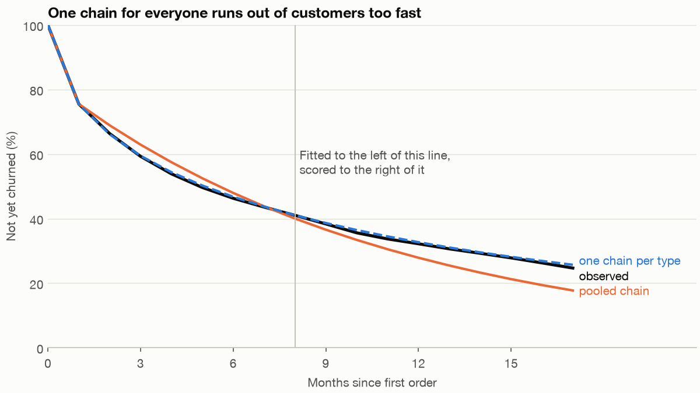
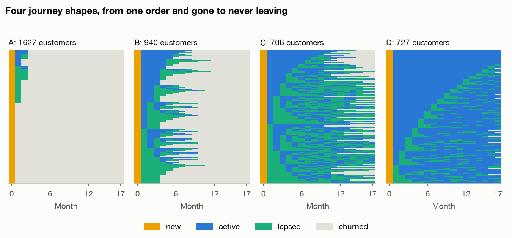

# States and sequences: Markov chains and optimal matching

Fernhill's finance lead wants one number for what a new customer is worth, and the growth lead wants to know which journeys end in a second order. A customer can be new, active, lapsed or gone, so both questions look like one small table of monthly moves between those states. That table gives a confident answer, £431, when the true figure is £513, because it averages customers who behave nothing like each other. This chapter builds the table, shows how it fails and how to catch the failure, then looks at the journeys themselves.

---

## The question and the data

The business question is **which journeys lead to a second order, and what is a customer in each state worth?**

There are two candidate tables, and they do different jobs:

- **`load_journeys(n_customers=4000)`** gives one row per customer per month for 18 months, with a recorded state, and `load_truth("journeys")` holds the chains that generated them. All the estimating and scoring in this chapter use this table, since only here can a method be scored. The column `true_journey_type` is used for scoring and for one marked comparison, never for fitting the methods you could use in practice.
- **`load_orders()`** is the real shape of the data most retailers hold, and it has no states in it and no truth. We use it once, to show how states get derived from an order log and what that costs. It is not used for any number below that section. The journeys are an overlay and don't reconcile with the orders.

The code blocks are the sections of `practice/ch08_states_sequences.py` in order, each relying on those before it, with the chart code left to the script. Run them with `uv run ch08_states_sequences.py` from the practice folder.

```python
import numpy as np
import pandas as pd
from scipy.cluster.hierarchy import fcluster, linkage
from scipy.spatial.distance import squareform
from sklearn.metrics import adjusted_rand_score, silhouette_score

from retail import CHANNELS, END, JOURNEY_STATES, load_journeys, load_orders, load_truth
from sequenzo import SequenceData, get_distance_matrix
```

```python
journeys, truth = load_journeys(), load_truth("journeys")
print(len(journeys), "rows,", journeys.customer_id.nunique(), "customers,", journeys.month_index.nunique(), "months each")
print(journeys[["customer_id", "channel", "month_index", "state", "orders", "revenue"]].iloc[18:22].to_string(index=False))
print(journeys.state.value_counts().reindex(STATES).to_string())
print(journeys.groupby("state").revenue.mean().reindex(STATES).round(2).to_string())

wide = journeys.pivot(index="customer_id", columns="month_index", values="state")
letters = wide.apply(lambda row: "".join(s[0].upper() for s in row), axis=1)
print(letters.value_counts().head(6).to_string())
```

```text
72000 rows, 4000 customers, 18 months each
 customer_id  channel  month_index   state  orders  revenue
           4 referral            0     new       1    29.26
           4 referral            1 churned       0     0.00
           4 referral            2 churned       0     0.00
           4 referral            3 churned       0     0.00
state
new         4000
active     17436
lapsed     11145
churned    39419
state
new        48.58
active     68.88
lapsed      0.00
churned     0.00
NCCCCCCCCCCCCCCCCC    978
NLCCCCCCCCCCCCCCCC    278
NLLCCCCCCCCCCCCCCC    138
NACCCCCCCCCCCCCCCC     89
NAAAAAAAAAAAAAAAAA     78
NALCCCCCCCCCCCCCCC     64
```

Written as letters, each customer's journey is a string: N for new, A for active, L for lapsed, C for churned. The most common by far is `NCCCCCCCCCCCCCCCCC`, one order and gone.

## States from an order log

An order log records purchases, not departures. So "churned" has to be a rule: here, four silent months. "Active" means an order this month and "lapsed" means fewer than four silent months.

```python
def states_from_orders(orders, silent_months=4, months=18):
    """Turn an order log into monthly states. `churned` here is a rule, not a recorded event."""
    orders = orders.assign(month=orders.order_date.dt.to_period("M"))
    first = orders.groupby("customer_id").month.min()
    first = first[first + months - 1 <= pd.Timestamp(END).to_period("M")]
    active = set(zip(orders.customer_id, orders.month))
    rows = []
    for customer, start in first.items():
        silent = 0
        for m in range(months):
            if m == 0:
                state = "new"
            elif (customer, start + m) in active:
                state, silent = "active", 0
            else:
                silent += 1
                state = "churned" if silent >= silent_months else "lapsed"
            rows.append((customer, m, state))
    return pd.DataFrame(rows, columns=["customer_id", "month_index", "state"])


def transition_counts(frame):
    frame = frame.sort_values(["customer_id", "month_index"])
    next_state = frame.groupby("customer_id").state.shift(-1)
    pairs = frame.assign(next_state=next_state).dropna(subset=["next_state"])
    return pd.crosstab(pairs.state, pairs.next_state).reindex(index=STATES, columns=STATES, fill_value=0)


def transition_matrix(frame, absorb=True):
    counts = transition_counts(frame).to_numpy(dtype=float).copy()
    if absorb:
        counts[3] = [0, 0, 0, 1]                     # churned stays churned
    return counts / counts.sum(axis=1, keepdims=True)


from_log = states_from_orders(load_orders())
print(from_log.customer_id.nunique(), "customers from the order log with 18 months of history")
print(pd.DataFrame(transition_matrix(from_log, absorb=False), index=STATES, columns=STATES).round(3).to_string())

# How often was the rule wrong? Customers it called churned who then bought again.
order_month = from_log.sort_values(["customer_id", "month_index"])
called = order_month[order_month.state == "churned"].groupby("customer_id").month_index.min()
came_back = order_month[order_month.state == "active"].groupby("customer_id").month_index.max()
print(f"{len(called)} customers ever called churned; {(came_back.reindex(called.index) > called).sum()} of them later ordered again ({(came_back.reindex(called.index) > called).mean():.1%})")
```

```text
12633 customers from the order log with 18 months of history
         new  active  lapsed  churned
new      0.0   0.151   0.849    0.000
active   0.0   0.320   0.680    0.000
lapsed   0.0   0.129   0.615    0.256
churned  0.0   0.024   0.000    0.976
12201 customers ever called churned; 2684 of them later ordered again (22.0%)
```

Two things come from this. The rates differ from those in the journeys table that follows, with new → lapsed at 0.849 against 0.312. The two tables aren't the same customers' histories, so nothing here should be read across. More importantly, churned is not absorbing: 22% of the customers the rule declared gone later ordered again. Every number in the rest of this chapter assumes a state that is really final. With an order log, that is an assumption you chose. Exercise 1 shows how far the rule moves it.

## The transition matrix

A **Markov chain** is a set of states and a table of probabilities of moving from each state to each other in one step, with the assumption that the next step depends only on the state you are in now. Estimating the table takes one line of logic: count the moves, and divide each row by its total.

```python
P = transition_matrix(journeys)
print(pd.DataFrame(P, index=STATES, columns=STATES).round(3).to_string())
print(f"largest gap to the generator's realised matrix: {np.abs(P - np.array(truth['realised_pooled_transition'])).max():.4f}")
```

```text
new  active  lapsed  churned
new      0.0   0.444   0.312    0.244
active   0.0   0.707   0.257    0.036
lapsed   0.0   0.351   0.516    0.132
churned  0.0   0.000   0.000    1.000
largest gap to the generator's realised matrix: 0.0000
```

Read a row across: of new customers, 44% are active next month, 31% lapsed and 24% churned. Active customers stay active 71% of the time, and lapsed customers come back 35% of the time.

## Absorbing states and time to churn

Churned has a 1 on the diagonal: once in, never out. That makes it an **absorbing state**, and the others **transient**. Grinstead and Snell (section 11.2) give the results we need. Call the transient-to-transient part of the table Q. Then the **fundamental matrix** N = (I − Q)⁻¹ holds the expected number of visits to each transient state from each starting state, and summing a row gives the expected number of steps before absorption, t = N·1. With one absorbing state, absorption is certain. First, a check against a worked example with a known answer: their drunkard's walk on five corners, for which they print N and t = (3, 4, 3).

```python
# Grinstead and Snell's drunkard's walk, section 11.2: states 0..4 with 0 and 4 absorbing, so we know the answer.
Q_check = np.array([[0, .5, 0], [.5, 0, .5], [0, .5, 0]])
N_check = np.linalg.inv(np.eye(3) - Q_check)
print("drunkard's walk N:", N_check.round(3).tolist(), " t:", N_check.sum(axis=1).round(3).tolist())

Q = P[:3, :3]
N = np.linalg.inv(np.eye(3) - Q)
print(pd.DataFrame(N, index=STATES[:3], columns=STATES[:3]).round(2).abs().to_string())
months_to_churn = N.sum(axis=1)
print("months to churn, pooled chain:", {s: round(float(m), 2) for s, m in zip(STATES[:3], months_to_churn)})
share = truth["realised_type_share"]
true_months = sum(share[t] * truth["by_type"][t]["months_to_churn"]["new"] for t in share)
print(f"months to churn for a new customer, truth: {true_months:.2f}")
```

```text
drunkard's walk N: [[1.5, 1.0, 0.5], [1.0, 2.0, 1.0], [0.5, 1.0, 1.5]]  t: [3.0, 4.0, 3.0]
        new  active  lapsed
new     1.0    6.31     4.0
active  0.0    9.42     5.0
lapsed  0.0    6.84     5.7
months to churn, pooled chain: {'new': 11.31, 'active': 14.42, 'lapsed': 12.54}
months to churn for a new customer, truth: 13.91
```

The check passes. The pooled chain then says a new customer lasts 11.31 months. The truth is 13.91. Hold on to that gap.

## Markov CLV, and what the pooled chain gets wrong

Modelling a customer relationship as a Markov chain with a reward in each state, and reading lifetime value from it, is usually credited to Pfeifer and Carraway (2000). We couldn't get the paper, so the algebra below is derived here and not quoted from it. A customer's value in a state is this month's revenue R plus the discounted value of wherever they go next, V = R + P·V/(1 + d). That is linear, so solve it in one step: V = (I − P/(1 + d))⁻¹ R. Later, in the [reinforcement learning pillar](../../../generative-ai/05-RL/README.md), the same equation returns: a Markov chain with rewards is a decision process without decisions.

```python
DISCOUNT = truth["monthly_discount"]


def rewards(frame):
    return frame.groupby("state").revenue.mean().reindex(STATES).fillna(0).to_numpy()


def chain_value(matrix, reward, discount=DISCOUNT):
    """V = R + P V / (1 + d), solved in one step rather than simulated."""
    return np.linalg.solve(np.eye(4) - matrix / (1 + discount), reward)


R = rewards(journeys)
pooled_value = chain_value(P, R)
print("pooled chain value by state:", {s: round(float(v), 2) for s, v in zip(STATES, pooled_value)})
print(f"true value of a new customer: {truth['true_value_of_new_customer']:.2f}")

rows = []
for t in share:
    part = journeys[journeys.true_journey_type == t]
    v = chain_value(transition_matrix(part), rewards(part))[0]
    rows.append({"type": t, "share": share[t], "value_estimated": v, "value_true": truth["by_type"][t]["value"]["new"], "lapsed_true": truth["by_type"][t]["value"]["lapsed"],
                 "second_order_true": truth["by_type"][t]["p_second_order"], "months_to_churn": truth["by_type"][t]["months_to_churn"]["new"]})
types = pd.DataFrame(rows).set_index("type")
print(types.round(3).to_string())
print(f"mixture of type chains: {(types.share * types.value_estimated).sum():.2f}")

channel_values = {}
for channel in CHANNELS:
    part = journeys[journeys.channel == channel]
    channel_values[channel] = (part.customer_id.nunique() / journeys.customer_id.nunique(), chain_value(transition_matrix(part), rewards(part))[0])
print({c: round(float(v[1]), 1) for c, v in channel_values.items()})
print(f"mixture of channel chains: {sum(w * v for w, v in channel_values.values()):.2f}")

# Resample customers to see how far 18 months of data pin these numbers down.
def customer_arrays(frame, last_month=17):
    """Per customer: transition counts, visits to each state, and revenue earned in each state."""
    frame = frame.sort_values(["customer_id", "month_index"])
    codes_long = frame.state.map(INDEX).to_numpy().reshape(-1, 18)[:, :last_month + 1]
    revenue_long = frame.revenue.to_numpy().reshape(-1, 18)[:, :last_month + 1]
    n = np.arange(len(codes_long))[:, None]
    counts, seen, money = np.zeros((len(n), 4, 4)), np.zeros((len(n), 4)), np.zeros((len(n), 4))
    np.add.at(counts, (n, codes_long[:, :-1], codes_long[:, 1:]), 1)
    np.add.at(seen, (n, codes_long), 1)
    np.add.at(money, (n, codes_long), revenue_long)
    return counts, seen, money


pair_counts, visits, earned = customer_arrays(journeys)
kind = journeys.sort_values(["customer_id", "month_index"]).true_journey_type.to_numpy()[::18]
n_customers = len(pair_counts)


def value_from(counts, visit, earn):
    counts = counts.copy()
    counts[3] = [0, 0, 0, 1]
    matrix = counts / counts.sum(axis=1, keepdims=True)
    return chain_value(matrix, earn / np.maximum(visit, 1))[0]


rng = np.random.default_rng(8)
draws = []
for _ in range(500):
    pick = rng.integers(0, n_customers, n_customers)
    c, v, e, k = pair_counts[pick], visits[pick], earned[pick], kind[pick]
    by_kind = {t: value_from(c[k == t].sum(axis=0), v[k == t].sum(axis=0), e[k == t].sum(axis=0)) for t in share}
    draws.append((value_from(c.sum(axis=0), v.sum(axis=0), e.sum(axis=0)), sum((k == t).mean() * by_kind[t] for t in share), by_kind["steady"]))
low, high = np.percentile(draws, [2.5, 97.5], axis=0)
print(f"95% intervals: pooled {low[0]:.0f} to {high[0]:.0f}; mixture of type chains {low[1]:.0f} to {high[1]:.0f}; steady alone {low[2]:.0f} to {high[2]:.0f}")
steady = journeys[journeys.true_journey_type == "steady"]
print("steady, active row estimated:", transition_matrix(steady)[1].round(3).tolist(), " true:", np.round(truth["transition"]["steady"][1], 3).tolist())
```

```text
pooled chain value by state: {'new': 430.73, 'active': 580.02, 'lapsed': 412.61, 'churned': 0.0}
true value of a new customer: 513.29
              share  value_estimated  value_true  lapsed_true  second_order_true  months_to_churn
type
steady        0.239         1688.931    1485.934     1258.843              0.979           32.864
drifter       0.274          233.137     230.317      115.996              0.775            7.894
one_and_done  0.316           54.197      53.350        4.986              0.069            1.515
comeback      0.170          443.085     458.150      414.767              0.890           20.000
mixture of type chains: 560.28
{'paid_social': 227.2, 'organic': 461.7, 'email': 721.0, 'referral': 453.1}
mixture of channel chains: 439.20
95% intervals: pooled 411 to 451; mixture of type chains 521 to 595; steady alone 1557 to 1815
steady, active row estimated: [0.0, 0.859, 0.124, 0.017]  true: [0.0, 0.85, 0.13, 0.02]
```

The pooled chain says £430.73, against a true £513.29. Why? No customer actually behaves like the average row. Steady customers are worth about £1,486 and last 33 months; one-and-done customers are worth £53. Value is curved in retention, because a customer who stays longer also has longer to go on staying, so the value of the average customer is lower than the average value of customers. The channel split barely helps (£439) because each channel is itself a mix.

The pooled value by state misleads in a further way. It puts a lapsed customer at £413, nearly as good as new. Across the true types, a lapsed customer is worth from £5 to £1,259. A lapse means something completely different depending on who lapsed, and the pooled chain can't say who.

Our repair has a wrinkle. One chain per type, using the true labels, gives £560, which overshoots, and its interval of £521 to £595 excludes the truth. The steady chain is the culprit, at £1,689 against £1,486: its active row came out at a churn of 0.017 where the truth is 0.02, and because that customer lasts so long, a tiny error in a tiny number moves the value a lot. Is that the method or this dataset? Again, ask other seeds.

```python
def plain_value(frame):
    return chain_value(transition_matrix(frame), rewards(frame))[0]


rows = []
for seed in range(100, 112):
    other, known = load_journeys(seed=seed), load_truth("journeys", seed=seed)
    weights = known["realised_type_share"]
    rows.append({"truth": known["true_value_of_new_customer"], "pooled": plain_value(other),
                 "type_chains": sum(weights[t] * plain_value(other[other.true_journey_type == t]) for t in weights)})
print(pd.DataFrame(rows).agg(["mean", "min", "max"]).round(1).to_string())
```

```text
truth  pooled  type_chains
mean  515.0   415.8        515.1
min   492.8   395.5        479.7
max   526.8   431.6        542.9
```

Over twelve other seeds, the type chains average £515.1 against a true £515.0, while the pooled chain averages £415.8, about 19% low. So the pooling bias is real and the overshoot belonged to this dataset. Treat any value driven by a very low churn rate as a wide range, even with perfect labels.

## Which journeys lead to a second order

A second order means reaching the active state at least once.

```python
ever = journeys.groupby("customer_id").agg(orders=("orders", "sum"), channel=("channel", "first"), kind=("true_journey_type", "first"))
ever["second"] = ever.orders >= 2


def p_second(matrix):
    return matrix[0, 1] + matrix[0, 2] * matrix[2, 1] / (1 - matrix[2, 2])


true_second = sum(share[t] * truth["by_type"][t]["p_second_order"] for t in share)
print(f"second order within 18 months: {ever.second.mean():.3f}; truth with no time limit {true_second:.3f}; pooled chain says {p_second(P):.3f}")
print(ever.groupby("channel").second.mean().loc[CHANNELS].round(3).to_string())
print(ever.groupby("kind").second.mean().loc[list(share)].round(3).to_string())

# What a lapse does: chance of coming back, by how long the customer has been silent.
ordered = journeys.sort_values(["customer_id", "month_index"]).copy()
ordered["next_state"] = ordered.groupby("customer_id").state.shift(-1)
ordered["prev_state"] = ordered.groupby("customer_id").state.shift(1)
run = (ordered.state != ordered.state.shift()).cumsum()
ordered["run_length"] = ordered.groupby(run).cumcount() + 1
lapsed = ordered[(ordered.state == "lapsed") & ordered.next_state.notna()]
back = lapsed.groupby(lapsed.run_length.clip(upper=5)).next_state.agg(n="size", returned=lambda x: (x == "active").mean(), churned=lambda x: (x == "churned").mean())
print(back.round(3).to_string())
```

```text
second order within 18 months: 0.620; truth with no time limit 0.620; pooled chain says 0.670
channel
paid_social    0.404
organic        0.673
email          0.808
referral       0.660
kind
steady          0.975
drifter         0.765
one_and_done    0.087
comeback        0.877
               n  returned  churned
run_length
1           5401     0.369    0.129
2           2632     0.356    0.132
3           1304     0.340    0.130
4            680     0.316    0.116
5            806     0.266    0.175
```

Overall 62% order again, and most of the difference is decided early and by who the customer is: 40% of paid social customers against 81% from email, and 9% of one-and-dones against 98% of the steady. The pooled chain says 67%, which is too high, as it treats everyone as if they had the return rate of the mix that survives to lapse.

The lapse table answers a practical question: is there a point when a lapsed customer stops coming back? Not a sharp one in these data. The monthly return rate falls gently, from 37% after one silent month to 27% at five or more. That is a description of who returned, and whether a win-back email would add to it takes the kind of holdout in [chapter 5](05-segmentation-and-rfm.md).

## Checking the chain: the Markov property and a holdout

A transition matrix is a description of the past. It forecasts only if the process is **stationary**, meaning the same table applies later, and the Markov assumption holds. Both can be tested without the truth.

```python
active = ordered[(ordered.state == "active") & ordered.next_state.notna()]
print("P(active next | active now), by the month before:")
print(active.groupby("prev_state").next_state.agg(n="size", stay=lambda x: (x == "active").mean()).round(3).to_string())
print("the same within one type (steady):")
print(active[active.true_journey_type == "steady"].groupby("prev_state").next_state.agg(n="size", stay=lambda x: (x == "active").mean()).round(3).to_string())
```

```text
P(active next | active now), by the month before:
                n   stay
prev_state
active      11345  0.772
lapsed       3651  0.521
new          1774  0.679
the same within one type (steady):
               n   stay
prev_state
active      8505  0.857
lapsed      1089  0.859
new          817  0.880
```

If the chain were correct, the month before wouldn't matter. It matters a lot: 77% stay after two active months, 52% after coming back from a lapse. Within one true type the difference goes away, at 86%, 86% and 88%. So history predicts the next move only because it reveals what kind of customer this is. That is the signature of a mix.

```python
SPLIT = 8
train = journeys[journeys.month_index <= SPLIT]
late = journeys[journeys.month_index >= SPLIT]
P_early, P_late = transition_matrix(train), transition_matrix(late)
print("fitted on months 0-8:")
print(pd.DataFrame(P_early, index=STATES, columns=STATES).round(3).to_string())
print("fitted on months 8-17:")
print(pd.DataFrame(P_late, index=STATES, columns=STATES).drop("new").round(3).to_string())


def curves(matrix, reward, months=18):
    start = np.array([1.0, 0, 0, 0])
    alive, revenue = [], []
    for _ in range(months):
        alive.append(1 - start[3])
        revenue.append(start @ reward)
        start = start @ matrix
    return np.array(alive), np.array(revenue)


observed_alive = journeys.groupby("month_index").state.apply(lambda s: (s != "churned").mean()).to_numpy()
observed_revenue = journeys.groupby("month_index").revenue.mean().to_numpy()
pooled_alive, pooled_revenue = curves(P_early, rewards(train))
mix_alive, mix_revenue = np.zeros(18), np.zeros(18)
for t in share:
    part = train[train.true_journey_type == t]
    a, r = curves(transition_matrix(part), rewards(part))
    mix_alive += share[t] * a
    mix_revenue += share[t] * r
print(f"{'':30s}{'alive at 17':>12s}{'revenue, months 9-17':>22s}")
print(f"{'observed':30s}{observed_alive[17]:12.3f}{observed_revenue[9:].sum():22.2f}")
print(f"{'pooled chain, months 0-8':30s}{pooled_alive[17]:12.3f}{pooled_revenue[9:].sum():22.2f}")
print(f"{'type chains, months 0-8':30s}{mix_alive[17]:12.3f}{mix_revenue[9:].sum():22.2f}")
```

```text
fitted on months 0-8:
         new  active  lapsed  churned
new      0.0   0.444   0.312    0.244
active   0.0   0.694   0.265    0.041
lapsed   0.0   0.325   0.522    0.153
churned  0.0   0.000   0.000    1.000
fitted on months 8-17:
         new  active  lapsed  churned
active   0.0   0.724   0.247    0.029
lapsed   0.0   0.391   0.508    0.101
churned  0.0   0.000   0.000    1.000
                               alive at 17  revenue, months 9-17
observed                             0.247                126.17
pooled chain, months 0-8             0.178                 94.76
type chains, months 0-8              0.257                128.34
```

Fit on the first nine months, score on the rest. Later moves look better, with churn from lapsed falling from 15% to 10% and returns from lapsed rising from 33% to 39%. Nothing has changed at Fernhill. Those are simply the types that remain. A chain fitted to the early months reaches 17.8% still here where 24.7% are, and misses a quarter of the later revenue (£94.76 against £126.17).



*Image Source: generated by `practice/ch08_states_sequences.py`. The type chains use the true labels, so this line shows what is possible, not what you can do on real data.*

The type chains need labels that real data lack. A **mixture of Markov chains** doesn't: it assumes several chains and estimates, using expectation-maximisation, both the chains and how likely each customer is to belong to each. [Latent class analysis](../../../data-science/01-classical-ml/notes/05b-clustering-categorical-and-mixed-data.md#latent-class-a-model-of-how-customers-arise) is the same idea applied to a table of columns instead of a sequence.

```python
def fit_mixture(counts, visits_each, earned_each, k=4, iterations=300, seed=8):
    """EM for a mixture of Markov chains: no labels needed, each customer is only ever weighted by the chains' likelihood."""
    rng = np.random.default_rng(seed)
    resp = rng.dirichlet(np.ones(k), len(counts))
    for _ in range(iterations):
        weights = resp.mean(axis=0)
        chains = np.einsum("ni,nab->iab", resp, counts) + .5
        chains /= chains.sum(axis=2, keepdims=True)
        log_like = np.log(weights) + np.einsum("nab,iab->ni", counts, np.log(chains))
        resp = np.exp(log_like - log_like.max(axis=1, keepdims=True))
        resp /= resp.sum(axis=1, keepdims=True)
    chains[:, 3] = [0, 0, 0, 1]
    reward = np.einsum("ni,na->ia", resp, earned_each) / np.maximum(np.einsum("ni,na->ia", resp, visits_each), 1)
    return resp.mean(axis=0), chains, reward, log_like


early, early_visits, early_earned = customer_arrays(journeys, last_month=SPLIT)
em_weights, em_chains, em_reward, _ = fit_mixture(early, early_visits, early_earned)
em_alive, em_revenue = np.zeros(18), np.zeros(18)
for w, c, r in zip(em_weights, em_chains, em_reward):
    a, rev = curves(c, r)
    em_alive += w * a
    em_revenue += w * rev
print(f"{'mixture of 4 chains, no labels':30s}{em_alive[17]:12.3f}{em_revenue[9:].sum():22.2f}")

rows = []
for k in (2, 3, 4, 5):
    w8, c8, r8, _ = fit_mixture(pair_counts, visits, earned, k=k)
    rows.append({"k": k, "value_new": sum(w * chain_value(c, r)[0] for w, c, r in zip(w8, c8, r8))})
print(pd.DataFrame(rows).round(1).to_string(index=False), f"  truth {truth['true_value_of_new_customer']:.1f}")
found = [sum(w * chain_value(c, r)[0] for w, c, r in zip(*fit_mixture(*customer_arrays(load_journeys(seed=seed)))[:3])) for seed in range(100, 112)]
known = [load_truth("journeys", seed=seed)["true_value_of_new_customer"] for seed in range(100, 112)]
print(f"12 other seeds: mixture mean {np.mean(found):.1f}, range {min(found):.1f} to {max(found):.1f}; truth mean {np.mean(known):.1f}")
w4, c4, r4, _ = fit_mixture(pair_counts, visits, earned)
print(pd.DataFrame({"share": w4, "stay_active": c4[:, 1, 1], "active_to_churn": c4[:, 1, 3], "lapsed_to_churn": c4[:, 2, 3], "value_new": [chain_value(c, r)[0] for c, r in zip(c4, r4)]}).sort_values("value_new").round(3).to_string(index=False))
```

```text
mixture of 4 chains, no labels       0.280                131.31
 k  value_new
 2      454.3
 3      592.4
 4      571.7
 5      573.4   truth 513.3
12 other seeds: mixture mean 504.7, range 470.6 to 548.1; truth mean 515.0
 share  stay_active  active_to_churn  lapsed_to_churn  value_new
 0.181        0.350            0.397            0.527     64.597
 0.348        0.623            0.061            0.192    226.097
 0.202        0.288            0.052            0.049    367.964
 0.269        0.859            0.016            0.063   1513.984
```

On the holdout it gets within 4% of the observed revenue (£131.31 against £126.17), though it overshoots survival at 28.0% against 24.7%. Fitted to everything it recovers a steady-like group of 27% (the truth is 24%) worth £1,514, and values a new customer at £572, in the same range as the labelled chains on this dataset. Over twelve other seeds it averages £504.7 against £515.0, so it repairs most of the bias without any labels. Its value depends on k: two chains give £454, three to five give £572 to £592, so report that range too.

## Journeys as strings: optimal matching

Now set the model aside and look at journeys as sequences. Sociologists have long asked how similar two life courses are, and the classic answer is **optimal matching** (OM), which Abbott introduced to the field from Levenshtein's work on strings and Needleman and Wunsch's alignment algorithm (Gabadinho et al., 2011, section 8.2). The distance between two sequences is the cheapest total cost of edits that turns one into the other, using **substitutions** (swap one state for another) and **indels** (insert or delete one). Despite the name, this is unrelated to the treated-and-control [matching](../../03-experimentation-and-causality/notes/05-matching-and-weighting.md) of causal inference: nobody here is treated, and the distance compares whole histories.

We use two implementations: a dozen lines of dynamic programming so you can see it, and `sequenzo` (version 0.1.42, a Python package that builds on TraMineR) for the full matrix. It installed and ran without trouble, though it prints a banner on import and when it runs, which the script silences.

```python
def edit_distance(a, b, sub, indel):
    """Needleman-Wunsch: cheapest set of insertions, deletions and substitutions turning a into b."""
    grid = np.zeros((len(a) + 1, len(b) + 1))
    grid[:, 0] = np.arange(len(a) + 1) * indel
    grid[0, :] = np.arange(len(b) + 1) * indel
    for i in range(1, len(a) + 1):
        for j in range(1, len(b) + 1):
            grid[i, j] = min(grid[i - 1, j - 1] + sub[a[i - 1], b[j - 1]],
                             grid[i - 1, j] + indel,
                             grid[i, j - 1] + indel)
    return grid[-1, -1]


def trate_costs(counts):
    """Substitution cost 2 - p(i|j) - p(j|i): states that often follow each other are cheap to swap."""
    rates = counts / counts.sum(axis=1, keepdims=True)
    cost = 2 - rates - rates.T
    np.fill_diagonal(cost, 0)
    return cost


to_index = lambda s: [INDEX[x] for x in s]
pair_a, pair_b = wide.loc[1].tolist(), wide[wide.apply(lambda r: r.tolist().count("active"), axis=1) == 17].iloc[0].tolist()
print("".join(s[0].upper() for s in pair_a))
print("".join(s[0].upper() for s in pair_b))
constant = 2 * (1 - np.eye(4))
print("hand distance, substitution 2, indel 1:", edit_distance(to_index(pair_a), to_index(pair_b), constant, 1))
```

```text
NLLCCCCCCCCCCCCCCC
NAAAAAAAAAAAAAAAAA
hand distance, substitution 2, indel 1: 34.0
```

These share only the opening N, so all 17 other months need changing, at 2 each. Substitution 2 and indel 1 is a special case, as Gabadinho et al. point out: OM then reduces to a distance based on the longest common subsequence, and `sequenzo` says so when it runs it.

Costs are the contentious part of OM. A popular data-driven choice, **TRATE**, sets the cost of swapping two states to 2 − p(i|j) − p(j|i), so that states that often follow each other are cheap to swap.

```python
columns = [f"m{i:02d}" for i in wide.columns]
frame = wide.copy()
frame.columns = columns
frame = frame.reset_index()


def om_matrix(table, sm, indel=1):
    with contextlib.redirect_stdout(io.StringIO()):
        data = SequenceData(table, time=[c for c in table.columns if c != "customer_id"], states=STATES, id_col="customer_id")
        distance = get_distance_matrix(data, method="OM", sm=sm, indel=indel, norm="none")
    distance = np.asarray(distance, dtype=float)
    return (distance + distance.T) / 2


cost = trate_costs(transition_counts(journeys).to_numpy(dtype=float))
print(pd.DataFrame(cost, index=STATES, columns=STATES).round(3).to_string())

D = om_matrix(frame, "TRATE")
D_constant = om_matrix(frame, "CONSTANT")
rng = np.random.default_rng(8)
pairs = rng.integers(0, len(frame), size=(300, 2))
by_position = wide.to_numpy()
hand_constant = np.array([edit_distance(to_index(by_position[i]), to_index(by_position[j]), constant, 1) for i, j in pairs])
hand_trate = np.array([edit_distance(to_index(by_position[i]), to_index(by_position[j]), cost, 1) for i, j in pairs])
print(f"300 random pairs, largest gap between hand and sequenzo: constant {np.abs(hand_constant - D_constant[pairs[:, 0], pairs[:, 1]]).max():.4f}, TRATE {np.abs(hand_trate - D[pairs[:, 0], pairs[:, 1]]).max():.4f}")
print(f"{letters.nunique()} distinct sequences among {len(letters)} customers; mean distance {D[np.triu_indices_from(D, 1)].mean():.2f}")
```

```text
new  active  lapsed  churned
new      0.000   1.556   1.688    1.756
active   1.556   0.000   1.392    1.964
lapsed   1.688   1.392   0.000    1.868
churned  1.756   1.964   1.868    0.000
300 random pairs, largest gap between hand and sequenzo: constant 0.0000, TRATE 0.0000
1466 distinct sequences among 4000 customers; mean distance 15.95
```

The hand version and `sequenzo` agree on 300 random pairs, to four decimal places, under both cost schemes, so we can trust the package here. Notice how little TRATE varies, from 1.39 to 1.96. Those costs aren't deep facts about customers; they are a summary of the same table we just distrusted.

## Clustering into journey types

The distance matrix goes into **hierarchical clustering**: start with every customer on their own and keep joining the nearest groups. We use Ward's linkage, though it strictly assumes Euclidean distances, which OM distances are not.

```python
np.fill_diagonal(D, 0)
Z = linkage(squareform(D, checks=False), "ward")
true_type = journeys.groupby("customer_id").true_journey_type.first().loc[wide.index]
print("k  silhouette  adjusted Rand against the true types")
for k in (2, 3, 4, 5, 6, 8):
    labels = fcluster(Z, k, "maxclust")
    print(f"{k}  {silhouette_score(D, labels, metric='precomputed'):.3f}       {adjusted_rand_score(true_type, labels):.3f}")

K = 4
cluster = pd.Series(fcluster(Z, K, "maxclust"), index=wide.index, name="cluster")
ranking = journeys.groupby("customer_id").revenue.sum().groupby(cluster).mean().sort_values().index       # A earns least, D most
cluster = cluster.map(dict(zip(ranking, "ABCD")))
print(pd.crosstab(cluster, true_type)[list(share)].to_string())

summary = pd.DataFrame({"n": cluster.value_counts().sort_index(), "second_order": ever.second.groupby(cluster).mean(), "orders": ever.orders.groupby(cluster).mean(),
                        "revenue_18m": journeys.groupby("customer_id").revenue.sum().groupby(cluster).mean()})
medoids = {}
for c in sorted(cluster.unique()):
    members = np.where(cluster.values == c)[0]
    medoids[c] = letters.iloc[members[D[np.ix_(members, members)].sum(axis=1).argmin()]]
summary["medoid"] = pd.Series(medoids)
summary["channel_paid_social"] = (ever.channel == "paid_social").groupby(cluster).mean()
print(summary.round(3).to_string())
```

```text
k  silhouette  adjusted Rand against the true types
2  0.680       0.235
3  0.554       0.357
4  0.504       0.399
5  0.509       0.403
6  0.493       0.397
8  0.490       0.356
true_journey_type  steady  drifter  one_and_done  comeback
cluster
A                      51      277          1184       115
B                     125      552            81       182
C                     138      212             0       356
D                     642       56             0        29
            n  second_order  orders  revenue_18m              medoid  channel_paid_social
cluster
A        1627         0.143   1.213       58.875  NCCCCCCCCCCCCCCCCC                0.419
B         940         0.866   4.252      206.123  NALALLCCCCCCCCCCCC                0.227
C         706         0.999   9.800      483.027  NALALLALLAALLALLCC                0.166
D         727         1.000  21.411     1051.912  NAAAAAAAAAAAAAAAAA                0.129
```

The silhouette, which measures how well separated clusters are, peaks at k = 2: gone against stayed. It is about flat between 4 and 6. We keep four because it reads well as a description, and that is a judgement, not a result. Against the truth, the adjusted Rand index (1 is perfect agreement, 0 is chance) reaches about 0.40 and no higher at any k. OM doesn't recover the generating types, for an honest reason: a steady customer who happens to leave early produces the same string as a drifter, and 51 of them sit in cluster A.

The **medoid** of each cluster is its most central real journey, and it is the shortest way of reporting what the cluster is. A: one order and gone. B: a few on-and-off months and gone. C: on and off for the whole window. D: active throughout. An **index plot** draws every customer as a row of coloured months.



*Image Source: generated by `practice/ch08_states_sequences.py`. Each row is a customer, sorted within the cluster.*

## Description, not prediction

It's tempting to feed these clusters back into the chain, since they look like the types the chain needs.

```python
rows = []
for c in order:
    part = journeys[journeys.customer_id.isin(cluster.index[cluster == c])]
    counts = transition_counts(part).to_numpy(dtype=float) + 1     # one pseudo-count, because some clusters never visit a state
    counts[3] = [0, 0, 0, 1]
    matrix = counts / counts.sum(axis=1, keepdims=True)
    rows.append({"cluster": c, "share": (cluster == c).mean(), "value": chain_value(matrix, rewards(part))[0], "stay_active": matrix[1, 1]})
by_cluster = pd.DataFrame(rows).set_index("cluster")
print(by_cluster.round(3).to_string())
print(f"mixture of cluster chains: {(by_cluster.share * by_cluster.value).sum():.2f}   truth {truth['true_value_of_new_customer']:.2f}   pooled {pooled_value[0]:.2f}")
```

```text
share     value  stay_active
cluster
A        0.407    58.907        0.175
B        0.235   198.563        0.520
C        0.176   652.764        0.508
D        0.182  3935.663        0.866
mixture of cluster chains: 901.14   truth 513.29   pooled 430.73
```

That gives £901, about 1.75 times the truth, and cluster D's value of £3,936 is more than two and a half times the true steady value of £1,486. The clusters were formed by looking at the outcome. Cluster D holds customers who happened to stay, so of course its chain says people stay. The mixture model weighs the evidence for each customer without sorting on the result, which is why it could value customers and this can't.

That is what description means here. OM tells you what shapes journeys took, after the fact, for customers whose journeys you have already seen. It doesn't tell you what a new customer will do, or why anyone did anything. Abbott and Tsay's review (2000; we read the abstract only) found its most promising uses in careers and sequentially organised cultural artefacts. The critics went further. Wu's reply in the same issue, known to us through Halpin's account (2008), argued that alignment worked in biology because it matches how mutation works, while the analogy to life-course change is weak. Halpin himself disputes part of that, and puts the two methods side by side: hazard models address the generating process, while sequence analysis is more descriptive and exploratory, as a complement and not a competitor.

Description is the right deliverable when the decision is about what to name, what to look at or what to build. If the growth team needs to hear that about 41% of customers sit in a mostly one-order-and-gone shape, and that nearly one in five are on and off for 18 months with no clear break, an index plot does that better than any model. When someone asks what a new customer is worth, or what would happen if we changed something, it is the wrong tool.

## Recommendation

- **Don't budget on the pooled chain.** It values a new customer at £431 and is, across seeds, about 19% low. Quote the mixture instead, with its range: on these data about £454 to £592, depending on the number of chains and with the steady-like group driving it.
- **Don't value a "lapsed" customer from the pooled row.** The £413 is an average over groups worth £5 and £1,259.
- **Put the effort into the first month.** By month 1 a quarter of customers have gone, and a customer's first move and channel say most of what is known about a second order. Whether anything changes that first move takes an experiment, and this chapter offers none.
- **Check any chain on a holdout before it forecasts,** using the month-before table and a later period. Both flagged the pooled chain here without help from the truth.
- **Use the four journey shapes to explain, not to score.** They are how to tell the growth team what is happening.

The main limit is that all of this comes from recorded states and a tidy mix of first-order chains, because that is what the generator contains. An order log needs a churn rule, and 22% of those it calls gone come back. What would change the recommendation: on your own data, a mixture that does no better than the pooled chain on a holdout would mean heterogeneity isn't the problem.

## Pitfalls

- **Treating an inferred state as an observed one.** The symptom is a "churned" row with non-zero moves out of it. In an order log, churn is your rule, so test how it moves the result.
- **Pooling unlike customers.** The symptom is a chain that forecasts too few survivors and that depends on the month before. Check the second-order table, then try a mixture.
- **Reading stationarity failure as a real-world change.** The later table looks better because the worst customers have gone, not because anything improved.
- **Clustering on the outcome and then predicting it.** The symptom is a surprisingly large value for the best cluster (£3,936 here). Clusters formed on a whole history can't value that history.
- **Trusting a low-churn value.** A churn rate of 0.017 against 0.02 moved the steady value by 14%. Report a range.
- **Taking a silhouette as a count of real types.** It preferred two clusters here, where the generator has four, and four clusters agreed with the truth only moderately.
- **Treating substitution costs as discovered facts.** They are a modelling choice. Show how the clusters change when you change them.

## Try it

Exercises use `practice/ch08_states_sequences.py`.

1. Change `silent_months` in `states_from_orders` to 2, 3, 6 and 9. How often is the rule wrong?

   <details><summary>Answer</summary>

   The share of customers called churned who later order again is 33.5% at two months, 27.2% at three, 22.0% at four, 13.5% at six and 6.6% at nine. A longer wait means fewer mistakes and a later verdict, so you have to choose between them and the data can't choose for you.
   </details>

2. Change the monthly discount to 0.005, 0.02 and 0.03. Does discounting change how wrong the pooled chain looks against the type chains?

   <details><summary>Answer</summary>

   The ratio of pooled value to type-chain value on this dataset is 0.72 at 0.005, 0.77 at 0.01, 0.84 at 0.02 and 0.89 at 0.03. A heavier discount shrinks the far future, which is where the long-lasting types make their money and where pooling does its damage. Try `discount=0` too: the system is singular, because the churned row of I − P is then all zeros, and the equation can't pin down a churned customer's value.
   </details>

3. Rerun the clustering with `om_matrix(frame, "TRATE", indel=2)` and `om_matrix(frame, "CONSTANT")`. Does the choice of costs matter?

   <details><summary>Answer</summary>

   At k = 4 the adjusted Rand index goes from 0.399 for TRATE with indel 1 to 0.364 with indel 2 and 0.352 for constant costs, with silhouettes of 0.504, 0.497 and 0.547. The choice moves things a little, and the best-separated option is not the one that best matches the truth.
   </details>

## Interview checklist

| Question | Answer |
|---|---|
| What is the Markov property? | The next state depends only on the current one, and not on how you got there |
| How do you estimate a transition matrix? | Count moves between states and divide each row by its total |
| What is an absorbing state? | One you can't leave. Churned is one, if churn is recorded rather than inferred |
| What is the fundamental matrix? | N = (I − Q)⁻¹ gives expected visits to each transient state; its row sums give expected time to absorption |
| How do you get lifetime value from a chain? | Solve V = R + P·V/(1 + d), so V = (I − P/(1 + d))⁻¹ R |
| Why does a pooled chain undervalue customers? | Value is curved in retention, so the value of the average customer is less than the average of customer values. Here by about 19% |
| How do you test a chain without the truth? | Check whether the previous state still predicts the next, and score on a later period |
| What is optimal matching? | The cheapest set of substitutions and indels turning one sequence into another, computed by dynamic programming |
| What is TRATE? | A substitution cost of 2 − p(i\|j) − p(j\|i), so frequent neighbours are cheap to swap |
| Can clusters of journeys predict value? | Not when they are formed on the same journeys: here they inflated the value by about 75%. They describe |
| When is description the right deliverable? | When the decision is about what is happening and what to name, not what will happen or why |

## Next

States and chains give one route to lifetime value. [Marketing measurement](09-marketing-measurement.md) takes up the rest of it: attribution, mix models and lifetime value fitted as a model, and what each marketing pound buys.
