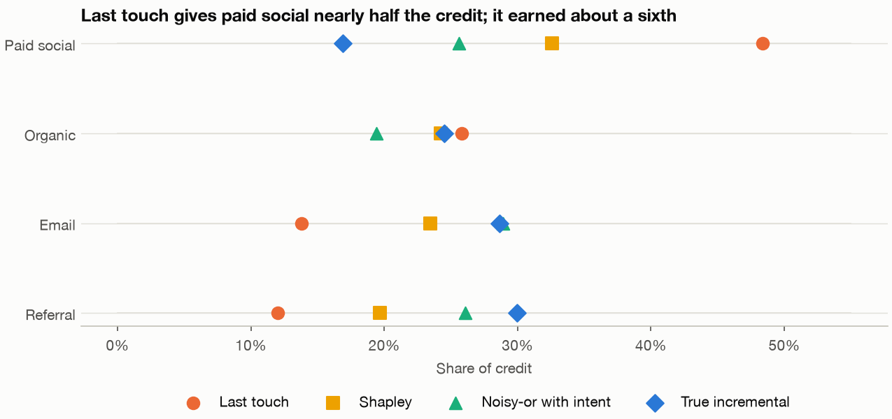
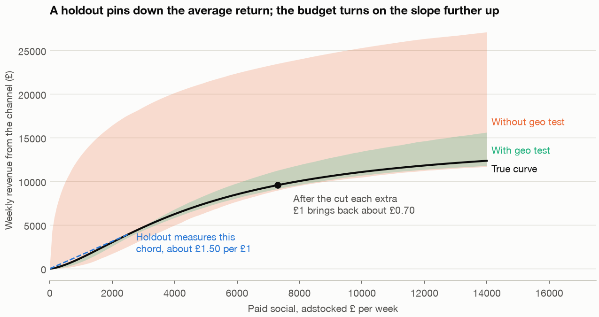
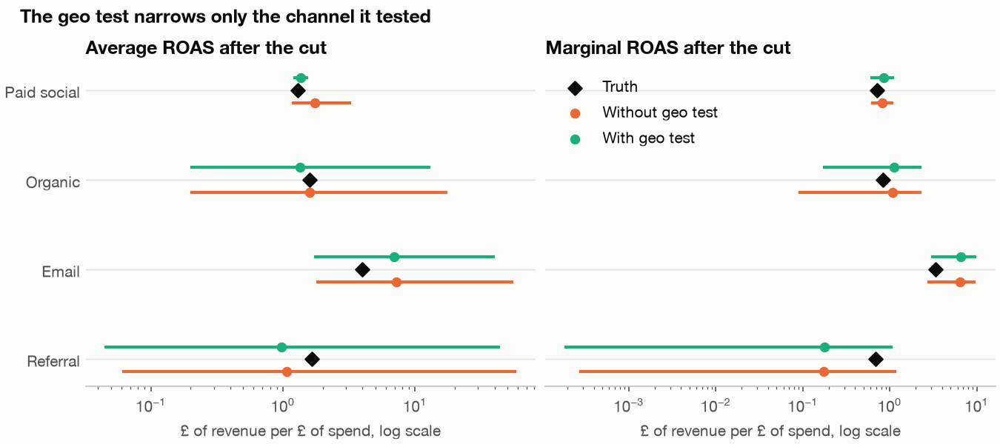
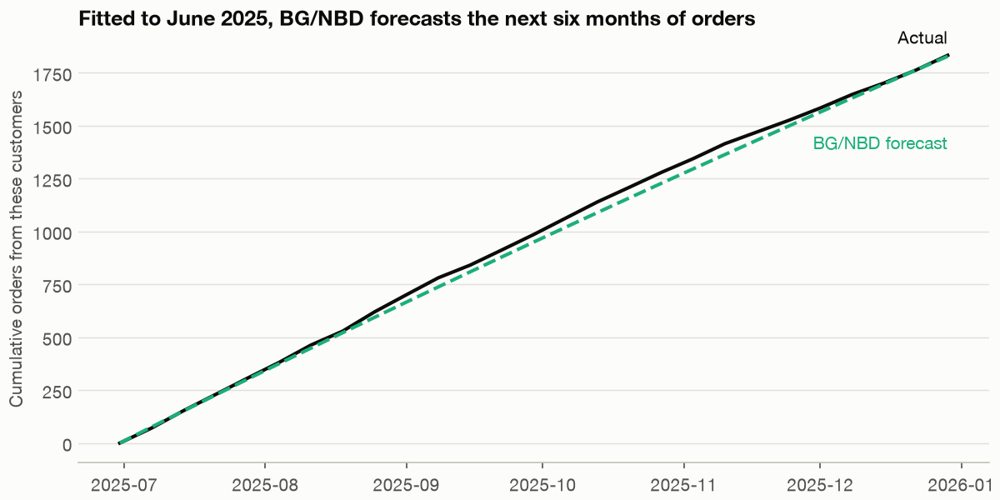
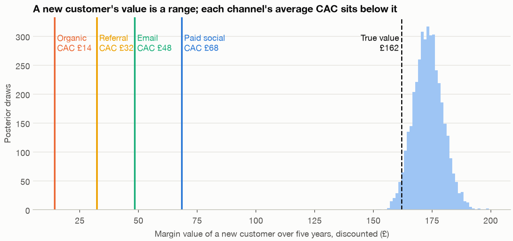

# Marketing measurement: attribution, mix models and lifetime value

Fernhill's dashboard says paid social closes almost half of all sales, and from January 2025 the money went that way: paid social rose from about £2,680 a week to about £7,340 while email was cut from about £1,360 to about £450. The script and charts call that switch "the cut". The finance lead now asks where next quarter's budget should go and what a new customer is worth. The dashboard can't answer, because it shares out credit and never asks what would have happened without the ad. This chapter runs attribution, a geo test and a mix model in order of what each can claim, then values a customer with a fitted model and sets that against what a customer costs.


*Image Source: generated by `practice/ch09_marketing_measurement.py`. Paid social's true share is 17%; last touch gives it 48% and Shapley 33%. The noisy-or model comes later in the chapter.*

---

## The question and the data

The business question is **where should next quarter's budget go, and what is a new customer worth?**

Four simulated tables serve it, each with a truth to score against. They are overlays and don't reconcile with one another or with earlier chapters:

- **`load_touch_paths()`** has 8,000 paths to purchase. `true_intent` is how ready the person already was, which no real analyst sees, so it appears only in marked comparisons.
- **`load_geo_test()`** has 20 geographic areas in 10 pairs, where paid social went to zero in one area of each pair for eight weeks in autumn 2024.
- **`load_marketing_weekly()`** has 157 weeks of revenue, spend by channel and new customers.
- **`load_repeat_log()`** has 11,929 orders from 3,000 customers with no contract, so a customer who leaves simply goes quiet.

The code blocks are the main sections of `practice/ch09_marketing_measurement.py` in order, each relying on those before it, with the chart code and a few reporting helpers left to the script. Run them with `uv run ch09_marketing_measurement.py` from the practice folder; it takes several minutes.

```python
paths, touch_truth = load_touch_paths(), load_truth("touch_paths")
print(len(paths), "paths,", paths.converted.sum(), "conversions, conversion rate", round(paths.converted.mean(), 4))
print(paths[["path_id", "path", "n_touches", "converted", "value"]].head(4).to_string(index=False))
```

```text
8000 paths, 899 conversions, conversion rate 0.1124
 path_id                                                 path  n_touches  converted  value
       1                                          paid_social          1          0   0.00
       2                                    paid_social>email          2          0   0.00
       3 paid_social>paid_social>organic>paid_social>referral          5          1  65.28
       4                              email>paid_social>email          3          0   0.00
```

## Attribution is accounting

**Attribution** divides each sale's credit among the channels on its path. The usual default is **last touch**, which gives it all to the final channel. Dalessandro and colleagues, whose paper we read in full, describe it as the industry default and note the problem we meet here: retargeting tends to come last, so last touch rewards a channel for being there when a ready buyer arrives.

```python
touches = paths.path.str.split(">")
converted = paths.converted == 1
last_touch = touches.str[-1][converted].value_counts(normalize=True).reindex(CHANNELS)
true_share = pd.Series(touch_truth["true_incremental_share"]).reindex(CHANNELS)
print(pd.DataFrame({"last_touch": last_touch, "true_incremental": true_share}).round(3).to_string())
by_last = paths.groupby(touches.str[-1]).agg(paths=("converted", "size"), conversion=("converted", "mean"),
                                             mean_intent=("true_intent", "mean"))
print(by_last.reindex(CHANNELS).round(3).to_string())
```

```text
             last_touch  true_incremental
paid_social       0.484             0.169
organic           0.258             0.245
email             0.138             0.286
referral          0.120             0.300
             paths  conversion  mean_intent
path
paid_social   3768       0.115        0.374
organic       2312       0.100        0.285
email         1016       0.122        0.318
referral       904       0.119        0.313
```

Paid social gets 48% of the credit and truly caused 17%. Referral gets 12% and caused 30%. The second table shows why: paths ending in paid social don't convert much more often than the rest, but the people on them started with more intent, at 0.374 against 0.285 for organic. The channel finds people who were coming anyway.

**Shapley credit**, from cooperative game theory, averages a channel's contribution to the conversion rate over every order in which channels could have joined. Dalessandro and colleagues show that their causally motivated method comes to the same thing under a uniform ordering.

```python
def shapley_credit(channel_sets, outcome):
    """Shapley credit by channel. v(S) is the conversion rate of paths whose channel set is exactly S; v(empty) = 0."""
    groups = pd.DataFrame({"s": channel_sets, "y": outcome}).groupby("s").y.agg(["mean", "size"])
    value, size = groups["mean"].to_dict(), groups["size"].to_dict()
    credit = dict.fromkeys(CHANNELS, 0.0)
    for full, n in size.items():
        for k in full:
            rest = [c for c in full if c != k]
            for r in range(len(rest) + 1):
                for subset in itertools.combinations(rest, r):
                    s = frozenset(subset)
                    weight = math.factorial(len(s)) * math.factorial(len(full) - len(s) - 1) / math.factorial(len(full))
                    credit[k] += n * weight * (value.get(s | {k}, value.get(s, 0.0)) - value.get(s, 0.0))
    return pd.Series(credit)


channel_sets = touches.map(frozenset)
shapley = shapley_credit(channel_sets, paths.converted)
print("distinct channel sets:", channel_sets.nunique(), "| credit handed out:", round(shapley.sum(), 1))
decile = pd.qcut(paths.true_intent, 10, labels=False)
shapley_intent = sum(shapley_credit(channel_sets[decile == d], paths.converted[decile == d]) for d in range(10))
table = pd.DataFrame({"last_touch": last_touch, "shapley": shapley / shapley.sum(),
                      "shapley_within_intent": shapley_intent / shapley_intent.sum(), "true_incremental": true_share})
print(table.round(3).to_string())
print("true conversions from any touch:", round(sum(touch_truth["true_incremental_conversions"].values()), 1),
      "| would have converted untouched:", round(touch_truth["conversions_without_any_touch"], 1))
```

```text
distinct channel sets: 15 | credit handed out: 899.0
             last_touch  shapley  shapley_within_intent  true_incremental
paid_social       0.484    0.326                  0.315             0.169
organic           0.258    0.243                  0.261             0.245
email             0.138    0.234                  0.227             0.286
referral          0.120    0.197                  0.197             0.300
true conversions from any touch: 469.0 | would have converted untouched: 463.9
```

Shapley is fairer: paid social falls from 48% to 33%. It's still about twice the truth, and splitting by the true intent, which you wouldn't have, barely helps. Both methods must hand out all 899 conversions, while the truth says about half would have happened with no touch at all. Across 12 seeds paid social averages 47.5% under last touch and 29.0% under Shapley, against a true 16.8%, so this is bias, not one unlucky draw.

Dalessandro and colleagues reach the same place from the theory. The causal reading needs no unmeasured confounding, among other things, and they say this is likely violated, so they recast the result as "channel importance". They report that an intent-like confounder, prior interaction with the site, accounted for 38% to 73% of conversions in four campaigns. So try the favourable case: `fit_noisy_or` (in the script) fits the generator's own form by maximum likelihood, in which each touch independently adds a lift, with intent included.

```python
lift_intent, gained_intent = fit_noisy_or(paths, use_intent=True)
lift_blind, gained_blind = fit_noisy_or(paths, use_intent=False)
print(pd.DataFrame({"true_lift": pd.Series(touch_truth["lift_per_touch"]), "lift_with_intent": lift_intent, "lift_no_intent": lift_blind,
                    "share_with_intent": gained_intent / gained_intent.sum(), "share_no_intent": gained_blind / gained_blind.sum(),
                    "true_share": true_share}).round(3).to_string())
```

```text
             true_lift  lift_with_intent  lift_no_intent  share_with_intent  share_no_intent  true_share
paid_social       0.01             0.014           0.019              0.256            0.289       0.169
organic           0.02             0.015           0.015              0.194            0.165       0.245
email             0.05             0.047           0.056              0.289            0.291       0.286
referral          0.06             0.048           0.056              0.261            0.255       0.300
```

On this seed paid social still gets 26%, although its lift is close to the true 1%. Across 12 seeds the same fit averages 18.0% against 16.8%, which is roughly unbiased, but it ranges from 6.3% to 25.5%. So even with the true form and a variable you never observe, 8,000 paths pin down a 1% lift poorly. This takes an experiment.

## What an experiment measures

**Incrementality** is the difference a channel makes, compared with the same world without it. A **geo test** measures that directly by switching the channel off in randomly chosen areas. For each pair we grow the holdout area's earlier revenue by its control's growth, which gives the revenue it would have earned, and divide what it lost by what it didn't spend. That ratio is **incremental ROAS**.

```python
geo, geo_truth = load_geo_test(), load_truth("geo_test")
print(geo.week.min().date(), "to", geo.week.max().date(), "| test starts", geo_truth["start"], "| geos", geo.geo.nunique(), "| cut", CUT.date())


def geo_lift(frame):
    """Pair by pair: holdout's pre-period, grown by its control's post/pre ratio, is what it would have done."""
    sums = frame.groupby(["pair", "holdout", "post"]).agg(revenue=("revenue", "sum"), spend=("spend_paid_social", "sum")).unstack("post")
    hold, ctrl = sums.xs(1, level="holdout"), sums.xs(0, level="holdout")
    lost = hold[("revenue", 0)] * ctrl[("revenue", 1)] / ctrl[("revenue", 0)] - hold[("revenue", 1)]
    saved = hold[("spend", 0)] * ctrl[("spend", 1)] / ctrl[("spend", 0)]     # holdout spend is zero, so we estimate it
    return lost, saved


lost, saved = geo_lift(geo)
iroas = lost.sum() / saved.sum()
pick = rng.integers(0, 10, (4000, 10))
boot = lost.to_numpy()[pick].sum(axis=1) / saved.to_numpy()[pick].sum(axis=1)
iroas_se = boot.std()
print(f"revenue lost {lost.sum():,.0f} (true {geo_truth['true_revenue_lost']:,.0f}) | spend saved {saved.sum():,.0f} (true {geo_truth['spend_saved']:,.0f})")
print(f"iROAS {iroas:.3f}, pair bootstrap 95% [{np.percentile(boot, 2.5):.2f}, {np.percentile(boot, 97.5):.2f}], true {geo_truth['true_iroas']:.3f}")
print("by pair:", (lost / saved).round(2).to_list())
```

```text
2024-06-10 to 2024-10-21 | test starts 2024-09-02 | geos 20 | cut 2025-01-01
revenue lost 15,263 (true 15,957) | spend saved 10,239 (true 10,471)
iROAS 1.491, pair bootstrap 95% [1.43, 1.57], true 1.524
by pair: [1.58, 1.53, 1.51, 1.36, 1.38, 1.35, 1.72, 1.67, 1.46, 1.44]
```

The estimate of 1.49 sits close to the true 1.524, with an interval that includes it. Across 12 seeds the mean error is 0.002 with a standard deviation of 0.044, so the design is sound. (An earlier estimate near 1.43 was made before a change to the generator's baseline and wasn't reproduced.)

This is a clean causal number, and it answers a narrower question than the budget asks. The test ran in autumn 2024, when paid social spent about £2,510 a week, and it asks what all of that spend returned. Spend is now about £7,300. What the 7,300th pound returns is a different number, and that takes a curve.

## Adstock and saturation

Two facts about advertising shape a mix model. **Adstock** is carryover: some of this week's spend works next week. **Saturation** is diminishing returns: the tenth thousand pounds buys less than the first. Jin and colleagues use a geometric adstock with a decay rate α and a Hill curve, adstock first and then the curve, and pymc-marketing has both.

```python
weekly, marketing_truth = load_marketing_weekly(), load_truth("marketing")
SPEND = [f"spend_{c}" for c in CHANNELS]
after = (weekly.week >= CUT).to_numpy()


def adstock(x, alpha, l_max=8):
    """Geometric carryover, weights normalised to one, so the result stays on the spend scale."""
    weights = alpha ** np.arange(l_max)
    weights = weights / weights.sum()
    return np.convolve(np.concatenate([np.full(l_max - 1, x[0]), x]), weights, mode="valid")


def hill(x, K, slope, beta):
    """S-shaped saturation: beta is the ceiling, K the spend at half of it, slope how sharp the bend is."""
    return beta * x ** slope / (x ** slope + K ** slope)


pulse = np.r_[np.zeros(3), 1000.0, np.zeros(6)]
print("adstock of a single £1,000 week, alpha 0.30:", adstock(pulse, .30).round(0).tolist())
print("adstock of the same week, alpha 0.60:      ", adstock(pulse, .60).round(0).tolist())
paid = {k: marketing_truth[f"hill_{k}"]["paid_social"] for k in ("K", "slope")} | {"beta": marketing_truth["beta"]["paid_social"]}
for x in (1000, 2500, 5000, 7300, 13000):
    print(f"paid social at £{x:>6,}/wk: true response £{hill(x, **paid):>6,.0f}, average ROAS {hill(x, **paid) / x:.2f}, "
          f"marginal ROAS {hill(x + 1, **paid) - hill(x, **paid):.2f}")
print(weekly[SPEND].corr().round(2).loc["spend_paid_social"].to_string())
print(pd.DataFrame({"before": weekly[~after][SPEND].mean(), "after": weekly[after][SPEND].mean(),
                    "min": weekly[SPEND].min(), "max": weekly[SPEND].max()}).round(0).to_string())
```

```text
adstock of a single £1,000 week, alpha 0.30: [0.0, 0.0, 0.0, 700.0, 210.0, 63.0, 19.0, 6.0, 2.0, 1.0]
adstock of the same week, alpha 0.60:       [0.0, 0.0, 0.0, 407.0, 244.0, 146.0, 88.0, 53.0, 32.0, 19.0]
paid social at £ 1,000/wk: true response £ 1,231, average ROAS 1.23, marginal ROAS 1.70
paid social at £ 2,500/wk: true response £ 3,918, average ROAS 1.57, marginal ROAS 1.74
paid social at £ 5,000/wk: true response £ 7,500, average ROAS 1.50, marginal ROAS 1.12
paid social at £ 7,300/wk: true response £ 9,573, average ROAS 1.31, marginal ROAS 0.71
paid social at £13,000/wk: true response £12,111, average ROAS 0.93, marginal ROAS 0.27
spend_paid_social    1.00
spend_organic        0.04
spend_email         -0.72
spend_referral       0.16
                   before   after     min      max
spend_paid_social  2680.0  7343.0  1702.0  13465.0
spend_organic       864.0   878.0   468.0   1727.0
spend_email        1362.0   447.0   275.0   2572.0
spend_referral      648.0   700.0   337.0   1344.0
```

Average **ROAS**, revenue per pound of spend, is still 1.31 at £7,300, which looks fine. **Marginal ROAS**, the return on the next pound, is 0.71. A budget question is about the next pound, so a channel can look healthy on the average while its next pound loses money. Paid social and email also correlate at −0.72, and Chan and Perry list correlated inputs among the main difficulties, because the data can't then separate the two. A plain regression shows the cost.

```python
design = np.column_stack([np.ones(len(weekly)), weekly[SPEND].to_numpy()])
ols = pd.Series(np.linalg.lstsq(design, weekly.revenue.to_numpy(), rcond=None)[0][1:], CHANNELS)
true_avg = {c: weekly[f"true_contribution_{c}"].sum() / weekly[f"spend_{c}"].sum() for c in CHANNELS}
print(pd.DataFrame({"ols_coefficient": ols, "true_average_roas": true_avg}).round(2).to_string())
```

```text
             ols_coefficient  true_average_roas
paid_social             0.98               1.41
organic                 2.69               1.59
email                   0.46               2.89
referral                0.73               1.70
```

Regression calls email worth 46p and organic £2.69, against a true £2.89 and £1.59.

## A small Bayesian mix model

A **marketing mix model (MMM)** regresses revenue on transformed spend, plus trend and seasonality. Chan and Perry, read in full, warn that MMMs are correlational and cite 7 to 10 data points per parameter as the minimum for a stable regression. Our model has 157 weeks and about 31 parameters, with four for each channel, so about five each. We fit it three ways: with the library's default priors, with the priors Jin and colleagues give (on the library's scaled units), and with those plus the geo test.

```python
JIN_SATURATION = {"slope": Prior("Gamma", alpha=3, beta=1, dims="channel"), "kappa": Prior("Beta", alpha=2, beta=2, dims="channel"),
                  "beta": Prior("HalfNormal", sigma=1, dims="channel")}
JIN_ADSTOCK = {"alpha": Prior("Beta", alpha=3, beta=3, dims="channel")}


def fit_mmm(frame, lift_test=None, jin_priors=True, seed=SEED, target_accept=.99):
    X = frame[["week"] + SPEND].assign(t=np.arange(len(frame)))
    model = MMM(date_column="week", channel_columns=SPEND, target_column="revenue", control_columns=["t"], yearly_seasonality=6,
                adstock=GeometricAdstock(l_max=8, priors=JIN_ADSTOCK if jin_priors else None),
                saturation=HillSaturation(priors=JIN_SATURATION if jin_priors else None))
    model.build_model(X, frame.revenue)
    if lift_test is not None:
        model.add_lift_test_measurements(lift_test)
    model.fit(X, frame.revenue, chains=4, tune=3000, draws=2000, target_accept=target_accept, random_seed=seed, progressbar=False)
    return model


def recovery(draws, frame, every=8):
    """Average ROAS after the cut and marginal ROAS at after-cut adstock, per kept draw and channel."""
    use = np.arange(0, draws["alpha"].shape[0], every)
    avg, marginal = np.zeros((len(use), 4)), np.zeros((len(use), 4))
    late = (frame.week >= CUT).to_numpy()
    for j, c in enumerate(CHANNELS):
        x = frame[f"spend_{c}"].to_numpy()
        for row, i in enumerate(use):
            K, s, b = draws["K"][i, j], draws["slope"][i, j], draws["beta"][i, j]
            ad = adstock(x, draws["alpha"][i, j])
            avg[row, j] = hill(ad, K, s, b)[late].sum() / x[late].sum()
            level = ad[late].mean()
            marginal[row, j] = hill(level + 1, K, s, b) - hill(level, K, s, b)
    return avg, marginal


default_fit = fit_mmm(weekly, jin_priors=False)
print("default priors:", diagnostics(default_fit))
default_draws = curves(default_fit)
default_avg, default_marginal = recovery(default_draws, weekly)
print(report(default_draws, default_avg, default_marginal, marketing_truth).to_string())

plain_fit = fit_mmm(weekly)
print("Jin priors:", diagnostics(plain_fit))
plain_draws = curves(plain_fit)
plain_avg, plain_marginal = recovery(plain_draws, weekly)
print(report(plain_draws, plain_avg, plain_marginal, marketing_truth).to_string())
```

```text
default priors: divergences 0 of 8000, largest R-hat 1.036 on saturation_kappa[spend_email], largest for paid social 1.010
                             roas  true           marginal true_m
paid_social     2.71 [1.46, 5.72]  1.29  0.80 [0.65, 0.98]   0.71
organic        3.73 [0.31, 30.65]  1.59  1.15 [0.31, 2.15]   0.84
email        20.36 [3.71, 110.09]   4.0  5.70 [2.37, 8.28]   3.38
referral       3.01 [0.06, 43.23]  1.65  0.28 [0.01, 1.00]   0.69
Jin priors: divergences 1 of 8000, largest R-hat 1.039 on saturation_beta[spend_referral], largest for paid social 1.010
                           roas  true           marginal true_m
paid_social   1.75 [1.21, 3.19]  1.29  0.82 [0.64, 1.05]   0.71
organic      1.59 [0.20, 17.18]  1.59  1.09 [0.09, 2.24]   0.84
email        7.21 [1.83, 54.31]   4.0  6.41 [2.81, 9.29]   3.38
referral     1.06 [0.06, 57.06]  1.65  0.18 [0.00, 1.14]   0.69
```

The sampler needed work. PyMC's own NUTS gave R-hat up to 1.6 and hundreds of divergences. With `nutpie` installed the library selects it instead, and with 3,000 tuning steps and a target acceptance of 0.99 the fits above have almost no divergences and an R-hat of about 1.04 at worst.

The default fit is a clear warning. It calls paid social's average 2.71 where the truth is 1.29, and email's 20 where the truth is 4, and yet its marginal for paid social is about right at 0.80. Chan and Perry describe this: average ROAS requires extrapolating to zero spend, where there's no data, so a model can give a reasonable marginal and a poor average. Priors pull the averages back, since with small samples they largely decide the posterior. In the simulations of Jin and colleagues, read through to their conclusion, fitted response curves were biased by up to about 40% with two years of weekly data and by up to about 10% with sixty. Three years is much nearer the first.

```python
test_weeks = weekly.week.between(geo.week[geo.post == 1].min(), geo.week.max())
test_spend = weekly.loc[test_weeks, "spend_paid_social"].mean()
lift_test = pd.DataFrame({"channel": ["spend_paid_social"], "x": [test_spend], "delta_x": [-test_spend],
                          "delta_y": [-iroas * test_spend], "sigma": [iroas_se * test_spend]})
print(lift_test.round(1).to_string(index=False))
geo_fit = fit_mmm(weekly, lift_test=lift_test)
print("Jin priors and geo test:", diagnostics(geo_fit))
geo_draws = curves(geo_fit)
geo_avg, geo_marginal = recovery(geo_draws, weekly)
print(report(geo_draws, geo_avg, geo_marginal, marketing_truth).to_string())
```

```text
          channel      x  delta_x  delta_y  sigma
spend_paid_social 2510.9  -2510.9  -3742.8   94.7
Jin priors and geo test: divergences 0 of 8000, largest R-hat 1.013 on saturation_kappa[spend_email], largest for paid social 1.001
                           roas  true           marginal true_m
paid_social   1.37 [1.23, 1.51]  1.29  0.86 [0.62, 1.08]   0.71
organic      1.34 [0.20, 12.77]  1.59  1.11 [0.18, 2.24]   0.84
email        6.94 [1.78, 39.05]   4.0  6.51 [3.12, 9.53]   3.38
referral     0.98 [0.05, 42.81]  1.65  0.18 [0.00, 1.04]   0.69
our curve against the library's contribution, largest gap after week 8: £ 0.0
          true    no_geo  with_geo
K       5000.0   5858.06   5473.94
slope      1.5      1.04      1.59
beta   15000.0  24354.94  16687.25
alpha      0.3      0.33      0.34
```

This isn't quite a prior from the geo test. `add_lift_test_measurements` adds a likelihood term saying the curve must fall by the measured amount over the tested spend change. The documentation states the limit: "The experiment measures an average return over its tested spend change; the MMM uses the response curve to infer the local return."

So the geo test should fix the average and leave the marginal to the curve, and it does. Paid social's average tightens to 1.37 [1.23, 1.51] against a true 1.29, and the curve's parameters, in the last table, move towards the truth. But its marginal stays about as wide, 0.86 [0.62, 1.08] against 0.71, and the channels that weren't tested hardly move. Email's marginal, at 6.51 against 3.38, is overstated about twice on this seed. Seeds 100 to 103 put it at 2.09 to 3.47 against about 3.4, usually too low, so email's curve is simply poorly known. For paid social those seeds give 0.74 to 0.92 against 0.72 to 0.78.


*Image Source: generated by `practice/ch09_marketing_measurement.py`. The geo test is the chord from zero to £2,510. The budget question is the slope out at £7,300, well beyond it.*


*Image Source: generated by `practice/ch09_marketing_measurement.py`. Average ROAS on the left and marginal on the right, with 90% intervals. Only paid social's average tightens with the geo test.*

## Moving the budget

Moving money changes the marginal, so we move a sum from paid social to email across the posterior and score it with the true curves.

```python
after_ad = {c: adstock(weekly[f"spend_{c}"].to_numpy(), marketing_truth["adstock_alpha"][c])[after].mean() for c in CHANNELS}
true_curve = {c: {"K": marketing_truth["hill_K"][c], "slope": marketing_truth["hill_slope"][c], "beta": marketing_truth["beta"][c]} for c in CHANNELS}


rows = []
for amount in (250, 500, 1000, 2000, 4000):
    true_gain = (hill(after_ad["email"] + amount, **true_curve["email"]) - hill(after_ad["email"], **true_curve["email"])
                 - hill(after_ad["paid_social"], **true_curve["paid_social"]) + hill(after_ad["paid_social"] - amount, **true_curve["paid_social"]))
    gain = move_gain(geo_draws, amount)
    rows.append({"moved_per_week": amount, "true_gain": round(true_gain), "posterior_median": round(np.median(gain)),
                 "p5": round(np.percentile(gain, 5)), "p95": round(np.percentile(gain, 95)), "p_gain_positive": round((gain > 0).mean(), 3)})
print(pd.DataFrame(rows).to_string(index=False))
print("P(email marginal ROAS > paid social marginal ROAS):", round((geo_marginal[:, 2] > geo_marginal[:, 0]).mean(), 3))
total = sum(after_ad.values())


now = np.array([after_ad[c] for c in CHANNELS])
best = minimize(lambda x: -true_revenue(x), now, bounds=[(1, total)] * 4, constraints={"type": "eq", "fun": lambda x: x.sum() - total}, method="SLSQP")
print("after-cut mean adstocked spend by channel:", pd.Series(now, CHANNELS).round(0).to_dict())
print("truth's best split of the same total:     ", pd.Series(best.x, CHANNELS).round(0).to_dict())
print(f"weekly revenue from media now £{true_revenue(now):,.0f}, at truth's best £{true_revenue(best.x):,.0f}")
products, demand = load_products().set_index("sku"), load_product_demand()
units = demand[demand.week.dt.year == 2025].groupby("sku").units.sum()
margin = ((products.unit_price - products.unit_cost) * units).sum() / (products.unit_price * units).sum()
break_even = 1 / margin
print(f"gross margin, 2025 demand at list prices {margin:.3f}, so an extra £1 pays back its margin at revenue ROAS {break_even:.2f}")
levels = np.linspace(1, 15000, 15000)
for c in CHANNELS:
    slope = np.diff(hill(levels, **true_curve[c]))
    print(f"  {c}: true marginal ROAS now {marketing_truth['true_marginal_roas_after_cut'][c]:.2f}, spend where it equals break-even £{levels[np.where(slope >= break_even)[0].max()]:,.0f}, spend now £{after_ad[c]:,.0f}")
```

```text
 moved_per_week  true_gain  posterior_median    p5   p95  p_gain_positive
            250        550               908   383  1438            1.000
            500        905              1186   473  1871            0.999
           1000       1232              1124   212  1916            0.983
           2000       1049               205  -765  1132            0.656
           4000       -925             -2700 -3447 -1635            0.001
P(email marginal ROAS > paid social marginal ROAS): 1.0
after-cut mean adstocked spend by channel: {'paid_social': 7298.0, 'organic': 885.0, 'email': 449.0, 'referral': 701.0}
truth's best split of the same total:      {'paid_social': 6188.0, 'organic': 840.0, 'email': 1743.0, 'referral': 562.0}
weekly revenue from media now £13,965, at truth's best £15,248
gross margin, 2025 demand at list prices 0.613, so an extra £1 pays back its margin at revenue ROAS 1.63
  paid_social: true marginal ROAS now 0.71, spend where it equals break-even £2,969, spend now £7,298
  organic: true marginal ROAS now 0.84, spend where it equals break-even £355, spend now £885
  email: true marginal ROAS now 3.38, spend where it equals break-even £1,088, spend now £449
  referral: true marginal ROAS now 0.69, spend where it equals break-even £282, spend now £701
```

Up to about £1,000 a week the model and the truth agree on direction. The gain is real: £905 to £1,232 a week in truth at £500 to £1,000, with the model's probability of a gain at 0.98 or above. At £2,000 they part, with the truth at +£1,049 and the model at +£205 and only a 66% chance, so the model is more cautious there. At £4,000 both say it loses money. The truth's best split of the same total moves about £1,100 out of paid social and £1,300 into email, for about £1,280 more revenue a week, which is a ceiling.

The larger finding is the last block. Fernhill's gross margin is 61%, so a pound of spend pays for itself only at a revenue ROAS of 1.63. Only email is below the spend where that holds. Paid social is at £7,300 against about £2,970, and organic and referral also sit past their points. Even the geo test's 1.49 is below 1.63. So reallocation is the smaller question, and whether the total should fall is the larger, with one large caveat: the weekly table doesn't say how much of its revenue includes a customer's later orders. If it doesn't, the bar of 1.63 is too high.

## What a customer is worth: BG/NBD

[Chapter 3](03-cohort-and-retention.md) pointed to BG/NBD for retail with no contract and stopped there. [Chapter 8](08-states-and-sequences.md#markov-clv-and-what-the-pooled-chain-gets-wrong) gave another route, a Markov chain with a reward in each state, usually credited to Pfeifer and Carraway (2000), which we still haven't been able to read. That needs a recorded state, and an order log has none.

**BG/NBD** (Fader, Hardie and Lee, 2005) needs only three numbers per customer: repeat orders `frequency`, the week of the last order `recency`, and the time observed `T`. While active, a customer orders at a Poisson rate λ, and rates differ across customers as a gamma distribution with parameters r and α. After any order the customer may leave for good with probability p, and p differs as a beta distribution with parameters a and b. It simplifies the Pareto/NBD of Schmittlein, Morrison and Colombo (1987), which we haven't read. We read the BG/NBD paper in full.

```python
log, repeat_truth = load_repeat_log(), load_truth("repeat_log")
print(len(log), "orders,", log.customer_id.nunique(), "customers, mean value", round(log.value.mean(), 2))


def rfm_table(frame, end):
    """frequency = repeat orders; recency = weeks from first to last order; T = weeks from first order to end."""
    frame = frame[frame.order_date <= end]
    d = frame.groupby("customer_id").order_date.agg(["min", "max", "count"])
    return pd.DataFrame({"customer_id": d.index, "frequency": d["count"] - 1, "recency": (d["max"] - d["min"]).dt.days / 7,
                         "T": (end - d["min"]).dt.days / 7}).reset_index(drop=True)


rfm = rfm_table(log, END)
print(rfm.head(3).round(2).to_string(index=False))
print("no repeat order at all:", round((rfm.frequency == 0).mean(), 3), "| mean repeats", round(rfm.frequency.mean(), 2))
```

```text
11929 orders, 3000 customers, mean value 50.83
 customer_id  frequency  recency     T
           1          7    29.86 84.29
           2          2     6.57 98.57
           3          6    28.57 97.00
no repeat order at all: 0.286 | mean repeats 2.98
```

We first maximise the likelihood in equation 6 of the paper, written out as `bgnbd_nll` in the script, then fit the library's `BetaGeoModel`, so one checks the other.

```python
def bgnbd_mle(table):
    fit = minimize(bgnbd_nll, np.log([.5, 5, 1, 2]), args=(table.frequency.to_numpy(), table.recency.to_numpy(), table["T"].to_numpy()), method="L-BFGS-B")
    return dict(zip(["r", "alpha", "a", "b"], np.exp(fit.x))), -fit.fun


mle, ll = bgnbd_mle(rfm)
print("maximum likelihood:", {k: round(v, 3) for k, v in mle.items()}, "| log likelihood", round(ll, 1))
print("truth:             ", {k: repeat_truth[k] for k in ("r", "alpha", "a", "b")})
```

```text
maximum likelihood: {'r': np.float64(0.487), 'alpha': np.float64(7.467), 'a': np.float64(0.659), 'b': np.float64(2.448)} | log likelihood -34280.3
truth:              {'r': 0.5, 'alpha': 8.0, 'a': 0.7, 'b': 2.5}
```

```python
bg = BetaGeoModel()
bg.fit(rfm, chains=4, tune=1000, draws=1000, random_seed=SEED, progressbar=False)
print(az.summary(bg.idata.posterior, var_names=["r", "alpha", "a", "b"], ci_prob=.9)[["mean", "sd", "eti90_lb", "eti90_ub", "r_hat"]].to_string())
alive = bg.expected_probability_alive(rfm).mean(("chain", "draw")).to_numpy()
true_alive = log.groupby("customer_id").true_alive_at_end.first().reindex(rfm.customer_id).to_numpy()
u = mannwhitneyu(alive[true_alive == 1], alive[true_alive == 0]).statistic
print(f"mean P(alive) {alive.mean():.3f}, realised {repeat_truth['realised_alive_share']:.3f}, AUC {u / ((true_alive == 1).sum() * (true_alive == 0).sum()):.3f}")
for low, high in ((0, .25), (.25, .5), (.5, .75), (.75, .95), (.95, 1.01)):
    m = (alive >= low) & (alive < high)
    print(f"  P(alive) {low:.2f}-{min(high, 1):.2f}: {m.sum():>5} customers, truly alive {true_alive[m].mean():.3f}")
```

```text
         mean      sd eti90_lb eti90_ub r_hat
r      0.4886  0.0163     0.46     0.52  1.00
alpha    7.51    0.38      6.9      8.1  1.00
a       0.656   0.067     0.55     0.77  1.00
b        2.44    0.33      1.9        3  1.00
mean P(alive) 0.633, realised 0.638, AUC 0.920
  P(alive) 0.00-0.25:   672 customers, truly alive 0.100
  P(alive) 0.25-0.50:   362 customers, truly alive 0.434
  P(alive) 0.50-0.75:   505 customers, truly alive 0.630
  P(alive) 0.75-0.95:   558 customers, truly alive 0.842
  P(alive) 0.95-1.00:   903 customers, truly alive 0.999
```

The two agree and sit near the truth. These data are exactly BG/NBD by construction, so this tests the code and not the idea. On real data, the CDNOW log, the paper reports an aggregate under-forecast of about 4% and an individual-level correlation of 0.626. The probability that a customer is still active is well calibrated, with an AUC of 0.92 at telling those alive from those gone,. Next, the check that matters most: fit to June 2025 and forecast the next six months with equation 10, `expected_future` in the script.

```python
SPLIT = pd.Timestamp("2025-06-30")
calibration = rfm_table(log, SPLIT)
fit_cal, _ = bgnbd_mle(calibration)
print("calibration fit to", SPLIT.date(), {k: round(v, 3) for k, v in fit_cal.items()})


later = log[log.order_date > SPLIT]
horizon = (END - SPLIT).days / 7
expected = expected_future(fit_cal, calibration, horizon)
print(f"orders in holdout, {horizon:.1f} weeks: actual {len(later)}, forecast {expected.sum():.0f}, error {expected.sum() / len(later) - 1:+.1%}")
actual_by_customer = later.groupby("customer_id").size().reindex(calibration.customer_id).fillna(0).to_numpy()
print("correlation of customer forecasts with actual:", round(np.corrcoef(expected, actual_by_customer)[0, 1], 3))
groups = pd.DataFrame({"x": np.minimum(calibration.frequency, 7), "forecast": expected, "actual": actual_by_customer}).groupby("x").agg(customers=("actual", "size"), actual=("actual", "mean"), forecast=("forecast", "mean"))
print(groups.round(2).to_string())
```

```text
calibration fit to 2025-06-30 {'r': np.float64(0.499), 'alpha': np.float64(7.635), 'a': np.float64(0.617), 'b': np.float64(2.176)}
orders in holdout, 26.3 weeks: actual 1841, forecast 1847, error +0.3%
correlation of customer forecasts with actual: 0.717
   customers  actual  forecast
x
0        976    0.14      0.17
1        789    0.28      0.23
2        405    0.45      0.40
3        230    0.52      0.67
4        147    0.95      0.90
5         96    0.99      1.03
6         62    1.37      1.37
```


*Image Source: generated by `practice/ch09_marketing_measurement.py`. Fitted to June 2025, the forecast ends 0.3% from the actual count.*

## What an order is worth: Gamma-Gamma

BG/NBD counts orders. The **Gamma-Gamma** model (Fader and Hardie, 2013) adds their value, on the assumption that a customer's order value is independent of how often they order. The correlation of 0.02 below supports that here. It estimates each customer's mean by shrinking their own average towards the population's, with more weight on their own as orders accumulate.

```python
repeat_only = log.sort_values("order_date").groupby("customer_id").apply(lambda d: d.value.iloc[1:].mean() if len(d) > 1 else np.nan, include_groups=False)
money = rfm.assign(monetary_value=rfm.customer_id.map(repeat_only)).query("frequency > 0")[["customer_id", "frequency", "monetary_value"]]
print(len(money), "customers with a repeat order; corr(frequency, monetary value):", round(money.frequency.corr(money.monetary_value), 3))
gg = GammaGammaModel()
gg.fit(money, chains=4, tune=1000, draws=1000, random_seed=SEED, progressbar=False)
print(az.summary(gg.idata.posterior, var_names=["p", "q", "v"], ci_prob=.9)[["mean", "sd", "eti90_lb", "eti90_ub", "r_hat"]].to_string())
print("truth:", {k: repeat_truth[k] for k in "pqv"}, "| true mean order value", repeat_truth["true_mean_order_value"])


gg_mle = gamma_gamma_mle(money)
print("maximum likelihood:", {k: round(v, 2) for k, v in gg_mle.items()}, "| implied mean", round(gg_mle["p"] * gg_mle["v"] / (gg_mle["q"] - 1), 2))
mean_value = (gg.idata.posterior["p"] * gg.idata.posterior["v"] / (gg.idata.posterior["q"] - 1)).stack(s=("chain", "draw")).to_numpy()
print(f"population mean order value: {np.median(mean_value):.2f} [{np.percentile(mean_value, 5):.2f}, {np.percentile(mean_value, 95):.2f}]; raw mean of all orders {log.value.mean():.2f}")
shrunk = gg.expected_customer_spend(money).mean(("chain", "draw")).to_numpy()
one = money.frequency == 1
print(f"one repeat order: raw sd {money.monetary_value[one].std():.1f} -> shrunk sd {shrunk[one.to_numpy()].std():.1f}")
```

```text
2141 customers with a repeat order; corr(frequency, monetary value): 0.02
    mean     sd eti90_lb eti90_ub r_hat
p   4.95   0.31      4.5      5.5  1.01
q  3.907  0.143      3.7      4.1  1.00
v   30.1    2.6       26       34  1.00
truth: {'p': 6.0, 'q': 4.0, 'v': 25.0} | true mean order value 50.0
maximum likelihood: {'p': np.float64(6.45), 'q': np.float64(3.92), 'v': np.float64(22.77)} | implied mean 50.36
population mean order value: 51.01 [49.64, 52.46]; raw mean of all orders 50.83
one repeat order: raw sd 40.5 -> shrunk sd 25.5
```

Here the library misleads on the parameters. It reports p of 4.95 and v of 30 against a true 6 and 25, with intervals that exclude the truth. Maximum likelihood on the same equation gives 6.45 and 22.77, and across 12 seeds it averages 6.25 and 24.5, so the data aren't the cause. The library's default priors, Weibull(2, 1) on p and q and Weibull(2, 10) on v, are informative at this scale. Exercise 3 removes them. The implied mean order value survives this, at £51.01 against a true £50, and that's the part lifetime value uses. Among customers with one repeat order, shrinkage takes the spread of means from £40.5 to £25.5.

## Lifetime value against acquisition cost

A customer's value is the discounted expected orders times the mean order value times margin. Because a is below 1 here, the expected number of orders before dropout is infinite, so undiscounted orders never level off, and you have to pick a horizon and a discount rate. We use five years, and chapter 8's 1% a month.

```python
def expected_repeats_new(r, alpha, a, b, t):
    """Fader, Hardie and Lee (2005), equation 9: expected repeat orders for a new customer in t weeks."""
    return (a + b - 1) / (a - 1) * (1 - (alpha / (alpha + t)) ** r * hyp2f1(r, b, a + b - 1, t / (alpha + t)))


TRUE_DISCOUNT = load_truth("journeys")["monthly_discount"]
WEEKS_PER_MONTH = 52.18 / 12


def discounted_orders(r, alpha, a, b, months=60, discount=TRUE_DISCOUNT):
    grid = np.arange(0, months + 1) * WEEKS_PER_MONTH
    cumulative = np.array([expected_repeats_new(r, alpha, a, b, t) for t in grid])
    return 1 + (np.diff(cumulative, axis=0) / (1 + discount) ** np.arange(1, months + 1).reshape((-1,) + (1,) * (cumulative.ndim - 1))).sum(axis=0)


true_orders = discounted_orders(repeat_truth["r"], repeat_truth["alpha"], repeat_truth["a"], repeat_truth["b"])
long_orders = discounted_orders(repeat_truth["r"], repeat_truth["alpha"], repeat_truth["a"], repeat_truth["b"], months=1200)
print(f"truth at {TRUE_DISCOUNT:.0%} a month: over 60 months {true_orders:.2f} orders, £{true_orders * repeat_truth['true_mean_order_value']:.0f} revenue; "
      f"over 100 years {long_orders:.2f} orders, £{long_orders * repeat_truth['true_mean_order_value']:.0f} revenue")
for years in (1, 3, 5, 10, 25, 50):
    undiscounted = expected_repeats_new(repeat_truth["r"], repeat_truth["alpha"], repeat_truth["a"], repeat_truth["b"], years * 52.18)
    print(f"  at the true parameters, repeat orders by year {years:>2}: {undiscounted:.2f}, undiscounted")
poster = bg.idata.posterior
keep = {k: poster[k].stack(s=("chain", "draw")).to_numpy() for k in ("r", "alpha", "a", "b")}
orders = discounted_orders(keep["r"], keep["alpha"], keep["a"], keep["b"])
library = bg.expected_purchases_new_customer(pd.DataFrame({"customer_id": [0], "t": [52.18]})).mean().item()
print(f"library's mean repeat orders in year one {library:.3f}; our closed form {expected_repeats_new(keep['r'], keep['alpha'], keep['a'], keep['b'], 52.18).mean():.3f}")
revenue_ltv = orders * mean_value
ltv = revenue_ltv * margin
print(f"revenue value £{np.median(revenue_ltv):.0f} [{np.percentile(revenue_ltv, 5):.0f}, {np.percentile(revenue_ltv, 95):.0f}] | margin value £{np.median(ltv):.0f} [{np.percentile(ltv, 5):.0f}, {np.percentile(ltv, 95):.0f}] | true margin value £{true_orders * repeat_truth['true_mean_order_value'] * margin:.0f}")
```

```text
truth at 1% a month: over 60 months 5.29 orders, £264 revenue; over 100 years 6.96 orders, £348 revenue
  at the true parameters, repeat orders by year  1: 1.96, undiscounted
  at the true parameters, repeat orders by year  3: 3.97, undiscounted
  at the true parameters, repeat orders by year  5: 5.31, undiscounted
  at the true parameters, repeat orders by year 10: 7.63, undiscounted
  at the true parameters, repeat orders by year 25: 11.74, undiscounted
  at the true parameters, repeat orders by year 50: 15.82, undiscounted
library's mean repeat orders in year one 2.043; our closed form 2.043
revenue value £283 [267, 300] | margin value £173 [163, 184] | true margin value £162
plugging in maximum likelihood instead of posterior draws: revenue value £279; parts: orders 5.54 posterior, 5.53 plug-in
```

The median margin value is £173, with a 90% interval of £163 to £184, and the true value of £162 lies just outside. Don't read that as tight knowledge: the interval covers sampling error given a correct model and a fixed margin. Across 12 seeds the plug-in revenue value runs from £252 to £273 around a true £264, and this seed's £279 is high. A fair statement allowing for that is about £155 to £185 of margin. Chapter 8's £513 comes from a different simulated table and horizon, so don't set the two side by side.

**CAC** is customer acquisition cost, spend divided by new customers. The ratio of LTV to CAC is a common summary, and a value above 3 is often quoted as healthy. That's folklore: we have no source for it.

```python
rows = {}
for c in CHANNELS:
    rows[c] = {"spend_per_week_before": weekly[~after][f"spend_{c}"].mean(), "spend_per_week_after": weekly[after][f"spend_{c}"].mean(),
               "new_per_week_before": weekly[~after][f"new_customers_{c}"].mean(), "new_per_week_after": weekly[after][f"new_customers_{c}"].mean(),
               "cac_before": weekly[~after][f"spend_{c}"].sum() / weekly[~after][f"new_customers_{c}"].sum(),
               "cac_after": weekly[after][f"spend_{c}"].sum() / weekly[after][f"new_customers_{c}"].sum()}
cac = pd.DataFrame(rows).T
print(cac.round(1).to_string())
ratio = {c: ltv / cac.loc[c, "cac_after"] for c in CHANNELS}
print(pd.DataFrame({c: {"cac": cac.loc[c, "cac_after"], "median_ltv_to_cac": np.median(r), "p5": np.percentile(r, 5), "p95": np.percentile(r, 95),
                        "p_above_1": (r > 1).mean(), "p_above_3": (r > 3).mean()} for c, r in ratio.items()}).T.round(2).to_string())

attributed = touches.str[-1][converted].value_counts().reindex(CHANNELS)
caused = pd.Series(touch_truth["true_incremental_conversions"]).reindex(CHANNELS)
what_if = pd.DataFrame({"last_touch_conversions": attributed, "true_incremental": caused, "caused_per_credited": caused / attributed})
what_if["incremental_cac"] = cac.cac_after / what_if.caused_per_credited
what_if["ltv_to_incremental_cac"] = np.median(ltv) / what_if.incremental_cac
print(what_if.round(2).to_string())
```

```text
             spend_per_week_before  spend_per_week_after  new_per_week_before  new_per_week_after  cac_before  cac_after
paid_social                 2680.2                7343.3                 41.2               107.3        65.0       68.4
organic                      863.7                 877.8                 59.6                61.3        14.5       14.3
email                       1361.9                 447.1                 27.6                 9.2        49.3       48.4
referral                     647.6                 699.6                 23.3                21.7        27.7       32.3
               cac  median_ltv_to_cac     p5    p95  p_above_1  p_above_3
paid_social  68.42               2.53   2.39   2.69        1.0        0.0
organic      14.33              12.09  11.40  12.82        1.0        1.0
email        48.44               3.58   3.37   3.79        1.0        1.0
referral     32.25               5.37   5.06   5.70        1.0        1.0
             last_touch_conversions  true_incremental  caused_per_credited  incremental_cac  ltv_to_incremental_cac
paid_social                     435             79.22                 0.18           375.71                    0.46
organic                         232            114.90                 0.50            28.93                    5.99
email                           124            134.28                 1.08            44.73                    3.87
referral                        108            140.57                 1.30            24.78                    6.99
```


*Image Source: generated by `practice/ch09_marketing_measurement.py`. Each channel's CAC sits below the value of a customer, on average.*

Every channel clears 1, and paid social gets 2.53 against 3.58 for email. But CAC is an average, and it takes every customer credited to a channel as caused by it, the same mistake as attribution. The second table is a what-if: scale each channel's new customers by the share of its last-touch credit that was truly caused. Paid social's ratio falls to 0.46, while email's stays near 3.9. That carries a ratio from one simulated table to another, so treat it as a sense of scale.

One thing doesn't reconcile. New paid social customers rise almost in step with spend, so CAC hardly moves (£65.0 to £68.4), while revenue from that spend saturates. A real business couldn't have both, and here they are separate overlays, so don't multiply LTV by new customers to get a channel's return.

## Recommendation

- **Move about £500 to £1,000 a week from paid social to email next quarter.** The truth and the model agree on direction, and neither relies on attribution. Don't go to £2,000 on this evidence.
- **Stop using last touch to set budgets.** Keep it for reporting if people want it, labelled as credit. Shapley isn't a fix.
- **Run a geo test at today's spend, and test partial cuts.** The one we have says what the first £2,500 returned. A test taking paid social from about £7,300 to about £5,000 would measure the part of the curve the decision sits on. Then test email, the channel whose curve is least known.
- **Put off any decision on total spend until that test reports,** and until someone settles whether weekly revenue includes later orders. The case for a cut is strong on these numbers, but it rests on that.
- **Quote a new customer as about £155 to £185 of margin** over five years at 1% a month, and say so whenever the figure is used. Don't defend a channel with its LTV to CAC.

The limits are that every table here is simulated, BG/NBD is being scored on its own generator, and the overlays don't reconcile. Two full runs of the final script gave identical output. An earlier run on the same seeds, before some late chart edits, gave slightly different mix-model figures (email's marginal 6.43 against 6.51), and we couldn't explain why, so don't lean on the second decimal. What would change the recommendation: a test at current spend showing paid social's marginal above about 1.6 would end the case for moving money, and a fall in email's returns when spend is restored, which this history can't show, would cap the move early.

Meridian and Robyn do the mix-model job at scale; we neither read nor ran them. Gupta and colleagues' survey of LTV models (2006) couldn't be reached and Fader's *Customer Centricity* wasn't read.

## Pitfalls

- **Reading attribution as cause.** Shares must sum to 100%, whatever was caused. A channel can get 48% and cause 17%.
- **Reading Shapley as causal because it's fair.** Fairness is among channels, not against the world where no ad ran.
- **Using an average to make a marginal decision.** Paid social's 1.31 average at £7,300 hides a marginal of 0.71. The geo test's 1.49 is the slope of a chord up to £2,510, not of the curve at today's spend.
- **Believing R².** Chan and Perry show five models with R² of 0.98 to 0.99 that disagree by up to 50%.
- **Trusting library defaults on either model.** Default priors here tripled email's ROAS in the MMM and pulled Gamma-Gamma's p away from the truth. Compare with maximum likelihood, or set `model_config`.
- **Accepting the first sampler run.** Read the R-hat and the divergences, and try `nutpie`.
- **Using posterior means in a nonlinear formula.** Jin and colleagues use the samples, and so do we.
- **Forgetting that a below 1 has no finite lifetime total.** Without a discount or a horizon, undiscounted orders keep growing.
- **Narrow posteriors as narrow knowledge.** The LTV interval left out the truth because it doesn't include model error.

## Try it

Exercises use `practice/ch09_marketing_measurement.py`, whose `try_it` section prints each answer.

1. Compute first-touch credit. Does crediting the start of the path rather than the end fix attribution?

   <details><summary>Answer</summary>

   No. Paid social gets 35.8%, down from 48.4% but still twice its true 16.9%, and email and referral stay low at 17.4% and 17.7%. It's a different rule for sharing out the same conversions. Nothing about the world has been measured.
   </details>

2. Repeat the budget table without the geo test. How much does the test change the decision?

   <details><summary>Answer</summary>

   Little. Moving £1,000 gives a median of £985 without it and £1,124 with it, with intervals of [164, 1,877] and [212, 1,916]. The test narrowed paid social's average, but the decision depends on marginal returns and on email, which it didn't test. A test at today's spend would be worth more than this one.
   </details>

3. Refit Gamma-Gamma with `model_config` set to wide HalfNormal priors: σ of 50 on p and q, and 200 on v. Does the library then recover the parameters?

   <details><summary>Answer</summary>

   Yes. It gives p 6.56, q 3.93 and v 23.1, with 90% intervals of 5.2 to 8.3 for p and 16 to 31 for v, which now cover the true 6 and 25 and agree with maximum likelihood. The default priors caused the earlier gap, not the likelihood.
   </details>

4. At the true parameters and £50 an order, vary the horizon from 36 to 120 months and the monthly discount from 0% to 2%. Which matters more?

   <details><summary>Answer</summary>

   About equally. Margin value runs from £136 at 36 months to £192 at 120, and from £140 to £193 for a discount of 2% down to 0% at 60 months. Both ranges are far wider than the posterior's £163 to £184, so the assumptions matter more than the sampling error.
   </details>

## Interview checklist

| Question | Answer |
|---|---|
| What's wrong with last-touch attribution? | It credits whoever is last, so channels that reach ready buyers look causal. It shares out conversions without asking which would have happened anyway |
| Is Shapley attribution causal? | No. It's a fair split among channels. It needs no unmeasured confounding to be causal, and that's unlikely to hold |
| What does a geo test measure? | The average return over the spend change tested, by randomising the channel off in some areas and comparing with their pairs |
| Average against marginal ROAS? | Average is revenue per pound so far, marginal the return on the next pound. Budgets move on the marginal |
| Why is an MMM hard to identify? | Few data points, correlated spend, targeting and seasonality confounding it, and average ROAS needing an extrapolation to zero spend |
| How does a lift test help an MMM? | It adds a likelihood term that pins the curve over the tested range. It doesn't fix the slope far above that range |
| What does BG/NBD assume? | Poisson orders while active, gamma-distributed rates, a chance of leaving after each order, and beta-distributed dropout. Only frequency, recency and T are needed |
| What does Gamma-Gamma add, and what does it assume? | Each customer's mean order value, shrunk to the population's. It assumes value is independent of order frequency |
| Why does LTV to CAC mislead? | CAC is an average and credits the channel with every customer it recorded, so it can look healthy when the next pound and the caused customers don't |

## Next

Marketing's money now has a next step, and customers have a price. [Operations and supply chain](10-operations-and-supply-chain.md) takes the forecast from chapter 1 to the warehouse: how much stock to hold and how many packers to roster.
