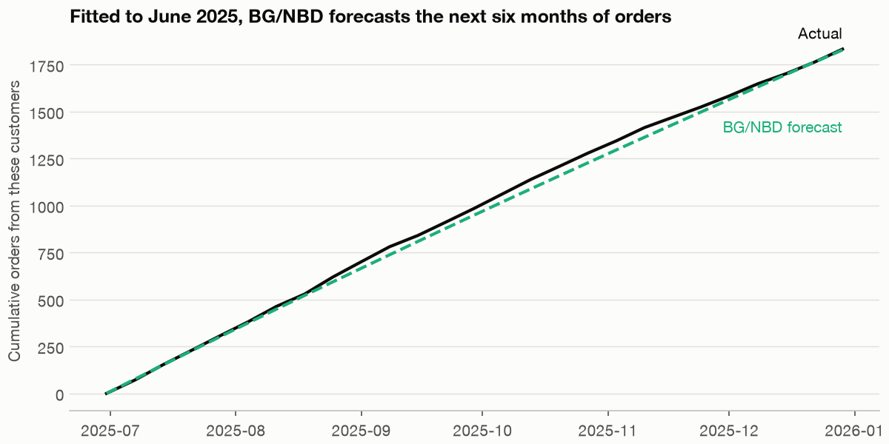
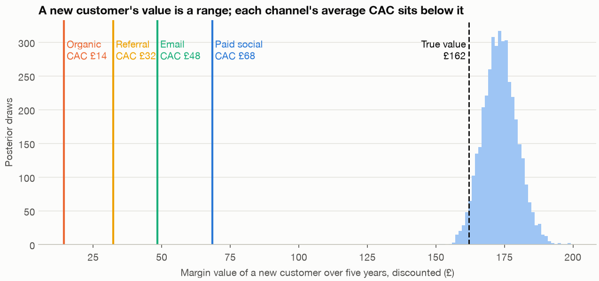

# 9b — Customer lifetime value: BG/NBD, Gamma-Gamma and what a customer costs

[Part one](09-marketing-measurement.md) ended with a budget decision that needed no customer value at all. The finance lead's second question does: what is a new customer worth, and does a channel's cost per customer sit comfortably below it? Fernhill's order log records no churn, so a contract-style retention curve can't answer, and the usual shortcut, LTV divided by CAC, hides the same credit-sharing mistake that sank last-touch attribution. This part fits a lifetime-value model that needs only frequency, recency and age, prices an order, and says how wide the answer has to be.

> The second half of marketing measurement. [09](09-marketing-measurement.md) covered attribution, the geo test, the mix model and the budget move. Here: BG/NBD, Gamma-Gamma, and lifetime value against acquisition cost. The data and the simulated Fernhill history are the same.

---

## What a customer is worth: BG/NBD

[Chapter 3](03-cohort-and-retention.md) pointed to BG/NBD for retail with no contract and stopped there. [Chapter 8](08-states-and-sequences.md#markov-clv-and-what-the-pooled-chain-gets-wrong) gave another route, a Markov chain with a reward in each state, usually credited to Pfeifer and Carraway (2000), which we still haven't been able to read. That needs a recorded state, and an order log has none.

**BG/NBD** (Fader, Hardie and Lee, 2005) needs only three numbers per customer: repeat orders `frequency`, the week of the last order `recency`, and the time observed `T`. While active, a customer orders at a Poisson rate λ, and rates differ across customers as a gamma distribution with parameters r and α. After any order the customer may leave for good with probability p, and p differs as a beta distribution with parameters a and b. It simplifies the Pareto/NBD of Schmittlein, Morrison and Colombo (1987), which we haven't read. We read the BG/NBD paper in full.

```python
log, repeat_truth = load_repeat_log(), load_truth("repeat_log")
print(len(log), "orders,", log.customer_id.nunique(), "customers, mean value", round(log.value.mean(), 2))


def rfm_table(frame, end):
    """frequency = repeat orders; recency = weeks from first to last order; T = weeks from first order to end."""
    frame = frame[frame.order_date <= end]
    d = frame.groupby("customer_id").order_date.agg(["min", "max", "count"])
    return pd.DataFrame({"customer_id": d.index, "frequency": d["count"] - 1, "recency": (d["max"] - d["min"]).dt.days / 7,
                         "T": (end - d["min"]).dt.days / 7}).reset_index(drop=True)


rfm = rfm_table(log, END)
print(rfm.head(3).round(2).to_string(index=False))
print("no repeat order at all:", round((rfm.frequency == 0).mean(), 3), "| mean repeats", round(rfm.frequency.mean(), 2))
```

```text
11929 orders, 3000 customers, mean value 50.83
 customer_id  frequency  recency     T
           1          7    29.86 84.29
           2          2     6.57 98.57
           3          6    28.57 97.00
no repeat order at all: 0.286 | mean repeats 2.98
```

We first maximise the likelihood in equation 6 of the paper, written out as `bgnbd_nll` in the script, then fit the library's `BetaGeoModel`, so one checks the other.

```python
def bgnbd_mle(table):
    fit = minimize(bgnbd_nll, np.log([.5, 5, 1, 2]), args=(table.frequency.to_numpy(), table.recency.to_numpy(), table["T"].to_numpy()), method="L-BFGS-B")
    return dict(zip(["r", "alpha", "a", "b"], np.exp(fit.x))), -fit.fun


mle, ll = bgnbd_mle(rfm)
print("maximum likelihood:", {k: round(v, 3) for k, v in mle.items()}, "| log likelihood", round(ll, 1))
print("truth:             ", {k: repeat_truth[k] for k in ("r", "alpha", "a", "b")})
```

```text
maximum likelihood: {'r': np.float64(0.487), 'alpha': np.float64(7.467), 'a': np.float64(0.659), 'b': np.float64(2.448)} | log likelihood -34280.3
truth:              {'r': 0.5, 'alpha': 8.0, 'a': 0.7, 'b': 2.5}
```

```python
bg = BetaGeoModel()
bg.fit(rfm, chains=4, tune=1000, draws=1000, random_seed=SEED, progressbar=False)
print(az.summary(bg.idata.posterior, var_names=["r", "alpha", "a", "b"], ci_prob=.9)[["mean", "sd", "eti90_lb", "eti90_ub", "r_hat"]].to_string())
alive = bg.expected_probability_alive(rfm).mean(("chain", "draw")).to_numpy()
true_alive = log.groupby("customer_id").true_alive_at_end.first().reindex(rfm.customer_id).to_numpy()
u = mannwhitneyu(alive[true_alive == 1], alive[true_alive == 0]).statistic
print(f"mean P(alive) {alive.mean():.3f}, realised {repeat_truth['realised_alive_share']:.3f}, AUC {u / ((true_alive == 1).sum() * (true_alive == 0).sum()):.3f}")
for low, high in ((0, .25), (.25, .5), (.5, .75), (.75, .95), (.95, 1.01)):
    m = (alive >= low) & (alive < high)
    print(f"  P(alive) {low:.2f}-{min(high, 1):.2f}: {m.sum():>5} customers, truly alive {true_alive[m].mean():.3f}")
```

```text
         mean      sd eti90_lb eti90_ub r_hat
r      0.4886  0.0163     0.46     0.52  1.00
alpha    7.51    0.38      6.9      8.1  1.00
a       0.656   0.067     0.55     0.77  1.00
b        2.44    0.33      1.9        3  1.00
mean P(alive) 0.633, realised 0.638, AUC 0.920
  P(alive) 0.00-0.25:   672 customers, truly alive 0.100
  P(alive) 0.25-0.50:   362 customers, truly alive 0.434
  P(alive) 0.50-0.75:   505 customers, truly alive 0.630
  P(alive) 0.75-0.95:   558 customers, truly alive 0.842
  P(alive) 0.95-1.00:   903 customers, truly alive 0.999
```

The two agree and sit near the truth. These data are exactly BG/NBD by construction, so this tests the code and not the idea. On real data, the CDNOW log, the paper reports an aggregate under-forecast of about 4% and an individual-level correlation of 0.626. The probability that a customer is still active is well calibrated, with an AUC of 0.92 at telling those alive from those gone,. Next, the check that matters most: fit to June 2025 and forecast the next six months with equation 10, `expected_future` in the script.

```python
SPLIT = pd.Timestamp("2025-06-30")
calibration = rfm_table(log, SPLIT)
fit_cal, _ = bgnbd_mle(calibration)
print("calibration fit to", SPLIT.date(), {k: round(v, 3) for k, v in fit_cal.items()})


later = log[log.order_date > SPLIT]
horizon = (END - SPLIT).days / 7
expected = expected_future(fit_cal, calibration, horizon)
print(f"orders in holdout, {horizon:.1f} weeks: actual {len(later)}, forecast {expected.sum():.0f}, error {expected.sum() / len(later) - 1:+.1%}")
actual_by_customer = later.groupby("customer_id").size().reindex(calibration.customer_id).fillna(0).to_numpy()
print("correlation of customer forecasts with actual:", round(np.corrcoef(expected, actual_by_customer)[0, 1], 3))
groups = pd.DataFrame({"x": np.minimum(calibration.frequency, 7), "forecast": expected, "actual": actual_by_customer}).groupby("x").agg(customers=("actual", "size"), actual=("actual", "mean"), forecast=("forecast", "mean"))
print(groups.round(2).to_string())
```

```text
calibration fit to 2025-06-30 {'r': np.float64(0.499), 'alpha': np.float64(7.635), 'a': np.float64(0.617), 'b': np.float64(2.176)}
orders in holdout, 26.3 weeks: actual 1841, forecast 1847, error +0.3%
correlation of customer forecasts with actual: 0.717
   customers  actual  forecast
x
0        976    0.14      0.17
1        789    0.28      0.23
2        405    0.45      0.40
3        230    0.52      0.67
4        147    0.95      0.90
5         96    0.99      1.03
6         62    1.37      1.37
```


*Image Source: generated by `practice/ch09_marketing_measurement.py`. Fitted to June 2025, the forecast ends 0.3% from the actual count.*

## What an order is worth: Gamma-Gamma

BG/NBD counts orders. The **Gamma-Gamma** model (Fader and Hardie, 2013) adds their value, on the assumption that a customer's order value is independent of how often they order. The correlation of 0.02 below supports that here. It estimates each customer's mean by shrinking their own average towards the population's, with more weight on their own as orders accumulate.

```python
repeat_only = log.sort_values("order_date").groupby("customer_id").apply(lambda d: d.value.iloc[1:].mean() if len(d) > 1 else np.nan, include_groups=False)
money = rfm.assign(monetary_value=rfm.customer_id.map(repeat_only)).query("frequency > 0")[["customer_id", "frequency", "monetary_value"]]
print(len(money), "customers with a repeat order; corr(frequency, monetary value):", round(money.frequency.corr(money.monetary_value), 3))
gg = GammaGammaModel()
gg.fit(money, chains=4, tune=1000, draws=1000, random_seed=SEED, progressbar=False)
print(az.summary(gg.idata.posterior, var_names=["p", "q", "v"], ci_prob=.9)[["mean", "sd", "eti90_lb", "eti90_ub", "r_hat"]].to_string())
print("truth:", {k: repeat_truth[k] for k in "pqv"}, "| true mean order value", repeat_truth["true_mean_order_value"])


gg_mle = gamma_gamma_mle(money)
print("maximum likelihood:", {k: round(v, 2) for k, v in gg_mle.items()}, "| implied mean", round(gg_mle["p"] * gg_mle["v"] / (gg_mle["q"] - 1), 2))
mean_value = (gg.idata.posterior["p"] * gg.idata.posterior["v"] / (gg.idata.posterior["q"] - 1)).stack(s=("chain", "draw")).to_numpy()
print(f"population mean order value: {np.median(mean_value):.2f} [{np.percentile(mean_value, 5):.2f}, {np.percentile(mean_value, 95):.2f}]; raw mean of all orders {log.value.mean():.2f}")
shrunk = gg.expected_customer_spend(money).mean(("chain", "draw")).to_numpy()
one = money.frequency == 1
print(f"one repeat order: raw sd {money.monetary_value[one].std():.1f} -> shrunk sd {shrunk[one.to_numpy()].std():.1f}")
```

```text
2141 customers with a repeat order; corr(frequency, monetary value): 0.02
    mean     sd eti90_lb eti90_ub r_hat
p   4.95   0.31      4.5      5.5  1.01
q  3.907  0.143      3.7      4.1  1.00
v   30.1    2.6       26       34  1.00
truth: {'p': 6.0, 'q': 4.0, 'v': 25.0} | true mean order value 50.0
maximum likelihood: {'p': np.float64(6.45), 'q': np.float64(3.92), 'v': np.float64(22.77)} | implied mean 50.36
population mean order value: 51.01 [49.64, 52.46]; raw mean of all orders 50.83
one repeat order: raw sd 40.5 -> shrunk sd 25.5
```

Here the library misleads on the parameters. It reports p of 4.95 and v of 30 against a true 6 and 25, with intervals that exclude the truth. Maximum likelihood on the same equation gives 6.45 and 22.77, and across 12 seeds it averages 6.25 and 24.5, so the data aren't the cause. The library's default priors, Weibull(2, 1) on p and q and Weibull(2, 10) on v, are informative at this scale. Exercise 3 removes them. The implied mean order value survives this, at £51.01 against a true £50, and that's the part lifetime value uses. Among customers with one repeat order, shrinkage takes the spread of means from £40.5 to £25.5.

## Lifetime value against acquisition cost

A customer's value is the discounted expected orders times the mean order value times margin. Because a is below 1 here, the expected number of orders before dropout is infinite, so undiscounted orders never level off, and you have to pick a horizon and a discount rate. We use five years, and chapter 8's 1% a month.

```python
def expected_repeats_new(r, alpha, a, b, t):
    """Fader, Hardie and Lee (2005), equation 9: expected repeat orders for a new customer in t weeks."""
    return (a + b - 1) / (a - 1) * (1 - (alpha / (alpha + t)) ** r * hyp2f1(r, b, a + b - 1, t / (alpha + t)))


TRUE_DISCOUNT = load_truth("journeys")["monthly_discount"]
WEEKS_PER_MONTH = 52.18 / 12


def discounted_orders(r, alpha, a, b, months=60, discount=TRUE_DISCOUNT):
    grid = np.arange(0, months + 1) * WEEKS_PER_MONTH
    cumulative = np.array([expected_repeats_new(r, alpha, a, b, t) for t in grid])
    return 1 + (np.diff(cumulative, axis=0) / (1 + discount) ** np.arange(1, months + 1).reshape((-1,) + (1,) * (cumulative.ndim - 1))).sum(axis=0)


true_orders = discounted_orders(repeat_truth["r"], repeat_truth["alpha"], repeat_truth["a"], repeat_truth["b"])
long_orders = discounted_orders(repeat_truth["r"], repeat_truth["alpha"], repeat_truth["a"], repeat_truth["b"], months=1200)
print(f"truth at {TRUE_DISCOUNT:.0%} a month: over 60 months {true_orders:.2f} orders, £{true_orders * repeat_truth['true_mean_order_value']:.0f} revenue; "
      f"over 100 years {long_orders:.2f} orders, £{long_orders * repeat_truth['true_mean_order_value']:.0f} revenue")
for years in (1, 3, 5, 10, 25, 50):
    undiscounted = expected_repeats_new(repeat_truth["r"], repeat_truth["alpha"], repeat_truth["a"], repeat_truth["b"], years * 52.18)
    print(f"  at the true parameters, repeat orders by year {years:>2}: {undiscounted:.2f}, undiscounted")
poster = bg.idata.posterior
keep = {k: poster[k].stack(s=("chain", "draw")).to_numpy() for k in ("r", "alpha", "a", "b")}
orders = discounted_orders(keep["r"], keep["alpha"], keep["a"], keep["b"])
library = bg.expected_purchases_new_customer(pd.DataFrame({"customer_id": [0], "t": [52.18]})).mean().item()
print(f"library's mean repeat orders in year one {library:.3f}; our closed form {expected_repeats_new(keep['r'], keep['alpha'], keep['a'], keep['b'], 52.18).mean():.3f}")
revenue_ltv = orders * mean_value
ltv = revenue_ltv * margin
print(f"revenue value £{np.median(revenue_ltv):.0f} [{np.percentile(revenue_ltv, 5):.0f}, {np.percentile(revenue_ltv, 95):.0f}] | margin value £{np.median(ltv):.0f} [{np.percentile(ltv, 5):.0f}, {np.percentile(ltv, 95):.0f}] | true margin value £{true_orders * repeat_truth['true_mean_order_value'] * margin:.0f}")
```

```text
truth at 1% a month: over 60 months 5.29 orders, £264 revenue; over 100 years 6.96 orders, £348 revenue
  at the true parameters, repeat orders by year  1: 1.96, undiscounted
  at the true parameters, repeat orders by year  3: 3.97, undiscounted
  at the true parameters, repeat orders by year  5: 5.31, undiscounted
  at the true parameters, repeat orders by year 10: 7.63, undiscounted
  at the true parameters, repeat orders by year 25: 11.74, undiscounted
  at the true parameters, repeat orders by year 50: 15.82, undiscounted
library's mean repeat orders in year one 2.043; our closed form 2.043
revenue value £283 [267, 300] | margin value £173 [163, 184] | true margin value £162
plugging in maximum likelihood instead of posterior draws: revenue value £279; parts: orders 5.54 posterior, 5.53 plug-in
```

The median margin value is £173, with a 90% interval of £163 to £184, and the true value of £162 lies just outside. Don't read that as tight knowledge: the interval covers sampling error given a correct model and a fixed margin. Across 12 seeds the plug-in revenue value runs from £252 to £273 around a true £264, and this seed's £279 is high. A fair statement allowing for that is about £155 to £185 of margin. Chapter 8's £513 comes from a different simulated table and horizon, so don't set the two side by side.

**CAC** is customer acquisition cost, spend divided by new customers. The ratio of LTV to CAC is a common summary, and a value above 3 is often quoted as healthy. That's folklore: we have no source for it.

```python
rows = {}
for c in CHANNELS:
    rows[c] = {"spend_per_week_before": weekly[~after][f"spend_{c}"].mean(), "spend_per_week_after": weekly[after][f"spend_{c}"].mean(),
               "new_per_week_before": weekly[~after][f"new_customers_{c}"].mean(), "new_per_week_after": weekly[after][f"new_customers_{c}"].mean(),
               "cac_before": weekly[~after][f"spend_{c}"].sum() / weekly[~after][f"new_customers_{c}"].sum(),
               "cac_after": weekly[after][f"spend_{c}"].sum() / weekly[after][f"new_customers_{c}"].sum()}
cac = pd.DataFrame(rows).T
print(cac.round(1).to_string())
ratio = {c: ltv / cac.loc[c, "cac_after"] for c in CHANNELS}
print(pd.DataFrame({c: {"cac": cac.loc[c, "cac_after"], "median_ltv_to_cac": np.median(r), "p5": np.percentile(r, 5), "p95": np.percentile(r, 95),
                        "p_above_1": (r > 1).mean(), "p_above_3": (r > 3).mean()} for c, r in ratio.items()}).T.round(2).to_string())

attributed = touches.str[-1][converted].value_counts().reindex(CHANNELS)
caused = pd.Series(touch_truth["true_incremental_conversions"]).reindex(CHANNELS)
what_if = pd.DataFrame({"last_touch_conversions": attributed, "true_incremental": caused, "caused_per_credited": caused / attributed})
what_if["incremental_cac"] = cac.cac_after / what_if.caused_per_credited
what_if["ltv_to_incremental_cac"] = np.median(ltv) / what_if.incremental_cac
print(what_if.round(2).to_string())
```

```text
             spend_per_week_before  spend_per_week_after  new_per_week_before  new_per_week_after  cac_before  cac_after
paid_social                 2680.2                7343.3                 41.2               107.3        65.0       68.4
organic                      863.7                 877.8                 59.6                61.3        14.5       14.3
email                       1361.9                 447.1                 27.6                 9.2        49.3       48.4
referral                     647.6                 699.6                 23.3                21.7        27.7       32.3
               cac  median_ltv_to_cac     p5    p95  p_above_1  p_above_3
paid_social  68.42               2.53   2.39   2.69        1.0        0.0
organic      14.33              12.09  11.40  12.82        1.0        1.0
email        48.44               3.58   3.37   3.79        1.0        1.0
referral     32.25               5.37   5.06   5.70        1.0        1.0
             last_touch_conversions  true_incremental  caused_per_credited  incremental_cac  ltv_to_incremental_cac
paid_social                     435             79.22                 0.18           375.71                    0.46
organic                         232            114.90                 0.50            28.93                    5.99
email                           124            134.28                 1.08            44.73                    3.87
referral                        108            140.57                 1.30            24.78                    6.99
```


*Image Source: generated by `practice/ch09_marketing_measurement.py`. Each channel's CAC sits below the value of a customer, on average.*

Every channel clears 1, and paid social gets 2.53 against 3.58 for email. But CAC is an average, and it takes every customer credited to a channel as caused by it, the same mistake as [attribution](09-marketing-measurement.md#attribution-is-accounting). The second table is a what-if: scale each channel's new customers by the share of its last-touch credit that was truly caused. Paid social's ratio falls to 0.46, while email's stays near 3.9. That carries a ratio from one simulated table to another, so treat it as a sense of scale.

One thing doesn't reconcile. New paid social customers rise almost in step with spend, so CAC hardly moves (£65.0 to £68.4), while revenue from that spend saturates. A real business couldn't have both, and here they are separate overlays, so don't multiply LTV by new customers to get a channel's return.

## Recommendation

- **Quote a new customer as about £155 to £185 of margin** over five years at 1% a month, and say so whenever the figure is used. Don't defend a channel with its LTV to CAC.

Gupta and colleagues' survey of LTV models (2006) couldn't be reached and Fader's *Customer Centricity* wasn't read. BG/NBD is scored here on its own generator, so the holdout fit tests the code and not the idea.

## Pitfalls

- **Trusting library defaults.** Default priors pulled Gamma-Gamma's p away from the truth here. Compare with maximum likelihood, or set `model_config`.
- **Forgetting that a below 1 has no finite lifetime total.** Without a discount or a horizon, undiscounted orders keep growing.
- **Narrow posteriors as narrow knowledge.** The LTV interval left out the truth because it doesn't include model error.

## Try it

Exercises use `practice/ch09_marketing_measurement.py`, whose `try_it` section prints each answer.

1. Refit Gamma-Gamma with `model_config` set to wide HalfNormal priors: σ of 50 on p and q, and 200 on v. Does the library then recover the parameters?

   <details><summary>Answer</summary>

   Yes. It gives p 6.56, q 3.93 and v 23.1, with 90% intervals of 5.2 to 8.3 for p and 16 to 31 for v, which now cover the true 6 and 25 and agree with maximum likelihood. The default priors caused the earlier gap, not the likelihood.
   </details>

2. At the true parameters and £50 an order, vary the horizon from 36 to 120 months and the monthly discount from 0% to 2%. Which matters more?

   <details><summary>Answer</summary>

   About equally. Margin value runs from £136 at 36 months to £192 at 120, and from £140 to £193 for a discount of 2% down to 0% at 60 months. Both ranges are far wider than the posterior's £163 to £184, so the assumptions matter more than the sampling error.
   </details>

## Interview checklist

| Question | Answer |
|---|---|
| What does BG/NBD assume? | Poisson orders while active, gamma-distributed rates, a chance of leaving after each order, and beta-distributed dropout. Only frequency, recency and T are needed |
| What does Gamma-Gamma add, and what does it assume? | Each customer's mean order value, shrunk to the population's. It assumes value is independent of order frequency |
| Why does LTV to CAC mislead? | CAC is an average and credits the channel with every customer it recorded, so it can look healthy when the next pound and the caused customers don't |

## Next

[Operations and supply chain](10-operations-and-supply-chain.md) takes the forecast from chapter 1 to the warehouse: how much stock to hold and how many packers to roster.
