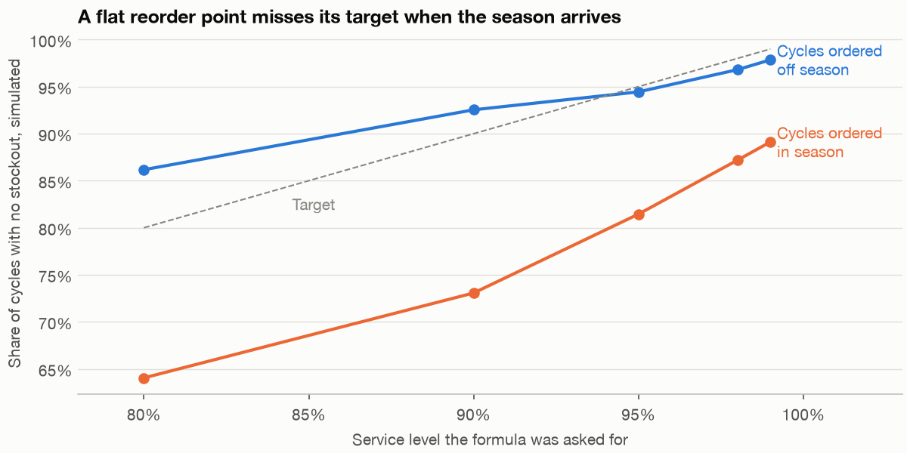

# Operations and supply chain: stock, queues and a plan

A forecast of 1,120 units is not an order of 1,120 units, and a queue that a textbook says will wait 3.9 minutes doesn't wait 3.9 minutes when the shift starts with nobody in it. Fernhill's warehouse manager has to commit to stock months ahead and to packers days ahead, and each decision turns on a spread and two prices rather than on an average. We work out both decisions with the standard formulas, then run each one against a simulated truth to see where the formula holds and where it doesn't. Some hold and some don't, and on packers the surprise is that Monday, the busiest day, isn't the day with the longest wait.

---

## The question and the data

The business question is **how much of each product should the warehouse hold, and how many packers on a Monday?**

Four tables come from `practice/retail.py`, and all are overlays on the shop's other tables:

- **`load_products()`** has 12 products with price, cost, salvage value, holding cost and order cost. Three are sold only for the eight weeks before Christmas.
- **`load_product_demand()`** has weekly units per product for three years. **`load_purchase_orders()`** has 20 orders per product with their lead times, but no quantities.
- **`load_packing_line()`** has every parcel over 13 weeks: when it arrived, when packing started and ended, and the wait. `load_truth("packing_line")` has the arrival rates, the service rate of 12 parcels an hour and the wage.
- **`load_fulfilment()`** has pick and pack times and delivery lead time per order line, used at the end.

These tables don't reconcile with each other, and we say where that matters. The code blocks are the main sections of `practice/ch10_operations_supply_chain.py` in order, each relying on those before it, with the chart code left to the script. Run them with `uv run ch10_operations_supply_chain.py` from the practice folder; it takes about half a minute.

## One season's order: the newsvendor

A Christmas line is ordered once, before the season, and what's left after Christmas is sold off cheaply. This is the **newsvendor** problem. Each unit short loses the **underage cost**, price minus cost. Each unit left over loses the **overage cost**, cost minus salvage. Ordering one more unit pays when the chance it sells, times the underage cost, beats the chance it doesn't, times the overage cost. That gives the order as a quantile of demand, at the **critical fractile**:

    fractile = underage / (underage + overage)

It is the same argument as the critical ratio in [the forecasting chapter](01-forecasting.md#from-forecast-to-decision), where short staff cost £12 and spare staff £4. Here it's run from the season's forecast and the spread of that forecast's error. We forecast 2025 from the two earlier seasons, so the error includes both the season's own noise and the mistake in the forecast. The plan named Cachon and Terwiesch's *Matching Supply with Demand* as the text for this chapter. We haven't read it, so the formulas here are stated from the derivation above and tested against simulation.

```python
def season_forecast(frame, sku, before=2025):
    """Point forecast of one season from earlier seasons, with the spread of its error."""
    rows = frame[(frame.sku == sku) & (frame.units > 0) & (frame.week.dt.year < before)]
    seasons = rows.groupby(rows.week.dt.year).units.sum()
    weekly_var = rows.groupby(rows.week.dt.year).units.var().mean()
    season_var = 8 * weekly_var                       # one season's own noise
    error_sd = (season_var * (1 + 1 / len(seasons))) ** .5     # plus the error in the forecast itself
    return seasons.mean(), error_sd


def critical_fractile(row):
    under, over = row.unit_price - row.unit_cost, row.unit_cost - row.salvage_value
    return under, over, under / (under + over)


rows = []
for sku in LINES:
    p = products.loc[sku]
    mean, sd = season_forecast(demand, sku)
    under, over, fractile = critical_fractile(p)
    rows.append({"sku": sku, "underage": under, "overage": over, "fractile": fractile, "forecast": mean, "error_sd": sd,
                 "order_q": mean + norm.ppf(fractile) * sd, "true_q": truth["by_sku"][sku]["newsvendor_q"],
                 "true_mean": truth["by_sku"][sku]["season_mean"], "true_sd": truth["by_sku"][sku]["season_sd"]})
plan = pd.DataFrame(rows).set_index("sku")
print(plan.round(2).to_string())
past = season_rows[season_rows.year < 2025].groupby(["sku", "year"]).units.sum().unstack("year")
ratios = pd.concat([past[2023] / past[2024], past[2024] / past[2023]])     # each past season against a forecast made from the other
print("actual over forecast, past seasons:", ratios.round(3).sort_values().tolist())
plan["ratio_q"] = [plan.forecast[s] * ratios.quantile(plan.fractile[s]) for s in LINES]
print("order from the ratio quantile, chapter 1's route:", plan.ratio_q.round(0).to_dict())
```

```text
order from the ratio quantile, chapter 1's route: {'KIT-03': 738.0, 'TEX-03': 1215.0, 'LGT-03': 892.0}
```

The margin on these lines is nearly three times what a leftover costs, so the fractiles are all near 0.73: order well above the forecast. Chapter 1's route takes the ratio of actual to forecast and reads its quantile. With two past seasons there are only six ratios, three mirror-image pairs between 0.95 and 1.05, so it produces smaller orders. The true spread is about 13% of a season.

Now score each order on 200,000 seasons from the generator's own demand process, which is what a real retailer never has.

```python
def season_draws(level, generator, n=200_000, k=K):
    """Season demand from the generator's own process: eight Gamma-Poisson weeks."""
    return generator.poisson(generator.gamma(k, level / k, (n, 8))).sum(axis=1)


def profit(q, d, p):
    sold = np.minimum(q, d)
    return (p.unit_price * sold + p.salvage_value * (q - sold) - p.unit_cost * q).mean()


rows = []
sims = {}
for sku in LINES:
    p = products.loc[sku]
    d = sims[sku] = season_draws(truth["by_sku"][sku]["weekly_level"], rng)
    row = plan.loc[sku]
    rows.append({"sku": sku, "profit_point": profit(row.forecast, d, p), "profit_fractile": profit(row.order_q, d, p),
                 "profit_ratio": profit(row.ratio_q, d, p), "profit_true_q": profit(row.true_q, d, p), "profit_sim_best": profit(np.quantile(d, row.fractile), d, p),
                 "sim_quantile": np.quantile(d, row.fractile), "stockout_point": (d > row.forecast).mean(), "stockout_fractile": (d > row.order_q).mean(), "target": 1 - row.fractile})
outcome = pd.DataFrame(rows).set_index("sku")
outcome["gain"] = outcome.profit_fractile - outcome.profit_point
outcome["gain_pct"] = outcome.gain / outcome.profit_point
print(outcome.round(3).to_string())
actual = season_rows[season_rows.year == 2025].groupby("sku").units.sum()
print("what 2025 actually did, one season:")
for sku in LINES:
    p, row = products.loc[sku], plan.loc[sku]
    d = np.array([actual[sku]])
    print(f"  {sku}: demand {actual[sku]}, forecast {row.forecast:.0f}, order {row.order_q:.0f}; profit at the forecast {profit(row.forecast, d, p):,.0f}, at the fractile {profit(row.order_q, d, p):,.0f}")
```

```text
        profit_point  profit_fractile  profit_ratio  profit_true_q  profit_sim_best  sim_quantile  stockout_point  stockout_fractile  target     gain  gain_pct
sku
KIT-03     14630.757        14895.726     14821.497      14897.602        14897.919         776.0           0.538              0.289   0.267  264.968     0.018
TEX-03     16805.553        16666.546     16840.310      16843.556        16843.923        1203.0           0.365              0.114   0.273 -139.007    -0.008
LGT-03     16754.662        17614.895     17252.483      18085.886        18086.214        1037.0           0.800              0.592   0.259  860.233     0.051
what 2025 actually did, one season:
  KIT-03: demand 652, forecast 708, order 770; profit at the forecast 13,900, at the fractile 13,404
  TEX-03: demand 996, forecast 1164, order 1296; profit at the forecast 14,925, at the fractile 14,136
  LGT-03: demand 1082, forecast 854, order 927; profit at the forecast 17,090, at the fractile 18,536
```

Adding up the three lines, ordering the forecast earns £48,191, the ratio route £48,914, the fractile £49,177, and knowing the truth £49,827. So the fractile earns about 2% more than ordering the forecast, and it gets most of the way to the best possible.

It doesn't win everywhere, and the two exceptions say something:

- **TEX-03 loses £139.** Two good seasons put its forecast at 1,164 against a true mean of 1,120, and its error spread came out at 218 against a true 144. The forecast is already above the mean, so adding a buffer to it overshoots. The stockout rate of 11% is far below the 27% target.
- **LGT-03 stocks out 59% of the time** against a 26% target, because its forecast of 854 is far below the true 960. The fractile helps, adding £860, and is still £471 short of the best.
- **One real season isn't a verdict.** On the 2025 demand that really happened, the fractile lost on two lines and won on the third, ending £161 up across all three. A rule that's right on average is often wrong in a given year.

Over seeds 100 to 111, the average gain across the three lines was 1.70%, and it was positive on 11 of the 12. So the gain is real and small, and the forecast matters more: the distance between our orders and the best orders is mostly forecast error, not the choice of quantile.


*Image Source: generated by `practice/ch10_operations_supply_chain.py`. The fractile beats the forecast on two lines; the third was forecast too high to begin with. Profit falls faster to the left of the peak than to the right, which is why the order sits above the mean.*

This is why stock decisions need a forecast distribution and not a point. The M5 uncertainty competition, of which we read the abstract only, asked for nine quantiles of each of 42,840 Walmart unit-sales series, and those quantiles are the input that this calculation needs.

## How much to order at a time: EOQ

The nine staple products sell all year and can be reordered. Ordering more at a time means fewer order costs and more stock to hold. Balancing those gives the **economic order quantity**, EOQ = √(2 × annual units × order cost / holding cost per unit per year). The purchase orders table goes out every eight weeks and holds no quantities, so we take today's order to be eight weeks of 2025 demand. That is our assumption.

```python
staples = products.index[~products.christmas_only]
year = demand[demand.week.dt.year == 2025].groupby("sku").units.sum()
eoq = pd.DataFrame({"annual_units": year[staples], "order_cost": products.order_cost[staples], "holding": products.holding_cost_per_year[staples]})
eoq["eoq"] = (2 * eoq.annual_units * eoq.order_cost / eoq.holding) ** .5
eoq["true_eoq"] = [truth["by_sku"][s]["eoq"] for s in staples]
eoq["now_q"] = eoq.annual_units * truth["po_interval_weeks"] / 52.18     # purchase orders go out every eight weeks and carry no quantity
cost = lambda q, e: e.annual_units / q * e.order_cost + q / 2 * e.holding
eoq["cost_now"] = cost(eoq.now_q, eoq)
eoq["cost_eoq"] = cost(eoq.eoq, eoq)
eoq["saving"] = eoq.cost_now - eoq.cost_eoq
print(eoq.round(1).to_string())
print(f"total cycle cost now £{eoq.cost_now.sum():,.0f}, at EOQ £{eoq.cost_eoq.sum():,.0f}, saving {eoq.saving.sum() / eoq.cost_now.sum():.1%}")
print("cost against the best, ordering a multiple of EOQ:", {m: round((m + 1 / m) / 2, 3) for m in (.5, .75, 1.25, 1.5, 2)})
```

```text
        annual_units  order_cost  holding    eoq  true_eoq  now_q  cost_now  cost_eoq  saving
sku
KIT-01          3175        40.0      4.5  237.6     246.1  486.8    1356.1    1069.1   287.0
KIT-02          6169        40.0      1.5  573.6     577.3  945.8     970.3     860.4   109.9
TEX-01          5009        35.0      2.2  394.8     387.6  768.0    1092.2     888.2   204.0
TEX-02          1923        35.0      5.2  160.1     162.8  294.8    1002.2     840.7   161.5
LGT-01          2549        45.0      3.5  256.0     256.4  390.8     977.4     896.1    81.3
LGT-02          1083        45.0      7.0  118.0     120.9  166.0     874.7     826.0    48.6
FUR-01           485       120.0     21.2   74.0      71.6   74.4    1572.8    1572.7     0.0
FUR-02           217       120.0     35.0   38.6      39.5   33.3    1364.9    1350.1    14.8
FUR-03           673       120.0     15.0  103.8     104.4  103.2    1556.6    1556.5     0.0
total cycle cost now £10,767, at EOQ £9,860, saving 8.4%
cost against the best, ordering a multiple of EOQ: {0.5: 1.25, 0.75: 1.042, 1.25: 1.025, 1.5: 1.083, 2: 1.25}
```

Estimates sit close to the truth, which is calculated from expected demand rather than 2025's. EOQ saves 8.4%, or £907 a year, and nothing on furniture, where eight weeks happens to be about right. The last line explains why EOQ isn't worth arguing over: an order 25% over the best costs only 2.5% more, and 50% over costs 8.3% more. The cost curve is flat near the bottom, and a rounder number that fits a pallet is usually fine.

## How much to keep in reserve: safety stock

Stock is reordered when it falls to a **reorder point**: expected demand over the lead time, plus **safety stock** for the times demand runs high or the delivery runs late. Both sources of noise count:

    safety stock = z × √(lead time × weekly demand variance + weekly mean² × lead time variance)

Here z comes from the **service level**, the chance of getting through one order cycle without running out. That number is a decision, not an estimate, and the second table prices it.

```python
leads = orders.groupby("sku").lead_time_days.agg(["mean", "std"])
history = demand[demand.sku.isin(staples)].groupby("sku").units.agg(["mean", "var"])
stock = pd.DataFrame({"weekly_mean": history["mean"][staples], "weekly_var": history["var"][staples], "lead_weeks": leads["mean"][staples] / 7, "lead_sd_weeks": leads["std"][staples] / 7})


def safety_stock(frame, level):
    """Spread of demand over the lead time: demand's own noise plus lead-time noise, times z for the service level."""
    return norm.ppf(level) * (frame.lead_weeks * frame.weekly_var + frame.weekly_mean ** 2 * frame.lead_sd_weeks ** 2) ** .5


stock["ss_95"] = safety_stock(stock, .95)
stock["true_ss"] = [truth["by_sku"][s]["safety_stock"] for s in staples]
stock["ss_no_lead_noise"] = norm.ppf(.95) * (stock.lead_weeks * stock.weekly_var) ** .5
print(stock.round(1).to_string())
print("share of safety stock owed to lead-time noise:", (1 - stock.ss_no_lead_noise.sum() / stock.ss_95.sum()).round(3))
choices = {s: {"safety_stock": safety_stock(stock, s).sum(), "cost_per_year": (safety_stock(stock, s) * products.holding_cost_per_year[staples]).sum()} for s in (.80, .90, .95, .98, .99)}
print(pd.DataFrame(choices).T.round(0).to_string())
```

```text
        weekly_mean  weekly_var  lead_weeks  lead_sd_weeks  ss_95  true_ss  ss_no_lead_noise
sku
KIT-01         69.6      1041.0         2.8            0.7  120.0    108.7              88.6
KIT-02        124.7      3022.8         2.2            0.4  159.7    144.5             133.0
TEX-01         96.6      1451.8         3.9            1.2  225.7    192.9             124.1
TEX-02         38.9       297.4         4.0            1.1   88.9     80.9              56.7
LGT-01         48.8       455.8         4.7            1.3  128.4    124.3              75.8
LGT-02         21.4        85.3         5.1            1.4   59.2     56.7              34.3
FUR-01          9.0        23.7         8.0            2.6   44.9     35.4              22.6
FUR-02          4.5         8.9         9.3            2.0   21.2     20.9              14.9
FUR-03         12.7        48.4         6.5            0.9   35.0     46.3              29.2
share of safety stock owed to lead-time noise: 0.344
      safety_stock  cost_per_year
0.80         452.0         2476.0
0.90         688.0         3770.0
0.95         883.0         4839.0
0.98        1102.0         6042.0
0.99        1249.0         6844.0
```

Going from 95% to 99% costs another £2,005 a year in held stock, against £4,839 for the whole of the 95% buffer. About a third of the safety stock is there only because deliveries vary, and leaving that out is the commonest shortcut. Most of the estimates run above the truth because the sample variance of weekly demand includes the seasonal swing. FUR-03 runs below, because 20 orders happened to give a lead-time spread of 0.9 weeks when the true one is about 1.8.

### Does the buffer deliver what it promises?

Each policy goes through 200 simulated years of the generator's demand and lead times, with unmet demand lost.  is a daily loop, left to the script. **Cycle service** is the share of order cycles with no stockout, and **fill rate** is the share of units sold.

```python
results = []
for sku in staples:
    weekly = stock.loc[sku, "weekly_mean"]
    lead = stock.loc[sku, "lead_weeks"]
    results.append({"sku": sku, **simulate_policy(sku, weekly * lead + stock.loc[sku, "ss_95"], eoq.loc[sku, "eoq"], rng)})
run = pd.DataFrame(results).set_index("sku")
print(run.round(3).to_string())
print(run.mean().round(3).to_string())
ladder = []
for level in (.80, .90, .95, .98, .99):
    ss = safety_stock(stock, level)
    one = pd.DataFrame([simulate_policy(s, stock.weekly_mean[s] * stock.lead_weeks[s] + ss[s], eoq.eoq[s], rng, years=100) for s in staples]).mean()
    ladder.append({"target": level, "cost_per_year": (ss * products.holding_cost_per_year[staples]).sum(), **one[["cycle_service_all", "cycle_service_off_season", "cycle_service_in_season", "fill_off_season", "fill_in_season"]]})
ladder = pd.DataFrame(ladder)
print(ladder.round(3).to_string(index=False))
```

```text
        cycle_service_off_season  cycle_service_in_season  cycle_service_all  fill_off_season  fill_in_season  cycles_per_year  mean_on_hand
sku
FUR-03                     0.864                    0.691              0.825            0.973           0.923            6.275        83.442
cycle_service_off_season      0.948
cycle_service_in_season       0.794
cycle_service_all             0.914
fill_off_season               0.991
fill_in_season                0.947
cycles_per_year               9.602
mean_on_hand                211.094
 target  cost_per_year  cycle_service_all  cycle_service_off_season  cycle_service_in_season  fill_off_season  fill_in_season
   0.80       2476.020              0.816                     0.862                    0.640            0.974           0.892
   0.90       3770.279              0.883                     0.925                    0.731            0.985           0.931
   0.95       4839.100              0.916                     0.944                    0.814            0.991           0.945
   0.98       6042.056              0.947                     0.968                    0.872            0.994           0.968
   0.99       6844.032              0.959                     0.978                    0.891            0.997           0.976
```

Outside the season, the formula gets what it promises: 94.8% against a target of 95%. In season it gets 79.4% (81.4% in the ladder's separate draw), because the reorder point uses a year-round mean, and demand runs 60% higher in those weeks. The all-year figure of 91.4% hides this. So does the fill rate, which still looks healthy at 94.7%, because a stockout late in a cycle loses few units. FUR-03 shows the other way to miss, at 86.4% off season, because its lead-time spread was underestimated. Asking the formula for 99% only lifts in-season service to 89%. A higher z is a costly fix for a wrong mean, and exercise 2 tries the proper one.



*Image Source: generated by `practice/ch10_operations_supply_chain.py`. The same reorder point serves two different demand rates, so it misses on the higher one at every setting.*

## The packing line, and Little's law

Now the packers. Each weekday has its own arrival rate and crew. Utilisation, **ρ**, is arrivals divided by what the crew can pack in an hour.

```python
line, line_truth = load_packing_line(), load_truth("packing_line")
service = line_truth["service_rate_per_hour"]
print(len(line), "parcels over", line.date.nunique(), "days, pack minutes", round(line.pack_minutes.mean(), 2))
summary = line.groupby("weekday").agg(days=("date", "nunique"), parcels=("parcel_id", "size"), mean_wait=("wait_minutes", "mean"), p95_wait=("wait_minutes", lambda s: s.quantile(.95)), share_waiting=("wait_minutes", lambda s: (s > 0).mean())).reindex(WEEKDAYS)
summary["per_hour"] = summary.parcels / summary.days / 8
summary["packers"] = [line_truth["packers"][d] for d in WEEKDAYS]
summary["rho"] = summary.per_hour / (service * summary.packers)
summary["erlang_c"] = [erlang_c(line_truth["arrivals_per_hour"][d], service, line_truth["packers"][d])["mean_wait"] * 60 for d in WEEKDAYS]
print(summary.round(3).to_string())
```

```text
22566 parcels over 65 days, pack minutes 4.97
           days  parcels  mean_wait  p95_wait  share_waiting  per_hour  packers    rho  erlang_c
weekday
Monday       13     6357      2.909    11.334          0.600    61.125        6  0.849     3.894
Tuesday      13     4495      1.171     6.105          0.375    43.221        5  0.720     1.623
Wednesday    13     4182      4.348    16.208          0.656    40.212        4  0.838     4.933
Thursday     13     3912      1.984     8.745          0.502    37.615        4  0.784     3.489
Friday       13     3620      1.957     9.436          0.449    34.808        4  0.725     1.893
```

Monday has the most parcels, but it isn't the day with the longest wait. Wednesday is, at 4.35 minutes, since its four packers run about as hot as Monday's six (ρ of 0.84 and 0.85) and a smaller crew pools less. That is a fact worth raising before anyone proposes a Monday fix.

**Little's law** says the average number in a system equals the arrival rate times the average time in it, L = λW. We read Little's 1961 proof in full. It needs stationary arrivals and finite means, and places no restriction on the arrival or service distributions, the number of servers or the queue discipline, and it can be applied to the queue alone. Over a finite window it holds exactly except for the parcels straddling the ends of that window. Our days start empty and run until the last parcel is packed, so nothing straddles, and the law should hold to rounding error. That makes it a check on the log rather than a forecast.

```python
def little_day(day):
    """Queue length as a step function of time, and the two sides of L = lambda W on one day."""
    start = day.arrived.min().normalize() + pd.Timedelta(hours=8)
    arrive = (day.arrived - start).dt.total_seconds().to_numpy() / 60
    begin = (day.pack_start - start).dt.total_seconds().to_numpy() / 60
    finish = (day.pack_end - start).dt.total_seconds().to_numpy() / 60
    times = np.r_[arrive, begin]
    steps = np.r_[np.ones(len(arrive)), -np.ones(len(begin))]
    order = np.argsort(times, kind="stable")
    queue = np.cumsum(steps[order])
    span = finish.max()
    area = (queue[:-1] * np.diff(times[order])).sum()
    in_queue = area / span
    return pd.Series({"span": span, "L_q": in_queue, "lambda_W": len(day) / span * (begin - arrive).mean(), "busy": (finish - begin).sum() / span})


days = line.groupby(["date", "weekday"]).apply(little_day, include_groups=False).reset_index()
print(days.head(3).assign(date=lambda d: d.date.dt.date).round(4).to_string(index=False))
print("largest gap between L_q and lambda times W across", len(days), "days:", f"{(days.L_q - days.lambda_W).abs().max():.2e}")
print(days.groupby("weekday")[["L_q", "busy"]].mean().reindex(WEEKDAYS).round(2).to_string())
counts = []
for date, day in line.groupby("date"):
    start = date + pd.Timedelta(hours=8)
    for clock in pd.date_range(start, periods=16, freq="30min"):
        counts.append({"weekday": day.weekday.iloc[0], "queue": ((day.arrived <= clock) & (day.pack_start > clock)).sum()})
floor = pd.DataFrame(counts).groupby("weekday").queue.mean().reindex(WEEKDAYS)
print(pd.DataFrame({"mean_queue_seen_every_30_min": floor, "wait_implied": floor / summary.per_hour * 60, "wait_recorded": summary.mean_wait}).round(2).to_string())
```

```text
      date   weekday     span    L_q  lambda_W   busy
2025-09-29    Monday 489.3148 1.1366    1.1366 4.4436
2025-09-30   Tuesday 495.0486 0.9524    0.9524 3.6274
2025-10-01 Wednesday 499.1335 1.5117    1.5117 3.1947
largest gap between L_q and lambda times W across 65 days: 8.88e-16
            L_q  busy
weekday
Monday     2.91  5.00
Tuesday    0.83  3.48
Wednesday  2.85  3.30
Thursday   1.22  3.04
Friday     1.12  2.80
           mean_queue_seen_every_30_min  wait_implied  wait_recorded
weekday
Monday                             2.91          2.86           2.91
Tuesday                            0.88          1.22           1.17
Wednesday                          2.75          4.10           4.35
Thursday                           1.12          1.78           1.98
Friday                             1.04          1.80           1.96
```

It holds to rounding error on all 65 days, with no assumption about arrivals. If a real log failed this check, the timestamps would be wrong. The lower table is the practical version: walk the floor every half hour between 08:00 and 15:30, count the queue, divide by the arrival rate, and you get close to the recorded wait with no timestamps at all.

## Erlang C, and a day that starts empty

The **Erlang C** formula gives the steady-state wait of an **M/M/c queue**: c servers, Poisson arrivals and exponential service, and `erlang_c` in `retail.py` computes it. But a shift isn't a steady state. It starts empty, arrivals stop at 16:00 and packers work until the line clears. So we simulate the generator's own day 2,000 times and set all three figures side by side.

```python
def simulate_days(arrivals, packers, generator, n_days=2000, service_rate=service, hours=8):
    """The generator's own day: Poisson count, uniform arrivals, exponential service, first come first served, empty at 08:00."""
    waits, overruns, day_means = [], [], []
    for _ in range(n_days):
        n = generator.poisson(arrivals * hours)
        times = np.sort(generator.uniform(0, hours * 60, n))
        minutes = generator.exponential(60 / service_rate, n)
        free = [0.0] * packers
        heapq.heapify(free)
        w = np.zeros(n)
        for i in range(n):
            soonest = heapq.heappop(free)
            begin = max(times[i], soonest)
            w[i] = begin - times[i]
            heapq.heappush(free, begin + minutes[i])
        waits.append(w)
        overruns.append(max(free) - hours * 60)
        day_means.append(w.mean())
    return np.concatenate(waits), np.array(overruns), np.array(day_means)


rows = []
for day, c in [("Monday", 5), ("Monday", 6), ("Monday", 7), ("Tuesday", 4), ("Tuesday", 5), ("Wednesday", 4), ("Wednesday", 5), ("Thursday", 3), ("Thursday", 4), ("Friday", 3), ("Friday", 4)]:
    rate = line_truth["arrivals_per_hour"][day]
    w, over, means = simulate_days(rate, c, rng)
    theory = erlang_c(rate, service, c)
    recorded = summary.loc[day, "mean_wait"] if c == line_truth["packers"][day] else np.nan
    rows.append({"day": day, "packers": c, "rho": theory["rho"], "erlang_c": theory["mean_wait"] * 60, "simulated": w.mean(), "recorded": recorded,
                 "p95": np.quantile(w, .95), "over_10_min": (w > 10).mean(), "day_sd": means.std(), "overrun_min": max(0, over.mean())})
queue_table = pd.DataFrame(rows)
print(queue_table.round(3).to_string(index=False))
simulated = queue_table.set_index(["day", "packers"])
```

```text
      day  packers   rho  erlang_c  simulated  recorded    p95  over_10_min  day_sd  overrun_min
   Monday        5 1.033       inf     18.919       NaN 54.391        0.605  11.516       41.840
   Monday        6 0.861     3.894      3.423     2.909 13.948        0.101   2.588       14.721
   Monday        7 0.738     0.997      0.956       NaN  5.311        0.009   0.602       11.987
  Tuesday        4 0.917    12.326      8.389       NaN 29.067        0.313   6.547       19.560
  Tuesday        5 0.733     1.623      1.527     1.171  7.744        0.027   0.971       10.757
Wednesday        4 0.833     4.933      4.254     4.348 17.078        0.145   2.982       13.623
Wednesday        5 0.667     0.980      0.931       NaN  5.408        0.010   0.639        9.698
 Thursday        3 1.056       inf     26.458       NaN 74.894        0.690  15.762       52.300
 Thursday        4 0.792     3.489      3.150     1.984 13.563        0.094   2.331       11.779
   Friday        3 0.944    26.906     13.092       NaN 43.126        0.454   9.337       25.974
   Friday        4 0.708     1.893      1.797     1.957  8.960        0.039   1.149        9.790
Monday wait by arrival hour: [1.68, 3.07, 3.47, 3.69, 3.76, 3.75, 3.95, 3.89]
Wednesday wait by arrival hour: [2.27, 4.07, 4.53, 4.73, 4.83, 4.81, 5.0, 5.01]
```

Reading across each row:

- **A day that starts empty does run below Erlang C, by 5% to 14%.** Monday is 3.42 against 3.89 and Wednesday 4.25 against 4.93. The figure shows why: the first hour waits under half as long, and the line reaches Erlang's level by mid-afternoon.
- **The rest of the gap to the recorded wait is thirteen-day luck.** Monday's recorded 2.91 is lower than the simulated 3.42, and the sd of a single Monday's mean wait is 2.6 minutes, so thirteen Mondays have a standard error of about 0.7. Thursday's recorded 1.98 is further below its 3.15 for the same reason. Friday's recorded wait is slightly above Erlang C.
- **"Unstable" doesn't mean what Erlang says.** Monday with five packers has ρ of 1.03 and an infinite Erlang wait. The real day ends: a mean wait of 19 minutes, 61% of parcels waiting over ten minutes, and a line that runs 42 minutes past 16:00. That is still a very bad day and it has a finite cost, which a steady-state formula can't give you.

Over seeds 100 to 111 the mean recorded waits were Monday 3.30, Tuesday 1.74, Wednesday 4.81, Thursday 3.01 and Friday 1.87, each within two standard errors of the simulated day. So Monday and Thursday do sit below Erlang C on average, but Tuesday's 1.74 is above its 1.62 and Friday's level with it. The empty start is a small effect, and it doesn't explain the full gap on this seed.

Wednesday had a longer wait than Monday in 10 of those 12 seeds, so Wednesday's lead is a real feature of the crews and not luck.


*Image Source: generated by `practice/ch10_operations_supply_chain.py`, from 3,000 simulated days each. Erlang C describes the afternoon, not the day.*

## So how many packers on a Monday?

Six or seven: five is out, and the choice between six and seven depends on what a minute of waiting is worth, which the data doesn't say. So price the extra packer. A packer-day costs £112. Divide that by the parcel-hours of waiting it removes and you get the value at which it pays for itself.

```python
wage_day = line_truth["wage_per_hour"] * 8
rows = []
for day in WEEKDAYS:
    c = line_truth["packers"][day]
    rate = line_truth["arrivals_per_hour"][day]
    now, _, _ = simulate_days(rate, c, rng)
    more, _, _ = simulate_days(rate, c + 1, rng)
    rows.append({"day": day, "packers": c, "wait_now": now.mean(), "wait_with_one_more": more.mean(), "parcel_minutes_saved_per_day": (now.mean() - more.mean()) * rate * 8,
                 "break_even_per_parcel_hour": wage_day / ((now.mean() - more.mean()) * rate * 8 / 60)})
marginal = pd.DataFrame(rows)
print(marginal.round(2).to_string(index=False))
print(f"a packer-day costs £{wage_day:.0f}")
```

```text
      day  packers  wait_now  wait_with_one_more  parcel_minutes_saved_per_day  break_even_per_parcel_hour
   Monday        6      3.34                0.95                       1187.60                        5.66
  Tuesday        5      1.56                0.44                        394.47                       17.04
Wednesday        4      4.35                0.96                       1084.40                        6.20
 Thursday        4      3.21                0.74                        751.04                        8.95
   Friday        4      1.73                0.44                        353.19                       19.03
a packer-day costs £112
```

A seventh packer on Monday pays if an hour of parcel waiting is worth more than £5.66. A fifth on Wednesday pays at £6.20, close behind and with a third fewer parcels, and Tuesday's and Friday's extras need three times that. So a question framed around Monday has a sibling on Wednesday, and if the budget stretches to only one extra packer, the two are nearly a coin toss.

The alternative is a target: find the smallest crew that holds a mean wait below a limit.

```text
               5     6     7     8     9      3     4       2
Monday     19.18  3.37  0.94  0.32  0.12    NaN   NaN     NaN
Tuesday     1.57  0.46  0.14   NaN   NaN  59.77  8.31     NaN
Wednesday   0.91  0.27  0.08   NaN   NaN  36.24  4.16     NaN
Thursday    0.75  0.21  0.06   NaN   NaN  27.14  3.21     NaN
Friday      0.44  0.12   NaN   NaN   NaN  12.71  1.80  106.21
               Monday  Tuesday  Wednesday  Thursday  Friday  packer_days
max_mean_wait
1                   7        6          5         5       5           28
2                   7        5          5         5       4           26
3                   7        5          5         5       4           26
5                   6        5          4         4       4           23
```

Thursday's four packers sit at 3.21 minutes, just over the 3-minute line, so that target buys an extra Thursday packer that a 3.3-minute target wouldn't. A round-number target hides a decision like this, and a price for waiting makes it visible.

## A shift plan as a linear programme

A crew per day is not a rota. People are employed, and that's where a **linear programme** earns its place: minimise a cost that's linear in the decisions, subject to linear constraints. The data holds a wage of £14 an hour and nothing about contracts, so the structure here is **our assumption**: permanent packers work all five days at the wage, and agency cover is bought by the day at a premium. We vary the premium because we made it up.

The constraint for each weekday is permanent plus that day's agency cover at least equal to the need. A **shadow price** on a constraint is what one more unit of need that day adds to the cost.

```python
def shift_plan(need, premium=1.5, integer=True):
    """Cheapest cover: permanent packers work all five days, agency cover is bought by the day at a premium."""
    model = pulp.LpProblem("shifts", pulp.LpMinimize)
    kind = "Integer" if integer else "Continuous"
    permanent = model.add_variable("permanent", lowBound=0, cat=kind)
    agency = {day: model.add_variable(f"agency_{day}", lowBound=0, cat=kind) for day in WEEKDAYS}
    model += 5 * wage_day * permanent + pulp.lpSum(premium * wage_day * agency[day] for day in WEEKDAYS)
    for day in WEEKDAYS:
        model += permanent + agency[day] >= need[day], day
    model.solve(pulp.COIN_CMD(msg=False))
    prices = {c.name: c.pi for c in model.constraints()} if not integer else None
    return {"cost": pulp.value(model.objective), "permanent": permanent.value(), "agency": {d: agency[d].value() for d in WEEKDAYS}, "prices": prices}


print("solvers available:", pulp.listSolvers(onlyAvailable=True))
current = {d: line_truth["packers"][d] for d in WEEKDAYS}
print(f"today's rota: {sum(current.values())} packer-days, £{sum(current.values()) * wage_day:,.0f} a week at the flat wage")
for premium in (1.2, 1.5, 2.0):
    for target in (3, 5):
        need = requirement.loc[target, WEEKDAYS].to_dict()
        relaxed, whole = shift_plan(need, premium, integer=False), shift_plan(need, premium)
        print(f"premium {premium}, mean wait at most {target} min, need {list(need.values())}: £{whole['cost']:,.0f} (LP £{relaxed['cost']:,.0f}), "
              f"permanent {whole['permanent']:.0f}, agency {[round(whole['agency'][d]) for d in WEEKDAYS]}, shadow prices {[round(relaxed['prices'][d]) for d in WEEKDAYS]}")
for value in (5, 7, 10, 20):
    picks = {}
    for day in WEEKDAYS:
        rate = line_truth["arrivals_per_hour"][day]
        costs = {c: c * wage_day + value * rate * 8 * w / 60 for c, w in wait_tables[day].items()}
        picks[day] = min(costs, key=costs.get)
    print(f"a parcel-hour of waiting worth £{value}: cheapest packers {list(picks.values())}, {sum(picks.values())} packer-days")
```

```text
solvers available: ['COIN_CMD']
today's rota: 23 packer-days, £2,576 a week at the flat wage
premium 1.2, mean wait at most 3 min, need [7, 5, 5, 5, 4]: £3,046 (LP £3,046), permanent 4, agency [3, 1, 1, 1, 0], shadow prices [134, 134, 134, 134, 22]
premium 1.2, mean wait at most 5 min, need [6, 5, 4, 4, 4]: £2,643 (LP £2,643), permanent 4, agency [2, 1, 0, 0, 0], shadow prices [134, 134, 134, 22, 134]
premium 1.5, mean wait at most 3 min, need [7, 5, 5, 5, 4]: £3,136 (LP £3,136), permanent 5, agency [2, 0, 0, 0, 0], shadow prices [168, 168, 168, 56, 0]
premium 1.5, mean wait at most 5 min, need [6, 5, 4, 4, 4]: £2,744 (LP £2,744), permanent 4, agency [2, 1, 0, 0, 0], shadow prices [168, 168, 168, 0, 56]
premium 2.0, mean wait at most 3 min, need [7, 5, 5, 5, 4]: £3,248 (LP £3,248), permanent 5, agency [2, 0, 0, 0, 0], shadow prices [224, 224, 112, 0, 0]
premium 2.0, mean wait at most 5 min, need [6, 5, 4, 4, 4]: £2,912 (LP £2,912), permanent 4, agency [2, 1, 0, 0, 0], shadow prices [224, 224, 112, 0, 0]
a parcel-hour of waiting worth £5: cheapest packers [6, 5, 4, 4, 4], 23 packer-days
a parcel-hour of waiting worth £7: cheapest packers [7, 5, 5, 4, 4], 25 packer-days
a parcel-hour of waiting worth £10: cheapest packers [7, 5, 5, 5, 4], 26 packer-days
a parcel-hour of waiting worth £20: cheapest packers [7, 6, 5, 5, 5], 28 packer-days
```

Things to take from it:

- **The LP and the integer programme agree.** Every row costs the same relaxed as in whole people. That follows from the structure here (one column of ones plus an identity matrix has no fractional corners), and it stops being true once contracts get more complicated, so check.
- **The premium decides the shape of the crew.** At 1.2 times the wage, four permanents and lots of agency; at 1.5 or 2.0, five permanents and two agency on Monday for the same need. Today's need, the 5-minute row, stays at four permanents in all three.
- **Read Monday's shadow price, and be wary of the others.** Monday's is one agency day, and that is firm. Those on the other days share out the permanent's weekly cost and aren't unique when several constraints tie. For example, they move about between Thursday and Friday across the rows.
- **The last lines replace the target with a price.** At £5 per parcel-hour, today's rota is the cheapest. At £7, add Monday and Wednesday. At £10, add Thursday too. That table is what to put in front of the manager.

The check is to run the plan against the simulated day.

```text
      day  packers_now  wait_now  p95_now  packers_plan  wait_plan  p95_plan  overrun_plan
   Monday            6      3.47    13.99             7       0.94      5.21         11.92
  Tuesday            5      1.52     7.77             5       1.52      7.69         10.72
Wednesday            4      4.41    17.64             5       0.94      5.47          9.91
 Thursday            4      3.31    14.10             5       0.75      4.62          9.11
   Friday            4      1.79     8.96             5       0.44      3.12          8.38
parcel-weighted mean wait: now 2.96 min, plan 0.95 min; packer-days now 23, plan 27
parcels up 10%: packers to hold a 3-minute mean wait {'Monday': 7, 'Wednesday': 5}
parcels up 20%: packers to hold a 3-minute mean wait {'Monday': 8, 'Wednesday': 5}
parcels up 30%: packers to hold a 3-minute mean wait {'Monday': 8, 'Wednesday': 6}
```

The plan does what it set out to do, and with five permanents Friday gets a spare packer as a side effect. It costs £3,136 a week against £2,744 for today's crew under the same contract assumption, so £392 a week to bring the parcel-weighted wait from 2.96 to 0.95 minutes. The last lines show why the margin is worth having: 10% more parcels would keep the seven on Monday, but 20% needs eight.

## The wider warehouse

The fulfilment log covers picks and deliveries over three years, and it changes how far to trust the packing numbers.

```text
       pick_minutes  pack_minutes  lead_time_days
peak
False          4.91          3.51            3.04
True           6.39          3.48            3.98
           pick_minutes  pack_minutes  lead_time_days
category
furniture         14.74          8.98            6.83
kitchen            4.23          2.99            2.80
lighting           5.32          4.00            2.80
textiles           3.18          2.00            2.82
pick multiplier in peak by category: {'furniture': 1.32, 'kitchen': 1.31, 'lighting': 1.3, 'textiles': 1.31}
lead time in the June 2023 outage: 6.78 | rest of non-peak: 3.01
delivered within 3 days, not peak: 0.71 | peak: 0.475
mean pack minutes here 3.5 | on the packing line 4.97
rows per weekday in 2025, Monday first: [3496, 3515, 3541, 3629, 3495, 3533, 3577]
packing-line parcels per Monday by month: {9: 467.0, 10: 489.0, 11: 475.0, 12: 508.0}
```

Peak season lifts picking by about 31% in every category and does nothing to packing. Delivery within three days falls from 71% to 48%, and the June 2023 outage more than doubled lead time. Three things don't reconcile with the packing line. Mean pack time here is 3.5 minutes against 5 on the line. Rows are flat across weekdays here while the line has a Monday peak. And the line's parcels hold steady through November and December, although its 13 weeks overlap peak. Exercise 4 shows how much the pack time matters.

## Recommendation

- **Christmas lines: order at the fractile, near 73%, above the forecast.** Expect about 2% more profit on average and don't judge the rule by one season. Spend more effort on the forecast: on LGT-03 forecast error cost more than the rule earned.
- **Staples: move to EOQ where it's far from eight weeks,** on kitchen and textiles, for about £900 a year.
- **Set the reorder point by season.** A flat one gives 79% in season against a 95% target. Raising z is the expensive way to fix this.
- **Treat 95% as a decision.** Going to 99% costs about £2,000 a year more in held stock.
- **Monday: never five. Go from six to seven if a parcel-hour of waiting is worth more than about £6, and then Wednesday's fifth packer should come with it,** since it costs and earns about the same. Six is already fragile: 10% more parcels takes Monday's wait from 3.4 to 7.9 minutes.
- **The plan:** five permanent packers and two Monday agency, if agency costs 1.5 times the wage or more. Below about 1.25 times, stay at four permanents.

These are simulated tables, the contracts are assumed, real demand won't match the simulation, and queues here have no absence, no breaks and no peak uplift. What would change the recommendation: a stated value for waiting, or a promise on dispatch times, would settle the Monday choice outright. A pack time near 3.5 minutes rather than 5 would take a packer or more off every day. Parcels that arrive in bursts rather than evenly would make waits worse than any of these figures. Cachon and Terwiesch, and Hillier and Lieberman, are the textbook treatments; neither was read here.

## Pitfalls

- **Ordering the point forecast.** The symptom is a stockout rate of 37% to 80% here, against a target of about 27%. The mean is the right order only when underage and overage cost the same.
- **Trusting the forecast's own error.** Two seasons gave TEX-03 an error spread 50% too large and LGT-03 a mean 11% too low. A quantile of a poor forecast is a precise-looking poor order.
- **A year-round mean in a seasonal reorder point.** The symptom is a healthy annual service level and stockouts every December. Split service by period.
- **Reporting cycle service and fill rate as one thing.** Here 79% and 95% describe the same weeks. Say which you mean.
- **Dropping lead-time variance.** It's a third of the buffer here, and 20 orders can underestimate it by half.
- **Reading Erlang C as the wait for the day.** It describes a steady state that an empty-start shift only reaches by afternoon, and "infinite" at ρ above 1 means a late finish, not a queue without end.
- **Comparing with a 13-day sample and concluding the theory is wrong.** Recorded means have a standard error of about 0.7 minutes on Monday. Friday's sits above Erlang, Thursday's far below, and neither is a finding.
- **Staffing to the busiest day by reflex.** The longest wait here is on Wednesday. Look at the wait and at ρ, not the volume.
- **Letting a round target make the decision.** A 3-minute target buys a Thursday packer that 3.3 minutes wouldn't.
- **Older pulp code on pulp 4.2.0.** On this version, `pulp` fails on import without numpy, which it doesn't declare. CBC isn't bundled, so `PULP_CBC_CMD` is gone and you ask for `pulp[cbc]` and `COIN_CMD`. `LpVariable(name, lowBound=0)` raises a `TypeError`, so use `model.add_variable`, and `model.constraints` is now a method.

## Try it

1. Set TEX-03's salvage value to zero. What happens to the fractile, the order and the profit?

   <details><summary>Answer</summary>

   The fractile falls from 0.727 to 0.667 and the order from 1,207 to 1,182. Expected profit goes from £16,844 to £16,644, and keeping the old order would make £16,619, so reacting to the change is worth only £25. Losing salvage hurts much more than the order choice can recover.
   </details>

2. Make the reorder point follow the season: base level off season, and base level times 1.6 from one lead time before the season. What service do you get, and what does it cost?

   <details><summary>Answer</summary>

   Using the same safety stock, in-season cycle service goes from 80.0% to 94.7% and off-season stays at 95%. Holding cost goes from £9,972 to £10,346 a year, so about £374. Getting anywhere near that in-season service by raising z would cost over £2,000 and still miss. Note that the base here uses the true level, as a real business would use a seasonal forecast.
   </details>

3. Add 10% to parcels without changing the crew. Which day breaks first?

   <details><summary>Answer</summary>

   Monday with six goes to ρ 0.947, a mean wait of 7.93 minutes, a 95th percentile of 27 minutes and a 22-minute overrun. Wednesday with four goes to ρ 0.917 and 8.31 minutes, with a 95th percentile of 30 minutes and a 20-minute overrun. Both more than double their wait, Wednesday still the worse, which is what running at a ρ of 0.85 costs.
   </details>

4. Rerun the Monday and Wednesday simulation with a pack time of 3.5 minutes, the figure in the fulfilment table. How many packers then?

   <details><summary>Answer</summary>

   Monday with five waits 1.01 minutes, and with six 0.29. With four it's 5.66 minutes. Wednesday with three waits 3.00 minutes and with four 0.55. So a disagreement of 1.5 minutes between two tables moves the Monday answer from "six or seven" to "five", and you should settle which table is right before arguing about the wage.
   </details>

## Interview checklist

| Question | Answer |
|---|---|
| What is the newsvendor critical fractile? | Underage over underage plus overage cost. Order that quantile of demand, not the mean |
| When is the mean the right order? | Only when underage and overage cost the same and the distribution is symmetric |
| What does the point forecast miss in a stock decision? | The error spread, which is what turns margins into an order |
| What is EOQ, and why not worry about precision? | √(2DS/H). The cost is flat near the bottom: 25% over costs 2.5% more here |
| What goes into safety stock? | z for the service level, and both demand and lead-time noise |
| What is cycle service against fill rate? | The share of cycles with no stockout against the share of units served |
| Why might a 95% buffer give 79%? | The reorder point used a year-round mean through a season where demand runs 60% higher |
| What does Little's law assume? | Stationarity and finite means. Nothing about distributions, servers or discipline |
| What is it good for in practice? | Validating logs, and getting wait from a queue count alone |
| What does Erlang C assume? | Poisson arrivals, exponential service and a steady state. A shift that starts empty isn't one |
| What happens at ρ above 1 in a finite day? | A long but finite wait and an overrun, which you can cost, rather than an infinite queue |
| Why can fewer servers at the same ρ wait longer? | A small crew pools less, so an unlucky parcel waits longer. Compare Wednesday with Monday |
| What's a shadow price? | What one more unit of a constraint adds to the optimal cost. Not unique when constraints tie |
| When does an LP relaxation give whole numbers? | When the constraint matrix has no fractional corners, as in this crew problem. Check by solving both |

## Next

The forecast in chapter 1 has now reached the warehouse floor. One question is left, and it sits behind all of them: which numbers should the shop be run on? Go on to [metric trees and defining metrics](11-metric-trees.md).
