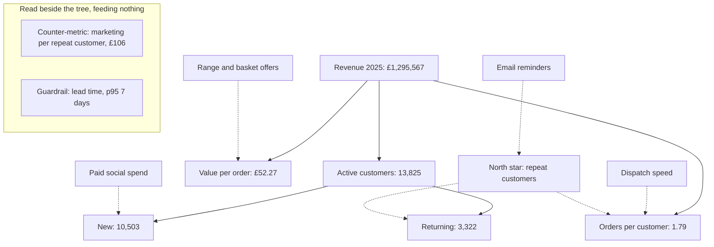

# Metric trees and defining metrics: what to run on, and what catches it lying

In 2025 Fernhill's revenue rose 2.1%, active customers rose 33.9% and new customers rose 33.0%. A dashboard of those three numbers would have called it a good year. Marketing spend rose 66.4% to get there, revenue less marketing fell 17.1%, and the customers who joined that year came back much less often. None of the numbers was wrong. They were the wrong numbers to run on, nothing was paired with them to catch the cost, and a question as plain as "what is our repeat rate?" has at least four answers in this ledger, from 4.6% to 46.5%.

## The question and the data

The business question is **which number should Fernhill run on, what feeds it, and what would catch it being gamed?** Answering it means building a tree from the top number down to things someone can change, picking a north star with drivers beneath it, pairing each target with something that would expose a bad gain, and writing each metric down precisely enough that two analysts get the same answer.

This chapter owns the tree and the definition. [Metrics and KPI design](../../03-experimentation-and-causality/notes/02-metrics-and-kpi-design.md) owns what happens to a metric inside an experiment: the [four kinds of metric](../../03-experimentation-and-causality/notes/02-metrics-and-kpi-design.md#four-kinds-of-metric) and the OEC, [ratio metrics and their variance](../../03-experimentation-and-causality/notes/02-metrics-and-kpi-design.md#ratio-metrics) and [testing a guardrail](../../03-experimentation-and-causality/notes/02-metrics-and-kpi-design.md#guardrails-need-a-test-of-their-own). A model's metric is a separate question again, covered in [choosing a metric](../../../data-science/01-classical-ml/notes/11-choosing-a-metric.md).

Five tables from `practice/retail.py` are used. **`load_orders()`** is the ledger: 63,958 orders from 26,342 customers, 2023 to 2025, all synthetic. **`load_customers()`** gives each customer's acquisition channel, **`load_marketing_weekly()`** the weekly spend per channel, **`load_fulfilment()`** the dates and lead time per order line, and **`load_sessions()`** the web log. These tables don't all reconcile. The marketing table's own revenue column doesn't match the ledger, so only its spend is used, and the web log counts 37,329 purchases where the ledger has 20,852 orders over the same dates, so conversion stays outside the tree below.

The code blocks are the sections of `practice/ch11_metric_trees.py` in order, each relying on those before it. Run them with `uv run ch11_metric_trees.py` from the practice folder.

```python
orders, customers, marketing = load_orders(), load_customers(), load_marketing_weekly()
orders["year"] = orders.order_date.dt.year
print(len(orders), "orders;", len(customers), "customers;", orders.order_date.min().date(), "to", orders.order_date.max().date())
```

```text
63958 orders; 26342 customers; 2023-01-01 to 2025-12-31
```

## A tree has two kinds of edge

A metric tree starts at one number and repeatedly asks what it's made of. The first few levels are arithmetic. Revenue is active customers times orders per customer times value per order, and that's true whatever the business does. Below that, the links turn into claims: we believe a reminder email raises orders per customer, but that's a hypothesis, and it can be false while the identity above it stays true.

So draw the two differently, because they're read differently. A solid edge is an **identity**: you can check it with an assert, and it attributes a change exactly. A dashed edge is a **causal claim**: it needs an experiment or some other design before anyone acts on it, and the tree only tells you where to look.



The two boxes on the side have no edges because they constrain the tree without feeding it. The arithmetic part is short enough to run, and the assert is the point. If the leaves stop multiplying back to the ledger, someone has changed a definition.

```python
def tree(frame):
    """The three leaves of the revenue identity, plus the revenue they multiply to."""
    active = frame.customer_id.nunique()
    n_orders = len(frame)
    revenue = frame.value.sum()
    return pd.Series({"revenue": revenue, "active": active, "per_customer": n_orders / active,
                      "per_order": revenue / n_orders})


years = orders.groupby("year")[["customer_id", "value"]].apply(tree)
years["rebuilt"] = years.active * years.per_customer * years.per_order
print(years.round(2).to_string())
assert np.allclose(years.revenue, years.rebuilt), "the leaves must multiply back to the ledger"
```

```text
         revenue   active  per_customer  per_order     rebuilt
year
2023   800797.19   7940.0          1.91      52.83   800797.19
2024  1268304.45  10324.0          2.33      52.82  1268304.45
2025  1295567.33  13825.0          1.79      52.27  1295567.33
```

### Attributing a change along the identity

Revenue rose by £27,263. A tree lets you say which leaves did it, which needs a split that doesn't depend on the order you take them in and leaves nothing over. Multiplying the leaves one at a time gives an answer that depends on which you take first and leaves an interaction term. Weighting each leaf's log change by the log mean of revenue avoids both, because the logs of a product add up and the weight is chosen so the parts sum to the change.

```python
def attribute(before, after, leaves=("active", "per_customer", "per_order")):
    """Split a change in a product among its factors with log-mean weights, which leaves no residual."""
    weight = (after.revenue - before.revenue) / np.log(after.revenue / before.revenue)
    return pd.Series({leaf: weight * np.log(after[leaf] / before[leaf]) for leaf in leaves})


change = attribute(years.loc[2024], years.loc[2025])
print(change.round(0).to_string())
print("sum of the parts", round(change.sum()), "; change in revenue", round(years.revenue[2025] - years.revenue[2024]))
```

```text
active          374320.0
per_customer   -333706.0
per_order       -13352.0
sum of the parts 27263 ; change in revenue 27263
```

That table holds the whole 2025 story. Having more customers added £374,320 and those customers buying less often took away £333,706, so a 2% rise is two large moves almost cancelling. Holding the frequency fixed shows what the growth story assumed:

```python
naive = years.loc[2024].copy()
naive["active"] = years.active[2025]
print("revenue if the extra customers had kept 2024's frequency:", round(naive.active * naive.per_customer * naive.per_order))
```

```text
revenue if the extra customers had kept 2024's frequency: 1698403
```

The £403k gap is the distance between the forecast a plan based on customer counts would have made and the ledger. Attribution still isn't explanation. It says frequency fell and leaves the reason open. Whether that's mix or every channel getting worse is what the [cohort analysis in chapter 3](03-cohort-and-retention.md) worked out, and it isn't redone here.

## The north star and its drivers

A **north star** is the one company-level number a team steers by across quarters, and [the experimentation chapter](../../03-experimentation-and-causality/notes/02-metrics-and-kpi-design.md#four-kinds-of-metric) has the short definition and how it relates to an OEC. Few experiments can detect a move in one, so it isn't for deciding launches. It should have three properties. It should follow value to the customer as well as to the shop, it should lead revenue rather than restate it, and a team should be able to name what it would do differently because of it.

Revenue fails the second: it's the outcome, and it arrives too late to steer by. The candidate here is **repeat customers**, customers with two or more orders in the trailing 365 days, because someone who comes back has found the product worth buying twice and because the [tree](#a-tree-has-two-kinds-of-edge) shows frequency is where the 2025 damage was.

```python
orders = orders.sort_values("order_date")


def repeat_customers(frame, end, days=365):
    """Customers with two or more orders in the `days` to `end`."""
    window = frame[(frame.order_date > end - pd.Timedelta(days=days)) & (frame.order_date <= end)]
    return int((window.groupby("customer_id").size() >= 2).sum())


ends = pd.to_datetime(["2023-12-31", "2024-06-30", "2024-12-31", "2025-06-30", "2025-12-31"])
star = pd.DataFrame({"repeat_customers": [repeat_customers(orders, end) for end in ends],
                     "revenue_12m": [orders[(orders.order_date > end - pd.Timedelta(days=365))
                                            & (orders.order_date <= end)].value.sum() for end in ends]}, index=ends.date)
star["active_12m"] = [orders[(orders.order_date > end - pd.Timedelta(days=365))
                             & (orders.order_date <= end)].customer_id.nunique() for end in ends]
star["share_repeating"] = star.repeat_customers / star.active_12m
print(star.round(3).to_string())
```

```text
            repeat_customers  revenue_12m  active_12m  share_repeating
2023-12-31              2913    800797.19        7940            0.367
2024-06-30              3845   1074946.97        9456            0.407
2024-12-31              4430   1264983.31       10306            0.430
2025-06-30              4471   1300892.06       12156            0.368
2025-12-31              4587   1295567.33       13825            0.332
```

The north star rose 3.5% across 2025 while the share of active customers repeating fell from 43.0% to 33.2%. It's a count, so buying a lot of new customers lifts it even as each buys less. Rodden and colleagues, writing about large-scale measures at Google, warn that raw counts go up as the user base grows and need normalising ([Rodden et al., CHI 2010](https://research.google.com/pubs/archive/36299.pdf)). Normalising isn't free here either, since the share would punish healthy acquisition. No single number was going to catch 2025, which is why the next section exists.

Next, the **drivers**: the levels under the north star that a team can own. New and returning customers are the natural split, because they're different businesses.

```python
first_order = orders.groupby("customer_id").order_date.min().rename("first_order")
orders = orders.join(first_order, on="customer_id")
orders["acquired_year"] = orders.first_order.dt.year
split = orders.assign(kind=np.where(orders.acquired_year == orders.year, "new", "returning"))
split = split.groupby(["year", "kind"]).agg(revenue=("value", "sum"), customers=("customer_id", "nunique"),
                                            orders=("value", "size"))
split["revenue_per_customer"] = split.revenue / split.customers
print(split.round(2).to_string())
```

```text
                  revenue  customers  orders  revenue_per_customer
year kind
2023 new        800797.19       7940   15159                100.86
2024 new        801072.52       7899   15239                101.41
     returning  467231.93       2425    8774                192.67
2025 new        791693.80      10503   15216                 75.38
     returning  503873.53       3322    9570                151.68
```

A new customer in 2025 spent £75.38 in their first calendar year, against £101.41 for a new customer in 2024. Revenue from new customers barely moved, on 33% more of them. The drivers Fernhill can assign to an owner are **new customers by channel** and **the share who come back within 90 days**, and beneath those sit input metrics such as email reminders sent, which a team controls directly. The HEART paper's Goals-Signals-Metrics process is a good discipline here: write the goal first, then what would signal it, and only then the metric, so a metric doesn't get chosen merely because it's already on a dashboard ([Rodden et al., CHI 2010](https://research.google.com/pubs/archive/36299.pdf)). Amplitude's playbook frames the same idea as a link between what customers, product and the business each care about ([Amplitude, North Star Playbook](https://amplitude.com/books/north-star/about-north-star-framework), vendor material, and only its introduction was available to read).

## Guardrails and counter-metrics

These two are often used as synonyms, but they do different jobs.

A **guardrail** is a global must-not-break: delivery speed, refunds, page load. It belongs to nobody's target, it applies to every change, and a breach stops the work. In an experiment it needs a [non-inferiority test of its own](../../03-experimentation-and-causality/notes/02-metrics-and-kpi-design.md#guardrails-need-a-test-of-their-own).

A **counter-metric** is paired with one specific target and names how that target could be hit badly. It's set by asking "if a team hit this number in the laziest possible way, what would you see?" New customers pair with the 90-day repeat rate of those customers and the cost of each one who repeats. Value per order pairs with orders per customer, since a bigger minimum basket would raise one and lower the other. We didn't find a primary source that defines the term, so treat this as the working distinction this course uses.

The test of a counter-metric is whether it would have moved. The obvious one for acquisition is cost per new customer, so look at it:

```python
customers = customers.join(first_order, on="customer_id")
ordered = orders[orders.order_date > orders.first_order].groupby("customer_id").order_date.min().rename("second_order")
customers = customers.join(ordered, on="customer_id")
customers["gap"] = (customers.second_order - customers.first_order).dt.days
LAST = orders.order_date.max()


def card(year):
    """New customers per channel in a year, with the two numbers that would catch a bad gain."""
    spend = marketing[marketing.week.dt.year == year][[f"spend_{c}" for c in CHANNELS]].sum()
    joined = customers[customers.first_order.dt.year == year]
    mature = joined[joined.first_order <= LAST - pd.Timedelta(days=90)]
    out = pd.DataFrame({"new": joined.groupby("channel").size(),
                        "repeat_90d": mature.groupby("channel").gap.apply(lambda g: (g <= 90).mean())})
    out["spend"] = [spend[f"spend_{c}"] for c in out.index]
    out["cost_per_new"] = out.spend / out.new
    out["cost_per_repeater"] = out.cost_per_new / out.repeat_90d
    return out.loc[CHANNELS]


cards = {year: card(year) for year in (2024, 2025)}
for year, table in cards.items():
    print(year, f"new {table.new.sum():,}, spend £{table.spend.sum():,.0f}, "
          f"all-channel cost per new £{table.spend.sum() / table.new.sum():.2f}, "
          f"cost per repeater £{table.spend.sum() / (table.new * table.repeat_90d).sum():.2f}")
    print(table.round(3).to_string())
extra = cards[2025].loc["paid_social"] - cards[2024].loc["paid_social"]
print("marginal paid social cost per extra customer:", round(extra.spend / extra.new, 2))
```

```text
2024 new 7,899, spend £292,745, all-channel cost per new £37.06, cost per repeater £122.03
              new  repeat_90d      spend  cost_per_new  cost_per_repeater
channel
paid_social  2169       0.177  140374.38        64.718            365.558
organic      3081       0.321   45835.19        14.877             46.345
email        1461       0.446   72216.78        49.430            110.932
referral     1188       0.316   34319.03        28.888             91.517
2025 new 10,503, spend £487,125, all-channel cost per new £46.38, cost per repeater £229.94
              new  repeat_90d      spend  cost_per_new  cost_per_repeater
channel
paid_social  5649       0.136  381849.66        67.596            498.755
organic      3219       0.273   45645.51        14.180             51.867
email         490       0.386   23251.02        47.451            122.877
referral     1145       0.248   36379.19        31.772            128.271
marginal paid social cost per extra customer: 69.39
```

Paid social's cost per new customer went from £64.72 to £67.60, a rise of 4%. The extra customers cost £69.39 each. An acquisition team watching that number saw a steady, scalable channel. Its 90-day repeat rate fell from 17.7% to 13.6%, and so cost per customer who repeats went from £365.56 to £498.76. That's why the pair has to include what the customer does afterwards. A counter-metric from the same step of the funnel as its target usually stays calm.

Putting these together gives the scoreboard Fernhill should have been reading, with the guardrail beside it:

```python
scoreboard = pd.DataFrame({year: {"revenue": years.revenue[year],
                                  "marketing spend": cards[year].spend.sum(),
                                  "revenue less marketing": years.revenue[year] - cards[year].spend.sum()}
                           for year in (2024, 2025)})
scoreboard.loc["repeat customers, 31 December"] = [star.repeat_customers[ends[2].date()], star.repeat_customers[ends[4].date()]]
scoreboard.loc["marketing per repeat customer"] = scoreboard.loc["marketing spend"] / scoreboard.loc["repeat customers, 31 December"]
scoreboard.loc["active customers"] = years.active[[2024, 2025]].to_numpy()
scoreboard.loc["new customers"] = [cards[2024].new.sum(), cards[2025].new.sum()]
scoreboard["change"] = scoreboard[2025] / scoreboard[2024] - 1
print(scoreboard.round(3).to_string())
```

```text
                                      2024         2025  change
revenue                        1268304.450  1295567.330   0.021
marketing spend                 292745.380   487125.380   0.664
revenue less marketing          975559.070   808441.950  -0.171
repeat customers, 31 December     4430.000     4587.000   0.035
marketing per repeat customer       66.082      106.197   0.607
active customers                 10324.000    13825.000   0.339
new customers                     7899.000    10503.000   0.330
```

```python
lead = load_fulfilment().assign(year=lambda f: f.order_date.dt.year)
print(lead[lead.year >= 2024].groupby("year").lead_time_days.agg(["mean", lambda d: d.quantile(.95)]).round(2).to_string())
```

```text
      mean  <lambda_0>
year
2024  3.19         7.0
2025  3.18         7.0
```

The guardrail did not move, with a mean lead time of about 3.2 days and a 95th percentile of 7 in both years, so nothing was broken operationally and it rightly stayed silent. The damage shows up in marketing per repeat customer, up 60.7%, against a north star up 3.5%.

## How a proxy goes wrong

Goodhart's law says that a measure stops being a good measure once it becomes a target. Manheim and Garrabrant split the failure into four mechanisms ([Manheim and Garrabrant, 2018](https://arxiv.org/abs/1803.04585), a preprint). The split is useful because each mechanism has a different defence. The examples in this table are hypotheticals for Fernhill.

| Variant | Mechanism | Hypothetical at Fernhill | Defence |
|---|---|---|---|
| Regressional | The proxy is the goal plus noise, so picking the top scorers also picks up the noise | Rewarding the month's best channel on repeat rate, then seeing it fall back | Compare over longer windows, and allow for noise before crediting a winner |
| Extremal | The relationship holds in the normal range and breaks at the extremes | Cost per new customer stays flat as paid social scales, until the audience runs out | Check the metric where you plan to operate, not only where you've been |
| Causal | The proxy and the goal share a cause, and intervening on the proxy doesn't reach the goal | Customers who open emails repeat more, so forcing opens with subject-line tricks is expected to lift repeat buying | Test the dashed edge before you steer by it |
| Adversarial | Someone with their own goal exploits the measure | A team splits large orders in two to count more repeaters | Tighten the definition and audit it |

The last row is easy to demonstrate. This section is a simulation of a cheat on the ledger and did not happen in the data: take the largest fifth of the single-order customers and split each order in two on the same day.

```python
END = pd.Timestamp("2025-12-31")
year_2025 = orders[(orders.order_date > END - pd.Timedelta(days=365)) & (orders.order_date <= END)]
counts = year_2025.groupby("customer_id").size()
once = year_2025[year_2025.customer_id.isin(counts[counts == 1].index)]
big = once[once.value >= once.value.quantile(.8)]
halves = pd.concat([big.assign(value=big.value / 2)] * 2)  # a hypothetical: split the largest single orders in two
gamed = pd.concat([year_2025.drop(big.index), halves])
print(f"split {len(big):,} orders: {repeat_customers(year_2025, END):,} repeat customers become {repeat_customers(gamed, END):,}")
print("revenue unchanged:", round(gamed.value.sum()) == round(year_2025.value.sum()),
      f"; value per order £{year_2025.value.mean():.2f} becomes £{gamed.value.mean():.2f}")


def repeat_customers_distinct(frame, end, days=365):
    """As repeat_customers, but two orders on one day count once."""
    window = frame[(frame.order_date > end - pd.Timedelta(days=days)) & (frame.order_date <= end)]
    return int((window.groupby("customer_id").order_date.nunique() >= 2).sum())


print(f"counting distinct days: {repeat_customers_distinct(year_2025, END):,} before, {repeat_customers_distinct(gamed, END):,} after")
print(f"distinct days, 31 December 2024: {repeat_customers_distinct(orders, pd.Timestamp('2024-12-31')):,}")
```

```text
split 1,848 orders: 4,587 repeat customers become 6,435
revenue unchanged: True ; value per order £52.27 becomes £48.64
counting distinct days: 4,571 before, 4,571 after
distinct days, 31 December 2024: 4,423
```

The north star leaps 40% with revenue unchanged. Value per order drops, which is the counter-metric for this cheat, and the definition can close the gap outright by counting distinct days. That removes 16 customers from the real figure (4,587 to 4,571), people whose two orders fell on one day. So the north star this chapter recommends is that stricter version. A cheat you can imagine is a clause you should write into the definition.

## Writing a definition two analysts agree on

A definition is precise when two analysts, working apart, get the same number. Five choices usually decide that. The [experimentation chapter's block](../../03-experimentation-and-causality/notes/02-metrics-and-kpi-design.md#writing-a-metric-down) records how to read a metric in an experiment; these are the choices that get made before that, and they aren't small. Take "repeat rate" for customers who joined in 2025.

**Who's in the population, and is it final yet?** A customer who joined last week has had no chance to come back, and counting them as a failure drags down the most recent period for no reason.

```python
def repeat_rate(frame, within=None, mature_only=False):
    """Share of `frame` with a second order: ever, or within `within` days, optionally only customers we can have seen."""
    if mature_only:
        frame = frame[frame.first_order <= LAST - pd.Timedelta(days=within)]
    hit = frame.gap.notna() if within is None else frame.gap <= within
    return float(hit.mean()), len(frame)


joined_2025 = customers[customers.first_order.dt.year == 2025]
joined_2024 = customers[customers.first_order.dt.year == 2024]
for label, kwargs in {"ever": {}, "90 days, everyone": {"within": 90}, "90 days, mature": {"within": 90, "mature_only": True}}.items():
    r24, n24 = repeat_rate(joined_2024, **kwargs)
    r25, n25 = repeat_rate(joined_2025, **kwargs)
    print(f"{label:<20} 2024 {r24:.1%} of {n24:,}   2025 {r25:.1%} of {n25:,}")
late = joined_2025[joined_2025.first_order.dt.month == 12]
print(f"December 2025 joiners, 90 days, as seen on 31 December: {(late.gap <= 90).mean():.1%} of {len(late):,}")
```

```text
ever                 2024 46.5% of 7,899   2025 24.4% of 10,503
90 days, everyone    2024 30.4% of 7,899   2025 18.1% of 10,503
90 days, mature      2024 30.4% of 7,899   2025 20.2% of 7,923
December 2025 joiners, 90 days, as seen on 31 December: 4.6% of 854
```

"Ever" compares 46.5% with 24.4% and is unfair, because 2024's customers had an extra year in which to return. Ninety days over everyone gives 18.1% and is unfair the other way. Ninety days over customers we've had 90 days to watch gives 30.4% against 20.2%, on 7,923 of the 10,503, and that's the honest comparison. A dashboard showing December's joiners at 4.6% is showing the calendar, not behaviour. This is **right-censoring**, and it's what [survival analysis in chapter 7](07-survival-and-event-history.md) is for when you can't wait.

**What's the window?** The same question has very different answers across the windows people use without saying so.

```python
for days in (30, 90, 365):
    window = orders[orders.order_date > LAST - pd.Timedelta(days=days)]
    print(f"active in the last {days:>3} days: {window.customer_id.nunique():>6,}")
print("customers ever acquired:", f"{len(customers):,}")
```

```text
active in the last  30 days:  1,881
active in the last  90 days:  4,820
active in the last 365 days: 13,825
customers ever acquired: 26,342
```

"How many customers do we have?" is any of 1,881, 4,820, 13,825 or 26,342. They're all defensible, and the choice follows how often people actually buy from the shop. Note that a trailing 365 days isn't quite a calendar year in a leap year: the north star table's 12-month revenue for 2024 is £1,264,983 where the calendar gives £1,268,304. Neither is wrong, as long as you don't compare one with the other.

**Which clock?** Revenue by order date and revenue by delivery date are different numbers for the same month, and the later clocks keep changing after the month ends.

```python
fulfilment = load_fulfilment().merge(orders[["order_id", "value"]], on="order_id")
for name, column in (("order date", "order_date"), ("dispatch date", "dispatch_date"), ("delivery date", "delivered_date")):
    month = fulfilment[(fulfilment[column] >= "2025-11-01") & (fulfilment[column] < "2025-12-01")]
    print(f"November 2025 revenue by {name:<14} £{month.value.sum():>9,.0f}")
tail = fulfilment[(fulfilment.order_date >= "2025-12-01")]
print(f"December 2025 orders delivered after 31 December: {(tail.delivered_date > LAST).mean():.1%}, "
      f"£{tail[tail.delivered_date > LAST].value.sum():,.0f}")
```

```text
November 2025 revenue by order date     £  117,454
November 2025 revenue by dispatch date  £  113,807
November 2025 revenue by delivery date  £  113,299
December 2025 orders delivered after 31 December: 12.0%, £14,197
```

**What's the unit?** Conversion has one numerator and at least two denominators, and they differ by nearly a factor of two. The [funnel chapter](04-funnel-and-conversion.md) works through what each is for.

```python
sessions = load_sessions()
sessions["bought"] = sessions.furthest == 5
by_visitor = sessions.groupby("user_id").bought.max()
print(f"per session {sessions.bought.mean():.2%}; per visitor {by_visitor.mean():.2%}")
print(f"purchases in the web log {sessions.bought.sum():,}; "
      f"orders in the ledger, same dates {((orders.order_date >= sessions.date.min())).sum():,}")
```

```text
per session 7.52%; per visitor 14.20%
purchases in the web log 37,329; orders in the ledger, same dates 20,852
```

**Who owns it, and what version is it?** Definitions change for good reasons, and a number with no version gets compared with its former self. A metric spec captures all five choices, and then the function reads the spec, so the code can't quietly disagree with the words. The asserts run on a small table worked out by hand.

```python
@dataclass(frozen=True)
class MetricSpec:
    name: str
    version: str
    question: str
    population: str
    numerator: str
    denominator: str
    clock: str
    window_days: int
    final_after_days: int
    owner: str


REPEAT_90 = MetricSpec(
    name="repeat_90d", version="1.0", question="Do the customers we acquire come back?",
    population="Customers whose first order fell in the reporting period and at least 90 days before the data ends",
    numerator="Of those, customers with a second order 1 to 90 days after the first; same-day orders do not count",
    denominator="Customers in the population",
    clock="order_date, in the ledger's own day", window_days=90, final_after_days=90, owner="Head of retention")


def repeat_90d(customer_table, start, end, as_of, spec=REPEAT_90):
    """The metric in `spec`, or None if none of the period's customers is final yet."""
    in_period = customer_table[(customer_table.first_order >= start) & (customer_table.first_order <= end)]
    population = in_period[in_period.first_order <= as_of - pd.Timedelta(days=spec.final_after_days)]
    if population.empty:
        return None
    seen = population.second_order <= as_of
    hit = seen & (population.gap >= 1) & (population.gap <= spec.window_days)
    return float(hit.mean())


toy = pd.DataFrame({
    "first_order": pd.to_datetime(["2025-01-01", "2025-01-01", "2025-01-01", "2025-01-01", "2025-11-01"]),
    "second_order": pd.to_datetime(["2025-01-01", "2025-03-01", "2025-06-01", None, "2025-11-05"])})
toy["gap"] = (toy.second_order - toy.first_order).dt.days
got = repeat_90d(toy, pd.Timestamp("2025-01-01"), pd.Timestamp("2025-12-31"), pd.Timestamp("2025-12-31"))
assert got == 0.25, got  # one of the four mature rows; the same-day and day-151 repeats do not count, and November is not final
assert repeat_90d(toy, pd.Timestamp("2025-11-01"), pd.Timestamp("2025-11-30"), pd.Timestamp("2025-12-31")) is None
for year in (2024, 2025):
    value = repeat_90d(customers, pd.Timestamp(f"{year}-01-01"), pd.Timestamp(f"{year}-12-31"), LAST)
    print(year, f"{REPEAT_90.name} v{REPEAT_90.version}: {value:.1%}")
```

```text
2024 repeat_90d v1.0: 30.4%
2025 repeat_90d v1.0: 20.2%
```

The function returns None rather than a number when nobody in the period is final yet. A period with no final customers has no value to report, and returning 0% would read as a collapse.

Keep one such definition per metric in one place. Semantic layers are the tool built for that. dbt's moves metric definitions out of BI tools into the modelling layer so each consumer gets the same answer ([dbt Semantic Layer docs](https://docs.getdbt.com/docs/use-dbt-semantic-layer/dbt-sl)), and it names [metric types](https://docs.getdbt.com/docs/build/metrics-overview) that map onto this chapter: simple, cumulative, derived, ratio and conversion. Its [ratio type](https://docs.getdbt.com/docs/build/ratio) takes the numerator and denominator as metrics in their own right and computes each in a sub-query before dividing. The tool doesn't decide the population, the clock or the owner. Those are still your job, and the semantic layer is where the answers get enforced.

## Using the tree to diagnose

Once built, the tree is how you answer "why did this number move?" without starting over each time. Attribute along the identity, month against month and against the same month last year, then go down whichever leaf moved.

```python
monthly = orders.assign(month=orders.order_date.dt.to_period("M")).groupby("month")[["customer_id", "value"]].apply(tree)
steps = pd.DataFrame({f"{a} to {b}": attribute(monthly.loc[a], monthly.loc[b]) for a, b in (("2024-12", "2025-01"), ("2024-11", "2025-11"))})
steps.loc["total"] = steps.sum()
print(steps.round(0).to_string())
print(monthly.loc["2024-10":"2025-03"].round(2).to_string())
```

```text
              2024-12 to 2025-01  2024-11 to 2025-11
active                   -3462.0             10761.0
per_customer             -9138.0             -9531.0
per_order                 2705.0               506.0
total                    -9894.0              1736.0
           revenue  active  per_customer  per_order
month
2024-10  115166.38  1753.0          1.23      53.54
2024-11  115718.15  1758.0          1.23      53.38
2024-12  115476.14  1815.0          1.22      52.09
2025-01  105582.03  1759.0          1.12      53.38
2025-02  101045.28  1759.0          1.11      51.66
2025-03  105141.62  1795.0          1.13      51.67
```

December to January looks like a seasonal fall, and part of it may be. Orders per customer stepping from 1.22 to 1.12 and staying there for three months doesn't look seasonal, and comparing November with the previous November shows it directly: £9,531 lost to frequency, more than offset by £10,761 from more customers. That points at something from January 2025. `retail.py` confirms an email budget cut then, since this is synthetic data with known causes, and [chapter 3](03-cohort-and-retention.md) takes it from there.

## The recommendation

Fernhill should change the top of its scoreboard. These are the numbers:

| Role | Metric | 2024 | 2025 | Owner |
|---|---|---|---|---|
| North star | Repeat customers: two or more orders on distinct days, trailing 365 days, at period end | 4,423 | 4,571 | Whole company |
| Driver | New customers per channel | 7,899 | 10,503 | Acquisition |
| Driver | `repeat_90d` v1.0, final customers only | 30.4% | 20.2% | Retention |
| Counter-metric on acquisition | Cost per customer who repeats within 90 days | £122.03 | £229.94 | Acquisition, read with retention |
| Counter-metric on the north star | Marketing per repeat customer | £66.08 | £106.20 | Finance |
| Guardrail | Delivery lead time, 95th percentile | 7 days | 7 days | Operations |

Acquisition's target should move from new customers to customers who repeat within 90 days, so cost per new customer stops being the number that gets defended. Chapter 3's recommendation on reminders and the paid social cap is the first test of the dashed edges in the tree.

The limits are real. The 90-day repeat rate is a leading proxy for a long-term value nobody has measured directly in this chapter, and [marketing measurement in chapter 9](09-marketing-measurement.md) goes further on what a customer is worth. The owners are illustrative, because a synthetic shop has no organisation chart. And 365 days may not be right for this shop: a good next check is how long Fernhill's customers usually take between orders, then setting the window accordingly.

## Pitfalls

- **A tree of only identities.** The symptom is a tidy diagram nobody can act on. Multiplying revenue into factors tells you nothing about what to change until the dashed edges are drawn and tested.
- **Reading a dashed edge as solid.** The symptom is "email opens feed repeat purchase, so let's get opens up." Correlated leaves aren't levers. Say which edges have been tested.
- **A north star that restates revenue.** The symptom is a star that never tells anyone to do something different from what the revenue line says. Revenue from repeat customers is close to this, and may still be a reasonable choice if you know that.
- **A counter-metric from the same step.** The symptom is calm while the business deteriorates. Paid social's cost per new customer moved 4% in the year its cost per repeater moved 36%.
- **Reporting an immature cohort as a fall.** The symptom is an alarming last point on every retention chart. Show only final customers, or mark the rest as provisional.
- **Comparing across a definition change.** The symptom is a step in a series on the day a query got edited. Version the definition and restate history when it changes, or break the line.
- **Mixing a trailing window with a calendar period.** The symptom is two "2024 revenue" numbers £3,321 apart that are both correct. State which one you mean.
- **Too many metrics, one owner.** The symptom is a scoreboard of forty rows. Each row needs an owner and a decision it would change, or it's diagnostic and belongs one level down.
- **Wiring unreconciled tables into an identity.** The symptom is a tree that fails its own assert, or passes because someone rescaled it. Fernhill's web log can't sit under the ledger's revenue, so it stays beside the tree.

## Try it

1. Build the same tree per acquisition channel for email and paid social, and attribute the change from 2024 to 2025 for each. What does each tell you?

   <details><summary>Answer</summary>

   Merge `customers[["customer_id", "channel"]]` onto `orders` and apply `tree` and `attribute` per channel. Email's revenue falls from £372,824 to £237,474, with −£110,346 from fewer active customers, −£23,532 from frequency and −£1,472 from value. Paid social rises from £184,896 to £396,607, with +£246,879 from customers, −£36,660 from frequency and +£1,492 from value. Both channels lost frequency, so the fall isn't only mix, though this doesn't separate the two. Chapter 3 does that properly.
   </details>

2. Attribute the change from 2023 to 2024 instead. Was that year's growth the same kind of growth as 2025's?

   <details><summary>Answer</summary>

   Revenue rose £467,507: +£266,943 from customers, +£200,740 from frequency and −£175 from value per order. Both main leaves pulled the same way, partly because 2023 is the first year in the ledger and so has no returning customers at all. Compare that with 2025, where customers and frequency pulled against each other. The same tree separates healthy-looking growth from growth that's costing you.
   </details>

3. Change `REPEAT_90` to a 60-day window with a 60-day finality rule, using `dataclasses.replace`. Then ask `repeat_90d` for 2025 as of 30 June 2025, and for December 2025 joiners as of 31 December. Explain all the answers.

   <details><summary>Answer</summary>

   With 60 days the rate is 24.5% in 2024 and 15.6% in 2025, so the level changes while the direction and rough size of the fall hold up. Compare the two only with the same window, which is why the version belongs in the name. Using the default spec as of 30 June gives 19.8%, on only those who joined by about the start of April. December's joiners return None, as nobody is yet final.
   </details>

4. Someone proposes "emails opened per customer" as the driver for retention's team. Write its counter-metric, and say which Goodhart variant you're most worried about.

   <details><summary>Answer</summary>

   There's no single right answer. The natural counter-metric pair is unsubscribe rate and the repeat rate itself, because more sends will raise opens and can burn the list. The main worry is causal: people who already intend to buy open email, so forcing opens need not change buying. Test it with a holdout before making it anyone's target. Fernhill's tables don't contain opens, so this is reasoning rather than a result.
   </details>

## Interview checklist

| Question | Answer |
|---|---|
| What's a metric tree? | One top number broken into what it's made of. Identities at the top, causal claims below, and they're read differently |
| Why separate identity edges from causal ones? | An identity can be asserted and attributes exactly. A causal edge needs an experiment before anyone acts on it |
| How do you attribute a change across a product of factors? | Log-mean weights on each factor's log change. No residual, and the order doesn't matter |
| What makes a good north star? | It tracks customer value, leads revenue, and changes what someone would do. It's too slow to decide a single launch, which is the OEC's job |
| Guardrail or counter-metric? | A guardrail is global and must not break. A counter-metric is paired with one target and exposes hitting it badly |
| How do you pick a counter-metric? | Ask how the target would be hit in the laziest way, then measure the result downstream. Check it would really have moved |
| Why did cost per new customer miss this? | It sits in the same funnel step. Paid social moved 4% while its cost per repeating customer moved 36% |
| Name the Goodhart variants | Regressional, extremal, causal and adversarial. Each needs a different defence |
| What must a metric definition state? | Population, window, clock, unit, finality, version and owner, plus a function that reads them |
| What's maturity or finality? | How long until a period's number stops changing. Reporting before that confuses censoring with a fall |
| Count or rate for a north star? | A count rises with scale and a rate punishes growth. Choose one, then pair it with something that catches the other's failure |
| What does a semantic layer solve? | One stored definition served to every consumer. It doesn't make the definition right |

## Next

That's the last of the applied analyses. Each ended with a decision and a check against something known, and this one set out the numbers the others should be judged by. Go on to [data science](../../../data-science/README.md), which takes up the models behind these analyses in depth.
