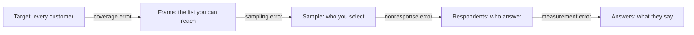

# Surveys and sampling design: who you ask, and who answers

Fernhill emailed everyone it could about their last delivery, and 2,573 people replied. 73.0% said they were satisfied, and the dashboard printed a margin of plus or minus 1.7 points. Fernhill's customers are synthetic, so we can look up the truth: 49.6%. That error is more than 13 times the margin, and no amount of extra replies would have shrunk it. The formula answered the question it was given: how far would a random sample of this size wander? This wasn't a random sample. This chapter is about building one that is and repairing what goes wrong in the field. Weighting, stating honestly what's left, and writing questions whose answers mean what you think they mean are in [12b](12b-weighting-the-margin-and-the-question.md).

## The question and the data

The business question is **what share of Fernhill's customers are satisfied with delivery, and how sure can a survey make us?** It's an estimate of a level, not a causal claim, and it borrows from earlier chapters. [Why a big sample doesn't help](../../02-probability-and-statistics/notes/07-data-generating-process.md#big-is-not-the-same-as-representative) is Meng's result and stays there. [The half-width of an interval on a proportion](../../02-probability-and-statistics/notes/04-estimation.md) is what a survey calls its margin of error. [Propensity weights and effective sample size](../../03-experimentation-and-causality/notes/05-matching-and-weighting.md#judging-the-designs) carry over. What's new is the design before the data exists, and the repair after it comes back short.

One table is used, **`load_survey_frame()`** from `practice/retail.py`: one row per customer who has ordered, with what the CRM knows (channel, order count, spend, whether they ordered in 2025, whether they can be emailed, a postcode area) and, in `true_` columns, the answer they'd give and their chance of giving it. All of it is synthetic. A 4 or 5 on the 1-to-5 answer counts as satisfied. Whether someone answers leans on the CRM columns and also on satisfaction itself. A real survey has no `true_` columns; here every method gets marked.

The code blocks are the sections of `practice/ch12_surveys.py` in order, each relying on those before it. Run them with `uv run ch12_surveys.py` from the practice folder.

```python
frame = load_survey_frame()
N = len(frame)
truth = frame.true_satisfied.mean()
print(N, "customers; true share satisfied", round(truth, 3), "(a survey never sees this)")
print(frame.groupby("segment").agg(customers=("spend", "size"), spend=("spend", "mean"), spend_sd=("spend", "std"),
                                   satisfied=("true_satisfied", "mean"), active=("active", "mean")).round(2).to_string())
```

```text
26342 customers; true share satisfied 0.496 (a survey never sees this)
         customers   spend  spend_sd  satisfied  active
segment
few           6274  120.93     70.64       0.49    0.51
many          4043  438.56    383.69       0.65    0.67
one          16025   51.97     37.98       0.46    0.49
```

`segment` sorts customers by order count: `one` is a single order, `few` two or three, `many` four or more. The `many` group is the smallest, and it spends far more and is happier. Those segments drive everything below.

## Frame, coverage and the errors a margin can't see

A survey has four groups. The **target** is who you want to know about: every customer. The **frame** is the list you can draw from: the emailable ones. The **sample** is who you select from the frame, and the **respondents** are who answer.



**Total survey error** is "the accumulation of all errors that may arise in the design, collection, processing, and analysis of survey data". That is Biemer's 2016 definition as quoted in [Maslovskaya's slides](https://repository.ncrm.ac.uk/resources/online/data_quality_and_survey_error/downloads/slides/data_quality_total_survey_error.pdf) for the National Centre for Research Methods; I read the slides, not Biemer. The [AAPOR task force on non-probability sampling](https://aapor.org/wp-content/uploads/2022/11/NPS_TF_Report_Final_7_revised_FNL_6_22_13-2.pdf) (2013) groups the first three gaps as errors of non-observation. A margin of error measures only one of them, the sampling step. [AAPOR's fact sheet](https://aapor.org/wp-content/uploads/2023/01/Margin-of-Sampling-Error-508.pdf) says: "There is no such thing as a measurable overall margin of error for a poll".

The blanket email splits its error across the gaps:

```python
def half_width(p, n):
    """The simple-random-sample 95% half-width: what a dashboard prints as a margin of error."""
    return 1.96 * np.sqrt(p * (1 - p) / n)


sent = frame[frame.emailable]
replied = sent[RNG.random(len(sent)) < sent.true_p_email]
raw = replied.true_satisfied.mean()
print(f"customers {N}; emailable {len(sent)} ({len(sent) / N:.0%}); replies {len(replied)} ({len(replied) / len(sent):.1%} of those sent)")
print(f"answers say {raw:.3f}, plus or minus {half_width(raw, len(replied)):.3f} by the textbook formula")
print(f"true share: everyone {truth:.3f}; emailable {sent.true_satisfied.mean():.3f}; replies {raw:.3f}")
print(f"coverage error {sent.true_satisfied.mean() - truth:+.3f}; nonresponse error {raw - sent.true_satisfied.mean():+.3f}")
```

```text
customers 26342; emailable 15981 (61%); replies 2573 (16.1% of those sent)
answers say 0.730, plus or minus 0.017 by the textbook formula
true share: everyone 0.496; emailable 0.521; replies 0.730
coverage error +0.025; nonresponse error +0.209
```

Coverage cost 2.5 points and nonresponse 20.9. Neither shrinks with more email: bias, says the AAPOR report, "is not a function of the sample size".

A **probability sample** is what makes the sampling step measurable. [Statistics Canada's *Survey Methods and Practices*](https://www150.statcan.gc.ca/n1/en/pub/12-587-x/12-587-x2003001-eng.pdf) requires that "all units in the survey population have a non-zero inclusion probability in the sample and that these probabilities can be calculated". It adds: "It is not necessary for all units to have the same inclusion probability". Our email fails that test twice. Nobody chose who replied, and 39% of customers had no chance at all. For samples like that, the AAPOR report suggests "exclusion bias" as the better name than coverage bias, and AAPOR's fact sheet says a margin of sampling error "does not apply to opt-in online surveys and other non-probability based polls".

The evidence that size doesn't rescue this is large-scale. [Bradley et al.](https://www.nature.com/articles/s41586-021-04198-4) (*Nature*, 2021) compared US COVID-19 first-dose estimates with the CDC benchmark. Delphi-Facebook, with about 250,000 responses a week, overestimated uptake by 17 points in May 2021. Axios-Ipsos, with about 1,000 a week and careful panel recruitment, overestimated it by 4.2. By their reckoning Delphi-Facebook's bias-adjusted effective sample in April 2021 was under 10, a measure that counts bias as well as variance.

## Strata and allocation: where to spend a fixed sample

Fernhill can do better. It has the whole customer list, so that list becomes its frame, and it can chase people by email, post and phone. Budget buys about 1,000 completed interviews, so it samples 2,000 and expects about half to answer. A simple random sample would work, but we already know which customers differ, so we can **stratify**: split the frame into groups and sample each one separately. No draw can then come up short on heavy buyers.

The remaining choice is how many from each stratum. **Proportional allocation** gives each stratum its population share, so every customer has the same chance. Statistics Canada says it's "never worse than simple random sampling". **Neyman allocation** gives more to the strata that vary more: $n_h = n \cdot N_h S_h / \sum_k N_k S_k$, where $N_h$ is the stratum's size and $S_h$ its standard deviation. Statistics Canada describes it as the special case of optimum allocation for equal interview costs, and as minimising the overall variance. Its catch is that $S_h$ is for one statistic. The table allocates the 1,000 completes:

```python
strata = frame.groupby("segment").agg(N_h=("spend", "size"), S_spend=("spend", "std"), S_sat=("true_satisfied", "std"))
n = 1000
plans = pd.DataFrame({"proportional": n * strata.N_h / N,
                      "neyman_spend": n * strata.N_h * strata.S_spend / (strata.N_h * strata.S_spend).sum(),
                      "neyman_satisfied": n * strata.N_h * strata.S_sat / (strata.N_h * strata.S_sat).sum()}).round().astype(int)
print(plans.to_string())


def stratified_se(alloc, S):
    """The stratified estimator's standard error, with the finite population correction in each stratum."""
    W = strata.N_h / N
    return np.sqrt((W**2 * (1 - alloc / strata.N_h) * S**2 / alloc).sum())


fpc = np.sqrt(1 - n / N)  # the finite population correction, explained in the next section
rows = {"simple random": {"spend": fpc * frame.spend.std() / np.sqrt(n), "satisfied": fpc * frame.true_satisfied.std() / np.sqrt(n)}}
for plan in plans:
    rows[plan] = {"spend": stratified_se(plans[plan], strata.S_spend), "satisfied": stratified_se(plans[plan], strata.S_sat)}
print(pd.DataFrame(rows).T.round(4).to_string())

groups = {s: g[["spend", "true_satisfied"]].to_numpy(float) for s, g in frame.groupby("segment")}
reps = []
for _ in range(2000):
    est = np.zeros(2)
    for s, values in groups.items():
        take = values[RNG.choice(len(values), plans.neyman_spend[s], replace=False)]
        est += strata.N_h[s] / N * take.mean(axis=0)
    reps.append(est)
print("Neyman for spend, standard deviation over 2,000 draws:", np.round(np.std(reps, axis=0), 4), "(spend, satisfied)")
```

```text
         proportional  neyman_spend  neyman_satisfied
segment
few               238           170               240
many              153           596               148
one               608           234               612
                   spend  satisfied
simple random     6.4309     0.0155
proportional      4.8783     0.0154
neyman_spend      2.9714     0.0218
neyman_satisfied  4.9546     0.0154
Neyman for spend, standard deviation over 2,000 draws: [3.0459 0.0213] (spend, satisfied)
```

Stratifying proportionally cut the standard error on spend from 6.43 to 4.88 and barely moved satisfaction, from 0.0155 to 0.0154, since a 19-point gap between segments is small beside the spread of a yes-or-no answer within each. Neyman for spend cut spend's further, to 2.97, by putting 596 of the 1,000 interviews on heavy buyers. It also raised satisfaction's standard error by about 42%, to 0.0218. [Kish](https://www.scb.se/contentassets/ca21efb41fee47d293bbee5bf7be7fb3/methods-for-design-effects.pdf) (*Journal of Official Statistics*, 1995) reports the same thing from a simplified analysis of a real multistage sample: "an 'optimal allocation' for mean incomes resulted in losses for median incomes". For a share near one half, $S_h$ barely varies, so Neyman lands on nearly proportional, which the table shows too. The 2,000 repeated draws agree with the formula.

A survey asks many questions, so we take proportional here. Disproportionate allocation earns its keep when one number matters most or a small stratum needs its own estimate.

The **finite population correction** multiplies the variance by $1 - f$, where $f = n/N$, because a sample that uses up the population leaves less to be uncertain about:

```python
for label, small_n, big_n in [("this survey", 1000, N), ("B2B accounts", 150, 400)]:
    f = small_n / big_n
    print(f"{label}: f = {f:.3f}; standard error multiplied by sqrt(1 - f) = {np.sqrt(1 - f):.3f}")
```

```text
this survey: f = 0.038; standard error multiplied by sqrt(1 - f) = 0.981
B2B accounts: f = 0.375; standard error multiplied by sqrt(1 - f) = 0.791
```

For 1,000 of 26,342 it's a 2% change. For 150 of 400 B2B accounts it's a 21% cut, and leaving it out overstates the margin. Statistics Canada relays Cochran's rule that it can be ignored for a sampling fraction up to 5%, and for many purposes 10% (I read that rule second-hand).

## Clusters: paying precision to save money

Now suppose the research team wants home visits, because a sofa's delivery is hard to judge by email. Reaching a postcode area costs £60 in travel, and each interview there costs £8 (both invented for this example). Visiting one customer per area spends the money on travel. **Cluster sampling** picks some areas and takes several people in each. It's cheaper, but neighbours resemble each other, so each extra interview in an area tells you less. [The design effect](../../03-experimentation-and-causality/notes/03-experimentation-at-scale.md#when-users-affect-each-other) $1 + (m-1)\rho$ from the experiments pillar measures the loss, where $m$ is interviews per area and $\rho$ the intra-cluster correlation, how alike people in one area are. With £12,000 to spend, compare designs by **effective sample size**, interviews divided by design effect:

```python
def icc(data, group, y):
    """One-way ANOVA estimate of the intra-cluster correlation."""
    by = data.groupby(group)[y]
    k, m = by.ngroups, len(data) / by.ngroups
    between = (by.size() * (by.mean() - data[y].mean())**2).sum() / (k - 1)
    within = ((data[y] - by.transform("mean"))**2).sum() / (len(data) - k)
    return (between - within) / (between + (m - 1) * within)


frame["y"] = frame.true_satisfied.astype(float)
rho = icc(frame, "area", "y")
budget, per_area, per_interview = 12_000, 60, 8
values_by_area = [g.y.to_numpy() for _, g in frame.groupby("area")]
print(f"intra-cluster correlation {rho:.3f}; budget {budget}, {per_area} per area visited, {per_interview} per interview")
rows = []
for m in [5, 10, 15, 20, 40]:
    areas = min(budget // (per_area + per_interview * m), len(values_by_area))
    total = areas * m
    deff = 1 + (m - 1) * rho
    draws = [np.concatenate([values_by_area[a][RNG.choice(len(values_by_area[a]), m, replace=False)]
                             for a in RNG.choice(len(values_by_area), areas, replace=False)]).mean() for _ in range(1500)]
    rows.append({"per_area": m, "areas": areas, "interviews": total, "deff": deff, "effective_n": total / deff,
                 "formula_se": np.sqrt(deff * truth * (1 - truth) / total), "simulated_se": np.std(draws)})
print(pd.DataFrame(rows).round(4).to_string(index=False))
```

```text
intra-cluster correlation 0.026; budget 12000, 60 per area visited, 8 per interview
 per_area  areas  interviews   deff  effective_n  formula_se  simulated_se
        5    120         600 1.1050     543.0019      0.0215        0.0198
       10     85         850 1.2362     687.6025      0.0191        0.0176
       15     66         990 1.3674     724.0070      0.0186        0.0173
       20     54        1080 1.4986     720.6722      0.0186        0.0171
       40     31        1240 2.0234     612.8166      0.0202        0.0193
```

The effective sample peaks around 15 to 20 per area, and 40 per area gives more interviews (1,240) and less information (613 against 724). The correlation is only 0.026. The formula's standard errors run a little above the simulated ones, because the formula treats the areas as drawn from an endless supply and here 85 of the 120 are visited.

The [UN's household survey handbook](https://unstats.un.org/unsd/publication/seriesf/seriesf_98e.pdf) (2008) puts the trade-off in one line: the sampler "can exercise no control over the intra-class correlation" but "can still adjust the cluster size". Its worked example has a correlation of 0.03: 50 people per cluster gives a design effect of 2.5, 100 gives 4.0, and it calls effects "much larger than 2.5-3.0" undesirable for key indicators.

## Nonresponse: a low rate is not the same as high bias

Fernhill's designed survey goes into the field. Report what happened to every case, not just the rate. [AAPOR's *Standard Definitions*](https://aapor.org/wp-content/uploads/2023/05/Standards-Definitions-10th-edition.pdf) (10th edition, 2023) defines six response rates, which differ on partial interviews and on cases of unknown eligibility. RR1 counts completes over everyone who might be eligible. RR3 discounts the unknowns by $e$, the estimated eligible share, and AAPOR calls it "the most-common" in reporting, adding "One must not select a proportion to boost the response rate". RR6 counts partials and drops the unknowns, which makes it "the maximum", and AAPOR allows it only if no unknown case is assumed eligible. That conflicts with the $e = 0.8$ below, so read our RR6 as an upper bound. The same fieldwork gives three figures:

```python
def field_survey(rng, size=2000):
    """A proportional stratified sample of the whole frame, chased by email, post and phone."""
    picked = []
    for _, g in frame.groupby("segment"):
        picked.append(g.sample(int(round(size * len(g) / N)), random_state=int(rng.integers(1 << 31))))
    sample = pd.concat(picked)
    return sample, rng.random(len(sample)) < sample.true_p_followup.to_numpy()


sample, answered = field_survey(RNG)
u = RNG.random(len(sample))
complete = answered & (u < .94)
partial = answered & ~complete
refused = ~answered & (u < .25)
no_contact = ~answered & (u >= .25) & (u < .85)
unknown = ~answered & (u >= .85)
I, P, R, NC, UN = complete.sum(), partial.sum(), refused.sum(), no_contact.sum(), unknown.sum()
e = .8
print(f"sampled {len(sample)}: complete {I}, partial {P}, refused {R}, no contact {NC}, unknown eligibility {UN}")
print(f"RR1 {I / (I + P + R + NC + UN):.3f}; RR3 with e = {e}: {I / (I + P + R + NC + e * UN):.3f}; RR6 {(I + P) / (I + P + R + NC):.3f}")
```

```text
sampled 2000: complete 853, partial 55, refused 284, no contact 661, unknown eligibility 147
RR1 0.426; RR3 with e = 0.8: 0.433; RR6 0.490
```

(The dispositions are generated in the script, and $e = 0.8$ is our assumption. Each section draws its own fieldwork, so this one has 908 answers and the weighting section below has 966.) Always say which rate you quote. AAPOR also says response rates "make little sense" for non-probability samples, where selection probabilities are unknowable.

Does a low rate matter? The bias of the respondents' mean is driven by the covariance between someone's chance of answering, $p$, and their answer, $y$: $\text{bias} \approx \text{cov}(p, y) / \bar{p}$. Response rate appears only in the denominator. So:

```python
y = frame.true_satisfied.to_numpy(float)


def nonresponse_bias(p):
    """Respondent mean minus population mean: the covariance of the chance of answering with y, over the mean chance."""
    return np.cov(p, y, bias=True)[0, 1] / p.mean()


mailings = {"flat 8%": np.full(N, .08),
            "'tell us what you loved', 42%": .30 + .25 * y,
            "blanket email, all customers": frame.true_p_email.to_numpy(),
            "designed, with reminders": frame.true_p_followup.to_numpy()}
for name, p in mailings.items():
    print(f"{name:32s} response {p.mean():.3f}; bias {nonresponse_bias(p):+.3f}; check {np.average(y, weights=p) - y.mean():+.3f}")
```

```text
flat 8%                          response 0.080; bias -0.000; check +0.000
'tell us what you loved', 42%    response 0.424; bias +0.147; check +0.147
blanket email, all customers     response 0.147; bias +0.217; check +0.217
designed, with reminders         response 0.460; bias +0.047; check +0.047
```

A flat 8% has no bias at all, and a 42% mailing that invites people to say what they loved has 14.7 points.

[Groves's talk slides](http://www.dc-aapor.org/documents/NRW07_NonresponseRatesandBiasinHouseholdSurveysGroves.pdf) (posted by DC-AAPOR; I couldn't reach his 2006 article of the same title in *Public Opinion Quarterly*) pool about 959 estimates from 59 studies and conclude that "The nonresponse rate by itself is not a good predictor of nonresponse bias", with variation lying "mostly among estimates within the same survey". Don't over-read that. A plain regression on those 959 estimates would have an $R^2$ of 0.04, by Groves and Peytcheva's 2008 figure, which I know only through [Brick and Tourangeau](https://reference-global.com/download/article/10.1515/jos-2017-0034.pdf) (*Journal of Official Statistics*, 2017). Brick and Tourangeau's reanalysis of the same data correlates each study's mean or median absolute relative bias with its response rate, finds about −0.36 to −0.50 depending on the weighting, and concludes that response rates "may not be very good predictors of nonresponse bias, but they are far from irrelevant". A low rate gives bias more room. It doesn't tell you how much of the room got used.

Groves's slides also separate the causes, into models including "Common Cause" and "Survey Variable Cause", and I read those as the two standard [missing data](../../01-python-for-data-analysis/notes/02-loading-and-cleaning.md#missing-data-decide-what-a-gap-means) names; the mapping is mine, not his. If something else drives both answering and the answer, such as being a heavy buyer, that's consistent with **missing at random**, and a variable holding that cause can repair it. If the answer itself drives answering, because the unhappy don't reply, that's **not missing at random**. And as [Brick](https://reference-global.com/download/article/10.2478/jos-2013-0026.pdf) (*Journal of Official Statistics*, 2013) notes, you can't tell the two apart "without obtaining additional data for the nonrespondents".

## Weighting, the margin and the question

Raking the respondents to known totals, reporting a margin that reflects the design, writing questions that measure what you mean, and reading a five-point scale are in [12b, Weighting, the margin and the question](12b-weighting-the-margin-and-the-question.md), together with the recommendation.

## Practice

Run `uv run ch12_surveys.py` from `practice/`, which takes under a minute. It needs numpy, pandas and scipy. `latent` in `SURVEY_DGP` in `retail.py` sets how much satisfaction itself drives replying. Change it in `followup_logit` to move the designed survey's rows, and in `email_logit` to move the email's. At 0 in `email_logit`, the email's fully raked figure falls from 66.6% to 49.3%.

## Pitfalls

| Pitfall | Symptom | Fix |
|---|---|---|
| Printing a margin on a self-selected sample | A tight plus or minus on a poll anyone could join | Report it as non-probability, and describe the model if you give a precision measure |
| Treating the response rate as the quality measure | A 42% survey trusted over an 8% one with no check | Compare respondents with the frame on known columns first |
| Optimising allocation for one number | Fine on spend, and the satisfaction margin is about 42% wider | Use proportional unless one statistic dominates |

## Try it

1. Rerun the cluster table with an area costing £120, then £240, trying 5 to 60 interviews per area in steps of 5. What happens to the best number of interviews per area, and why?

<details><summary>Answer</summary>

By the formula's effective sample: £60 peaks at 15 (724), £120 at 25 (568) and £240 at 30 (426). Dearer travel pushes you to fewer areas with more people in each.
</details>

2. You have 400 B2B accounts and want plus or minus 5 points at 95%. How many completed interviews, ignoring and then using the finite population correction?

<details><summary>Answer</summary>

Ignoring it, $1.96^2 \times 0.25 / 0.05^2 = 384$, nearly every account. With it, $384 / (1 + 384/400) = 196$. That's my arithmetic, at the worst case $p = 0.5$.
</details>

## Interview checklist

| Question | Answer |
|---|---|
| Why does a margin of error fail on an email blast? | It measures sampling error from a probability sample. An email blast has no known selection probabilities |
| Target, frame, sample, respondents? | Each gap has its own error: coverage, sampling, nonresponse. Measurement error sits on top |
| What makes a sample a probability sample? | Random selection with a known, non-zero chance for every unit. The chances needn't be equal |
| Stratified or cluster? | Stratify for precision: every group is sampled. Cluster to save money: some groups are, and precision falls |
| Proportional or Neyman allocation? | Proportional is never worse than simple random. Neyman minimises variance for one statistic, at others' expense |
| When does the finite population correction matter? | Above a sampling fraction of about 5%, by a common rule. It reduces the variance by 1 − f |
| How many interviews per cluster? | Trade per-cluster cost against the intra-cluster correlation: compare by effective sample within the budget |
| Does a low response rate mean high bias? | Not by itself: bias comes from the covariance of response propensity and the answer. The rate predicts bias poorly for one estimate, but isn't irrelevant across studies |
| Which response rate do you quote? | Name it. RR3 is the most common: it estimates the eligible share of unknown cases |

## Next

[12b — Weighting, the margin and the question](12b-weighting-the-margin-and-the-question.md): the design and the field work are done. Now repair what nonresponse left, state the margin the design earns, and check what the question measured.
