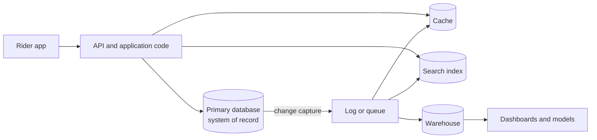

# 1 — Data systems and data models

A taxi app looks like one product and is really a small crowd of storage systems: a relational database for trips, a cache in front of it, a search index for addresses, a queue for receipts and a warehouse for the finance team. Nobody sold you that combination. You assembled it with application code, which makes you the designer of a data system whether or not that was the plan. This chapter sets out the vocabulary for talking about such a system, namely what reliable and scalable actually mean in numbers, and then the first decision every system makes, which is the shape data takes when you write it down. Everything later in this pillar is a mechanism under one of these two headings.

Kleppmann's [*Designing Data-Intensive Applications*](https://dataintensive.net/) is the core text for this subject, and this chapter follows its first two chapters (ch. 1, pp. 3-23; ch. 2, pp. 27-64). The [reading map](../../CURRICULUM.md#reading-map-designing-data-intensive-applications) shows where each of its twelve chapters lands in these notes. All the code here runs with `uv run --with numpy python 01_data_systems_and_data_models.py`, using SQLite from the standard library.

## You are building a data system

The old categories have blurred. Redis can act as a queue, and Kafka can act as durable storage, so sorting products into "database" and "message broker" tells you less than it used to (pp. 4-5). Meanwhile no single tool does the whole job, so application code stitches several together and hides them behind an API. Once you do that, the API is a promise about behaviour: that the cache is invalidated when a fare changes, that a search result never points at a deleted trip. Those promises are data system design, and you are the one making them.



One distinction organises that diagram, and it recurs in every later pillar. A **system of record** holds the authoritative version of a fact. Everything else is **derived data**, which can be thrown away and rebuilt from the source: the cache, the index, the warehouse table (Part III introduction, p. 386; ch. 12, p. 491). A data engineer spends most of a career on the right-hand side of that picture, so the first question to ask of any table is which of the two it is. If a table is derived, a bad day means a rerun. If it is a system of record, a bad day means data loss.

Kleppmann organises the first chapter around three concerns. **Reliability** means the system keeps working correctly when things go wrong. **Scalability** means there is a reasonable way to cope as load grows. **Maintainability** means many different people can keep working on it productively over the years (p. 6). The next three sections take them in turn, with numbers wherever the words would otherwise be a slogan.

## Faults are not failures

A **fault** is one component deviating from its spec. A **failure** is the system as a whole no longer serving its user. You cannot get the probability of faults to zero, so the design goal is to stop faults becoming failures, and Netflix's Chaos Monkey is the famous form of the idea: cause faults on purpose so that the handling is exercised continually (p. 7).

Hardware faults are the most obvious kind and the easiest to count. Disks are often quoted with a mean time to failure of 10 to 50 years (p. 7). That sounds comfortable until you have a lot of them.

```python
disks = 10_000
for mttf_years in (10, 30, 50):
    per_day = disks / (mttf_years * 365)
    print(f"MTTF {mttf_years:>2} years: {per_day:4.2f} failed disks per day, one every {1/per_day:4.1f} days")
```

```text
MTTF 10 years: 2.74 failed disks per day, one every  0.4 days
MTTF 30 years: 0.91 failed disks per day, one every  1.1 days
MTTF 50 years: 0.55 failed disks per day, one every  1.8 days
```

At cluster scale a disk failure is a routine daily event, and handling it cannot involve a person being surprised. Hardware faults at least tend to be independent. Software faults are worse because they are correlated: the same bug, on the same input, on every node at once. The book's example is the leap second of 30 June 2012, which hung many Linux applications simultaneously (pp. 8-9). Redundancy does nothing about that, and neither does retrying. What helps is process isolation, letting things crash and restart, and a system that checks itself: a message queue can assert that messages in equal messages out, and raise an alarm when they do not (p. 9).

Human faults are the largest category of all. One study of large internet services found that configuration errors by operators led the causes of outages, with hardware accounting for only 10-25% (p. 9). The defences are a sandbox to experiment in, fast rollback, and tools to **recompute data** in case the old computation turns out to be wrong (p. 10). That last one is close to a mission statement for a pipeline. It is why the [idempotency chapter](../../03-transform-and-orchestrate/notes/04-idempotency-and-backfills.md) exists, and it is the same property the batch chapter calls human fault tolerance (ch. 10, p. 414).

## Describing load

"Does it scale?" has no answer until you say which load. Kleppmann's rule is to pick **load parameters** for the system at hand, and his example is Twitter in November 2012 (pp. 11-13): 4.6k tweets per second on average and 12k at peak, against 300k home-timeline reads per second. The hard part is not the tweet rate. It is the fan-out from a tweet to its followers. One way merges every followee's tweets at read time. The other precomputes a timeline for each user, which at an average of 75 followers turns 4.6k tweets into 345k timeline writes per second. Averages hide the real problem, because an account with 30 million followers means 30 million writes for one tweet.

Here is the same calculation on synthetic data, with a heavy-tailed follower distribution, to see how few accounts cause the trouble.

```python
import numpy as np
rng = np.random.default_rng(11)

# Followers are heavy-tailed: most have few, a handful have millions.
users = 1_000_000
followers = rng.pareto(1.1, users) * 8
followers = np.minimum(followers, 30_000_000)
posts_per_s = 4_600

print(f"mean followers  {followers.mean():>12,.0f}")
print(f"median          {np.median(followers):>12,.0f}")
print(f"largest         {followers.max():>12,.0f}")

# Pick who posts uniformly. Timeline writes per second on fan-out-on-write:
print(f"fan-out writes/s, all users      {posts_per_s * followers.mean():>14,.0f}")

# Hybrid: accounts above a threshold are read at query time instead.
for threshold in (1_000_000, 100_000, 10_000):
    kept = followers[followers < threshold]
    share_of_writes = kept.sum() / followers.sum()
    print(f"excluding >={threshold:>9,} followers: {(followers >= threshold).sum():>6,} accounts,"
          f" writes fall to {share_of_writes:6.1%}")
```

```text
mean followers            53
median                     7
largest            1,341,811
fan-out writes/s, all users             243,774
excluding >=1,000,000 followers:      1 accounts, writes fall to  97.5%
excluding >=  100,000 followers:     30 accounts, writes fall to  84.9%
excluding >=   10,000 followers:    382 accounts, writes fall to  69.4%
```

The median user has 7 followers, and the mean is more than seven times that because of a tail. A few hundred accounts out of a million generate about 30% of the write load, and that is the shape of Twitter's eventual answer: a hybrid that fans out for most accounts and fetches the very large ones at read time (p. 13). The lesson for a data engineer is that the distribution, not the mean, is the load parameter. The same shape shows up as [a hot partition](05-partitioning-and-replication.md) and as [a skewed shuffle](08-distributed-compute.md).

## Describing performance

Two performance measures matter, and each belongs to a kind of system. A batch job cares about **throughput**, the records per second it gets through. An online service cares about **response time**, how long a client waits (p. 13). A footnote makes a point every Spark user eventually rediscovers: a job takes longer than size divided by throughput, because of skew and because it must wait for its slowest task.

Response time is a distribution, not a number. The same request takes different times because of a garbage collection pause, a page fault or a TCP retransmit, so you have to describe the whole shape (pp. 14-15). Here are a million simulated requests: most are fast, and 1.5% run into something slow.

```python
rng = np.random.default_rng(3)
n = 1_000_000
fast = rng.lognormal(mean=np.log(40), sigma=0.4, size=n)         # ms
slow = rng.random(n) < 0.015                                     # GC, a cache miss, a page fault
latency = fast + slow * rng.exponential(800, n)

print(f"mean {latency.mean():7.1f} ms")
for p in (50, 95, 99, 99.9):
    print(f"p{p:<5} {np.percentile(latency, p):7.1f} ms")
print(f"requests slower than the mean: {(latency > latency.mean()).mean():.1%}")
```

```text
mean    55.2 ms
p50       40.3 ms
p95       82.1 ms
p99      366.6 ms
p99.9   2184.1 ms
requests slower than the mean: 22.2%
```

The mean says 55 ms, and that describes nobody. The median request took 40 ms, and one request in a hundred took about nine times that. Kleppmann explains why the tail is worth paying for: at Amazon, the customers who see the slowest responses tend to be the ones with the most purchase history, so p99.9 mattered commercially, while optimising further out cost more than it returned (p. 15).

Percentiles have a trap in how they combine. The output below comes from ten servers where one is slow and, thanks to sticky sessions, takes 30% of traffic.

```python
# Ten servers. Nine are healthy; one is slow and, because it sits behind a sticky
# load balancer, takes 30% of the traffic.
rng = np.random.default_rng(4)
shuffled = rng.permutation(latency)
bad, rest = shuffled[:300_000] * 4, shuffled[300_000:]
parts = [bad] + list(np.array_split(rest, 9))

avg_of_p99 = np.mean([np.percentile(p, 99) for p in parts])
true_p99 = np.percentile(np.concatenate(parts), 99)
print(f"average of ten servers' p99 {avg_of_p99:7.1f} ms")
print(f"p99 of all requests         {true_p99:7.1f} ms")

# The correct way to combine: keep histograms and add them.
edges = np.logspace(0, 5, 400)
hist = sum(np.histogram(p, edges)[0] for p in parts)
merged_p99 = edges[np.searchsorted(hist.cumsum(), 0.99 * hist.sum())]
print(f"p99 from merged histograms  {merged_p99:7.1f} ms")
```

```text
average of ten servers' p99   476.8 ms
p99 of all requests           535.9 ms
p99 from merged histograms    524.0 ms
```

The average of per-server p99s understates the truth, because it weighs a quiet server the same as a busy one. Averaging percentiles has no statistical meaning, and the right way to combine them is to add the histograms (p. 16). The small gap between the merged result and the exact one is just bucket width. If you build a dashboard from pre-aggregated percentiles in a warehouse, this is the bug you are probably shipping.

The tail also compounds when one request needs many backends, since the user waits for the slowest of them. This is **tail latency amplification** (p. 16).

```python
for fanout in (1, 5, 10, 50, 100):
    print(f"{fanout:>3} backend calls: {1 - 0.99**fanout:6.1%} of requests hit a call slower than its p99")
```

```text
1 backend calls:   1.0% of requests hit a call slower than its p99
  5 backend calls:   4.9% of requests hit a call slower than its p99
 10 backend calls:   9.6% of requests hit a call slower than its p99
 50 backend calls:  39.5% of requests hit a call slower than its p99
100 backend calls:  63.4% of requests hit a call slower than its p99
```

At 100 calls, the "rare" 1% case hits nearly two thirds of user requests. This is why a [query fanning out across partitions](05-partitioning-and-replication.md) costs more than the sum of its parts.

How you measure can hide all of this. A load test that sends each request only after the previous one returned stops generating load during a stall, so the stall vanishes from its results; requests must keep arriving independently (p. 16). This effect has a name, coordinated omission, though the book only describes it. Here is one 2-second server stall in a 100-second test, measured both ways.

```python
SERVICE, STALL_START, STALL_END = 0.005, 50.0, 52.0

def finish(start):
    """When a request that starts at `start` completes; the server freezes for 2 s."""
    if STALL_START <= start < STALL_END:
        start = STALL_END
    return start + SERVICE

# Open loop: a request every 10 ms whatever happens, as real users behave.
open_loop, free = [], 0.0
for t in np.arange(0, 100, 0.01):
    free = finish(max(t, free))
    open_loop.append(free - t)

# Closed loop: one client sends the next request only after the last reply.
closed_loop, t = [], 0.0
while t < 100:
    done = finish(t)
    closed_loop.append(done - t)
    t = done + 0.005                          # same 10 ms pacing when healthy

for name, lat in (("open loop", open_loop), ("closed loop", closed_loop)):
    lat = np.array(lat)
    print(f"{name:<12} n={len(lat):>6}  p50={np.percentile(lat, 50)*1000:7.1f} ms"
          f"  p99={np.percentile(lat, 99)*1000:7.1f} ms  max={lat.max()*1000:7.1f} ms")
```

```text
open loop    n= 10000  p50=    5.0 ms  p99= 1505.1 ms  max= 2005.0 ms
closed loop  n=  9801  p50=    5.0 ms  p99=    5.0 ms  max= 2005.0 ms
```

Both tests saw the same freeze, and the closed-loop one reports a p99 of 5 ms. It recorded just one slow request. Real users arriving every 10 ms would have queued behind the stall and then waited while the backlog drained, which affects about 4% of the sample. Queueing is the mechanism: one slow request holds up those behind it, which is **head-of-line blocking** (pp. 15-16), and it returns in [Kafka consumers](../../04-warehouse-lakehouse-streaming/notes/04-kafka-and-stream-semantics.md).

## Coping with load

There are two broad responses. **Scaling up** buys a more powerful machine, and **scaling out** spreads load across many smaller ones in a **shared-nothing** design (p. 17). Real architectures mix them, and the point has only sharpened since the book: a single large machine is often the simpler and cheaper answer, which is the argument of the [distributed compute chapter](08-distributed-compute.md).

Stateless services scale out easily. Stateful ones are hard, and that difficulty is what the later chapters of this pillar are about. There is also no generic scalable architecture. A system handling 100k requests per second at 1 kB each and one handling 3 requests per minute at 2 GB each have the same data throughput, and they look nothing alike (p. 18). Scaling is always built around assumptions about which operations will be common, and if those assumptions are wrong the work is wasted.

Maintainability gets the least attention because it does not show up in a benchmark. Kleppmann divides it into operability, simplicity and evolvability (pp. 19-22). The tool he offers for simplicity matters most here: **abstraction**, which removes accidental complexity by hiding it behind a clean interface. His main example is SQL, which hides on-disk layout, concurrency and crash recovery (p. 21). That leads to the second half of this chapter.

## Data models are layers

Most programs are stacked data models: objects in application code, JSON or tables in a database, bytes in memory and on disk, and voltages below that (p. 27). Each layer hides the one beneath. The model also shapes what is easy, since every data model embodies assumptions that make some operations fast and others awkward (p. 28). So it is worth choosing deliberately.

The relational model dates from Codd's 1970 paper ([*A Relational Model of Data for Large Shared Data Banks*](https://doi.org/10.1145/362384.362685)) and has dominated since the mid-1980s. Its rival in the last two decades has been the document model. The real difference between them is what happens to a fact that many records share.

```python
import sqlite3, json, time
db = sqlite3.connect(":memory:")
rng = np.random.default_rng(7)
trips = 200_000
drivers = 2_000
driver_of = rng.integers(0, drivers, trips).tolist()
fares = np.round(rng.gamma(2.2, 7.0, trips), 2).tolist()

# Relational: the driver's name is stored once, and trips point to it.
db.executescript("""
create table driver(driver_id integer primary key, name text);
create table trip(trip_id integer primary key, driver_id integer references driver, fare real);
create index trip_driver on trip(driver_id);
create table trip_doc(trip_id integer primary key, doc text);
create index doc_driver on trip_doc(json_extract(doc, '$.driver.id'));
""")
db.executemany("insert into driver values (?,?)", [(i, f"Driver {i}") for i in range(drivers)])
db.executemany("insert into trip values (?,?,?)", zip(range(trips), driver_of, fares))

# Document: each trip carries its driver with it.
docs = ((i, json.dumps({"fare": fares[i], "driver": {"id": driver_of[i], "name": f"Driver {driver_of[i]}"}}))
        for i in range(trips))
db.executemany("insert into trip_doc values (?,?)", docs)

def timed(label, sql, *args):
    t = time.perf_counter(); cur = db.execute(sql, args); rows = cur.fetchall()
    print(f"{label:<34} {(time.perf_counter()-t)*1000:8.2f} ms   rows touched {max(cur.rowcount, len(rows)):>4}")

timed("rename, relational", "update driver set name='Ana M.' where driver_id=7")
timed("rename, document", "update trip_doc set doc=json_set(doc,'$.driver.name','Ana M.') "
      "where json_extract(doc,'$.driver.id')=7")
timed("read one trip, relational (join)", "select t.fare, d.name from trip t join driver d using(driver_id) where trip_id=4242")
timed("read one trip, document", "select doc from trip_doc where trip_id=4242")
```

```text
rename, relational                     0.03 ms   rows touched    1
rename, document                       0.28 ms   rows touched   92
read one trip, relational (join)       0.02 ms   rows touched    1
read one trip, document                0.01 ms   rows touched    1
```

Renaming a driver touched one row in the normalised design and 92 documents in the other. That is the argument in one line. Whether you store an ID or a piece of text is a question about duplication, and an ID has the great advantage that it means nothing to people, so it never has to change (p. 33). The document side wins on the read, because the whole record is there without a join, and it wins for real when a document is the unit you usually want (p. 41). In this tiny test both reads take a few hundredths of a millisecond, so do not read much into the comparison. On a remote store, or a document spread across many tables, it can matter a lot.

Documents suit one-to-many data that forms a tree, like a CV (p. 32). They suit many-to-one and many-to-many data poorly: joins move out of the database and into your application, and data tends to grow more interconnected as features are added, not less (p. 34). This is an old argument. IBM's hierarchical IMS of 1968 looked a lot like JSON and had the same trouble with many-to-many relations, which is what the relational and CODASYL network models were invented to solve (pp. 36-37). The relational model's lasting idea was to lay all the data out in the open and leave the access path to a query optimiser, which only has to be built once (pp. 37-38).

A warehouse designer will recognise this as the trade behind [star schemas and wide tables](../../02-ingest-and-modelling/notes/03-data-vault-and-obt.md). A dimension table normalises, and a one-big-table denormalises. An analytical store can afford the second, since its load is append-mostly and a rebuild is cheap. The storage cost that once decided this has largely gone, and what remains is the update question you just measured.

## Schema on read, schema on write

Calling document stores schemaless misleads people, since some code always assumes a structure. The better distinction is whether the schema is explicit and enforced on write, or implicit and applied on read, which is roughly static versus dynamic typing (pp. 39-40).

```python
db.execute("insert into trip_doc values (900001, ?)", (json.dumps({"fare": 11.0, "driver_name": "Old Format"}),))
db.execute("insert into trip_doc values (900002, ?)", (json.dumps({"fare": 12.0, "driver": {"id": 3, "name": "New Format"}}),))

# Schema-on-read: the reader carries the history of every shape ever written.
def driver_name(doc):
    d = json.loads(doc)
    if "driver" in d:
        return d["driver"]["name"]
    return d.get("driver_name", "unknown")

for tid in (900001, 900002):
    print(driver_name(db.execute("select doc from trip_doc where trip_id=?", (tid,)).fetchone()[0]))

# Schema-on-write: the shape is enforced, and changing it is an explicit event.
t = time.perf_counter()
db.execute("alter table trip add column tip real default 0")
print(f"alter table on {trips:,} rows: {(time.perf_counter()-t)*1000:.2f} ms")
t = time.perf_counter()
db.execute("update trip set tip = round(fare*0.1, 2)")
print(f"backfill the new column:      {(time.perf_counter()-t)*1000:.2f} ms")
try:
    db.execute("insert into trip(trip_id, driver_id, fare) values (1, 1, 2.0)")
except sqlite3.IntegrityError as e:
    print("rejected on write:", e)
```

```text
Old Format
New Format
alter table on 200,000 rows: 0.06 ms
backfill the new column:      48.70 ms
rejected on write: UNIQUE constraint failed: trip.trip_id
```

Schema-on-read let the old document stay, and the price is a function that remembers every shape ever written, in every consumer. Schema-on-write forced a decision, and it rejected the bad row on the way in. The `ALTER TABLE` took a fraction of a millisecond because SQLite only changed metadata; the backfill, as usual, is the part that costs (p. 40). Schema-on-read is the better fit when items are truly varied or the shape is controlled by someone else (pp. 40-41), which describes a raw landing zone exactly. Most lakes therefore use both: read the raw layer tolerantly, then enforce a schema from the first transform onwards. Later, [data contracts](../../02-ingest-and-modelling/notes/04-data-contracts.md) move the check to the producer, and the [next chapter](02-encoding-and-files.md) takes up evolving the schema inside a file.

## Declarative queries

The largest benefit of SQL is what it leaves unsaid. An imperative program specifies steps in order. A declarative query specifies the result and lets the engine pick the steps, so it can change those steps later, reorder things, and run them in parallel without you rewriting anything (pp. 42-43).

```python
query = "select count(*), avg(fare) from trip where fare > 100"
def plan(sql):
    return " | ".join(r[3] for r in db.execute("explain query plan " + sql))

t = time.perf_counter(); print(db.execute(query).fetchone()); a = time.perf_counter() - t
print(f"{a*1000:7.2f} ms   {plan(query)}")
db.execute("create index trip_fare on trip(fare)")
t = time.perf_counter(); print(db.execute(query).fetchone()); b = time.perf_counter() - t
print(f"{b*1000:7.2f} ms   {plan(query)}")
```

```text
(1, 124.22)
   3.57 ms   SCAN trip
(1, 124.22)
   0.03 ms   SEARCH trip USING COVERING INDEX trip_fare (fare>?)
```

Nothing in the query changed. An index appeared and the plan switched from a scan to a covering index search, about a hundred times faster on this rare-value filter. An imperative loop over rows would have had to be rewritten to get that. This independence between query and physical layout is why the same SQL could move from a row store to a column store to a [lakehouse](../../04-warehouse-lakehouse-streaming/notes/03-lakehouse-vs-warehouse.md) with its meaning intact, and why dbt can treat a model as a `select` statement. The book's MapReduce querying section makes a nearby point: map and reduce must be pure functions, because that is what lets the engine run them anywhere, in any order, and rerun them on failure (pp. 46-48). Restricting what the programmer can say gives the system freedom to act, and [the batch chapter](08-distributed-compute.md) relies on the same restriction.

## Graphs, and when joins run out

When many-to-many relations dominate, a graph becomes the natural model, with vertices and edges that can hold heterogeneous data (p. 49). A property graph can be stored in two ordinary relational tables, one of vertices and one of edges (p. 50). What separates graph queries from the usual kind is that the number of joins is not known in advance: "reachable from here" might take two hops or twenty. A SQL engine handles that with a recursive common table expression (pp. 53-54).

```python
db.executescript("""
create table zone(zone text primary key);
create table adjacent(a text, b text);
""")
edges = [("Airport","Harbour"),("Harbour","Old Town"),("Old Town","Station"),("Station","Uni"),
         ("Uni","Hospital"),("Harbour","Docks"),("Docks","Stadium"),("Stadium","Hospital"),
         ("Old Town","Market"),("Market","Uni")]
db.executemany("insert into adjacent values (?,?)", edges + [(b, a) for a, b in edges])

# Reachable within any number of hops: no fixed number of joins can say this.
rows = db.execute("""
with recursive reach(zone, hops, path) as (
    select 'Airport', 0, 'Airport'
    union
    select a.b, r.hops + 1, r.path || ' > ' || a.b
    from reach r join adjacent a on a.a = r.zone
    where r.hops < 6 and instr(r.path, a.b) = 0
)
select zone, min(hops), path from reach group by zone order by 2, 1
""").fetchall()
for r in rows:
    print(f"{r[1]} hops  {r[0]:<10} {r[2]}")
```

```text
0 hops  Airport    Airport
1 hops  Harbour    Airport > Harbour
2 hops  Docks      Airport > Harbour > Docks
2 hops  Old Town   Airport > Harbour > Old Town
3 hops  Market     Airport > Harbour > Old Town > Market
3 hops  Stadium    Airport > Harbour > Docks > Stadium
3 hops  Station    Airport > Harbour > Old Town > Station
4 hops  Hospital   Airport > Harbour > Docks > Stadium > Hospital
4 hops  Uni        Airport > Harbour > Old Town > Market > Uni
```

The recursive CTE works and it is standard SQL, but Kleppmann's comparison stands: his equivalent query takes 29 lines of SQL against 4 of Cypher (p. 55). If this is your main question, use a graph query language. If it is an occasional one, as with a lineage graph or a hierarchy in a dimension table, the CTE is enough. [Column-level lineage](../../05-quality-and-observability/notes/02-monitors-and-lineage.md) is exactly this question, asked of a graph whose edges are SQL dependencies.

| Model | Natural fit | What goes wrong |
|---|---|---|
| Relational | Many-to-one and many-to-many, with evolving questions | Object-relational impedance mismatch; large schema changes need planning |
| Document | Self-contained trees read and replaced as a unit | Shared facts get duplicated; joins move to the application; large documents rewritten on each change |
| Graph | Connected data with variable-length paths | Few analytical engines; hard to partition |
| Columnar file or table | Scans over a few columns of many rows | Row-at-a-time updates ([chapter 3](03-row-and-column-stores.md)) |

The three models have also been converging, as relational systems added JSON columns and document stores added joins (pp. 41-42). Emulating one in another is usually possible and usually awkward, which is the book's closing summary of the chapter (p. 63). The right question stays the same: which relationships does your data have, and which of them will you query?

## Pitfalls

- **Reporting a mean latency.** It describes no user. Report p50, p95 and p99, and say over which window.
- **Averaging percentiles across servers or days.** The result has no meaning. Store histograms and merge them.
- **Calling a table "derived" without being able to rebuild it.** If the source has expired, it has quietly become a system of record.
- **Testing with a closed-loop client.** It slows down when the server does, so the stall disappears from the numbers.
- **Duplicating shared facts for read speed with no way to update them.** Each copy is a promise to keep it in sync, and most such promises are broken by the first rename.
- **Reading "schemaless" as "no schema".** The schema moved into every consumer, unversioned and untested.
- **Assuming retries handle software faults.** A correlated bug fails again on every node, in the same way.

## Try it

The code in this chapter is collected in [practice/01_data_systems_and_data_models.py](../practice/01_data_systems_and_data_models.py).

1. Change the fan-out simulation's Pareto shape from 1.1 to 2.0. What happens to the mean, the largest account, and the case for a hybrid?

<details><summary>Answer</summary>

The tail thins dramatically. With the same million users the mean drops to about 8 and the largest account to around 9,000, so no account reaches even the lowest threshold of 10,000 and the hybrid changes nothing. A hybrid exists because of the tail, so its value depends on the distribution rather than on overall volume.

</details>

2. In the `omission` simulation, make the stall 10 seconds. What do the two p99s become, and why does the closed-loop one barely move?

<details><summary>Answer</summary>

The open-loop p99 climbs to about 9.5 s, and about 18% of requests take over a second: 10% arrive during the stall, and the backlog then takes as long again to drain, because the server only works twice as fast as requests arrive. The closed loop still records a single slow request out of thousands, so its p99 stays at 5 ms. Only its max shows the stall.

</details>

3. For the trips table, name the system of record and the derived data in this set: the raw CDC events in the lake, a `dim_driver` table, a Redis cache of ETAs, a ledger of driver payments. Which would you be most worried about losing?

<details><summary>Answer</summary>

The ledger is a system of record, as are the raw CDC events if the source no longer holds them. `dim_driver` and the cache are derived. Losing the raw events or the ledger means permanent data loss; losing the other two means a rerun or a cold cache.

</details>

## Interview checklist

| Question | Answer |
|---|---|
| Fault vs failure? | A fault is one component deviating from spec. A failure is the whole system ceasing to serve its users. Design stops faults becoming failures, including by injecting them on purpose. |
| Which faults are worst? | Correlated software faults, since redundancy does not help, and human configuration errors, which lead outage causes. |
| Why percentiles rather than a mean? | Response time is a distribution with a long tail. The mean describes nobody, and p99 tracks what the unlucky users actually see. |
| How do you combine percentiles across servers? | Add the histograms. Averaging percentiles has no statistical meaning. |
| What is tail latency amplification? | When a request needs many backend calls, it waits for the slowest. At 100 calls, 63% of requests experience some call slower than its p99. |
| What is coordinated omission? | A closed-loop load generator stops sending during a stall, so it fails to record the requests that would have queued, and tail percentiles look healthy. |
| Twitter's fan-out problem? | Fan-out on write makes reads cheap, but a very large account means millions of writes per tweet. A hybrid handles the largest accounts at read time. |
| Document vs relational? | Documents suit self-contained trees read as a unit. Relational suits many-to-one and many-to-many data, since each fact is stored once and joins live in the database. |
| Schema-on-read vs schema-on-write? | Whether structure is implicit in readers or enforced on write. Lakes use read at the raw layer and write from the first transform. |
| What does declarative buy? | The engine can change the access path, parallelise and reorder without the query changing. An index or a new storage layer speeds up existing SQL. |
| System of record vs derived data? | Records hold the authoritative facts. Derived data can be deleted and rebuilt. Knowing which is which decides what a bad day costs. |

## Next

The rest of this pillar follows a set of trips down the stack, starting with how they are written down. [Encoding and files](02-encoding-and-files.md) asks what a file promises the program that reads it years later.
