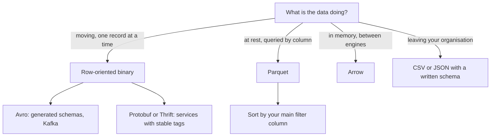

# 1 — Encoding and files

A data pipeline is a chain of programs that never meet. The one that wrote a file last March has been deleted, and the one reading it today was written by someone who has never seen it. The bytes on disk are the only thing they share, so the choice of file format decides how much the reader has to guess. A CSV says nothing and leaves everything to inference, while Parquet and Avro carry a schema with the data. This chapter starts from that difference, builds a month of taxi trips in each format, and opens up the files to see why a columnar file on disk and a columnar table in memory are designed so differently.

## Why encoding comes first

Programs hold data in objects, lists and hash tables, tied together with pointers that mean nothing outside the process. To put that data in a file or send it over a network, it has to become a self-contained sequence of bytes, and reading it back reverses the step. Kleppmann calls this encoding and decoding ([*Designing Data-Intensive Applications*](https://dataintensive.net/), O'Reilly 2017, ch. 4). Every other chapter in data engineering assumes this step went right.

Two properties decide whether it did, and the book's terms are the ones interviewers use:

- **Backward compatibility:** newer code can read data written by older code.
- **Forward compatibility:** older code can read data written by newer code.

Backward is the easy one, because the author of the new code knows the old format. Forward is harder, because old code has to ignore something that did not exist when it was written. A warehouse needs both. It holds years of files from past schemas, which is backward compatibility, and during any rollout some consumers lag behind the producer, which is forward. Kleppmann's phrase for the underlying fact is that data outlives code: you can redeploy an application in minutes, but a five-year-old partition still has the shape it was written in.

Language-native formats fail this test first. Python's `pickle` ties the data to one language, runs arbitrary code on load, and treats versioning as an afterthought. It is fine for a cache you can rebuild and wrong for anything another team reads.

The running example for this pillar is one million synthetic taxi trips, a stand-in for the NYC data used in the [zoomcamp ingest](../../02-ingest-and-modelling/notes/01-ingest.md). Trips arrive in time order, and a few zones take most of the pickups, as in the real data.

```python
import numpy as np, pyarrow as pa

def make_trips(n=1_000_000, seed=7):
    """One synthetic month of taxi trips, sorted by pickup time like an append-only log."""
    rng = np.random.default_rng(seed)
    start = np.datetime64("2026-01-01T00:00:00", "s")
    seconds = np.sort(rng.integers(0, 31 * 86_400, n))
    # 260 zones with a heavy tail: a few busy zones take most pickups.
    weights = 1 / np.arange(1, 261)
    zones = rng.choice(260, n, p=weights / weights.sum()) + 1
    miles = np.round(rng.gamma(2.0, 1.6, n), 2)
    return pa.table({
        "trip_id": np.arange(n, dtype="int64"),
        "pickup_at": pa.array(start + seconds.astype("timedelta64[s]")),
        "pickup_zone": zones.astype("int32"),
        "payment_type": pa.array(rng.choice(["card", "cash", "app"], n, p=[.7, .2, .1])),
        "passengers": rng.choice([1, 2, 3, 4], n, p=[.7, .18, .07, .05]).astype("int8"),
        "trip_miles": miles,
        "fare_usd": np.round(np.maximum(3.0, 3.0 + 2.5 * miles + rng.normal(0, 1.0, n)), 2),
    })

trips = make_trips()
print(trips.schema)
print(trips.num_rows, "rows,", round(trips.nbytes / 1e6, 1), "MB in Arrow memory")
```

```text
trip_id: int64
pickup_at: timestamp[s]
pickup_zone: int32
payment_type: string
passengers: int8
trip_miles: double
fare_usd: double
1000000 rows, 44.9 MB in Arrow memory
```

The `nbytes` figure is what the table occupies in memory as Arrow columns, and it is the baseline for everything below.

## Text formats and what they leave unsaid

Write the same table four ways and compare.

```python
import os, pyarrow.csv as pcsv, pyarrow.parquet as pq, pyarrow.json, gzip, shutil, time

pcsv.write_csv(trips, "trips.csv")
with open("trips.csv", "rb") as src, gzip.open("trips.csv.gz", "wb") as dst:
    shutil.copyfileobj(src, dst)
pq.write_table(trips, "trips_snappy.parquet", compression="snappy")
pq.write_table(trips, "trips_zstd.parquet", compression="zstd")

for path in ["trips.csv", "trips.csv.gz", "trips_snappy.parquet", "trips_zstd.parquet"]:
    print(f"{path:24s} {os.path.getsize(path) / 1e6:7.1f} MB")
```

```text
trips.csv                   48.7 MB
trips.csv.gz                11.7 MB
trips_snappy.parquet        13.6 MB
trips_zstd.parquet           7.7 MB
```

Gzip shrinks a CSV by about four times, so raw size is not the main objection to CSV. A compressed CSV still has to be decompressed and parsed from the first byte to read one column, and the parse is where the trouble starts. A CSV has no schema, so the reader must guess, and a sensible guess can destroy data.

```python
import io, pyarrow.csv as pcsv

raw = b'zip,amount,note\n02134,12,"plain"\n10001,007,"has, a comma"\n'
table = pcsv.read_csv(io.BytesIO(raw))
print(table.schema)
print(table.to_pylist())

# Same bytes, with the schema stated rather than guessed.
typed = pcsv.read_csv(io.BytesIO(raw), convert_options=pcsv.ConvertOptions(
    column_types={"zip": pa.string(), "amount": pa.string()}))
print(typed.to_pylist())

# A JSON number read as a double cannot hold every 64-bit id.
tweet_id = 2**53 + 1
print(tweet_id, "->", int(float(tweet_id)))
```

```text
zip: int64
amount: int64
note: string
[{'zip': 2134, 'amount': 12, 'note': 'plain'}, {'zip': 10001, 'amount': 7, 'note': 'has, a comma'}]
[{'zip': '02134', 'amount': '12', 'note': 'plain'}, {'zip': '10001', 'amount': '007', 'note': 'has, a comma'}]
9007199254740993 -> 9007199254740992
```

The zip code `02134` became the integer `2134`, and the amount `007` in the second row became `7`. Nothing raised an error. The quoted comma was handled here, but the format's escaping rules are loose enough that not every parser agrees, a point Kleppmann makes alongside the number problem ([ch. 4](https://dataintensive.net/)). The last line is that number problem: integers above 2^53 cannot be represented exactly in a double, which is how JavaScript and many JSON parsers read numbers. He gives the case of Twitter, whose 64-bit tweet IDs had to be returned in its API both as a number and as a decimal string for this reason.

JSON has the same gap in a different place. It distinguishes strings from numbers but has no integer type, no decimal, no date, and no binary, so binary data is usually base64-encoded at a cost of about a third more bytes. The practical rule is that text formats are a good **interchange** choice between organisations, where the shared format matters more than efficiency, and a poor choice for anything you control end to end. In a pipeline, CSV is what you are handed, and the first job is to read it with an explicit schema, as the `typed` read did.

## Binary encodings and schemas

Binary formats with a schema remove the guessing. Kleppmann works one small record through each, and the results are worth reproducing because they show where the bytes go. For `userName` Martin, `favoriteNumber` 1337, and `interests` daydreaming and hacking, his counts are 81 bytes for compact JSON, 66 for MessagePack, 59 for Thrift's binary protocol, 34 for Thrift's compact protocol, 33 for Protocol Buffers and 32 for Avro. MessagePack still repeats every field name, which is why it saves so little. The schema-based formats replace the names with something shorter or with nothing at all. Running two of them confirms the figures.

```python
import json, fastavro

schema_v1 = {"type": "record", "name": "Person", "fields": [
    {"name": "userName", "type": "string"},
    {"name": "favoriteNumber", "type": ["null", "long"], "default": None},
    {"name": "interests", "type": {"type": "array", "items": "string"}},
]}
person = {"userName": "Martin", "favoriteNumber": 1337, "interests": ["daydreaming", "hacking"]}

as_json = json.dumps(person, separators=(",", ":")).encode()
buf = io.BytesIO()
fastavro.schemaless_writer(buf, fastavro.parse_schema(schema_v1), person)
print("JSON bytes:", len(as_json))
print("Avro bytes:", len(buf.getvalue()))
print(buf.getvalue())
```

```text
JSON bytes: 81
Avro bytes: 32
b'\x0cMartin\x02\xf2\x14\x04\x16daydreaming\x0ehacking\x00'
```

The Avro bytes contain no field names and no tags. There is a length, `Martin`, a union branch marker, the number, and the array. A reader can only make sense of this with the schema it was written with, which is the design: Avro separates the **writer's schema** from the **reader's schema**. They must be compatible, not identical, and the library resolves them by field name.

```python
# The reader knows a newer schema: one added field with a default, one removed.
schema_v2 = {"type": "record", "name": "Person", "fields": [
    {"name": "userName", "type": "string"},
    {"name": "interests", "type": {"type": "array", "items": "string"}},
    {"name": "city", "type": "string", "default": "unknown"},
]}
buf.seek(0)
print(fastavro.schemaless_reader(buf, fastavro.parse_schema(schema_v1), fastavro.parse_schema(schema_v2)))

# A field with no default cannot be resolved against old data.
schema_bad = {"type": "record", "name": "Person", "fields": [
    {"name": "userName", "type": "string"},
    {"name": "city", "type": "string"},
]}
buf.seek(0)
try:
    fastavro.schemaless_reader(buf, fastavro.parse_schema(schema_v1), fastavro.parse_schema(schema_bad))
except Exception as exc:
    print(type(exc).__name__, "-", exc)
```

```text
{'userName': 'Martin', 'interests': ['daydreaming', 'hacking'], 'city': 'unknown'}
SchemaResolutionError - No default value for field city in Person
```

That is schema evolution in two cases. Adding `city` with a default works against old data, and dropping `favoriteNumber` works because the reader skips it. Requiring `city` with no default fails loudly, and the failure is the feature. The rule Avro enforces is that you may add or remove only fields that have a default.

Thrift and Protocol Buffers take a different route with numbered field tags. A field can be renamed freely because the name is not in the data, but a tag can never change meaning or be reused after deletion. Avro's by-name approach has a benefit that matters here: you can generate a schema from a database table on every export, and the names do the matching, where tags would need someone to assign them by hand. That is why Avro is common for database dumps and for event streams. It raises a practical question, though, which is where the reader gets the writer's schema. There are three common answers:

| Setting | Where the writer's schema lives |
|---|---|
| Large file of many records | Once, at the start of the object container file |
| Database of records written over time | A schema version number on each record, with a table of versions |
| Network or message stream | Negotiated on connect, or a version ID resolved through a schema registry |

The third row is why the Kafka section of the [ingest chapter](../../02-ingest-and-modelling/notes/01-ingest.md) runs a Schema Registry beside the broker. A registry also gives you a place to refuse an incompatible change before it ships, the idea that [data contracts](../../02-ingest-and-modelling/notes/04-data-contracts.md) later extend to whole datasets.

One failure survives all of this tooling. If an old service reads a record written by newer code, decodes it into a model class, and writes it back, any field the old code did not know about can vanish. Kleppmann draws this case explicitly in chapter 4. Formats can preserve unknown fields, but application code usually discards them at the model class boundary, so the check has to include the application.

Row-oriented binary formats are the right choice for records in motion, one at a time. Analytics asks a different question, which is the sum of one column over a billion rows, and needs a different layout.

## Parquet: a columnar file

Parquet stores values column by column rather than row by row. It descends from Google's Dremel, which combined a columnar layout for nested records with multi-level execution trees to run aggregation queries over trillion-row tables in seconds (Melnik et al., [*Dremel*](https://doi.org/10.1145/1953122.1953148), VLDB 2010; the link is the CACM 2011 reprint). The [format specification](https://parquet.apache.org/docs/file-format/) has three nested levels: a file holds **row groups**, a row group holds one **column chunk** per column, and a chunk holds **pages**, the unit of encoding and compression.

```text
trips.parquet
+-----------------------------------------------------------+
| magic "PAR1"                                              |
| Row group 0                                               |
|   trip_id chunk      [page][page]...                      |
|   pickup_at chunk    [page][page]...                      |
|   ...                                                     |
|   fare_usd chunk     [page][page]...                      |
| Row group 1  ...                                          |
| Footer: schema, every chunk's offset, encoding, min, max  |
| footer length, magic "PAR1"                               |
+-----------------------------------------------------------+
A reader seeks to the end first, reads the footer, then fetches
only the byte ranges it needs. Object storage makes this cheap.
```

The footer at the end of the file is the part that repays attention, because a reader consults it before touching any data. Open it for our trips.

```python
meta = pq.ParquetFile("trips_zstd.parquet").metadata
print("rows", meta.num_rows, "| row groups", meta.num_row_groups, "| columns", meta.num_columns,
      "| footer bytes", meta.serialized_size)
rg = meta.row_group(0)
print("row group 0:", rg.num_rows, "rows,", round(rg.total_byte_size / 1e6, 1), "MB uncompressed")
for i in range(rg.num_columns):
    c = rg.column(i)
    st = c.statistics
    print(f"{c.path_in_schema:13s} {c.total_compressed_size / 1e6:6.2f} MB "
          f"ratio {c.total_uncompressed_size / c.total_compressed_size:5.1f}  "
          f"min {st.min!s:.19} max {st.max!s:.19}  {sorted(set(c.encodings))}")
```

```text
rows 1000000 | row groups 1 | columns 7 | footer bytes 1689
row group 0: 1000000 rows, 21.0 MB uncompressed
trip_id         1.28 MB ratio   6.5  min 0 max 999999  ['PLAIN', 'RLE', 'RLE_DICTIONARY']
pickup_at       2.11 MB ratio   3.8  min 2026-01-01 00:00:02 max 2026-01-31 23:59:57  ['PLAIN', 'RLE', 'RLE_DICTIONARY']
pickup_zone     1.03 MB ratio   1.1  min 1 max 260  ['PLAIN', 'RLE', 'RLE_DICTIONARY']
payment_type    0.16 MB ratio   1.6  min app max cash  ['PLAIN', 'RLE', 'RLE_DICTIONARY']
passengers      0.18 MB ratio   1.4  min 1 max 4  ['PLAIN', 'RLE', 'RLE_DICTIONARY']
trip_miles      1.38 MB ratio   1.0  min -0.0 max 27.25  ['PLAIN', 'RLE', 'RLE_DICTIONARY']
fare_usd        1.54 MB ratio   1.0  min 3.0 max 71.18  ['PLAIN', 'RLE', 'RLE_DICTIONARY']
```

Three things are visible here. The schema travels with the data, so `trip_id` cannot come back as a string. Encoding differs per column: `payment_type` compresses to 0.16 MB because it has three values in a dictionary, while `fare_usd` is close to random and barely compresses at all. And each chunk records its minimum and maximum, which a reader can use to skip data it does not need without decompressing a byte.

(The `-0.0` minimum on `trip_miles` is not bad data. Writers record a zero minimum on a float column as negative zero, so that a reader comparing against it cannot wrongly skip a row group holding `-0.0`.)

The savings come in two forms, and it helps to separate them. **Column pruning** means reading only the columns the query names. **Predicate pushdown** means using the footer's statistics to skip whole row groups. The second depends on the data's physical order.

```python
pq.write_table(trips, "small_groups.parquet", row_group_size=50_000, compression="zstd")

def groups_touching(path, column, lo, hi):
    pf = pq.ParquetFile(path)
    idx = pf.schema_arrow.get_field_index(column)
    return sum(
        1 for g in range(pf.num_row_groups)
        if pf.metadata.row_group(g).column(idx).statistics.max >= lo
        and pf.metadata.row_group(g).column(idx).statistics.min <= hi
    ), pf.num_row_groups

print("trip_id 500000..500010 ->", groups_touching("small_groups.parquet", "trip_id", 500_000, 500_010))
print("fare 40..41            ->", groups_touching("small_groups.parquet", "fare_usd", 40, 41))

def best_ms(fn, repeats=5):
    """Best of a few runs, because a shared laptop is a noisy lab."""
    times = []
    for _ in range(repeats):
        t0 = time.perf_counter(); fn(); times.append((time.perf_counter() - t0) * 1000)
    return min(times)

print(f"read all 7 columns:  {best_ms(lambda: pq.read_table('small_groups.parquet')):6.1f} ms")
print(f"read fare_usd only:  {best_ms(lambda: pq.read_table('small_groups.parquet', columns=['fare_usd'])):6.1f} ms")
```

```text
trip_id 500000..500010 -> (1, 20)
fare 40..41            -> (20, 20)
read all 7 columns:     7.7 ms
read fare_usd only:     1.3 ms
```

`trip_id` rose monotonically with arrival, so a tight range overlaps exactly one of 20 row groups. `fare_usd` is scattered through time, so every group's minimum and maximum span the range and nothing can be skipped. The statistics are always there, but they only help when the order of the data matches the filter. Sorting is therefore a physical design decision, and it costs something:

```python
by_zone = trips.sort_by([("pickup_zone", "ascending"), ("payment_type", "ascending")])
pq.write_table(by_zone, "sorted_zone.parquet", compression="zstd")
for path in ["trips_zstd.parquet", "sorted_zone.parquet"]:
    m = pq.ParquetFile(path).metadata
    idx = pq.ParquetFile(path).schema_arrow.names
    sizes = {idx[i]: sum(m.row_group(g).column(i).total_compressed_size for g in range(m.num_row_groups))
             for i in range(m.num_columns)}
    print(f"{path:22s} total {os.path.getsize(path)/1e6:5.1f} MB  "
          f"pickup_zone {sizes['pickup_zone']/1e3:7.1f} KB  payment_type {sizes['payment_type']/1e3:7.1f} KB  "
          f"pickup_at {sizes['pickup_at']/1e3:8.1f} KB")
```

```text
trips_zstd.parquet     total   7.7 MB  pickup_zone  1032.8 KB  payment_type   163.4 KB  pickup_at   2111.0 KB
sorted_zone.parquet    total   9.0 MB  pickup_zone     4.8 KB  payment_type     4.9 KB  pickup_at   3575.1 KB
```

Sorting by zone and payment type shrank those two columns from about a megabyte and 163 KB to about 5 KB each, because long runs of one value collapse to almost nothing. But `pickup_at` grew by 70%, since it is no longer in order, and the file as a whole got larger, from 7.7 to 9.0 MB. Only one sort order can be the physical one, and it should serve the query filters you actually run. The [next chapter](02-row-and-column-stores.md) explains the mechanism.

Row group size is the other knob. Small groups give finer skipping and more footer metadata to read, while larger groups compress better and suit large scans. The default in pyarrow put all million rows in one group here. Library defaults differ, so check by reading the metadata as above rather than assuming.

## Arrow: the same idea in memory

Arrow also lays out columns contiguously, which makes it easy to confuse with Parquet. The two make opposite trade-offs because they optimise different costs. On disk, I/O is the slow step, so Parquet spends CPU to save bytes with dictionaries, run lengths and compression. In memory, CPU is the slow step, so the [Arrow columnar format](https://arrow.apache.org/docs/format/Columnar.html) keeps values uncompressed and fixed-width where possible, so that the tenth million value is at a computable address and a loop can run over it directly.

```python
import pyarrow.ipc as ipc, pyarrow.compute as pc

fares = trips["fare_usd"].combine_chunks()
validity, values = fares.buffers()
print("fare_usd:", fares.type, "| validity buffer:", validity, "| values buffer bytes:", values.size)

as_numpy = fares.to_numpy(zero_copy_only=True)
print("numpy shares Arrow's memory:", as_numpy.ctypes.data == values.address)

with ipc.new_file("trips.arrow", trips.schema) as w:
    w.write_table(trips)
def from_arrow_file():
    return ipc.open_file(pa.memory_map("trips.arrow")).read_all()

print(f"trips.arrow        {os.path.getsize('trips.arrow')/1e6:5.1f} MB, open all columns: {best_ms(from_arrow_file):7.2f} ms")
print(f"trips_zstd.parquet {os.path.getsize('trips_zstd.parquet')/1e6:5.1f} MB, open all columns: "
      f"{best_ms(lambda: pq.read_table('trips_zstd.parquet')):7.2f} ms")
```

```text
fare_usd: double | validity buffer: None | values buffer bytes: 8000000
numpy shares Arrow's memory: True
trips.arrow         44.9 MB, open all columns:    1.16 ms
trips_zstd.parquet   7.7 MB, open all columns:   10.04 ms
```

`fare_usd` is one buffer of 8 bytes per value, 8,000,000 bytes in total. There is no validity buffer because the column has no nulls. NumPy can wrap that buffer without copying, which the address comparison confirms. The file comparison shows the trade-off in both directions. The Arrow file is almost six times the size of the Parquet file and opens in about a millisecond, since memory-mapping means no decoding at all. The Parquet file is compact and must be decoded before use, about ten times slower to open across all columns here, though it is the one you would want to pay to store or move across a network.

The other reason Arrow exists is that it gives independent engines a shared layout. Before it, moving data from a database to pandas meant converting every value through a serialised form, and each pair of systems needed its own converter. With it, passing a table across a library boundary can be a pointer exchange.

```python
import duckdb, polars as pl

con = duckdb.connect()

# DuckDB scans the Arrow table from the Python variable name, no export step.
top = con.sql("""
    SELECT pickup_zone, count(*) AS trips, round(avg(fare_usd), 2) AS avg_fare
    FROM trips GROUP BY pickup_zone ORDER BY trips DESC LIMIT 3
""").to_arrow_table()
print(type(top).__name__, top.to_pylist()[0])
# Polars wraps the same columnar layout.
print(pl.from_arrow(top))
```

```text
Table {'pickup_zone': 1, 'trips': 163162, 'avg_fare': 11.0}
shape: (3, 3)
┌─────────────┬────────┬──────────┐
│ pickup_zone ┆ trips  ┆ avg_fare │
│ ---         ┆ ---    ┆ ---      │
│ i32         ┆ i64    ┆ f64      │
╞═════════════╪════════╪══════════╡
│ 1           ┆ 163162 ┆ 11.0     │
│ 2           ┆ 81252  ┆ 10.99    │
│ 3           ┆ 54218  ┆ 10.98    │
└─────────────┴────────┴──────────┘
```

DuckDB scanned a Python variable holding an Arrow table, returned Arrow, and Polars read it. This is why the rest of the pillar can mix the three tools freely. Treat them as engines over one data layout, rather than as competing stores.

## Schema drift across files

A dataset is usually many files written over time, so evolution shows up again one level higher. Suppose February's files add a `tip_usd` column.

```python
jan = pa.table({"trip_id": [1, 2], "fare_usd": [12.5, 9.0]})
feb = pa.table({"trip_id": [3], "fare_usd": [20.0], "tip_usd": [4.0]})
pq.write_table(jan, "jan.parquet"); pq.write_table(feb, "feb.parquet")

print(con.sql("SELECT * FROM read_parquet(['jan.parquet','feb.parquet'], union_by_name=true) ORDER BY trip_id"))
# Without union_by_name the schema of the first file wins, and tip_usd disappears without an error.
print(con.sql("SELECT * FROM read_parquet(['jan.parquet','feb.parquet'])").columns)
```

```text
┌─────────┬──────────┬─────────┐
│ trip_id │ fare_usd │ tip_usd │
│  int64  │  double  │ double  │
├─────────┼──────────┼─────────┤
│       1 │     12.5 │    NULL │
│       2 │      9.0 │    NULL │
│       3 │     20.0 │     4.0 │
└─────────┴──────────┴─────────┘

['trip_id', 'fare_usd']
```

Look at the second result. Without `union_by_name`, DuckDB took the first file's schema and dropped `tip_usd`, with no error and no warning. A pipeline written in January keeps working in February and quietly never sees a tip. That is the failure mode this whole subject is built around, a stage silently trusting the one before it, and here it happens inside one line of SQL. Reading by name is the fix at this level. Table formats (Delta and Iceberg, covered in [the lakehouse chapter](../../04-warehouse-lakehouse-streaming/notes/02-table-formats.md)) handle it properly by keeping the schema history in a transaction log rather than in the file listing.

## Choosing a format



| Format | Layout | Schema | Best at | Bad at |
|---|---|---|---|---|
| CSV | Row, text | None | Exchange with anyone | Types, nesting, partial reads |
| JSON lines | Row, text | Implicit | APIs, logs, nested records | Size, numbers above 2^53 |
| Avro | Row, binary | Separate, resolved by name | Streams, dumps, evolution | Analytic scans |
| Protobuf | Row, binary | Separate, numbered tags | Service calls | Generated or ad hoc schemas |
| Parquet | Column, binary, compressed | In footer | Analytic scans at rest | Row updates, single-row reads |
| Arrow | Column, binary, uncompressed | In stream or file header | In-process exchange, computation | Long-term compact storage |

## Pitfalls

- **Letting a reader infer types from CSV.** A zip code loses its leading zero and an ID loses its low digits, and neither raises an error. State the schema at the first read and treat inference as a tool for exploration only.
- **Reading a directory of Parquet with one schema assumed.** The first file wins by default in several tools, which drops new columns silently. Use `union_by_name` or a table format with schema history.
- **Assuming pushdown works without checking the order.** Statistics on a scattered column skip nothing. Read the footer to see whether min and max actually narrow your filter.
- **Sorting without counting the cost to other columns.** Sorting by zone shrank two columns to almost nothing and still grew the file, because `pickup_at` lost its order. Compare whole-file size and the query mix, not one column.
- **Reusing a Protobuf tag or adding a required Avro field.** Both break old readers or old data. Add fields as optional or with defaults, and let a registry refuse the rest.
- **Using `pickle` between services.** It couples the reader to one language and code version, and loading it can execute code.
- **Storing Arrow files as the long-term format.** It opened fastest here at nearly six times the bytes. Keep Parquet at rest and use Arrow in memory or for short-lived exchange.

## Try it

The code in this chapter is collected in [practice/01_encoding_and_files.py](../practice/01_encoding_and_files.py).

1. Write the trips with `row_group_size=10_000` and then `row_group_size=500_000`. Predict the effect on footer size and on how many groups a tight `trip_id` range touches, and then measure.

<details><summary>Answer</summary>

Smaller groups mean more chunk metadata, so `meta.serialized_size` grows roughly in proportion to the number of groups. The tight range still touches one group in both, but one group is 10,000 rows rather than 500,000, so 50 times fewer values are decoded. The price is a slightly larger file, since dictionaries and compression restart in every group.

</details>

2. Add `{"name": "age", "type": "int", "default": 0}` to `schema_v1`, write a record with it, then read those bytes using the old `schema_v1` as the reader's schema. Is this backward or forward compatibility?

<details><summary>Answer</summary>

Pass the new schema as the writer's schema and the old one as the reader's. The reader skips `age`. Old code reading new data is **forward** compatibility, and Avro permits it here because the writer's schema tells the decoder how to skip the field.

</details>

3. Write the zone-sorted table with `row_group_size=50_000`. Using `groups_touching`, find a column for which sorting by `pickup_zone` first makes pushdown useful, and one for which sorting makes it worse.

<details><summary>Answer</summary>

`pickup_zone` itself goes from touching every group to touching very few for a single-zone filter. `pickup_at` goes the other way: in arrival order a one-hour range touches one group, and after the sort every group spans almost the whole month.

</details>

## Interview checklist

| Question | Answer |
|---|---|
| Backward vs forward compatibility? | Backward: new code reads old data. Forward: old code reads new data. Warehouses need both because files outlive code and rollouts are never atomic. |
| Why not CSV in a pipeline? | No types, loose escaping, and every read parses the whole file. Fine for exchange; read it once with a stated schema and convert. |
| Avro vs Protobuf? | Protobuf puts numbered tags in the data, good for hand-managed service APIs. Avro has no tags and resolves writer and reader schemas by name, good for generated schemas and streams. |
| What is in a Parquet footer? | The schema, row group locations, and per-chunk encoding, sizes and min and max statistics. Readers fetch it first and then only the byte ranges they need. |
| Column pruning vs predicate pushdown? | Pruning skips columns not named. Pushdown skips row groups whose statistics rule out the filter. Pushdown depends on physical sort order. |
| Parquet vs Arrow? | Parquet is compressed for storage, so it saves I/O at a CPU cost. Arrow is uncompressed for memory, so it gives random access and zero-copy exchange. They complement each other. |
| Why can a sort make a Parquet file larger? | Only one order can be physical. Runs in the sort key compress better, but a column that was in order before may lose its delta and dictionary savings. |
| How does a Kafka consumer find an Avro schema? | Each message carries a schema ID, resolved through a schema registry, which also rejects incompatible changes. |

## Next

The footer's statistics and the sorted runs are one mechanism seen from outside. [Row and column stores](02-row-and-column-stores.md) looks at it from inside the database, using the same trips in SQLite and DuckDB.
