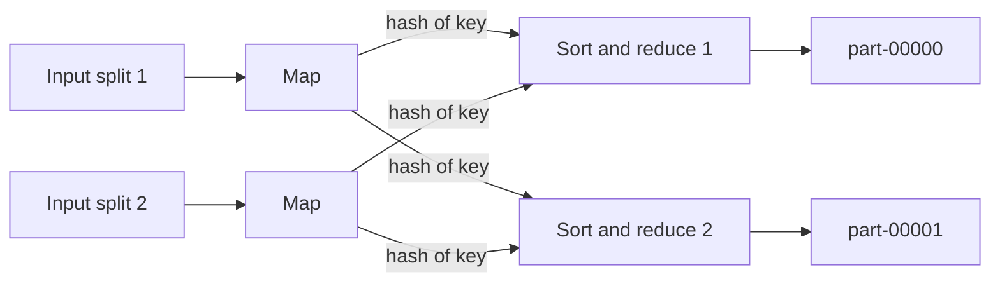
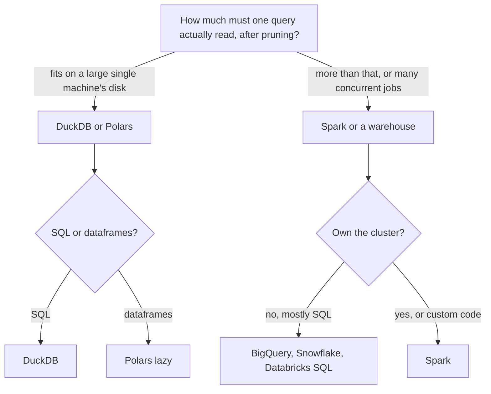

# 3 — Distributed compute

Distributed compute exists because some jobs do not fit on one machine, and it costs far more than the cluster bill. Once data crosses a network, every join becomes a shuffle, every failed worker becomes a recovery plan, and the slowest task sets the finish time. The surprise of the last decade is how far the single-machine limit has moved. This chapter builds MapReduce by hand to see what it actually does, follows how Spark changed it, and then runs the same query in DuckDB, Polars and Spark to ask which you should reach for first.

## Start with one machine

Kleppmann opens his batch processing chapter ([*Designing Data-Intensive Applications*](https://dataintensive.net/), ch. 10) with something unfashionable, a chain of Unix tools analysing a log file. It is worth starting there because the shape carries over. First the trips again, this time written to Parquet and held as a list of zones.

```python
import numpy as np, pyarrow as pa, pyarrow.parquet as pq, duckdb, polars as pl, subprocess, zlib, os, time, random
from collections import Counter, defaultdict

def make_trips(n=1_000_000, seed=7):
    rng = np.random.default_rng(seed)
    start = np.datetime64("2026-01-01T00:00:00", "s")
    seconds = np.sort(rng.integers(0, 31 * 86_400, n))
    weights = 1 / np.arange(1, 261)
    zones = rng.choice(260, n, p=weights / weights.sum()) + 1
    miles = np.round(rng.gamma(2.0, 1.6, n), 2)
    return pa.table({
        "trip_id": np.arange(n, dtype="int64"),
        "pickup_at": pa.array(start + seconds.astype("timedelta64[s]")),
        "pickup_zone": zones.astype("int32"),
        "payment_type": pa.array(rng.choice(["card", "cash", "app"], n, p=[.7, .2, .1])),
        "passengers": rng.choice([1, 2, 3, 4], n, p=[.7, .18, .07, .05]).astype("int8"),
        "trip_miles": miles,
        "fare_usd": np.round(np.maximum(3.0, 3.0 + 2.5 * miles + rng.normal(0, 1.0, n)), 2),
    })

trips = make_trips()
pq.write_table(trips, "trips.parquet", compression="zstd")
zones = trips["pickup_zone"].to_pylist()
```

Then a count of pickups by zone, as a shell pipeline.

```python
with open("zones.txt", "w") as f:
    f.writelines(f"{z}\n" for z in zones[:200_000])
print(subprocess.run("sort zones.txt | uniq -c | sort -rn | head -3", shell=True, capture_output=True, text=True).stdout)
```

```text
32574 1
16229 2
10940 3
```

`sort` is a real merge sort. When its input is larger than memory it spills sorted runs to disk and merges them, so it handles data well beyond RAM, and GNU `sort` will use multiple cores. The same is true in the other direction: a Python dictionary of counts is limited by the number of distinct keys, while a sort is limited only by disk. Almost everything that follows is this pipeline's design spread over many machines. The tools have one uniform interface, their inputs are never modified, and each stage can be inspected separately.

## MapReduce by hand

Google's MapReduce (Dean and Ghemawat, [*MapReduce*](https://research.google.com/archive/mapreduce-osdi04.pdf), OSDI 2004, [CACM 2008 version](https://doi.org/10.1145/1327452.1327492)) ran on top of a distributed file system (Ghemawat, Gobioff and Leung, [*The Google File System*](https://doi.org/10.1145/1165389.945450), SOSP 2003) designed around the assumption that component failures are normal rather than exceptional. Its programming model is two functions you write, with a framework that does everything between them. Here is that framework with the machines taken away, counting trips per zone.

```python
N_REDUCERS = 4

def map_task(chunk):
    for zone in chunk:
        yield zone, 1

def partition(key):
    # A stable hash: Python's hash() of strings changes per process, which would split a key.
    return zlib.crc32(str(key).encode()) % N_REDUCERS

def reduce_task(key, values):
    return key, sum(values)

splits = [zones[i:i + 250_000] for i in range(0, len(zones), 250_000)]   # four map tasks

# Map side: each task writes one sorted spill per reducer.
spills = defaultdict(list)
for chunk in splits:
    per_reducer = defaultdict(list)
    for key, value in map_task(chunk):
        per_reducer[partition(key)].append((key, value))
    for r, pairs in per_reducer.items():
        spills[r].append(sorted(pairs))

# Reduce side: merge the sorted spills, so one key's values arrive together.
from heapq import merge
from itertools import groupby
result = {}
for r in range(N_REDUCERS):
    merged = merge(*spills[r])
    for key, group in groupby(merged, key=lambda kv: kv[0]):
        k, v = reduce_task(key, (value for _, value in group))
        result[k] = v

print("reducer input sizes:", [sum(map(len, spills[r])) for r in range(N_REDUCERS)])
print("top zones:", sorted(result.items(), key=lambda kv: -kv[1])[:3])
assert result == Counter(zones)
```

```text
reducer input sizes: [196903, 241293, 184582, 377222]
top zones: [(1, 163162), (2, 81252), (3, 54218)]
```

The `partition` function is the part that deserves a close look. Every value for one key must reach one reducer, so the hash has to be stable across processes; `crc32` is, and Python's `hash` of a string is not. The input sizes also show something the framework cannot fix: the reducers are unequal because hashing cannot split a key, and zone 1 by itself holds about 16% of the data.



The stage between map and reduce, called the **shuffle**, is the expensive one, because it moves data over the network and sorts it. Kleppmann makes a good observation about what mappers are doing: they send messages to reducers, and the key acts as the address. That separates the logic you write from all network concerns.

Fault tolerance in this design rests on two habits that are also the basis of the [idempotent pipelines chapter](../../03-transform-and-orchestrate/notes/04-idempotency-and-backfills.md): inputs are immutable, and output appears all at once.

```python
def run_task(rows, out_path, fail_after=None):
    """Write to a temporary name and rename on success: readers never see half a file."""
    tmp = out_path + ".tmp"
    with open(tmp, "w") as f:
        for i, row in enumerate(rows):
            if fail_after is not None and i == fail_after:
                raise RuntimeError("worker preempted")
            f.write(f"{row}\n")
    os.replace(tmp, out_path)

try:
    run_task(range(1000), "part-0", fail_after=400)
except RuntimeError as exc:
    print("attempt 1:", exc, "| output exists:", os.path.exists("part-0"))
run_task(range(1000), "part-0")
print("attempt 2: output lines:", sum(1 for _ in open("part-0")))
```

```text
attempt 1: worker preempted | output exists: False
attempt 2: output lines: 1000
```

The first attempt died and left nothing, so a retry cannot double-count. Kleppmann calls the wider property human fault tolerance. If bad code ships, you can roll it back, re-run it, and overwrite the bad output, which is impossible for a database mutated in place.

The paper also records why scale makes stragglers matter. Its sort of about a terabyte (10^10 100-byte records on about 1,800 machines) finished in 891 seconds, and it took 44% longer with the "backup task" speculative re-execution disabled, because a few slow machines kept the whole job waiting. Failure at this scale is more common than you might assume. Kleppmann explains that MapReduce's design tolerates preemption: at Google, batch tasks ran alongside priority work and could be killed to make room, with about a 5% chance of an hour-long task being terminated. The arithmetic for a realistic job follows.

```python
hourly = 0.05
per_10_min = 1 - (1 - hourly) ** (10 / 60)
print(f"10-minute task killed: {per_10_min:.2%}")
print(f"at least one of 100 killed: {1 - (1 - per_10_min) ** 100:.0%}")
```

```text
10-minute task killed: 0.85%
at least one of 100 killed: 57%
```

A hundred ten-minute tasks have better-than-even odds that at least one gets killed, which matches the figure Kleppmann gives. That explains why MapReduce writes each stage to disk: restarting one task is cheap. On a cluster where preemption is rare, that same choice is pure overhead, as Spark would show.

## Joins are shuffles

Warehouse queries are mostly joins, so the join strategy is the main thing to read in a distributed query plan. There are three common strategies, and you should be able to tell which you are looking at.

| Join | How | Needs | Moves |
|---|---|---|---|
| Sort-merge or shuffle hash | Partition both sides by the join key and join each partition | Nothing | Both tables |
| Broadcast hash | Send the small table to every worker holding the big one | A small side that fits in memory | The small table, once per worker |
| Partitioned or bucketed | Join pre-partitioned files directly with no shuffle | Both sides partitioned the same way on the key | Nothing |

For our trips and a 260-row zone dimension, on an assumed 10-node cluster, the difference is stark. This is a back-of-the-envelope count, not a benchmark: with random placement, about 9 of every 10 bytes must move to reach the right node.

```python
trip_bytes, zone_bytes = trips.nbytes, 260 * 64     # 64 bytes is an assumed width for a zone row
nodes = 10

sort_merge = trip_bytes * (nodes - 1) / nodes + zone_bytes * (nodes - 1) / nodes
broadcast = zone_bytes * (nodes - 1)
print(f"partitioned join moves about {sort_merge / 1e6:8.2f} MB across the network")
print(f"broadcast join moves about   {broadcast / 1e6:8.2f} MB across the network")
```

```text
partitioned join moves about    40.42 MB across the network
broadcast join moves about       0.15 MB across the network
```

That factor of a few hundred is why optimisers try hard to broadcast dimensions. A bad statistic that hides a table's size can make a plan fall back to a shuffle. Kleppmann adds the corollary that the optimiser has to know the physical layout, which is one of the jobs of a metastore.

Skew is the other classic failure. Hash partitioning spreads keys, but it cannot spread one key.

```python
def load(keys, reducers=8):
    counts = Counter(zlib.crc32(str(k).encode()) % reducers for k in keys)
    return [counts[r] for r in range(reducers)]

plain = load(zones)
# Salt only the known hot key: two-stage aggregation splits it across every reducer.
hot = {1}
rng = random.Random(0)
salted = load(f"{z}#{rng.randrange(8)}" if z in hot else z for z in zones)
for name, l in [("plain", plain), ("salted", salted)]:
    print(f"{name:7s} max {max(l):7d} mean {sum(l) // len(l):7d} max/mean {max(l) / (sum(l) / len(l)):.2f}")
```

```text
plain   max  230811 mean  125000 max/mean 1.85
salted  max  192624 mean  125000 max/mean 1.54
```

The fix is to split the known hot key across reducers with a random salt and then merge the partial results in a second stage. That helped here: the maximum fell from 1.85 to 1.54 times the mean. The rest of the imbalance is ordinary hash collisions, since several other busy zones also share partitions, so salting one key is rarely the whole answer. Kleppmann describes system support in the same vein, such as Pig's sampling-based skewed join and Hive's separate handling of hot keys. A straggling reducer in a Spark job is very often this.

## Spark: keep the shape, drop the disk

MapReduce's weakness is that each job's output goes to replicated storage before the next one starts, even when one consumer is waiting and the data is temporary. Dataflow engines like Spark, Tez and Flink treat the whole workflow as one job, which lets them skip needless sorts, avoid unnecessary map stages, and hold intermediate state in memory or on local disk.

Giving up that durable intermediate state raises the fault-tolerance question again. Zaharia et al. answered it with resilient distributed datasets ([*Resilient Distributed Datasets*](https://www.usenix.org/conference/nsdi12/technical-sessions/presentation/zaharia), NSDI 2012): rather than replicate data, log the coarse-grained transformations that built each partition, called the **lineage**, and recompute a lost partition from it. The motivation was iterative and interactive work that reuses data between computations, and the paper reports Spark up to 20 times faster than Hadoop on iterative applications. Here is the lineage from a real run.

```python
from pyspark.sql import SparkSession, functions as F

spark = SparkSession.builder.master("local[4]").appName("trips").getOrCreate()
spark.sparkContext.setLogLevel("ERROR")
rdd = spark.sparkContext.parallelize(zones, 8).map(lambda z: (z, 1)).reduceByKey(lambda a, b: a + b, 4)
print(rdd.toDebugString().decode())
```

```text
(4) PythonRDD[5] at RDD at PythonRDD.scala:59 []
 |  MapPartitionsRDD[4] at mapPartitions at PythonRDD.scala:197 []
 |  ShuffledRDD[3] at partitionBy at NativeMethodAccessorImpl.java:0 []
 +-(8) PairwiseRDD[2] at reduceByKey at lineage:5 []
    |  PythonRDD[1] at reduceByKey at lineage:5 []
    |  ParallelCollectionRDD[0] at readRDDFromFile at PythonRDD.scala:326 []
```

The `ShuffledRDD` line marks the boundary between stages. If a partition after it is lost, Spark re-reads shuffle files from the parents, or re-runs them if those are gone. Kleppmann adds an important condition: recomputation is only safe if the operators are deterministic, so a task that consumed random numbers or iterated a hash in unstable order can yield different data the second time. Downstream tasks then have to be killed and re-run too.

Spark SQL then lifted this from RDDs to relations (Armbrust et al., [*Spark SQL*](https://doi.org/10.1145/2723372.2742797), SIGMOD 2015): a declarative DataFrame API and an extensible optimiser, Catalyst. Declaring what you want rather than which function to call lets the engine rearrange your query. You can see the rearrangement in a local run on our Parquet file.

```python
df = spark.read.parquet("trips.parquet")
per_zone = (df.filter(F.col("payment_type") == "card")
              .groupBy("pickup_zone")
              .agg(F.count("*").alias("trips"), F.round(F.avg("fare_usd"), 2).alias("avg_fare"))
              .orderBy(F.desc("trips")).limit(3))
per_zone.show()
per_zone.explain()
spark.stop()
```

```text
+-----------+------+--------+
|pickup_zone| trips|avg_fare|
+-----------+------+--------+
|          1|114187|   11.01|
|          2| 56982|   10.97|
|          3| 37979|   10.96|
+-----------+------+--------+

== Physical Plan ==
AdaptiveSparkPlan isFinalPlan=false
+- TakeOrderedAndProject(limit=3, orderBy=[trips#8L DESC NULLS LAST], output=[pickup_zone#2,trips#8L,avg_fare#9])
   +- HashAggregate(keys=[pickup_zone#2], functions=[count(1), avg(fare_usd#6)])
      +- Exchange hashpartitioning(pickup_zone#2, 200), ENSURE_REQUIREMENTS, [plan_id=88]
         +- HashAggregate(keys=[pickup_zone#2], functions=[partial_count(1), partial_avg(fare_usd#6)])
            +- Project [pickup_zone#2, fare_usd#6]
               +- Filter (isnotnull(payment_type#3) AND (payment_type#3 = card))
                  +- FileScan parquet [pickup_zone#2,payment_type#3,fare_usd#6] Batched: true, DataFilters: [isn ...
```

(The `FileScan` line runs past the page; it has been truncated.) Read the plan from the bottom up: a scan of three of seven columns with the filter pushed into Parquet, a partial aggregate on each partition, an `Exchange` which is the shuffle, into 200 partitions by default, and a final aggregate. Partial aggregation before the shuffle is the combiner idea from MapReduce, chosen automatically. The default of 200 partitions is one to check: it is a lot of partitions for a million rows, though adaptive execution, shown by `AdaptiveSparkPlan`, can coalesce them at run time. This code needs only `pyspark` and a Java runtime, and `local[4]` runs it in one process with four threads. Practice with a real cluster is in the [zoomcamp batch module](../../04-warehouse-lakehouse-streaming/practice/datatalks-de/05-batch/).

## One machine again: DuckDB and Polars

Now the same question, on the same file, with no cluster.

```python
query = """
    SELECT pickup_zone, count(*) AS trips, round(avg(fare_usd), 2) AS avg_fare
    FROM 'trips.parquet' WHERE payment_type = 'card'
    GROUP BY pickup_zone ORDER BY trips DESC LIMIT 3
"""
print(duckdb.sql(query))

lazy = (pl.scan_parquet("trips.parquet")
        .filter(pl.col("payment_type") == "card")
        .group_by("pickup_zone")
        .agg(pl.len().alias("trips"), pl.col("fare_usd").mean().round(2).alias("avg_fare"))
        .sort("trips", descending=True)
        .limit(3))
print(lazy.collect())
print(lazy.explain())
```

```text
┌─────────────┬────────┬──────────┐
│ pickup_zone │ trips  │ avg_fare │
│    int32    │ int64  │  double  │
├─────────────┼────────┼──────────┤
│           1 │ 114187 │    11.01 │
│           2 │  56982 │    10.97 │
│           3 │  37979 │    10.96 │
└─────────────┴────────┴──────────┘

shape: (3, 3)
┌─────────────┬────────┬──────────┐
│ pickup_zone ┆ trips  ┆ avg_fare │
│ ---         ┆ ---    ┆ ---      │
│ i32         ┆ u32    ┆ f64      │
╞═════════════╪════════╪══════════╡
│ 1           ┆ 114187 ┆ 11.01    │
│ 2           ┆ 56982  ┆ 10.97    │
│ 3           ┆ 37979  ┆ 10.96    │
└─────────────┴────────┴──────────┘
SORT BY [slice: (0, 3, dynamic_pred: bef072fe-25c9-4515-9b20-ed135cacb2c6), descending: [true]] [col("trips")]
  FILTER col("trips").dynamic_predicate()
  FROM
    AGGREGATE[maintain_order: false]
      [len().alias("trips"), col("fare_usd").mean().round().alias("avg_fare")] BY [col("pickup_zone")]
      FROM
      simple π 2/2 ["pickup_zone", "fare_usd"]
        Parquet SCAN [trips.parquet]
        PROJECT 3/7 COLUMNS
        SELECTION: col("payment_type") == "card"
        ESTIMATED ROWS: 1000000
```

DuckDB, Polars and the Spark run above all give identical numbers. Polars' `explain` shows the optimiser doing the same work as Catalyst: `PROJECT 3/7 COLUMNS` is column pruning and `SELECTION` is the filter pushed into the Parquet scan. The `lazy` builder is the point. If you were to use eager `read_parquet`, you would lose both optimisations. The API looks like pandas and behaves like a query planner.

Memory is what people assume will stop them, and it stops a modern engine later than expected. DuckDB will spill aggregates to disk, the same trick as `sort`.

```python
con = duckdb.connect()
con.execute("SET memory_limit = '200MB'")
con.execute("SET temp_directory = 'spill'")
con.execute("""COPY (SELECT i AS trip_id, i % 3000000 AS rider_id, random() * 40 AS fare_usd
                     FROM range(40000000) t(i)) TO 'big.parquet' (FORMAT parquet)""")
print(f"big.parquet {os.path.getsize('big.parquet') / 1e6:.0f} MB on disk")
t0 = time.perf_counter()
print(con.sql("""SELECT count(*) AS riders, round(avg(spend), 2) AS avg_spend
                 FROM (SELECT rider_id, sum(fare_usd) AS spend FROM 'big.parquet' GROUP BY rider_id)"""))
print(f"group by 3,000,000 keys under a 200 MB limit: {time.perf_counter() - t0:.1f} s")
```

```text
big.parquet 640 MB on disk
┌─────────┬───────────┐
│ riders  │ avg_spend │
│  int64  │  double   │
├─────────┼───────────┤
│ 3000000 │    266.69 │
└─────────┴───────────┘

group by 3,000,000 keys under a 200 MB limit: 3.6 s
```

That is a 640 MB compressed file of 40 million rows, grouped by three million distinct keys, under a memory limit smaller than the file, finishing in a few seconds on a laptop.

Two pieces of evidence push the argument past anecdote. McSherry, Isard and Murray ([*Scalability! But at what COST?*](https://www.usenix.org/conference/hotos15/workshop-program/presentation/mcsherry), HotOS 2015) defined COST as the configuration that outperforms a competent single thread. They reimplemented graph computations from systems papers on a 2014 laptop. For 20 PageRank iterations on the 1.47-billion-edge `twitter_rv` graph, their single thread took 300 s reading from SSD; published figures were 857 s for Spark and 419 s for GraphX on 128 cores, and 249 s for GraphLab on 128 cores. Graph problems are a hard case for partitioning, and these were 2014 versions, so this says little about Spark on a modern scan. It does show that scaling curves can hide large overheads, which is the part to remember.

The second is about how large data really is. Jordan Tigani, who worked on BigQuery and went on to co-found MotherDuck, argues in ["Big Data is Dead"](https://motherduck.com/blog/big-data-is-dead/) that most customers had under 1 TB, and that among customers spending over $1,000 a year, 90% of queries touched under 100 MB. He discloses that these figures are from memory, and he has a database to sell, so treat them as informed opinion and not as measurement. The structural argument is stronger than the numbers: most analytic queries read recent, filtered, pruned data, so the working set is much smaller than the stored total.

## Choosing



| | DuckDB | Polars | Spark |
|---|---|---|---|
| Interface | SQL | DataFrame, lazy | DataFrame and SQL |
| Runs on | One process | One process | Local or a cluster |
| Larger than memory | Spills to disk | Streaming engine | Spills, plus more nodes |
| Fault tolerance | Re-run the query | Re-run the query | Task retry through lineage |
| Reaches for when | Files and SQL, tests, small marts | Python pipelines | Terabytes per job, many tenants, existing platform |
| Costs you | Single-node limit, one writer process | Single-node limit | A JVM, a shuffle to tune, cluster operations |

Spark is the right answer when a job truly reads more than one machine holds, when you need retries that survive losing hardware during long jobs, or when the organisation already runs it. Otherwise, a single node first is the cheap default, and the [lakehouse chapter](../../04-warehouse-lakehouse-streaming/notes/03-lakehouse-vs-warehouse.md) takes up what changes when many engines share one store.

## Pitfalls

- **Reaching for a cluster before measuring.** The relevant number is the data one query reads after pruning, not the size of the lake. Test the query on one machine first.
- **Using an unstable hash for partitioning.** A hash that differs across processes splits one key across reducers and gives silently wrong totals. Python's `hash()` of a string is salted per process.
- **Writing to a database from inside each task.** Retries and speculation will duplicate writes, the database can be overwhelmed, and partial results become visible. Kleppmann's advice is to write files and bulk-load them atomically.
- **Treating a slow reducer as a slow machine.** It is usually a skewed key. Check the input size per task before adding workers.
- **Hiding table sizes from the optimiser.** Stale statistics can turn a broadcast into a shuffle. Read the plan and look for `Exchange` on the small side.
- **Nondeterminism in recomputed tasks.** Random numbers, current time, or unordered iteration break lineage recovery and retries. Seed them or take them from the input.
- **Quoting the COST paper as "Spark is slow".** It measures graph algorithms on 2014 versions. Its lasting point is to measure absolute performance and not just scaling.
- **Assuming the Polars eager API optimises.** Pushdown happens in `scan_parquet` and `lazy`. `read_parquet` reads everything first.

## Try it

The code in this chapter is collected in [practice/03_distributed_compute.py](../practice/03_distributed_compute.py).

1. Change the `mapreduce` code so that it computes average fare per zone. Why can't the reducer's output simply be averaged in a combiner?

<details><summary>Answer</summary>

Emit `(zone, (fare, 1))` from the map and sum both parts in the reducer, dividing at the very end. An average of averages is wrong when groups differ in size, so a combiner has to pass along the sum and the count. This is Kimball's "ratio of the sums" rule in a different setting.

</details>

2. In the `skew` code, salt the top three zones rather than one, and compare the max to mean ratio with `reducers=8` and `reducers=32`.

<details><summary>Answer</summary>

Salting more hot keys brings the ratio closer to 1 at 8 reducers. At 32, salting with only 8 salt values leaves each hot key on at most 8 partitions, so the salt count should grow to match the reducer count. Remember that the reduce step must now re-aggregate across salts.

</details>

3. Lower the DuckDB `memory_limit` until the `larger_than_memory` query fails, and find what stops it.

<details><summary>Answer</summary>

On the 12-core laptop used here the query finished at 200 MB and raised `OutOfMemoryException` at 100 MB. Then `SET threads = 1` let it finish at 25 MB in about the same time, because each thread keeps its own working blocks. So the limit depends on parallelism as well as data size, and the numbers will differ on your machine. Try `threads` before you buy memory.

</details>

## Interview checklist

| Question | Answer |
|---|---|
| Walk through MapReduce. | Map emits key-value pairs. The framework partitions by hash of key, sorts, and copies them to reducers (the shuffle). Reduce handles all values for one key. Output is committed atomically. |
| Why is the shuffle the bottleneck? | It moves data across the network and sorts it, and nearly every join and group-by needs one. Reducing it is most of tuning. |
| What did Spark change? | It runs the whole workflow as one job, keeps intermediate data in memory or on local disk, and recovers via lineage rather than replicated intermediate files. |
| What is lineage, and what does it need? | The record of transformations that built a partition, used to recompute it. It needs deterministic operators. |
| Broadcast vs sort-merge join? | Broadcast copies a small table to every worker, with no shuffle of the large table. Sort-merge shuffles both sides by key, and is the general fallback. |
| How do you handle skew? | Find the hot keys, then salt them and aggregate in two stages, or broadcast the small side. Adaptive execution can split skewed partitions. |
| What is COST? | The hardware configuration needed before a system beats a competent single thread (McSherry et al., HotOS 2015). Some systems never do. |
| When would you not use Spark? | When the query's input after pruning fits on one large machine. DuckDB or Polars are simpler and cheaper, and each can spill. |

## Next

A cluster has to decide where each row lives and how many copies it keeps. [Partitioning and replication](04-partitioning-and-replication.md) covers those two decisions.
