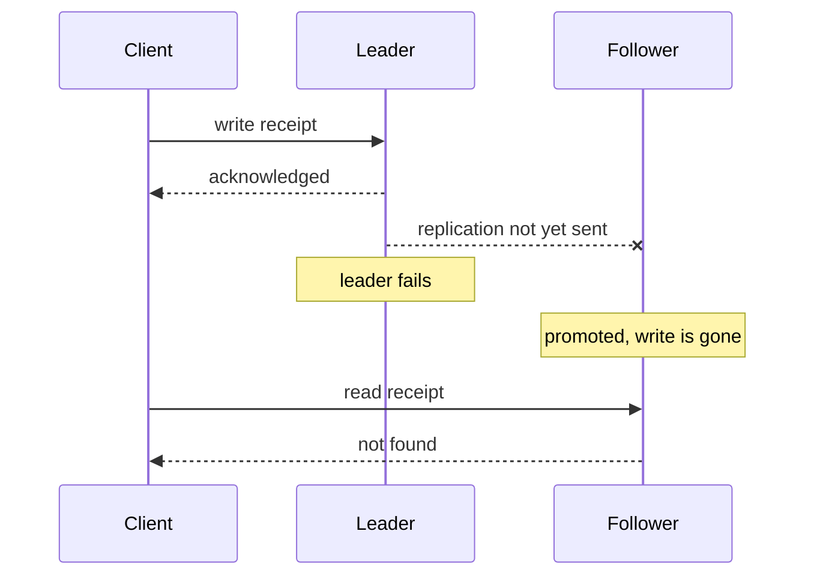

# 4 — Partitioning and replication

Once data lives on many machines, two questions come up and they are easy to confuse. Partitioning decides which machine holds a given row, so that no node has to hold everything. Replication decides how many machines hold each copy, so that losing one loses nothing. Partitioning is a choice you make again each time you design a table or a lake layout, and replication decides what a reader sees just after a write, which is what makes a dashboard look wrong even though nothing is broken. This chapter builds small models of both, using the taxi trips, and closes with how they appear in a pipeline.

## Partitioning and replication together

Kleppmann treats these in consecutive chapters ([*Designing Data-Intensive Applications*](https://dataintensive.net/), ch. 5 and 6), and his first caution is about vocabulary. The same idea is a shard in MongoDB and Elasticsearch, a region in HBase, a tablet in Bigtable, a vnode in Cassandra and Riak, and a vBucket in Couchbase. Real systems combine both mechanisms, so a node leads some partitions and follows others.

```text
             Partition 0        Partition 1        Partition 2
Node A       LEADER             follower
Node B       follower           LEADER             follower
Node C                          follower           LEADER
Node D       follower                              follower

Each partition has its own leader. Losing node B moves leadership
of partition 1 alone. Writes go to a partition's leader, reads may
go to any replica, and the lag between them is chapter material below.
```

The goal of partitioning is to spread data and load evenly. An uneven split is called **skew**, and a partition with a disproportionate share of load is a **hot spot**. There are two main strategies for assigning keys, and each makes one thing easy.

## Range and hash partitioning

Partitioning by key range assigns each partition a contiguous range, like the volumes of an encyclopedia, as in Bigtable, HBase and RethinkDB. Keeping keys sorted makes range queries cheap. Partitioning by hash of the key gives up the order in exchange for an even spread. Using trips by date, here is the trade in numbers. A stable hash helper comes first.

```python
import zlib, random, itertools, sqlite3, os, time, numpy as np
from collections import Counter

def h(key):
    """A hash that is stable across processes."""
    return zlib.crc32(str(key).encode())
```

```python
rng = np.random.default_rng(7)
days = np.sort(rng.integers(0, 31, 1_000_000))
ids = np.arange(len(days))

# Today's writes: the rows for the last day of the month.
today = ids[days == 30]
range_partitions = 31                       # one per day
hash_partitions = np.array([h(i) for i in today[:50_000]]) % 31
print("writes today by range-on-date: 1 of", range_partitions, "partitions takes", len(today), "rows")
print("writes today by hash: busiest partition takes",
      f"{Counter(hash_partitions.tolist()).most_common(1)[0][1] / 50_000:.1%} of them")

def partitions_for_week(kind):
    if kind == "range":
        return len(set(range(7, 14)))
    return 31          # a hash has destroyed the order, so ask every partition

print("query one week: range touches", partitions_for_week("range"), "| hash touches", partitions_for_week("hash"))
```

```text
writes today by range-on-date: 1 of 31 partitions takes 31952 rows
writes today by hash: busiest partition takes 2.2% of them
query one week: range touches 7 | hash touches 31
```

A range on date means every write this month lands on one partition, because all new data has today's date; Kleppmann gives sensor readings keyed on a timestamp as the same trap. The hash divides those writes almost evenly, with the busiest partition taking 2.2% of them, but a one-week query has to ask all 31 partitions. A bad partition key usually causes one of these two problems: a write hot spot, or a query that fans out to everything.

Compound keys get both. Cassandra hashes only the first part of the key and sorts by the rest, so a key of `(zone, day)` finds one partition and then scans a sorted run within it. Kleppmann's example is `(user_id, update_timestamp)`, which gives one user's updates in order on one partition.

```python
rows = [{"zone": int(z), "day": int(d)} for z, d in zip(rng.integers(1, 261, 200_000), rng.integers(0, 31, 200_000))]
store = {}
for row in rows:
    store.setdefault(h(row["zone"]) % 16, []).append((row["zone"], row["day"]))
for part in store.values():
    part.sort()

target = h(42) % 16
hits = [r for r in store[target] if r[0] == 42 and 7 <= r[1] < 14]
print(f"zone 42, days 7-13: read 1 of 16 partitions, {len(hits)} rows, rows sorted by day inside the zone")
```

```text
zone 42, days 7-13: read 1 of 16 partitions, 172 rows, rows sorted by day inside the zone
```

## Hot keys

Hashing cannot help if one key is hot, because the same key always hashes to the same place. The celebrity with millions of followers is the standard example. Most systems will not fix this automatically, so the application has to, for example by appending a random two-digit number so that writes for that key spread across 100 keys.

```python
keys_stream = ["celebrity"] * 300_000 + [f"user{i}" for i in range(700_000)]
def busiest(stream, n=100):
    c = Counter(h(k) % n for k in stream)
    return c.most_common(1)[0][1]

salt = random.Random(0)
print("no salt, busiest partition:", busiest(keys_stream))
print("salted,  busiest partition:", busiest(f"{k}{salt.randrange(100):02d}" if k == "celebrity" else k for k in keys_stream))
```

```text
no salt, busiest partition: 307030
salted,  busiest partition: 19127
```

The busiest partition dropped by a factor of 16. The price is that any read for the celebrity must now fetch and combine 100 keys, so this should only be done for the keys that need it. It is the same salting as in the [previous chapter's shuffle](03-distributed-compute.md), for the same reason.

## Secondary indexes and fan-out

Finding a row by its partition key is direct. Finding it by anything else requires a secondary index, and those are partitioned too, in one of two ways.

| | Local (document-partitioned) | Global (term-partitioned) |
|---|---|---|
| Each index lives | Beside its partition's data | In its own partitions, split by indexed value |
| Writes | Touch one partition | May touch several, often updated asynchronously |
| Reads | Scatter to all partitions, gather results | Go to one index partition |
| Examples | MongoDB, Cassandra, Elasticsearch, Riak, SolrCloud | DynamoDB global indexes, usually a fraction of a second behind |

Scatter-gather has a cost that does not show up in averages: the response waits for the slowest shard, so tail latency gets worse with fan-out. A small simulation, with an invented lognormal latency, shows how quickly the median moves.

```python
lat = random.Random(1)
def one_shard():
    return lat.lognormvariate(1.6, 0.5)      # a median near 5 ms, invented for the demo

def scatter_gather(n):
    return max(one_shard() for _ in range(n))

for n in [1, 4, 16, 64]:
    sample = sorted(scatter_gather(n) for _ in range(20_000))
    print(f"{n:3d} shards: median {sample[10_000]:6.1f} ms   p99 {sample[19_800]:6.1f} ms")
```

```text
  1 shards: median    4.9 ms   p99   15.8 ms
  4 shards: median    8.2 ms   p99   20.1 ms
 16 shards: median   11.7 ms   p99   24.6 ms
 64 shards: median   15.6 ms   p99   30.2 ms
```

With 64 shards, the median request takes three times the median for one shard, and it comes close to what used to be a single shard's 99th percentile. Nothing got slower. The query just has more chances to draw a slow shard.

## Rebalancing

Nodes get added and fail, so partitions have to move, and rebalancing should leave the load fair, keep serving during the move, and move no more than necessary. The obvious scheme, `hash(key) mod N`, fails the third requirement. Kleppmann's example is hash 123456, which goes to node 6 with 10 nodes, 3 with 11 and 0 with 12. Measured over a million keys, here it is against the fixed-partition approach.

```python
keys = range(1_000_000)
moved_mod = sum(h(k) % 10 != h(k) % 11 for k in keys) / len(keys)
print(f"hash mod N, 10 -> 11 nodes: {moved_mod:.1%} of keys move")

# Fixed partitions: 1,024 partitions never change; only ownership of some moves.
PARTITIONS = 1024
owners = {p: p % 10 for p in range(PARTITIONS)}
new_owners = dict(owners)
for node in range(10):                         # the new node takes a fair share from each node
    take = [p for p, o in owners.items() if o == node][: PARTITIONS // 11 // 10 + 1]
    for p in take:
        new_owners[p] = 10
moved_fixed = sum(new_owners[h(k) % PARTITIONS] != owners[h(k) % PARTITIONS] for k in keys) / len(keys)
print(f"fixed partitions, 10 -> 11 nodes: {moved_fixed:.1%} of keys move")
print("load after rebalance:", sorted(Counter(new_owners.values()).values()))
```

```text
hash mod N, 10 -> 11 nodes: 91.0% of keys move
fixed partitions, 10 -> 11 nodes: 9.8% of keys move
load after rebalance: [92, 92, 92, 92, 92, 92, 93, 93, 93, 93, 100]
```

Going from 10 to 11 nodes with `mod N` moves 91% of the data. Creating far more partitions than nodes, and moving whole partitions, moves only about the new node's fair share, as in Riak, Elasticsearch, Couchbase and Voldemort. HBase and RethinkDB split partitions dynamically as they grow, so the count adapts to the data. Avoid calling any of these "consistent hashing" unless you mean the specific algorithm, since Kleppmann points out the term is used loosely.

He also warns about automation. If rebalancing fires automatically on failure detection, a node that is only slow gets declared dead, more data moves to the remaining nodes, and the extra load can make them look dead too. Keeping a person in the loop for the rebalance decision is slower and safer.

## Partitioning a lake

So far these have been database mechanisms. The version a data engineer handles most often is a folder layout in object storage, and the rules are the same.

```python
import duckdb

con = duckdb.connect()
con.execute("""CREATE TABLE trips AS
    SELECT i AS trip_id, TIMESTAMP '2026-01-01' + INTERVAL (i * 2.6784) SECOND AS pickup_at,
           (hash(i) % 260 + 1)::INT AS pickup_zone, round(3 + random() * 40, 2) AS fare_usd
    FROM range(1000000) t(i)""")
con.execute("""COPY (SELECT *, pickup_at::DATE AS day FROM trips)
               TO 'lake' (FORMAT parquet, PARTITION_BY (day))""")
files = [os.path.join(d, f) for d, _, fs in os.walk("lake") for f in fs]
print(len(files), "files, e.g.", sorted(files)[0])
print(f"average file {sum(map(os.path.getsize, files)) / len(files) / 1e3:.0f} KB")

q = "SELECT sum(fare_usd) FROM read_parquet('lake/*/*.parquet', hive_partitioning=true) WHERE day = DATE '2026-01-15'"
plan = con.sql("EXPLAIN ANALYZE " + q).fetchall()[0][1]
print([line.strip(" │") for line in plan.splitlines() if "File Filters" in line or "Scanning Files" in line or "Files" in line][:3])
print(con.sql(q).fetchall())
```

```text
31 files, e.g. lake/day=2026-01-01/data_0.parquet
average file 438 KB
["File Filters: day = '2026-01-15'::DATE", 'Scanning Files: 1/31', 'Total Files Read: 1']
[(742153.250000002,)]
```

`Scanning Files: 1/31` is partition pruning: the engine read the folder names and opened a single file. It is the same mechanism as the footer pruning from [chapter 1](01-encoding-and-files.md), one level higher. So the partition key should be the column most queries filter on, usually a date, and hive-style `key=value` folders make it readable to any engine. Now go too far with the same idea and partition by day and zone.

```python
con.execute("""COPY (SELECT *, pickup_at::DATE AS day FROM trips)
               TO 'too_fine' (FORMAT parquet, PARTITION_BY (day, pickup_zone))""")
fine = [os.path.join(d, f) for d, _, fs in os.walk("too_fine") for f in fs]
print(f"{len(fine)} files, average {sum(map(os.path.getsize, fine)) / len(fine) / 1e3:.1f} KB")
print(f"footer overhead reading all: {sum(os.path.getsize(f) for f in fine) / 1e6:.1f} MB vs "
      f"{sum(os.path.getsize(f) for f in files) / 1e6:.1f} MB by day")
def t(path):
    t0 = time.perf_counter(); con.sql(f"SELECT sum(fare_usd) FROM read_parquet('{path}', hive_partitioning=true)").fetchall()
    return (time.perf_counter() - t0) * 1000
print(f"full scan by day {min(t('lake/*/*.parquet') for _ in range(3)):.1f} ms, by day and zone {min(t('too_fine/*/*/*.parquet') for _ in range(3)):.1f} ms")
```

```text
8060 files, average 2.6 KB
footer overhead reading all: 21.0 MB vs 13.6 MB by day
full scan by day 3.0 ms, by day and zone 705.5 ms
```

The dataset has gained metadata overhead, with the same rows taking half as much space again, and a full scan runs hundreds of times slower, since the engine must now open thousands of tiny files and read a footer for each one. This is the **small files problem**, and it is common with streaming sinks or over-eager partition keys. Each folder also costs a list call on object storage. Rough guidance is to keep the partition key low in cardinality and leave finer selectivity to sorted row groups inside each file. A rule that holds up well: partition by what you delete or backfill by, and sort by what you filter on. Backfills are covered in [idempotency and backfills](../../03-transform-and-orchestrate/notes/04-idempotency-and-backfills.md).

## Leaders and followers

Replication keeps the same data on several machines for four reasons: availability, latency, read scale and disconnected use. If the data never changed this would be trivial, so all the difficulty is in handling changes. The most common design is **leader-based replication**, used by PostgreSQL, MySQL, MongoDB and, importantly for this subject, Kafka. All writes go to the leader, which sends a log of changes to its followers, and they apply it in the same order. The question of what that log contains matters to pipelines, because it is what change data capture reads.

```python
def replica():
    db = sqlite3.connect(":memory:")
    db.execute("CREATE TABLE trips (id INT PRIMARY KEY, audit REAL)")
    db.executemany("INSERT INTO trips VALUES (?, 0)", [(1,), (2,)])
    return db

leader, follower_stmt, follower_row = replica(), replica(), replica()
statement = "UPDATE trips SET audit = random()"
leader.execute(statement)
follower_stmt.execute(statement)                                     # replay the statement
for row in leader.execute("SELECT audit, id FROM trips"):            # or ship the resulting rows
    follower_row.execute("UPDATE trips SET audit = ? WHERE id = ?", row)

state = lambda db: db.execute("SELECT * FROM trips ORDER BY id").fetchall()
print("statement replica matches leader:", state(follower_stmt) == state(leader))
print("row replica matches leader:      ", state(follower_row) == state(leader))
```

```text
statement replica matches leader: False
row replica matches leader:       True
```

Replaying the statement diverged at once, because `random()` differs on each machine, and `NOW()` and autoincrement have the same problem. Kleppmann lists the options: statement-based replication, write-ahead log shipping, which is exact but tied to one storage version, and logical row-based logs, which are decoupled from the storage engine. The last one is also easy for other programs to parse, so it is what **change data capture** tools use to feed warehouses, and why the [ingest chapter](../../02-ingest-and-modelling/notes/01-ingest.md) prefers CDC to dumping tables.

Replication can be synchronous or asynchronous. A synchronous follower is guaranteed current, but a stalled one blocks all writes, so a common setup, semi-synchronous replication, makes one follower synchronous and the rest asynchronous. Fully asynchronous systems keep writing through follower failures. They accept the risk this model shows next.

```python
class Node:
    def __init__(self, name):
        self.name, self.log, self.applied = name, [], 0
    def apply(self, entry):
        self.log.append(entry); self.applied += 1

class Cluster:
    """Single leader with asynchronous followers: a write is acknowledged before it replicates."""
    def __init__(self, followers=2):
        self.leader = Node("leader")
        self.followers = [Node(f"f{i}") for i in range(followers)]
        self.next_id = 1
    def write(self, value):
        entry = (self.next_id, value)
        self.next_id += 1
        self.leader.apply(entry)
        return entry[0]                              # acknowledged here
    def replicate(self, follower, upto):
        for entry in self.leader.log[follower.applied:upto]:
            follower.apply(entry)
    def failover(self):
        self.followers.sort(key=lambda n: n.applied, reverse=True)
        self.leader = self.followers.pop(0)
        self.next_id = self.leader.applied + 1       # autoincrement from what the new leader knows

c = Cluster()
for rider in ["ana", "bo", "cy", "di"]:
    c.write(f"receipt for {rider}")
old_log = list(c.leader.log)
c.replicate(c.followers[0], 3)
c.replicate(c.followers[1], 2)
print("acknowledged to clients:", old_log)

print("read from f1 now:", c.followers[1].log[-1], "(lagging: read-your-writes fails for cy, di)")
c.failover()
print("new leader log:", c.leader.log)
print("lost acknowledged write:", [e for e in old_log if e not in c.leader.log])
new_id = c.write("receipt for eve")
print("new write reused id", new_id, "- the old id", new_id, "belonged to:", dict(old_log)[new_id])
```

```text
acknowledged to clients: [(1, 'receipt for ana'), (2, 'receipt for bo'), (3, 'receipt for cy'), (4, 'receipt for ...
read from f1 now: (2, 'receipt for bo') (lagging: read-your-writes fails for cy, di)
new leader log: [(1, 'receipt for ana'), (2, 'receipt for bo'), (3, 'receipt for cy')]
lost acknowledged write: [(4, 'receipt for di')]
new write reused id 4 - the old id 4 belonged to: receipt for di
```

Each of those four lines is a lesson. The client was told `di`'s receipt was saved, and it no longer exists. That is the durability cost of asynchronous replication. Follower `f1` was serving stale data the whole time, with no error. And then the failover did something worse: the new leader's counter handed out ID 4 a second time. If any other system has stored the first ID 4, such as a cache or a warehouse, the two rows now collide. This is a simplified form of an incident Kleppmann recounts from GitHub, in which an out-of-date MySQL follower was promoted, reused autoincrement keys that Redis also stored, and disclosed private data to the wrong users. He lists further failover problems: split brain, when two nodes both believe they lead, and the difficulty of setting a timeout (30 seconds is his example value) that neither triggers needlessly nor leaves a long outage.



## What lag looks like

Asynchronous followers are eventually consistent, and most of the time that lag is below a second, but it can reach minutes during load or recovery. Kleppmann names the anomalies, and they are the same ones you will see on dashboards built from read replicas.

```python
replica_lag = {"f0": 3, "f1": 1}          # how many writes behind each follower is
history = [f"comment{i}" for i in range(1, 11)]
def read_from(replica):
    return history[: len(history) - replica_lag[replica]]

print("random replica reads:", len(read_from("f1")), "then", len(read_from("f0")), "comments: time went backwards")
pick = lambda user: "f" + str(zlib.crc32(user.encode()) % 2)
print("pinned by hash of user id:", {u: pick(u) for u in ["ana", "bo", "cy"]})
```

```text
random replica reads: 9 then 7 comments: time went backwards
pinned by hash of user id: {'ana': 'f0', 'bo': 'f1', 'cy': 'f1'}
```

**Read-your-writes** fails when a user saves something and then reads from a stale replica. **Monotonic reads** fails when successive reads hit replicas with different lag, so that data appears to go backwards. The output shows nine comments followed by seven. Pinning each user to one replica by hash of user ID, as the second line does, is the standard fix for that one. **Consistent prefix** fails when causally related writes on different partitions arrive out of order, so an answer appears before its question, which is a common form of the problem in a warehouse where two tables load at different times. Kleppmann's warning applies directly here: pretending that asynchronous replication is synchronous is a recipe for problems later.

Multi-leader setups exist for multiple data centres and offline clients, but they make write conflicts possible and are often considered risky, so avoid them unless you have that exact need.

## Leaderless and quorums

Dynamo (DeCandia et al., [*Dynamo*](https://www.allthingsdistributed.com/files/amazon-dynamo-sosp2007.pdf), SOSP 2007) took another route for Amazon's shopping cart, designing for an "always writeable" store in which rejecting a customer's update was the worse outcome. A client writes to several replicas in parallel with no leader, and reads from several too. If `w` writers and `r` readers must overlap across `n` replicas, then at least one reader sees the latest write. This is the `w + r > n` condition.

```python
def always_overlap(n, w, r):
    nodes = range(n)
    return all(set(a) & set(b) for a in itertools.combinations(nodes, w)
                                for b in itertools.combinations(nodes, r))

print(f"{'n':>2} {'w':>2} {'r':>2}  overlap  tolerates down (write / read)")
for n, w, r in [(3, 2, 2), (3, 1, 1), (3, 3, 1), (5, 3, 3), (5, 2, 2)]:
    print(f"{n:2d} {w:2d} {r:2d}  {str(always_overlap(n, w, r)):7s}  {n - w} / {n - r}")
```

```text
 n  w  r  overlap  tolerates down (write / read)
 3  2  2  True     1 / 1
 3  1  1  False    2 / 2
 3  3  1  True     0 / 2
 5  3  3  True     2 / 2
 5  2  2  False    3 / 3
```

The combination `n=3, w=2, r=2` tolerates one node down, and `n=5, w=3, r=3` tolerates two, matching the examples Kleppmann gives. The exhaustive check confirms that `n=3, w=1, r=1` can miss. Latency follows the slowest member of each quorum, as the Dynamo paper states, so `R` and `W` are usually set below `N`. Note that quorums are not a guarantee of linearisable reads. Kleppmann works through the exceptions: sloppy quorums, concurrent writes settled by last-write-wins that lose data under clock skew, and partial write failures. Note too that despite the name, DynamoDB itself uses a single leader per partition (his footnote), so "Dynamo-style" describes Riak, Cassandra and Voldemort.

## In a pipeline

A data engineer usually does not operate these systems, but consumes them, and the mechanisms show up as symptoms.

| What you see | Mechanism | What to do |
|---|---|---|
| Counts drop briefly after a load | Read replica lag, monotonic reads | Read from one replica or the primary for load checks |
| Extract from a replica misses recent rows | Replication lag | Extract to a watermark below the lag, not to now |
| Duplicate IDs after a database failover | Lost writes and reused keys | Key on source, timestamp and log position, not ID alone |
| Fact row has no matching dimension row | Consistent prefix across tables | Load in dependency order, and test for orphans |
| One Spark task takes an hour | Skewed key | Salt or broadcast |
| Query scans every file | Filter column is not the partition key | Repartition, or sort inside files |
| Thousands of tiny files | Too fine a partition, streaming sink | Compact, or partition more coarsely |

The first four rows are cases of a stage trusting the one before it. They are why the [next pillar](../../02-ingest-and-modelling/README.md) begins by treating ingest as an honest copy of a source that may be behind, and why [the quality pillar](../../05-quality-and-observability/README.md) tests rather than assumes.

## Pitfalls

- **Partitioning by a high-cardinality column.** It creates thousands of tiny files and a slower scan. Partition by something like a date, and sort within files for the rest.
- **Partitioning by the ingest timestamp when queries filter on event time.** Pruning then does nothing for the queries you run. Filter columns choose partition keys.
- **Using `hash mod N` for placement.** Adding one node moved 91% of keys in the test above. Use fixed or dynamic partitions.
- **Reading a replica straight after writing to the primary.** You can miss your own write, and tests that do this flicker. Read from the primary, or wait on a log position.
- **Trusting IDs after a failover.** Autoincrement keys can be reused once a stale follower is promoted. Keep the source's log position with each extracted row.
- **Assuming asynchronous replication means durable.** A write acknowledged by the leader can still be lost. Know each source's mode before you claim exactly-once.
- **Treating `w + r > n` as strong consistency.** Sloppy quorums and last-write-wins break the intuition. Read the system's own guarantees.
- **Enabling automatic rebalancing with an aggressive failure detector.** A slow node gets treated as dead and the moves spread the load problem. Keep a person in the loop.

## Try it

The code in this chapter is collected in [practice/04_partitioning_and_replication.py](../practice/04_partitioning_and_replication.py).

1. In the `Cluster` model, make one follower synchronous, so that `write` also applies the entry to it before returning. Which output lines change? What did you pay?

<details><summary>Answer</summary>

Failover chooses the most caught-up follower, which now holds every acknowledged write, so nothing is lost and no ID is reused. This is semi-synchronous replication. You pay by waiting for that follower on every write, and if it stalls, writes block until another follower is made synchronous.

</details>

2. Choose a partition key and a sort key for a trips lake where 90% of queries filter by day and 50% also filter by zone. Say why.

<details><summary>Answer</summary>

Partition by day, sort by zone inside each file. Day has low cardinality and also matches how you will backfill and delete. Zone's selectivity comes from row-group statistics over the sorted column, with no file explosion. The `small_files` result is the argument against partitioning by both.

</details>

3. Using `always_overlap`, find the smallest `w` and `r` for `n=7` that overlap with `w = r`. How many failures can each tolerate?

<details><summary>Answer</summary>

`w = r = 4`, the rounded-up `(n+1)/2`, tolerating 3 failures for both reads and writes. With `w = r = 3`, a write set and read set can be disjoint.

</details>

## Interview checklist

| Question | Answer |
|---|---|
| Partitioning vs replication? | Partitioning splits data so no node has it all, for scale. Replication copies data so that a node can fail, for availability. Most systems do both. |
| Range vs hash partitioning? | Range keeps order and supports range scans, but sequential keys cause write hot spots. Hash spreads evenly and forces range queries to fan out. Compound keys mix both. |
| Why not `hash mod N`? | Adding a node moves most keys. Use many fixed partitions and move whole partitions instead. |
| How do you handle a hot key? | Add a random suffix to split writes across many keys and combine them on read, only for the keys that need it. |
| Local vs global secondary index? | Local has fast writes and scatter-gather reads. Global has targeted reads and slower, often asynchronous, writes. |
| Sync vs async replication? | Sync guarantees the follower is current but blocks when it stalls. Async keeps writing but can lose acknowledged writes on failover. Semi-sync makes one follower synchronous. |
| What are read-your-writes, monotonic reads and consistent prefix? | Respectively: you see your own write; time does not go backwards across reads; causally ordered writes appear in order. All can fail under replication lag. |
| What does `w + r > n` mean, and what doesn't it? | Read and write sets overlap, so a read should touch the latest write. It does not provide linearisability: sloppy quorums and last-write-wins can break it. |
| Why does CDC read the logical log? | Row-based logs are decoupled from the storage format and record exact changes, so external tools can parse them and replay them in order. |

## Next

That completes the storage and compute foundations. [Pillar 02, ingest and modelling](../../02-ingest-and-modelling/README.md), starts getting data out of sources and shaping it for questions.
