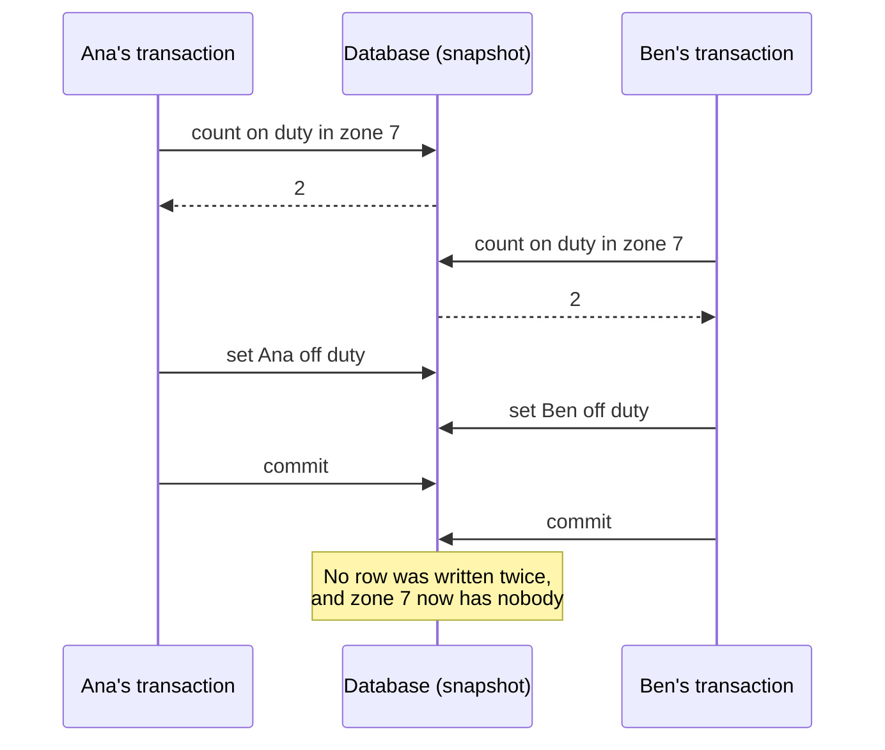

# 4 — Transactions and isolation

A rider pays for a trip and three balances change. If the process dies after the second update, money has vanished, and if two pieces of code do this at once, money can appear from nowhere with every statement individually correct. A transaction is the abstraction that makes those problems someone else's. It lets you pretend that a group of reads and writes is one step that either happened or did not, with nobody else running at the same time. The first half of that pretence is cheap and nearly always true. The second half has a price, so databases offer it in grades, and those grades are named so badly that people run for years on a weaker one than they think. This chapter makes each grade fail on a real database, so that you can recognise the failure when it shows up in a pipeline.

This chapter follows [*Designing Data-Intensive Applications*](https://dataintensive.net/) (ch. 7, pp. 221-268). The code starts on SQLite and then moves to a real PostgreSQL server, using the `pgserver` package, which ships the binaries so nothing has to be installed: `uv run --no-project --python 3.12 --with pgserver --with 'psycopg[binary]' python 04_transactions_and_isolation.py`. Two connections are interleaved step by step, so each anomaly happens every time rather than once in a blue moon.

## What a transaction promises

Transactions were not discovered in nature. They were designed to simplify the programming model, so that an application can ignore a large class of errors and leave them to the database (p. 222). The acronym that describes them, ACID, dates from 1983 and has drifted into a marketing term, because implementations mean different things by it (pp. 223-224). It is worth decoding one letter at a time.

**Atomicity** is not about concurrency. It means that if a sequence of writes cannot finish, because of a crash or a full disk or a broken connection, the database discards what it had done. Kleppmann says *abortability* would have been the better word (p. 224). Here is the rider paying, with a crash between the driver's credit and the platform's.

```python
import sqlite3

db = sqlite3.connect("wallet.db", isolation_level=None)   # we issue BEGIN ourselves
db.execute("create table wallet(owner text primary key, cents int check (cents >= 0))")

def reset():
    db.execute("delete from wallet")
    db.execute("insert into wallet values ('rider', 5000), ('driver', 0), ('platform', 0)")

def pay_trip(fare, *, crash, atomic):
    """Rider pays; the driver and the platform each get a share. Three writes, one fact."""
    if atomic:
        db.execute("begin")
    try:
        db.execute("update wallet set cents = cents - ? where owner='rider'", (fare,))
        db.execute("update wallet set cents = cents + ? where owner='driver'", (fare * 8 // 10,))
        if crash:
            raise ConnectionError("process died here")
        db.execute("update wallet set cents = cents + ? where owner='platform'", (fare * 2 // 10,))
        if atomic:
            db.execute("commit")
    except ConnectionError:
        if atomic:
            db.execute("rollback")

def show(label):
    rows = dict(db.execute("select owner, cents from wallet"))
    print(f"{label:<28} {rows}  total={sum(rows.values())}")

reset(); pay_trip(2000, crash=True, atomic=False); show("crash, no transaction")
reset(); pay_trip(2000, crash=True, atomic=True);  show("crash, in a transaction")
reset(); pay_trip(2000, crash=False, atomic=True); show("no crash")
```

```text
crash, no transaction        {'rider': 3000, 'driver': 1600, 'platform': 0}  total=4600
crash, in a transaction      {'rider': 5000, 'driver': 0, 'platform': 0}  total=5000
no crash                     {'rider': 3000, 'driver': 1600, 'platform': 400}  total=5000
```

Without a transaction, 400 cents have left the system and nothing records where they should have gone. Worse, you cannot simply rerun the payment, because the rider has already been charged. With a transaction the failure takes you back to a state you can retry from, and that is the real benefit: an error becomes safe to handle by trying again.

**Consistency** is the odd one out. Here it means that invariants hold, such as credits equalling debits, and the book points out that the word has at least four unrelated meanings in this field (p. 224). A database can check a few invariants, through foreign keys and constraints, but in general only the application knows them. So C belongs to the application, while A, I and D are what the database provides (p. 225).

**Isolation** means concurrent transactions do not step on each other. In the textbook definition that is serializability: the result is as if they had run one at a time (p. 225). The rest of this chapter is about how rarely you actually get that.

**Durability** means committed data survives, which on one node means a write-ahead log and on several means replicas. Nothing makes that absolute: disks develop bad blocks, and `fsync` has been known to lie (pp. 226-227).

One practical warning before moving on. Retrying an aborted transaction is the whole point, but it has edge cases (p. 232). The commit may have succeeded and only its acknowledgement been lost, so a retry applies it twice; a retry during overload adds load; a permanent error will never succeed; and a side effect outside the database, like an email, will happen again. The first case is real enough to demonstrate.

## Two writers, one row

SQLite is the easiest place to see the problem, since it is on every machine and has a simple answer to concurrency.

```python
a = sqlite3.connect("serial.db", isolation_level=None, timeout=0)
b = sqlite3.connect("serial.db", isolation_level=None, timeout=0)
a.execute("pragma journal_mode=wal")
a.execute("create table driver(id int primary key, trips int)")
a.execute("insert into driver values (7, 100)")

# 1. Read-modify-write in application code, with no transaction: a lost update.
ta = a.execute("select trips from driver where id=7").fetchone()[0]
tb = b.execute("select trips from driver where id=7").fetchone()[0]
a.execute("update driver set trips=? where id=7", (ta + 1,))
b.execute("update driver set trips=? where id=7", (tb + 1,))
print("no transaction, two increments:", b.execute("select trips from driver").fetchone()[0])

# 2. Two deferred transactions: both read from a snapshot, the second writer loses.
a.execute("begin"); b.execute("begin")
ta = a.execute("select trips from driver where id=7").fetchone()[0]
tb = b.execute("select trips from driver where id=7").fetchone()[0]
a.execute("update driver set trips=? where id=7", (ta + 1,)); a.execute("commit")
try:
    b.execute("update driver set trips=? where id=7", (tb + 1,))
except sqlite3.OperationalError as e:
    print("second writer, stale snapshot:", e)
    b.execute("rollback")

# 3. BEGIN IMMEDIATE takes the single write lock up front, so writers run in series.
a.execute("begin immediate")
try:
    b.execute("begin immediate")
except sqlite3.OperationalError as e:
    print("second BEGIN IMMEDIATE:       ", e)
a.execute("commit")
```

```text
no transaction, two increments: 101
second writer, stale snapshot: database is locked
second BEGIN IMMEDIATE:        database is locked
```

Three things happened there. With no transaction around it, two increments of 100 produced 101. That is a **lost update**, caused entirely by application code reading a value, computing, and writing it back. Inside a transaction, the second writer was refused, because its snapshot was older than the commit it would have overwritten. And `BEGIN IMMEDIATE` shows SQLite's whole approach: it permits one writer at a time ([isolation in SQLite](https://www.sqlite.org/isolation.html)). This is the simplest possible form of serializability, and we will come back to it. A busy server cannot be that blunt, which is why it offers weaker levels, so for those we need a real one.

```python
import sys, tempfile, threading, time
try:
    import pgserver, psycopg
    from psycopg import IsolationLevel as Iso, errors
except ImportError:
    sys.exit("The rest needs Postgres: run with --python 3.12 --with pgserver --with 'psycopg[binary]'")

pg = pgserver.get_server(tempfile.mkdtemp())

def connect(level=Iso.READ_COMMITTED, autocommit=False):
    conn = psycopg.connect(pg.get_uri(), autocommit=autocommit)
    conn.isolation_level = level
    return conn

def admin(sql):
    with connect(autocommit=True) as c:
        c.execute(sql)

def one(conn, sql, *args):
    return conn.execute(sql, args).fetchone()[0]

with connect() as c:
    print(one(c, "select version()").split(",")[0])
    print("default isolation:", one(c, "show transaction_isolation"))
```

```text
PostgreSQL 16.2 on aarch64-apple-darwin23.5.0
default isolation: read committed
```

Note the default. Postgres gives you read committed unless you ask for something else, as do Oracle 11g and SQL Server 2012 (p. 236). If nobody has set your isolation level, you are probably running at the level that the next two sections break.

## Read committed and its limits

Read committed makes exactly two promises: you read only committed data, so there are no **dirty reads**, and you overwrite only committed data, so there are no **dirty writes** (p. 234). Most databases implement the first by remembering the old committed value and giving it to readers until the writer commits (p. 237). That stops a reader from seeing half of a transaction.

It does not stop a reader seeing the database change underneath it.

```python
admin("""drop table if exists account;
         create table account(owner text primary key, cents int);
         insert into account values ('driver', 50000), ('savings', 50000)""")

# Dirty read: asking for READ UNCOMMITTED in Postgres gets you READ COMMITTED.
w = connect(); r = connect(Iso.READ_UNCOMMITTED)
w.execute("update account set cents = cents - 10000 where owner='driver'")
print("uncommitted write, other session reads:", one(r, "select cents from account where owner='driver'"))
w.rollback(); r.rollback()

def total_seen_during_transfer(level):
    reader, writer = connect(level), connect()
    first = one(reader, "select cents from account where owner='driver'")
    writer.execute("update account set cents = cents - 10000 where owner='driver'")
    writer.execute("update account set cents = cents + 10000 where owner='savings'")
    writer.commit()
    second = one(reader, "select cents from account where owner='savings'")
    reader.rollback()
    admin("update account set cents = 50000")
    return first + second

print("true total: 100000")
print("read committed sees:  ", total_seen_during_transfer(Iso.READ_COMMITTED))
print("repeatable read sees: ", total_seen_during_transfer(Iso.REPEATABLE_READ))
```

```text
uncommitted write, other session reads: 50000
true total: 100000
read committed sees:   110000
repeatable read sees:  100000
```

Postgres accepts `READ UNCOMMITTED` as a level, and then behaves as read committed, as its [documentation](https://www.postgresql.org/docs/current/transaction-iso.html) says, so the other session saw the committed 50,000. Then a driver moved 10,000 cents between two accounts while a reader was summing them. Each query saw committed data, and the total came out 10,000 too high. This is **read skew**, or a nonrepeatable read (pp. 237-238). In an app, a refresh fixes it. In data work it does not, because the book's list of things that cannot tolerate it is a list of data engineering tasks: a backup, an analytic query that touches much of the database, a periodic integrity check (p. 238). A data quality test that compares two tables under read committed can fail, or worse pass, because of what was committed between the two reads.

The fix is **snapshot isolation**, which Postgres calls repeatable read: every query in the transaction sees the database as of the transaction's start.

## How snapshots work: row versions

The implementation is worth seeing, because the same idea reappears at file scale in table formats. In multi-version concurrency control, writes never destroy a row. An update marks the old version as deleted by this transaction, and creates a new version, so readers never block writers and writers never block readers (pp. 239-241). Postgres exposes the bookkeeping as hidden columns: `xmin` is the transaction that created this version, `xmax` the one that deleted it, and `ctid` its physical location.

```python
admin("""drop table if exists fare;
         create table fare(zone int primary key, cents int);
         insert into fare values (7, 1200)""")
VERSION = "select xmin::text, xmax::text, ctid::text, cents from fare where zone=7"

old_view = connect(Iso.REPEATABLE_READ); writer = connect(); other = connect()
print("before            ", old_view.execute(VERSION).fetchone())
writer.execute("update fare set cents = 1500 where zone=7")
print("writer sees       ", writer.execute(VERSION).fetchone())
print("others, uncommitted", other.execute(VERSION).fetchone()); other.rollback()
writer.commit()
print("others, committed ", other.execute(VERSION).fetchone()); other.rollback()
print("old snapshot      ", old_view.execute(VERSION).fetchone()); old_view.rollback()

# Each update writes a new row version, so the table grows until vacuum reclaims the old ones.
with connect(autocommit=True) as c:
    size = lambda: one(c, "select pg_relation_size('fare')")
    print("table bytes before updates", size())
    pin = connect(Iso.REPEATABLE_READ); one(pin, "select count(*) from fare")   # old snapshot pins versions
    for i in range(5000):
        c.execute("update fare set cents = %s where zone=7", (i,))
    print("after 5000 updates, snapshot held open", size())
    pin.rollback()
    c.execute("vacuum full fare")
    print("after vacuum full                     ", size())
```

```text
before             ('736', '0', '(0,1)', 1200)
writer sees        ('737', '0', '(0,2)', 1500)
others, uncommitted ('736', '737', '(0,1)', 1200)
others, committed  ('737', '0', '(0,2)', 1500)
old snapshot       ('736', '737', '(0,1)', 1200)
table bytes before updates 8192
after 5000 updates, snapshot held open 188416
after vacuum full                      8192
```

Follow the `ctid`. The update wrote a second row version at `(0,2)` and left the first at `(0,1)`, stamped with `xmax` set to the writer's ID. While the writer is uncommitted, everyone else still reads the old version. After commit, a new transaction sees the new one, while the old snapshot, which began before the writer, carries on seeing 1200. Nothing was locked and nobody waited. Visibility is a rule evaluated per row version against a transaction's snapshot (p. 241).

The cost is at the bottom of the output. The row was updated 5000 times while a transaction held an old snapshot open, so every version had to be kept, and an 8 KB table grew to about 188 KB. Garbage collection reclaims versions once no transaction can see them (p. 240). One idle analytics session holding a snapshot open for hours can therefore bloat a busy OLTP database, which is a good reason not to run long warehouse extracts against a primary.

Now scale the idea up. The book describes append-only B-trees, where a commit writes a new root and the root *is* a consistent snapshot of the database at that moment (p. 242). A [table format](../../04-warehouse-lakehouse-streaming/notes/02-table-formats.md) is the same design built out of immutable files. Parquet files are never edited, a commit publishes a new snapshot, and readers keep using the snapshot they started with. Time travel and vacuum in Iceberg or Delta are row-version visibility and garbage collection, at the level of files instead of rows.

## Lost updates

Snapshots fix reads. Two writers still have a problem whenever each reads a value, changes it and writes it back, because the later write clobbers the earlier (p. 243). Here is the race, one step at a time.

```python
admin("""drop table if exists driver;
         create table driver(id int primary key, trips int);
         insert into driver values (7, 100)""")

def interleave(level):
    a, b = connect(level), connect(level)
    ta = one(a, "select trips from driver where id=7")
    tb = one(b, "select trips from driver where id=7")
    a.execute("update driver set trips=%s where id=7", (ta + 1,)); a.commit()
    try:
        b.execute("update driver set trips=%s where id=7", (tb + 1,)); b.commit()
        outcome = "both committed"
    except errors.SerializationFailure as e:
        b.rollback(); outcome = f"second aborted: {str(e).strip()}"
    with connect() as c:
        result = one(c, "select trips from driver where id=7")
    admin("update driver set trips = 100")
    return result, outcome

print("read committed: ", interleave(Iso.READ_COMMITTED))
print("repeatable read:", interleave(Iso.REPEATABLE_READ))
```

```text
read committed:  (101, 'both committed')
repeatable read: (101, 'second aborted: could not serialize access due to concurrent update')
```

Under read committed, two increments produced 101, and both transactions reported success. Under repeatable read, Postgres noticed that the row had changed since the snapshot and aborted the second writer. This automatic detection is a real advantage of Postgres, Oracle's serializable and SQL Server's snapshot level, and MySQL's InnoDB repeatable read does not do it (p. 245), which is one concrete way in which the same level name means different things on different engines.

The book lists the ways to prevent it (pp. 243-246). Here are all of them under contention, with 8 threads each making 150 increments.

```python
def increment_rmw(c):
    t = one(c, "select trips from driver where id=7")
    c.execute("update driver set trips=%s where id=7", (t + 1,))

def increment_atomic(c):
    c.execute("update driver set trips = trips + 1 where id=7")

def increment_lock(c):
    t = one(c, "select trips from driver where id=7 for update")
    c.execute("update driver set trips=%s where id=7", (t + 1,))

def increment_cas(c):
    while True:
        t = one(c, "select trips from driver where id=7")
        if c.execute("update driver set trips=%s where id=7 and trips=%s", (t + 1, t)).rowcount == 1:
            return
        c.commit()

THREADS, EACH = 8, 150

def run(fn, level=Iso.READ_COMMITTED):
    admin("update driver set trips = 0")
    retries = [0]
    def worker():
        with connect(level) as c:
            for _ in range(EACH):
                while True:
                    try:
                        fn(c); c.commit(); break
                    except errors.SerializationFailure:
                        c.rollback(); retries[0] += 1
    t0 = time.perf_counter()
    pool = [threading.Thread(target=worker) for _ in range(THREADS)]
    [t.start() for t in pool]; [t.join() for t in pool]
    with connect() as c:
        return one(c, "select trips from driver where id=7"), retries[0], time.perf_counter() - t0

print(f"expected {THREADS * EACH}")
for name, fn, level in [("read-then-write, read committed", increment_rmw, Iso.READ_COMMITTED),
                        ("atomic update", increment_atomic, Iso.READ_COMMITTED),
                        ("select for update", increment_lock, Iso.READ_COMMITTED),
                        ("compare-and-set", increment_cas, Iso.READ_COMMITTED),
                        ("read-then-write, repeatable read", increment_rmw, Iso.REPEATABLE_READ)]:
    final, retries, secs = run(fn, level)
    print(f"{name:<34} final={final:>5}  retries={retries:>5}  {secs:5.2f} s")
```

```text
expected 1200
read-then-write, read committed    final=  172  retries=    0   0.10 s
atomic update                      final= 1200  retries=    0   0.08 s
select for update                  final= 1200  retries=    0   0.10 s
compare-and-set                    final= 1200  retries=    0   0.58 s
read-then-write, repeatable read   final= 1200  retries= 4240   1.02 s
```

The naive version lost most of the increments, and it did so while every transaction committed cleanly and no error appeared in any log. The atomic update is fastest and simplest, and it is the right answer whenever the change can be expressed in one statement. `SELECT ... FOR UPDATE` works whenever you need logic between the read and the write. Compare-and-set and repeatable read both get the correct answer, but they pay for it with retry loops; note the thousands of retries on the single hot row. One more caution applies from the book: these techniques assume a single up-to-date copy. With multi-leader or leaderless replication there is no such copy, so locks and compare-and-set do not apply (p. 246), a point the [replication chapter](05-partitioning-and-replication.md) picks up.

The compare-and-set line is worth remembering when you reach table formats, since an Iceberg commit is exactly that pattern: read the current snapshot, write new files, then swap the catalog pointer only if it has not moved, and retry if it has ([Iceberg spec](https://iceberg.apache.org/spec/)).

## Write skew

This is the anomaly that snapshot isolation does not catch and that most people have never heard of. The book's example is doctors on call (pp. 246-247). Ours: zone 7 must keep at least one driver on duty, so a driver may sign off only if at least two are on duty. Ana and Ben both tap the button at once.



```python
admin("""drop table if exists duty;
         create table duty(driver text primary key, zone int, on_duty boolean);
         insert into duty values ('Ana', 7, true), ('Ben', 7, true)""")

def sign_off(conn, name):
    """Rule: zone 7 must keep at least one driver on duty."""
    if one(conn, "select count(*) from duty where zone=7 and on_duty") >= 2:
        conn.execute("update duty set on_duty=false where driver=%s", (name,))

def both_sign_off(level):
    admin("update duty set on_duty=true")
    a, b = connect(level), connect(level)
    result = []
    sign_off(a, "Ana"); sign_off(b, "Ben")          # each sees two on duty
    for name, c in (("Ana", a), ("Ben", b)):
        try:
            c.commit(); result.append(f"{name} committed")
        except errors.SerializationFailure as e:
            result.append(f"{name} aborted: {str(e).splitlines()[0]}")
    with connect() as c:
        left = one(c, "select count(*) from duty where on_duty")
    return left, result

for name, level in [("read committed", Iso.READ_COMMITTED), ("repeatable read", Iso.REPEATABLE_READ),
                    ("serializable", Iso.SERIALIZABLE)]:
    left, result = both_sign_off(level)
    print(f"{name:<16} on duty afterwards={left}  {result}")
```

```text
read committed   on duty afterwards=0  ['Ana committed', 'Ben committed']
repeatable read  on duty afterwards=0  ['Ana committed', 'Ben committed']
serializable     on duty afterwards=1  ['Ana committed', 'Ben aborted: could not serialize access due to read/wr ...
```

Read that middle line twice. Repeatable read is the level many people assume is safe, and it let both commit and left the zone empty, without any error, because the two transactions wrote different rows and so nothing conflicted. Only serializable caught it. The anomaly is a generalised lost update: two transactions read the same data and then each write something different (p. 248). The pattern is always the same three steps (pp. 250-251): a `SELECT` checks a condition, the application decides, and a write changes the condition that was checked. Bookings, usernames, double spending and game moves all have this shape (pp. 249-250).

If you are not on serializable, explicitly lock the rows the decision depends on (p. 248).

```python
def sign_off_locked(name, started, results):
    with connect() as c:
        rows = c.execute("select driver from duty where zone=7 and on_duty for update").fetchall()
        started.set()
        if len(rows) >= 2:
            time.sleep(0.2)                         # hold the locks while "thinking"
            c.execute("update duty set on_duty=false where driver=%s", (name,))
            results.append(f"{name} signed off")
        else:
            results.append(f"{name} refused: only {len(rows)} on duty")

admin("update duty set on_duty=true")
started, results = threading.Event(), []
first = threading.Thread(target=sign_off_locked, args=("Ana", started, results))
first.start(); started.wait()
second = threading.Thread(target=sign_off_locked, args=("Ben", threading.Event(), results))
second.start(); first.join(); second.join()
print(results)
with connect() as c:
    print("on duty afterwards:", one(c, "select count(*) from duty where on_duty"))
```

```text
['Ana signed off', 'Ben refused: only 1 on duty']
on duty afterwards: 1
```

Ben's query waited for Ana's commit, and then Postgres re-evaluated its `WHERE` clause against the latest row and returned only one driver, so he was refused. That works here because the decision depends on rows that exist.

## Phantoms

What if the decision depends on a row *not* existing? A booking system checks that no one has the vehicle at 10:00, then inserts. There is nothing to lock.

```python
admin("""drop table if exists booking;
         create table booking(vehicle int, hour int, rider text)""")

def book(c, rider):
    free = not c.execute("select 1 from booking where vehicle=9 and hour=10 for update").fetchall()
    if free:
        c.execute("insert into booking values (9, 10, %s)", (rider,))

for name, level in [("read committed, for update", Iso.READ_COMMITTED),
                    ("repeatable read, for update", Iso.REPEATABLE_READ), ("serializable", Iso.SERIALIZABLE)]:
    admin("truncate booking")
    a, b = connect(level), connect(level)
    try:
        book(a, "Rae"); book(b, "Sam"); a.commit(); b.commit(); note = "both committed"
    except errors.SerializationFailure:
        a.rollback(); b.rollback(); note = "second aborted"
    with connect() as c:
        print(f"{name:<28} bookings for the slot={one(c, 'select count(*) from booking')}  {note}")

# A unique constraint turns the absence of a row into something the database can check.
admin("truncate booking; alter table booking add constraint one_per_slot unique (vehicle, hour)")
a, b = connect(), connect()
a.execute("insert into booking values (9, 10, 'Rae')"); a.commit()
try:
    b.execute("insert into booking values (9, 10, 'Sam')"); b.commit()
except errors.UniqueViolation as e:
    b.rollback(); print("unique constraint:", str(e).splitlines()[0])

# An exclusion constraint does the same for overlapping ranges.
admin("""drop table if exists booking2;
         create table booking2(vehicle int, during int4range,
             exclude using gist (during with &&) where (vehicle = 9))""")
a, b = connect(), connect()
a.execute("insert into booking2 values (9, '[10,12)')"); a.commit()
try:
    b.execute("insert into booking2 values (9, '[11,13)')"); b.commit()
except errors.ExclusionViolation as e:
    b.rollback(); print("exclusion constraint:", str(e).splitlines()[0])
```

```text
read committed, for update   bookings for the slot=2  both committed
repeatable read, for update  bookings for the slot=2  both committed
serializable                 bookings for the slot=1  second aborted
unique constraint: duplicate key value violates unique constraint "one_per_slot"
exclusion constraint: conflicting key value violates exclusion constraint "booking2_during_excl"
```

`FOR UPDATE` returned no rows and so locked nothing, and both riders got the vehicle. A write in one transaction changing the result of a search in another is a **phantom** (p. 251). Serializable handles it. So does a constraint, which is often the better answer: a unique index turns "no row exists" into something the database can enforce. An exclusion constraint does the same thing for overlapping ranges, so it is the natural way to express a booking. (Normally you would include the vehicle in the constraint using the `btree_gist` extension. `pgserver` does not bundle it, so the example uses a partial constraint.) The book also describes materialising conflicts, where you pre-create a row per slot just to have something to lock, and treats it as a last resort (p. 251).

| Anomaly | What happens | Read committed | Repeatable read (Postgres) | Serializable |
|---|---|---|---|---|
| Dirty read | See another transaction's uncommitted write | Prevented | Prevented | Prevented |
| Dirty write | Overwrite another's uncommitted write | Prevented | Prevented | Prevented |
| Read skew | See different parts of the database at different times | **Happens** | Prevented | Prevented |
| Lost update | Read-modify-write overwrites a concurrent write | **Happens** | Aborted, on Postgres | Prevented |
| Write skew | Decide from a read that a concurrent write invalidates | **Happens** | **Happens** | Aborted |
| Phantom write skew | Same, about rows that do not exist yet | **Happens** | **Happens** | Aborted |

Every bold cell, and each abort, ran above on Postgres 16. The book's summary (pp. 266-267) applies across engines, but level names do not translate. Oracle 11g's "serializable" is really snapshot isolation (p. 226), so always test the anomaly you care about rather than trusting the name.

## Three ways to actually be serializable

If weak isolation is so treacherous, why not always use serializable? There are three implementations (p. 252), and each has a cost.

**Run them one at a time.** This sounds hopeless, but cheap RAM and short transactions made it viable around 2007, as in VoltDB and Redis (p. 253). It requires transactions to be short, usually via stored procedures with no waiting on a client, so that one slow transaction does not stall the rest (pp. 254-255). It is SQLite's approach, as shown above with `BEGIN IMMEDIATE`, and it is why a SQLite or DuckDB file is a fine answer for a single-writer pipeline step.

**Two-phase locking** was the only widely used algorithm for around 30 years. Readers block writers and writers block readers, unlike snapshot isolation (pp. 257-258). The trouble is performance: latency gets unstable, and it is at its worst at high percentiles, since one slow transaction can make everything wait (p. 259). Locks also mean deadlocks. Note that two-phase locking has nothing to do with [two-phase commit](07-consistency-and-consensus.md), despite the name (p. 257).

```python
admin("update driver set trips=0 where id=7; insert into driver values (8, 0) on conflict do nothing")
outcome, barrier = [], threading.Barrier(2)

def transfer(first, second):
    with connect() as c:
        try:
            c.execute("update driver set trips=trips+1 where id=%s", (first,))
            barrier.wait()                         # both now hold one row and want the other
            c.execute("update driver set trips=trips+1 where id=%s", (second,))
            c.commit(); outcome.append("committed")
        except errors.DeadlockDetected as e:
            c.rollback(); outcome.append(str(e).splitlines()[0])

t0 = time.perf_counter()
pool = [threading.Thread(target=transfer, args=args) for args in [(7, 8), (8, 7)]]
[t.start() for t in pool]; [t.join() for t in pool]
print(outcome, f"resolved after {time.perf_counter() - t0:.1f} s")
```

```text
['deadlock detected', 'committed'] resolved after 1.0 s
```

Postgres noticed the cycle and killed one transaction, about a second later because that is its default `deadlock_timeout`. Your code must retry, and the wait shows up as tail latency.

**Serializable snapshot isolation** (SSI), from 2008, is optimistic (p. 261). Transactions run on a snapshot, without blocking, while the database tracks which reads a concurrent write has invalidated. At commit, a transaction whose premise has become false is aborted (pp. 262-265). That is what produced the "read/write dependencies" error earlier. Postgres has used it since 9.1, as [Ports and Grittner describe](https://arxiv.org/abs/1208.4179). The cost, as with any optimistic scheme, is aborts under contention (pp. 262, 266), which the next test measures.

```python
admin("""drop table if exists zone_count;
         create table zone_count(zone int primary key, trips int);
         insert into zone_count select g, 0 from generate_series(1, 1000) g""")

def hammer(level, zones, workers=8, each=100):
    """Read a zone, then write it. A narrow zones range means high contention."""
    admin("update zone_count set trips=0")
    aborts, commits, lock = [0], [0], threading.Lock()
    def worker(seed):
        import random
        rnd = random.Random(seed)
        with connect(level) as c:
            for _ in range(each):
                z = rnd.randrange(1, zones + 1)
                while True:
                    try:
                        t = one(c, "select trips from zone_count where zone=%s", z)
                        c.execute("update zone_count set trips=%s where zone=%s", (t + 1, z))
                        c.commit()
                        with lock: commits[0] += 1
                        break
                    except errors.SerializationFailure:
                        c.rollback()
                        with lock: aborts[0] += 1
    t0 = time.perf_counter()
    pool = [threading.Thread(target=worker, args=(i,)) for i in range(workers)]
    [t.start() for t in pool]; [t.join() for t in pool]
    return commits[0], aborts[0], time.perf_counter() - t0

for zones in (1, 10, 1000):
    commits, aborts, secs = hammer(Iso.SERIALIZABLE, zones)
    print(f"serializable, {zones:>4} hot rows: {commits} commits, {aborts:>5} aborts"
          f" ({aborts / (commits + aborts):4.0%} of attempts), {commits / secs:6.0f} commits/s")
```

```text
serializable,    1 hot rows: 800 commits,  2800 aborts ( 78% of attempts),   1270 commits/s
serializable,   10 hot rows: 800 commits,   316 aborts ( 28% of attempts),   3528 commits/s
serializable, 1000 hot rows: 800 commits,    47 aborts (  6% of attempts),   4911 commits/s
```

On one hot row, most attempts abort and throughput falls. Spread the work and the aborts fall away. They do not reach zero though, even though collisions on a thousand rows should be rare, because tracking is coarser than a single row. Predicate locks can be held at tuple, page or relation level, and the [Postgres documentation](https://www.postgresql.org/docs/current/transaction-iso.html) warns that a sequential scan needs a relation-level lock and raises the failure rate. So a serializable system pairs well with short transactions and indexes, and any code using it **must** have a retry loop, since a serialization failure is a normal outcome rather than an error to report.

## What this means for a pipeline

A warehouse rarely gives you row-level serializable transactions, but the anomalies do not go away. They move to a different scale.

**The retry needs an identity.** Back to the lost acknowledgement (p. 232). A client whose commit succeeded but whose reply vanished will retry, and the database cannot tell that this is the same request unless the client says so.

```python
admin("""drop table if exists charge;
         create table charge(request_id text unique, rider text, cents int)""")

def charge(conn, request_id, cents, ack_lost):
    conn.execute("insert into charge values (%s, 'Rae', %s) on conflict (request_id) do nothing",
                 (request_id, cents))
    conn.commit()
    if ack_lost:
        raise ConnectionError("commit succeeded, reply never arrived")

def pay_with_retry(request_id_for):
    with connect() as c:
        for attempt in range(2):
            try:
                charge(c, request_id_for(attempt), 2000, ack_lost=attempt == 0)
                break
            except ConnectionError:
                pass
        total = one(c, "select sum(cents) from charge")
        c.rollback()
    admin("truncate charge")
    return total

print("new id on each retry:    charged", pay_with_retry(lambda attempt: f"req-{attempt}"))
print("same id on each retry:   charged", pay_with_retry(lambda attempt: "req-1"))
```

```text
new id on each retry:    charged 4000
same id on each retry:   charged 2000
```

A unique request ID, stored in the same transaction as the write, makes a retry harmless. The book returns to this in its last chapter as the end-to-end argument (ch. 12, pp. 518-519). It is the same mechanism as an idempotent [`MERGE` on a business key](../../03-transform-and-orchestrate/notes/04-idempotency-and-backfills.md), and as [Kafka's idempotent producer](../../04-warehouse-lakehouse-streaming/notes/04-kafka-and-stream-semantics.md).

**Readers see your load.** A partition rebuild that commits between the delete and the insert leaves a window in which dashboards read nothing.

```python
admin("""drop table if exists fct_trip;
         create table fct_trip(day date, fare int);
         insert into fct_trip select '2026-01-01', 1 from generate_series(1, 100000)""")
reader = connect(autocommit=True)
COUNT = "select count(*), sum(fare) from fct_trip where day='2026-01-01'"

# Reload the partition with a commit between delete and insert.
w = connect()
w.execute("delete from fct_trip where day='2026-01-01'"); w.commit()
print("two commits, reader sees:", reader.execute(COUNT).fetchone())
w.execute("insert into fct_trip select '2026-01-01', 2 from generate_series(1, 100000)"); w.commit()

# Reload the same partition in one transaction.
w.execute("delete from fct_trip where day='2026-01-01'")
print("one transaction, during: ", reader.execute(COUNT).fetchone())
w.execute("insert into fct_trip select '2026-01-01', 3 from generate_series(1, 100000)")
print("one transaction, still:  ", reader.execute(COUNT).fetchone())
w.commit()
print("one transaction, after:  ", reader.execute(COUNT).fetchone())
w.close(); reader.close()
pg.cleanup()
```

```text
two commits, reader sees: (0, None)
one transaction, during:  (100000, 200000)
one transaction, still:   (100000, 200000)
one transaction, after:   (100000, 300000)
```

The first reader saw an empty day. In the second run, a concurrent reader kept seeing the old rows until commit and then all the new ones, and nothing in between. Atomicity across several statements is what makes a replace safe, and it is why [dbt's incremental strategies](../../03-transform-and-orchestrate/notes/03-dbt-tests-snapshots-incremental.md) and warehouse `INSERT OVERWRITE` are written the way they are. In a warehouse without multi-statement transactions, or on bare Parquet files, that window is yours to manage, which is the problem [table formats](../../04-warehouse-lakehouse-streaming/notes/02-table-formats.md) were built to solve.

**Concurrent writers are the warehouse's lost update.** Two backfills overlapping on one table, or a compaction running alongside an ingest, are the same race. Table formats handle them optimistically, so a failed commit is normal and needs a retry, exactly like the SSI loop. [Delta's concurrency documentation](https://docs.delta.io/latest/concurrency-control.html) lists which pairs of operations can conflict. The orchestrator's [one-at-a-time setting](../../03-transform-and-orchestrate/notes/05-dagster-and-airflow.md) for a table is the serial-execution answer, applied at job scale.

**The orchestrator is a database application too.** A scheduler's record of what ran, and the rule that stops two schedulers launching the same task, live in a metadata database and rely on the mechanisms in this chapter. The [consensus chapter](07-consistency-and-consensus.md) returns to this.

The final limit is that everything here assumes one database. A transaction that spans partitions or systems is much harder, and the next chapters show why. [Replication](05-partitioning-and-replication.md) comes first, then [what goes wrong across machines](06-when-distributed-systems-fail.md), then [atomic commit across them](07-consistency-and-consensus.md).

## Pitfalls

- **Trusting the name of an isolation level.** Oracle's serializable is snapshot isolation, and MySQL's repeatable read does not detect lost updates. Test the anomaly you care about.
- **Read-modify-write in application code.** Object-relational mappers make it easy to write by accident, and it loses data with no error (p. 244). Prefer a single atomic statement.
- **Assuming repeatable read stops write skew.** It does not. If a decision depends on a read, lock those rows, add a constraint or use serializable.
- **Serializable without a retry loop.** Aborts are the mechanism, so unhandled ones become user-facing errors.
- **Retrying without a request ID.** A lost acknowledgement turns a retry into a double charge.
- **Long transactions on a primary.** A forgotten snapshot pins old row versions and bloats tables. Run extracts from a replica, or better, from change data capture.
- **Testing concurrency without forcing interleavings.** Races are rare at low load, so a test that simply runs twice proves little. Use two connections and step through them, as above.
- **Assuming `TRUNCATE` behaves like `DELETE`.** It takes a strong lock and blocks readers, and the [Postgres documentation](https://www.postgresql.org/docs/current/mvcc-caveats.html) notes that it is not MVCC-safe, so a concurrent snapshot can see the table as empty.

## Try it

The code in this chapter is collected in [practice/04_transactions_and_isolation.py](../practice/04_transactions_and_isolation.py).

1. In the stress test, run `increment_rmw` under `Iso.SERIALIZABLE`. What are the final count and the retry count, and how do they compare with repeatable read?

<details><summary>Answer</summary>

The final count is correct at 1200, with thousands of retries, close to the repeatable read result. On one row, both levels resolve the same conflict by aborting and retrying, so the cost is similar. Serializable costs you more when transactions read and write different rows, which is the case repeatable read misses.

</details>

2. Change `sign_off_locked` to connect at `Iso.REPEATABLE_READ`. Ben's query still waits for Ana. What happens when she commits?

<details><summary>Answer</summary>

Ben does not get a refusal this time. He gets `could not serialize access due to concurrent update`, because a repeatable read transaction cannot lock a row that changed after its snapshot. The invariant still holds, with one driver left on duty, but your code now has to retry rather than read a new count.

</details>

3. In `load_swap`, replace the `delete` with `truncate fct_trip` inside the transaction, and set `lock_timeout` to 200 ms on the reader. What does the reader see during the load?

<details><summary>Answer</summary>

It sees neither old nor new rows, and fails with `canceling statement due to lock timeout`. `TRUNCATE` takes an `ACCESS EXCLUSIVE` lock until commit, so without a timeout every reader would queue behind your load. A faster command made the pipeline less available.

</details>

## Interview checklist

| Question | Answer |
|---|---|
| What does the A in ACID really mean? | Abortability. If a group of writes cannot finish, they are all discarded, so the client can safely retry. It says nothing about concurrency. |
| What does the C mean? | Application invariants. The database can check some through constraints, but it is the application's property, unlike A, I and D. |
| Read committed vs snapshot isolation? | Read committed takes a new snapshot per statement, so a transaction can see different states (read skew). Snapshot isolation fixes one snapshot for the whole transaction. |
| How does MVCC work? | An update creates a new row version and marks the old one deleted, tagged with transaction IDs. Readers pick the version visible to their snapshot, so readers and writers do not block one another. |
| What is a lost update, and how do you stop it? | Two read-modify-write cycles where the later overwrites the earlier. Use an atomic update, `SELECT FOR UPDATE`, compare-and-set, or automatic detection under snapshot isolation. |
| What is write skew? | Two transactions read the same data, then write different rows, and together break an invariant neither broke alone. Snapshot isolation allows it. Use serializable, explicit locks or a constraint. |
| What is a phantom? | A write that changes the result of another transaction's search. Locks cannot help when the row does not exist yet, so use a constraint or serializable. |
| Name the three ways to get serializability. | Actual serial execution, two-phase locking, and serializable snapshot isolation. They trade throughput limits, blocking and tail latency, and aborts under contention. |
| 2PL vs SSI? | 2PL is pessimistic and blocks readers and writers. SSI is optimistic, lets them run, and aborts at commit if a premise has been invalidated. |
| Why might a retry charge twice? | The commit can succeed with the acknowledgement lost. Store a unique request ID in the same transaction so the retry does nothing. |
| What does this have to do with a table format? | A commit is a compare-and-set on a pointer to an immutable snapshot, which gives multi-version reads and optimistic writers at file scale, so a retry on conflict is normal. |

## Next

So far everything has lived on one database. The next chapter copies and splits that data across machines, and shows that the guarantees here do not automatically come along. See [Partitioning and replication](05-partitioning-and-replication.md).
