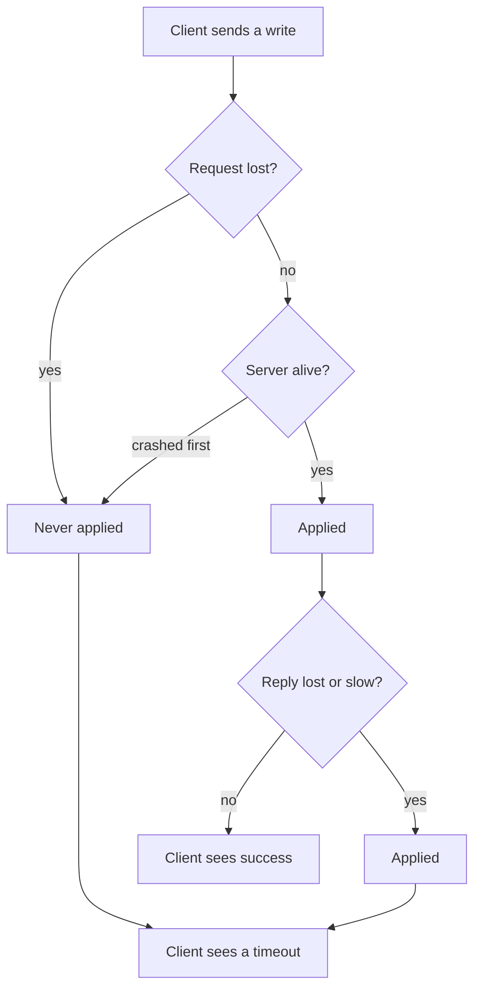

# 6 — When distributed systems fail

A worker sends a write and hears nothing back. Did the write happen? It cannot find out, and nothing it can do will settle the matter, because every way of asking is another message over the same network. On one computer a bug tends to give a crash or a repeatable wrong answer, and that determinism is so familiar that we stop noticing it. Across machines it is gone: some parts work, some do not, and no part knows for sure which. This chapter is about that uncertainty and how it leaks through tools that promise to hide it. It is a pessimistic chapter on purpose. The retries, heartbeats, attempt IDs and idempotent writes that fill the rest of this course are all responses to what happens here, and without seeing the problem they look like superstition.

This chapter follows [*Designing Data-Intensive Applications*](https://dataintensive.net/) (ch. 8, pp. 273-312). All the code here is a seeded simulation, apart from one real process pause, and runs with `uv run --with numpy python 06_when_distributed_systems_fail.py`. Simulations prove less than a real cluster does, so read each one as a calculation of a consequence, not a measurement of a system.

## Partial failure

A single computer is built to be deterministic. If something internal goes wrong, it generally prefers to crash rather than return a wrong result (p. 274). A network of computers cannot do that, since it has **partial failures**: some part is broken in an unpredictable way while the rest works fine, and an operation involving several nodes may or may not have succeeded (p. 275).

There is another option, which is to pretend otherwise. High-performance computing clusters typically checkpoint to disk, and when a node fails they stop everything and restart from the last checkpoint, turning a partial failure into a total one (pp. 275-276). Keep that in mind. Rerunning a failed batch job from the start is the same bargain, and for a batch job it can be a good one. For a large service it is not an option, because in a system of thousands of nodes something is always broken (p. 276).

The core problem is what a client sees when it sends a request over an asynchronous network (pp. 278-279).



The two routes to the bottom of that diagram look identical from the client. So how often does a timeout conceal a write that actually happened?

```python
import random

def call(rng, p_lost_request=0.02, p_lost_reply=0.02, p_slow=0.02, p_crash=0.01):
    """One request over an unreliable network. Returns (applied on server?, client saw reply?)."""
    if rng.random() < p_lost_request:
        return False, False                   # request never arrived
    if rng.random() < p_crash:
        return False, False                   # server died before doing the work
    applied = True
    if rng.random() < p_lost_reply:
        return applied, False                 # work done, reply lost
    if rng.random() < p_slow:
        return applied, False                 # work done, reply later than the timeout
    return applied, True

rng = random.Random(1)
applied_after_timeout = timed_out = ok = 0
for _ in range(100_000):
    applied, replied = call(rng)
    if replied:
        ok += 1
    else:
        timed_out += 1
        applied_after_timeout += applied
print(f"replies {ok:,}, timeouts {timed_out:,}")
print(f"of the timeouts, the write HAD been applied in {applied_after_timeout / timed_out:.0%}")
```

```text
replies 93,206, timeouts 6,794
of the timeouts, the write HAD been applied in 57%
```

With these made-up but moderate fault rates, more than half of the timeouts hide a write that succeeded. A timeout means "I do not know", and treating it as "it failed" is wrong more often than not. Notice also where the certainty has to come from. A TCP acknowledgement says only that the kernel got the bytes. If you need to know that the work happened, you need a positive reply from the application itself (p. 281).

The natural response is to retry, and the data engineering consequence is exactly what the [transactions chapter](04-transactions-and-isolation.md) warned about.

```python
def charge_all(rng, requests, max_tries, idempotent):
    """Client retries on timeout. The ledger is what the server actually recorded."""
    ledger, seen, gave_up = [], set(), 0
    for request_id in range(requests):
        for _ in range(max_tries):
            applied, replied = call(rng)
            if applied and not (idempotent and request_id in seen):
                ledger.append(request_id)
                seen.add(request_id)
            if replied:
                break
        else:
            gave_up += 1
    charged = len(ledger)
    distinct = len(set(ledger))
    return charged, distinct, gave_up

N = 100_000
for label, tries, idem in [("no retry", 1, False), ("retry 3x", 3, False), ("retry 3x, request id", 3, True)]:
    charged, distinct, gave_up = charge_all(random.Random(2), N, tries, idem)
    print(f"{label:<22} charges {charged:>7,}  duplicates {charged - distinct:>6,}"
          f"  never charged {N - distinct:>6,}  client gave up {gave_up:>5,}")
```

```text
no retry               charges  97,057  duplicates      0  never charged  2,943  client gave up 6,811
retry 3x               charges 104,129  duplicates  4,131  never charged      2  client gave up    26
retry 3x, request id   charges  99,998  duplicates      0  never charged      2  client gave up    26
```

Without retries about 3% of the riders were never charged, while the client thought 7% had failed. With retries, almost nobody is missed, at the cost of over 4,000 double charges. A request ID fixes this, and it does so without making the network any better. Most of what the industry calls exactly-once has this shape: at-least-once delivery, made harmless on the receiving side.

## Detecting faults: the timeout trade-off

The only general way to detect a dead node is that it stopped answering. How long to wait has no right answer. A short timeout declares nodes dead when they are merely slow, and that causes an operation to run twice, or load to shift onto nodes already under stress, which can cascade (p. 281). A long timeout means long waits before anyone acts.

A textbook system could guarantee a maximum delay, but real networks are asynchronous, with no upper bound on how long a packet may spend queueing in a switch, an OS, a hypervisor or TCP's own congestion control (pp. 282-283). The book's advice is to measure the round-trip distribution and choose from that (p. 284). Here is one made-up distribution: 5 ms typically, with one in a thousand requests hitting a long queue.

```python
import numpy as np
rng = np.random.default_rng(3)

# Round trip times for a healthy node: a lognormal body plus rare queueing spikes.
n = 1_000_000
rtt = rng.lognormal(np.log(5), 0.5, n)
spike = rng.random(n) < 0.001
rtt[spike] += rng.exponential(400, spike.sum())
print(f"healthy rtt  p50={np.percentile(rtt,50):5.1f} ms  p99={np.percentile(rtt,99):5.1f}"
      f"  p99.9={np.percentile(rtt,99.9):6.1f}  max={rtt.max():7.1f}")
print("timeout   healthy node wrongly declared dead, per 10,000 checks")
for timeout in (10, 25, 100, 500, 2000):
    print(f"{timeout:>5} ms   {(rtt > timeout).mean() * 10_000:>8.1f}")
```

```text
healthy rtt  p50=  5.0 ms  p99= 16.3  p99.9=  32.4  max= 2795.8
timeout   healthy node wrongly declared dead, per 10,000 checks
   10 ms      840.1
   25 ms       15.3
  100 ms        7.6
  500 ms        2.9
 2000 ms        0.1
```

No setting is clean. A 10 ms timeout, at twice the median, would falsely condemn 8% of checks. Going to 25 ms removes nearly all of that, because that was the body of the distribution, and from there you are working on the tail: 20 times more waiting, for only a halving of the false alarms. This is the same [long tail as in chapter 1](01-data-systems-and-data-models.md), now deciding whether a healthy node gets killed. Systems like Akka and Cassandra go a step further and use a phi accrual detector that adjusts to observed variability (p. 284).

Why does the network behave this way at all? A telephone circuit reserves a fixed bandwidth and has bounded delay, while a packet network shares bandwidth and gets better utilisation for bursty traffic, so queues are the price of cheap capacity (pp. 284-286). Variable delay is not a law of nature, but a cost trade-off that won't be going away.

Network faults are also not exotic. One study of a medium-sized datacenter found about 12 network faults per month, half disconnecting a single machine and half an entire rack. Redundant gear helps less than you would think, since it does not stop human error (p. 279). When part of the network is cut off from the rest, this is called a **network partition** or netsplit.

## You cannot trust the clock

Each machine has two kinds of clock, for two different jobs (pp. 287-289).

```python
import time
wall_a, mono_a = time.time(), time.monotonic()
time.sleep(0.05)
print(f"elapsed by wall clock {time.time() - wall_a:.4f} s, by monotonic clock {time.monotonic() - mono_a:.4f} s")
print("wall clock now      ", round(time.time(), 1), " seconds since 1970: comparable between machines, can jump")
print("monotonic clock now ", round(time.monotonic(), 1), " since some arbitrary point: meaningless on another machine")

drift_ppm = 200
print(f"{drift_ppm} ppm drift: {drift_ppm * 1e-6 * 30 * 1000:.0f} ms per 30 s, {drift_ppm * 1e-6 * 86400:.1f} s per day")
```

```text
elapsed by wall clock 0.0503 s, by monotonic clock 0.0503 s
wall clock now       1793617234.7  seconds since 1970: comparable between machines, can jump
monotonic clock now  2010496.4  since some arbitrary point: meaningless on another machine
200 ppm drift: 6 ms per 30 s, 17.3 s per day
```

A **time-of-day clock** returns seconds since the epoch, is roughly comparable across machines, and can jump, including backwards, when NTP corrects it. A **monotonic clock** only moves forward, so it suits measuring a duration, and its absolute value is meaningless on another machine. The practical rule is to use monotonic time for timeouts. Google assumes 200 ppm of drift for machines that synchronise only once in a while, which is the 17 seconds per day above (p. 289). The best NTP does over the public internet is around 35 ms, and a virtual machine's clock can also stop while it is paused (p. 290).

The nasty part is that a clock can be wrong with nothing crashing. The result is silent, subtle data loss rather than an alert, so you need to monitor offsets and remove a node that drifts too far (p. 291).

The standard way that this data loss happens is **last-write-wins** conflict resolution, used by Cassandra and Riak, which keeps the highest timestamp and quietly discards the rest (p. 292). The book's example is a skew under 3 ms that loses an increment (pp. 291-292). Here is what that looks like at volume, with two nodes accepting writes to one key, one write every 10 ms on average.

```python
def lww_run(skew_ms, seed, writes=100_000):
    """Two nodes take turns accepting writes to one key, one every `gap` ms.
    B's clock runs skew_ms behind. Last-write-wins keeps the highest timestamp."""
    rng = random.Random(seed)
    lost, t, winner_ts, winner = 0, 0.0, -1, None
    for i in range(writes):
        t += rng.expovariate(1 / 10)              # a write every 10 ms on average
        node = rng.choice("AB")
        stamp = t if node == "A" else t - skew_ms
        if stamp > winner_ts:
            winner_ts, winner = stamp, i
        else:
            lost += 1                             # acknowledged, then silently discarded
    return lost / writes

print("clock skew   acknowledged writes silently dropped by LWW")
for skew in (0, 1, 3, 10, 35, 100, 1000):
    print(f"{skew:>6} ms   {lww_run(skew, 4):7.2%}")
```

```text
clock skew   acknowledged writes silently dropped by LWW
     0 ms     0.00%
     1 ms     2.48%
     3 ms     7.05%
    10 ms    19.61%
    35 ms    41.25%
   100 ms    49.63%
  1000 ms    50.01%
```

Those writes were all acknowledged. Three milliseconds of skew, far better than NTP gives you over the internet, drops 7% of them, with no error anywhere. At large skew, half are lost: the node with the slow clock never wins. The rate of loss depends on how the skew compares to the gap between writes, so any key receiving frequent updates is at risk, and the risk goes unnoticed in light testing.

Timestamps also let an effect appear to come before its cause, which matters to anyone who sorts or windows on event time.

```python
def inverted_share(skew_ms, gap_low=5, gap_high=50, trips=100_000, seed=5):
    """The drop-off service emits an event, then payment emits one 5-50 ms later.
    Payment's clock runs skew_ms behind. How often does payment look like it came first?"""
    rng = random.Random(seed)
    return sum(rng.uniform(gap_low, gap_high) < skew_ms for _ in range(trips)) / trips

print("clock skew   payment stamped before the drop-off that caused it")
for skew in (0, 5, 10, 20, 35, 80):
    print(f"{skew:>6} ms   {inverted_share(skew):7.2%}")
```

```text
clock skew   payment stamped before the drop-off that caused it
     0 ms     0.00%
     5 ms     0.00%
    10 ms    11.02%
    20 ms    33.41%
    35 ms    66.85%
    80 ms   100.00%
```

If the payment service's clock is 20 ms behind, a third of payments are stamped before the drop-off that caused them. Any pipeline that sorts by `event_time` to rebuild a sequence, or computes `payment_time - dropoff_time`, inherits this, and you will find negative durations in the warehouse. The fix is not a better clock. It is to order within one source using something the source guarantees, such as a sequence number or a [log offset or LSN](../../04-warehouse-lakehouse-streaming/notes/04-kafka-and-stream-semantics.md), and to treat cross-service timestamps as approximate. The book's statement that a timestamp is really a range with a confidence interval is the honest form (pp. 293-294). Google's Spanner makes that range explicit through its TrueTime API, and it waits out the uncertainty, around 7 ms, before committing (pp. 294-295).

## Process pauses

Clocks are not the only thing that goes wrong with time. A thread can stop at any point in its code, for a long while, and carry on with no idea that anything happened. Stop-the-world garbage collection, a VM being suspended, a laptop lid closing, CPU steal, slow disk I/O, swapping, and `SIGSTOP` can all do this (pp. 296-297). Here is the last one for real: a process that checks the time every millisecond, stopped from outside.

```python
import os, signal, subprocess, sys
child_code = """
import time, sys
last = time.monotonic()
worst = 0.0
end = last + 2.0
while time.monotonic() < end:
    now = time.monotonic()
    worst = max(worst, now - last)
    last = now
    time.sleep(0.001)
print(f"{worst:.3f}")
"""
def worst_gap(pause_for):
    child = subprocess.Popen([sys.executable, "-c", child_code], stdout=subprocess.PIPE, text=True)
    time.sleep(0.5)
    if pause_for:
        os.kill(child.pid, signal.SIGSTOP)        # a stop-the-world pause the process cannot see coming
        time.sleep(pause_for)
        os.kill(child.pid, signal.SIGCONT)
    return float(child.communicate()[0])

print(f"worst gap between heartbeats, undisturbed   {worst_gap(0):6.3f} s")
print(f"worst gap between heartbeats, paused 0.8 s  {worst_gap(0.8):6.3f} s")
```

```text
worst gap between heartbeats, undisturbed    0.010 s
worst gap between heartbeats, paused 0.8 s   0.804 s
```

The paused process has no way to tell from the inside that it stopped, other than by noticing a gap after the fact. Now look at what this does to a common pattern (pp. 295-296): check that your lease is still valid, then act. A pause between those two lines invalidates the check, and no amount of checking more often closes the window. The book's advice is that a node must assume its execution can be paused for a significant length of time at any point (p. 298). JVM data tools make this concrete: a long garbage collection can silence a Spark executor long enough to get it declared lost.

## Knowledge, truth and fencing

So a node cannot trust its own judgement. It might believe it is the leader, or holds a lock, while everyone else has moved on. The book's framing is that truth is defined by the majority (pp. 300-301): decisions are made by a **quorum**, so that no single node's faulty belief matters.

```python
def can_decide(nodes, reachable):
    return reachable > nodes // 2

print("nodes  majority  tolerates")
for n in (1, 2, 3, 4, 5, 7):
    print(f"{n:>5}  {n // 2 + 1:>8}  {(n - 1) // 2:>9}")

# A 5-node cluster splits. Which side may act?
for left, right in ((3, 2), (4, 1), (2, 2)):
    total = left + right
    print(f"split {left}|{right} of {total}: left can decide={can_decide(total, left)}, right can decide={can_decide(total, right)}")
```

```text
nodes  majority  tolerates
    1         1          0
    2         2          0
    3         2          1
    4         3          1
    5         3          2
    7         4          3
split 3|2 of 5: left can decide=True, right can decide=False
split 4|1 of 5: left can decide=True, right can decide=False
split 2|2 of 4: left can decide=False, right can decide=False
```

Three nodes tolerate one failure and five tolerate two (p. 301). Two majorities must overlap, so a split cluster cannot produce two conflicting decisions, and a 2|2 split halts rather than guesses. Even numbers add nothing. Four nodes tolerate one, the same as three. This is why every coordination service you meet runs on 3 or 5 nodes.

That handles agreement inside the cluster, but what of a deposed leader that still believes in itself? Here is the book's example, with data files instead of its storage service (pp. 302-303). Worker A takes a lease, pauses, and wakes up after the lease has passed to worker B. It holds no lock and has no way of knowing.

```python
class Storage:
    def __init__(self, fence):
        self.fence, self.highest, self.rows = fence, -1, []
    def write(self, who, token, row):
        if self.fence and token < self.highest:
            return f"{who} (token {token}): REJECTED, already saw {self.highest}"
        self.highest = max(self.highest, token)
        self.rows.append((who, row))
        return f"{who} (token {token}): wrote {row}"

class LockService:
    """Grants a lease; each grant carries a higher token."""
    def __init__(self):
        self.token, self.expires = 0, -1
    def acquire(self, now, ttl=10):
        if now < self.expires:
            return None
        self.token += 1
        self.expires = now + ttl
        return self.token

for fence in (False, True):
    locks, store = LockService(), Storage(fence)
    print("fencing on" if fence else "fencing off")
    a = locks.acquire(now=0)                       # worker A gets the lease at t=0
    print(" ", store.write("A", a, "part-1"))      # and writes
    # A pauses for 15 s, which it cannot detect. The lease lapses at t=10.
    b = locks.acquire(now=12)                      # worker B gets it at t=12
    print(" ", store.write("B", b, "part-1-rerun"))
    print(" ", store.write("A", a, "part-2-from-stale-worker"))   # A wakes, still believes
    print("  final rows:", store.rows)
```

```text
fencing off
  A (token 1): wrote part-1
  B (token 2): wrote part-1-rerun
  A (token 1): wrote part-2-from-stale-worker
  final rows: [('A', 'part-1'), ('B', 'part-1-rerun'), ('A', 'part-2-from-stale-worker')]
fencing on
  A (token 1): wrote part-1
  B (token 2): wrote part-1-rerun
  A (token 1): REJECTED, already saw 2
  final rows: [('A', 'part-1'), ('B', 'part-1-rerun')]
```

The fix is **fencing**. The lock service hands out a token that increases with each grant, and the storage refuses writes carrying a token lower than one it has already seen (p. 303). What matters here is that the check lives in the **resource**, not the client. A client that needs to verify itself can pause in the same way, so it is unwise to rely on clients being well behaved (p. 304).

This is the most useful idea in the chapter for a pipeline, because you will meet the same problem under the name **zombie**. A task loses its heartbeat, the scheduler declares it dead and starts a second attempt, and the first one wakes and finishes. Airflow's documentation describes this under [task instance heartbeat timeouts](https://airflow.apache.org/docs/apache-airflow/stable/core-concepts/tasks.html). Without fencing, the old attempt's output can overwrite the new attempt's. So:

- A Spark job commits a task's output through an output committer, which lets only one attempt of a task win, so speculative or zombie attempts do not land in the final directory.
- Kafka's transactions fence off an old producer that shares a `transactional.id` with a newer one, and the [Kafka chapter](../../04-warehouse-lakehouse-streaming/notes/04-kafka-and-stream-semantics.md) runs that producer.
- A [table format](../../04-warehouse-lakehouse-streaming/notes/02-table-formats.md) commit is safe against a zombie, since it can only succeed by a compare-and-set on the current version.
- If you write bare files to a known path with no commit step, nothing fences anything. A plain overwrite from a stale attempt silently wins. [Write to a temporary location, then swap](../../03-transform-and-orchestrate/notes/04-idempotency-and-backfills.md), and name the attempt in the path.

## Lying, and how much to worry

So far nodes may be slow or dead but they are honest. A **Byzantine** fault is one where a node may send arbitrary or malicious messages, and protocols that survive these need more than two thirds of nodes to work correctly. They suit aerospace and blockchains, but in a datacenter under one organisation's control the cost is rarely justified, and a software bug on every node would defeat it anyway (pp. 304-305).

Weak forms of lying do matter, though, and simple measures handle them: checksums at the application level, sanity checks on inputs, and multiple NTP servers (p. 306). Corruption does get past hardware, and it does not always announce itself.

```python
import zlib
def flip(data, rng):
    i = rng.randrange(len(data))
    out = bytearray(data); out[i] ^= 1 << rng.randrange(8)
    return bytes(out)

rng = random.Random(6)
block = b"trip_id=1,fare=1200;" * 200
caught_len = caught_crc = 0
trials = 20_000
for _ in range(trials):
    bad = flip(block, rng)
    caught_len += len(bad) != len(block)
    caught_crc += zlib.crc32(bad) != zlib.crc32(block)
print(f"{trials:,} single-bit corruptions: length check caught {caught_len:,}, crc32 caught {caught_crc:,}")

# The value still parses, so without a checksum it flows downstream as a real number.
good = int(b"1200"); bad = int(bytes([b"1200"[0] ^ 8]) + b"200")
print(f"a flipped bit in fare: {good} becomes {bad}")
```

```text
20,000 single-bit corruptions: length check caught 0, crc32 caught 20,000
a flipped bit in fare: 1200 becomes 9200
```

Every flip was caught by a 32-bit checksum, and none by the length check. The second line is what happens with no checksum: the bytes still parse, so 1200 flows through your pipeline as 9200. A [Parquet file's](02-encoding-and-files.md) page checksums and the warehouse's reconciliation counts are the application-level check, and a [data quality test](../../05-quality-and-observability/notes/01-quality-dimensions-and-tests.md) catches the ones that slip through to the semantics.

## Reasoning about it

The book formalises all this into a **system model**, a statement of what a design assumes (pp. 307-308). For timing, a network may be synchronous, partially synchronous (usually behaves, sometimes not) or asynchronous. For nodes, the options are crash-stop, crash-recovery or Byzantine. Partial synchrony and crash-recovery are the useful combination for real systems (p. 308). When a vendor makes a durability claim, ask which of these it assumes.

The second useful distinction is between **safety** and **liveness** (pp. 308-309). Safety means nothing bad ever happens, and if violated you can point to the moment it occurred. Uniqueness of fencing tokens is a safety property. Liveness means something good eventually happens, like a request eventually receiving a response. Eventual consistency is a liveness property. A good system keeps its safety properties in every circumstance while liveness is allowed to wait for conditions to improve.

| Property you might want | Kind | If the network misbehaves |
|---|---|---|
| Two workers never both commit a part | Safety | Must hold always; use fencing or a commit protocol |
| A failed job is eventually retried | Liveness | May be delayed until the partition heals |
| Replicas converge | Liveness | May be stale for a while, that is the deal |
| A committed row is never lost | Safety | Must hold; requires a quorum or a replicated log |

The model is still a simplification, and the book is candid that the real world produces cases the model calls impossible (p. 310). Testing matters as well as proof. It also describes one particularly awkward kind of fault, the **limping node**: a network card that drops to 1 Kb/s throughput but still answers heartbeats, so nothing declares it dead (p. 311). A slow Spark executor, a straggler, is the everyday version, and it is why speculative execution exists ([Spark configuration](https://spark.apache.org/docs/latest/configuration.html)).

The chapter's practical conclusion is its most useful one: if you can avoid distribution, do. "If you can avoid opening Pandora's box", as the book puts it, a single machine is well worth keeping to (p. 311). Whenever a [single-node engine will do the job](08-distributed-compute.md), it spares you this chapter.

## Pitfalls

- **Reading a timeout as a failure.** It means unknown. Plan for the write having happened.
- **Retrying without an identity.** At-least-once plus no deduplication is duplicates. Every retried write needs a request ID or a natural key.
- **Comparing timestamps from different machines to determine order.** Use a sequence number from one source. Expect negative durations otherwise.
- **Using `time.time()` to measure elapsed time.** It can jump backwards. Use a monotonic clock.
- **Last-write-wins on a mutable key.** It silently discards acknowledged writes. It is only safe where keys are immutable.
- **Trusting a client's check of its own lease.** A pause can fall between the check and the act. The check has to happen at the resource.
- **Setting timeouts by guess.** Measure the round-trip distribution, and remember that a low value creates load exactly when the system is struggling.
- **An alert on "node down" only.** A limping node passes every heartbeat. Alert on latency and throughput as well.

## Try it

The code in this chapter is collected in [practice/06_when_distributed_systems_fail.py](../practice/06_when_distributed_systems_fail.py).

1. In `outcomes`, set `p_lost_request=0` and `p_crash=0`. What share of timeouts now hide an applied write, and what does that say about retrying blindly?

<details><summary>Answer</summary>

All of them, 100%. On a network that loses only replies, every timeout is a success in disguise, and every retry without a request ID is a duplicate. The client's view is the same in both worlds, so it cannot tell which one it is in.

</details>

2. Run `lww_run` for a 3 ms skew when writes arrive every 1 ms on average, then every 1000 ms (change the `1 / 10` rate). What is the pattern?

<details><summary>Answer</summary>

About 39% lost at 1 ms, 7% at 10 ms and under 0.1% at 1000 ms. What matters is the ratio of skew to the gap between writes. So last-write-wins looks fine in a test on a quiet key, and it fails on your busiest one.

</details>

3. In `lease`, suppose A's stale write reaches storage *before* B's first write. Does fencing reject it? Should it?

<details><summary>Answer</summary>

No, it is accepted, because storage has not yet seen token 2. That is correct: A's write is ordered before B's, and B will see it or overwrite it. Fencing does not prove that A's lease is valid, only that no newer holder has written, and that is the property that protects the data.

</details>

## Interview checklist

| Question | Answer |
|---|---|
| What is a partial failure? | Some parts of a system are broken while others work, nondeterministically, so an operation may or may not have taken effect. |
| What does a timeout tell you? | Nothing about the outcome. The request may be lost, or the server dead, or the work done and the reply lost. |
| How do you choose a timeout? | Measure the round-trip distribution. Short gives false positives and duplicate work, long gives slow detection. Adaptive detectors like phi accrual automate this. |
| Time-of-day clock vs monotonic clock? | Time-of-day is comparable across machines but can jump. Monotonic only goes forward, so it suits durations, but is meaningless elsewhere. |
| Why is last-write-wins dangerous? | It uses timestamps from unsynchronised clocks and drops acknowledged writes without an error. Skew of a few milliseconds is enough. |
| Why can't you just check your lease before writing? | The process can pause between the check and the write for an arbitrary time, so the check may be stale by the time you act. |
| What is a fencing token? | A number that increases with each lock grant. The resource rejects a write with a token lower than one it has seen, which stops a zombie. |
| What is a zombie task? | An attempt declared dead that is actually still running. It needs a commit protocol or fencing so that it cannot overwrite the retry. |
| Why an odd number of nodes? | A majority of 4 is 3 and tolerates 1, the same as 3 nodes. Two majorities must overlap, which prevents split decisions. |
| Safety vs liveness? | Safety: nothing bad ever happens, and it can be violated at a point in time. Liveness: something good eventually happens. Keep safety always, and let liveness wait for recovery. |
| What is a Byzantine fault, and do you need to handle it? | A node that sends arbitrary or malicious messages. Generally not within one organisation's datacenter, but do use checksums and sanity checks for weak forms. |

## Next

We can now state the problem exactly: with no reliable clock and no reliable failure detector, how can any group of machines agree on anything? The next chapter answers that, and the answer holds up table formats, Kafka and orchestrators. See [Consistency and consensus](07-consistency-and-consensus.md).
