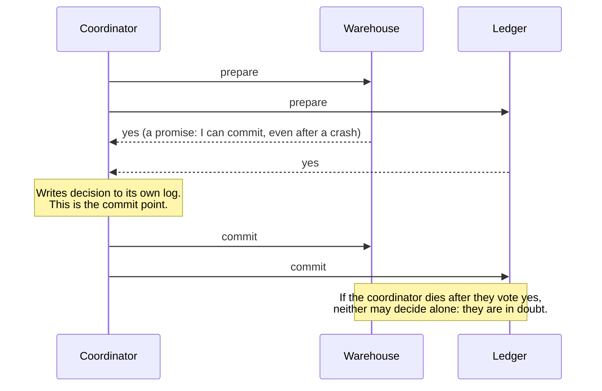

# 7 — Consistency and consensus

Two orchestrator schedulers must not both launch the nightly job. Two writers must not both commit version 42 of a table. A Kafka cluster must agree on who leads each partition, even as its machines fail one by one. All three are the same problem in different clothes, and the last chapter showed why it is hard: messages get lost, clocks lie, and any node can pause mid-thought. This chapter builds up from what "consistent" should mean to the algorithms that deliver it. You will probably never implement one, since they are notoriously easy to get wrong. But you already depend on several, and knowing what each provides tells you what your tools can actually promise, and what it costs them.

This chapter follows [*Designing Data-Intensive Applications*](https://dataintensive.net/) (ch. 9, pp. 321-375). The code is a set of small simulations, with a real PostgreSQL server for the two-phase commit section: `uv run --no-project --python 3.12 --with pgserver --with 'psycopg[binary]' python 07_consistency_and_consensus.py`. Without those packages the Postgres section is skipped and the rest still runs.

## From convergence to linearizability

Most replicated databases offer **eventual consistency**, which promises only that replicas converge at some unspecified time if you stop writing. The book points out how weak that is, since it says nothing about what you read until then (pp. 322-323). It helps to have a stronger idea to compare it with.

**Linearizability** makes a system appear as if there were a single copy of the data, with all operations atomic on it (p. 324). The defining property is a recency guarantee: as soon as one client has read a new value, every later read must also see it, so values cannot go backwards (pp. 324-327). Whether a history satisfies this can be checked mechanically. Find some order for the operations that respects real time, where anything that finished before another began must come first, and in which each read returns the latest write.

```python
def linearizable(history, initial=0):
    """history: (client, 'w'|'r', value, start, end). True if some total order of the operations
    respects real time (an op that ended before another began comes first) and every read sees
    the latest write before it. Searches every order, so it is only for small histories."""
    def search(remaining, value, order):
        if not remaining:
            return order
        for op in remaining:
            if any(other[4] < op[3] for other in remaining if other is not op):
                continue                             # something had to finish before this began
            client, kind, v, *_ = op
            if kind == "r" and v != value:
                continue
            rest = [o for o in remaining if o is not op]
            found = search(rest, v, order + [f"{client}:{kind}({v})"])
            if found:
                return found
        return None
    found = search(list(history), initial, [])
    return (True, " -> ".join(found)) if found else (False, "no valid order exists")

# A writer sets x=1 from t=0 to t=10, overlapping both reads.
fine   = [("W", "w", 1, 0, 10), ("A", "r", 0, 1, 2), ("B", "r", 1, 3, 4)]
# Same, but A reads the new value, and then B, starting later, reads the old one.
broken = [("W", "w", 1, 0, 10), ("A", "r", 1, 1, 2), ("B", "r", 0, 3, 4)]
print("old then new, during the write:", linearizable(fine))
print("new then old, during the write:", linearizable(broken))
```

```text
old then new, during the write: (True, 'A:r(0) -> W:w(1) -> B:r(1)')
new then old, during the write: (False, 'no valid order exists')
```

During a write's lifetime a read may return either value, so the first history is fine. The second is not: A saw the new value, and B started after that and saw the old, and no single order can explain that. This checker tries every order, and the book notes that real tests of linearizability are expensive for the same reason (p. 329).

Keep this separate from **serializability**. Serializability is an isolation property of transactions touching several objects, and says that they behave as if in some serial order, which may not be the real-time order. Linearizability is a recency guarantee on a single register. A database providing both has **strict serializability**. Two-phase locking and actual serial execution are typically linearizable as well, and serializable snapshot isolation is not by design, since a read from a snapshot misses newer writes (p. 329). So the [transactions chapter's](04-transactions-and-isolation.md) grades are about a different question.

When do you need it? Leader election and locks, since a lock has to have one current holder. Uniqueness constraints, such as usernames (pp. 330-331). And cross-channel timing, where two systems communicate along two paths: the book's example has an image-resize job told over a queue to process a file that may not have reached the replica it reads from (p. 331). A pipeline equivalent is an event that says "new file ready" arriving before the object store listing can see that file, which is a real bug class wherever a store's listing lags its writes.

## Which systems are linearizable?

Single-leader replication can be, if you read from the leader, and if the leader really is the leader. Consensus algorithms are. Multi-leader is not. Leaderless often is not, despite how it looks (pp. 332-334). The surprise is that strict quorums with `w + r > n`, which [the replication chapter](05-partitioning-and-replication.md) used to get overlap, do not suffice. A write arrives at replicas at different moments, so one reader can catch the new value on one replica, and a later reader can miss it (p. 334). Here is the book's `n=3, w=3, r=2` setup, with reads running while the write is in flight.

```python
import random

class Replica:
    def __init__(self):
        self.value, self.version = 0, 0

def run_quorum(n, r, seed, reads_between=2):
    """A write (to all n) reaches replicas one at a time while reads run. Each read asks r
    replicas and keeps the highest version. Returns a history for the checker."""
    rng = random.Random(seed)
    replicas = [Replica() for _ in range(n)]
    history, t = [], 0
    for step, target in enumerate(rng.sample(range(n), n)):
        replicas[target].value, replicas[target].version = 1, 1      # one more replica has it
        if step < n - 1:                                             # write still in flight
            for i in range(reads_between):
                best = max(rng.sample(replicas, r), key=lambda x: x.version)
                history.append((f"R{t}", "r", best.value, t, t + 0.5))
                t += 1
    return [("W", "w", 1, -1, t + 1)] + history

def share_non_linearizable(n, r, runs=5000):
    return sum(not linearizable(run_quorum(n, r, seed))[0] for seed in range(runs)) / runs

for n, r in [(3, 2), (5, 3)]:
    print(f"n={n} w={n} r={r} (w + r > n): {share_non_linearizable(n, r):.0%} of runs not linearizable")
example = next(h for h in (run_quorum(3, 2, s) for s in range(100)) if not linearizable(h)[0])
print("example:", [(c, k, v) for c, k, v, *_ in example])

def single_leader_history(seed):
    """All reads go to one node, which switches once from the old value to the new."""
    switch, history = random.Random(seed).randrange(5), []
    for t in range(5):
        history.append((f"R{t}", "r", int(t >= switch), t, t + 0.5))
    return [("W", "w", 1, -1, 6)] + history

print("reading from a single leader:",
      sum(not linearizable(single_leader_history(s))[0] for s in range(5000)), "of 5000 not linearizable")
```

```text
n=3 w=3 r=2 (w + r > n): 22% of runs not linearizable
n=5 w=5 r=3 (w + r > n): 37% of runs not linearizable
example: [('W', 'w', 1), ('R0', 'r', 1), ('R1', 'r', 0), ('R2', 'r', 1), ('R3', 'r', 1)]
reading from a single leader: 0 of 5000 not linearizable
```

Overlap in the steady state is not the same as recency during a write. In the example, `R0` read the new value and the later `R1` read the old. Fixing this requires synchronous read repair and more, at a performance cost (pp. 334-335). Note that the single-leader case passed all 5000 runs because there is only one register to read from.

## CAP, and the real cost

The theorem everyone quotes, CAP, is usually stated as "pick two of three", and the book calls that misleading, since partitions are not a choice. A better statement is *either consistent or available when partitioned* (p. 337). If replicas are cut off and you require linearizability, some must refuse requests. If you do not, they can all answer but may diverge. CAP's formal version covers only linearizability and network partitions, and says nothing about delays, dead nodes or other trade-offs, so it is mostly of historical interest (p. 338).

The more useful observation is that performance, more often than fault tolerance, is why systems give up linearizability. Your CPU's RAM is not linearizable across cores, and no network partition is involved (p. 338). A result the book cites shows that linearizable reads and writes must have a response time at least proportional to the uncertainty in network delay (p. 338), which is high on real networks. Weaker guarantees are how systems go fast.

## Ordering and causality

Ordering runs through this whole book: leaders exist to order writes, serializability orders transactions, and timestamps try to order events. The underlying need is usually **causality**: a question comes before its answer, and a row must be created before it is updated. Consistency that respects this is causal consistency, and a [consistent snapshot](04-transactions-and-isolation.md) is exactly that, with the effects of what you can see all included (p. 340).

A **total order** lets you compare any two elements, while causality gives only a **partial order**, since two concurrent events are incomparable, like branches in Git (pp. 341-342). So linearizability is a total order, and causal consistency a partial one. Linearizability implies causality, and the interesting finding is that causal consistency is the strongest model that doesn't slow down for network delays and stays available during partitions (p. 342).

Tracking causality in full needs version vectors, which are expensive at scale, so a practical compromise is sequence numbers. Single-leader replication gets them for free from its log (pp. 343-344). Without a leader, **Lamport timestamps** generate a total order consistent with causality using just a counter and a node ID ([Lamport 1978](https://doi.org/10.1145/359545.359563); pp. 345-346). The rule fits in one line: when you receive a message, set your counter to the larger of yours and the sender's, then add one.

```python
class Node:
    def __init__(self, name):
        self.name, self.counter = name, 0
    def event(self):
        self.counter += 1
        return (self.counter, self.name)
    def send(self):
        return self.event()
    def receive(self, stamp):
        self.counter = max(self.counter, stamp[0])
        return self.event()

a, b, c = Node("A"), Node("B"), Node("C")
log = []
def record(label, stamp): log.append((stamp, label))

record("A: rider requests trip", a.event())
m = a.send(); record("A: sends request", m)
record("B: driver accepts", b.receive(m))
record("B: driver sends arrival", (m2 := b.send()))
record("C: unrelated trip elsewhere", c.event())
record("C: payment on arrival", c.receive(m2))
for stamp, label in sorted(log):
    print(stamp, label)
```

```text
(1, 'A') A: rider requests trip
(1, 'C') C: unrelated trip elsewhere
(2, 'A') A: sends request
(3, 'B') B: driver accepts
(4, 'B') B: driver sends arrival
(5, 'C') C: payment on arrival
```

Sorting by `(counter, node)` puts each effect after its cause, without any wall clock, which avoids the inversions of the [last chapter](06-when-distributed-systems-fail.md). The payment follows the arrival, even though node C's own counter was behind. The unrelated event on C sorts somewhere arbitrary, and that is fine since nothing depended on it.

So why is that not enough? Because this order only exists **after the fact** (pp. 346-347).

```python
def claim_with_lamport():
    """Two nodes each accept a username claim, then later compare timestamps."""
    a, b = Node("A"), Node("B")
    sa, sb = a.event(), b.event()
    winner = min((sa, "Rae"), (sb, "Sam"))
    print(f"each node said yes at once, without waiting: A stamped {sa}, B stamped {sb}")
    print(f"after they exchange stamps the winner is {winner[1]}, so the other's success was premature")

claim_with_lamport()
```

```text
each node said yes at once, without waiting: A stamped (1, 'A'), B stamped (1, 'B')
after they exchange stamps the winner is Rae, so the other's success was premature
```

To reject a duplicate username at the moment of the request, a node has to know that no other node is concurrently claiming it. Lamport timestamps can settle a winner only once it has heard from everyone, and if any node is down, that never comes. To decide *now*, the order needs to be final at the time you act.

## Total order broadcast: the log

That finalised order has a name: **total order broadcast**. It requires reliable delivery, so that if one node gets a message all do, and totally ordered delivery, so that all nodes get them in the same order. Crucially, the order is fixed when the message is delivered (p. 348). If you are thinking "that is a log", you have it. It is what a replication log is, and what state machine replication uses: apply the same sequence, in order, on every replica, and they all finish in the same state (pp. 348-349).

Its power is that it can implement things that looked unrelated. Here is a uniqueness check, or a linearizable compare-and-set, using nothing but a log (p. 350).

```python
class Log:
    """Total order broadcast: a single sequence that every consumer applies in the same order."""
    def __init__(self):
        self.entries = []
    def append(self, msg):
        self.entries.append(msg)
        return len(self.entries) - 1

def apply(log, upto=None):
    owners = {}
    for i, (kind, key, who) in enumerate(log.entries[:upto]):
        if kind == "claim" and key not in owners:
            owners[key] = who
    return owners

def claim(log, key, who):
    position = log.append(("claim", key, who))         # 1. append a tentative claim
    owners = apply(log, position + 1)                  # 2. read the log up to our own message
    return owners[key] == who                          # 3. did ours come first?

log = Log()
print("Rae claims vehicle-9:", claim(log, "vehicle-9", "Rae"))
print("Sam claims vehicle-9:", claim(log, "vehicle-9", "Sam"))
print("Sam claims vehicle-3:", claim(log, "vehicle-3", "Sam"))
print("two replicas replaying the log agree:", apply(log) == apply(log), apply(log))
```

```text
Rae claims vehicle-9: True
Sam claims vehicle-9: False
Sam claims vehicle-3: True
two replicas replaying the log agree: True {'vehicle-9': 'Rae', 'vehicle-3': 'Sam'}
```

Sam's claim is decided by reading the log up to his own message. Every node that replays this log reaches the same answer with no further coordination. The book goes on to show that a linearizable compare-and-set and total order broadcast can implement each other, and that both are equivalent to consensus (pp. 351-352).

This is the most useful conceptual link in the pillar, so here are the three places it turns up in a data stack:

- A [Kafka partition](../../04-warehouse-lakehouse-streaming/notes/04-kafka-and-stream-semantics.md) is a totally ordered log. Consumers replaying it get the same answer, which is what makes reprocessing possible. Order across partitions is not guaranteed, so it is total per partition rather than across the topic.
- A [table format's commit log](../../04-warehouse-lakehouse-streaming/notes/02-table-formats.md) is the same thing for a table. The [Iceberg spec](https://iceberg.apache.org/spec/) says that each metadata change replaces the version it was based on through an atomic operation, producing "a linear history of table versions". The compare-and-set from the [transactions chapter](04-transactions-and-isolation.md) is what forms that total order.
- [Change data capture](../../02-ingest-and-modelling/notes/01-ingest.md) reads a database's replication log, whose order is already consistent with causality, which is why applying it in order to a warehouse is sound.

## Atomic commit and two-phase commit

Next, a related agreement problem. A transaction touching several nodes must commit on all or none. On one node, atomic commit comes down to a single moment, when the disk finishes writing a commit record, so one disk controller effectively makes the decision (p. 354). With several nodes you cannot just send commit to each, because some might fail while others succeed, and a committed transaction cannot be taken back, since others may have read its data (p. 355).

**Two-phase commit** introduces a coordinator (p. 356). It has nothing to do with two-phase locking.



Two promises make it work: a participant that votes yes gives up its right to abort, and once the coordinator decides, that decision is final and must be retried until delivered (pp. 357-358). The coordinator's commit point is itself an ordinary single-node atomic commit (p. 359). The weakness is in the gap between those two. A participant that has voted yes can neither commit nor abort without hearing from the coordinator (pp. 358-359).

```python
class Participant:
    def __init__(self, name, will_vote=True):
        self.name, self.will_vote, self.state, self.locks = name, will_vote, "active", True
    def prepare(self):
        self.state = "prepared" if self.will_vote else "aborted"
        if not self.will_vote:
            self.locks = False
        return self.will_vote
    def finish(self, decision):
        self.state, self.locks = decision, False

def two_phase_commit(participants, coordinator_crash=None):
    """coordinator_crash: None, 'before_decision' or 'after_one_commit'."""
    votes = [p.prepare() for p in participants]
    decision = "committed" if all(votes) else "aborted"
    if coordinator_crash == "before_decision":
        return None
    for i, p in enumerate(participants):
        if coordinator_crash == "after_one_commit" and i == 1:
            return decision
        if p.state == "prepared" or decision == "aborted":
            p.finish(decision)
    return decision

def show(label, crash=None, votes=(True, True, True)):
    ps = [Participant(n, v) for n, v in zip(("warehouse", "ledger", "queue"), votes)]
    two_phase_commit(ps, crash)
    print(f"{label:<34}", {p.name: p.state + ("*" if p.locks else "") for p in ps})

print("* = still holding locks")
show("all vote yes")
show("ledger votes no", votes=(True, False, True))
show("coordinator dies before deciding", "before_decision")
show("coordinator dies mid-commit", "after_one_commit")
```

```text
* = still holding locks
all vote yes                       {'warehouse': 'committed', 'ledger': 'committed', 'queue': 'committed'}
ledger votes no                    {'warehouse': 'aborted', 'ledger': 'aborted', 'queue': 'aborted'}
coordinator dies before deciding   {'warehouse': 'prepared*', 'ledger': 'prepared*', 'queue': 'prepared*'}
coordinator dies mid-commit        {'warehouse': 'committed', 'ledger': 'prepared*', 'queue': 'prepared*'}
```

In the last two lines, participants are stuck holding locks, and the mid-commit case is more awkward still, because one has committed and the others cannot learn that. They cannot safely consult each other, either. This is not only a toy behaviour. Postgres exposes the participant side directly through [`PREPARE TRANSACTION`](https://www.postgresql.org/docs/current/sql-prepare-transaction.html), so we can do the same thing to a real database.

```python
import sys, tempfile, time
try:
    import pgserver, psycopg
except ImportError:
    pgserver = None
    print("skipped: needs --python 3.12 --with pgserver --with 'psycopg[binary]'")
if pgserver:
    data = tempfile.mkdtemp()
    pg = pgserver.get_server(data)
    with psycopg.connect(pg.get_uri(), autocommit=True) as c:
        c.execute("alter system set max_prepared_transactions = 10")
    pg.cleanup()                                   # the setting needs a restart
    pg = pgserver.get_server(data)
    uri = pg.get_uri()
    with psycopg.connect(uri, autocommit=True) as c:
        c.execute("create table payout(driver int primary key, cents int)")
        c.execute("insert into payout values (7, 0)")

    # A participant does its work and votes yes, then the client disappears.
    client = psycopg.connect(uri, autocommit=True)
    client.execute("begin")
    client.execute("update payout set cents = 2000 where driver = 7")
    client.execute("prepare transaction 'trip-42'")
    client.close()                                 # coordinator gone, no decision delivered

    with psycopg.connect(uri, autocommit=True) as c:
        print("in doubt:", c.execute("select gid, prepared::time(0) is not null from pg_prepared_xacts").fetchall())
        print("visible value:", c.execute("select cents from payout").fetchone()[0])
        c.execute("set lock_timeout = '200ms'")
        try:
            c.execute("update payout set cents = 1 where driver = 7")
        except psycopg.errors.LockNotAvailable as e:
            print("another writer:", str(e).splitlines()[0])

    pg.cleanup()                                   # restart the database: does the promise survive?
    pg = pgserver.get_server(data)
    with psycopg.connect(pg.get_uri(), autocommit=True) as c:
        print("after a restart, still in doubt:", c.execute("select gid from pg_prepared_xacts").fetchall())
        c.execute("commit prepared 'trip-42'")     # a human or recovery tool plays coordinator
        print("after commit prepared:", c.execute("select cents from payout").fetchone()[0])
    pg.cleanup()
```

```text
in doubt: [('trip-42', True)]
visible value: 0
another writer: canceling statement due to lock timeout
after a restart, still in doubt: [('trip-42',)]
after commit prepared: 2000
```

The client disconnected, and the transaction did not go away. It is durable and survives a database restart, because that is the promise it made. Meanwhile it holds its row lock, so other writers to that row wait. Only a `COMMIT PREPARED` or a `ROLLBACK PREPARED` resolves it. This is why Postgres disables this feature by default, with `max_prepared_transactions` at 0.

The book is frank about what happens at scale (pp. 362-364). Locks can be held for as long as the coordinator is down, 20 minutes or more; orphaned transactions can need an administrator; XA, the standard API, is a lowest common denominator; and the coordinator becomes a database in its own right, a single point of failure inside what you thought was a stateless application server. Distributed transactions in MySQL are reported to be over 10 times slower than single-node ones (p. 360).

A distinction matters here. **Internal** distributed transactions, where all participants run the same software, can be efficient. **Heterogeneous** ones, across different technologies, are the problematic kind (pp. 360-361). That is why the exactly-once guarantee of a stream processor is usually internal, and why [Kafka transactions](../../04-warehouse-lakehouse-streaming/notes/04-kafka-and-stream-semantics.md) hold only inside Kafka. For anything outside, the book's preferred approach, in its final chapter, is a log plus idempotent consumers, which is what [change data capture](../../02-ingest-and-modelling/notes/01-ingest.md) gives you, and not a distributed commit (ch. 12, pp. 492-493).

## Fault-tolerant consensus

Two-phase commit requires all participants, and it blocks if its coordinator dies. A **consensus** algorithm does better. Formally it provides uniform agreement, integrity, validity and termination. The first three are safety properties. The last is a liveness property, and it is what 2PC lacks (pp. 364-365). The trick is to accept a decision from a **majority** instead of from everyone, so any majority can carry on when others fail (p. 366). As the [previous chapter](06-when-distributed-systems-fail.md) noted, if a majority of nodes fails, safety still holds and the system simply stops.

Viewstamped Replication, Paxos, Raft and Zab all decide a sequence of values, which means they implement total order broadcast (p. 366). They also elect a leader, which raises a chicken-and-egg problem: you need consensus to choose a leader, and a leader to reach consensus (p. 367). The way out is the **epoch number** (Raft's "term"), and two rounds of voting (p. 368). A leader is unique only within its term. Any new election uses a higher term, and a node that hears of a higher term refuses the older leader. Before a leader acts, a quorum must have approved it. Because a vote for leader and a vote on a value both need majorities, the two sets overlap, so a new leader must hear about anything committed.

Here is a Raft-shaped toy, in about 100 lines, using the same ideas: terms, one vote per term, the requirement that a voter's log not be ahead of the candidate's, and majority acknowledgement. The design follows the [Raft paper](https://raft.github.io/raft.pdf). It leaves out almost everything required for production: real networks, timeouts, persistence, membership changes, log compaction. It also cuts one corner by having a follower simply copy the leader's whole log.

```python
class ConsensusNode:
    def __init__(self, id):
        self.id, self.term, self.voted_for = id, 0, None
        self.log = []          # entries of (term, value)
        self.committed = 0

def up_to_date(cand_log, voter_log):
    last = lambda log: (log[-1][0], len(log)) if log else (0, 0)
    return last(cand_log) >= last(voter_log)

class Cluster:
    """A small Raft-shaped consensus: terms, one vote per term, majority to win and to commit."""
    def __init__(self, n, seed):
        self.nodes = [ConsensusNode(i) for i in range(n)]
        self.majority = n // 2 + 1
        self.rng = random.Random(seed)
        self.reachable = {i: set(range(n)) for i in range(n)}
        self.leaders = {}      # term -> leader id
        self.acked = []        # (value, term, index) the client was told succeeded

    def can_talk(self, a, b):
        return b in self.reachable[a]

    def partition(self):
        ids = list(range(len(self.nodes)))
        self.rng.shuffle(ids)
        cut = self.rng.randrange(1, len(ids))
        left, right = set(ids[:cut]), set(ids[cut:])
        for i in left:
            self.reachable[i] = left
        for i in right:
            self.reachable[i] = right

    def heal(self):
        self.reachable = {i: set(range(len(self.nodes))) for i in range(len(self.nodes))}

    def elect(self, cand_id):
        cand = self.nodes[cand_id]
        cand.term += 1
        cand.voted_for = cand_id
        votes = 1
        for n in self.nodes:
            if n.id == cand_id or not self.can_talk(cand_id, n.id):
                continue
            if cand.term > n.term:
                n.term, n.voted_for = cand.term, None
            if n.term == cand.term and n.voted_for is None and up_to_date(cand.log, n.log):
                n.voted_for = cand_id
                votes += 1
        if votes >= self.majority:
            assert self.leaders.get(cand.term, cand_id) == cand_id, "two leaders in one term"
            self.leaders[cand.term] = cand_id
            return True
        return False

    def replicate(self, leader_id, value):
        """A leader appends and copies to whoever it can reach. Stale leaders get refused."""
        leader = self.nodes[leader_id]
        if self.leaders.get(leader.term) != leader_id:
            return False
        entry = (leader.term, value)
        leader.log.append(entry)
        acks = 1
        for n in self.nodes:
            if n.id == leader_id or not self.can_talk(leader_id, n.id):
                continue
            if n.term > leader.term:                    # a follower has seen a newer term: refuse
                continue
            n.term = leader.term
            n.log = list(leader.log)                    # simplification: follower adopts the leader's log
            acks += 1
        if acks >= self.majority:
            self.acked.append((value, leader.term, len(leader.log) - 1))
            return True
        return False

def run_trial(seed, n=5, steps=60):
    cluster = Cluster(n, seed)
    rng = random.Random(seed + 1)
    leader, stale_rejected, value = None, 0, 0
    for _ in range(steps):
        event = rng.random()
        if event < 0.15:
            cluster.partition()
        elif event < 0.30:
            cluster.heal()
        elif event < 0.55 or leader is None:
            candidate = rng.randrange(n)
            if cluster.elect(candidate):
                leader = candidate
        else:
            value += 1
            target = leader if rng.random() < 0.8 else rng.randrange(n)
            cluster.replicate(target, value)
        for v, term, index in cluster.acked:
            # Safety: any later leader's log must still contain every acknowledged entry.
            newest = max(cluster.leaders, default=0)
            if newest and term <= newest:
                log = cluster.nodes[cluster.leaders[newest]].log
                assert index < len(log) and log[index] == (term, v), f"lost acked write {v}"
    return len(cluster.leaders), len(cluster.acked)

trials = 3000
terms = acked = 0
for seed in range(trials):
    t, a = run_trial(seed)
    terms += t
    acked += a
print(f"{trials} random runs with partitions: {terms} leaders elected, {acked} writes acknowledged")
print("invariants checked after every step: at most one leader per term, no acknowledged write lost")
```

```text
3000 random runs with partitions: 36436 leaders elected, 53047 writes acknowledged
invariants checked after every step: at most one leader per term, no acknowledged write lost
```

First, watch it work once, with the most common failure: a leader on the wrong side of a partition.

```python
c = Cluster(5, seed=0)
print("node 0 elected:", c.elect(0), "term", c.nodes[0].term)
print("write a, all reachable:", c.replicate(0, "a"))
c.reachable = {0: {0, 1}, 1: {0, 1}, 2: {2, 3, 4}, 3: {2, 3, 4}, 4: {2, 3, 4}}
print("partition {0,1} | {2,3,4}")
print("old leader writes b, reaches 2 of 5:", c.replicate(0, "b"), "(not acknowledged)")
print("node 2 elected on the majority side:", c.elect(2), "term", c.nodes[2].term)
print("node 2 writes c:", c.replicate(2, "c"))
c.heal()
print("healed; old leader tries d in term", c.nodes[0].term, ":", c.replicate(0, "d"))
print("logs:", {n.id: [v for _, v in n.log] for n in c.nodes})
print("node 2 writes e:", c.replicate(2, "e"))
print("logs:", {n.id: [v for _, v in n.log] for n in c.nodes})
```

```text
node 0 elected: True term 1
write a, all reachable: True
partition {0,1} | {2,3,4}
old leader writes b, reaches 2 of 5: False (not acknowledged)
node 2 elected on the majority side: True term 2
node 2 writes c: True
healed; old leader tries d in term 1 : False
logs: {0: ['a', 'b', 'd'], 1: ['a', 'b', 'd'], 2: ['a', 'c'], 3: ['a', 'c'], 4: ['a', 'c']}
node 2 writes e: True
logs: {0: ['a', 'c', 'e'], 1: ['a', 'c', 'e'], 2: ['a', 'c', 'e'], 3: ['a', 'c', 'e'], 4: ['a', 'c', 'e']}
```

The old leader's write `b` reached two nodes, not a majority, so the client was never told it succeeded. The majority side elected node 2 in a higher term and went on. When the partition healed, the old leader's `d` failed, and its uncommitted `b` and `d` were discarded when it next heard from the real leader. This is why an old leader cannot do harm: its term is stale. It is the [fencing token](06-when-distributed-systems-fail.md) again, built into the protocol. The two random checks, no two leaders in a term and no acknowledged write lost, passed in all 3000 runs. Such a test can pass vacuously, so let us confirm that it can fail by breaking the one rule that matters.

```python
def run_trial_minority(seed, n=5, steps=60):
    """The same protocol, but with a 'majority' of only 2 of 5."""
    cluster = Cluster(n, seed)
    cluster.majority = 2
    rng = random.Random(seed + 1)
    leader, value = None, 0
    try:
        for _ in range(steps):
            event = rng.random()
            if event < 0.15:
                cluster.partition()
            elif event < 0.30:
                cluster.heal()
            elif event < 0.55 or leader is None:
                candidate = rng.randrange(n)
                if cluster.elect(candidate):
                    leader = candidate
            else:
                value += 1
                cluster.replicate(leader, value)
            for v, term, index in cluster.acked:
                newest = max(cluster.leaders, default=0)
                if newest and term <= newest:
                    log = cluster.nodes[cluster.leaders[newest]].log
                    assert index < len(log) and log[index] == (term, v), "lost"
    except AssertionError as e:
        return str(e)
    return None

failures = [run_trial_minority(s) for s in range(1000)]
print(f"quorum of 2 of 5: {sum(f is not None for f in failures)} of 1000 runs broke an invariant")
```

```text
quorum of 2 of 5: 688 of 1000 runs broke an invariant
```

Lower the quorum from 3 of 5 to 2 of 5, and most runs break an invariant, because two disjoint "majorities" can now each make progress. That also shows the limits of what the toy demonstrates. A random test passing does not prove an algorithm is correct, and the real proofs are the point of those papers.

Consensus has a price (p. 369). Voting before commit is effectively synchronous replication, which costs throughput; a strict majority is required, so a partition can stop a minority side; the member set is usually fixed; and failure detection rests on timeouts, so on a flaky network elections can repeat and little work gets done. Also, the FLP result says no deterministic algorithm can guarantee consensus on a purely asynchronous network, and timeouts are how real systems escape it (p. 353).

## Where consensus lives in your stack

Few applications use consensus directly. They outsource it to a small service. ZooKeeper and etcd are small in-memory databases offering linearizable atomic operations, total ordering, failure detection through sessions, and change notifications (pp. 370-371). A typical pattern runs consensus on a fixed set of 3 or 5 nodes, and uses that to coordinate many others (p. 372). So what does each data tool do?

| Tool | Decision to agree on | Mechanism |
|---|---|---|
| Kafka | Metadata, including who leads each partition | [KRaft](https://cwiki.apache.org/confluence/display/KAFKA/KIP-595%3A+A+Raft+Protocol+for+the+Metadata+Quorum), a Raft-based controller quorum, replacing ZooKeeper |
| Iceberg | Which metadata file is current | The catalog's atomic swap ([spec](https://iceberg.apache.org/spec/)); a database or service provides the compare-and-set |
| Delta Lake on object storage | Who owns version N of the log | Put-if-absent on the store, or a coordinator ([table formats](../../04-warehouse-lakehouse-streaming/notes/02-table-formats.md)) |
| Airflow | Which scheduler launches a task | Row locks in the metadata database, with no Raft or Paxos among schedulers |
| Kubernetes | Cluster state | etcd |

The Airflow row is the most instructive. Its [scheduler documentation](https://airflow.apache.org/docs/apache-airflow/stable/administration-and-deployment/scheduler.html) says that it deliberately avoids direct communication or a consensus algorithm between schedulers and uses `SELECT ... FOR UPDATE` row locks in its metadata database instead, so as to keep the operational surface area small. The [`FOR UPDATE` that fixed write skew](04-transactions-and-isolation.md) is what stops two schedulers launching one task, and the agreement problem has been handed to Postgres. If that database has a single primary, you have reduced the problem to "who is the primary", which is the book's point about leaders generally: having one only moves the need for consensus somewhere else, where it is needed less often (p. 375). The practical lesson is that the metadata database is the part of your [orchestrator](../../03-transform-and-orchestrate/notes/05-dagster-and-airflow.md) to treat like a system of record.

The book's summary is the best way to remember this chapter (pp. 373-374). Many problems reduce to consensus: linearizable compare-and-set, atomic commit, total order broadcast, locks and leases, membership, and uniqueness constraints. With a single leader they are all easy, until the leader fails. Then you have three options: wait for it to recover, which blocks; have a human fail it over; or use an algorithm to elect a new one. The third is what consensus provides. Some systems, like leaderless and multi-leader ones, simply do not use global consensus, and they accept conflicts and manage without linearizability (p. 375).

## Pitfalls

- **Treating `w + r > n` as strong consistency.** It gives overlap, not linearizability. A later read can return an older value while a write is in flight.
- **Confusing linearizable with serializable.** One is recency on one object, the other is isolation across many. Neither implies the other.
- **Running your own leader election over a table flag or a timestamp.** That combines each flaw of the last chapter. Use a coordination service, or a database row lock with fencing.
- **Treating a stuck prepared transaction as harmless.** It holds locks across restarts. Monitor `pg_prepared_xacts` if you ever enable it.
- **A two-node consensus cluster.** Two nodes tolerate no failures. Use 3 or 5.
- **Putting high-rate data through ZooKeeper or etcd.** They are designed for small, slowly changing metadata (p. 372).
- **Promising exactly-once across heterogeneous systems.** It holds inside one system's transaction. At the boundary, use idempotent writes.

## Try it

The code in this chapter is collected in [practice/07_consistency_and_consensus.py](../practice/07_consistency_and_consensus.py).

1. Run `share_non_linearizable(3, 3)`, so that a read asks all three replicas. What changes, and what have you given up?

<details><summary>Answer</summary>

It drops to 0% in this simulation, since any replica holding the new value is always among those read. The cost is availability: one unreachable replica now stops every read, as well as every write with `w = 3`. This model also leaves out read replicas being slow or down, which is exactly when the trade matters.

</details>

2. In `run_trial_minority`, set `cluster.majority` to 1, then 3, then 4 for the 5-node cluster. What happens to the failure count, and why not always use 4?

<details><summary>Answer</summary>

It gives about 900 failed runs of 1000 at 1, and 0 at 3 and at 4, since any two sets of size 3 out of 5 overlap. Using 4 is safe too, but it tolerates just one failed node rather than two, and elections and commits get harder. A quorum larger than a majority gives up availability for no extra safety.

</details>

3. In `twopc`, why can't the participants ask one another when the coordinator dies before deciding?

<details><summary>Answer</summary>

If all of them have voted yes and none has heard a decision, then the coordinator may have decided either way: it may have logged an abort because of a timeout, for instance, or a commit that has already reached a participant now cut off from the rest. Whatever they choose could contradict it. A consensus algorithm solves this by having the decision made by a majority rather than held by one node.

</details>

## Interview checklist

| Question | Answer |
|---|---|
| What is linearizability? | The system behaves as if there were one copy of the data, and every operation takes effect atomically at a point in time. Once a new value has been read, no later read returns an older one. |
| Linearizable vs serializable? | Linearizable is a real-time recency guarantee on one object. Serializable is an isolation guarantee on transactions, in some order. Both together are strict serializability. |
| What does CAP actually say? | When a network partition occurs, you choose between linearizability and availability. Partitions aren't optional, so "pick two" misleads. |
| Why do systems give up linearizability? | Mostly for performance. It requires waiting on the network, and response time is at least proportional to the delay uncertainty. |
| What is a Lamport timestamp? | A `(counter, node)` pair, where a node takes the max on receipt. It gives a total order consistent with causality, but only after the fact. |
| Why isn't a Lamport timestamp enough for a uniqueness check? | The order is only final after hearing from every node, so a node can't decide at request time. |
| What is total order broadcast? | Reliable delivery of messages to all nodes in the same order, fixed at delivery. In practice it is a replicated log, and it is equivalent to consensus. |
| Explain 2PC. | A coordinator asks participants to prepare, each votes and promises, the coordinator logs a decision, and it delivers that decision. A participant that voted yes is stuck until it hears. |
| What is an in-doubt transaction? | One that voted yes and hasn't heard the decision. It holds locks, and survives restarts, until the decision arrives or an admin resolves it. |
| How does consensus improve on 2PC? | It needs a majority rather than everyone, elects a replacement leader, and is designed to terminate while a majority is up. |
| How does an old leader get stopped? | Each election uses a higher term, and nodes refuse lower terms. An old leader can't reach a majority, and so can't commit. |
| How does Airflow stop two schedulers doing the same thing? | Row locks in its metadata database, not a consensus algorithm between schedulers. Agreement is delegated to the database. |

## Next

We now know how storage works on one machine and what happens across many. Most data engineers meet all of this through one kind of tool, which spreads a query across a cluster and hides nearly all of these problems, by choosing determinism and restart over coordination. See [Distributed compute](08-distributed-compute.md).
