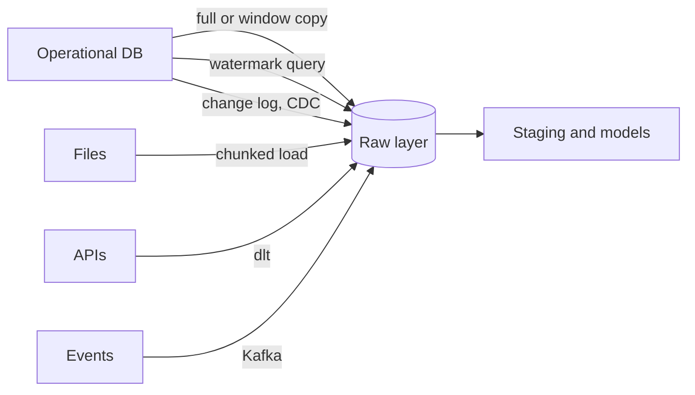

# 1 — Ingest

Every number your company reports begins with someone copying rows out of a system that was not built to be copied from. The copy runs at 2 a.m., the network drops at 2:04, and the scheduler helpfully retries. Whether Tuesday's revenue is now correct, doubled or missing is decided by a few lines in the loader that nobody reads again. This chapter is about those lines: how to get data from where it is born into a place you control, as batch files or as an event stream, without loading it twice or losing it once.

## Where it sits

Ingest starts the pipeline: **ingest** → model → transform → orchestrate → store → monitor → serve. Every later stage assumes the raw layer exists, is complete for a known time window, and can be re-pulled. Pillar 1 supplied the two background facts: files carry schemas or fail to ([encoding and files](../../01-storage-and-compute-foundations/notes/01-encoding-and-files.md), which is why the Kafka section here runs Avro with a Schema Registry), and a source you read from may lag or lose writes ([partitioning and replication](../../01-storage-and-compute-foundations/notes/04-partitioning-and-replication.md)). The stream background is Kleppmann, [*Designing Data-Intensive Applications*](https://dataintensive.net/), ch. 11. The zoomcamp material splits the job three ways:

| Mode | Zoomcamp material | What it teaches |
|---|---|---|
| Batch file load | DE 01 `2_docker_sql` | Chunked CSV/Parquet → Postgres in Docker; the ingest script as a container |
| Infrastructure for landing | DE 01 `1_terraform_gcp` | GCS bucket + BigQuery dataset as code; the lake you ingest into |
| API ingest | DE Workshop 1 (dlt) | Paginated APIs, normalisation, incremental loading |
| Event streams | DE 06 | Kafka producers/consumers, Avro + Schema Registry, Kafka Streams, Faust, Spark Structured Streaming, ksqlDB, Redpanda |
| Streaming SQL | DE Workshop 2 (RisingWave) | Incrementally maintained materialised views over a stream |



DE 01 is listed as cross-cutting infrastructure in the module map: Docker and Terraform are used by every later module, but their first job is to stand up the landing zone, so they live here.

---

## Batch ingest: the chunked loader

The DE 01 loader (`ingest_data.py`) is the shape every batch ingester takes: parse arguments, open a connection, stream the file in chunks, create the table from the schema, append the rest.

```python
# illustrative: the DE 01 loader, which needs the Postgres container below
engine = create_engine(f'postgresql://{user}:{password}@{host}:{port}/{db}')

df_iter = pd.read_csv(csv_name, iterator=True, chunksize=100000)
df = next(df_iter)
df.tpep_pickup_datetime = pd.to_datetime(df.tpep_pickup_datetime)
df.tpep_dropoff_datetime = pd.to_datetime(df.tpep_dropoff_datetime)

df.head(n=0).to_sql(name=table_name, con=engine, if_exists='replace')  # schema only
df.to_sql(name=table_name, con=engine, if_exists='append')
for df in df_iter:                                                     # remaining chunks
    ...
    df.to_sql(name=table_name, con=engine, if_exists='append')
```

For Parquet the same idea uses `pq.ParquetFile(path).iter_batches(batch_size=100000)`.

What the pattern gets right, and what it leaves to you:

| Property | `ingest_data.py` | What production adds |
|---|---|---|
| Bounded memory | Yes, 100k-row chunks | Same |
| Schema from data | `head(n=0).to_sql` | An explicit schema (see the Spark `StructType` in [warehouse and store](../../04-warehouse-lakehouse-streaming/notes/01-warehouse-and-store.md)) so a bad file can't redefine a column |
| Idempotency | `if_exists='replace'` on every run, a full reload | Partition-scoped overwrite or merge on a key, so a rerun of one day replaces only that day |
| Types | Only the two timestamps are cast | Cast every column at the boundary or in staging ([transform](../../03-transform-and-orchestrate/notes/01-transform.md)) |
| Partial failure | A crash mid-loop leaves a half-loaded table | Load to a temp table, swap on success |

Source data: `https://github.com/DataTalksClub/nyc-tlc-data/releases/download/yellow/yellow_tripdata_2021-01.csv.gz`. The NYC TLC data is now Parquet at the origin; the DataTalks mirror keeps CSV for the course.

### The loader as a container

```dockerfile
FROM python:3.9.1
RUN apt-get install wget
RUN pip install pandas sqlalchemy psycopg2
WORKDIR /app
COPY ingest_data.py ingest_data.py
ENTRYPOINT [ "python", "ingest_data.py" ]
```

```bash
docker network create pg-network
docker run -it -e POSTGRES_USER=root -e POSTGRES_PASSWORD=root -e POSTGRES_DB=ny_taxi \
  -v $(pwd)/ny_taxi_postgres_data:/var/lib/postgresql/data -p 5432:5432 \
  --network=pg-network --name pg-database postgres:13
docker build -t taxi_ingest:v001 .
docker run -it --network=pg-network taxi_ingest:v001 \
  --user=root --password=root --host=pg-database --port=5432 \
  --db=ny_taxi --table_name=yellow_taxi_trips --url=${URL}
pgcli -h localhost -p 5432 -u root -d ny_taxi
```

The `docker-compose.yaml` in the module replaces the network and two `docker run` calls with two services, `postgres:13` and `pgadmin` on port 8080; compose creates the shared network for you. The point of the container is that the *ingest job* becomes a unit an orchestrator can schedule ([03](../../03-transform-and-orchestrate/notes/02-orchestrate.md)), not a script on someone's laptop.

---

## Making a load safe to repeat

The table above lists idempotency as something production adds. It deserves its own section because it is the property that everything else in this pillar leans on. Schedulers retry, operators re-run, and a retried load must not change the answer. To keep the mechanics in view, we use a small operational database in SQLite in place of Postgres: three days of a thousand trips each, updated in place, as an application would.

```python
import sqlite3, duckdb, random, datetime as dt

def make_source(path="ops.sqlite", days=3, per_day=1000, seed=7):
    """An operational database: one row per trip, updated in place."""
    rng = random.Random(seed)
    db = sqlite3.connect(path)
    db.execute("DROP TABLE IF EXISTS trips")
    db.execute("""CREATE TABLE trips (
        trip_id INTEGER PRIMARY KEY, pickup_date TEXT, zone INTEGER,
        fare_usd REAL, updated_at TEXT)""")
    rows, tid = [], 0
    for d in range(days):
        day = dt.date(2026, 1, 1) + dt.timedelta(days=d)
        for _ in range(per_day):
            tid += 1
            rows.append((tid, str(day), rng.randint(1, 260),
                         round(rng.uniform(4, 60), 2), f"{day} 23:00:00"))
    db.executemany("INSERT INTO trips VALUES (?,?,?,?,?)", rows)
    db.commit()
    return db

source = make_source()
print(source.execute("SELECT count(*), sum(fare_usd) FROM trips").fetchone())
```

```text
(3000, 95196.9)
```

Here is the bug in its simplest form. An `append` load is scheduled for one day, it times out at the client after it has already committed, and the scheduler retries.

```python
wh = duckdb.connect()
wh.execute("CREATE TABLE raw_trips (trip_id INT, pickup_date DATE, zone INT, fare_usd DOUBLE, updated_at TIMESTAMP)")

def load_append(day):
    rows = source.execute("SELECT * FROM trips WHERE pickup_date = ?", (day,)).fetchall()
    wh.executemany("INSERT INTO raw_trips VALUES (?,?,?,?,?)", rows)

load_append("2026-01-01")
load_append("2026-01-01")   # the scheduler retried after a timeout
print(wh.execute("SELECT count(*) AS loaded, count(DISTINCT trip_id) AS trips FROM raw_trips").fetchone())
```

```text
(2000, 1000)
```

Two thousand rows now hold one thousand trips, and every sum downstream is twice the truth. Nothing failed, so nothing alerts. The fix is to make the unit of work a window and to replace that window:

```python
def load_window(day):
    """Replace one day's rows inside a transaction: running it twice changes nothing."""
    rows = source.execute("SELECT * FROM trips WHERE pickup_date = ?", (day,)).fetchall()
    wh.execute("BEGIN")
    wh.execute("DELETE FROM raw_trips WHERE pickup_date = ?", (day,))
    wh.executemany("INSERT INTO raw_trips VALUES (?,?,?,?,?)", rows)
    wh.execute("COMMIT")

load_window("2026-01-01")
load_window("2026-01-01")
print(wh.execute("SELECT count(*) AS loaded, count(DISTINCT trip_id) AS trips FROM raw_trips").fetchone())
```

```text
(1000, 1000)
```

Kleppmann's definition is the useful one: an idempotent operation has the same effect whether you perform it once or many times ([*DDIA*](https://dataintensive.net/), p. 478). Setting a value is idempotent and incrementing a counter is not, and appending is a kind of increment. The transaction matters as much as the delete. Without it, a crash between the two statements leaves the day empty, which is worse than duplicates because the totals look merely low.

---

## Finding what changed

Replacing a window works when a source gives you whole windows: last month's file, or yesterday's events that nobody will touch again. Operational tables are harder, since rows change in place and any row may change at any time. A full copy is the honest baseline, and it is often the right answer for small tables. Once a table is too big to copy nightly, you need to find only what changed, and there are two ways to do it.

### The high watermark

The usual first attempt is a query: keep the largest `updated_at` you have seen, and next time ask for anything larger. This loader does that and merges on the key. Then three things happen in the source overnight: a correction whose transaction began before the watermark, a customer's deletion, and an ordinary update.

```python
wh.execute("DELETE FROM raw_trips")

def extract_since(mark):
    return source.execute("SELECT * FROM trips WHERE updated_at > ? ORDER BY updated_at", (mark,)).fetchall()

def upsert(rows):
    if rows:
        wh.executemany("INSERT INTO raw_trips VALUES (?,?,?,?,?)", rows)
    wh.execute("""CREATE OR REPLACE TABLE raw_trips AS
        SELECT * EXCLUDE rn FROM (SELECT *, row_number() OVER
          (PARTITION BY trip_id ORDER BY updated_at DESC) rn FROM raw_trips) WHERE rn = 1""")

rows = extract_since("1900-01-01")
upsert(rows)
mark = max(r[4] for r in rows)
print("high watermark", mark)

# A correction commits at 09:00 but its transaction began at 22:30, and stamped then.
source.execute("UPDATE trips SET fare_usd = 99.0, updated_at = '2026-01-03 22:30:00' WHERE trip_id = 42")
# A customer deletion leaves no row to find.
source.execute("DELETE FROM trips WHERE trip_id = 43")
# A normal correction after the watermark.
source.execute("UPDATE trips SET fare_usd = 11.0, updated_at = '2026-01-04 08:00:00' WHERE trip_id = 44")
source.commit()

rows = extract_since(mark)
upsert(rows)
print("extracted", len(rows), "rows, ids", [r[0] for r in rows])
print(wh.execute("SELECT trip_id, fare_usd FROM raw_trips WHERE trip_id IN (42, 43, 44) ORDER BY 1").fetchall())
print("source says:", source.execute("SELECT trip_id, fare_usd FROM trips WHERE trip_id IN (42, 43, 44) ORDER BY 1").fetchall())
```

```text
high watermark 2026-01-03 23:00:00
extracted 1 rows, ids [44]
[(42, 53.67), (43, 5.26), (44, 11.0)]
source says: [(42, 99.0), (44, 11.0)]
```

The loader picked up only the ordinary update. Trip 42 keeps its old fare because its `updated_at` was stamped when the transaction started, at 22:30, while the commit became visible after the extract had moved its mark to 23:00. Trip 43 is still in the warehouse because a deleted row cannot be returned by a query. Nothing in the output hints at either problem, and the warehouse is now quietly different from the source. A replica adds a third way to miss rows, since a follower can be behind the leader when you read your mark from it ([chapter 4 of pillar 1](../../01-storage-and-compute-foundations/notes/04-partitioning-and-replication.md)).

The standard patch for late commits is to re-read a window behind the mark and let the merge remove duplicates:

```python
from datetime import datetime, timedelta

def minus_hours(ts, hours):
    return str(datetime.fromisoformat(ts) - timedelta(hours=hours))

rows = extract_since(minus_hours(mark, 2))   # re-read a two-hour overlap, and let upsert dedupe
upsert(rows)
print("extracted", len(rows), "rows")
print(wh.execute("SELECT trip_id, fare_usd FROM raw_trips WHERE trip_id IN (42, 43, 44) ORDER BY 1").fetchall())
```

```text
extracted 1002 rows
[(42, 99.0), (43, 5.26), (44, 11.0)]
```

Trip 42 is now right, at the price of re-reading rows. Here it took 1,002 rows to find two, because this synthetic source stamps a day's rows at one time. Deletion is still not fixed, and no overlap will fix it. Teams work around that with soft-delete columns, which only help if every writer honours them, or with a periodic key comparison against the source. An overlap also only covers commits within its width, so it is a guess about how long your longest transaction runs.

### Change data capture

The alternative is to stop asking the table and read the database's own record of what happened. Replication already needs that record: the leader writes every change to a log, and followers apply it in order. Change data capture (CDC) exposes that stream to other systems, which in effect makes your warehouse one more follower ([*DDIA*](https://dataintensive.net/), p. 454-455). [Debezium](https://debezium.io/documentation/reference/stable/features.html) is the common open-source implementation. It reads the log of databases such as PostgreSQL and MySQL and publishes change events through Kafka Connect. Its documentation lists the advantages over polling that the failures above predict: all changes are captured, deletes included, and no "last updated" column is needed.

We have no replication slot in SQLite, so we imitate the log with triggers that write a change table. Kleppmann points out that triggers are also a real way to build CDC, though fragile and costly compared with parsing the log (p. 455), so use this to learn the shape and not as a design. The steps are the same as for a real connector. Take a snapshot at a known log position, then apply everything after it.

```python
source = make_source()
source.executescript("""
CREATE TABLE change_log (lsn INTEGER PRIMARY KEY AUTOINCREMENT, op TEXT, trip_id INT,
                         pickup_date TEXT, zone INT, fare_usd REAL, updated_at TEXT);
CREATE TRIGGER t_i AFTER INSERT ON trips BEGIN INSERT INTO change_log (op,trip_id,pickup_date,zone,fare_usd,updated_at)
  VALUES ('c',new.trip_id,new.pickup_date,new.zone,new.fare_usd,new.updated_at); END;
CREATE TRIGGER t_u AFTER UPDATE ON trips BEGIN INSERT INTO change_log (op,trip_id,pickup_date,zone,fare_usd,updated_at)
  VALUES ('u',new.trip_id,new.pickup_date,new.zone,new.fare_usd,new.updated_at); END;
CREATE TRIGGER t_d AFTER DELETE ON trips BEGIN INSERT INTO change_log (op,trip_id) VALUES ('d',old.trip_id); END;
""")
wh = duckdb.connect()
wh.execute("CREATE TABLE raw_trips (_lsn BIGINT, trip_id INT, pickup_date DATE, zone INT, fare_usd DOUBLE)")
snapshot = source.execute("SELECT trip_id, pickup_date, zone, fare_usd FROM trips").fetchall()
wh.executemany("INSERT INTO raw_trips VALUES (0,?,?,?,?)", snapshot)
print("snapshot rows", wh.execute("SELECT count(*) FROM raw_trips").fetchone()[0])

source.execute("UPDATE trips SET fare_usd = 99.0, updated_at = '2026-01-03 22:30:00' WHERE trip_id = 42")
source.execute("DELETE FROM trips WHERE trip_id = 43")
source.execute("UPDATE trips SET fare_usd = 11.0, updated_at = '2026-01-04 08:00:00' WHERE trip_id = 44")
source.commit()
for e in source.execute("SELECT lsn, op, trip_id, fare_usd FROM change_log").fetchall():
    print(e)
```

```text
snapshot rows 3000
(1, 'u', 42, 99.0)
(2, 'd', 43, None)
(3, 'u', 44, 11.0)
```

Every change is now a row with a position, including the delete. Applying them takes some care, because CDC delivery is normally at least once: a consumer that crashes before saving its offset sees events again. The fix is the one Kleppmann describes for Kafka offsets (p. 478): store with each row the position of the change that last touched it, and ignore anything not newer.

```python
def apply_changes(after_lsn):
    """Apply changes in log order. A row stores the last position that touched it,
    and deleted keys are remembered, so replaying a change has no effect."""
    wh.execute("CREATE TABLE IF NOT EXISTS raw_trips_deleted (trip_id INT PRIMARY KEY, _lsn BIGINT)")
    events = source.execute("SELECT * FROM change_log WHERE lsn > ? ORDER BY lsn", (after_lsn,)).fetchall()
    for lsn, op, tid, day, zone, fare, _ in events:
        seen = wh.execute("SELECT max(_lsn) FROM (SELECT _lsn FROM raw_trips WHERE trip_id = ? UNION ALL "
                          "SELECT _lsn FROM raw_trips_deleted WHERE trip_id = ?)", (tid, tid)).fetchone()[0]
        if seen is not None and seen >= lsn:
            continue
        wh.execute("DELETE FROM raw_trips WHERE trip_id = ?", (tid,))
        if op == "d":
            wh.execute("INSERT OR REPLACE INTO raw_trips_deleted VALUES (?, ?)", (tid, lsn))
        else:
            wh.execute("INSERT INTO raw_trips VALUES (?,?,?,?,?)", (lsn, tid, day, zone, fare))
    return events[-1][0] if events else after_lsn

position = apply_changes(0)
position = apply_changes(0)   # a consumer crashed before saving its offset, so it replays everything
print("position", position)
print(wh.execute("SELECT trip_id, fare_usd, _lsn FROM raw_trips WHERE trip_id IN (42, 43, 44) ORDER BY 1").fetchall())
print("rows match source:", wh.execute("SELECT count(*) FROM raw_trips").fetchone()[0] == source.execute("SELECT count(*) FROM trips").fetchone()[0])
```

```text
position 3
[(42, 99.0, 1), (44, 11.0, 3)]
rows match source: True
```

The replay did nothing, trip 42 has its correct fare, and trip 43 is gone. The delete table is there for a subtle reason: without it, replaying an old `u` event for a deleted key would bring the row back. Retention creates one more operational requirement. A real log is truncated, so a connector that falls too far behind has to take a new snapshot. In return for all of this, you run more moving parts than a nightly query needs, and CDC is usually asynchronous, so all the replication lag behaviour from pillar 1 still applies (p. 455).

So the choice runs in order of cost. Copy the table if it is small. Use a watermark with an overlap if rows are never hard deleted and a small error is tolerable. Move to CDC when deletes matter, when the table is too big to re-read, or when consumers need freshness measured in minutes.

| Method | Sees updates | Sees hard deletes | Load on source | Operational cost |
|---|---|---|---|---|
| Full copy | Yes | Yes | High, per run | Low |
| Window replace | Only if the window is immutable | Within the window | Low | Low |
| Watermark + overlap | Within the overlap | No | Medium, needs an index | Low |
| Log-based CDC | Yes | Yes | Low on the query path | High: connector, broker, snapshots |

---

## The landing zone as code: Terraform on GCP

```hcl
provider "google" {
  project = var.project
  region  = var.region
}

resource "google_storage_bucket" "data-lake-bucket" {
  name          = var.gcs_bucket_name
  location      = var.location
  force_destroy = true
  lifecycle_rule {
    condition { age = 1 }
    action    { type = "AbortIncompleteMultipartUpload" }
  }
}

resource "google_bigquery_dataset" "dataset" {
  dataset_id = var.bq_dataset_name
  location   = var.location
}
```

```bash
gcloud auth application-default login     # or export GOOGLE_APPLICATION_CREDENTIALS=key.json
terraform init && terraform plan && terraform apply
terraform destroy                          # when the homework is done; buckets cost money
```

The provider is pinned at `hashicorp/google 5.6.0`. The service account needs **Storage Admin**, **Storage Object Admin** and **BigQuery Admin**. Those are course-convenient roles; a real pipeline account gets object-level write on one bucket and data-editor on one dataset.

Two settings matter beyond the homework: `force_destroy = true` lets `destroy` delete a non-empty bucket (handy in a course, dangerous in production), and the multipart-abort rule stops half-finished uploads from accumulating as billable storage.

---

## API ingest: dlt (Workshop 1)

Workshop 1 covers reading from APIs, building scalable pipelines, normalising nested JSON and incremental loading, using [dlt](https://dlthub.com/docs/intro). dlt is a Python library, not a service: a pipeline is a function call.

```python
# illustrative: paginate and API_URL stand for your API client. The tested version is in the section above
import dlt

@dlt.resource(name="rides", write_disposition="merge", primary_key="record_id")
def rides(updated_at=dlt.sources.incremental("updated_at", initial_value="2024-01-01")):
    for page in paginate(API_URL, since=updated_at.last_value):   # your generator
        yield page

pipeline = dlt.pipeline(pipeline_name="taxi", destination="duckdb", dataset_name="raw")
info = pipeline.run(rides())
print(info)
```

What dlt does that `ingest_data.py` doesn't:

| Concern | dlt mechanism |
|---|---|
| Nested JSON | Normalises nested objects into child tables with generated keys |
| Schema drift | Infers and evolves the destination schema; new columns are added, not dropped |
| Incremental state | `dlt.sources.incremental` stores the high-water mark between runs |
| Idempotent writes | `write_disposition` = `append`, `replace` or `merge` (upsert on `primary_key`) |
| Destinations | DuckDB, BigQuery, Postgres, Snowflake, filesystem/Parquet and others behind one call |

The same pattern runs here without any API, against the SQLite source. It needs nothing but `dlt[duckdb]`, and it shows the state dlt keeps between runs:

```python
import dlt

def trips_resource(mark_initial="1900-01-01"):
    @dlt.resource(name="trips", primary_key="trip_id", write_disposition="merge")
    def trips(updated_at=dlt.sources.incremental("updated_at", initial_value=mark_initial)):
        db = sqlite3.connect("ops.sqlite")
        db.row_factory = sqlite3.Row
        q = "SELECT trip_id, pickup_date, zone, fare_usd, updated_at FROM trips WHERE updated_at >= ?"
        yield [dict(r) for r in db.execute(q, (updated_at.last_value,))]
    return trips

pipeline = dlt.pipeline(pipeline_name="ops_trips", destination=dlt.destinations.duckdb("lake.duckdb"),
                        dataset_name="raw", pipelines_dir="dlt_state", dev_mode=False)
print(pipeline.run(trips_resource()).has_failed_jobs)
n1 = duckdb.connect("lake.duckdb", read_only=True).execute("SELECT count(*) FROM raw.trips").fetchone()[0]
source.execute("UPDATE trips SET fare_usd = 22.0, updated_at = '2026-01-05 10:00:00' WHERE trip_id = 44")
source.commit()
print(pipeline.run(trips_resource()).has_failed_jobs)
con = duckdb.connect("lake.duckdb", read_only=True)
print("rows", n1, "->", con.execute("SELECT count(*) FROM raw.trips").fetchone()[0])
print("trip 44 fare", con.execute("SELECT fare_usd FROM raw.trips WHERE trip_id = 44").fetchone()[0])
print(sorted(r[0] for r in con.execute("SELECT table_name FROM information_schema.tables WHERE table_schema = 'raw'").fetchall()))
```

```text
False
False
rows 2999 -> 2999
trip 44 fare 22.0
['_dlt_loads', '_dlt_pipeline_state', '_dlt_version', 'trips']
```

The second run found trip 44's update and merged it, and the row count held still. Note the `>=` in the query. dlt deduplicates rows at the boundary value for you, which is its answer to the same mark problem. This source still has the two gaps from the last section, because `dlt.sources.incremental` is a watermark. Trip 43's deletion arrived only because the earlier example had reset the source. dlt gives you state, schema evolution and merge in a few lines, and it cannot find a change that the query cannot see.


**Modern gap: dlt.** The zoomcamp uses dlt only for one workshop (the course syllabus and module map tag it as ingest), but it is the cleanest Python-native answer to "pull from an API, land it typed, don't reload history". Treat it as the default for API sources and keep the hand-rolled loader for understanding. Source: [dlt docs](https://dlthub.com/docs/intro), [Workshop 1](https://github.com/DataTalksClub/data-engineering-zoomcamp/blob/main/cohorts/2024/workshops/dlt.md).

---

## Streaming ingest: Kafka (DE 06)

### The model

| Term | Meaning | Why it matters for ingest |
|---|---|---|
| Topic | Named, append-only log | The unit you produce to and subscribe to |
| Partition | Ordered shard of a topic | Ordering is per partition only; parallelism = partition count |
| Key | Hashed to choose the partition | Same key → same partition → ordered per key (the course keys rides by `pu_location_id`) |
| Offset | Position in a partition | Consumers commit offsets; replay = reset the offset |
| Consumer group | Consumers sharing a subscription | Each partition goes to one consumer in the group |
| Retention | Time/size the log keeps messages | The window in which a consumer can fall behind and recover |

```bash
kafka-topics.sh --create --topic demo_1 --bootstrap-server localhost:9092 --partitions 2
```

The module's compose file runs Confluent Platform 7.2.0: `broker`, `zookeeper`, `schema-registry` (8081), `control-center` (9021) and `kafka-rest` (8082) on a `kafka-spark-network`. Note the two listeners: `PLAINTEXT://broker:29092` for containers and `PLAINTEXT_HOST://localhost:9092` for your host. Most "can't connect to Kafka" errors in the course are the wrong one of these two.

### JSON producer and consumer

```python
# illustrative: from the zoomcamp module; needs the services named in Run labels
producer = KafkaProducer(
    bootstrap_servers=['localhost:9092'],
    key_serializer=lambda key: str(key).encode(),
    value_serializer=lambda x: json.dumps(x.__dict__, default=str).encode('utf-8'))
producer.send('rides_json', key=ride.pu_location_id, value=ride)

consumer = KafkaConsumer(
    'rides_json', bootstrap_servers=['localhost:9092'],
    auto_offset_reset='earliest', enable_auto_commit=True,
    group_id='consumer.group.id.json-example.1',
    key_deserializer=lambda key: int(key.decode('utf-8')),
    value_deserializer=lambda x: json.loads(x.decode('utf-8'), object_hook=lambda d: Ride.from_dict(d)))
while True:
    records = consumer.poll(1.0)
```

`enable_auto_commit=True` commits offsets on a timer, whether or not your code finished processing. That is at-most-once on a crash. For at-least-once, commit manually after the write succeeds and make the write idempotent.

### Avro and the Schema Registry

JSON carries no contract. The Avro variant registers a schema and serialises against it:

```json
{"type": "record", "name": "RideRecord", "fields": [
  {"name": "vendor_id", "type": "int"},
  {"name": "passenger_count", "type": "int"},
  {"name": "trip_distance", "type": "float"},
  {"name": "payment_type", "type": "int"},
  {"name": "total_amount", "type": "float"}]}
```

```python
# illustrative: from the zoomcamp module; needs the services named in Run labels
schema_registry_client = SchemaRegistryClient({'url': 'http://localhost:8081'})
value_serializer = AvroSerializer(schema_registry_client, value_schema_str, ride_record_to_dict)
producer.produce(topic=topic, key=key_serializer(key, ctx), value=value_serializer(value, ctx),
                 on_delivery=delivery_report)
producer.flush()
```

The registry rejects a producer whose schema breaks the subject's compatibility rule, which turns "an event schema changed and nobody told us" (a scenario in [architecture and governance](../../07-architecture-and-governance/notes/01-data-architectures-mesh-fabric-mdw.md)) from a silent downstream break into a failed deploy upstream.

### Processing the stream: four ways in the module

| Tool | Language | Course example | Run label |
|---|---|---|---|
| Kafka Streams | Java | `groupByKey().windowedBy(TimeWindows.ofSizeAndGrace(10s, 5s)).count()`; stream-stream join after `selectKey` with `JoinWindows.ofTimeDifferenceAndGrace(20m, 5m)` | needs Java/Gradle + a Confluent Cloud key (SASL_SSL config) |
| Faust | Python | `app.Table('vendor_rides_windowed', default=int).tumbling(timedelta(minutes=1), expires=timedelta(hours=1))`; branch with `current_event().forward(high_amount_rides)` when `total_amount >= 40` | needs Docker Kafka; Faust is unmaintained upstream, so legacy |
| Spark Structured Streaming | PySpark | Sliding `F.window(..., "10 minutes", "5 minutes")` counts to console and back to Kafka | needs Spark + `--packages org.apache.spark:spark-sql-kafka-0-10_2.12:3.3.1` |
| ksqlDB | SQL | `CREATE STREAM` over a topic, session-windowed `CREATE TABLE ... WINDOW SESSION (60 SECONDS)` | needs Confluent Cloud or a ksqlDB server |

```python
# illustrative: from the zoomcamp module; needs the services named in Run labels
df_kafka_raw = (spark.readStream.format("kafka")
    .option("kafka.bootstrap.servers", "localhost:9092,broker:29092")
    .option("subscribe", topic).option("startingOffsets", "earliest").load())

counts = df.groupBy(F.window(timeColumn=df.tpep_pickup_datetime,
                             windowDuration="10 minutes", slideDuration="5 minutes"),
                    df.vendor_id).count()

(counts.writeStream.outputMode('complete')
       .trigger(processingTime='5 seconds').format("console").start())
# Kafka sink: .format("kafka").option("topic", ...).option("checkpointLocation", "checkpoint").start()
```

```sql
CREATE STREAM ride_streams (VendorId varchar, trip_distance double, payment_type varchar)
  WITH (KAFKA_TOPIC='rides', VALUE_FORMAT='JSON');

CREATE TABLE payment_type_sessions AS
  SELECT payment_type, count(*)
  FROM RIDE_STREAMS
  WINDOW SESSION (60 SECONDS)
  GROUP BY payment_type
  EMIT CHANGES;
```

Window vocabulary, since every tool above uses it:

| Window | Definition | Course example |
|---|---|---|
| Tumbling | Fixed size, no overlap | Faust 1-minute vendor counts |
| Hopping / sliding | Fixed size, overlapping by a slide | Spark 10 min every 5 min |
| Session | Closed by a gap of inactivity | ksqlDB 60-second sessions |
| Grace | How late an event may arrive and still count | Kafka Streams `ofSizeAndGrace(10s, 5s)` |

The `checkpointLocation` on the Spark Kafka sink is what makes a restarted job resume at the right offsets instead of reprocessing or skipping.

### Redpanda

The Python examples also run against Redpanda (v23.2.26 in the compose file), a Kafka-API-compatible broker without ZooKeeper or a JVM. The module aliases `rpk`:

```bash
rpk cluster info
rpk topic create rides --partitions 2 --replicas 1
rpk topic consume rides
rpk group list && rpk group describe <group>
```

Swap the broker, keep the client code: that is the practical meaning of "Kafka API compatible".

---

## Streaming SQL: RisingWave (Workshop 2)

Workshop 2 ("Stream processing with SQL") uses RisingWave, a Postgres-wire-compatible streaming database. You create a source over a Kafka topic and define `CREATE MATERIALIZED VIEW ... AS SELECT ...`; the engine maintains the view incrementally as events arrive, so a dashboard query reads a precomputed answer. It sits between ksqlDB (stream-native SQL) and a warehouse (batch SQL), and it is the course's only example of serving a continuously updated aggregate with plain SQL. Workshop materials live upstream only: [rising-wave.md](https://github.com/DataTalksClub/data-engineering-zoomcamp/blob/main/cohorts/2024/workshops/rising-wave.md).

---

## Unstructured ingest: crawling documents for an LLM

The zoomcamps ingest tables. An LLM application usually ingests documents: articles, repos and posts scraped from the web. The *LLM Engineer's Handbook* builds this as an ordinary ETL into a document store, and three of its design choices transfer (*LLM Engineer's Handbook*, ch. 3):

- **Normalize by content type, not by source.** Every crawler emits one of three document classes (article, repository, post), with the source URL kept in metadata. Adding a new site means one new crawler. If each source got its own document class, every downstream layer would need code for it.
- **Dispatch on the URL's domain, with a fallback.** A registry maps domain patterns to crawler classes. Anything unmatched goes to a generic HTML crawler.
- **A schemaless store is fine at small scale.** MongoDB as the "warehouse" suits hundreds of heterogeneous text documents. The authors say to move to Snowflake or BigQuery at millions. The feature pipeline reads from this store on its own schedule. The store is the only contract between the two.

```python
# illustrative: from the zoomcamp module; needs the services named in Run labels
import re
from urllib.parse import urlparse

class CrawlerDispatcher:
    def __init__(self):
        self._registry: dict[str, type[BaseCrawler]] = {}

    def register(self, domain: str, crawler: type[BaseCrawler]) -> "CrawlerDispatcher":
        self._registry[rf"https://(www\.)?{re.escape(domain)}/*"] = crawler
        return self

    def get_crawler(self, url: str) -> BaseCrawler:
        for pattern, crawler in self._registry.items():
            if re.match(pattern, url):
                return crawler()
        return CustomArticleCrawler()          # generic fallback: fetch HTML, extract text

dispatcher = (CrawlerDispatcher()
              .register("medium.com", MediumCrawler)
              .register("github.com", GithubCrawler))
```

Count successes and attempts per domain on every run (the book's pipeline writes them into run metadata). A crawler that silently starts returning empty pages is the unstructured version of a source that stops sending. One caution the book skips: its Medium and LinkedIn crawlers log in and drive a browser with Selenium. That is fragile, and it is against those platforms' terms. Prefer official APIs, exports or RSS where they exist.

---

## Choosing batch or stream

| Question | Batch (DE 01, dlt) | Stream (DE 06) |
|---|---|---|
| Freshness the consumer actually needs | Hours or days | Seconds to minutes |
| Replay | Re-download the file or re-run the API window | Reset offsets within retention |
| Ordering | Sort after load | Per-partition, by key |
| Failure unit | One file or one day | One message; needs idempotent sinks |
| Operational cost | A scheduled container | Always-on brokers, schema registry, consumers |

Default to batch. Move a source to streaming when a named consumer needs the freshness. Real-time inference ([feature serve](../../06-ml-platform/notes/01-feature-serve.md), Kinesis + Lambda) is the course's example of a consumer that does.

---

## Run labels

| Material | Needs |
|---|---|
| DE 01 `2_docker_sql` | Docker; runs offline after the CSV download |
| DE 01 `1_terraform_gcp` | Terraform + a GCP account and service-account key |
| DE 06 `python/` (JSON, Avro, Faust, Spark streaming, Redpanda) | Docker (Kafka or Redpanda compose) |
| DE 06 `java/` | Java + Gradle + a Confluent Cloud API key |
| DE 06 `ksqldb/` | Confluent Cloud or a self-hosted ksqlDB server |
| Workshops 1–2 | Upstream only; dlt runs offline against DuckDB |

---

## Pitfalls

- **Appending in a retried task.** The most common way to double a metric. Make the unit of work a window and replace it, or merge on a key.
- **Delete and insert outside a transaction.** A crash between them leaves a hole that looks like a slow day.
- **Taking the watermark from `now()`.** Rows committed between your read and your clock are lost. Take the mark from the data you actually received, and subtract an overlap.
- **Assuming `updated_at` is honest.** It is written by the application, often at transaction start, and bulk fixes and manual SQL may skip it.
- **Expecting a query to find deletes.** It cannot, so decide what happens to them before the first load.
- **Starting CDC without a snapshot position.** Without a consistent snapshot tied to a log position, changes around the start are lost or applied twice ([*DDIA*](https://dataintensive.net/), p. 455).
- **Treating events as exactly once.** Delivery is at least once in most setups, so the sink has to be idempotent. Kafka's own semantics are in [pillar 4](../../04-warehouse-lakehouse-streaming/notes/04-kafka-and-stream-semantics.md).
- **Transforming on the way in.** Keep the raw layer as received, so that you can re-derive everything when a transform turns out to be wrong.

## Try it

1. Rewrite `load_window` so that it raises an exception straight after the `DELETE`, with and without the `BEGIN`. Count the rows left in `raw_trips`.

<details><summary>Answer</summary>

Without a transaction the count is 0: the day has gone, and the failure is visible only if someone checks. With `BEGIN`, and a `ROLLBACK` in your exception handler, the count stays at 1,000. Tested with the source above.
</details>

2. Update trip 45 with an `updated_at` three hours before the mark and re-run the overlap extract, which looks back two hours. Is it found? What would you change?

<details><summary>Answer</summary>

It is not found, since the query only looks back two hours. Widen the overlap to more than your longest transaction, or schedule a periodic full comparison to catch anything older. The overlap is an assumption about the source, so write it down and monitor it.
</details>

3. In `apply_changes`, remove the `raw_trips_deleted` bookkeeping and replay an old `u` event for trip 43 after its delete. What appears in `raw_trips`?

<details><summary>Answer</summary>

The deleted trip comes back with its old fare, because nothing remembers that a newer change removed it. Real systems keep tombstones for the same reason, and log compaction keeps them for a while ([*DDIA*](https://dataintensive.net/), p. 456).
</details>

## Interview checklist

| Question | Answer |
|---|---|
| What makes a load idempotent? | Re-running it gives the same end state. Replace a whole window in a transaction, or merge on a key. |
| A retry doubled a table. Why, and how do you fix it? | An append ran twice after a timeout. Fix the loader by replacing a window, then rebuild the affected days. |
| What can a high watermark miss? | Rows committed after the mark with an earlier timestamp, rows skipped by bulk updates, and every hard delete. |
| How does an overlap help, and what does it cost? | It re-reads a window behind the mark, and the merge removes duplicates. It costs extra reads and only covers commits within its width. |
| What is CDC? | Reading the database's change log and publishing each change in order, so that other systems act as followers. |
| Why does CDC need a snapshot? | Logs are truncated, so you need a consistent copy tied to a log position, and then you apply everything after it. |
| How do you make CDC application idempotent? | Store the log position with each row, keep tombstones for deletes, and ignore events not newer than what is stored. |
| Batch or stream by default? | Batch, unless a named consumer needs the freshness and can justify running brokers. |
| What does dlt give you, and what doesn't it? | State, schema evolution, normalisation and merge. Its incremental cursor is still a watermark, so it cannot see hard deletes. |

## Next

Raw tables are in place and safe to rebuild, but they are shaped for the application that wrote them. [Dimensional modelling](02-dimensional-modelling.md) reshapes them around the questions people ask. The raw tables also become the `source()` that dbt staging models select from in [transform](../../03-transform-and-orchestrate/notes/01-transform.md).
