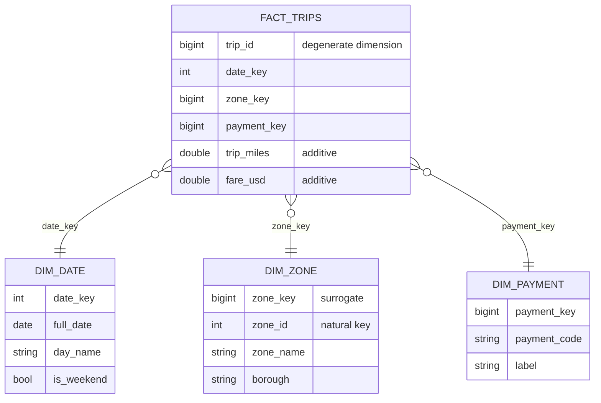
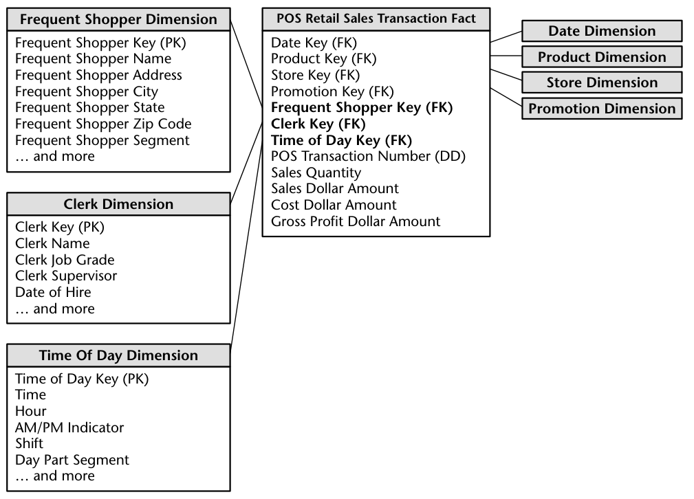
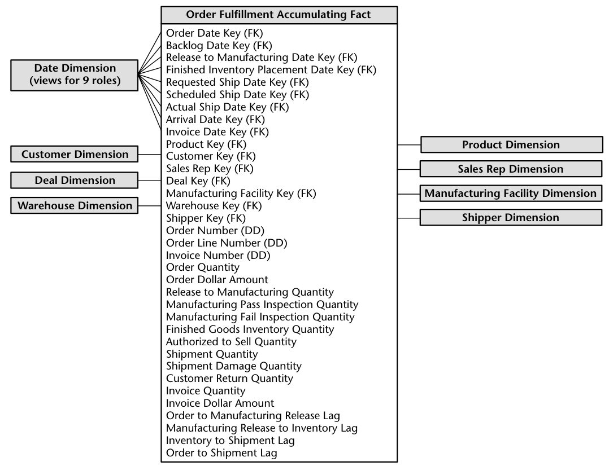

# 2 — Dimensional modelling

> Part one of two. This part covers the grain, the four design decisions and what can be added up. [2b](02b-dimensional-modelling-history-and-conformed-dimensions.md) covers slowly changing dimensions, dimension shapes, conformed dimensions and when to leave the star.

Two analysts bring the same metric to the same meeting with two different numbers, and the rest of the hour is spent finding out why. Kimball and Ross put that scene near the top of their list of what a warehouse is for, and it is still the best test of a model. A dimensional model is a small set of agreements about what one row means, what can be added up, and what a label meant on the day the event happened. Each section below breaks one of those agreements on a million synthetic taxi trips and shows the number that comes out wrong.

## The problem with reporting off the source

The ingest chapter left us with raw copies of operational tables. Those tables are normalized for writing: a trip row holds a zone id, the zone table holds a name and a borough, and a payment code means whatever the application code says it means. That shape protects updates and is poor for reading, because each question means working out the joins again, and each analyst works them out slightly differently.

Kimball's architecture separates the kitchen from the dining room ([*The Data Warehouse Toolkit*](https://www.kimballgroup.com/data-warehouse-business-intelligence-resources/books/), 2nd ed., ch. 1). Staging is where the cooking happens, and no one eats there: it is off-limits to business users, and a normalized staging database is acceptable but "not the end goal". The presentation layer is what people query, and it is built from two kinds of table. The words *fact* and *dimension* come from joint work by General Mills and Dartmouth in the 1960s and spread through AC Nielsen and IRI in the 1970s, so the idea is older than most of the tools that now implement it. Kimball's rules of thumb for the proportions, which are practitioner experience and not measurements: fact tables take 90 percent or more of the space, dimensions are shallow (often far fewer than 1 million rows) but wide (50 to 100 attributes is common), and one fact table typically has 5 to 15 dimensions (ch. 1).

- A **fact table** holds measurements. Each row is one event at one grain, and the columns are foreign keys plus numbers.
- A **dimension table** holds the words people use to filter and group: names, categories, flags. Dimensions are wide, short and read far more often than they change.

Laid out, a fact in the middle with dimensions around it looks like a star, which gives the design its name. Kleppmann gives the same picture and notes that it is the standard shape of an analytic warehouse ([*Designing Data-Intensive Applications*](https://dataintensive.net/), ch. 3), which is why the column stores of [row and column stores](../../01-storage-and-compute-foundations/notes/03-row-and-column-stores.md) fit it so well: a query touches a handful of the fact's columns and compresses long runs of repeating keys.



Our running source is one month of trips plus a zone lookup. The lookup is deliberately incomplete, because real ones are.

```python
import duckdb, numpy as np, pyarrow as pa

def make_ops(n=1_000_000, seed=7):
    """The operational source: one row per trip, plus a zone lookup with a borough."""
    rng = np.random.default_rng(seed)
    zones = rng.zipf(1.3, n * 2)
    zones = zones[zones <= 260][:n]
    miles = np.round(rng.gamma(2.0, 1.6, n) + 0.1, 2)
    trips = pa.table({
        "trip_id": np.arange(1, n + 1),
        "pickup_at": pa.array((np.datetime64("2026-01-01") + rng.integers(0, 31 * 86400, n) * np.timedelta64(1, "s")).astype("datetime64[s]")),
        "zone_id": zones.astype("int32"),
        "payment_code": rng.choice(np.array(["CRD", "CSH", "APP", "XXX"]), n, p=[.7, .2, .0995, .0005]),
        "trip_miles": miles,
        "fare_usd": np.round(3 + miles * 2.5 + rng.normal(0, 1, n).clip(-2, 8), 2),
    })
    return trips

con = duckdb.connect()
src_trips = make_ops()
boroughs = ["Manhattan", "Queens", "Brooklyn", "Bronx", "Staten Island"]
con.execute("CREATE TABLE src_zones AS SELECT z AS zone_id, 'Zone ' || z AS zone_name, "
            "['Manhattan','Queens','Brooklyn','Bronx','Staten Island'][1 + z % 5] AS borough FROM range(1, 251) t(z)")
print(con.execute("SELECT count(*), count(DISTINCT zone_id), max(zone_id) FROM src_trips").fetchall()[0])
print("zones in lookup:", con.execute("SELECT count(*) FROM src_zones").fetchall()[0][0])
```

```text
(1000000, 260, 260)
zones in lookup: 250
```

Trips use 260 zone ids and the lookup knows 250. Keep that in mind for the next section.

## Four decisions, in order

Kimball's design process is four steps (ch. 2), and the order is the useful part.

1. **Choose the business process.** Pick a process, such as completing a trip, and leave the org chart out of it. A department's "finance model" fills up with the unrelated things finance happens to look at.
2. **Declare the grain.** State in one sentence what a row is: *one row per completed trip*. Kimball's examples are a line item on a till receipt, a line on a doctor's bill, a boarding pass, a daily inventory snapshot and a monthly bank balance. If you cannot say the sentence, you cannot build the table.
3. **Choose the dimensions.** Every candidate must take a single value for each row at the declared grain. A column that takes several values (the tolls on a trip) is telling you the grain is wrong or that it needs its own fact.
4. **Identify the facts.** Keep only numbers true to the grain.

The grain comes first, and at the most atomic level the source can give you. Rolled-up tables answer the questions you predicted, while atomic ones answer those too and the ones nobody has asked yet. Kimball's case study runs on 100 grocery stores and about 60,000 products, and still picks the individual line item.

Kimball's embellished retail schema shows what the atomic grain buys. The frequent-shopper, clerk and time-of-day dimensions are added to the transaction fact as three new foreign keys, and no existing key, fact or application has to change. Had the grain been daily sales by store and product, those three dimensions would not apply to it (ch. 2).


*Image Source: Kimball and Ross, [*The Data Warehouse Toolkit*](https://www.kimballgroup.com/data-warehouse-business-intelligence-resources/books/) (Wiley, 2002), Fig. 2.11*

Here is that design in DuckDB. Each piece carries a decision worth naming.

```python
con.execute("""
CREATE TABLE dim_date AS
SELECT CAST(strftime(d, '%Y%m%d') AS INT) AS date_key, d::DATE AS full_date,
       year(d) AS year, month(d) AS month, dayname(d) AS day_name,
       isodow(d) >= 6 AS is_weekend
FROM generate_series(DATE '2025-01-01', DATE '2027-12-31', INTERVAL 1 DAY) t(d)""")

con.execute("CREATE SEQUENCE zone_sk START 1")
con.execute("""
CREATE TABLE dim_zone AS
SELECT nextval('zone_sk') AS zone_key, zone_id, zone_name, borough FROM src_zones ORDER BY zone_id""")
con.execute("INSERT INTO dim_zone VALUES (-1, -1, 'Unknown', 'Unknown')")   # orphans point here

con.execute("""
CREATE TABLE dim_payment AS
SELECT row_number() OVER (ORDER BY code) AS payment_key, code AS payment_code, label
FROM (VALUES ('CRD','Card'), ('CSH','Cash'), ('APP','App')) t(code, label)""")
con.execute("INSERT INTO dim_payment VALUES (-1, 'XXX', 'Unknown')")

con.execute("""
CREATE TABLE fact_trips AS
SELECT t.trip_id,                       -- degenerate dimension: no table behind it
       CAST(strftime(t.pickup_at, '%Y%m%d') AS INT) AS date_key,
       coalesce(z.zone_key, -1)    AS zone_key,
       coalesce(p.payment_key, -1) AS payment_key,
       t.trip_miles, t.fare_usd
FROM src_trips t
LEFT JOIN dim_zone z    ON t.zone_id = z.zone_id
LEFT JOIN dim_payment p ON t.payment_code = p.payment_code""")
print(con.execute("SELECT count(*) FROM dim_date").fetchall()[0][0], "dates,",
      con.execute("SELECT count(*) FROM dim_zone").fetchall()[0][0], "zones,",
      con.execute("SELECT count(*) FROM fact_trips").fetchall()[0][0], "facts")
print("orphan trips on the Unknown zone:", con.execute("SELECT count(*) FROM fact_trips WHERE zone_key = -1").fetchall()[0][0])
```

```text
1095 dates, 251 zones, 1000000 facts
orphan trips on the Unknown zone: 2187
```

Four details in there are the ones an interviewer asks about.

**Surrogate keys.** `zone_key` is a meaningless integer owned by the warehouse. It buffers us from the source, which may recycle codes or arrive with a second numbering after an acquisition (ch. 2), and the section on history below cannot work without it. It is also cheap. In Kimball's worked retail example (a hypothetical chain: $4 billion a year at a $2.00 average item, so about 2 billion line items a year), four integer keys, a transaction number and four 4-byte facts make a row of only 38 bytes, about 38 GB per billion rows; adding shopper, clerk and time-of-day keys takes it to 48 bytes (ch. 2).

**A row for "we do not know".** The 2187 trips in the ten unlisted zones got key `-1` instead of being dropped. An inner join to the lookup would have made them disappear quietly, so that fares by zone no longer summed to total fares. Kimball uses the same device for "No Promotion in Effect" and "Date to be Determined": the fact keeps a valid key, and the gap is visible as a row someone can count. This is the first place the subject's theme shows up. The model states exactly what it refuses to trust.

**A date dimension built ahead of time.** Calendars do not arrive in events, and a month with no trips would otherwise vanish from a report. Ten years is only about 3,650 rows, so generate it once and generously. Keep time of day out of it: folding minutes in would grow ten years to 5,256,000 rows (3,650 x 1,440), where a separate 1,440-row time-of-day dimension costs nothing (ch. 2).

**A degenerate dimension.** `trip_id` sits in the fact with no table behind it. Everything descriptive about a trip already lives in the other dimensions, and the id still earns its place for tracing a row back to the source. Kimball's example is the transaction number on a till receipt.

Reporting is now one shape of query, whichever question is being asked.

```python
print(con.sql("""
SELECT z.borough, d.is_weekend, count(*) AS trips, round(sum(f.fare_usd)) AS fares
FROM fact_trips f
JOIN dim_zone z ON f.zone_key = z.zone_key
JOIN dim_date d ON f.date_key = d.date_key
JOIN dim_payment p ON f.payment_key = p.payment_key
WHERE p.label = 'Card' AND d.day_name = 'Friday'
GROUP BY ALL ORDER BY fares DESC LIMIT 4"""))
```

```text
┌───────────────┬────────────┬───────┬──────────┐
│    borough    │ is_weekend │ trips │  fares   │
│    varchar    │  boolean   │ int64 │  double  │
├───────────────┼────────────┼───────┼──────────┤
│ Queens        │ false      │ 45070 │ 506863.0 │
│ Brooklyn      │ false      │ 23885 │ 269627.0 │
│ Bronx         │ false      │ 17313 │ 193697.0 │
│ Staten Island │ false      │ 14088 │ 157838.0 │
└───────────────┴────────────┴───────┴──────────┘
```

Notice how little there is to decide. The joins are always fact to dimension on a key, and business words sit in `WHERE` and `GROUP BY`. That sameness is what lets a BI tool generate SQL and lets two analysts reach one answer. If the column list keeps growing past the fifteen or so dimensions Kimball treats as typical, he calls the result a centipede and suggests combining correlated ones into a single dimension (ch. 2).

## The grain, and what breaks it

Nearly every wrong number in a star schema traces back to a grain violation. Suppose finance wants toll charges added to the model, and each tolled trip has two toll rows. The obvious thing is to join them on.

```python
rng = np.random.default_rng(1)
tolled = rng.choice(1_000_000, 80_000, replace=False) + 1
trip_tolls = pa.table({"trip_id": np.repeat(tolled, 2), "toll_usd": np.round(rng.uniform(2, 9, 160_000), 2)})

print("true fares      ", con.execute("SELECT round(sum(fare_usd)) FROM fact_trips").fetchall()[0][0])
print("joined to tolls ", con.execute("""SELECT round(sum(f.fare_usd)) FROM fact_trips f
    LEFT JOIN trip_tolls t USING (trip_id)""").fetchall()[0][0])
print("rolled up first ", con.execute("""SELECT round(sum(f.fare_usd)), round(sum(t.tolls)) FROM fact_trips f
    LEFT JOIN (SELECT trip_id, sum(toll_usd) AS tolls FROM trip_tolls GROUP BY 1) t USING (trip_id)""").fetchall()[0])
```

```text
true fares       11257895.0
joined to tolls  12157075.0
rolled up first  (11257895.0, 879936.0)
```

Revenue went up by 899,180 dollars, 8%, because 80,000 trips now appear twice each. No error was raised, the SQL is valid, and the query reads naturally. The tolls table has a finer grain than the fact, and the join silently multiplied the fact to match. The fix is to roll the finer table up to the fact's grain before joining, or to model tolls as a separate fact at one row per toll. This is the single most common bug in analytics SQL, and a uniqueness test on the primary key after each join is the cheapest protection there is. We write that test in [dbt depth](../../03-transform-and-orchestrate/notes/03-dbt-tests-snapshots-incremental.md).

## What can be added up

Facts come in three kinds (ch. 1, with semi-additive balances in ch. 3):

| Kind | Sums across | Example | Trap |
|---|---|---|---|
| Additive | every dimension | `fare_usd`, `trip_miles` | None. This is what you want. |
| Semi-additive | some dimensions, not time | account balance, vehicles in the depot | Summing a daily balance over a week gives a number that means nothing. Take the average or the last value. |
| Non-additive | no dimension | fare per mile, percentages | Must be recomputed from additive parts |

Kimball's balance example makes the semi-additive trap concrete: daily balances of $50, 50, 100, 100, 100 over a week sum to $400 but average $80, and SQL's `AVG` over a snapshot divides by every row (3 products x 4 stores x 7 dates is 84), where the right divisor is the 7 dates, so the date constraint has to be isolated and its cardinality used (ch. 3). Snapshots are also dense, unlike sparse sales facts: at 60,000 products x 100 stores each load adds about 6 million rows, so Kimball keeps 60 dailies plus 148 weeklies (208 snapshots) instead of 1,095 over three years (ch. 3, hypothetical grocery chain). Store the additive parts of a ratio such as gross margin return on inventory (GMROI) and compute it after summing (ch. 3). Year-to-date and quarter-to-date totals follow the same rule: they are not true to the grain and overstate when summed, so compute them with a date constraint in the query, not in the fact table (ch. 7, general-ledger snapshot). Density can also rule a snapshot out: a daily balance for a bank with 10 million accounts is about 3.65 billion fact rows a year, so Kimball takes point-in-time balances from the transaction fact (columns for a sequence number, a final-row flag and the ending balance) and keeps only a monthly snapshot. That works only while the transaction table is complete, so a late-arriving row forces a sweep forward, and it is invalid for balances that move without transactions, such as brokerage valuations (ch. 9).

Kimball's line on the last row is worth memorizing: the ratio of the sums, not the sum of the ratios. Store the parts and compute the ratio at query time, at whatever level the user has grouped to.

```python
print(con.sql("""
SELECT round(sum(fare_usd) / sum(trip_miles), 2)  AS ratio_of_sums,
       round(avg(fare_usd / trip_miles), 2)       AS avg_of_ratios,
       round(sum(fare_usd / trip_miles))          AS sum_of_ratios
FROM fact_trips"""))
```

```text
┌───────────────┬───────────────┬───────────────┐
│ ratio_of_sums │ avg_of_ratios │ sum_of_ratios │
│    double     │    double     │    double     │
├───────────────┼───────────────┼───────────────┤
│          3.41 │           4.1 │     4101034.0 │
└───────────────┴───────────────┴───────────────┘
```

These are three answers to "what do we charge per mile?". The ratio of sums, 3.41 dollars, is the real one, total fares over total miles. The average of per-trip ratios, 4.10, is a different quantity that weights a one-block trip the same as a run to the airport, and short trips carry a large share of the flag fall. It is a legitimate number if that is what you meant, and a 20% overstatement if it is not. The sum of ratios is nonsense, though it is the one a dashboard tool produces when someone drags a stored `fare_per_mile` column onto a chart with the default aggregation. That is the case for not storing it: leave out the column, and no one can sum it.

Fact tables also come in three structural kinds (ch. 5). A **transaction** fact has one row per event and never changes, like ours. A **periodic snapshot** has one row per entity per period, such as vehicles in service each day. An **accumulating snapshot** has one row per process instance, updated as it moves through milestones, such as order placed, shipped, delivered. The tests in Kimball's comparison table: an accumulating snapshot is the only kind whose rows are revisited and updated, it carries one date key per milestone, and several date columns alone do not make a fact table an accumulating snapshot. It fits short-lived processes with a definite end, while long-lived ones such as bank accounts belong in a periodic snapshot. Because many milestone dates are unknown at first load, the date keys must be surrogates pointing at an "Unknown" row, not literal SQL dates (ch. 5). Real instances run wide: a university applicant pipeline carries 15 role-playing date keys and a health-care billing line seven (ch. 12, ch. 13). Pick by the question you are asked: the transaction fact tells you what happened, the snapshot how things stood.

Kimball's order-fulfilment table is the accumulating snapshot at full size. It carries nine date roles, from the order date to the invoice date, plus quantities for each stage and the lags between them, and its rows are revisited as the order moves (ch. 5). The dates have to be surrogate keys that can point at an Unknown row, because most of them are not known when the row is first loaded.


*Image Source: Kimball and Ross, [*The Data Warehouse Toolkit*](https://www.kimballgroup.com/data-warehouse-business-intelligence-resources/books/) (Wiley, 2002), Fig. 5.10*

What happens when a dimension changes, the shapes that keep one manageable, conformed dimensions and drilling across, and when the star is the wrong tool continue in [part two](02b-dimensional-modelling-history-and-conformed-dimensions.md), which carries on with this script.

## Pitfalls

- **No declared grain.** If no one can say what a row is, the first join will silently change it. Write the sentence in the model's description and test it.
- **Inner joins to dimensions.** They drop rows whose key has no match, and totals stop reconciling with no error. Load with left joins to an Unknown row.
- **Storing ratios.** They will be summed. Store the numerator and denominator.
- **Summing a snapshot across time.** Daily balances added over a month produce an impressive, meaningless figure.
- **Snowflaking by reflex.** Normalising the product dimension in Kimball's retail example saves 2.7 MB (150,000 rows x 18 bytes) beside a fact table that may reach 10 GB, and it costs the user a join per attribute (ch. 2).

## Try it

1. Build a periodic snapshot `fact_zone_day` with one row per zone and day, carrying `trips` and `fares`. Check that its fares reconcile with `fact_trips` to the cent, then explain why `count(*)` no longer gives the number of trips.

The full code for this chapter is in [`practice/02_dimensional_modelling.py`](../practice/02_dimensional_modelling.py).

<details>
<summary>Answers</summary>

1. `CREATE TABLE fact_zone_day AS SELECT date_key, zone_key, count(*) AS trips, sum(fare_usd) AS fares FROM fact_trips GROUP BY 1, 2`. `sum(fares)` matches `sum(fare_usd)` from the fact, allowing for floating point rounding. `count(*)` now counts zone-days, so the trip count is `sum(trips)`. Each grain has its own meaning of "a row".

</details>

## Interview checklist

| Question | Answer |
|---|---|
| What are the steps of dimensional design? | Business process, grain, dimensions, facts, in that order. The grain sentence decides what the others may contain. |
| What is a surrogate key and why use one? | A warehouse-owned meaningless integer. It buffers from source key changes and recycling, and it lets one natural key have several history rows. |
| How do you handle a fact whose dimension is unknown? | Point it at a default row such as key -1 rather than dropping it, so totals reconcile and the gap can be counted. |
| What is a degenerate dimension? | A key in the fact with no dimension table, such as an order number. It is useful for grouping lines and tracing to the source. |
| Additive, semi-additive, non-additive? | Sums across all dimensions, across some but not time, and across none. Store the parts of a ratio and compute it at query time. |
| Why did a join inflate revenue? | A grain mismatch fanned out the fact. Roll up the finer table first or model it as its own fact, and test key uniqueness after joins. |
| Transaction, periodic and accumulating snapshot? | One row per event, per entity and period, or per process instance updated at milestones. |

## Next

[Part two](02b-dimensional-modelling-history-and-conformed-dimensions.md) takes the model through change: slowly changing dimensions, conformed dimensions and drilling across, and when the star is the wrong tool.
