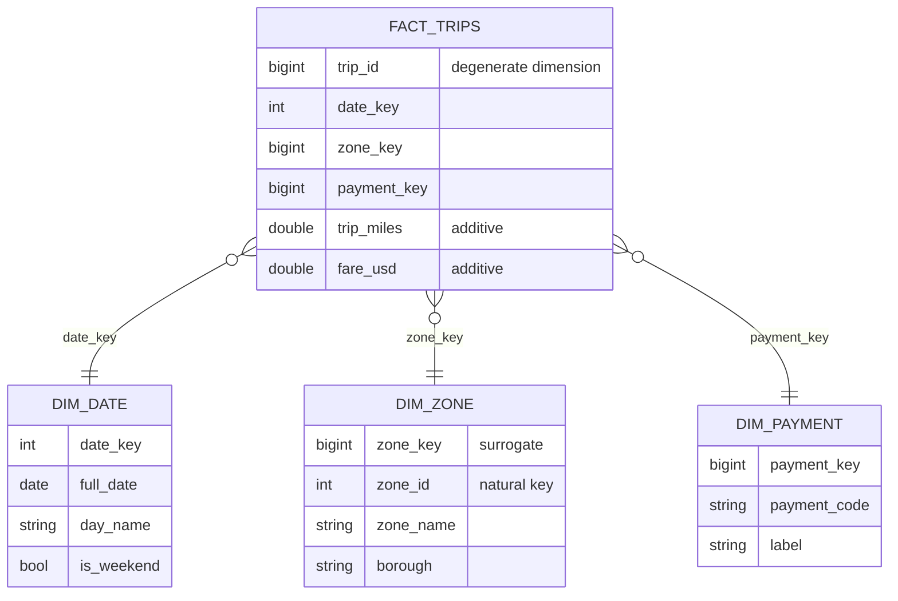

# 2 — Dimensional modelling

Two analysts bring the same metric to the same meeting with two different numbers, and the rest of the hour is spent finding out why. Kimball and Ross put that scene near the top of their list of what a warehouse is for, and it is still the best test of a model. A dimensional model is a small set of agreements about what one row means, what can be added up, and what a label meant on the day the event happened. Each section below breaks one of those agreements on a million synthetic taxi trips and shows the number that comes out wrong.

## The problem with reporting off the source

The ingest chapter left us with raw copies of operational tables. Those tables are normalized for writing: a trip row holds a zone id, the zone table holds a name and a borough, and a payment code means whatever the application code says it means. That shape protects updates and is poor for reading, because each question means working out the joins again, and each analyst works them out slightly differently.

Kimball's architecture separates the kitchen from the dining room ([*The Data Warehouse Toolkit*](https://www.kimballgroup.com/data-warehouse-business-intelligence-resources/books/), 2nd ed., ch. 1). Staging is where the cooking happens, and no one eats there. The presentation layer is what people query, and it is built from two kinds of table. The words *fact* and *dimension* come from joint work by General Mills and Dartmouth in the 1960s and spread through AC Nielsen and IRI in the 1970s, so the idea is older than most of the tools that now implement it.

- A **fact table** holds measurements. Each row is one event at one grain, and the columns are foreign keys plus numbers.
- A **dimension table** holds the words people use to filter and group: names, categories, flags. Dimensions are wide, short and read far more often than they change.

Laid out, a fact in the middle with dimensions around it looks like a star, which gives the design its name. Kleppmann gives the same picture and notes that it is the standard shape of an analytic warehouse ([*Designing Data-Intensive Applications*](https://dataintensive.net/), ch. 3), which is why the column stores of [row and column stores](../../01-storage-and-compute-foundations/notes/03-row-and-column-stores.md) fit it so well: a query touches a handful of the fact's columns and compresses long runs of repeating keys.



Our running source is one month of trips plus a zone lookup. The lookup is deliberately incomplete, because real ones are.

```python
import duckdb, numpy as np, pyarrow as pa

def make_ops(n=1_000_000, seed=7):
    """The operational source: one row per trip, plus a zone lookup with a borough."""
    rng = np.random.default_rng(seed)
    zones = rng.zipf(1.3, n * 2)
    zones = zones[zones <= 260][:n]
    miles = np.round(rng.gamma(2.0, 1.6, n) + 0.1, 2)
    trips = pa.table({
        "trip_id": np.arange(1, n + 1),
        "pickup_at": pa.array((np.datetime64("2026-01-01") + rng.integers(0, 31 * 86400, n) * np.timedelta64(1, "s")).astype("datetime64[s]")),
        "zone_id": zones.astype("int32"),
        "payment_code": rng.choice(np.array(["CRD", "CSH", "APP", "XXX"]), n, p=[.7, .2, .0995, .0005]),
        "trip_miles": miles,
        "fare_usd": np.round(3 + miles * 2.5 + rng.normal(0, 1, n).clip(-2, 8), 2),
    })
    return trips

con = duckdb.connect()
src_trips = make_ops()
boroughs = ["Manhattan", "Queens", "Brooklyn", "Bronx", "Staten Island"]
con.execute("CREATE TABLE src_zones AS SELECT z AS zone_id, 'Zone ' || z AS zone_name, "
            "['Manhattan','Queens','Brooklyn','Bronx','Staten Island'][1 + z % 5] AS borough FROM range(1, 251) t(z)")
print(con.execute("SELECT count(*), count(DISTINCT zone_id), max(zone_id) FROM src_trips").fetchall()[0])
print("zones in lookup:", con.execute("SELECT count(*) FROM src_zones").fetchall()[0][0])
```

```text
(1000000, 260, 260)
zones in lookup: 250
```

Trips use 260 zone ids and the lookup knows 250. Keep that in mind for the next section.

## Four decisions, in order

Kimball's design process is four steps (ch. 2), and the order is the useful part.

1. **Choose the business process.** Pick a process, such as completing a trip, and leave the org chart out of it. A department's "finance model" fills up with the unrelated things finance happens to look at.
2. **Declare the grain.** State in one sentence what a row is: *one row per completed trip*. Kimball's examples are a line item on a till receipt, a line on a doctor's bill, a boarding pass, a daily inventory snapshot and a monthly bank balance. If you cannot say the sentence, you cannot build the table.
3. **Choose the dimensions.** Every candidate must take a single value for each row at the declared grain. A column that takes several values (the tolls on a trip) is telling you the grain is wrong or that it needs its own fact.
4. **Identify the facts.** Keep only numbers true to the grain.

The grain comes first, and at the most atomic level the source can give you. Rolled-up tables answer the questions you predicted, while atomic ones answer those too and the ones nobody has asked yet. Kimball's case study runs on 100 grocery stores and about 60,000 products, and still picks the individual line item.

Here is that design in DuckDB. Each piece carries a decision worth naming.

```python
con.execute("""
CREATE TABLE dim_date AS
SELECT CAST(strftime(d, '%Y%m%d') AS INT) AS date_key, d::DATE AS full_date,
       year(d) AS year, month(d) AS month, dayname(d) AS day_name,
       isodow(d) >= 6 AS is_weekend
FROM generate_series(DATE '2025-01-01', DATE '2027-12-31', INTERVAL 1 DAY) t(d)""")

con.execute("CREATE SEQUENCE zone_sk START 1")
con.execute("""
CREATE TABLE dim_zone AS
SELECT nextval('zone_sk') AS zone_key, zone_id, zone_name, borough FROM src_zones ORDER BY zone_id""")
con.execute("INSERT INTO dim_zone VALUES (-1, -1, 'Unknown', 'Unknown')")   # orphans point here

con.execute("""
CREATE TABLE dim_payment AS
SELECT row_number() OVER (ORDER BY code) AS payment_key, code AS payment_code, label
FROM (VALUES ('CRD','Card'), ('CSH','Cash'), ('APP','App')) t(code, label)""")
con.execute("INSERT INTO dim_payment VALUES (-1, 'XXX', 'Unknown')")

con.execute("""
CREATE TABLE fact_trips AS
SELECT t.trip_id,                       -- degenerate dimension: no table behind it
       CAST(strftime(t.pickup_at, '%Y%m%d') AS INT) AS date_key,
       coalesce(z.zone_key, -1)    AS zone_key,
       coalesce(p.payment_key, -1) AS payment_key,
       t.trip_miles, t.fare_usd
FROM src_trips t
LEFT JOIN dim_zone z    ON t.zone_id = z.zone_id
LEFT JOIN dim_payment p ON t.payment_code = p.payment_code""")
print(con.execute("SELECT count(*) FROM dim_date").fetchall()[0][0], "dates,",
      con.execute("SELECT count(*) FROM dim_zone").fetchall()[0][0], "zones,",
      con.execute("SELECT count(*) FROM fact_trips").fetchall()[0][0], "facts")
print("orphan trips on the Unknown zone:", con.execute("SELECT count(*) FROM fact_trips WHERE zone_key = -1").fetchall()[0][0])
```

```text
1095 dates, 251 zones, 1000000 facts
orphan trips on the Unknown zone: 2187
```

Four details in there are the ones an interviewer asks about.

**Surrogate keys.** `zone_key` is a meaningless integer owned by the warehouse. It buffers us from the source, which may recycle codes or arrive with a second numbering after an acquisition (ch. 2), and the section on history below cannot work without it.

**A row for "we do not know".** The 2187 trips in the ten unlisted zones got key `-1` instead of being dropped. An inner join to the lookup would have made them disappear quietly, so that fares by zone no longer summed to total fares. Kimball uses the same device for "No Promotion in Effect" and "Date to be Determined": the fact keeps a valid key, and the gap is visible as a row someone can count. This is the first place the subject's theme shows up. The model states exactly what it refuses to trust.

**A date dimension built ahead of time.** Calendars do not arrive in events, and a month with no trips would otherwise vanish from a report. Ten years is only about 3,650 rows, so generate it once and generously.

**A degenerate dimension.** `trip_id` sits in the fact with no table behind it. Everything descriptive about a trip already lives in the other dimensions, and the id still earns its place for tracing a row back to the source. Kimball's example is the transaction number on a till receipt.

Reporting is now one shape of query, whichever question is being asked.

```python
print(con.sql("""
SELECT z.borough, d.is_weekend, count(*) AS trips, round(sum(f.fare_usd)) AS fares
FROM fact_trips f
JOIN dim_zone z ON f.zone_key = z.zone_key
JOIN dim_date d ON f.date_key = d.date_key
JOIN dim_payment p ON f.payment_key = p.payment_key
WHERE p.label = 'Card' AND d.day_name = 'Friday'
GROUP BY ALL ORDER BY fares DESC LIMIT 4"""))
```

```text
┌───────────────┬────────────┬───────┬──────────┐
│    borough    │ is_weekend │ trips │  fares   │
│    varchar    │  boolean   │ int64 │  double  │
├───────────────┼────────────┼───────┼──────────┤
│ Queens        │ false      │ 45070 │ 506863.0 │
│ Brooklyn      │ false      │ 23885 │ 269627.0 │
│ Bronx         │ false      │ 17313 │ 193697.0 │
│ Staten Island │ false      │ 14088 │ 157838.0 │
└───────────────┴────────────┴───────┴──────────┘
```

Notice how little there is to decide. The joins are always fact to dimension on a key, and business words sit in `WHERE` and `GROUP BY`. That sameness is what lets a BI tool generate SQL and lets two analysts reach one answer. If the column list keeps growing past the fifteen or so dimensions Kimball treats as typical, he calls the result a centipede and suggests combining correlated ones into a single dimension (ch. 2).

## The grain, and what breaks it

Nearly every wrong number in a star schema traces back to a grain violation. Suppose finance wants toll charges added to the model, and each tolled trip has two toll rows. The obvious thing is to join them on.

```python
rng = np.random.default_rng(1)
tolled = rng.choice(1_000_000, 80_000, replace=False) + 1
trip_tolls = pa.table({"trip_id": np.repeat(tolled, 2), "toll_usd": np.round(rng.uniform(2, 9, 160_000), 2)})

print("true fares      ", con.execute("SELECT round(sum(fare_usd)) FROM fact_trips").fetchall()[0][0])
print("joined to tolls ", con.execute("""SELECT round(sum(f.fare_usd)) FROM fact_trips f
    LEFT JOIN trip_tolls t USING (trip_id)""").fetchall()[0][0])
print("rolled up first ", con.execute("""SELECT round(sum(f.fare_usd)), round(sum(t.tolls)) FROM fact_trips f
    LEFT JOIN (SELECT trip_id, sum(toll_usd) AS tolls FROM trip_tolls GROUP BY 1) t USING (trip_id)""").fetchall()[0])
```

```text
true fares       11257895.0
joined to tolls  12157075.0
rolled up first  (11257895.0, 879936.0)
```

Revenue went up by 899,180 dollars, 8%, because 80,000 trips now appear twice each. No error was raised, the SQL is valid, and the query reads naturally. The tolls table has a finer grain than the fact, and the join silently multiplied the fact to match. The fix is to roll the finer table up to the fact's grain before joining, or to model tolls as a separate fact at one row per toll. This is the single most common bug in analytics SQL, and a uniqueness test on the primary key after each join is the cheapest protection there is. We write that test in [dbt depth](../../03-transform-and-orchestrate/notes/03-dbt-tests-snapshots-incremental.md).

## What can be added up

Facts come in three kinds (ch. 1, with semi-additive balances in ch. 3):

| Kind | Sums across | Example | Trap |
|---|---|---|---|
| Additive | every dimension | `fare_usd`, `trip_miles` | None. This is what you want. |
| Semi-additive | some dimensions, not time | account balance, vehicles in the depot | Summing a daily balance over a week gives a number that means nothing. Take the average or the last value. |
| Non-additive | no dimension | fare per mile, percentages | Must be recomputed from additive parts |

Kimball's line on the last row is worth memorizing: the ratio of the sums, not the sum of the ratios. Store the parts and compute the ratio at query time, at whatever level the user has grouped to.

```python
print(con.sql("""
SELECT round(sum(fare_usd) / sum(trip_miles), 2)  AS ratio_of_sums,
       round(avg(fare_usd / trip_miles), 2)       AS avg_of_ratios,
       round(sum(fare_usd / trip_miles))          AS sum_of_ratios
FROM fact_trips"""))
```

```text
┌───────────────┬───────────────┬───────────────┐
│ ratio_of_sums │ avg_of_ratios │ sum_of_ratios │
│    double     │    double     │    double     │
├───────────────┼───────────────┼───────────────┤
│          3.41 │           4.1 │     4101034.0 │
└───────────────┴───────────────┴───────────────┘
```

These are three answers to "what do we charge per mile?". The ratio of sums, 3.41 dollars, is the real one, total fares over total miles. The average of per-trip ratios, 4.10, is a different quantity that weights a one-block trip the same as a run to the airport, and short trips carry a large share of the flag fall. It is a legitimate number if that is what you meant, and a 20% overstatement if it is not. The sum of ratios is nonsense, though it is the one a dashboard tool produces when someone drags a stored `fare_per_mile` column onto a chart with the default aggregation. That is the case for not storing it: leave out the column, and no one can sum it.

Fact tables also come in three structural kinds (ch. 5). A **transaction** fact has one row per event and never changes, like ours. A **periodic snapshot** has one row per entity per period, such as vehicles in service each day. An **accumulating snapshot** has one row per process instance, updated as it moves through milestones, such as order placed, shipped, delivered. Pick by the question you are asked: the transaction fact tells you what happened, the snapshot how things stood.

## History: slowly changing dimensions

Dimensions do change. In Kimball's example, a product called IntelliKidz 1.0 moves from Education to Strategy on January 15th (ch. 4; the Kimball Group keeps a [summary of the techniques](https://www.kimballgroup.com/data-warehouse-business-intelligence-resources/kimball-techniques/dimensional-modeling-techniques/) online). The question is what happens to last quarter's Education numbers, and only the business can answer it. The modeller's job is to make the answer a deliberate choice for each attribute. Kimball named the three responses in 1994, and the type numbers have stuck.

Our version: the city redraws a boundary, and zone 6 moves from Queens to Brooklyn on January 15th.

**Type 1, overwrite.** Update the row. It takes one line and keeps no history.

```python
con.execute("CREATE TABLE dim_zone_t1 AS SELECT * FROM dim_zone")
before = con.execute("""SELECT round(sum(fare_usd)) FROM fact_trips f JOIN dim_zone_t1 z USING (zone_key)
    WHERE z.borough = 'Brooklyn'""").fetchall()[0][0]
con.execute("UPDATE dim_zone_t1 SET borough = 'Brooklyn' WHERE zone_id = 6")  # the city redraws a boundary
after = con.execute("""SELECT round(sum(fare_usd)) FROM fact_trips f JOIN dim_zone_t1 z USING (zone_key)
    WHERE z.borough = 'Brooklyn'""").fetchall()[0][0]
print("Brooklyn fares for January, as reported before:", before)
print("Brooklyn fares for January, as reported after: ", after)
```

```text
Brooklyn fares for January, as reported before: 2382840.0
Brooklyn fares for January, as reported after:  2710631.0
```

January's Brooklyn revenue changed by about 328,000 dollars, for days already reported and possibly already invoiced, with no record that anything happened. Type 1 is correct for corrections, such as fixing a misspelled zone name, where the old value was simply wrong. It is wrong for anything people compare over time, and anything built on top, such as an aggregate table, now needs rebuilding.

**Type 2, add a row.** Keep the old row, close it, and open a new one with a new surrogate key. This is the point of surrogate keys, since one natural key now has several rows. Kimball detects a change by comparing a row hash, which spares comparing each column one at a time (ch. 4).

```python
con.execute("CREATE SEQUENCE zone_v_sk START 1")
con.execute("""
CREATE TABLE dim_zone_v (zone_key BIGINT, zone_id INT, zone_name VARCHAR, borough VARCHAR,
                         row_hash UBIGINT, valid_from DATE, valid_to DATE, is_current BOOLEAN)""")

def apply_scd2(source_sql, load_date):
    """Close the current row of any changed zone, then open a new one. Rerunning changes nothing."""
    con.execute(f"""CREATE OR REPLACE TEMP TABLE incoming AS
        SELECT *, hash(zone_name, borough) AS row_hash FROM ({source_sql})""")
    con.execute("""UPDATE dim_zone_v d SET valid_to = ?, is_current = false
        FROM incoming i
        WHERE d.zone_id = i.zone_id AND d.is_current AND d.row_hash <> i.row_hash""", [load_date])
    con.execute("""INSERT INTO dim_zone_v
        SELECT nextval('zone_v_sk'), i.zone_id, i.zone_name, i.borough, i.row_hash,
               ?::DATE, DATE '9999-12-31', true
        FROM incoming i
        LEFT JOIN dim_zone_v d ON d.zone_id = i.zone_id AND d.is_current
        WHERE d.zone_id IS NULL""", [load_date])

apply_scd2("SELECT * FROM src_zones", "2025-01-01")
changed = """SELECT zone_id, zone_name, CASE WHEN zone_id = 6 THEN 'Brooklyn' ELSE borough END AS borough FROM src_zones"""
apply_scd2(changed, "2026-01-15")
apply_scd2(changed, "2026-01-15")     # a retry
print(con.sql("SELECT zone_key, zone_id, borough, valid_from, valid_to, is_current FROM dim_zone_v WHERE zone_id = 6 ORDER BY 1"))
print("rows in dimension:", con.execute("SELECT count(*) FROM dim_zone_v").fetchall()[0][0])
```

```text
┌──────────┬─────────┬──────────┬────────────┬────────────┬────────────┐
│ zone_key │ zone_id │ borough  │ valid_from │  valid_to  │ is_current │
│  int64   │  int32  │ varchar  │    date    │    date    │  boolean   │
├──────────┼─────────┼──────────┼────────────┼────────────┼────────────┤
│        6 │       6 │ Queens   │ 2025-01-01 │ 2026-01-15 │ false      │
│      251 │       6 │ Brooklyn │ 2026-01-15 │ 9999-12-31 │ true       │
└──────────┴─────────┴──────────┴────────────┴────────────┴────────────┘

rows in dimension: 251
```

Three properties of that output matter. The dimension grew by exactly one row, 250 zones became 251 rows, because attributes that did not change do not create history. The retry changed nothing, because a re-run finds a matching hash and no missing row. A pipeline that retries, and all of them do, needs this property; [idempotency and backfills](../../03-transform-and-orchestrate/notes/04-idempotency-and-backfills.md) generalizes it. And the two validity dates form an unbroken chain with no overlap, which is what lets the next step look up the right row.

Facts now take their key from the dimension row that was current when the event happened. Nothing else in the design needs to know.

```python
con.execute("""
CREATE TABLE fact_trips_v AS
SELECT t.trip_id, CAST(strftime(t.pickup_at, '%Y%m%d') AS INT) AS date_key,
       coalesce(z.zone_key, -1) AS zone_key, t.fare_usd
FROM src_trips t
LEFT JOIN dim_zone_v z ON t.zone_id = z.zone_id
     AND t.pickup_at::DATE >= z.valid_from AND t.pickup_at::DATE < z.valid_to""")
print("zone 6, grouped by the borough at the time of the trip")
print(con.sql("""SELECT z.borough, count(*) AS trips, min(f.date_key) AS first_day, max(f.date_key) AS last_day
    FROM fact_trips_v f JOIN dim_zone_v z USING (zone_key) WHERE z.zone_id = 6 GROUP BY 1 ORDER BY 3"""))
print("zone 6, restated to today's borough through the natural key")
print(con.sql("""SELECT cur.borough, count(*) AS trips
    FROM fact_trips_v f JOIN dim_zone_v z USING (zone_key)
    JOIN dim_zone_v cur ON cur.zone_id = z.zone_id AND cur.is_current
    WHERE z.zone_id = 6 GROUP BY 1"""))
```

```text
zone 6, grouped by the borough at the time of the trip
┌──────────┬───────┬───────────┬──────────┐
│ borough  │ trips │ first_day │ last_day │
│ varchar  │ int64 │   int32   │  int32   │
├──────────┼───────┼───────────┼──────────┤
│ Queens   │ 13251 │  20260101 │ 20260114 │
│ Brooklyn │ 15998 │  20260115 │ 20260131 │
└──────────┴───────┴───────────┴──────────┘

zone 6, restated to today's borough through the natural key
┌──────────┬───────┐
│ borough  │ trips │
│ varchar  │ int64 │
├──────────┼───────┤
│ Brooklyn │ 29249 │
└──────────┴───────┘
```

Both questions are now answerable. Grouped through the fact's own key, you get history as it was: 13,251 trips counted in Queens up to the 14th and 15,998 in Brooklyn from the 15th. Joined back through the natural key to the current row, you get history restated to today's map, all 29,249 in Brooklyn. Kimball's warning here matters for query writers: facts already carry the right key, so do not constrain them with the effective dates in ordinary queries. The dates exist for load logic and as-of lookups of the dimension itself.

That range join is also the answer to **late-arriving facts**. A trip dated January 10th that lands on January 20th looks up by its event date, finds zone key 6, and reports under Queens as it should. The only remaining work is inserting it into the right partition (ch. 13). If it would change a period finance already closed, you need a policy, and Kimball describes keeping two date keys, the event date and the booking date, so that both views tie out. **Late-arriving dimension rows** are the harder case. You learn on the 20th that the change took effect on the 10th, so you insert a row with a new key, fix the dates, and repoint the fact rows in that interval. It is messy and Kimball says so. Surrogate keys in a fact are not ordered by time, so do not rely on their order.

**Type 3, add a column.** Store `prior_borough` beside `borough`. It supports one "before and after" view and is rarely used (ch. 4). Use it for one planned reorganization, when the business wants to compare old and new side by side for a while.

| Type | Mechanism | History | Fact table impact | Use for |
|---|---|---|---|---|
| 1 | Overwrite | Gone | None, but past reports change | Corrections |
| 2 | New row and new key | Full | New facts get new keys; old facts untouched | Anything compared over time |
| 3 | New column | One step | None | A single planned before and after |

The trade-offs in row growth are real. Kimball warns about Type 2 on a rapidly changing attribute, since a dimension of millions of customers with one volatile column can grow past the point where it is a dimension. Split the volatile columns into their own dimension. In dbt you do not write `apply_scd2` by hand: a [snapshot](https://docs.getdbt.com/docs/build/snapshots) generates it, with `dbt_valid_from` and `dbt_valid_to` in place of our two columns. It is still worth writing once, so that when a snapshot does something surprising you know what it is doing.

Streaming has the same problem under another name. Kleppmann's example is applying a tax rate to a past sale: if you join to the rate as it is now, a rerun gives a different answer, so the join is not deterministic (pp. 475-476). His fix is the Type 2 idea, giving each version of the rate an identifier and referring to it from the sale. He also names the cost that a warehouse rarely feels and a log does, which is that with every version needed forever, log compaction cannot throw any of them away (p. 476). That is the same row growth as above, and the reason streaming pipelines tend to prefer a versioned dimension table to an endless changelog.

## Conformed dimensions and drilling across

One star is a report, while an enterprise warehouse is many stars that can be compared. Kimball's answer is the **bus architecture** (ch. 3): dimensions are built once and shared, so `dim_zone` means the same in trips, in driver shifts and in vehicle inspections. Planning happens on a **bus matrix**, business processes down the side and dimensions across the top, with a tick where a process uses a dimension. His retail example has rows such as Retail Sales, Retail Inventory and Purchase Orders against columns such as Date, Product, Store and Vendor. A single page makes the integration plan visible before anyone writes a pipeline.

| Process | Date | Zone | Payment | Vehicle | Driver |
|---|---|---|---|---|---|
| Trips | x | x | x | x | x |
| Driver shifts | x | x | | | x |
| Vehicle inspections | x | | | x | |

Conformed dimensions give you a safe way to combine facts, and a tempting wrong way sits right next to it. Add a shifts fact at one row per zone, day and shift, then ask for fares and drivers by zone.

```python
con.execute("""
CREATE TABLE fact_shifts AS
SELECT d.date_key, z.zone_key, (1 + (hash(d.date_key, z.zone_key) % 40))::INT AS drivers_on_shift, s.shift
FROM dim_date d CROSS JOIN dim_zone z CROSS JOIN (VALUES ('day'), ('night')) s(shift)
WHERE d.year = 2026 AND d.month = 1 AND z.zone_key > 0""")

wrong = con.execute("""SELECT round(sum(f.fare_usd)), sum(s.drivers_on_shift)
    FROM fact_trips f JOIN fact_shifts s USING (date_key, zone_key)""").fetchall()[0]
right = con.execute("""
WITH t AS (SELECT zone_key, sum(fare_usd) AS fares FROM fact_trips WHERE zone_key > 0 GROUP BY 1),
     s AS (SELECT zone_key, sum(drivers_on_shift) AS drivers FROM fact_shifts GROUP BY 1)
SELECT round(sum(t.fares)), sum(s.drivers) FROM t JOIN s USING (zone_key)""").fetchall()[0]
print("fact joined to fact:", wrong)
print("drill across:       ", right)
print("true:               ", con.execute("SELECT round(sum(fare_usd)) FROM fact_trips WHERE zone_key > 0").fetchall()[0][0],
      con.execute("SELECT sum(drivers_on_shift) FROM fact_shifts").fetchall()[0][0])
```

```text
fact joined to fact: (22466405.0, 42499888)
drill across:        (11233203.0, 314322)
true:                11233203.0 314322
```

Joining fact to fact doubled the fares, because each day and zone has two shifts, and it inflated drivers by more than a hundred times, because each shift row repeated once per trip. Both errors are the fan-out from earlier, this time in both directions at once. **Drilling across** means aggregating each fact to the shared dimension first and then joining the results, and that returns the true totals exactly. A BI tool's semantic layer does the same for you, if the model tells it which facts and dimensions conform.

## When the star is the wrong tool

Stars are built for analytical questions, and some other uses do not fit them. They are slower to change than a raw layer, they take design effort before value, and they assume someone owns the conformed dimensions. When many source systems need to be integrated and audited, the next chapter's Data Vault separates integration from presentation. When a team has one consumer and a modern column store, the same chapter's One Big Table is often cheaper. Neither removes the need to know what a row means, so the grain sentence survives every alternative.

Two remarks from Kleppmann put the star in a wider frame. An event log and a fact table resemble each other, since both record immutable facts at a fine grain and derive everything else (p. 458). And once a read shape can be derived from a log, the question of whether to normalise or denormalise loses most of its force, because you can have both: normalised at the system of record, denormalised wherever it is read (p. 462). The [first chapter of this subject](../../01-storage-and-compute-foundations/notes/01-data-systems-and-data-models.md) sets out why normalisation exists at all. Dimensional modelling is the discipline of deciding what the derived shape should be.

## Pitfalls

- **No declared grain.** If no one can say what a row is, the first join will silently change it. Write the sentence in the model's description and test it.
- **Inner joins to dimensions.** They drop rows whose key has no match, and totals stop reconciling with no error. Load with left joins to an Unknown row.
- **Natural keys in the fact.** They look simpler until the first Type 2 change, when one id maps to several rows and each join fans out.
- **Storing ratios.** They will be summed. Store the numerator and denominator.
- **Summing a snapshot across time.** Daily balances added over a month produce an impressive, meaningless figure.
- **Type 1 by default.** An `UPDATE` on a dimension rewrites published history. Choose per attribute, and ask the people who read the reports.
- **Fact-to-fact joins.** Always drill across through conformed dimensions.
- **Modelling the org chart.** A "marketing mart" with copies of everything breeds exactly the two-numbers meeting this whole design exists to prevent.

## Try it

1. Build a periodic snapshot `fact_zone_day` with one row per zone and day, carrying `trips` and `fares`. Check that its fares reconcile with `fact_trips` to the cent, then explain why `count(*)` no longer gives the number of trips.
2. Run the trip of January 10th through the range join, as a late-arriving fact in zone 6. Which `zone_key` does it get, and which borough does it report under?
3. Add a Type 3 `prior_borough` column to a copy of `dim_zone` and write the query comparing January fares by old and new borough. Why is this cheaper than Type 2 for this question, and what can it not answer?

The full code for this chapter is in [`practice/02_dimensional_modelling.py`](../practice/02_dimensional_modelling.py).

<details>
<summary>Answers</summary>

1. `CREATE TABLE fact_zone_day AS SELECT date_key, zone_key, count(*) AS trips, sum(fare_usd) AS fares FROM fact_trips GROUP BY 1, 2`. `sum(fares)` matches `sum(fare_usd)` from the fact, allowing for floating point rounding. `count(*)` now counts zone-days, so the trip count is `sum(trips)`. Each grain has its own meaning of "a row".
2. It gets `zone_key` 6, the row valid from 2025-01-01 to 2026-01-15, and reports under Queens. The join compares the event date with the validity range and never looks at the load date. That is why the late fact needs no special case.
3. `ALTER TABLE` plus one `UPDATE`: `prior_borough` takes the old value on the changed row. The dimension does not grow, and each fact can be grouped by either column with no new keys. It cannot say which borough a given trip belonged to on its date, and it holds one prior value only, so a second move loses the first.

</details>

## Interview checklist

| Question | Answer |
|---|---|
| What are the steps of dimensional design? | Business process, grain, dimensions, facts, in that order. The grain sentence decides what the others may contain. |
| What is a surrogate key and why use one? | A warehouse-owned meaningless integer. It buffers from source key changes and recycling, and it lets one natural key have several history rows. |
| How do you handle a fact whose dimension is unknown? | Point it at a default row such as key -1 rather than dropping it, so totals reconcile and the gap can be counted. |
| What is a degenerate dimension? | A key in the fact with no dimension table, such as an order number. It is useful for grouping lines and tracing to the source. |
| Additive, semi-additive, non-additive? | Sums across all dimensions, across some but not time, and across none. Store the parts of a ratio and compute it at query time. |
| SCD Types 1, 2, 3? | Overwrite and lose history; new row with new key and full history; new column with one prior value. Chosen per attribute. |
| Why does Type 2 need no change to fact queries? | The fact row holds the surrogate key of the version in force at event time, so a plain key join gives history as it was. |
| How do you restate Type 2 history to current values? | Join through the natural key to the row with `is_current`. |
| How do you load a late-arriving fact? | Look up the dimension by event date within the validity range, use that key, write into the correct partition. |
| Why did a join inflate revenue? | A grain mismatch fanned out the fact. Roll up the finer table first or model it as its own fact, and test key uniqueness after joins. |
| What is a conformed dimension? | One dimension shared across facts with identical meaning, the basis for comparing processes. |
| How do you combine two facts? | Drill across: aggregate each to the shared dimensions separately, then join the results. |
| Transaction, periodic and accumulating snapshot? | One row per event, per entity and period, or per process instance updated at milestones. |

## Next

[Data Vault and One Big Table](03-data-vault-and-obt.md) looks at the two alternatives to the star: one that puts more structure in the middle, and one that takes nearly all of it out.
