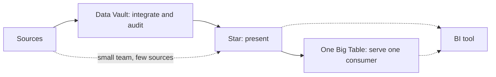

# 3 — Data Vault and One Big Table

The star from the last chapter sits in the middle of a range. Move one way and you pull a model apart into many small tables, so that twenty source systems and years of changing rules can be loaded and audited without anyone redesigning anything. Move the other way and you join everything into one wide table, so that nobody has to write a join at all. Both are used in production for sound reasons, and each is sold with more enthusiasm than the evidence supports. This chapter builds each on the same million trips and measures what they cost, so that the choice rests on your own constraints.

## The same data, three shapes

The source and the star are the ones from [dimensional modelling](02-dimensional-modelling.md), built here in shorter form so this chapter runs alone.

```python
import os, time, duckdb, numpy as np, pyarrow as pa

def make_ops(n=1_000_000, seed=7):
    """The operational source: one row per trip, plus a zone lookup with a borough."""
    rng = np.random.default_rng(seed)
    zones = rng.zipf(1.3, n * 2)
    zones = zones[zones <= 260][:n]
    miles = np.round(rng.gamma(2.0, 1.6, n) + 0.1, 2)
    trips = pa.table({
        "trip_id": np.arange(1, n + 1),
        "pickup_at": pa.array((np.datetime64("2026-01-01") + rng.integers(0, 31 * 86400, n) * np.timedelta64(1, "s")).astype("datetime64[s]")),
        "zone_id": zones.astype("int32"),
        "payment_code": rng.choice(np.array(["CRD", "CSH", "APP", "XXX"]), n, p=[.7, .2, .0995, .0005]),
        "trip_miles": miles,
        "fare_usd": np.round(3 + miles * 2.5 + rng.normal(0, 1, n).clip(-2, 8), 2),
    })
    return trips

con = duckdb.connect()
src_trips = make_ops()
boroughs = ["Manhattan", "Queens", "Brooklyn", "Bronx", "Staten Island"]
con.execute("CREATE TABLE src_zones AS SELECT z AS zone_id, 'Zone ' || z AS zone_name, "
            "['Manhattan','Queens','Brooklyn','Bronx','Staten Island'][1 + z % 5] AS borough FROM range(1, 251) t(z)")

con.execute("""CREATE TABLE dim_zone AS SELECT zone_id AS zone_key, zone_id, zone_name, borough FROM src_zones""")
con.execute("INSERT INTO dim_zone VALUES (-1, -1, 'Unknown', 'Unknown')")
con.execute("""CREATE TABLE dim_date AS SELECT CAST(strftime(d, '%Y%m%d') AS INT) AS date_key, d::DATE AS full_date,
    dayname(d) AS day_name, isodow(d) >= 6 AS is_weekend, month(d) AS month
    FROM generate_series(DATE '2026-01-01', DATE '2026-12-31', INTERVAL 1 DAY) t(d)""")
con.execute("""CREATE TABLE fact_trips AS SELECT trip_id, CAST(strftime(pickup_at, '%Y%m%d') AS INT) AS date_key,
    coalesce(z.zone_key, -1) AS zone_key, payment_code, trip_miles, fare_usd
    FROM src_trips t LEFT JOIN dim_zone z USING (zone_id)""")
print(con.execute("SELECT count(*) FROM fact_trips").fetchall()[0])
```

```text
(1000000,)
```



The diagram holds the main idea of the chapter. These are layers as much as rivals: a shop can load a vault, publish stars from it, and serve some of those stars as wide tables. The question for each layer is whether it pays for itself.

## Data Vault in one section

Data Vault came from Dan Linstedt around 2000, with a 2.0 revision around 2013 described in Linstedt and Olschimke, [*Building a Scalable Data Warehouse with Data Vault 2.0*](https://shop.elsevier.com/books/building-a-scalable-data-warehouse-with-data-vault-20/linstedt/978-0-12-802510-9). This section works from the standard description of the method and has not been checked against that book chapter by chapter, so treat it as the shape of the idea. It splits every source entity into three kinds of table ([overview](https://en.wikipedia.org/wiki/Data_vault_modeling)):

- A **hub** holds a list of business keys and nothing else: each zone id once, with when it was first seen and from where.
- A **link** holds a relationship between hubs: this trip was in this zone.
- A **satellite** holds descriptive attributes and their history, attached to a hub or link. A change adds a row.

Keys are hashes of the business key, so any loader can compute them without looking up a sequence. Rows are only ever inserted.

```python
con.execute("""
CREATE TABLE hub_zone (zone_hk UBIGINT PRIMARY KEY, zone_id INT, load_ts TIMESTAMP, record_source VARCHAR);
CREATE TABLE hub_trip (trip_hk UBIGINT PRIMARY KEY, trip_id BIGINT, load_ts TIMESTAMP, record_source VARCHAR);
CREATE TABLE link_trip_zone (link_hk UBIGINT PRIMARY KEY, trip_hk UBIGINT, zone_hk UBIGINT, load_ts TIMESTAMP, record_source VARCHAR);
CREATE TABLE sat_zone (zone_hk UBIGINT, load_ts TIMESTAMP, hash_diff UBIGINT, zone_name VARCHAR, borough VARCHAR,
                       record_source VARCHAR, PRIMARY KEY (zone_hk, load_ts));
CREATE TABLE sat_trip (trip_hk UBIGINT, load_ts TIMESTAMP, hash_diff UBIGINT, pickup_at TIMESTAMP, payment_code VARCHAR,
                       trip_miles DOUBLE, fare_usd DOUBLE, record_source VARCHAR);
""")
```

The load is mechanical on purpose, and this mechanical quality is the real selling point. Every hub loads the same way, every satellite the same way, so a team can generate them from metadata for hundreds of source tables.

```python
def load_vault(zones_sql, load_ts, source="ops"):
    """Insert-only. Hubs and links add unseen keys; satellites add a row when attributes change."""
    con.execute(f"""INSERT INTO hub_zone
        SELECT DISTINCT hash(zone_id), zone_id, TIMESTAMP '{load_ts}', '{source}' FROM ({zones_sql}) s
        WHERE hash(zone_id) NOT IN (SELECT zone_hk FROM hub_zone)""")
    con.execute(f"""INSERT INTO sat_zone
        WITH latest AS (SELECT zone_hk, arg_max(hash_diff, load_ts) AS hash_diff FROM sat_zone GROUP BY 1)
        SELECT hash(s.zone_id), TIMESTAMP '{load_ts}', hash(s.zone_name, s.borough), s.zone_name, s.borough, '{source}'
        FROM ({zones_sql}) s LEFT JOIN latest l ON l.zone_hk = hash(s.zone_id)
        WHERE l.hash_diff IS NULL OR l.hash_diff <> hash(s.zone_name, s.borough)""")

load_vault("SELECT * FROM src_zones", "2026-01-01 00:00:00")
con.execute(f"""INSERT INTO hub_trip SELECT hash(trip_id), trip_id, TIMESTAMP '2026-02-01', 'ops' FROM src_trips""")
con.execute(f"""INSERT INTO link_trip_zone SELECT hash(trip_id, zone_id), hash(trip_id), hash(zone_id), TIMESTAMP '2026-02-01', 'ops' FROM src_trips""")
con.execute(f"""INSERT INTO sat_trip SELECT hash(trip_id), TIMESTAMP '2026-02-01', hash(fare_usd, trip_miles), pickup_at, payment_code,
    trip_miles, fare_usd, 'ops' FROM src_trips""")

changed = "SELECT zone_id, zone_name, CASE WHEN zone_id = 6 THEN 'Brooklyn' ELSE borough END AS borough FROM src_zones"
load_vault(changed, "2026-01-15 00:00:00")
load_vault(changed, "2026-01-15 00:00:00")   # a retry adds nothing
print(con.sql("SELECT h.zone_id, s.borough, s.load_ts FROM hub_zone h JOIN sat_zone s USING (zone_hk) WHERE h.zone_id = 6 ORDER BY 3"))
print("hub, satellite rows:", con.execute("SELECT (SELECT count(*) FROM hub_zone), (SELECT count(*) FROM sat_zone)").fetchall()[0])
```

```text
┌─────────┬──────────┬─────────────────────┐
│ zone_id │ borough  │       load_ts       │
│  int32  │ varchar  │      timestamp      │
├─────────┼──────────┼─────────────────────┤
│       6 │ Queens   │ 2026-01-01 00:00:00 │
│       6 │ Brooklyn │ 2026-01-15 00:00:00 │
└─────────┴──────────┴─────────────────────┘

hub, satellite rows: (250, 251)
```

Compare that output with the Type 2 dimension from the last chapter. The same boundary change produced the same history, but nothing was updated: the old row was left as it was, and "current" is whichever row has the latest `load_ts`. A retry again added nothing, because the satellite compares `hash_diff` with its latest row. Adding a new source of zone attributes means adding a new satellite and leaves the existing tables alone, and that is the argument for the design: new sources and new rules cost a table each, and do not force a redesign of what exists.

Now the bill. Here is a question the star answers with one join.

```python
vault_sql = """
WITH z AS (SELECT zone_hk, arg_max(borough, load_ts) AS borough FROM sat_zone GROUP BY 1)
SELECT z.borough, count(*) AS trips, round(sum(st.fare_usd)) AS fares
FROM hub_trip ht
JOIN sat_trip st ON st.trip_hk = ht.trip_hk
JOIN link_trip_zone l ON l.trip_hk = ht.trip_hk
JOIN z ON z.zone_hk = l.zone_hk
GROUP BY 1 ORDER BY fares DESC LIMIT 3"""
star_sql = """
SELECT CASE WHEN z.zone_id = 6 THEN 'Brooklyn' ELSE z.borough END AS borough, count(*) AS trips, round(sum(f.fare_usd)) AS fares
FROM fact_trips f JOIN dim_zone z USING (zone_key)
WHERE z.zone_key > 0
GROUP BY 1 ORDER BY fares DESC LIMIT 3"""
def best_ms(sql, n=5):
    out = []
    for _ in range(n):
        t0 = time.perf_counter(); con.execute(sql).fetchall(); out.append((time.perf_counter() - t0) * 1000)
    return min(out)
print(con.sql(vault_sql))
print(con.sql(star_sql))
print(f"vault {best_ms(vault_sql):.0f} ms over 3 joins, star {best_ms(star_sql):.0f} ms over 1 join")
```

```text
┌──────────┬────────┬───────────┐
│ borough  │ trips  │   fares   │
│ varchar  │ int64  │  double   │
├──────────┼────────┼───────────┤
│ Queens   │ 369472 │ 4161174.0 │
│ Brooklyn │ 240648 │ 2710631.0 │
│ Bronx    │ 153256 │ 1723299.0 │
└──────────┴────────┴───────────┘

┌──────────┬────────┬───────────┐
│ borough  │ trips  │   fares   │
│ varchar  │ int64  │  double   │
├──────────┼────────┼───────────┤
│ Queens   │ 369472 │ 4161174.0 │
│ Brooklyn │ 240648 │ 2710631.0 │
│ Bronx    │ 153256 │ 1723299.0 │
└──────────┴────────┴───────────┘

vault 28 ms over 3 joins, star 3 ms over 1 join
```

The answers match exactly. The vault query needed three joins and an aggregate over the satellite to find current values, where the star needed one join (with a `CASE` standing in for the boundary change, as our `dim_zone` here is unversioned), and it ran about ten times slower in this one run on a busy laptop. The exact ratio is not the point, as this is one machine and small data. The point is the shape: three joins for one attribute means nobody should be asked to query this directly, and the method does not ask them to. Vault practice publishes information marts, usually stars, on top, and adds point-in-time and bridge tables to speed up reads.

That gives the honest verdict. Vault pays when you have many overlapping sources, sources that change often, and an obligation to show auditors exactly what was received and when. A large bank is the clearest fit. It does not pay for a startup with six source tables, where it means building the star anyway, plus a layer under it that no reader will touch. The raw, insert-only staging layer in [idempotency and backfills](../../03-transform-and-orchestrate/notes/04-idempotency-and-backfills.md) gives you most of the audit benefit at a fraction of the design cost.

## One Big Table

One Big Table (OBT) goes the other way. Pre-join every dimension onto the fact and store the result, so each attribute becomes a column and every question a filter and a group by. It became reasonable only with columnar storage. As [row and column stores](../../01-storage-and-compute-foundations/notes/02-row-and-column-stores.md) showed, a column of `borough` with long runs of the same value compresses to nearly nothing and an unread column costs almost no I/O, so the two old objections to denormalization are both much weaker than they were.

```python
con.execute("""
CREATE TABLE obt_trips AS
SELECT f.trip_id, f.trip_miles, f.fare_usd, f.payment_code, d.full_date, d.day_name, d.is_weekend, d.month,
       z.zone_id, z.zone_name, z.borough
FROM fact_trips f JOIN dim_date d USING (date_key) JOIN dim_zone z USING (zone_key)""")
con.execute("COPY fact_trips TO 'fact.parquet' (FORMAT parquet, COMPRESSION zstd)")
con.execute("COPY dim_date TO 'dim_date.parquet' (FORMAT parquet, COMPRESSION zstd)")
con.execute("COPY dim_zone TO 'dim_zone.parquet' (FORMAT parquet, COMPRESSION zstd)")
con.execute("COPY obt_trips TO 'obt.parquet' (FORMAT parquet, COMPRESSION zstd)")
star_mb = sum(os.path.getsize(f) for f in ["fact.parquet", "dim_date.parquet", "dim_zone.parquet"]) / 1e6
print(f"star {star_mb:.1f} MB, one big table {os.path.getsize('obt.parquet') / 1e6:.1f} MB")
```

```text
star 5.6 MB, one big table 7.0 MB
```

Twenty-five percent more storage on this data, for strings repeated a million times. Dictionary and run-length encoding absorbed most of the repetition. A row store, which keeps each repeated string in full, would have paid far more.

```python
q_star = """SELECT z.borough, d.is_weekend, round(sum(f.fare_usd)) FROM 'fact.parquet' f
    JOIN 'dim_zone.parquet' z USING (zone_key) JOIN 'dim_date.parquet' d USING (date_key)
    WHERE d.month = 1 AND f.payment_code = 'CRD' GROUP BY ALL"""
q_obt = """SELECT borough, is_weekend, round(sum(fare_usd)) FROM 'obt.parquet'
    WHERE month = 1 AND payment_code = 'CRD' GROUP BY ALL"""
print("same answer:", sorted(con.execute(q_star).fetchall()) == sorted(con.execute(q_obt).fetchall()))
print(f"star {best_ms(q_star):.1f} ms, one big table {best_ms(q_obt):.1f} ms")
```

```text
same answer: True
star 4.4 ms, one big table 3.5 ms
```

The same question, with no joins. One big table wins on this query, by a margin too small to matter on data this size. So we should look for better numbers than a laptop can provide.

The best public measurement I know of is Michael Kaminsky's [Star Schema vs OBT](https://www.fivetran.com/blog/star-schema-vs-obt) for Fivetran (2022; a vendor blog, though the vendor has no stake in the outcome). He took a subset of TPC-DS at scale 100, ran ten BI-style queries, and compared a star with a denormalized table on Redshift, Snowflake and BigQuery:

| Warehouse | Setup | Denormalized vs star |
|---|---|---|
| Redshift | dc2.large 1 node; dc2.8xlarge 3 nodes | 25-30% faster excluding compile time. Lost only on query 4. |
| Snowflake | X-Large | About 25% faster. The star won simple queries 3, 4 and 7. |
| BigQuery | Default | About 49% faster on average. |

The storage cost was much larger than ours: on Redshift the wide table took 60,250 MB against 29,778 MB for `store_sales`, and total disk went from a bit over 30 GB to over 90. Kaminsky calls that a likely worst case, because the dbt build could not apply column encodings. He also says the star keeps real advantages in organizing an ELT pipeline and in navigability, and suggests modelling a star first and then joining it back up for end users. Take that benchmark as evidence that OBT is faster for reads by a useful but not spectacular margin, on the queries he chose, and not as evidence that stars are obsolete.

## What OBT costs when something changes

A read benchmark misses the main cost. Run the boundary change again, in both shapes.

```python
t0 = time.perf_counter()
con.execute("UPDATE dim_zone SET borough = 'Brooklyn' WHERE zone_id = 6")
star_ms = (time.perf_counter() - t0) * 1000
t0 = time.perf_counter()
n = con.execute("UPDATE obt_trips SET borough = 'Brooklyn' WHERE zone_id = 6").fetchall()[0][0]
obt_ms = (time.perf_counter() - t0) * 1000
print(f"star: 1 row, {star_ms:.1f} ms. One big table: {n} rows, {obt_ms:.1f} ms")
print("and a file on the lake has to be rewritten whole:")
t0 = time.perf_counter()
con.execute("""COPY (SELECT * REPLACE (CASE WHEN zone_id = 6 THEN 'Brooklyn' ELSE borough END AS borough)
    FROM 'obt.parquet') TO 'obt2.parquet' (FORMAT parquet, COMPRESSION zstd)""")
print(f"rewrite of obt.parquet {(time.perf_counter() - t0) * 1000:.0f} ms")
```

```text
star: 1 row, 0.4 ms. One big table: 29249 rows, 4.4 ms
and a file on the lake has to be rewritten whole:
rewrite of obt.parquet 40 ms
```

One row against 29,249 rows, or the entire file if the table lives as Parquet on object storage. Files cannot be updated in place, so a change to one label means rewriting them all, or at least every file holding that zone. Open table formats ([table formats](../../04-warehouse-lakehouse-streaming/notes/02-table-formats.md)) reduce the rewriting but do not remove it. On a petabyte of history, that is a real bill and a real wait.

Three more costs follow from the same fact, that a dimension's value has been copied into each row:

- **History is frozen or wrong.** Columns hold whatever value was joined at build time. To report on the current borough, you rebuild. For both views you store two columns, or keep the dimension anyway.
- **Grain has nowhere to go.** A second fact at a different grain (shifts, tolls) cannot live in this table without fan-out, so you end up with one table per grain. The "one" in the name lasts until the second fact arrives.
- **Dimensions without facts disappear.** A zone that had no trips this month is simply absent from the table, so a report that should show zero shows nothing.

## Choosing

| Question | Star | Data Vault | One Big Table |
|---|---|---|---|
| Who writes queries | Analysts, BI tools | Engineers only, marts for everyone else | Anyone |
| Joins per question | 1 per dimension | Several per attribute | None |
| Effect of a label change | 1 row, or a new row for Type 2 | 1 satellite row | Every affected row |
| Adding a source | Redesign conformed dimensions | Add a satellite | Rebuild |
| History | Type 2 | Built in, insert-only | Rebuild or duplicate columns |
| Build effort | Design up front | Heavy, automated | Small, if a star already exists |
| Wins when | Several facts share dimensions | Many changing sources, audit duty | One consumer, one grain, stable labels |

A sensible default for most teams is staged raw, then a star, then a few wide tables as materialized views for the dashboards that need them. The star holds the definitions, and each wide table is a cached output of it that can be dropped and rebuilt. If a wide table has become the only place a definition exists, it has stopped being a cache and turned into your model, an accidental one.

## Pitfalls

- **Choosing a vault for its reputation.** Without many sources and an audit duty, it is a star with extra steps.
- **Querying the vault directly.** It was never meant for that. Build marts.
- **Treating a benchmark as a verdict.** Kaminsky's numbers were for ten chosen queries on TPC-DS. Test yours.
- **Assuming OBT's update cost away.** Look at how often labels change before committing. A monthly reorganization on a wide table is a monthly full rebuild.
- **A wide table as the source of truth.** Keep dimensions as tables so that a label has one home.
- **Mixing grains in one wide table.** Joining a finer fact on inflates every sum, as the fan-out showed.
- **Hash collisions treated as impossible.** Our 64-bit `hash` is fine for a demonstration. Vault practice uses a wider digest and you should also know that some engines' `hash` is not stable across versions, so pick an explicit algorithm.

## Try it

1. Add a second source of zone attributes, say `zone_population`, as a new satellite. Which existing tables did you have to touch? Do the same on the star and compare.
2. Write the vault query for "the borough of zone 6 as of January 10th", then the star equivalent using the versioned dimension in the previous chapter.
3. Find how much each table shrinks by re-sorting. Write `obt_trips` to Parquet sorted by `zone_id` and compare the file size with the unsorted one. Explain the result using run-length encoding.

The full code for this chapter is in [`practice/03_data_vault_and_obt.py`](../practice/03_data_vault_and_obt.py).

<details>
<summary>Answers</summary>

1. No existing table changes: create `sat_zone_population` keyed on `zone_hk` and `load_ts`, and load it. On the star you would `ALTER TABLE dim_zone` and backfill, or conform two sources into one row first, which is the redesign the vault avoids.
2. `SELECT borough FROM sat_zone s JOIN hub_zone h USING (zone_hk) WHERE h.zone_id = 6 AND s.load_ts <= '2026-01-10' ORDER BY s.load_ts DESC LIMIT 1` returns Queens. In the star, `SELECT borough FROM dim_zone_v WHERE zone_id = 6 AND DATE '2026-01-10' >= valid_from AND DATE '2026-01-10' < valid_to`.
3. `COPY (SELECT * FROM obt_trips ORDER BY zone_id) TO 'sorted.parquet' (FORMAT parquet, COMPRESSION zstd)` gives about 6.4 MB against the unsorted file's 7.0 MB. Sorting groups the repeated strings into long runs, so run-length encoding does better on `zone_id`, `zone_name` and `borough`. The gain is modest because those columns were already small under dictionary encoding, and `trip_id`, `fare_usd` and `trip_miles` take most of the space and do not repeat.

</details>

## Interview checklist

| Question | Answer |
|---|---|
| What are hubs, links and satellites? | Business keys, relationships between keys, and descriptive history, with every table insert-only. |
| What does a vault buy you? | Adding a source or rule costs a new table, plus loads simple enough to generate and a full audit trail. |
| What does it cost? | Several joins per attribute, so readers need marts, and point-in-time tables for speed. |
| When would you use one? | Many overlapping changing sources with an audit obligation. Not for a small team. |
| Why did OBT become viable? | Columnar storage: repeated values compress well and unread columns cost no I/O. |
| How much faster is OBT? | On Kaminsky's TPC-DS subset, 25-50% depending on the warehouse, with some simple queries favouring the star. |
| What is OBT's main weakness? | A label change rewrites every affected row or file, and there is no room for a second grain. |
| What default would you recommend? | Raw, then star for definitions, then wide tables as disposable outputs where read speed or ease matters. |
| Can you keep history in OBT? | Only as whatever was joined at build time, or by duplicating columns, so it usually means keeping dimensions. |

## Next

Every model so far assumes the source keeps sending what it sent yesterday. [Data contracts](04-data-contracts.md) turns that assumption into something enforceable.
