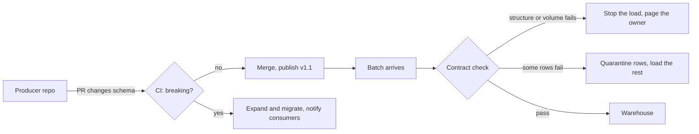

# 4 — Data contracts

On Monday a backend engineer changes `fare` from dollars to cents, because the payments team asked, and the application works perfectly. On Thursday the CFO asks why revenue rose a hundredfold. Nobody did anything wrong by their own lights: the engineer had no idea a warehouse read that column, and the warehouse had no way to tell that the number had changed meaning. A data contract is the agreement that was missing, written down and checked by a machine, between the team that produces a dataset and the teams that depend on it. This chapter writes one in an open standard, enforces it on six batches, and blocks a breaking change before it merges.

## Why the trust breaks here

Every previous stage in this pillar trusted the one before it. The loader trusts the source's schema, the star trusts the loader, and the dashboard trusts the star. Most of that trust is implicit, and the place it fails most often is the very first hand-off, since it crosses a team boundary. The team on the far side is measured on features, and its database schema is an implementation detail they feel free to change. That is good engineering from their side. The forward and backward compatibility rules in [encoding and files](../../01-storage-and-compute-foundations/notes/01-encoding-and-files.md) assume someone is thinking about the reader. Pulling raw tables out of an application's database, as ELT made easy, removes the moment at which anyone would.

Andrew Jones's [*Driving Data Quality with Data Contracts*](https://www.oreilly.com/library/view/-/9781837635009) (Packt, 2023) grew from his work at GoCardless and argues for moving this responsibility upstream. Sanderson, Freeman and Schmidt's [*Data Contracts*](https://www.oreilly.com/library/view/-/9781098157623/) (O'Reilly, 2025) is the longer treatment. I have read neither in full, so this chapter leans on the published standard and on code you can run, and those two are the places to go next.

The idea has a longer history in machine learning than the name suggests. Breck and colleagues at Google describe in [*Data Validation for Machine Learning*](https://proceedings.mlsys.org/paper_files/paper/2019/file/928f1160e52192e3e0017fb63ab65391-Paper.pdf) (MLSys 2019) a system deployed in TensorFlow Extended, used by hundreds of product teams over several petabytes a day. The paper differs from the contract literature in one useful way. It reports that their pipelines often had no schema to start with, and that "data comes first": the system infers a schema, and people curate it as it co-evolves with the data, because curated schemas avoid false alarms. Bear that in mind when deciding how strict to be on day one, since you can derive a first contract from a sample of existing data. They also report that the most common cause of training-serving skew is different code paths, which is the theme of [feature serving](../../06-ml-platform/notes/01-feature-serve.md).



## What goes in a contract

A contract is more than a schema. Schema tells you the column is a `DOUBLE`, and says nothing about what the number means, who to call, or how fresh it should be. The fields below are what the [Open Data Contract Standard](https://bitol-io.github.io/open-data-contract-standard/latest/) (ODCS, from the [Bitol project](https://github.com/bitol-io/open-data-contract-standard)) gives you room for, which is why we use it instead of inventing a format.

| Part | Promise | Example |
|---|---|---|
| Structure | Names, types, required and key fields | `trip_id` is a `BIGINT` primary key |
| Semantics | What it means, in words and units | "Fare in US dollars, before tip" |
| Quality | Rules the data must satisfy | No fare below 0 or above 500 |
| Service levels | Freshness, availability | Data no more than 2 hours old |
| Ownership | Who to call, who may change it | The team, in `team` and `support` |
| Grain | What one row is | "One row per completed trip" |

Here it is for our trips feed. It lives in the producer's repository as YAML, next to the code that writes the data.

```python
ODCS_URL = "https://raw.githubusercontent.com/bitol-io/open-data-contract-standard/main/schema/odcs-json-schema-latest.json"
import yaml, json, urllib.request, jsonschema, duckdb, numpy as np, pyarrow as pa

CONTRACT = """
apiVersion: v3.1.0
kind: DataContract
id: 6a1f7ab2-0b3e-4c5e-9f50-3bb9d8a7e101
name: trips
version: 1.0.0
status: active
description:
  purpose: One row per completed taxi trip, for finance and pricing.
schema:
  - name: trips
    physicalName: raw_trips
    logicalType: object
    dataGranularityDescription: One row per completed trip
    properties:
      - {name: trip_id, logicalType: integer, physicalType: BIGINT, primaryKey: true, required: true, unique: true}
      - {name: pickup_at, logicalType: timestamp, physicalType: TIMESTAMP, required: true}
      - {name: zone_id, logicalType: integer, physicalType: INTEGER, required: true}
      - name: fare_usd
        logicalType: number
        physicalType: DOUBLE
        required: true
        description: Fare in US dollars, before tip.
        quality:
          - {type: sql, description: fares are dollars and plausible,
             query: "SELECT count(*) FROM raw_trips WHERE fare_usd < 0 OR fare_usd > 500",
             mustBe: 0}
          - {type: sql, description: median fare looks like dollars not cents,
             query: "SELECT median(fare_usd) FROM raw_trips",
             mustBeBetween: [5, 40]}
slaProperties:
  - {property: freshness, value: 2, unit: h, element: trips.pickup_at}
"""
contract = yaml.safe_load(CONTRACT)
print(contract["name"], contract["version"], [p["name"] for p in contract["schema"][0]["properties"]])
```

```text
trips 1.0.0 ['trip_id', 'pickup_at', 'zone_id', 'fare_usd']
```

A contract only helps if tools can read it, so first check that this one is valid against the standard's published JSON Schema.

```python
schema = json.load(urllib.request.urlopen(ODCS_URL))
errors = list(jsonschema.Draft201909Validator(schema).iter_errors(contract))
print("schema errors:", [e.message[:80] for e in errors])
```

```text
schema errors: []
```

That fetches the current schema over the network, so it needs a connection. An empty list means the document fits the standard, including the version `v3.1.0` that we declare. It says nothing about any data, which is the next step.

## Enforcing it on a batch

We need batches to test on: one good, and five that break in the ways sources really break.

```python
def make_batch(n=20_000, seed=7, **change):
    rng = np.random.default_rng(seed)
    miles = rng.gamma(2.0, 1.6, n) + .1
    cols = {
        "trip_id": np.arange(1, n + 1),
        "pickup_at": pa.array((np.datetime64("2026-01-15T00:00:00") + rng.integers(0, 86400, n) * np.timedelta64(1, "s")).astype("datetime64[s]")),
        "zone_id": rng.integers(1, 261, n).astype("int32"),
        "fare_usd": np.round(3 + miles * 2.5, 2),
    }
    if change.get("cents"):       cols["fare_usd"] = np.round(cols["fare_usd"] * 100, 0)
    if change.get("rename"):      cols["fare_amount"] = cols.pop("fare_usd")
    if change.get("string_zone"): cols["zone_id"] = pa.array([str(z) for z in cols["zone_id"]])
    if change.get("nulls"):       cols["zone_id"] = pa.array(cols["zone_id"], mask=rng.random(n) < .03)
    if change.get("dupes"):       cols["trip_id"][:50] = 1
    return pa.table(cols)

TYPES = {"BIGINT": "int64", "TIMESTAMP": "timestamp[s]", "INTEGER": "int32", "DOUBLE": "double"}
```

The checker runs in two stages, because there is no point counting nulls in a column that is not there. Structure is cheap and blocking; content comes after.

```python
def check(contract, batch):
    """Return every breach. Structure first, since a missing column makes later checks meaningless."""
    con = duckdb.connect()
    con.register("raw_trips", batch)
    breaches, props = [], contract["schema"][0]["properties"]
    for p in props:
        if p["name"] not in batch.schema.names:
            breaches.append(f"missing column {p['name']}")
        elif str(batch.schema.field(p["name"]).type) != TYPES[p["physicalType"]]:
            breaches.append(f"{p['name']} is {batch.schema.field(p['name']).type}, promised {TYPES[p['physicalType']]}")
    if breaches:
        return breaches
    for p in props:
        c = p["name"]
        if p.get("required") and (n := con.execute(f"SELECT count(*) FROM raw_trips WHERE {c} IS NULL").fetchall()[0][0]):
            breaches.append(f"{c}: {n} nulls")
        if p.get("unique") and (n := con.execute(f"SELECT count(*) - count(DISTINCT {c}) FROM raw_trips").fetchall()[0][0]):
            breaches.append(f"{c}: {n} duplicates")
        for q in p.get("quality", []):
            v = con.execute(q["query"]).fetchall()[0][0]
            ok = v == q["mustBe"] if "mustBe" in q else q["mustBeBetween"][0] <= v <= q["mustBeBetween"][1]
            if not ok:
                breaches.append(f"{c}: {q['description']} (got {v})")
    return breaches

cases = {"good": {}, "renamed": {"rename": 1}, "zone as string": {"string_zone": 1},
         "3% null zones": {"nulls": 1}, "duplicate ids": {"dupes": 1}, "cents": {"cents": 1}}
for name, change in cases.items():
    print(f"{name:15s}", check(contract, make_batch(**change)) or "ok")
```

```text
good            ok
renamed         ['missing column fare_usd']
zone as string  ['zone_id is string, promised int32']
3% null zones   ['zone_id: 577 nulls']
duplicate ids   ['trip_id: 49 duplicates']
cents           ['fare_usd: fares are dollars and plausible (got 18565)', 'fare_usd: median fare looks like doll ...
```

Each failure was caught, and the messages name the column and the promise. Look at the last row closely, because it is the point of the chapter. In the "cents" batch, the column exists, has the right name and type, and has no nulls. Only the two quality rules noticed, and only because someone wrote down what a plausible fare is.

```python
for name, change in {"good": {}, "cents": {"cents": 1}}.items():
    b = make_batch(**change)
    print(name, "dbt-style schema test passes:", "fare_usd" in b.schema.names,
          "| mean fare", round(duckdb.sql("SELECT avg(fare_usd) FROM b").fetchall()[0][0], 2))
```

```text
good dbt-style schema test passes: True | mean fare 11.23
cents dbt-style schema test passes: True | mean fare 1122.8
```

A structural test passes both batches. The average fare moved by a factor of 100, and a type system cannot see that, as dollars and cents are both numbers. Semantics need rules of their own: a range, a distribution check, or both. The median rule is the more robust of the two here, since a range check can miss a smaller change, such as a switch to pence or to a fare that excludes a surcharge. Distribution monitoring in [quality dimensions and tests](../../05-quality-and-observability/notes/01-quality-dimensions-and-tests.md) picks up where a static rule leaves off.

## Stop, or quarantine

A failed check needs a decision, and that decision is part of the contract. There are two sensible actions.

**Stop the load** when the batch as a whole is untrustworthy, for instance a missing column, the wrong units, or half the expected volume. Nothing loaded is better than something wrong, since consumers can see that yesterday's data is stale and will notice, while they cannot see that today's is wrong.

**Quarantine rows** when failures are isolated. Good rows continue, bad rows go to a side table with a reason, and someone is alerted.

```python
def split(batch):
    """Row-level failures go aside with a reason. The good rows carry on."""
    con = duckdb.connect()
    con.register("b", batch)
    bad = con.sql("""SELECT *, CASE WHEN zone_id IS NULL THEN 'null zone' ELSE 'fare out of range' END AS reason
        FROM b WHERE zone_id IS NULL OR fare_usd NOT BETWEEN 0 AND 500""").to_arrow_table()
    good = con.sql("SELECT * FROM b WHERE zone_id IS NOT NULL AND fare_usd BETWEEN 0 AND 500").to_arrow_table()
    return good, bad

good, bad = split(make_batch(nulls=1))
print("good", good.num_rows, "quarantined", bad.num_rows, "share", round(bad.num_rows / 20000, 3))
THRESHOLD = 0.01
print("stop the load" if bad.num_rows / 20000 > THRESHOLD else "load good rows, alert the owner")
```

```text
good 19423 quarantined 577 share 0.029
stop the load
```

The threshold ties the two together: a few bad rows are noise, but past some share the batch itself is suspect. Here 2.9% of rows fail against a limit of 1%, so we stop. That limit is a business decision and should be written in the contract. Keep the quarantine table, and include it in reconciliation, so that good rows plus bad rows always equal rows received. This is the same principle as the Unknown row in the last chapter, that nothing disappears without a count.

## Blocking the change before it ships

Everything so far catches the bad data after it was written. A better check runs when the producer opens a pull request, since then the person who can fix it is already looking at the code.

```python
import copy

def breaking_changes(old, new):
    """Compare two contract versions, as a producer's CI job would before merging."""
    props = lambda c: {p["name"]: p for p in c["schema"][0]["properties"]}
    o, n, out = props(old), props(new), []
    for name, p in o.items():
        if name not in n:
            out.append(f"BREAKING removed {name}")
        elif n[name]["physicalType"] != p["physicalType"]:
            out.append(f"BREAKING {name} type {p['physicalType']} -> {n[name]['physicalType']}")
        elif n[name].get("required") and not p.get("required"):
            out.append(f"BREAKING {name} now required")
    for name, p in n.items():
        if name not in o:
            out.append(("BREAKING" if p.get("required") else "safe") + f" added {name}")
    return out

v2 = copy.deepcopy(contract)
v2["schema"][0]["properties"][2]["physicalType"] = "VARCHAR"
v2["schema"][0]["properties"].append({"name": "tip_usd", "logicalType": "number", "physicalType": "DOUBLE"})
print(breaking_changes(contract, v2))
```

```text
['BREAKING zone_id type INTEGER -> VARCHAR', 'safe added tip_usd']
```

A CI job runs this on each pull request that touches the contract, comparing with the version on the main branch. Changing a type is breaking, and adding an optional column is safe. Dropping a column, renaming one (a drop plus an add) or making an optional column required are all breaking as well. The rule is the same as [schema evolution](../../01-storage-and-compute-foundations/notes/01-encoding-and-files.md): old readers must keep working.

Breaking changes are sometimes right, and the way through is **expand and contract**, the same pattern used for database migrations:

1. Add `fare_cents` alongside `fare_usd`, and write both. Non-breaking.
2. Announce a deadline. Consumers move, one at a time, and lineage tells you which ones remain.
3. Drop `fare_usd` in a new major version, which is the one breaking change, now with no one affected.

```python
def add_field(c, name, **kw):
    c = copy.deepcopy(c)
    c["schema"][0]["properties"].append({"name": name, **kw})
    return c

v2 = add_field(contract, "fare_cents", logicalType="integer", physicalType="BIGINT")
print("step 1, add the new column:", breaking_changes(contract, v2))
v3 = copy.deepcopy(v2)
v3["schema"][0]["properties"] = [p for p in v3["schema"][0]["properties"] if p["name"] != "fare_usd"]
print("step 3, drop the old one:  ", breaking_changes(v2, v3))
```

```text
step 1, add the new column: ['safe added fare_cents']
step 3, drop the old one:   ['BREAKING removed fare_usd']
```

The diff tool sees the difference. Step 1 passes CI and step 3 requires sign-off, which is the conversation the contract was written to force. Version numbers follow semantic versioning: a breaking change gets a new major version, as with any other API.

## What contracts do not fix

They have limits, and it is worth being plain about them. A contract cannot make a producer care, so without a mandate from whoever owns both teams, it is a document nobody reads. Writing one for every table is unworkable; start with the few datasets whose failure reaches an executive or a customer. Rules catch only what someone thought of, so novel failures still need monitoring. Contracts are also awkward for third-party sources, where nobody will sign anything: run the same checks on arrival, as a one-sided contract that protects you even though it binds no one else. And you must keep checking at runtime even with CI, because a contract in a repository is a claim, while the checks are what make it true.

## Pitfalls

- **A schema calling itself a contract.** Without semantics and ownership, you have only automated `DESCRIBE`.
- **Starting with every table.** Pick the critical few. Breck's system deliberately limits its schema to a narrow set of constraints to avoid false positives, and that is good practice for yours too.
- **Checks only in the warehouse.** By then the bad data is loaded. Check at the boundary, and in the producer's CI.
- **No named owner.** An alert that goes to a shared channel is a notification with no one responsible for it.
- **Dropping failing rows silently.** Totals stop reconciling and no one knows why. Quarantine with a reason.
- **Renames treated as harmless.** To a reader, a rename is a drop and an add.
- **Thresholds invented by engineers.** How much bad data is acceptable is a business question.

## Try it

1. Add a volume rule: fail if a batch has fewer than 10,000 rows. Write it in the contract as a `quality` entry with `type: sql` and run it on `make_batch(n=5_000)`.
2. Extend `breaking_changes` to report a removed `unique` constraint. Is relaxing a guarantee breaking, even though the column and type are the same?
3. Add a freshness check that reads `slaProperties` from the contract and compares the value with `max(pickup_at)` relative to a given "now". Does the good batch pass at `2026-01-16 00:30` and at `2026-01-16 03:00`?

The full code for this chapter is in [`practice/04_data_contracts.py`](../practice/04_data_contracts.py).

<details>
<summary>Answers</summary>

1. Add `{type: sql, description: at least 10k rows, query: "SELECT count(*) FROM raw_trips", mustBeBetween: [10000, 10000000]}` to a property's `quality` list. `check` returns the breach with `(got 5000)`. Volume is a table-level rule, and ODCS also allows `quality` on the schema object itself; the small checker here only reads property-level rules, so it goes under `trip_id`.
2. Yes. A consumer may be joining on the assumption of uniqueness, so the fan-out returns. Add `elif p.get("unique") and not n[name].get("unique"): out.append(f"BREAKING {name} no longer unique")`. A guarantee removed is a breaking change even when nothing about the shape changed.
3. With `h = contract["slaProperties"][0]["value"]`, the check is `now - max(pickup_at) <= h hours`. `make_batch` puts pickups up to about 2026-01-15 23:59, so 00:30 passes (about 31 minutes old) and 03:00 fails (about 3 hours old).

</details>

## Interview checklist

| Question | Answer |
|---|---|
| What is a data contract? | An enforced agreement between producer and consumers covering structure, meaning, quality, service levels and ownership. |
| How does it differ from a schema? | A schema covers structure only. A units change passes any schema. |
| Where do you enforce it? | In producer CI for changes, at the boundary for each batch, and in monitoring for what rules cannot foresee. |
| What is ODCS? | The Open Data Contract Standard from Bitol, a YAML format with a published JSON Schema, covering schema, quality, SLAs and team. |
| What counts as a breaking change? | Removing or renaming a column, changing a type, making something required, removing a guarantee. Adding an optional column is safe. |
| How do you ship a breaking change? | Expand and contract: add new, write both, migrate consumers with a deadline, then drop the old in a new major version. |
| Stop or quarantine? | Stop when the batch as a whole is suspect. Quarantine isolated rows with a reason. Set a threshold between them and reconcile the counts. |
| How do you catch dollars becoming cents? | A semantic rule, range or distribution. Type checks cannot see it. |
| How do you get contracts adopted? | Start with the few critical datasets, make the check easy for producers in CI, and get a mandate from whoever owns both teams. |
| What about third-party sources? | Apply the same checks on arrival as a one-sided contract. It cannot bind them, though it does protect you. |
| Should contracts be hand-written or inferred? | Breck reports inferring the first schema and curating it as it evolves, since many pipelines start with no schema. Either way a human reviews the semantics. |

## Next

This closes ingest and modelling. Raw, modelled data now exists with its promises written down. [Pillar 3, transform and orchestrate](../../03-transform-and-orchestrate/notes/01-transform.md), builds the models with tests and schedules them so a re-run does no damage.
