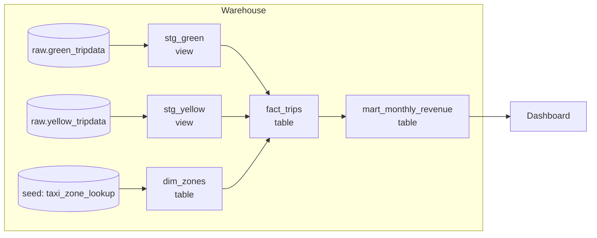

# 1 — Transform

Ingest hands you tables in which every column is a string, the names belong to the source system, and a retried load has written some rows twice. Nothing downstream should ever see that. The job of the transform stage is to turn it into typed, deduplicated, tested models in layers, written as SQL in version control, so that a wrong number can be traced to one line in one file. dbt is the tool this course uses for that, and this chapter builds a small dbt project you can run on your laptop, then reads the zoomcamp's `taxi_rides_ny` project against it.

The running example is the same taxi data as the rest of the subject: green and yellow trips landed raw, a lookup of zones, and a mart for monthly revenue. Pillar 2 designed the [star](../../02-ingest-and-modelling/notes/02-dimensional-modelling.md) these models build. Here we care about how it gets built and what stops it being built wrong.

## ETL, ELT, and why dbt is the T

| | ETL | ELT |
|---|---|---|
| Transform runs | Before load, in a separate engine | After load, inside the warehouse |
| Raw data kept | Often not | Yes, the raw layer is the replay point |
| Compute | Pipeline servers | Warehouse (BigQuery slots, Postgres, DuckDB) |
| Who writes it | Data engineers in Python or Java | Analytics engineers in SQL |

The second row is what matters most. Kleppmann describes the same shift in [*Designing Data-Intensive Applications*](https://dataintensive.net/) (ch. 10, pp. 415-416) as the data lake's "sushi principle", raw data is better: collect first and let each consumer interpret it, instead of forcing every source through one model at the door. A bug in a transform is then cheap, because the input still exists and the output can be rebuilt. The [idempotency chapter](04-idempotency-and-backfills.md) turns that observation into a discipline.

dbt does not move data. It compiles Jinja-templated `SELECT` statements into DDL and DML and runs them in your warehouse, in dependency order. That is why the zoomcamp's project runs on BigQuery and Postgres, and why the code below runs on DuckDB with only the profile changed: the adapter differs, and the SQL mostly doesn't. Here is the whole of the setup, and a helper that runs dbt inside Python and prints one line per node so the output below stays short. On a real project you would type `dbt build` in a shell.

```python
import json, pathlib, duckdb, numpy as np, pyarrow as pa
from dbt.cli.main import dbtRunner

def write(path, text):
    p = pathlib.Path(path)
    p.parent.mkdir(parents=True, exist_ok=True)
    p.write_text(text)

write("dbt_project.yml", """
name: taxi
version: "1.0"
profile: taxi
models:
  taxi:
    staging: {+materialized: view}
    core:    {+materialized: table}
    marts:   {+materialized: table}
""")
write("profiles.yml", """
taxi:
  target: dev
  outputs:
    dev: {type: duckdb, path: taxi.duckdb, threads: 2}
""")

def dbt(*args):
    """Run a dbt command in this process and print one line per node."""
    res = dbtRunner().invoke([*args, "--project-dir", ".", "--profiles-dir", ".", "--quiet"])
    if res.exception:
        raise res.exception
    for r in res.result.results:
        extra = f"  ({r.failures} failing rows)" if r.failures else ""
        print(f"{r.status!s:8}{r.node.resource_type!s:9}{r.node.name}{extra}")

def sql(query):
    with duckdb.connect("taxi.duckdb") as con:
        return con.execute(query).fetchall()
```

Now a landed raw layer. Every column is text, because that is what a CSV loader gives you, and 500 rows of each table arrive twice, because a load was retried.

```python
def make_raw(n, seed, pickup_col):
    """Raw landed data: everything is a string, names belong to the source, some rows arrive twice."""
    rng = np.random.default_rng(seed)
    pickup = np.datetime64("2026-01-01T00:00:00") + rng.integers(0, 31 * 86400, n) * np.timedelta64(1, "s")
    t = pa.table({
        "vendorid": rng.integers(1, 3, n).astype(str),
        pickup_col: pickup.astype(str),
        "pulocationid": rng.integers(1, 266, n).astype(str),
        "total_amount": np.round(rng.gamma(2.0, 7.0, n) + 3, 2).astype(str),
        "payment_type": rng.choice(["1", "2", "3", "4", "5", "6"], n, p=[.72, .22, .02, .02, .01, .01]),
    })
    return pa.concat_tables([t, t.slice(0, 500)])          # a retried load landed 500 rows twice

green, yellow = make_raw(100_000, 1, "lpep_pickup_datetime"), make_raw(200_000, 2, "tpep_pickup_datetime")
with duckdb.connect("taxi.duckdb") as con:
    con.execute("CREATE SCHEMA raw")
    con.execute("CREATE TABLE raw.green_tripdata AS SELECT * FROM green")
    con.execute("CREATE TABLE raw.yellow_tripdata AS SELECT * FROM yellow")
    print(con.execute("SELECT count(*) FROM raw.green_tripdata").fetchall()[0][0], "green rows,",
          con.execute("SELECT count(*) FROM raw.yellow_tripdata").fetchall()[0][0], "yellow rows")
    print(con.execute("DESCRIBE raw.green_tripdata").fetchall()[3][:2])

zones = "locationid,borough,zone\n" + "".join(
    f"{i},{['Manhattan','Queens','Brooklyn','Bronx','Staten Island'][i % 5]},Zone {i}\n" for i in range(1, 261))
write("seeds/taxi_zone_lookup.csv", zones)
```

```text
100500 green rows, 200500 yellow rows
('total_amount', 'VARCHAR')
```

## The layers



| Layer | Grain and job | Materialisation | Zoomcamp model |
|---|---|---|---|
| Source | Declared, not built: points at raw tables | n/a | `sources: staging.green_tripdata`, `yellow_tripdata` |
| Staging | One model per source table; rename, cast, dedupe, nothing else | `view` | `stg_green_tripdata` |
| Core | Facts and dimensions; joins across sources | `table` | `fact_trips`, `dim_zones` |
| Mart | Aggregates for one consumer | `table` | `dm_monthly_zone_revenue` |

The rule that makes this worth the ceremony is that each layer only reads the one before it. Business logic has one home, so when finance disputes a number there is one place to look. [dbt's structure guide](https://docs.getdbt.com/best-practices/how-we-structure/1-guide-overview) spells out the same staging, intermediate and marts split at greater length. It adds an intermediate layer for logic several marts share, which a small project can skip until the same CTE appears twice.

The zoomcamp's vendored project lays this out as follows, with folder-level materialisation in `dbt_project.yml`. Folder-level config is what keeps individual model files free of boilerplate.

```text
models/
  staging/   stg_green_tripdata.sql, stg_yellow_tripdata.sql, schema.yml   -> views
  core/      dim_zones.sql, fact_trips.sql, dm_monthly_zone_revenue.sql, schema.yml -> tables
seeds/       taxi_zone_lookup.csv
macros/      get_payment_type_description.sql
```

```yaml
# illustrative: excerpt of practice/datatalks-de/04-analytics-engineering/taxi_rides_ny/dbt_project.yml
models:
  taxi_rides_ny:
    staging:
      materialized: view
    core:
      materialized: table
vars:
  payment_type_values: [1, 2, 3, 4, 5, 6]
seeds:
  taxi_rides_ny:
    taxi_zone_lookup:
      +column_types:
        locationid: numeric
```

## A staging model, line by line

A staging model does the dull work once so that nothing else has to. It declares where the data comes from, casts it, renames it to your own vocabulary, removes duplicates, and adds no business logic. In our small project a macro carries the one label that both services share.

```python
write("models/staging/sources.yml", """
sources:
  - name: raw
    tables:
      - name: green_tripdata
      - name: yellow_tripdata
""")
write("macros/payment_description.sql", """

    case {{ col }}
        when 1 then 'Credit card' when 2 then 'Cash' when 3 then 'No charge'
        when 4 then 'Dispute' when 5 then 'Unknown' when 6 then 'Voided trip'
        else 'EMPTY'
    end

""")
STAGING = """
with tripdata as (
    select *,
           row_number() over (
               partition by vendorid, PICKUP, pulocationid, total_amount
           ) as rn
    from {{ source('raw', 'TABLE') }}
    where vendorid is not null
)
select
    md5(concat_ws('|', vendorid, PICKUP, pulocationid, total_amount)) as trip_id,
    cast(vendorid as integer)         as vendor_id,
    cast(PICKUP as timestamp)         as pickup_at,
    try_cast(pulocationid as integer) as pickup_zone_id,
    try_cast(total_amount as double)  as total_amount,
    coalesce(try_cast(payment_type as integer), 0) as payment_type,
    {{ payment_description("coalesce(try_cast(payment_type as integer), 0)") }} as payment_label
from tripdata
where rn = 1
"""
write("models/staging/stg_green.sql",
      STAGING.replace("PICKUP", "lpep_pickup_datetime").replace("TABLE", "green_tripdata"))
write("models/staging/stg_yellow.sql",
      STAGING.replace("PICKUP", "tpep_pickup_datetime").replace("TABLE", "yellow_tripdata"))
```

The zoomcamp's staging model does the same with adapter-neutral macros, because it has to compile on two warehouses.

```sql
-- illustrative: needs the zoomcamp warehouse and dbt_utils (dbt deps)
with tripdata as (
  select *,
    row_number() over(partition by vendorid, lpep_pickup_datetime) as rn
  from {{ source('staging','green_tripdata') }}
  where vendorid is not null
)
select
    {{ dbt_utils.generate_surrogate_key(['vendorid', 'lpep_pickup_datetime']) }} as tripid,
    {{ dbt.safe_cast("vendorid", api.Column.translate_type("integer")) }} as vendorid,
    {{ dbt.safe_cast("pulocationid", api.Column.translate_type("integer")) }} as pickup_locationid,
    cast(lpep_pickup_datetime as timestamp) as pickup_datetime,
    cast(trip_distance as numeric) as trip_distance,
    cast(total_amount as numeric) as total_amount,
    coalesce({{ dbt.safe_cast("payment_type", api.Column.translate_type("integer")) }},0) as payment_type,
    {{ get_payment_type_description("payment_type") }} as payment_type_description
from tripdata
where rn = 1


  limit 100

```

| Line | Pattern | Why |
|---|---|---|
| `source('staging', ...)` | Declared source | Lineage starts here; `dbt docs` draws the graph from it |
| `row_number() ... where rn = 1` | Dedupe on the natural key | The raw data has duplicate rows |
| `generate_surrogate_key` | Hash of the natural key | A stable `tripid` to test for uniqueness and join on |
| `dbt.safe_cast` + `translate_type` | Adapter-neutral cast | Same model on BigQuery and Postgres; a bad value becomes null, not a failed run |
| `coalesce(..., 0)` | Explicit unknown | Null payment types fall into a bucket the macro labels |
| `var('is_test_run', default=true)` | Dev limit | Development builds touch 100 rows; prod overrides it |

The full build overrides the variable.

```bash
# illustrative: needs the zoomcamp project and warehouse
dbt build --select stg_green_tripdata --vars '{is_test_run: false}'
```

## Macros and packages

A macro is a Jinja function that returns SQL. Reach for one when the same CASE or expression appears in two models, as `payment_description` does above. The zoomcamp's `get_payment_type_description` is the same CASE with `dbt.safe_cast` around the column. Do not reach for one just to shorten SQL, because a reader of the model then has to open a second file to know what it does.

`packages.yml` pulls in other people's macros, and `dbt deps` installs them. The zoomcamp pins these two.

```yaml
# illustrative: packages.yml from taxi_rides_ny; dbt deps needs network access to hub.getdbt.com
packages:
  - package: dbt-labs/dbt_utils
    version: 1.1.1
  - package: dbt-labs/codegen
    version: 0.12.1
```

`dbt_utils` supplies `generate_surrogate_key` and many generic tests. `codegen` writes the boilerplate `schema.yml` and base models from an existing table. Pin versions, for the same reason you pin anything else: an unpinned package can change a compiled query between two runs with no change in your repo. Our small project uses DuckDB's `md5` directly so that it runs with no install step beyond dbt.

## The core models and the mart

Next come the star and the mart. `dim_zones` adds an explicit unknown row, the default-row idea from [dimensional modelling](../../02-ingest-and-modelling/notes/02-dimensional-modelling.md), and `fact_trips` joins through it.

```python
write("models/core/dim_zones.sql", """
select locationid as zone_id, borough, zone from {{ ref('taxi_zone_lookup') }}
union all
select -1, 'Unknown', 'Unknown'
""")
write("models/core/fact_trips.sql", """
with unioned as (
    select *, 'green' as service from {{ ref('stg_green') }}
    union all
    select *, 'yellow' as service from {{ ref('stg_yellow') }}
)
select u.trip_id, u.service, u.pickup_at, u.total_amount, u.payment_type, u.payment_label,
       coalesce(z.zone_id, -1) as zone_id, coalesce(z.borough, 'Unknown') as borough
from unioned u
left join {{ ref('dim_zones') }} z on u.pickup_zone_id = z.zone_id
""")
write("models/marts/mart_monthly_revenue.sql", """
select borough, service, date_trunc('month', pickup_at) as revenue_month,
       round(sum(total_amount), 2) as revenue, count(*) as trips
from {{ ref('fact_trips') }}
group by all
""")
dbt("build")
print(sql("SELECT count(*) FROM main.fact_trips"))
print(sql("SELECT service, count(*), round(sum(revenue)) FROM main.mart_monthly_revenue GROUP BY 1 ORDER BY 1"))
```

```text
success model    stg_yellow
success model    stg_green
success seed     taxi_zone_lookup
success model    dim_zones
success model    fact_trips
success model    mart_monthly_revenue
[(300000,)]
[('green', 6, 1694961.0), ('yellow', 6, 3402758.0)]
```

Three hundred thousand distinct trips survive: 100,000 green and 200,000 yellow, the 1,000 duplicates gone. Those are the counts of the raw tables minus exactly what we planted, which is the first reconciliation you should run on any new model.

dbt's four [materialisations](https://docs.getdbt.com/docs/build/materializations) decide what each `SELECT` becomes:

| Materialisation | Becomes | Build cost | Read cost | Use it for |
|---|---|---|---|---|
| `view` | A stored query | Almost none | The whole query, on every read | Staging, or anything small and rarely read |
| `table` | A rebuilt table | Full rebuild every run | Cheap | Core and marts, until the rebuild hurts |
| `incremental` | A table with rows merged or appended | Only new rows | Cheap | Large facts, once a full rebuild is too slow; the [next chapter but one](03-dbt-tests-snapshots-incremental.md) |
| `ephemeral` | Inlined as a CTE, no object | None | Paid by whoever selects from it | Shared logic you do not want in the warehouse catalogue |

Asking the database what the build left shows folder config at work.

```python
for row in sql("""SELECT table_type, table_name FROM information_schema.tables
                  WHERE table_schema = 'main' ORDER BY 1, 2"""):
    print(row)
```

```text
('BASE TABLE', 'dim_zones')
('BASE TABLE', 'fact_trips')
('BASE TABLE', 'mart_monthly_revenue')
('BASE TABLE', 'taxi_zone_lookup')
('VIEW', 'stg_green')
('VIEW', 'stg_yellow')
```

A dedupe is only as right as its key, and this is worth checking rather than assuming. The zoomcamp dedupes on `(vendorid, pickup time)`. On our synthetic green table, with pickups drawn at random across a month, that key sees 99,040 distinct values where 100,000 trips exist, because two distinct trips by one vendor sometimes start in the same second. Adding pickup zone and amount gets all 100,000 back. The number comes from randomly generated data and says nothing about real TLC rows, but the check transfers: count distinct on your candidate key before you trust it.

```python
for key in ["vendorid, lpep_pickup_datetime",
            "vendorid, lpep_pickup_datetime, pulocationid, total_amount"]:
    print(sql(f"SELECT count(*) FROM (SELECT DISTINCT {key} FROM raw.green_tripdata)")[0][0], "rows on key:", key)
```

```text
99040 rows on key: vendorid, lpep_pickup_datetime
100000 rows on key: vendorid, lpep_pickup_datetime, pulocationid, total_amount
```

## `ref()` builds the graph

You never write the build order. dbt parses every `ref` and `source` call to build a graph, and running it in topological order is what `dbt build` does. The graph is in a plain JSON file, which is also how tools like dagster-dbt and Cosmos read a project in the [orchestrator chapter](05-dagster-and-airflow.md). This is the old Unix idea Kleppmann calls separating logic from wiring: the model says what to compute, and something else decides where its input comes from and where its output goes ([*Designing Data-Intensive Applications*](https://dataintensive.net/), ch. 10, p. 396). That is why the same model can run against dev and prod unchanged.

```python
manifest = json.loads(pathlib.Path("target/manifest.json").read_text())
for node, parents in manifest["parent_map"].items():
    if node.startswith("model."):
        print(node.split(".")[-1], "<-", [p.split(".")[-1] for p in parents])
```

```text
stg_green <- ['green_tripdata']
stg_yellow <- ['yellow_tripdata']
fact_trips <- ['dim_zones', 'stg_green', 'stg_yellow']
dim_zones <- ['taxi_zone_lookup']
mart_monthly_revenue <- ['fact_trips']
```

Compile is the other half of the trick, and worth looking at once. dbt resolves `source()` to a real relation and expands the macro, and what it sends to the warehouse is ordinary SQL you can paste into a console when debugging.

```python
print(pathlib.Path("target/compiled/taxi/models/staging/stg_green.sql").read_text().strip())
```

```text
with tripdata as (
    select *,
           row_number() over (
               partition by vendorid, lpep_pickup_datetime, pulocationid, total_amount
           ) as rn
    from "taxi"."raw"."green_tripdata"
    where vendorid is not null
)
select
    md5(concat_ws('|', vendorid, lpep_pickup_datetime, pulocationid, total_amount)) as trip_id,
    cast(vendorid as integer)         as vendor_id,
    cast(lpep_pickup_datetime as timestamp)         as pickup_at,
    try_cast(pulocationid as integer) as pickup_zone_id,
    try_cast(total_amount as double)  as total_amount,
    coalesce(try_cast(payment_type as integer), 0) as payment_type,
    case coalesce(try_cast(payment_type as integer), 0)
        when 1 then 'Credit card' when 2 then 'Cash' when 3 then 'No charge'
        when 4 then 'Dispute' when 5 then 'Unknown' when 6 then 'Voided trip'
        else 'EMPTY'
    end as payment_label
from tripdata
where rn = 1
```

The zoomcamp's fact model has the same shape on a bigger scale.

```sql
-- illustrative: needs the zoomcamp warehouse
with green_tripdata as (
    select *, 'Green' as service_type from {{ ref('stg_green_tripdata') }}
),
yellow_tripdata as (
    select *, 'Yellow' as service_type from {{ ref('stg_yellow_tripdata') }}
),
trips_unioned as (
    select * from green_tripdata
    union all
    select * from yellow_tripdata
),
dim_zones as (
    select * from {{ ref('dim_zones') }} where borough != 'Unknown'
)
select trips_unioned.tripid, trips_unioned.service_type,
       pickup_zone.borough as pickup_borough, pickup_zone.zone as pickup_zone,
       dropoff_zone.borough as dropoff_borough, dropoff_zone.zone as dropoff_zone,
       trips_unioned.pickup_datetime, trips_unioned.total_amount -- ...
from trips_unioned
inner join dim_zones as pickup_zone  on trips_unioned.pickup_locationid  = pickup_zone.locationid
inner join dim_zones as dropoff_zone on trips_unioned.dropoff_locationid = dropoff_zone.locationid
```

Two more things to see there. A union needs identical column lists, and the two staging models are written to the same column order so that `select *` unions safely; the Spark version of this union in [warehouse and store](../../04-warehouse-lakehouse-streaming/notes/01-warehouse-and-store.md) has to compute the common columns explicitly. And the inner joins drop rows. Trips with an unknown zone vanish, which is a business decision hiding in a join type. Ours keeps them, and the difference is easy to measure.

```python
print(sql("""SELECT 'left join' AS how, count(*) FROM main.fact_trips
    UNION ALL SELECT 'inner join', count(*) FROM main.fact_trips WHERE zone_id <> -1"""))
print(sql("SELECT round(sum(total_amount)) FROM main.fact_trips WHERE zone_id = -1"))
```

```text
[('left join', 300000), ('inner join', 294320)]
[(96475.0,)]
```

An inner join would have lost 5,680 trips and about $96,000 of revenue from our synthetic month, silently, with every test still green. Our generator draws zone IDs up to 265 and the lookup stops at 260, so about 2 percent of rows have no parent. The real TLC lookup is cleaner, but a new code appearing in the source will do the same thing to you on some later day.

The zoomcamp's mart aggregates the fact for one question, monthly revenue by zone. [SQL for analytics](../../../data-analytics/06-applied-analyses/notes/06-sql-for-analytics.md#the-revenue-bridge) in data analytics shows the kind of question an analyst then asks of tables like this.

```sql
-- illustrative: needs the zoomcamp warehouse
select
    pickup_zone as revenue_zone,
    {{ dbt.date_trunc("month", "pickup_datetime") }} as revenue_month,
    service_type,
    sum(total_amount) as revenue_monthly_total_amount,
    count(tripid) as total_monthly_trips,
    avg(trip_distance) as avg_monthly_trip_distance
from {{ ref('fact_trips') }}
group by 1, 2, 3
```

## Tests and documentation

Tests live beside the docs in a YAML file next to the models, each one a query that returns the rows breaking a rule. A test passes when it returns nothing. The [data tests docs](https://docs.getdbt.com/docs/build/data-tests) list the four built in, and each catches one failure we have already met.

| Test | Catches |
|---|---|
| `unique` | Dedupe failed; the surrogate key collides |
| `not_null` | A required field arrived empty |
| `relationships` | A foreign key with no parent (an unknown zone ID) |
| `accepted_values` | A new code the business logic doesn't know |

```python
write("models/core/schema.yml", """
models:
  - name: stg_green
    columns:
      - name: trip_id
        data_tests: [unique, not_null]
      - name: pickup_at
        data_tests: [not_null]
  - name: fact_trips
    columns:
      - name: trip_id
        data_tests: [unique]
      - name: zone_id
        data_tests:
          - relationships:
              arguments: {to: ref('dim_zones'), field: zone_id}
      - name: payment_type
        data_tests:
          - accepted_values:
              arguments: {values: [0, 1, 2, 3, 4, 5, 6], quote: false}
""")
dbt("build")
```

```text
success model    stg_yellow
success model    stg_green
success seed     taxi_zone_lookup
pass    test     not_null_stg_green_pickup_at
pass    test     not_null_stg_green_trip_id
pass    test     unique_stg_green_trip_id
success model    dim_zones
success model    fact_trips
pass    test     accepted_values_fact_trips_payment_type__False__0__1__2__3__4__5__6
pass    test     relationships_fact_trips_zone_id__zone_id__ref_dim_zones_
pass    test     unique_fact_trips_trip_id
success model    mart_monthly_revenue
```

Now suppose the source starts sending payment code 9. We update 200 yellow rows in the raw table and rebuild.

```python
with duckdb.connect("taxi.duckdb") as con:
    con.execute("UPDATE raw.yellow_tripdata SET payment_type = '9' WHERE rowid % 1000 = 0")
dbt("build")
print("rows with code 9 in fact_trips:", sql("SELECT count(*) FROM main.fact_trips WHERE payment_type = 9")[0][0])
print("rows with code 9 reaching the mart: mart was skipped, still", sql("SELECT sum(trips) FROM main.mart_monthly_revenue")[0][0], "trips")
```

```text
success model    stg_green
success model    stg_yellow
success seed     taxi_zone_lookup
pass    test     not_null_stg_green_pickup_at
pass    test     not_null_stg_green_trip_id
success model    dim_zones
pass    test     unique_stg_green_trip_id
success model    fact_trips
fail    test     accepted_values_fact_trips_payment_type__False__0__1__2__3__4__5__6  (1 failing rows)
pass    test     relationships_fact_trips_zone_id__zone_id__ref_dim_zones_
pass    test     unique_fact_trips_trip_id
skipped model    mart_monthly_revenue
rows with code 9 in fact_trips: 200
rows with code 9 reaching the mart: mart was skipped, still 300000 trips
```

Read that carefully, because it is what `dbt build` promises and also what it doesn't. A test failure with `error` severity stopped `mart_monthly_revenue`, which was skipped, so the dashboard still shows yesterday's correct numbers rather than today's wrong ones. That is the point of building and testing in one DAG walk. But `fact_trips` was rebuilt before its test ran, because a test queries the built table, so the bad rows are already in it. Anyone who queries the core table directly sees them. dbt's default protects the layer *below* the failing test, never the model under test.

Also notice the failure count: one row, against 200 bad source rows, because `accepted_values` groups by value and returns each wrong value once. Read a failure count as "how many things this query returned", and go look at the query.

The zoomcamp's `schema.yml` sets every test to `severity: warn`, so a failure never stops the build. That is fine for a homework dataset with known dirt. In production, decide per test: keys `error`, descriptive columns `warn`. A test that only warns is a test nobody reads. The [next chapter but one](03-dbt-tests-snapshots-incremental.md) goes further, with thresholds, singular tests and unit tests.

```yaml
# illustrative: from taxi_rides_ny/models/staging/schema.yml, on dbt versions before 1.8 the key was `tests:`
models:
  - name: stg_green_tripdata
    columns:
      - name: tripid
        tests:
          - unique:   {severity: warn}
          - not_null: {severity: warn}
      - name: pickup_locationid
        tests:
          - relationships:
              to: ref('taxi_zone_lookup')
              field: locationid
              severity: warn
      - name: payment_type
        tests:
          - accepted_values:
              values: "{{ var('payment_type_values') }}"
              severity: warn
              quote: false
```

Fixing the source and rebuilding only what sits below it needs a graph selector. `stg_yellow+` means this node and everything downstream, and the green branch doesn't run.

```python
with duckdb.connect("taxi.duckdb") as con:
    con.execute("UPDATE raw.yellow_tripdata SET payment_type = '1' WHERE payment_type = '9'")
dbt("build", "--select", "stg_yellow+")
```

```text
success model    stg_yellow
success model    fact_trips
pass    test     accepted_values_fact_trips_payment_type__False__0__1__2__3__4__5__6
pass    test     relationships_fact_trips_zone_id__zone_id__ref_dim_zones_
pass    test     unique_fact_trips_trip_id
success model    mart_monthly_revenue
```

## Freshness: the test that needs no data

Every test above checks data that arrived. None notices data that did not. A pipeline that has quietly stopped ingesting passes every test indefinitely, because yesterday's rows are still clean. [Source freshness](https://docs.getdbt.com/docs/deploy/source-freshness) compares the newest timestamp in a column against the clock. The zoomcamp's `sources:` block has this commented out with `error_after: {count: 6, period: hour}`. Ours ends in January 2026, so against any later clock it is stale.

```python
write("models/staging/sources.yml", """
sources:
  - name: raw
    freshness:
      warn_after: {count: 6, period: hour}
      error_after: {count: 24, period: hour}
    loaded_at_field: cast(lpep_pickup_datetime as timestamp)
    tables:
      - name: green_tripdata
      - name: yellow_tripdata
        loaded_at_field: cast(tpep_pickup_datetime as timestamp)
""")
dbt("source", "freshness")
```

```text
error   source   green_tripdata
error   source   yellow_tripdata
```

The `loaded_at_field` should be when the row arrived, not when the event happened, if you have the choice. An event timestamp conflates a late batch with a quiet night. This is your first ingest monitor, and [monitors and lineage](../../05-quality-and-observability/notes/02-monitors-and-lineage.md) builds the rest.

## The command set

| Command | Does |
|---|---|
| `dbt deps` | Install packages |
| `dbt seed` | Load CSVs in `seeds/` as tables (`taxi_zone_lookup`) |
| `dbt run` | Build models |
| `dbt test` | Run tests |
| [`dbt build`](https://docs.getdbt.com/reference/commands/build) | Seed, run, test and snapshot, in DAG order; a failing test skips its downstream models |
| `dbt build --select +fact_trips` | `fact_trips` and everything upstream of it |
| `dbt build --select stg_yellow+` | `stg_yellow` and everything downstream of it |
| `dbt source freshness` | Compare sources against their freshness rules |
| `dbt docs generate && dbt docs serve` | Catalogue and lineage graph site |

`dbt build` is the one to schedule, for the reason the failure above shows.

## Deployment

The zoomcamp shows two paths.

| Path | Setup | Scheduling |
|---|---|---|
| dbt Cloud | `dbt_cloud_setup.md`: connect BigQuery with a service-account key, link the repo | dbt Cloud jobs, `dbt build` on a cron, with a production environment and target dataset |
| dbt Core locally (Postgres in the course) | `docker_setup/` (Dockerfile and compose) or `pip install dbt-bigquery` / `dbt-postgres`, plus `~/.dbt/profiles.yml` | Your orchestrator runs `dbt build` as a task ([orchestrate](02-orchestrate.md)) |

The module ends by charting `dm_monthly_zone_revenue` in Google Data Studio (now Looker Studio) or Metabase. A dashboard on a mart, never on a staging view, is the rule that keeps metric logic in one place (a [semantic layer](../../07-architecture-and-governance/notes/03-catalog-semantic-layer-and-contracts.md#a-semantic-layer-compiles-the-question-at-its-grain) is the next step when one mart can't serve every grain), and it's what prevents the "two dashboards show different numbers" scenario in [data architectures](../../07-architecture-and-governance/notes/01-data-architectures-mesh-fabric-mdw.md).

## Run labels

| Material | Needs |
|---|---|
| The code in this chapter, [`practice/01_transform.py`](../practice/01_transform.py) | `uv` only; `dbt-duckdb` on your machine, no accounts |
| `practice/datatalks-de/04-analytics-engineering/taxi_rides_ny/` on BigQuery | `dbt-bigquery` and a GCP account with the warehouse module's tables loaded |
| `taxi_rides_ny/` on Postgres | `dbt-postgres` and the Postgres container from the zoomcamp's first module, with green and yellow data |
| `docker_setup/` | Docker |
| dbt Cloud path | A dbt Cloud account (free developer tier) and GCP |

The zoomcamp's upstream repo has renumbered its modules since this snapshot was taken and now teaches analytics engineering on DuckDB and BigQuery, so check [upstream](https://github.com/DataTalksClub/data-engineering-zoomcamp) before following it line by line.

## Pitfalls

- **Business logic in staging.** A join or a filter on a business rule in `stg_` hides the logic from everyone who assumes staging is mechanical. Staging casts, renames and dedupes.
- **A dedupe key you did not check.** Too narrow and you delete real trips, as the zoomcamp's two-column key did on our data. Too wide and duplicates survive.
- **`row_number()` with no `order by`.** When duplicates differ in any column, the row you keep is arbitrary and can change between runs. Order by something meaningful, usually the load time, descending.
- **Inner joins in a fact.** They turn missing dimension rows into missing revenue, with no test failing. Left join through a default row and count the unknowns.
- **Assuming a test protects the model it is on.** It protects what's downstream. The tested table is already rebuilt.
- **Warn on everything.** The first warning nobody reads teaches the team to read none of them.
- **Dashboards on staging or core.** The metric's definition is then in the BI tool, and the next dashboard will define it differently.
- **Unpinned packages.** Compiled SQL can change with no commit in your repo.

## Try it

The full code for this chapter is in [`practice/01_transform.py`](../practice/01_transform.py), and you can make these changes in a copy of it.

1. Change the fact's `left join` to an `inner join` and run `dbt build`. How many rows and how much revenue disappear? Which test fails?
2. Add zones 261 to 265 to the seed and rebuild. What happens to the count of rows with `zone_id = -1`, and to the total row count? Why does this show that a default row is better than a dropped row?
3. Run `dbt ls --select stg_green+`. Name what it lists, then predict the same for `+fact_trips`.

<details>
<summary>Answers</summary>

1. The fact falls from 300,000 to 294,320 rows, and revenue falls by about $96,000, from about $5.10 million to $5.00 million. No test fails: `relationships` is now trivially true, since orphan rows are gone, and `unique` still holds. Only a reconciliation against staging can catch this, which is the singular test in the [next chapter but one](03-dbt-tests-snapshots-incremental.md).
2. Unknown rows go from 5,680 to 0, and the total stays 300,000. Fixing a reference table repairs history on the next build, because the rows were kept and only their label was waiting. Had they been dropped, you would have to know to go and reload them.
3. It lists `stg_green`, `fact_trips`, `mart_monthly_revenue` and every test attached to them: three models and six tests. `+fact_trips` goes the other way: `fact_trips`, both staging models, `dim_zones`, the seed, the two raw sources and their tests.

</details>

## Interview checklist

| Question | Answer |
|---|---|
| ETL vs ELT? | Whether transformation happens before load in a separate engine or after load inside the warehouse. ELT keeps raw as a replay point, so a bad transform can be rebuilt. |
| What does dbt actually do? | Compiles templated SELECTs to SQL and runs them in the warehouse in dependency order. It moves no data and runs no compute of its own. |
| What do the staging, core and mart layers do? | One-to-one cleanup of sources; facts and dimensions joined across sources; aggregates for one consumer. Each reads only the one before. |
| View, table, incremental or ephemeral? | Pay on read; pay full rebuild on write; pay only new rows, with more logic; inline as a CTE with no object. |
| How does dbt know the build order? | It parses `ref` and `source` calls into a graph and walks it topologically. |
| What does a dbt test return? | The rows breaking the rule. Zero rows passes. |
| What happens when a test fails in `dbt build`? | At `error` severity, downstream nodes are skipped. The tested model is already rebuilt, so its bad rows are visible. |
| Warn or error? | Error for keys and anything a consumer relies on; warn for descriptive columns, and only if someone reads the warnings. |
| Why is an inner join dangerous in a fact? | It drops rows with missing dimension keys, silently. A left join to a default row keeps totals reconciled. |
| How do you detect a pipeline that stopped loading? | Source freshness: the newest load timestamp against the clock, since row-level tests pass on old data forever. |
| When would you write a macro? | When the same expression appears in two models or must differ by adapter. Not merely to shorten SQL. |
| Why not build dashboards on staging? | The metric definition then moves into the BI tool, and two dashboards will disagree. |

## Next

[Orchestrate](02-orchestrate.md) takes it from here: `dbt build` is one task, and orchestration decides when it runs, what runs before it, and what happens when it fails.
