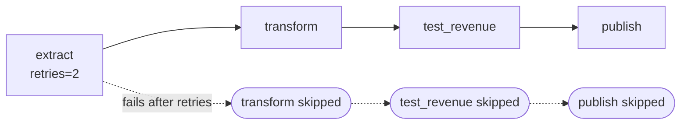

# 2 — Orchestrate

A cron line that runs a shell script works until the first morning it doesn't, and then you discover what it left out. The extract failed at 03:00 and the transform ran anyway on yesterday's file, so the dashboard shows a flat line, nobody was told, and the person who wrote it has to reconstruct which days need re-running by reading log files. An orchestrator exists to make those decisions explicit: which tasks depend on which, how many times to retry, which date a run is for, and what stops when something fails. This chapter builds a toy orchestrator in fifty lines to show there is no magic in those capabilities, then reads the tools the zoomcamps use against it.

Ingest and [transform](01-transform.md) are tasks. Orchestration decides when they run, in what order, with which parameters, and what happens on failure. Confidence on this note is `medium` because the zoomcamp's orchestration module in this snapshot is a README of video links with no code. The worked zoomcamp code comes from MLOps module 03 (Mage, upstream repo), module 04 (Prefect batch scoring) and module 05 (Prefect monitoring backfill), and the toy and the Prefect flow below are this note's own.

## What an orchestrator gives you

The DE orchestration module opens with "What is orchestration?" and this table is the checklist to hold any tool against.

| Capability | Without an orchestrator | With one |
|---|---|---|
| Dependencies | A shell script in the right order | A DAG; downstream waits on upstream success |
| Scheduling | cron on one machine | Schedules stored with the pipeline, visible in a UI |
| Parameters | `sys.argv` | Typed run parameters (date, taxi type, model run ID) |
| Retries | Manual rerun | Per-task retry with backoff |
| Backfill | A for-loop someone writes once | Run the same pipeline over a date range, each run isolated |
| Observability | Log files | Run history, task state, logs per run, alerts |
| Triggers | None | Schedule, sensor (new data arrived), API call, upstream success |

None of this is new. Kleppmann notes in [*Designing Data-Intensive Applications*](https://dataintensive.net/) (ch. 10, pp. 402-403) that once MapReduce jobs were being chained into workflows of 50 to 100 jobs, schedulers like Oozie, Azkaban, Luigi, Airflow and Pinball appeared to manage them, because chaining jobs by directory convention stopped being survivable. Directories did give those workflows one thing worth keeping: a job's output was only treated as valid once the job had succeeded, so the next job could not start on half of it (p. 402). The engines changed, and the shape of the problem didn't.

Adopt the orchestrator on day 0, even if it only runs locally at first. An orchestrator forces each pipeline to be a separate unit that hands off only through storage (warehouse, feature store, artifact store), and a pipeline built that way can later be triggered by a schedule, an API call or a monitoring alert without a rewrite. The *LLM Engineer's Handbook* authors credit this decoupling with making continuous training a small step at the end of their project rather than a refactor (*LLM Engineer's Handbook*, ch. 11). Once the whole system runs from one manual trigger, the automated triggers are configuration.

## An orchestrator in fifty lines

The core of every tool in this chapter is a loop: put the tasks in dependency order, run each one unless something it needs has failed, retry within a limit, and record what happened against a logical date. Here is that loop, with nothing else.

```python
import graphlib, time, datetime as dt, duckdb, pathlib, itertools

class Pipeline:
    """A toy orchestrator: dependencies, retries, a logical date, run history."""
    def __init__(self, name):
        self.name, self.tasks, self.deps, self.retries, self.history = name, {}, {}, {}, {}

    def task(self, *, needs=(), retries=0):
        def register(fn):
            self.tasks[fn.__name__] = fn
            self.deps[fn.__name__] = set(needs)
            self.retries[fn.__name__] = retries
            return fn
        return register

    def run(self, logical_date, verbose=True):
        state = {}
        for name in graphlib.TopologicalSorter(self.deps).static_order():
            if any(state[d] != "success" for d in self.deps[name]):
                state[name] = "skipped"
            else:
                state[name] = self._attempt(name, logical_date)
            if verbose:
                print(f"{logical_date} {name:12} {state[name]}")
        self.history[logical_date] = "success" if set(state.values()) == {"success"} else "failed"
        return state

    def _attempt(self, name, logical_date):
        for attempt in range(self.retries[name] + 1):
            try:
                self.tasks[name](logical_date)
                return "success"
            except Exception as e:
                print(f"{logical_date} {name:12} attempt {attempt + 1} failed: {e}")
                time.sleep(0.01 * 2 ** attempt)      # backoff, shortened for the demo
        return "failed"
```



Each task receives the day it is for, reads only from what its upstream wrote, and writes to a path derived from that day. Those three habits are most of the craft. The next chapters will keep returning to them.

```python
pipe = Pipeline("daily_revenue")
pathlib.Path("lake").mkdir(exist_ok=True)
outages = {}                                  # task -> failures still to inject

def maybe_fail(name):
    if outages.get(name, 0) > 0:
        outages[name] -= 1
        raise ConnectionError("warehouse unreachable")

@pipe.task(retries=2)
def extract(day):
    maybe_fail("extract")
    n = 1000 + int(day[-2:]) * 10          # deterministic per day
    duckdb.sql(f"""COPY (SELECT DATE '{day}' AS day, 5 + i % 40 AS fare FROM range({n}) t(i))
                   TO 'lake/raw_{day}.parquet'""")

@pipe.task(needs=["extract"])
def transform(day):
    maybe_fail("transform")
    duckdb.sql(f"""COPY (SELECT day, count(*) AS trips, sum(fare) AS revenue
                         FROM 'lake/raw_{day}.parquet' GROUP BY day)
                   TO 'lake/revenue_{day}.parquet'""")

@pipe.task(needs=["transform"])
def test_revenue(day):
    bad = duckdb.sql(f"SELECT count(*) FROM 'lake/revenue_{day}.parquet' WHERE revenue <= 0").fetchall()[0][0]
    assert bad == 0, f"{bad} days with no revenue"

@pipe.task(needs=["test_revenue"])
def publish(day):
    print(f"           published {day}")

pipe.run("2026-01-05")
```

```text
2026-01-05 extract      success
2026-01-05 transform    success
2026-01-05 test_revenue success
           published 2026-01-05
2026-01-05 publish      success
```

### Retries are for transient failures

A dropped connection often clears by itself, so retrying is cheap and usually works. Backoff stops a struggling service being hit harder while it recovers.

```python
outages["extract"] = 2                        # fails twice, succeeds on the third attempt
pipe.run("2026-01-06")
```

```text
2026-01-06 extract      attempt 1 failed: warehouse unreachable
2026-01-06 extract      attempt 2 failed: warehouse unreachable
2026-01-06 extract      success
2026-01-06 transform    success
2026-01-06 test_revenue success
           published 2026-01-06
2026-01-06 publish      success
```

When failures outlast the retries, the run must stop, and everything that depends on it must not run. That is the difference from the cron script: `publish` does not put yesterday's numbers out under today's date.

```python
outages["extract"] = 3                        # more failures than retries
pipe.run("2026-01-07")
```

```text
2026-01-07 extract      attempt 1 failed: warehouse unreachable
2026-01-07 extract      attempt 2 failed: warehouse unreachable
2026-01-07 extract      attempt 3 failed: warehouse unreachable
2026-01-07 extract      failed
2026-01-07 transform    skipped
2026-01-07 test_revenue skipped
2026-01-07 publish      skipped
```

A retry re-executes the task, which is safe only if running it twice does the same as running it once. Retrying a broken SQL statement wastes three attempts on a failure that will never clear, so a good policy separates "the network blinked" from "the code is wrong". Retrying an `INSERT` that timed out after it actually succeeded writes the rows twice. That second problem is the subject of [idempotency and backfills](04-idempotency-and-backfills.md).

### The logical date

The single most important idea in orchestration is that a run has a date which is not the clock. Tuesday's run might execute on Thursday, because the warehouse was down. It should process Tuesday. A pipeline that reads the date from the clock can only ever process today, so the failed partition can never be re-run.

```python
def naive_extract():
    """Reads the date from the clock. Re-running it writes today's partition, never the one that failed."""
    return dt.date.today().isoformat()

print("rerun 2026-01-07 with the clock writes to:", "raw_" + naive_extract() + ".parquet", "(not raw_2026-01-07)")
pipe.run("2026-01-07", verbose=False)
print("rerun 2026-01-07 with a logical date:", sorted(p.name for p in pathlib.Path("lake").glob("*07*")))
```

```text
rerun 2026-01-07 with the clock writes to: raw_2026-11-02.parquet (not raw_2026-01-07)
           published 2026-01-07
rerun 2026-01-07 with a logical date: ['raw_2026-01-07.parquet', 'revenue_2026-01-07.parquet']
```

### Scheduling is computing what is missing

A scheduler is a clock plus a comparison: the runs the schedule says should exist, minus the runs that have succeeded. Backfill, catch-up and recovering from an outage are all the same operation on different ranges, which is why a good tool does not treat them as different features. The comparison has to live somewhere durable, and it has to be the same for everyone asking, so the state of an orchestrator is a small database problem. Airflow, for one, settles which scheduler launches a task with row locks in its metadata database rather than a consensus algorithm, which [Consistency and consensus](../../01-storage-and-compute-foundations/notes/07-consistency-and-consensus.md) puts in context.

```python
def schedule(start, end):
    d = dt.date.fromisoformat(start)
    while d <= dt.date.fromisoformat(end):
        yield d.isoformat()
        d += dt.timedelta(days=1)

def missing_runs(start, end):
    return [d for d in schedule(start, end) if pipe.history.get(d) != "success"]

print("history:", pipe.history)
todo = missing_runs("2026-01-03", "2026-01-08")
print("to run:", todo)
for day in todo:
    pipe.run(day, verbose=False)
print("still missing:", missing_runs("2026-01-03", "2026-01-08"))
print(duckdb.sql("SELECT day, trips, revenue FROM 'lake/revenue_*.parquet' ORDER BY day"))
```

```text
history: {'2026-01-05': 'success', '2026-01-06': 'success', '2026-01-07': 'success'}
to run: ['2026-01-03', '2026-01-04', '2026-01-08']
           published 2026-01-03
           published 2026-01-04
           published 2026-01-08
still missing: []
┌────────────┬───────┬─────────┐
│    day     │ trips │ revenue │
│    date    │ int64 │ double  │
├────────────┼───────┼─────────┤
│ 2026-01-03 │  1030 │ 25085.0 │
│ 2026-01-04 │  1040 │ 25480.0 │
│ 2026-01-05 │  1050 │ 25575.0 │
│ 2026-01-06 │  1060 │ 25770.0 │
│ 2026-01-07 │  1070 │ 26065.0 │
│ 2026-01-08 │  1080 │ 26460.0 │
└────────────┴───────┴─────────┘
```

Airflow calls this `catchup`, Dagster shows it as missing partitions, and the zoomcamp's Mage module calls it a backfill. They are the same calculation. [Dagster and Airflow](05-dagster-and-airflow.md) shows the real commands.

### Triggers other than the clock

A schedule assumes data arrives on time. When it doesn't, you want a run to begin when the input exists, and a sensor is the usual tool: a task that polls for a condition. This is the shape of `sensors/detect_new_data.py` in the MLOps module, and of a file-landing check on a vendor's bucket. Give it a timeout, or a vendor who stops sending will leave it polling forever with nobody told.

```python
def sensor(path, timeout_ticks=5):
    """Poll for a file. A sensor is a task whose only job is to wait for the world."""
    for tick in itertools.count():
        if pathlib.Path(path).exists():
            return tick
        if tick == timeout_ticks:
            raise TimeoutError(path)
        if tick == 2:                     # the vendor's file lands while we poll
            pathlib.Path(path).touch()
        time.sleep(0.01)

print("file seen after", sensor("lake/_SUCCESS_vendor"), "polls")
```

```text
file seen after 3 polls
```

What the toy leaves out is everything that makes real tools hard: persisting state across restarts, running tasks on other machines, concurrency limits, a UI, access control, and upgrades. You should not write your own, but you should now be able to read any tool's documentation and identify which part of this loop a given feature changes.

## The orchestration inconsistency

The two zoomcamps don't agree on a tool, and the history explains why.

| Where | Tool | Note |
|---|---|---|
| DE orchestration module (2024 cohort, this snapshot) | **Mage** | Video module 2.2.1 to 2.2.9 |
| DE upstream, current cohort | **Kestra** | [Upstream repo](https://github.com/DataTalksClub/data-engineering-zoomcamp), module 2 |
| DE 2022 cohort | **Airflow** | [cohorts/2022/week_2_data_ingestion](https://github.com/DataTalksClub/data-engineering-zoomcamp/tree/main/cohorts/2022/week_2_data_ingestion) |
| DE 2023 cohort | **Prefect** | [cohorts/2023/week_2_workflow_orchestration](https://github.com/DataTalksClub/data-engineering-zoomcamp/tree/main/cohorts/2023/week_2_workflow_orchestration) |
| MLOps 03 (2024) | **Mage** | Units 3.0 to 3.5, code in [mage-ai/mlops](https://github.com/mage-ai/mlops) |
| MLOps 03 (2022 and 2023 cohorts) | **Prefect** | Superseded by Mage |
| MLOps 04 batch scoring | **Prefect 2** | `prefect.orion` import, a pre-2.10 API |
| MLOps 05 monitoring | **Prefect** | `@flow batch_monitoring_backfill`; the README says Prefect is "not officially supported in 2024" |

These tools are equivalent in capability for the course's pipelines. The inconsistency is a version artifact of the zoomcamps, not a design choice: each cohort re-recorded the orchestration module with a different tool and left the other modules alone. Learn the concepts in the table above once. The API is a week's work in any of them. [Dagster and Airflow](05-dagster-and-airflow.md) covers the two the zoomcamps' current material leaves out and most job descriptions ask for.

## Mage (DE orchestration, MLOps 03)

[Mage](https://docs.mage.ai/introduction/overview) is an open-source pipeline tool with a notebook-style UI. A pipeline is a sequence of **blocks**, each a Python or SQL file with a decorator that says what kind of block it is. The DE module ships no code in this snapshot, so the blocks below are written in the shape of the API-to-Postgres pipeline in the [mage-zoomcamp](https://github.com/mage-ai/mage-zoomcamp) starter.

```python
# illustrative: needs a running Mage project (Docker), where these decorators are provided
@data_loader
def load_data(*args, **kwargs):
    url = 'https://github.com/DataTalksClub/nyc-tlc-data/releases/download/yellow/yellow_tripdata_2021-01.csv.gz'
    return pd.read_csv(url, compression='gzip', dtype=taxi_dtypes, parse_dates=parse_dates)

@transformer
def transform(data, *args, **kwargs):
    return data[data['passenger_count'] > 0]

@test
def test_output(output, *args) -> None:
    assert output['passenger_count'].isin([0]).sum() == 0, 'There are rides with zero passengers'

@data_exporter
def export_data(data, *args, **kwargs):
    ...  # Postgres / GCS / BigQuery via io_config.yaml profiles
```

The `@test` block runs against the block's output after every run, a data quality check built into the pipeline rather than bolted on. It is the same idea as `test_revenue` in our toy.

### The DE orchestration sequence

| Section | Pipeline | Concept |
|---|---|---|
| 2.2.2 | Spin up Mage with Docker ([mage-zoomcamp](https://github.com/mage-ai/mage-zoomcamp)) | Projects, blocks, `io_config.yaml` |
| 2.2.3 | API to Postgres | Loader, transformer, exporter |
| 2.2.4 | API to GCS, partitioned vs unpartitioned | Write Parquet partitioned by date so downstream reads one day, not the whole file |
| 2.2.5 | GCS to BigQuery | Lake to warehouse, the standard ELT hop |
| 2.2.6 | Parameterised execution and backfills | Runtime variables such as `execution_date`; a backfill creates one run per date in a range |
| 2.2.7 | Deploy to GCP with Terraform ([mage-ai-terraform-templates](https://github.com/mage-ai/mage-ai-terraform-templates)) | Orchestrator as infrastructure |

### The MLOps 03 sequence

```bash
# illustrative: needs Docker
git clone https://github.com/mage-ai/mlops.git
cd mlops && ./scripts/start.sh        # UI on http://localhost:6789
```

| Unit | Pipeline | Concept |
|---|---|---|
| 3.0 | Why operationalise | Productivity, reliability, reproducibility, time-to-value |
| 3.1 | Data preparation | Ingest, prepare, build the training set; data validations as blocks |
| 3.2 | Training | sklearn and XGBoost with hyperopt; experiments to MLflow ([experiment tracking](../../06-ml-platform/notes/02-experiment-tracking-and-model-registry.md)) |
| 3.3 | Observability | SHAP dashboards and alerting |
| 3.4 | Triggers | `sensors/detect_new_data.py` fires the retraining pipeline; an inference pipeline served via API |
| 3.5 | Deployment | AWS permissions, Terraform deploy, CI/CD with GitHub Actions |

Unit 3.4 is the bridge to monitoring: a sensor polls for new data and triggers retraining, which is the "conditional retraining" the MLOps project rubric rewards ([MLOps maturity](../../06-ml-platform/notes/05-mlops-maturity-and-best-practices.md)).

`03-orchestration/requirements.txt` in the MLOps snapshot pins `mlflow==3.17.2`, `prefect==3.9.0`, `pandas==3.1.0`, `scikit_learn==1.9.1`, `xgboost==3.4.1`, `hyperopt==0.3.0`.

## Prefect (MLOps 04, 05)

[Prefect](https://docs.prefect.io/) turns decorated Python functions into tracked runs, and you can see each part of the toy in it: `retries` on the task, the flow's parameter as the logical date. This one runs locally against a temporary Prefect server. The first call needs three attempts of `extract_task`, as we set it up to.

```python
import os
os.environ["PREFECT_LOGGING_LEVEL"] = "CRITICAL"
from prefect import flow, task
from prefect.testing.utilities import prefect_test_harness

calls = {"n": 0}

@task(retries=2, retry_delay_seconds=0)
def extract_task(day: str) -> int:
    calls["n"] += 1
    if calls["n"] < 3:
        raise ConnectionError("warehouse unreachable")
    return 1000

@task
def transform_task(day: str, rows: int) -> dict:
    return {"day": day, "trips": rows}

@flow
def daily_revenue(day: str) -> dict:
    rows = extract_task(day)
    return transform_task(day, rows)

with prefect_test_harness():
    print(daily_revenue("2026-01-05"), "after", calls["n"], "attempts of extract")
    print([daily_revenue(d)["day"] for d in ["2026-01-06", "2026-01-07"]])
```

```text
{'day': '2026-01-05', 'trips': 1000} after 3 attempts of extract
['2026-01-06', '2026-01-07']
```

The MLOps 04 batch scorer is the clearest worked example of a parameterised, scheduled, backfillable job in either course.

```python
# illustrative: needs S3 credentials and an MLflow model
@task
def apply_model(input_file, run_id, output_file):
    logger = get_run_logger()
    df = read_dataframe(input_file)
    dicts = prepare_dictionaries(df)
    model = load_model(run_id)
    y_pred = model.predict(dicts)
    save_results(df, y_pred, run_id, output_file)
    return output_file

def get_paths(run_date, taxi_type, run_id):
    prev_month = run_date - relativedelta(months=1)
    year, month = prev_month.year, prev_month.month
    input_file = f's3://nyc-tlc/trip data/{taxi_type}_tripdata_{year:04d}-{month:02d}.parquet'
    output_file = (f's3://nyc-duration-prediction-alexey/taxi_type={taxi_type}'
                   f'/year={year:04d}/month={month:02d}/{run_id}.parquet')
    return input_file, output_file

@flow
def ride_duration_prediction(taxi_type: str, run_id: str, run_date: datetime = None):
    if run_date is None:
        ctx = get_run_context()
        run_date = ctx.flow_run.expected_start_time
    input_file, output_file = get_paths(run_date, taxi_type, run_id)
    apply_model(input_file=input_file, run_id=run_id, output_file=output_file)
```

Four orchestration ideas in thirty lines:

| Idea | Where |
|---|---|
| **Logical date, not wall-clock date** | `run_date` defaults to the run's `expected_start_time`, so a late or re-run job scores the month it was *scheduled* for |
| **Partitioned, deterministic output** | `taxi_type=/year=/month=/{run_id}.parquet`: a rerun overwrites the same file; Hive-style keys let Spark or BigQuery prune by month |
| **Model version in the path and rows** | `run_id` names the file and fills a `model_version` column, so every prediction traces to an MLflow run |
| **Tasks as the retry unit** | `apply_model` is a `@task`; retries and logs attach to it |

Scheduling, in the Prefect 2 API as the course has it:

```python
# illustrative: legacy Prefect 2 API, removed in Prefect 3
from prefect.deployments import Deployment
from prefect.orion.schemas.schedules import CronSchedule

deployment = Deployment.build_from_flow(
    flow=ride_duration_prediction,
    name="ride_duration_prediction",
    parameters={"taxi_type": "green", "run_id": "e1efc53e9bd149078b0c12aeaa6365df"},
    schedule=CronSchedule(cron="0 3 2 * *"),     # 03:00 on the 2nd of each month
    work_queue_name="ml",
)
deployment.apply()
```

Backfill is just the flow called over a range.

```python
# illustrative: needs the flow above
@flow
def ride_duration_prediction_backfill():
    d, end = datetime(2021, 3, 1), datetime(2022, 4, 1)
    while d <= end:
        score.ride_duration_prediction(taxi_type='green',
                                       run_id='e1efc53e9bd149078b0c12aeaa6365df', run_date=d)
        d = d + relativedelta(months=1)
```

It works only because the flow takes `run_date` as a parameter and writes to a path derived from it. **A pipeline that reads "today" from the clock can't be backfilled.**

MLOps 05 reuses the pattern: `@flow batch_monitoring_backfill` loops over days, computes Evidently metrics per day and inserts them into Postgres ([monitors and lineage](../../05-quality-and-observability/notes/02-monitors-and-lineage.md)).

**Legacy label.** `prefect.orion` was renamed in Prefect 2.10, and `Deployment.build_from_flow` is gone in Prefect 3, which uses `flow.serve(cron=...)` or `flow.deploy(...)`. The flow and task decorators carry over unchanged. Run the course code with a pinned Prefect 2 or port the deploy script. Source: [Prefect docs](https://docs.prefect.io/).

## Choosing

| If | Use |
|---|---|
| You are doing the zoomcamp homework | Whatever the cohort uses (Mage in this snapshot, Kestra upstream) |
| The pipeline is mostly dbt plus a few Python steps and lineage matters | [Dagster](05-dagster-and-airflow.md) |
| The org already runs Airflow | [Airflow](05-dagster-and-airflow.md); don't introduce a second orchestrator |
| A Python team wants the least ceremony for scheduled functions | Prefect |

## Run labels

| Material | Needs |
|---|---|
| The code in this chapter, [`practice/02_orchestrate.py`](../practice/02_orchestrate.py) | `uv` only; DuckDB and Prefect on your machine, no accounts |
| DE orchestration module | Videos only in this snapshot; following along needs Docker (Mage) and Postgres; 2.2.4 to 2.2.7 need a GCP account |
| MLOps 03 | Docker; code lives upstream in [mage-ai/mlops](https://github.com/mage-ai/mlops); 3.5 needs AWS |
| MLOps 04 `batch/` | Legacy: Prefect 2 (`prefect.orion`) and S3 credentials |
| MLOps 05 backfill | Docker (Postgres, Grafana) and Prefect |

## Pitfalls

- **Reading the clock in a task.** `now()`, `current_date` and `date.today()` make a run unrepeatable. Take the logical date as a parameter.
- **Retrying non-idempotent work.** A retry after a timeout can repeat a write that already happened. Make the write safe before you turn retries on.
- **Retrying forever or not at all.** No retries pages someone for every blip, and unlimited retries hide an outage. Set a small limit with backoff, and alert after it.
- **Assuming a failed task has stopped.** An orchestrator declares failure from a missing heartbeat or a timeout, and it cannot tell a dead worker from a paused or partitioned one. The old attempt may still be writing while the retry runs, so writes need to be safe against it. [When distributed systems fail](../../01-storage-and-compute-foundations/notes/06-when-distributed-systems-fail.md) runs this case.

- **Heavy work in the orchestrator's process.** The scheduler should start work elsewhere, in the warehouse or on a worker. One heavy task on the scheduler's machine stalls every other pipeline.
- **Passing data between tasks through the orchestrator.** Hand off through storage and pass the path. XComs and task results are for small values.
- **A sensor with no timeout.** A source that stops sending is what the sensor exists to notice, and an untimed sensor just waits with it.
- **Treating a green run as correct data.** The orchestrator knows tasks finished. A test task is what knows the numbers were right, and it has to be in the graph.
- **A second orchestrator.** Two schedulers mean two views of what ran, and dependencies between them are invisible to both.

## Try it

The full code for this chapter is in [`practice/02_orchestrate.py`](../practice/02_orchestrate.py).

1. Make `test_revenue` raise for one day only, say 2026-01-09, and run that day. What runs, what does `history` say, and does `missing_runs` pick it up?
2. Add a second upstream task, `extract_zones`, that `transform` also needs. How many lines change, and what happens to the rest of the graph if only `extract_zones` fails?
3. Write a task with `retries=1` that appends the day to a Python list and then raises on its first call, as a timeout after a successful write would. What is in the list when the run finishes?

<details>
<summary>Answers</summary>

1. `extract` and `transform` succeed, `test_revenue` fails, and `publish` is skipped. `history` records `failed`, and `missing_runs` returns the day, so the next catch-up re-runs it. The bad revenue file is still in the lake, because the test ran after the write.
2. One new task with its decorator, and one word in `transform`'s `needs` list. The loop needs no change, since `graphlib` orders whatever the dependency map says. If `extract_zones` fails, `transform`, `test_revenue` and `publish` skip, and `extract` still ran.
3. `['2026-01-05', '2026-01-05']`. The run reports success with the day written twice. Nothing in the orchestrator can see this. Only the task can prevent it, by making the write idempotent.

</details>

## Interview checklist

| Question | Answer |
|---|---|
| What does an orchestrator do that cron does not? | Dependencies, per-task retries, parameterised runs, backfill, run history and alerting, and it stops downstream on failure. |
| What is a logical date? | The period a run is for, separate from when it executes. It makes a late run or a re-run process the right data. |
| Why can't a job that reads `now()` be backfilled? | Every re-run computes today's data, so the failed period can't be reproduced. |
| What is a backfill, mechanically? | The schedule's runs for a range, minus those that succeeded, each one isolated by its logical date. |
| When is a retry safe? | When the failure is transient and the task is idempotent. Otherwise it wastes attempts or duplicates data. |
| Sensor vs schedule? | A schedule assumes data arrives on time, a sensor waits for evidence that it has. A sensor needs a timeout. |
| How should tasks pass data? | Through storage, passing only paths or keys between tasks. It makes each step restartable and keeps the orchestrator small. |
| Why does the task graph need test tasks? | A successful run only proves code finished. A test in the graph blocks publishing wrong numbers. |
| Why adopt an orchestrator on day 0? | It forces pipelines into separate units that hand off through storage, so later triggers are configuration rather than a refactor. |
| Why are the zoomcamps' tools different? | Each cohort re-recorded with a different tool. The concepts carry across, and any one API is about a week's work. |

## Next

[dbt tests, snapshots and incremental models](03-dbt-tests-snapshots-incremental.md) goes back inside the transform task, to the features you will need once `dbt build` is running every night on data that keeps growing.
