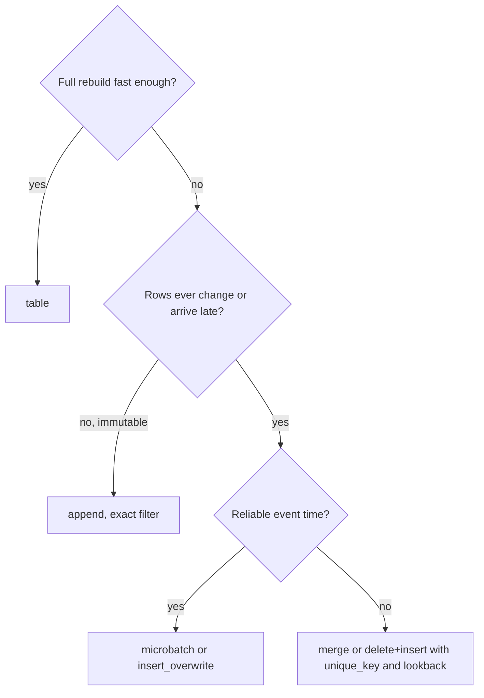

# 3 — dbt tests, snapshots and incremental models

The dbt project from the [transform chapter](01-transform.md) rebuilds everything on every run, tests only the shape of each column, and forgets history whenever a source overwrites a row. That holds up for a month of taxi data. It stops holding up in three ways as the data grows, and they arrive in a predictable order: a number goes wrong without any column-level test noticing, somebody asks what a record looked like last quarter and nobody kept it, and the nightly rebuild starts taking longer than the night. This chapter takes them in that order with tests beyond the built-in four, snapshots, and incremental models, and it runs each one until it breaks, because the failure modes are what you are being paid to know.

The project is smaller than the last chapter's so that each result can be read by eye: 1,000 trips over about five days, eight zones, one fact.

```python
import pathlib, duckdb
from dbt.cli.main import dbtRunner

def write(path, text):
    p = pathlib.Path(path)
    p.parent.mkdir(parents=True, exist_ok=True)
    p.write_text(text)

write("dbt_project.yml", 'name: taxi\nversion: "1.0"\nprofile: taxi\n')
write("profiles.yml", "taxi:\n  target: dev\n  outputs:\n    dev: {type: duckdb, path: taxi.duckdb}\n")

def dbt(*args):
    res = dbtRunner().invoke([*args, "--project-dir", ".", "--profiles-dir", ".", "--quiet"])
    if res.exception:
        raise res.exception
    for r in res.result.results:
        extra = f"  ({r.failures} failing)" if r.failures else ""
        print(f"{r.status!s:8}{r.node.resource_type!s:9}{r.node.name[:58]}{extra}")

def sql(query):
    with duckdb.connect("taxi.duckdb") as con:
        return con.execute(query).fetchall()

def run(statement):
    with duckdb.connect("taxi.duckdb") as con:
        con.execute(statement)

run("CREATE SCHEMA raw")
run("""CREATE TABLE raw.trips AS
       SELECT i AS trip_id, 1 + i % 8 AS zone_id,
              TIMESTAMP '2026-01-01' + INTERVAL (i * 7) MINUTE AS pickup_at,
              round(5 + (i * 37 % 400) / 10.0, 2) AS fare
       FROM range(1000) t(i)""")
run("""CREATE TABLE raw.zones (zone_id INT, zone TEXT, borough TEXT, updated_at TIMESTAMP)""")
run("""INSERT INTO raw.zones VALUES (1,'Astoria','Queens','2025-01-01'), (2,'Bushwick','Brooklyn','2025-01-01'),
       (3,'Harlem','Manhattan','2025-01-01'), (4,'Midtown','Manhattan','2025-01-01'),
       (5,'Flushing','Queens','2025-01-01'), (6,'Greenpoint','Queens','2025-01-01'),
       (7,'Red Hook','Brooklyn','2025-01-01'), (8,'Chelsea','Manhattan','2025-01-01')""")
write("models/sources.yml", "sources:\n  - name: raw\n    tables:\n      - name: trips\n      - name: zones\n")
write("models/dim_zones.sql", "select zone_id, zone, borough from {{ source('raw', 'zones') }}")
write("models/fact_trips.sql", """
select t.trip_id, t.pickup_at, t.fare, z.zone, z.borough
from {{ source('raw', 'trips') }} t
left join {{ ref('dim_zones') }} z using (zone_id)
""")
dbt("run")
print(sql("SELECT count(*), round(sum(fare)) FROM main.fact_trips"))
```

```text
success model    dim_zones
success model    fact_trips
[(1000, 24870.0)]
```

## Testing what columns can't show

The four built-in tests look at one column at a time. Most real bugs are relationships between tables. The [dbt docs](https://docs.getdbt.com/docs/build/data-tests) define a test as a `select` that returns failing records, so any assertion you can write in SQL can be a test. The most useful one you will ever write says that the fact still adds up to its source. A file in `tests/` is a **singular** test.

```python
write("tests/assert_fact_reconciles.sql", """
with src as (select count(*) as n, sum(fare) as fare from {{ source('raw', 'trips') }}),
     fct as (select count(*) as n, sum(fare) as fare from {{ ref('fact_trips') }})
select src.n as source_rows, fct.n as fact_rows, src.fare as source_fare, fct.fare as fact_fare
from src, fct
where src.n <> fct.n or abs(src.fare - fct.fare) > 0.01
""")
dbt("test")
```

```text
pass    test     assert_fact_reconciles
```

Pillar 2 promised a [test for the grain after a join](../../02-ingest-and-modelling/notes/02-dimensional-modelling.md), and here it is earning its place. Suppose the source sends a second row for zone 3. Nothing about that row is invalid.

```python
run("INSERT INTO raw.zones VALUES (3,'Harlem','Manhattan','2025-06-01')")     # a second row for zone 3
dbt("build")
print(sql("SELECT source_rows, fact_rows, round(source_fare), round(fact_fare) FROM (" +
          pathlib.Path("target/compiled/taxi/tests/assert_fact_reconciles.sql").read_text() + ")"))
```

```text
success model    dim_zones
success model    fact_trips
fail    test     assert_fact_reconciles  (1 failing)
[(1000, 1125, 24870.0, 27980.0)]
```

The fact went from 1,000 rows to 1,125, and revenue from 24,870 to 27,980 dollars, a 12.5 percent overstatement from one innocent row. The zone 3 trips each appear twice. No column-level test on a value would ever see this, and the dashboard would simply be wrong by an amount small enough to be believed.

A **generic** test is a singular test with parameters, so that you can attach it to columns in YAML the way you do the built-in ones. It lives in `tests/generic/`. Adding uniqueness on both the dimension and the fact tells us more than the reconciliation does. The reconciliation says the numbers are wrong. The uniqueness on `dim_zones` points at the cause.

```python
write("tests/generic/test_positive.sql", """

select {{ column_name }} from {{ model }} where {{ column_name }} <= 0

""")
write("models/schema.yml", """
models:
  - name: dim_zones
    columns:
      - name: zone_id
        data_tests: [unique, not_null]
  - name: fact_trips
    columns:
      - name: trip_id
        data_tests: [unique]
      - name: fare
        data_tests: [positive]
""")
dbt("test")
```

```text
fail    test     assert_fact_reconciles  (1 failing)
pass    test     not_null_dim_zones_zone_id
pass    test     positive_fact_trips_fare
fail    test     unique_dim_zones_zone_id  (1 failing)
fail    test     unique_fact_trips_trip_id  (125 failing)
```

Note that the failure counts differ by what each query counts. `unique_fact_trips_trip_id` reports 125, one per trip duplicated, and `unique_dim_zones_zone_id` reports 1, the one zone repeated. When a fix goes in upstream, everything passes.

```python
run("DELETE FROM raw.zones WHERE updated_at = '2025-06-01'")     # the source removes its duplicate
dbt("build")
```

```text
success model    dim_zones
pass    test     not_null_dim_zones_zone_id
pass    test     unique_dim_zones_zone_id
success model    fact_trips
pass    test     assert_fact_reconciles
pass    test     positive_fact_trips_fare
pass    test     unique_fact_trips_trip_id
```

Test the grain of every model that joins, on its key, at `error` severity. It is the cheapest test there is relative to what it catches. The `dbt_utils.unique_combination_of_columns` test does the same for a composite key.

### Severity, thresholds and looking at the failures

A failing test on 12 rows out of a billion should not always stop the world. [`warn_if` and `error_if`](https://docs.getdbt.com/reference/resource-configs/severity) let one test do both, and [`store_failures`](https://docs.getdbt.com/reference/resource-configs/store_failures) keeps the failing rows in a table, so the person on call can see them rather than rerun the query.

```python
run("UPDATE raw.trips SET fare = -1 WHERE trip_id < 12")
write("models/schema.yml", """
models:
  - name: dim_zones
    columns:
      - name: zone_id
        data_tests: [unique, not_null]
  - name: fact_trips
    columns:
      - name: trip_id
        data_tests: [unique]
      - name: fare
        data_tests:
          - positive:
              config:
                severity: error
                warn_if: ">0"
                error_if: ">50"
                store_failures: true
""")
dbt("build", "--select", "fact_trips")
print(sql("SELECT fare, count(*) FROM main_dbt_test__audit.positive_fact_trips_fare GROUP BY 1"))
run("UPDATE raw.trips SET fare = 7 WHERE trip_id < 12")
```

```text
success model    fact_trips
pass    test     assert_fact_reconciles
warn    test     positive_fact_trips_fare  (12 failing)
pass    test     unique_fact_trips_trip_id
[(-1.0, 12)]
```

Twelve negative fares warn and the build continues, and fifty-one would have stopped it. Setting a threshold is a decision about what a tolerable amount of known dirt is, and it should be written down with a reason. A threshold nobody remembers setting is where drift hides. A better long-run home for "this usually sits around 12" is a monitor that watches the trend ([monitors and lineage](../../05-quality-and-observability/notes/02-monitors-and-lineage.md)).

### Unit tests are for logic, data tests are for data

Data tests run on the data you have, so they can't tell you whether the logic is right for data you don't have yet. A band boundary at exactly 10 dollars may not occur in today's table. [Unit tests](https://docs.getdbt.com/docs/build/unit-tests), added in dbt 1.8, mock a model's inputs with a few rows and compare the output with what you say it should be. `dbt build` runs them before it builds the model.

```python
write("models/fare_bands.sql", """
select trip_id, fare,
       case when fare < 10 then 'low' when fare < 30 then 'mid' else 'high' end as band
from {{ ref('fact_trips') }}
""")
write("models/unit.yml", """
unit_tests:
  - name: band_boundaries
    model: fare_bands
    given:
      - input: ref('fact_trips')
        rows:
          - {trip_id: 1, fare: 9.99}
          - {trip_id: 2, fare: 10.00}
          - {trip_id: 3, fare: 30.00}
    expect:
      rows:
        - {trip_id: 1, fare: 9.99,  band: low}
        - {trip_id: 2, fare: 10.00, band: mid}
        - {trip_id: 3, fare: 30.00, band: high}
""")
dbt("build", "--select", "fare_bands")
```

```text
pass    unit_testband_boundaries
success model    fare_bands
```

Now somebody changes `<` to `<=`. The data tests couldn't say anything, because the model did not get built, and that is the right outcome. The unit test catches the change and names the row and column.

```python
good = pathlib.Path("models/fare_bands.sql").read_text()
write("models/fare_bands.sql", good.replace("fare < 10 ", "fare <= 10 "))
dbt("build", "--select", "fare_bands")
write("models/fare_bands.sql", good)
```

```text
actual differs from expected:
@@,trip_id,fare,band
  ,1      ,9.99,low
→ ,2      ,10.0,mid→low
  ,3      ,30.0,high
fail    unit_testband_boundaries  (1 failing)
skipped model    fare_bands
```

| | Data test | Unit test |
|---|---|---|
| Checks | The data, today | The logic, on rows you wrote |
| Runs | After the model builds | Before the model builds, against mocks |
| Catches | Bad sources, broken joins, drift | Wrong boundaries, wrong CASE arms, regressions |
| Worth writing for | Every model | Models with real logic; skip simple renames |
| Run it in | Every environment | CI and dev, since production inputs don't change the logic |

## Snapshots: keep what the source overwrites

A source table that updates in place destroys its own history. Pillar 2 built a [Type 2 dimension](../../02-ingest-and-modelling/notes/02-dimensional-modelling.md) by hand to preserve it. A [dbt snapshot](https://docs.getdbt.com/docs/build/snapshots) is that same pattern as a feature: on each run it compares the source with what it holds, closes the rows that changed, and inserts new versions. Since dbt 1.9 you declare it in YAML.

This is the example from pillar 2, in which Greenpoint moves from Queens to Brooklyn on January 15th.

```python
write("snapshots/zones.yml", """
snapshots:
  - name: zones_snapshot
    relation: source('raw', 'zones')
    config:
      schema: snapshots
      unique_key: zone_id
      strategy: timestamp
      updated_at: updated_at
      dbt_valid_to_current: "cast('9999-12-31' as timestamp)"
""")
dbt("snapshot")
run("UPDATE raw.zones SET borough = 'Brooklyn', updated_at = '2026-01-15' WHERE zone_id = 6")
dbt("snapshot")
HIST = """SELECT zone_id, borough, dbt_valid_from::DATE, dbt_valid_to::DATE
          FROM main_snapshots.zones_snapshot WHERE zone_id = 6 ORDER BY dbt_valid_from"""
for row in sql(HIST):
    print(row)
```

```text
success snapshot zones_snapshot
success snapshot zones_snapshot
(6, 'Queens', datetime.date(2025, 1, 1), datetime.date(2026, 1, 15))
(6, 'Brooklyn', datetime.date(2026, 1, 15), datetime.date(9999, 12, 31))
```

Zone 6 now has two rows with contiguous validity, and `dbt_valid_from` comes from the source's `updated_at` under the `timestamp` strategy. Setting `dbt_valid_to_current` to a far-future date gives the same convention as pillar 2, so that range joins need no `coalesce`. Join facts to this table on the natural key and `pickup_at` within the range to get history as it was.

### A snapshot only sees what it is there to see

The output above looks like history, but it's a series of samples. It records whatever state the source is in at each run. If a row changes twice between runs, the middle state is gone for good.

```python
run("UPDATE raw.zones SET borough = 'Queens',    updated_at = '2026-02-01' WHERE zone_id = 7")
run("UPDATE raw.zones SET borough = 'Manhattan', updated_at = '2026-02-02' WHERE zone_id = 7")
dbt("snapshot")
for row in sql(HIST.replace("zone_id = 6", "zone_id = 7")):
    print(row)
```

```text
success snapshot zones_snapshot
(7, 'Brooklyn', datetime.date(2025, 1, 1), datetime.date(2026, 2, 2))
(7, 'Manhattan', datetime.date(2026, 2, 2), datetime.date(9999, 12, 31))
```

Red Hook was in Queens for one day, and the snapshot has no record of it, since it only ran after both updates. `Brooklyn` runs straight on to `Manhattan`. Nothing failed, and nothing can recover the missing row. The remedy is either to snapshot at least as often as the source can change or, when the states in between matter, to capture every change with [CDC at the source](../../02-ingest-and-modelling/notes/01-ingest.md). This is also why snapshots run first and on their own schedule in many projects, and why a missed snapshot run is an incident: unlike a model, a snapshot cannot be rebuilt from anything.

### Timestamp or check

`timestamp` trusts an `updated_at` column. `check` compares the values of listed columns (or `all`) and uses the run's time as the change time. Each one can miss changes the other sees.

```python
write("snapshots/zones_check.yml", """
snapshots:
  - name: zones_check
    relation: source('raw', 'zones')
    config:
      schema: snapshots
      unique_key: zone_id
      strategy: check
      check_cols: [borough]
""")
dbt("snapshot", "--select", "zones_check")
run("UPDATE raw.zones SET zone = 'Greenpoint North', updated_at = '2026-03-01' WHERE zone_id = 6")
dbt("snapshot", "--select", "zones_check")
dbt("snapshot", "--select", "zones_snapshot")
print("rows for zone 6, check_cols=[borough]:", sql("SELECT count(*) FROM main_snapshots.zones_check WHERE zone_id = 6")[0][0])
print("rows for zone 6, timestamp strategy:  ", sql("SELECT count(*) FROM main_snapshots.zones_snapshot WHERE zone_id = 6")[0][0])
```

```text
success snapshot zones_check
success snapshot zones_check
success snapshot zones_snapshot
rows for zone 6, check_cols=[borough]: 1
rows for zone 6, timestamp strategy:   3
```

The rename added a row to the timestamp snapshot, because `updated_at` moved, but nothing to the check snapshot, because `check_cols` only watches `borough`. Which one is right depends on whether you care about the name. A source that doesn't bump `updated_at` on every change will make `timestamp` silently miss updates, which is common with hand-run fixes in the source database, and the [exercise below](#try-it) shows it. When you can trust the column, prefer `timestamp`, because it records when the change happened rather than when you noticed.

| | `timestamp` | `check` |
|---|---|---|
| Change is detected by | `updated_at` moved | Listed column values differ |
| `dbt_valid_from` is | The source's `updated_at` | The snapshot run's time |
| Misses | Updates that don't bump the column | Changes outside `check_cols` |
| Cost | Compares one column | Compares every listed column |

Rows that vanish from a source are ignored by default, so a deleted zone stays current forever. `hard_deletes: invalidate` closes the row, and `hard_deletes: new_record` adds a row flagged `dbt_is_deleted`.

```python
write("snapshots/zones_check.yml", pathlib.Path("snapshots/zones_check.yml").read_text() + "      hard_deletes: invalidate\n")
run("DELETE FROM raw.zones WHERE zone_id = 8")
dbt("snapshot", "--select", "zones_check")
print(sql("SELECT zone_id, dbt_valid_to IS NULL AS still_current FROM main_snapshots.zones_check WHERE zone_id = 8"))
```

```text
success snapshot zones_check
[(8, False)]
```

Snapshots ignore `--full-refresh`, by design: throwing one away and rebuilding it would lose exactly what it exists to keep. Snapshot sources directly and keep logic out, so that a bug in a transform can't get baked into history.

## Incremental models

When a full rebuild takes too long, an [incremental model](https://docs.getdbt.com/docs/build/incremental-models) processes only new rows and adds them to the existing table. The price is that you now have two code paths, first build and every later build, and a whole class of bugs in which those two paths disagree. `is_incremental()` is true only when the target already exists, the model is materialized as incremental, and `--full-refresh` isn't set. `{{ this }}` is the table as it stands.

### Without a key, overlaps become duplicates

The commonest first attempt uses a watermark with `>=`, so as not to miss anything at the boundary, and no `unique_key`. Without a key most adapters simply append.

```python
write("models/fct_append.sql", """
{{ config(materialized='incremental') }}
select trip_id, pickup_at, fare from {{ source('raw', 'trips') }}

where pickup_at >= (select max(pickup_at) from {{ this }})

""")
dbt("run", "--select", "fct_append")
dbt("run", "--select", "fct_append")
print(sql("SELECT count(*), count(DISTINCT trip_id) FROM main.fct_append"))
```

```text
success model    fct_append
success model    fct_append
[(1001, 1000)]
```

Nothing new arrived and the table still grew. The row at the watermark came through again. A `unique_key` tells dbt that incoming rows replace existing rows with the same key, which is what makes rerunning a load safe.

```python
write("models/fct_merge.sql", """
{{ config(materialized='incremental', unique_key='trip_id', incremental_strategy='delete+insert') }}
select trip_id, pickup_at, fare from {{ source('raw', 'trips') }}

where pickup_at > (select max(pickup_at) from {{ this }})

""")
dbt("run", "--select", "fct_merge")
dbt("run", "--select", "fct_merge")
print(sql("SELECT count(*), count(DISTINCT trip_id) FROM main.fct_merge"))
```

```text
success model    fct_merge
success model    fct_merge
[(1000, 1000)]
```

### A watermark can't see late rows

The more interesting failure has no error at all. A trip from January 2nd arrives after the table has already moved on past it, along with one fresh trip. The fresh row goes up the watermark, and the late one is below it for all time.

```python
run("""INSERT INTO raw.trips VALUES (1000, 1, TIMESTAMP '2026-01-02 08:00', 50.0),
                                    (1001, 1, TIMESTAMP '2026-01-06 00:00', 50.0)""")
dbt("run", "--select", "fct_merge")
print("late row  1000 present:", sql("SELECT count(*) FROM main.fct_merge WHERE trip_id = 1000")[0][0])
print("fresh row 1001 present:", sql("SELECT count(*) FROM main.fct_merge WHERE trip_id = 1001")[0][0])
```

```text
success model    fct_merge
late row  1000 present: 0
fresh row 1001 present: 1
```

The fact is now short of its source, and every test on the table passes. The reconciliation test from earlier in this chapter is the one that would catch it. The usual remedy is a lookback window: reprocess the last few days on every run, and let `unique_key` absorb the overlap.

```python
write("models/fct_merge.sql", """
{{ config(materialized='incremental', unique_key='trip_id', incremental_strategy='delete+insert') }}
select trip_id, pickup_at, fare from {{ source('raw', 'trips') }}

where pickup_at > (select max(pickup_at) - interval 3 day from {{ this }})

""")
run("INSERT INTO raw.trips VALUES (1002, 1, TIMESTAMP '2026-01-04 09:00', 50.0)")
dbt("run", "--select", "fct_merge")
print("row 1002, 2 days behind the newest: present", sql("SELECT count(*) FROM main.fct_merge WHERE trip_id = 1002")[0][0])
print("row 1000, 4 days behind the newest: present", sql("SELECT count(*) FROM main.fct_merge WHERE trip_id = 1000")[0][0])
print("rows:", sql("SELECT count(*) FROM main.fct_merge")[0][0], "source:", sql("SELECT count(*) FROM raw.trips")[0][0])
```

```text
success model    fct_merge
row 1002, 2 days behind the newest: present 1
row 1000, 4 days behind the newest: present 0
rows: 1002 source: 1003
```

A lookback is a bet about how late data gets, with the cost of reprocessing on one side and missed rows on the other. Row 1002 fell inside the three-day window, and row 1000 didn't. Measure how late your data really arrives and set the window from that, then accept that something later will still get through. So keep a full rebuild available, and run one periodically if you can afford to. A full refresh rebuilds from raw and repairs everything, so long as raw was kept, which is the ELT bet from [the transform chapter](01-transform.md) paying out.

```python
dbt("run", "--select", "fct_merge", "--full-refresh")
print("rows:", sql("SELECT count(*) FROM main.fct_merge")[0][0], "late row present:",
      sql("SELECT count(*) FROM main.fct_merge WHERE trip_id = 1000")[0][0])
```

```text
success model    fct_merge
rows: 1003 late row present: 1
```

### Schema change

Adding a column to an incremental model does nothing to the existing table by default. `on_schema_change` has four settings: `ignore` (the default), `fail`, `append_new_columns` and `sync_all_columns`.

```python
BODY = """
{{ config(materialized='incremental', unique_key='trip_id', on_schema_change='MODE') }}
select trip_id, pickup_at, fare COLS from {{ source('raw', 'trips') }}
 where pickup_at > (select max(pickup_at) from {{ this }}) 
"""
def fct_schema(mode, cols=""):
    write("models/fct_schema.sql", BODY.replace("MODE", mode).replace("COLS", cols))
    dbt("run", "--select", "fct_schema")
    print(mode, [c[0] for c in sql("DESCRIBE main.fct_schema")])

fct_schema("ignore")
fct_schema("ignore", ", fare * 0.2 as tip_estimate")
run("INSERT INTO raw.trips VALUES (1003, 1, TIMESTAMP '2026-01-07', 20.0)")
fct_schema("append_new_columns", ", fare * 0.2 as tip_estimate")
print(sql("SELECT count(*), count(tip_estimate) FROM main.fct_schema"))
```

```text
success model    fct_schema
ignore ['trip_id', 'pickup_at', 'fare']
success model    fct_schema
ignore ['trip_id', 'pickup_at', 'fare']
success model    fct_schema
append_new_columns ['trip_id', 'pickup_at', 'fare', 'tip_estimate']
[(1004, 1)]
```

With `ignore`, the new column is quietly dropped and there's no error. With `append_new_columns` the column appears, and of 1,004 rows just the one new row has a value. None of the settings backfills existing rows: that takes `--full-refresh` or a one-off update. For a production fact, `fail` is often the kindest choice, since it makes the change somebody's decision instead of leaving a column that's null for all of history.

### Strategies

`incremental_strategy` decides how new rows meet old ones. Available strategies [differ by adapter](https://docs.getdbt.com/docs/build/incremental-strategy), and dbt-duckdb supports `append`, `merge` (on recent DuckDB), `delete+insert` and `microbatch`.

| Strategy | What it does | Good for | Watch out for |
|---|---|---|---|
| `append` | Inserts rows, no matching | Immutable events you filter exactly | Any overlap duplicates |
| `merge` | Matches on `unique_key`, updates or inserts | Changing rows on warehouses with `MERGE` | Scans the target unless predicates limit it |
| `delete+insert` | Deletes matching keys, inserts the new rows | Same, where merge is slow or absent | Two statements, unless it runs in a transaction |
| `insert_overwrite` | Replaces whole partitions | Big partitioned facts on BigQuery or Spark | The batch must contain the whole partition, or you lose rows |
| `microbatch` | One bounded query per time period | Large time series with a reliable event time | Needs `event_time` configured upstream too |

### Microbatch: the same idea as a partition

[`microbatch`](https://docs.getdbt.com/docs/build/incremental-microbatch), available since dbt 1.9, drops the `is_incremental()` block. You declare an `event_time` and a `batch_size`, and dbt filters each upstream with a declared `event_time` to one period, then replaces that period in the target. Each batch is independent, which is what makes a failed batch re-runnable alone, and reprocessing a range is just `--event-time-start` and `--event-time-end`. dbt-duckdb implements it as delete-and-insert by period and refuses a `unique_key`.

```python
write("models/sources.yml", """
sources:
  - name: raw
    tables:
      - name: trips
        config: {event_time: pickup_at}
      - name: zones
""")
write("models/daily_revenue.sql", """
{{ config(materialized='incremental', incremental_strategy='microbatch',
          event_time='pickup_at', batch_size='day', begin='2026-01-01') }}
select trip_id, pickup_at, fare from {{ source('raw', 'trips') }}
""")
dbt("run", "--select", "daily_revenue", "--event-time-start", "2026-01-01", "--event-time-end", "2026-01-04")
print(sql("SELECT pickup_at::DATE, count(*), round(sum(fare)) FROM main.daily_revenue GROUP BY 1 ORDER BY 1"))
run("UPDATE raw.trips SET fare = fare + 100 WHERE pickup_at::DATE = '2026-01-02'")
dbt("run", "--select", "daily_revenue", "--event-time-start", "2026-01-02", "--event-time-end", "2026-01-03")
print(sql("SELECT pickup_at::DATE, count(*), round(sum(fare)) FROM main.daily_revenue GROUP BY 1 ORDER BY 1"))
```

```text
success model    daily_revenue
[(datetime.date(2026, 1, 1), 206, 4935.0), (datetime.date(2026, 1, 2), 207, 5179.0), (datetime.date(2026, 1, 3), ...
success model    daily_revenue
[(datetime.date(2026, 1, 1), 206, 4935.0), (datetime.date(2026, 1, 2), 207, 25879.0), (datetime.date(2026, 1, 3) ...
```

January 2nd restated from 5,179 to 25,879 and its neighbours didn't move. The next chapter builds this same "replace one period" operation by hand, because understanding it is what makes all of these strategies legible. The docs do warn that an upstream without `event_time` is scanned in full on every batch, so a dimension in the query costs a full read per day.



Start from `table`. Move to incremental when the rebuild is a measured problem, and add a reconciliation test on the day you do.

## Pitfalls

- **No grain test after a join.** A fan-out is the most expensive quiet bug in analytics, and one `unique` test catches it.
- **`severity: warn` by default.** A warning nobody reads isn't a test.
- **Unit-testing renames.** Save unit tests for logic that can be wrong in ways a type can't show.
- **Treating a snapshot as complete history.** It samples. Changes between runs are gone, and a snapshot that didn't run can't be rebuilt.
- **Logic in the snapshot's relation.** It bakes today's bug into permanent history. Snapshot sources as they are.
- **Trusting `updated_at`.** Check that the source actually bumps it, including on manual fixes.
- **Going incremental too early.** Two code paths are a real cost. Pay it when the rebuild hurts.
- **A watermark with no lookback.** Late rows vanish, and no test fails unless you reconciled.
- **Lookback without `unique_key`.** The window then duplicates every row in it, on every run.
- **`on_schema_change` left on `ignore`.** A new column silently never arrives.
- **`insert_overwrite` with a partial batch.** Replacing a partition with part of its rows deletes the rest.

## Try it

The full code for this chapter is in [`practice/03_dbt_depth.py`](../practice/03_dbt_depth.py).

1. Write a generic test `in_range` that takes `low` and `high` arguments, and attach it to `fare_bands.fare` with `low: 0, high: 40`. How many rows fail, and why isn't that a bug in the data?
2. Update zone 2's `borough` in the source without changing `updated_at`, then run `dbt snapshot`. What does each snapshot record for zone 2?
3. Using the `>` watermark, insert a new trip with a pickup time exactly equal to the model's current maximum. Is it picked up? What does this say about `>` versus `>=`?

<details>
<summary>Answers</summary>

1. Declare it with `` and `select` the rows outside the range, then attach it with `in_range: {arguments: {low: 0, high: 40}}`. On the project's final state, 303 rows fail: 207 are the January 2nd fares the microbatch cell raised by 100, which `fare_bands` sees because both it and `fact_trips` are views here, and the rest are ordinary fares above 40 that the generator can produce. A range test encodes an assumption about the data, and the assumption goes stale when the data legitimately changes.
2. The timestamp snapshot still shows `Brooklyn`, current, with nothing changed: `updated_at` didn't move, so it saw nothing. The check snapshot closes the old row and adds `Bronx`, stamped with the run's time rather than when the change really happened.
3. It is not picked up: `>` excludes the tie, so the row is lost until a full refresh. `>=` would pick it up but re-reads the boundary row on every run, which is safe only with a `unique_key`. So use `>=` with a key, or a lookback with a key, and never a bare `>` on data where timestamps can tie.

</details>

## Interview checklist

| Question | Answer |
|---|---|
| What is a singular test, and a generic one? | A SQL file that returns failing rows; the same thing parameterised, attachable to columns in YAML. |
| Name a test you would write beyond the built-ins. | Reconciliation of fact to source on counts and sums, and uniqueness of the fact's grain after joins. |
| Data test vs unit test? | A data test checks today's data after build. A unit test checks logic on mocked rows before the build. |
| `warn_if` / `error_if`? | Thresholds on the failing-row count that let one test warn at a low count and fail at a high one. |
| What does `store_failures` do? | Writes failing rows to a table, so they can be inspected without rerunning the test. |
| What is a snapshot, and what are its columns? | A Type 2 history of a mutable source, with `dbt_valid_from`, `dbt_valid_to`, `dbt_scd_id`, `dbt_updated_at`. |
| What can a snapshot not capture? | Intermediate states between runs. It samples, and a missed run can't be rebuilt. |
| Timestamp or check? | Timestamp when `updated_at` is reliable, as it records true change time. Check otherwise, on the listed columns. |
| Why doesn't `--full-refresh` affect snapshots? | Rebuilding would destroy the history it exists to hold. |
| What does `is_incremental()` check? | Target exists, model is incremental, and no `--full-refresh`. |
| What does `unique_key` do? | Replaces existing rows with the same key. Without it most adapters append, and any overlap duplicates. |
| How do you handle late-arriving rows? | A lookback window with `unique_key`, sized from measured lateness, plus periodic full refresh and reconciliation. |
| What does `on_schema_change` do to old rows? | Nothing. No setting backfills; that takes a full refresh or a one-off update. |
| What is microbatch? | One bounded, replaceable query per period of `event_time`, so a period can be retried or backfilled alone. |
| When do you make a model incremental? | When a measured rebuild cost justifies carrying two code paths. |

## Next

[Idempotency and backfills](04-idempotency-and-backfills.md) takes "replace one period" out of dbt and makes it the rule for every task: run it twice, get the same answer.
