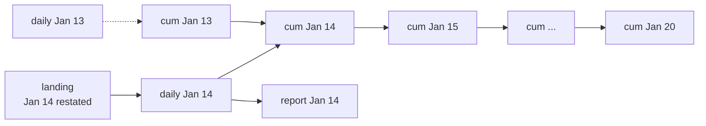

# 4 — Idempotency and backfills

Every pipeline gets run twice eventually. A task times out after its write has succeeded, so the orchestrator retries it. A bug is found in March's logic and someone has to redo March. A source sends a correction for last Tuesday. What separates a dull morning from a two-day cleanup is one property: running a task again for the same period leaves the same result as running it once. That property is idempotency, and it is what makes the rest of this pillar work: a retry is only safe with it, a backfill is only a loop with it, and without it an orchestrator that dutifully re-runs failed tasks just makes the damage worse. This chapter breaks a load in each of the common ways and then fixes it, using nothing but DuckDB files on disk.

## The argument

Kleppmann points out in [*Designing Data-Intensive Applications*](https://dataintensive.net/) (ch. 10, pp. 413-414) why batch jobs that write whole outputs are forgiving in a way that online databases aren't. If you deploy buggy code that writes bad data into a database, rolling back the code does not fix the data. If a batch job replaced its output, you roll back and run it again, and the output is right. He calls the idea, after others, *human fault tolerance*. Later in the book (ch. 11, p. 478) he gives the small version of it for stream processors: an operation that sets a value is naturally idempotent, while one that increments a counter isn't, unless you store the offset that produced each write so that you can tell whether it has already been applied. The same passage lists what that relies on: a restarted task must replay the same inputs, its processing must be deterministic, and nobody else may update the value at the same time. Those three conditions will come up in batch form below.

Maxime Beauchemin, the creator of Airflow, made this the organising idea for warehouse pipelines in ["Functional Data Engineering"](https://maximebeauchemin.medium.com/functional-data-engineering-a-modern-paradigm-for-batch-data-processing-2327ec32c42a) (Medium, 2018): treat a task like a pure function, so that its output depends only on its inputs and the period it is for; have it overwrite a partition rather than mutate rows; and keep raw inputs immutable, so that any output can be recomputed. This chapter follows that shape.

The inputs first: eleven days of landed trips, one folder per day, never edited in place.

```python
import datetime as dt, hashlib, os, pathlib, shutil, duckdb
from concurrent.futures import ThreadPoolExecutor

def days(start, end):
    d, last = dt.date.fromisoformat(start), dt.date.fromisoformat(end)
    while d <= last:
        yield d.isoformat()
        d += dt.timedelta(days=1)

def land(day, extra=0):
    """Immutable raw input: one folder per day, generated deterministically from the date."""
    folder = pathlib.Path(f"landing/day={day}")
    folder.mkdir(parents=True, exist_ok=True)
    n = 1000 + int(day[-2:]) * 10 + extra
    seed = int(day.replace("-", ""))
    duckdb.sql(f"""COPY (SELECT {seed}::BIGINT * 10000 + i AS trip_id, 1 + i % 8 AS zone_id,
                                5 + (i * 37 % 400) / 10.0 AS fare
                         FROM range({n}) t(i))
                   TO '{folder}/trips.parquet' (FORMAT parquet)""")

for day in days("2026-01-10", "2026-01-20"):
    land(day)
print(duckdb.sql("""SELECT count(DISTINCT day) AS days, count(*) AS trips, round(sum(fare)) AS fares
                    FROM read_parquet('landing/*/*.parquet', hive_partitioning=1)"""))
```

```text
┌───────┬───────┬──────────┐
│ days  │ trips │  fares   │
│ int64 │ int64 │  double  │
├───────┼───────┼──────────┤
│    11 │ 12650 │ 315233.0 │
└───────┴───────┴──────────┘
```

## Three ways to write, one of them wrong

An append-only load is the natural first draft, and it passes every test on the first run.

```python
con = duckdb.connect("warehouse.duckdb")
con.execute("CREATE TABLE daily_append (day DATE, trips BIGINT, fares DOUBLE)")

def load_append(day):
    con.execute(f"""INSERT INTO daily_append
        SELECT DATE '{day}', count(*), sum(fare) FROM 'landing/day={day}/*.parquet'""")

def total(table):
    return con.execute(f"SELECT count(*), sum(trips) FROM {table}").fetchall()[0]

load_append("2026-01-10")
print("after one run:          ", total("daily_append"))
load_append("2026-01-10")                     # a retry, a rerun, somebody being careful
print("after running it again: ", total("daily_append"))
```

```text
after one run:           (1, 1100)
after running it again:  (2, 2200)
```

The second run doubled it. There's no error, because `INSERT` did precisely what it says. This is what the [retry in the orchestrator chapter](02-orchestrate.md) does to you at 03:00.

Replacing the period is the fix. Scope the delete to the logical date and do both statements in one transaction, so that readers see the old day or the new day and never a gap.

```python
con.execute("CREATE TABLE daily (day DATE, trips BIGINT, fares DOUBLE)")

def load_overwrite(day):
    con.execute("BEGIN")
    con.execute(f"DELETE FROM daily WHERE day = DATE '{day}'")
    con.execute(f"""INSERT INTO daily
        SELECT DATE '{day}', count(*), sum(fare) FROM 'landing/day={day}/*.parquet'""")
    con.execute("COMMIT")

load_overwrite("2026-01-10")
print("after one run:          ", total("daily"))
load_overwrite("2026-01-10")
print("after running it again: ", total("daily"))
```

```text
after one run:           (1, 1100)
after running it again:  (1, 1100)
```

The other approach keys on the row. An upsert on the natural key makes a rerun harmless too.

```python
con.execute("CREATE TABLE trips_merged (trip_id BIGINT PRIMARY KEY, zone_id INT, fare DOUBLE)")

def load_merge(day):
    con.execute(f"""INSERT OR REPLACE INTO trips_merged
        SELECT trip_id, zone_id, fare FROM 'landing/day={day}/*.parquet'""")

load_merge("2026-01-10"); load_merge("2026-01-10")
print("merge, twice:", con.execute("SELECT count(*), count(DISTINCT trip_id) FROM trips_merged").fetchall()[0])
```

```text
merge, twice: (1100, 1100)
```

| Write mode | Rerun | Rows removed upstream | Cost | Use it for |
|---|---|---|---|---|
| Append | Duplicates | Stay | Cheapest | Almost nothing; only with exact-once input tracking |
| Overwrite a partition | Same result | Disappear | Rewrite one period | Almost every batch table; the default choice |
| Merge on a key | Same result | **Stay** | Matches against the target | Slowly changing entities and CDC, where no period owns the row |

The middle cell of the merge row is why overwrite is the default. If the source deletes a row and re-sends the day, an upsert has nothing that tells it to remove the old one. The exercises let you watch that happen.

## Purity: same inputs, same output

An overwrite gets rid of duplicates, but the job can still be impure. A `loaded_at` from the clock makes each run's output differ from the last, and then you can't tell a meaningful change from noise. A cheap way to check is to hash the sorted result and compare runs.

```python
def fingerprint(query):
    """A hash of a result set that does not depend on row order."""
    data = sorted(map(repr, con.execute(query).fetchall()))
    return hashlib.md5("".join(data).encode()).hexdigest()[:10]

def build_clocked(day):
    con.execute(f"""CREATE OR REPLACE TABLE out_clocked AS
        SELECT DATE '{day}' AS day, count(*) AS trips, now()::TIMESTAMP AS loaded_at
        FROM 'landing/day={day}/*.parquet'""")

def build_pure(day):
    con.execute(f"""CREATE OR REPLACE TABLE out_pure AS
        SELECT DATE '{day}' AS day, count(*) AS trips
        FROM 'landing/day={day}/*.parquet'""")

for build, table in [(build_clocked, "out_clocked"), (build_pure, "out_pure")]:
    prints = set()
    for _ in range(3):
        build("2026-01-10")
        prints.add(fingerprint(f"SELECT * FROM {table}"))
    print(f"{table:12} distinct results over 3 runs: {len(prints)}")
```

```text
out_clocked  distinct results over 3 runs: 3
out_pure     distinct results over 3 runs: 1
```

Harmless on its own, you might say, and a load timestamp is useful for debugging. Keep it in a run log or as metadata instead, since anything that hashes or compares rows downstream will now see a change on every run. The more damaging impurities change the numbers:

| Source of impurity | What goes wrong | Fix |
|---|---|---|
| `now()`, `current_date`, `date.today()` | Reruns compute a different period | Take the logical date as a parameter |
| Latest state of a dimension | Old periods get today's attributes (below) | Join as of the logical date |
| `row_number()` with no total order | The kept row can differ between runs | Order by something unique |
| `random()`, sampling with no seed | Different rows each run | Seed from the logical date |
| Reading a live API during transform | The answer depends on when you ran | Land the response first, then transform the landed file |
| "Whatever is in the folder" | A file that arrived late changes an old run | Read only the logical date's partition |

## Readers must never see half a write

Idempotency says a rerun will repair a crash. It doesn't say what readers see between the crash and the repair. Writing in place leaves a truncated file that looks valid, while writing beside it and renaming leaves the old complete file until the new one is ready.

```python
lake = pathlib.Path("lake/daily")

def write_in_place(day, rows, crash=False):
    path = lake / f"day={day}.csv"
    path.parent.mkdir(parents=True, exist_ok=True)
    with open(path, "w") as f:
        for i, row in enumerate(rows):
            if crash and i == len(rows) // 2:
                raise IOError("node lost")
            f.write(f"{row}\n")

def write_atomic(day, rows, crash=False):
    path = lake / f"day={day}.csv"
    path.parent.mkdir(parents=True, exist_ok=True)
    tmp = path.with_suffix(".tmp")
    with open(tmp, "w") as f:
        for i, row in enumerate(rows):
            if crash and i == len(rows) // 2:
                raise IOError("node lost")
            f.write(f"{row}\n")
    os.replace(tmp, path)                     # atomic on one POSIX filesystem

rows = list(range(1000))
for writer in (write_in_place, write_atomic):
    writer("2026-01-11", rows)
    try:
        writer("2026-01-11", rows, crash=True)
    except IOError:
        pass
    print(f"{writer.__name__:15} readers see", sum(1 for _ in open(lake / "day=2026-01-11.csv")), "rows after a crash")
```

```text
write_in_place  readers see 500 rows after a crash
write_atomic    readers see 1000 rows after a crash
```

`os.replace` is atomic only within one POSIX filesystem. Object stores have no such directory rename, which is one big reason table formats exist: Iceberg and Delta commit a new snapshot of metadata atomically, so that a half-written set of files is invisible ([table formats](../../04-warehouse-lakehouse-streaming/notes/02-table-formats.md)). Kleppmann makes the same case for batch jobs at p. 413: writing to an external database from inside a job leaks partial results, whereas building a new output and switching to it does not.

### Write, audit, publish

The rename gives you a place to stand: between "written" and "visible" you can run tests. The pattern is usually called write-audit-publish. It fixes the gap we saw in [the transform chapter](01-transform.md), in which a test failing in `dbt build` protected what was below but not the tested table itself. Build a staging copy, audit it, and swap only if it passes.

```python
for day in days("2026-01-10", "2026-01-20"):
    load_overwrite(day)

def publish(day, audit):
    """Write, audit, publish: build a staging copy, check it, then swap it in one transaction."""
    con.execute("CREATE OR REPLACE TABLE daily_staging AS SELECT * FROM daily")
    con.execute(f"DELETE FROM daily_staging WHERE day = DATE '{day}'")
    con.execute(f"""INSERT INTO daily_staging
        SELECT DATE '{day}', count(*), sum(fare) FROM 'landing/day={day}/*.parquet'""")
    bad = audit(day)
    if bad:
        print(f"{day}: audit failed ({bad}), production unchanged")
        return False
    con.execute("BEGIN")
    con.execute("DROP TABLE daily")
    con.execute("ALTER TABLE daily_staging RENAME TO daily")
    con.execute("COMMIT")
    print(f"{day}: published")
    return True

def min_trips(day):
    trips = con.execute(f"SELECT trips FROM daily_staging WHERE day = DATE '{day}'").fetchall()[0][0]
    return f"{trips} trips looks truncated" if trips < 500 else None

publish("2026-01-12", min_trips)
duckdb.sql("""COPY (SELECT * FROM 'landing/day=2026-01-13/*.parquet' LIMIT 40)
              TO 'truncated.parquet' (FORMAT parquet)""")
shutil.copy("truncated.parquet", "landing/day=2026-01-13/trips.parquet")   # a bad re-landing
publish("2026-01-13", min_trips)
print(con.execute("SELECT trips FROM daily WHERE day = '2026-01-13'").fetchall()[0][0], "trips still in production")
land("2026-01-13")                            # the source re-sends the day
```

```text
2026-01-12: published
2026-01-13: audit failed (40 trips looks truncated), production unchanged
1130 trips still in production
```

Here, a truncated re-landing of January 13th shrank that day to 40 rows, the audit refused it, and readers kept 1,130 trips. The copy of the whole table here is for clarity. On a warehouse you'd use a zero-copy clone, or a table format's branches, so that the audit costs little.

## Late data and restatement

A day is never quite finished. When rows for an old day turn up, an idempotent pipeline handles them with no new code: land them, and run that day again.

```python
print("before:", con.execute("SELECT trips, fares FROM daily WHERE day = '2026-01-14'").fetchall()[0])
land("2026-01-14", extra=50)                  # 50 more trips turn up for an old day
load_overwrite("2026-01-14")
print("after: ", con.execute("SELECT trips, fares FROM daily WHERE day = '2026-01-14'").fetchall()[0])
print("other days that moved:", con.execute("""SELECT count(*) FROM daily
    WHERE day <> DATE '2026-01-14' AND trips <> 1000 + day(day) * 10""").fetchall()[0][0])
```

```text
before: (1140, 28411.0)
after:  (1190, 29693.5)
other days that moved: 0
```

Fifty trips arrived, one partition moved, and the other ten didn't. Compare the [watermark in the dbt chapter](03-dbt-tests-snapshots-incremental.md), which couldn't see that row at all. This is also why the question "which period does this row belong to?" should be answered by event time, while "when did we learn about it?" goes in the landing path or a load date. Keeping both lets you answer what the numbers said as they stood on a given date.

## What a backfill really changes

The hard part of a backfill is deciding what the old answer *should* be. Two things catch people out.

### Dimensions: today's truth or that day's truth?

Rerun January 10th after Greenpoint moved to Brooklyn on the 15th, joining to the dimension as it stands today. Your backfill has now rewritten history without touching a line of fact logic.

```python
con.execute("CREATE TABLE zones_now (zone_id INT, borough TEXT)")
con.execute("INSERT INTO zones_now SELECT i, CASE WHEN i % 2 = 0 THEN 'Queens' ELSE 'Manhattan' END FROM range(1, 9) t(i)")
con.execute("""CREATE TABLE zones_hist AS
    SELECT zone_id, borough, DATE '2025-01-01' AS valid_from, DATE '9999-12-31' AS valid_to FROM zones_now""")
# Greenpoint moves to Brooklyn on January 15th
con.execute("UPDATE zones_now SET borough = 'Brooklyn' WHERE zone_id = 6")
con.execute("UPDATE zones_hist SET valid_to = DATE '2026-01-15' WHERE zone_id = 6")
con.execute("INSERT INTO zones_hist VALUES (6, 'Brooklyn', DATE '2026-01-15', DATE '9999-12-31')")

def by_borough_current(day):
    return con.execute(f"""SELECT z.borough, count(*) FROM 'landing/day={day}/*.parquet' t
        JOIN zones_now z USING (zone_id) GROUP BY 1 ORDER BY 1""").fetchall()

def by_borough_asof(day):
    return con.execute(f"""SELECT z.borough, count(*) FROM 'landing/day={day}/*.parquet' t
        JOIN zones_hist z ON t.zone_id = z.zone_id
         AND DATE '{day}' >= z.valid_from AND DATE '{day}' < z.valid_to
        GROUP BY 1 ORDER BY 1""").fetchall()

print("Jan 10, joined to the dimension as it is today:", by_borough_current("2026-01-10"))
print("Jan 10, joined to the dimension as it was then:", by_borough_asof("2026-01-10"))
```

```text
Jan 10, joined to the dimension as it is today: [('Brooklyn', 137), ('Manhattan', 550), ('Queens', 413)]
Jan 10, joined to the dimension as it was then: [('Manhattan', 550), ('Queens', 550)]
```

The 137 trips in zone 6 moved borough, and the Queens total for January 10th fell from 550 to 413, even though nothing happened on January 10th. Sometimes that is what you want: restating history in current territories is a legitimate report, and Pillar 2's [Type 1 and Type 2](../../02-ingest-and-modelling/notes/02-dimensional-modelling.md) discussion is exactly this choice. What you must not do is make it by accident. A nightly job on a Type 1 dimension and a backfill of the same job produce different answers for the same day, so the table's history depends on when each partition happened to be built. For reproducibility, join to a dated dimension, or snapshot the dimension per day and read the partition for the logical date.

### Dependencies on the past

A daily table depends only on its own day, so partitions can be rebuilt in any order. A cumulative table, in which each day reads yesterday's result, cannot.

```python
def downstream_of(day, start, end, cumulative):
    """Which partitions go stale when `day` is restated?"""
    all_days = list(days(start, end))
    return [d for d in all_days if d >= day] if cumulative else [day]

def build_cumulative(order):
    con.execute("CREATE OR REPLACE TABLE cum (day DATE, total BIGINT)")
    for day in order:
        prev = con.execute(f"SELECT coalesce(max(total), 0) FROM cum WHERE day = DATE '{day}' - 1").fetchall()[0][0]
        trips = con.execute(f"SELECT trips FROM daily WHERE day = DATE '{day}'").fetchall()[0][0]
        con.execute(f"DELETE FROM cum WHERE day = DATE '{day}'")
        con.execute(f"INSERT INTO cum VALUES (DATE '{day}', {prev + trips})")
    return con.execute("SELECT max(total) FROM cum").fetchall()[0][0]

window = list(days("2026-01-10", "2026-01-20"))
print("forward: ", build_cumulative(window))
print("backward:", build_cumulative(window[::-1]))
print("a daily table, restating Jan 14:     ", downstream_of("2026-01-14", window[0], window[-1], False))
print("a cumulative table, restating Jan 14:", len(downstream_of("2026-01-14", window[0], window[-1], True)), "partitions, in order")
```

```text
forward:  12700
backward: 1200
a daily table, restating Jan 14:      ['2026-01-14']
a cumulative table, restating Jan 14: 7 partitions, in order
```

Run backwards, it reports 1,200 where the true total is 12,700, with no error, because each day finds no previous row and starts from zero. And restating one old day stales everything after it, in order. This is what Airflow's `depends_on_past` and Dagster's partition mappings are declaring. When you can, compute a cumulative figure with a window function over the whole daily table, because that makes it a pure function of its input and takes the ordering problem away.



## Running the backfill

With those decided, the mechanics are short. Because each day is independent and idempotent, a backfill can stop part-way, be rerun over the whole range, and run in parallel, and all of those end in the same place.

```python
def backfill(start, end, workers=1):
    todo = list(days(start, end))
    def one(day):
        c = con.cursor()                      # one connection per worker
        c.execute("BEGIN")
        c.execute(f"DELETE FROM daily_bf WHERE day = DATE '{day}'")
        c.execute(f"""INSERT INTO daily_bf
            SELECT DATE '{day}', count(*), sum(fare) FROM 'landing/day={day}/*.parquet'""")
        c.execute("COMMIT")
    with ThreadPoolExecutor(max_workers=workers) as pool:
        list(pool.map(one, todo))

con.execute("CREATE OR REPLACE TABLE daily_bf (day DATE, trips BIGINT, fares DOUBLE)")
backfill("2026-01-10", "2026-01-14")          # stops part way: only half the range done
backfill("2026-01-10", "2026-01-20")          # rerun the whole range: nothing doubles
first = fingerprint("SELECT * FROM daily_bf")
backfill("2026-01-10", "2026-01-20", workers=4)
print("rerun over the partial run:", first, " rerun with 4 workers:", fingerprint("SELECT * FROM daily_bf"))
```

```text
rerun over the partial run: e5428cd5f5  rerun with 4 workers: e5428cd5f5
```

The rerun gives the same hash with one worker or four. That's the entire payoff of this chapter, in one line of output. In production you'd also want:

- **A concurrency limit.** A backfill competes with the daily run for the same warehouse. Airflow's [`airflow backfill create`](https://airflow.apache.org/docs/apache-airflow/stable/core-concepts/backfill.html) takes `--max-active-runs` for this, independent of the Dag's own setting.
- **A reprocessing rule.** The same command's `--reprocess-behavior` is `none`, `failed` or `completed`: skip what exists, or redo failures, or redo everything.
- **A dry run and a small first slice.** Run one old day, compare it against what you expect, then run the rest.
- **A plan for cost.** A three-year daily backfill is more than 1,000 runs. Work out the bill first.
- **A note to consumers.** Numbers will change. The people who put last quarter's revenue in a board deck should hear it from you.

Then reconcile, because a green run says only that the tasks finished. Compare what the output says with what the source says, for every partition.

```python
diff = con.execute("""
    WITH src AS (SELECT day::DATE AS day, count(*) AS trips, round(sum(fare), 2) AS fares
                 FROM read_parquet('landing/*/*.parquet', hive_partitioning=1) GROUP BY 1),
         out AS (SELECT day, trips, round(fares, 2) AS fares FROM daily_bf)
    SELECT s.day, s.trips, o.trips FROM src s FULL JOIN out o USING (day)
    WHERE s.trips IS DISTINCT FROM o.trips OR s.fares IS DISTINCT FROM o.fares""").fetchall()
print("partitions that disagree with source:", diff)
```

```text
partitions that disagree with source: []
```

## Side effects

Not everything can be overwritten. An email that has gone out, or a charge posted to a payment API, cannot be replaced by rerunning. The usual answer is the one Kleppmann gives for counters: record an idempotency key alongside the effect, derived from the logical date rather than generated per attempt, and check it first.

```python
con.execute("CREATE TABLE sent (idempotency_key TEXT PRIMARY KEY, body TEXT)")
outbox = []

def send_report(day):
    key = f"daily-report/{day}"
    fresh = con.execute("INSERT OR IGNORE INTO sent VALUES (?, ?) RETURNING 1", [key, day]).fetchall()
    if fresh:
        outbox.append(day)                    # the real send goes here

send_report("2026-01-10"); send_report("2026-01-10")
print("emails sent:", outbox)
```

```text
emails sent: ['2026-01-10']
```

Strictly speaking, this has a gap: a crash between recording the key and sending loses the email, and reversing the two sends it twice. Exactly-once delivery to an outside system needs that system's cooperation, usually by accepting the key itself, as many payment APIs do. Otherwise you are choosing at-most-once or at-least-once and should say which. Keep side effects out of backfills by default, and make them a separate final task.

## Pitfalls

- **Appending in a retried task.** Retries plus append equals duplicates, and the run reports success.
- **Merging where you should overwrite.** Rows deleted upstream linger forever.
- **Reading the clock.** It looks fine until the first rerun, which computes the wrong period.
- **A delete and insert in separate transactions.** Readers can catch the gap, and a crash between them leaves the day empty.
- **Backfilling against today's dimension without deciding to.** History changes silently.
- **Parallel backfill of a past-dependent table.** Each partition reads a neighbour that isn't built yet.
- **Restating a day and stopping there.** Everything downstream of it is now stale. Work out the closure before you begin.
- **Mutable raw data.** If landing can change in place, no output can be reproduced. Keep raw append-only, or versioned.
- **Sending from inside the transform.** A rerun sends again. Side effects go in their own keyed task, last.
- **Trusting a green backfill.** Reconcile, and tell the consumers.

## Try it

The full code for this chapter is in [`practice/04_idempotency.py`](../practice/04_idempotency.py).

1. Load January 16th with both `load_merge` and `load_overwrite`. Then remove 10 percent of that day's rows from its landing file, as a source correction would, and load it with both again. How many rows does each show?
2. Run `by_borough_current` and `by_borough_asof` for each day from January 10th to 20th. On which days do they disagree, and do the daily totals ever differ?
3. Re-land January 14th with 100 extra trips, `load_overwrite` it, and rebuild only January 14th of the cumulative table. What does January 20th say, what should it say, and what does the gap between January 14th and 15th show?

<details>
<summary>Answers</summary>

1. The day holds 1,160 rows. After the correction `load_overwrite` shows 1,044, and `load_merge` still has 1,160, because an upsert never hears about rows that have gone.
2. They disagree from January 10th to 14th and agree from the 15th on, when the dimension's current row is the correct one. The totals always match, since only the borough label moves. Nothing warns you, which is why a total-level reconciliation can't catch this.
3. January 20th stays at 12,700, when it should say 12,750, as a full forward rebuild confirms: re-landing with 100 extra replaced the earlier 50 extra. January 14th moves to 5,700 while January 15th is still 6,800, so the step between them is 1,100, when January 15th has 1,150 trips. A step that doesn't equal the day's trips is a cheap test for this exact failure.

</details>

## Interview checklist

| Question | Answer |
|---|---|
| What does idempotent mean for a pipeline? | Running a task again for the same period leaves the same state as running it once. |
| How do you make a batch load idempotent? | Overwrite the partition for the logical date in one transaction, or upsert on a natural key. |
| Overwrite or merge? | Overwrite by default, as it also reflects upstream deletes. Merge when no period owns the row, as in CDC. |
| What makes a task impure? | The clock, latest-state dimensions, unordered dedupe, unseeded randomness, live API reads, reading whatever is in the folder. |
| What is functional data engineering? | Beauchemin's framing: pure tasks, overwritten partitions, immutable raw inputs, so any output can be recomputed. |
| What is write-audit-publish? | Build to a staging location, test it, and make it visible atomically only if it passes. |
| How do you handle late data? | Assign rows by event time, land them, and re-run the affected partition and what's downstream of it. |
| Why can a backfill change history unexpectedly? | A join to a current-state dimension applies today's attributes to old periods. Join as of the logical date. |
| What is `depends_on_past` for? | A task whose partition reads the previous one, such as a cumulative table. It must run in order. |
| How do you avoid order dependence? | Compute a cumulative with a window over the daily table, making it a pure function of its input. |
| How do you run a large backfill safely? | Small slice first, a concurrency limit, a cost estimate, reconcile afterwards, and tell consumers. |
| How do you make a side effect safe? | A deterministic idempotency key checked before sending, ideally honoured by the receiver. Otherwise choose at-least-once or at-most-once. |

## Next

[Dagster and Airflow](05-dagster-and-airflow.md) runs one pipeline in both of the leading orchestrators, where logical dates, partitions and backfills are the tools' own vocabulary.
