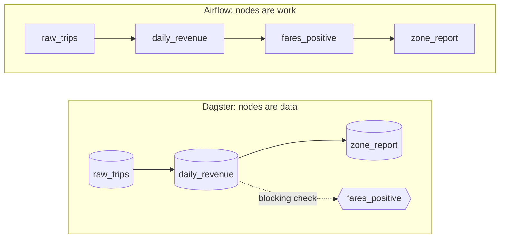

# 5 — Dagster and Airflow

Two orchestrators can run the same four steps on the same schedule and still disagree about what the pipeline is. Airflow calls it a sequence of tasks that ran. Dagster calls it a set of tables that should exist. That difference decides how you answer the question that matters at 09:00 on the day after an outage, which is not "did the job run?" but "which days of which tables are wrong?" This chapter writes one taxi pipeline in both tools, on your laptop, breaks it in the same three ways, and reads what each tool tells you.

## One pipeline, two descriptions

The pipeline is the one chapter 4 made safe: land a day of trips, replace that day in `daily_revenue`, refuse to continue if fares look wrong, rebuild `zone_report`. The functions below do the work and know nothing of any orchestrator. Keep orchestration code this thin; it is what makes the comparison fair, and it is what makes a migration possible later.

```python
import pathlib, sys
pathlib.Path("taxi_lib.py").write_text(r'''
import pathlib, duckdb

def land(day, sign=1):
    """The input both orchestrators read: one file per day of landed trips."""
    pathlib.Path("landing").mkdir(exist_ok=True)
    n = 1000 + int(day[-2:]) * 10
    duckdb.sql(f"""COPY (SELECT DATE '{day}' AS day, 1 + i % 8 AS zone_id, {sign} * (5 + (i * 37 % 400) / 10.0) AS fare
                         FROM range({n}) t(i)) TO 'landing/{day}.parquet' (FORMAT parquet)""")

def build_daily(day):
    """Idempotent: replaces one day of the output, as in the previous chapter."""
    with duckdb.connect("warehouse.duckdb") as con:
        con.execute("CREATE TABLE IF NOT EXISTS daily_revenue (day DATE, zone_id INT, trips BIGINT, fares DOUBLE)")
        con.execute("BEGIN")
        con.execute(f"DELETE FROM daily_revenue WHERE day = DATE '{day}'")
        con.execute(f"""INSERT INTO daily_revenue SELECT day, zone_id, count(*), sum(fare)
                        FROM 'landing/{day}.parquet' GROUP BY 1, 2""")
        con.execute("COMMIT")
        return con.execute(f"SELECT sum(trips) FROM daily_revenue WHERE day = DATE '{day}'").fetchall()[0][0]

def build_report():
    with duckdb.connect("warehouse.duckdb") as con:
        con.execute("""CREATE OR REPLACE TABLE zone_report AS
                       SELECT zone_id, sum(trips) AS trips, round(sum(fares), 2) AS fares
                       FROM daily_revenue GROUP BY 1""")
        return con.execute("SELECT count(*), sum(trips) FROM zone_report").fetchall()[0]
''')
sys.path.insert(0, ".")
import duckdb
from taxi_lib import land, build_daily, build_report
```



The two graphs look alike, and they mean different things. An edge in the Airflow graph says "run this after that". An edge in the Dagster graph says "this table is computed from that table". Most of the differences below follow from that one choice.

| | Dagster | Airflow |
|---|---|---|
| The node | an asset: a table, file or model that should exist | a task: a unit of work inside a Dag |
| The logical date | `context.partition_key`, one of a declared set | `ds` or `logical_date`, derived from a timetable |
| "What is missing?" | ask the instance which partitions exist | infer it from Dag runs and their states |
| A failed quality rule | `@asset_check(blocking=True)` | a task that raises |
| Backfill | select partitions; one run each by default | `airflow backfill create` over a date range |
| dbt | `dagster-dbt`: models become assets, tests become checks | Cosmos: a dbt project becomes a Dag |
| Minimum to try it | a Python function call | `airflow dags test` plus a SQLite metadata database |
| Minimum to schedule it | webserver and daemon | scheduler, API server, Dag processor |

## Dagster: declare the tables

An asset is a function decorated with what it produces. Partitions are declared once and shared, so "the logical date" stops being a string you pass around and becomes a set the tool can enumerate. The [partitioning guide](https://docs.dagster.io/guides/build/partitions-and-backfills/partitioning-assets) describes time, static, two-dimensional and dynamic variants; daily is what this pipeline needs. The `poisoned` and `outages` variables exist only to inject the failures we will want in a moment.

```python
import dagster as dg

daily = dg.DailyPartitionsDefinition(start_date="2026-01-10", end_date="2026-01-21")
poisoned, outages = set(), {"left": 0}        # failure injection for the demos below

@dg.asset(partitions_def=daily)
def raw_trips(context: dg.AssetExecutionContext) -> None:
    day = context.partition_key               # the logical date
    land(day, sign=-1 if day in poisoned else 1)

@dg.asset(partitions_def=daily, deps=[raw_trips], retry_policy=dg.RetryPolicy(max_retries=2))
def daily_revenue(context: dg.AssetExecutionContext) -> dg.MaterializeResult:
    if outages["left"] > 0:
        outages["left"] -= 1
        raise ConnectionError("warehouse unreachable")
    trips = build_daily(context.partition_key)
    return dg.MaterializeResult(metadata={"trips": int(trips)})

@dg.asset_check(asset=daily_revenue, blocking=True)
def fares_positive() -> dg.AssetCheckResult:
    with duckdb.connect("warehouse.duckdb") as con:
        bad = con.execute("SELECT count(*) FROM daily_revenue WHERE fares <= 0").fetchall()[0][0]
    return dg.AssetCheckResult(passed=bad == 0, metadata={"bad_rows": bad})

@dg.asset(partitions_def=daily, deps=[daily_revenue])
def zone_report() -> dg.MaterializeResult:
    zones, trips = build_report()
    return dg.MaterializeResult(metadata={"zones": zones, "trips": int(trips)})

pipeline = [raw_trips, daily_revenue, fares_positive, zone_report]
defs = dg.Definitions(assets=[raw_trips, daily_revenue, zone_report], asset_checks=[fares_positive])
graph = defs.resolve_asset_graph()
for asset_key in graph.get_all_asset_keys():
    print(asset_key.to_user_string(), "<-", sorted(k.to_user_string() for k in graph.get(asset_key).parent_keys))
```

```text
daily_revenue <- ['raw_trips']
raw_trips <- []
zone_report <- ['daily_revenue']
```

`zone_report` has no argument for the day, because it rebuilds from everything. It is partitioned anyway, so that one run covers one day of the whole chain. That is a modelling shortcut, and the Pitfalls come back to it.

`materialize` runs a selection in-process, with no server, which is what makes this chapter possible on a laptop. It is the honest way to test too: the same call works in a unit test.

```python
instance = dg.DagsterInstance.ephemeral()

def run_day(day):
    result = dg.materialize(pipeline, partition_key=day, instance=instance, raise_on_error=False)
    for event in result.all_events:
        if event.event_type_value in ("STEP_SUCCESS", "STEP_FAILURE", "STEP_UP_FOR_RETRY", "STEP_SKIPPED"):
            print(f"{day} {event.step_key:32} {event.event_type_value}")
    return result

r = run_day("2026-01-12")
print("trips:", r.asset_materializations_for_node("daily_revenue")[0].metadata["trips"].value)
```

```text
2026-01-12 raw_trips                        STEP_SUCCESS
2026-01-12 daily_revenue                    STEP_SUCCESS
2026-01-12 daily_revenue_fares_positive     STEP_SUCCESS
2026-01-12 zone_report                      STEP_SUCCESS
trips: 1120
```

Retries are declared on the asset. Two simulated warehouse outages take two attempts, and the third succeeds:

```python
outages["left"] = 2
run_day("2026-01-13").success
```

```text
2026-01-13 raw_trips                        STEP_SUCCESS
2026-01-13 daily_revenue                    STEP_UP_FOR_RETRY
2026-01-13 daily_revenue                    STEP_UP_FOR_RETRY
2026-01-13 daily_revenue                    STEP_SUCCESS
2026-01-13 daily_revenue_fares_positive     STEP_SUCCESS
2026-01-13 zone_report                      STEP_SUCCESS
```

An [asset check](https://docs.dagster.io/guides/test/asset-checks) is a test attached to the asset rather than a step in the sequence. By default a failed check does not stop the run. `blocking=True` is what stops downstream assets, and you have to ask for it. Poison a day with negative fares:

```python
poisoned.add("2026-01-14")
print("success:", run_day("2026-01-14").success)
poisoned.clear()
print("repaired:", dg.materialize(pipeline, partition_key="2026-01-14", instance=instance, raise_on_error=False).success)
```

```text
2026-01-14 raw_trips                        STEP_SUCCESS
2026-01-14 daily_revenue                    STEP_SUCCESS
2026-01-14 daily_revenue_fares_positive     STEP_FAILURE
success: False
repaired: True
```

`zone_report` never ran, so no reader sees a report built on the bad day. But `daily_revenue` was already written when the check ran, exactly as with `dbt build` in [chapter 3](03-dbt-tests-snapshots-incremental.md): a test on a table can only look at a table that exists. Fixing the input and running the day again repaired it, and repair needed no special mode because `build_daily` is idempotent.

Now the payoff of treating partitions as data. Because the instance records materialisations per partition, it can answer the 09:00 question directly:

```python
report = dg.AssetKey("zone_report")
def missing():
    done = instance.get_materialized_partitions(report)
    return [p for p in daily.get_partition_keys() if p not in done]
print("done:   ", sorted(instance.get_materialized_partitions(report)))
print("missing:", missing())
```

```text
done:    ['2026-01-12', '2026-01-13', '2026-01-14']
missing: ['2026-01-10', '2026-01-11', '2026-01-15', '2026-01-16', '2026-01-17', '2026-01-18', '2026-01-19', '202 ...
```

A real Dagster backfill is launched from the UI or an API, and [the docs](https://docs.dagster.io/guides/build/partitions-and-backfills/backfilling-data) say it submits one run per partition unless you set a `BackfillPolicy.single_run`; [launching more than one partition needs the daemon](https://docs.dagster.io/guides/build/partitions-and-backfills/partitioning-assets). Here, without a daemon, a loop over `missing()` shows the same mechanics. Run the backfill, then run one day again and confirm that nothing moved:

```python
for day in missing():
    assert dg.materialize(pipeline, partition_key=day, instance=instance, raise_on_error=False).success
print("missing after backfill:", missing())
with duckdb.connect("warehouse.duckdb") as con:
    print(con.execute("SELECT sum(trips), round(sum(fares)) FROM zone_report").fetchall())
```

```text
missing after backfill: []
[(12650, 315233.0)]
```

```python
dg.materialize(pipeline, partition_key="2026-01-14", instance=instance, raise_on_error=False)
with duckdb.connect("warehouse.duckdb") as con:
    print("after running Jan 14 again:", con.execute("SELECT sum(trips), round(sum(fares)) FROM zone_report").fetchall())
```

```text
after running Jan 14 again: [(12650, 315233.0)]
```

A schedule is derived from the partitions rather than written separately, which removes a whole class of bug. It also settles which day a run means, as the tick shows: firing at 03:00 on 14 January, it builds the partition for 13 January, the last complete day.

```python
job = dg.define_asset_job("taxi_daily", selection=[raw_trips, daily_revenue, zone_report])
schedule = dg.build_schedule_from_partitioned_job(job, hour_of_day=3)
defs = dg.Definitions(assets=[raw_trips, daily_revenue, zone_report], asset_checks=[fares_positive],
                      jobs=[job], schedules=[schedule])
resolved = defs.resolve_schedule_def(schedule.name)
print(resolved.name, repr(resolved.cron_schedule), resolved.job_name)
```

```text
taxi_daily_schedule '0 3 * * *' taxi_daily
```

```python
import datetime as dt
tick = dg.build_schedule_context(scheduled_execution_time=dt.datetime(2026, 1, 14, 3, tzinfo=dt.timezone.utc))
print("fires 2026-01-14 03:00, builds partition:", [r.partition_key for r in resolved.evaluate_tick(tick).run_requests])
```

```text
fires 2026-01-14 03:00, builds partition: ['2026-01-13']
```

The running code above uses `deps=` because its tables live in a warehouse. For small values Dagster can pass data itself, and then the dependency is the function argument, with the partition carried through. (Passing the data is the part to use with care: by default it is pickled to local disk by an IO manager, which is fine for a list and wrong for a warehouse table.)

```python
@dg.asset(partitions_def=dg.MonthlyPartitionsDefinition(start_date="2026-01-01", end_date="2026-03-01"))
def monthly_fares(context: dg.AssetExecutionContext) -> list[float]:
    month = context.partition_key                 # the logical date, again
    return [12.5, 8.0] if month == "2026-01-01" else [20.0]

@dg.asset(partitions_def=monthly_fares.partitions_def)
def monthly_total(monthly_fares: list[float]) -> float:   # the argument is the dependency
    return sum(monthly_fares)

result = dg.materialize([monthly_fares, monthly_total], partition_key="2026-01-01", instance=dg.DagsterInstance.ephemeral())
print(result.output_for_node("monthly_total"))
```

```text
20.5
```

## Airflow: declare the work

Airflow was [started in 2014 by Maxime Beauchemin at Airbnb](https://airflow.apache.org/docs/apache-airflow/stable/project.html), who later wrote the case for pure, partition-replacing tasks that [chapter 4](04-idempotency-and-backfills.md) relies on. It is the older tool, and in our judgement the one you are more likely to inherit; the 2022 cohort of the DataTalks zoomcamp taught it. Version 3 changed enough that tutorials written for 2.x will mislead you, so everything below was run on 3.3.2.

Dag code lives in a file that a separate process parses, not in your session, so the setup is larger than Dagster's. Airflow needs a home and a metadata database, here SQLite in a throwaway folder: (That database is more than bookkeeping. In a real deployment it is how schedulers avoid launching the same task twice, through [row locks rather than consensus](../../01-storage-and-compute-foundations/notes/07-consistency-and-consensus.md), so a SQLite file is for trying things out only.)

```python
import json, os, subprocess
pathlib.Path("dags").mkdir(exist_ok=True)
env = {**os.environ,
       "AIRFLOW_HOME": os.path.abspath("airflow_home"),
       "AIRFLOW__CORE__LOAD_EXAMPLES": "False",
       "AIRFLOW__CORE__DAGS_FOLDER": os.path.abspath("dags"),
       "AIRFLOW__LOGGING__LOGGING_LEVEL": "ERROR",
       "PYTHONPATH": os.path.abspath("dags")}

def airflow(*args):
    """Run the Airflow CLI against a throwaway home with a SQLite metadata database."""
    out = subprocess.run([sys.executable, "-m", "airflow", *args], capture_output=True, text=True, env=env)
    return out.returncode, out.stdout, out.stderr

print("migrate exit code:", airflow("db", "migrate")[0])
```

```text
migrate exit code: 0
```

Before writing the Dag, one decision needs care, because it changed silently between major versions. A cron string used to mean "run at the end of each interval, and call the run by the interval's start". From 3.0, [`create_cron_data_intervals` is `False` by default](https://airflow.apache.org/docs/apache-airflow/3.0.0/release_notes.html), so cron means [`CronTriggerTimetable`](https://airflow.apache.org/docs/apache-airflow/stable/authoring-and-scheduling/timetable.html): the logical date is the moment it fires. Ask both timetables about a run around 14 January:

```python
import datetime as dt
from airflow.timetables.base import TimeRestriction
from airflow.timetables.interval import CronDataIntervalTimetable
from airflow.timetables.trigger import CronTriggerTimetable
restriction = TimeRestriction(earliest=dt.datetime(2026, 1, 14, tzinfo=dt.timezone.utc), latest=None, catchup=True)
for table in (CronTriggerTimetable("0 3 * * *", timezone="UTC"), CronDataIntervalTimetable("0 3 * * *", timezone="UTC")):
    info = table.next_dagrun_info(last_automated_data_interval=None, restriction=restriction)
    print(f"{type(table).__name__:26} fires {info.run_after:%Y-%m-%d %H:%M}, logical date {info.logical_date:%Y-%m-%d %H:%M}")
```

```text
CronTriggerTimetable       fires 2026-01-14 03:00, logical date 2026-01-14 03:00
CronDataIntervalTimetable  fires 2026-01-15 03:00, logical date 2026-01-14 03:00
```

Read that with chapter 4 in mind. With the default, the run firing at 03:00 on the 14th has `ds = 2026-01-14`, a day with three hours of trips in it. A Dag that processes "`ds`" under the default timetable reprocesses an incomplete day every morning and never revisits it. With the interval timetable, the same `ds` value is produced a day later, once the day is complete, matching what the Dagster schedule did on its own. So the Dag below names its timetable explicitly.

```python
import shutil
shutil.copy("taxi_lib.py", "dags/taxi_lib.py")   # the same functions Dagster imported
```

```python
pathlib.Path("dags/taxi_daily.py").write_text(r'''
import datetime as dt, pathlib
import duckdb
from airflow.sdk import dag, task
from airflow.timetables.interval import CronDataIntervalTimetable
from taxi_lib import land, build_daily, build_report

@dag(dag_id="taxi_daily", schedule=CronDataIntervalTimetable("0 3 * * *", timezone="UTC"), start_date=dt.datetime(2026, 1, 10),
     end_date=dt.datetime(2026, 1, 21), catchup=False, max_active_runs=1)
def taxi_daily():
    @task
    def raw_trips(ds=None):                   # ds is the logical date, YYYY-MM-DD
        poisoned = pathlib.Path("poisoned.txt")
        land(ds, sign=-1 if poisoned.exists() and ds in poisoned.read_text() else 1)

    @task(retries=2, retry_delay=dt.timedelta(seconds=0))
    def daily_revenue(ds=None):
        outages = pathlib.Path("outages.txt")
        if outages.exists() and int(outages.read_text()) > 0:
            outages.write_text(str(int(outages.read_text()) - 1))
            raise ConnectionError("warehouse unreachable")
        return int(build_daily(ds))

    @task
    def fares_positive():
        with duckdb.connect("warehouse.duckdb") as con:
            bad = con.execute("SELECT count(*) FROM daily_revenue WHERE fares <= 0").fetchall()[0][0]
        assert bad == 0, f"{bad} rows with no revenue"

    @task
    def zone_report():
        return build_report()

    raw_trips() >> daily_revenue() >> fares_positive() >> zone_report()

taxi_daily()
''')
code, out, err = airflow("dags", "reserialize")
print("reserialize exit code:", code, err[-300:])
code, out, err = airflow("dags", "list", "-o", "json")
print([(d["dag_id"], d["is_paused"]) for d in json.loads(out)])
```

```text
reserialize exit code: 0
[('taxi_daily', 'True')]
```

The [TaskFlow API](https://airflow.apache.org/docs/apache-airflow/stable/tutorial/taskflow.html) makes this read like Python, but look at what is a task here: `fares_positive` is a step like any other, with an edge after it. Airflow has no concept that this task tests that table. It knows only that a raised exception stops what follows. Note also that the Dag is `is_paused=True`: new Dags start paused, and a scheduler will not touch them until you unpause.

`airflow dags test` runs one logical date to completion without a scheduler, recording it in the metadata database:

```python
def states(day):
    code, out, err = airflow("tasks", "states-for-dag-run", "taxi_daily", run_ids[day], "-o", "json")
    return {row["task_id"]: row["state"] for row in json.loads(out)}

run_ids = {}
def run_day(day):
    code, out, err = airflow("dags", "test", "taxi_daily", day)
    runs = json.loads(airflow("dags", "list-runs", "taxi_daily", "-o", "json")[1])
    run_ids[day] = next(r["run_id"] for r in runs if r["logical_date"].startswith(day))
    print(day, "exit", code, states(day))

run_day("2026-01-12")
with duckdb.connect("warehouse.duckdb", read_only=True) as con:
    print(con.execute("SELECT count(*), sum(trips) FROM daily_revenue").fetchall())
```

```text
2026-01-12 exit 0 {'raw_trips': 'success', 'daily_revenue': 'success', 'fares_positive': 'success', 'zone_report ...
[(8, 1120)]
```

The same two outages, with `retries=2` set on the task:

```python
pathlib.Path("outages.txt").write_text("2")
run_day("2026-01-13")
print("outages left:", pathlib.Path("outages.txt").read_text())
```

```text
2026-01-13 exit 0 {'raw_trips': 'success', 'daily_revenue': 'success', 'fares_positive': 'success', 'zone_report ...
outages left: 0
```

The same poisoned day. The states are the most useful output on this page: `fares_positive` failed, and `zone_report` is `upstream_failed` and never ran. The end result is the same as Dagster's. The vocabulary is different, in that Airflow reports on steps and you work out what that means for the tables.

```python
pathlib.Path("poisoned.txt").write_text("2026-01-14")
run_day("2026-01-14")
```

```text
2026-01-14 exit 1 {'raw_trips': 'success', 'daily_revenue': 'success', 'fares_positive': 'failed', 'zone_report' ...
```

Now repair the input, and rerun. Do this before the backfill, and here is why: the check reads the whole table. Skip the repair and every backfilled day fails its check on the 14th's rows, which is the check doing its job a little too widely.

```python
pathlib.Path("poisoned.txt").unlink()
run_day("2026-01-14")
with duckdb.connect("warehouse.duckdb", read_only=True) as con:
    print(con.execute("SELECT count(*) FROM daily_revenue WHERE fares <= 0").fetchall())
```

```text
2026-01-14 exit 0 {'raw_trips': 'success', 'daily_revenue': 'success', 'fares_positive': 'success', 'zone_report ...
[(0,)]
```

### A real backfill

In [Airflow 3, `airflow backfill create`](https://airflow.apache.org/docs/apache-airflow/stable/core-concepts/backfill.html) is a request recorded in the metadata database, and the scheduler carries it out. `--reprocess-behavior` chooses what happens to days already run (`none`, `failed` or `completed`), and `--dry-run` shows the plan. Note that the range is a range of run dates:

```python
code, out, err = airflow("backfill", "create", "--dag-id", "taxi_daily", "--from-date", "2026-01-15", "--to-date", "2026-01-18", "--dry-run")
print(out[out.index("Runs to be attempted"):])
```

```text
Runs to be attempted:
+---------------------------+-----------------+------------------+
| logical_date              | partition_key   | partition_date   |
+===========================+=================+==================+
| 2026-01-15 03:00:00+00:00 |                 |                  |
+---------------------------+-----------------+------------------+
| 2026-01-16 03:00:00+00:00 |                 |                  |
+---------------------------+-----------------+------------------+
| 2026-01-17 03:00:00+00:00 |                 |                  |
+---------------------------+-----------------+------------------+
```

Three days from 15 to 18, because the 18th at midnight comes before any 03:00 run on that date. Now for real. This cell starts `airflow standalone`, which brings up the scheduler, API server, Dag processor and triggerer, so this one needs nothing more than a laptop but does need a few seconds' patience:

```python
import atexit, signal, time
airflow("dags", "unpause", "taxi_daily", "-y")
print("create exit code:", airflow("backfill", "create", "--dag-id", "taxi_daily", "--from-date", "2026-01-15",
                                   "--to-date", "2026-01-18", "--reprocess-behavior", "none", "--max-active-runs", "1")[0])

server = subprocess.Popen([sys.executable, "-m", "airflow", "standalone"], env=env, start_new_session=True,
                          stdout=subprocess.DEVNULL, stderr=subprocess.DEVNULL)   # scheduler, API server, Dag processor, triggerer
atexit.register(lambda: os.killpg(server.pid, signal.SIGTERM))

def runs(dag_id="taxi_daily"):
    listed = json.loads(airflow("dags", "list-runs", dag_id, "-o", "json")[1] or "[]")
    return {r["run_id"].split("__")[0] + " " + (r["logical_date"] or "")[:16]: r["state"] for r in listed}

def wait_for(check, seconds=150):
    deadline = time.time() + seconds
    while time.time() < deadline and not check():
        time.sleep(3)

wait_for(lambda: sum(state == "success" for state in runs().values()) == 6)
for run_id, state in sorted(runs().items()):
    print(run_id, state)
with duckdb.connect("warehouse.duckdb", read_only=True) as con:
    print(con.execute("SELECT min(day), max(day), sum(trips) FROM daily_revenue").fetchall())
    print(con.execute("SELECT sum(trips) FROM zone_report").fetchall())
```

```text
create exit code: 0
backfill 2026-01-15T03:00 success
backfill 2026-01-16T03:00 success
backfill 2026-01-17T03:00 success
manual 2026-01-12T00:00 success
manual 2026-01-13T00:00 success
manual 2026-01-14T00:00 success
[(datetime.date(2026, 1, 12), datetime.date(2026, 1, 17), 6870)]
[(6870,)]
```

Six runs succeeded and the warehouse holds 12 through 17 January. `--max-active-runs 1` matters, and you will see why in Try it.

Notice what was harder to get than in Dagster: "which days are done?" This list answers "which runs happened?", and getting from there to "what is missing?" takes reasoning about the timetable. Runs are also not tables: a manual `DELETE` from `daily_revenue` would leave all six runs green. Dagster has the same blind spot, since its record is what it materialised rather than what is in the table today, but it keeps that record per table and per day.

### Assets arrive in Airflow

Airflow has been moving toward the same idea. Data-aware scheduling arrived as Datasets in 2.4, and 3.0 [renamed them assets and added an `@asset` decorator](https://airflow.apache.org/docs/apache-airflow/3.0.0/release_notes.html). An `@asset` function is a one-task Dag whose [completion emits an event that consumers schedule on](https://airflow.apache.org/docs/apache-airflow/stable/authoring-and-scheduling/asset-scheduling.html):

```python
pathlib.Path("dags/taxi_assets.py").write_text(r'''
import duckdb
from airflow.sdk import asset

@asset(schedule=None)
def daily_counts():
    with duckdb.connect("warehouse.duckdb") as con:
        con.execute("CREATE OR REPLACE TABLE daily_counts AS SELECT day, sum(trips) AS trips FROM daily_revenue GROUP BY 1")

@asset(schedule=daily_counts)                 # runs when daily_counts has a new event
def best_day():
    with duckdb.connect("warehouse.duckdb") as con:
        con.execute("CREATE OR REPLACE TABLE best_day AS SELECT * FROM daily_counts ORDER BY trips DESC LIMIT 1")
''')
print("reserialize exit code:", airflow("dags", "reserialize")[0])
for dag_id in ("daily_counts", "best_day"):
    airflow("dags", "unpause", dag_id, "-y")
airflow("dags", "trigger", "daily_counts")
wait_for(lambda: "success" in runs("best_day").values(), 90)
print("daily_counts:", list(runs("daily_counts").values()), "best_day:", list(runs("best_day").values()))
with duckdb.connect("warehouse.duckdb", read_only=True) as con:
    print(con.execute("SELECT * FROM best_day").fetchall())
```

```text
reserialize exit code: 0
daily_counts: ['success'] best_day: ['success']
[(datetime.date(2026, 1, 17), 1170)]
```

`best_day` ran because `daily_counts` finished, with no edge between two tasks and no sensor. This solves the cross-team problem of "my Dag should run when your table updates". It does not give you Dagster's per-partition record of what exists, and these runs have no logical date at all, so the rules of chapter 4 become yours to enforce through what the task reads.

## dbt in the graph

Most warehouse pipelines are largely dbt, so the practical question is how dbt fits. A `dbt build` inside one task hides the models from the orchestrator: one box, and one failure message to read. Both tools have an integration that expands it.

[`dagster-dbt`](https://docs.dagster.io/integrations/libraries/dbt) reads the manifest and gives each model its own asset. Its docs now lead with a `DbtProjectComponent`; the older decorator below is shorter to show and runs on the versions used here.

```python
import pathlib
import dagster as dg
from dagster_dbt import DbtCliResource, DbtProject, dbt_assets
root = pathlib.Path("taxi_dbt"); (root / "models").mkdir(parents=True)
(root / "dbt_project.yml").write_text("name: taxi\nprofile: taxi\nmodel-paths: [models]\n")
(root / "profiles.yml").write_text("taxi:\n  target: dev\n  outputs:\n    dev: {type: duckdb, path: warehouse.duckdb}\n")
(root / "models/stg_trips.sql").write_text("select 1 as trip_id, 12.5 as fare union all select 2, 8.0")
(root / "models/zone_mart.sql").write_text("select count(*) as trips, sum(fare) as fares from {{ ref('stg_trips') }}")
(root / "models/schema.yml").write_text("""version: 2
models:
  - name: stg_trips
    columns:
      - name: trip_id
        data_tests: [unique, not_null]
""")
project = DbtProject(project_dir=root, profiles_dir=root)
project.preparer.prepare(project)                # writes target/manifest.json

@dbt_assets(manifest=project.manifest_path)
def taxi_models(context: dg.AssetExecutionContext, dbt: DbtCliResource):
    yield from dbt.cli(["build"], context=context).stream()

result = dg.materialize([taxi_models], resources={"dbt": DbtCliResource(project_dir=project)})
print("success:", result.success)
print("assets:", sorted(m.asset_key.to_user_string() for m in result.asset_materializations_for_node(taxi_models.op.name)))
print("checks:", sorted(c.check_name for c in result.get_asset_check_evaluations()))
```

```text
success: True
assets: ['stg_trips', 'zone_mart']
checks: ['not_null_stg_trips_trip_id', 'unique_stg_trips_trip_id']
```

Two models arrived as two assets and the two tests as checks, without a line per model. Ingest, dbt and an ML training asset can then share one graph, which is the strongest argument for Dagster when lineage matters.

On Airflow the equivalent is [Astronomer Cosmos](https://astronomer.github.io/astronomer-cosmos/), which turns a dbt project into a Dag, with models as tasks. Cosmos was not run for this chapter, so there is no code for it here; start from its Quickstart.

## Choosing

Chapter 2 gave [the decision for a new project](02-orchestrate.md) in one table. Having now seen both, here is the reasoning behind it:

| If | Then | Because |
|---|---|---|
| The org already runs Airflow | Airflow | A second orchestrator costs more than any feature gains; move toward its assets and be explicit about timetables |
| A new platform, mostly dbt plus Python, and lineage matters | Dagster | Partitions and checks are built in, and "what is missing?" is a query |
| Non-Python teams schedule across many systems | Airflow, or Kestra from chapter 2 | Airflow's provider ecosystem, or Kestra's YAML |
| You are preparing for interviews | Learn Airflow, understand Dagster | Being able to contrast the two models is the point of the question |

The first row deserves its weight. Neither tool fixes a non-idempotent task, a run with no logical date, or a report built on an unchecked table. Those are the properties from chapters 2 and 4, and a pipeline that has them will run correctly on either.

## Pitfalls

- **Trusting the cron default after an Airflow upgrade.** Under 3.x a bare cron string gives a logical date equal to the fire time, so `ds` means today, not the day that just ended. A Dag written for 2.x then quietly processes a partial day. Name the timetable, or read `data_interval_start` with an interval set on the trigger.
- **Parallel backfill against a store with one writer.** More active runs looks like a free speed-up, and is only safe if the warehouse accepts concurrent writers and the tasks touch separate data. Two runs both rebuilding `zone_report` also race on the result.
- **Assuming a check blocks.** A Dagster asset check [does not stop downstream assets by default](https://docs.dagster.io/guides/test/asset-checks). Without `blocking=True`, the run reports success and the report ships.
- **Checks that scan everything.** Our `fares_positive` reads all days, so one bad day fails every later day until someone repairs it. That can be the right policy, but choose it deliberately; [partitioned checks](https://docs.dagster.io/guides/test/asset-checks) (a preview feature when this was written) or a `WHERE day =` narrow it.
- **Partitioning something that is not partitioned.** `zone_report` here records "2026-01-14 materialised", while the table actually reflects all days. A record that claims more than it means misleads whoever reads it. In a real project make it an unpartitioned asset, downstream of the partitioned one.
- **Treating the tool's record as the truth.** Both tools remember what ran. Neither notices if someone later changes the table. Monitoring the data itself is [pillar 05](../../05-quality-and-observability/README.md).
- **Heavy imports and queries at the top of a Dag file.** The file is parsed repeatedly, so [top-level code](https://airflow.apache.org/docs/apache-airflow/stable/best-practices.html) slows everything. Do the work inside the task.
- **Passing data through XCom.** A TaskFlow return value goes through the metadata database. Return a count or a path, not a dataset. Our tasks return an integer.
- **Relative paths in tasks.** This chapter's Dag reads `warehouse.duckdb` from the working directory, because the whole demo runs from one folder. On a real deployment tasks run on workers. Use a connection or an absolute location.

## Try it

Answers were checked by editing and running the practice scripts [05_dagster.py](../practice/05_dagster.py) and [05_airflow.py](../practice/05_airflow.py). The dbt block is [05_dagster_dbt.py](../practice/05_dagster_dbt.py).

1. In the Dagster code, change `blocking=True` to `False`, run the full script, then poison `2026-01-16` and run that day. What do the run's `success` and the check's step report, and what happens to the total in `zone_report`?

   <details><summary>Answer</summary>

   `success` is `True`, and all four steps report `STEP_SUCCESS`, including `daily_revenue_fares_positive`: the check ran and failed, but a failed non-blocking check is a recorded result rather than a failed step. `zone_report` is rebuilt with the negative fares, and its total falls from 315,233 to 257,445. A green run reported a loss of 57,788 in fares. This is why `blocking` should be a decision rather than a default.

   </details>

2. In the Airflow backfill, change `--max-active-runs` from 1 to 2. What fails, and what are the fixes?

   <details><summary>Answer</summary>

   One backfill run fails with `IO Error: Could not set lock on file ".../warehouse.duckdb": Conflicting lock is held`. In the run I checked, 15 January failed and the others succeeded; which one loses varies. [DuckDB allows one process to write at a time](https://duckdb.org/docs/current/connect/concurrency), and Airflow's tasks are separate processes. The fixes are serial runs, as in the chapter, or a warehouse built for concurrent writers.

   </details>

3. You inherit a 2.x Dag with `schedule="0 3 * * *"` that reads `ds`. After upgrading to Airflow 3 with default settings, which day does the run firing at 03:00 on 14 January process, and what are two fixes?

   <details><summary>Answer</summary>

   It processes `2026-01-14`, the day in progress, where 2.x would have processed the 13th; the `timetables` output shows the logical date equal to the fire time. Fixes: use `CronDataIntervalTimetable("0 3 * * *", timezone="UTC")` as this chapter does, or set the [`create_cron_data_intervals`](https://airflow.apache.org/docs/apache-airflow/3.0.0/release_notes.html) option back to `True`. Reading `ds` minus one day also works but hides the rule.

   </details>

## Interview checklist

| Question | Answer |
|---|---|
| What is the core difference between Dagster and Airflow? | Dagster's nodes are assets, the tables that should exist; Airflow's are tasks, the work to run. Dagster can say which partitions are missing; Airflow reports which runs happened. |
| What does a backfill look like in each? | Dagster: select partitions, one run each by default. Airflow 3: `airflow backfill create` with a date range, and the scheduler carries it out. Both depend on the task being idempotent. |
| What changed about cron in Airflow 3? | `create_cron_data_intervals` defaults to `False`, so a cron string means `CronTriggerTimetable` and the logical date equals the fire time. `ds` then names the current day. |
| How do you stop a bad table reaching a report? | A blocking check in Dagster; a task before the report in Airflow. The checked table is already written in both, so the guarantee is about what's downstream. |
| What does `@asset` in Airflow 3 give you and not give you? | Scheduling on data events without an edge between Dags. It does not give per-partition state, and asset-triggered runs have no logical date. |
| How do dbt and an orchestrator fit together? | `dagster-dbt` maps models to assets and tests to checks; Cosmos maps a project to a Dag of tasks. Without one, `dbt build` is one opaque step. |
| Why might a parallel backfill fail? | Concurrent runs collide on a shared output or a single-writer store. Limit active runs or partition the writes. |
| Which would you choose? | Whichever the team runs, unless starting fresh. A second orchestrator costs more than either's features. Idempotency and logical dates matter more than the choice. |

## Next

The tasks these orchestrators schedule run against storage, and how that storage is laid out decides what each run costs. [Warehouses and stores](../../04-warehouse-lakehouse-streaming/notes/01-warehouse-and-store.md) opens pillar 04 with partitions, clusters and file formats.
