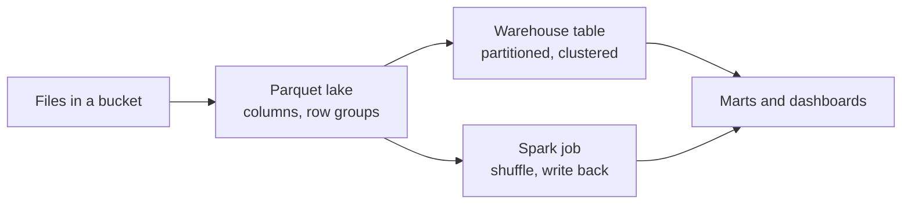

# Warehouse and store

A bill for a dashboard is a physics lesson in disguise. The same question, asked of the same taxi trips, can read 1.6 GB or 106 MB, and the only difference is how the bytes were laid out before anyone asked. This chapter is about that layout: where analytical data rests, why columns beat rows for scans, what partitioning and clustering buy, and when one machine stops being enough and a distributed engine earns its shuffle. The running example through this pillar is one year of New York taxi trips, stored first in a warehouse and then in a lake, and later arriving as a stream.

> Where data rests and how it's laid out: a columnar warehouse (BigQuery) that bills by bytes scanned, a lake of Parquet files, and a distributed engine (Spark) for the jobs too big for one machine.

---

## Where it sits

This pillar is the store in the data's journey. [Ingest](../../02-ingest-and-modelling/README.md) lands files in a bucket and [transform](../../03-transform-and-orchestrate/README.md) runs SQL somewhere; this chapter is the *somewhere*. Each stage silently trusts the one before it, and the store is where that trust becomes expensive, because a bad layout charges you on every query. The practice material is the DataTalks DE zoomcamp modules 03 (BigQuery) and 05 (Spark batch), in `practice/datatalks-de/`. The background reading is Kleppmann, [*Designing Data-Intensive Applications*](https://dataintensive.net/) (O'Reilly, 2017), chapter 3 on storage engines and column-oriented storage, chapter 6 on partitioning and chapter 10 on batch processing.



---

## OLTP vs OLAP

| | OLTP (Postgres in DE 01) | OLAP (BigQuery in DE 03) |
|---|---|---|
| Workload | Many small reads and writes by key | Few large scans and aggregations |
| Storage | Row-oriented | Column-oriented (DDIA ch. 3) |
| Schema | Normalised | Denormalised: star schema, wide fact tables |
| Cost driver | Rows touched | Bytes scanned in the columns you select |
| Users | Applications | Analysts, BI, ML training |

The column layout is why `SELECT *` is expensive in BigQuery and why the course's first BigQuery lesson is about scanning less.

### See the layout on a laptop

BigQuery hides its storage, so the mechanics are easier to see with Parquet, which records the compressed size of every column chunk in its footer. The next block generates a synthetic year of trips with the shape of the taxi data, plus one wide `note` column nobody queries. Install with `uv run --with duckdb --with pyarrow --with numpy python`; all the blocks in this chapter share one session and use the DuckDB and pyarrow versions current on 2026-11-01 (DuckDB 2.0, pyarrow 26).

```python
import duckdb, pyarrow as pa, pyarrow.parquet as pq, numpy as np, os, glob
rng = np.random.default_rng(7)
n = 3_000_000
start = np.datetime64('2024-01-01T00:00:00')
secs = rng.integers(0, 366 * 86400, n)                       # one leap year of pickups
trips = pa.table({
    'pickup': pa.array(start + secs.astype('timedelta64[s]')),
    'vendor_id': pa.array(rng.choice([1, 2], n, p=[.3, .7]).astype('int32')),
    'pu_zone': pa.array(rng.integers(1, 266, n).astype('int32')),
    'do_zone': pa.array(rng.integers(1, 266, n).astype('int32')),
    'distance': pa.array(np.round(rng.exponential(3.0, n), 2)),
    'fare': pa.array(np.round(3 + rng.exponential(14.0, n), 2)),
    'total': pa.array(np.round(4 + rng.exponential(19.0, n), 2)),
    'note': pa.array(rng.integers(0, 2**62, n).astype(str)),  # a wide column nobody queries
})
os.makedirs('lake', exist_ok=True)
pq.write_table(trips, 'lake/flat.parquet', row_group_size=100_000)
print(f"{n:,} rows, {os.path.getsize('lake/flat.parquet') / 1e6:.0f} MB on disk")
```

Output:

```text
3,000,000 rows, 103 MB on disk
```

Row storage has to read the whole row to get any field of it. Column storage reads only the columns the query names, and Parquet's footer tells us exactly what that saves.

```python
def column_bytes(paths):
    """Compressed bytes per column, summed from Parquet footers. No data is read."""
    out = {}
    for path in paths:
        md = pq.ParquetFile(path).metadata
        for rg in range(md.num_row_groups):
            for c in range(md.num_columns):
                col = md.row_group(rg).column(c)
                out[col.path_in_schema] = out.get(col.path_in_schema, 0) + col.total_compressed_size
    return out

sizes = column_bytes(['lake/flat.parquet'])
total = sum(sizes.values())
for name, b in sorted(sizes.items(), key=lambda kv: -kv[1]):
    print(f"{name:10s} {b / 1e6:7.1f} MB  {b / total:5.1%}")
q = sizes['pickup'] + sizes['total']
print(f"SELECT *               reads {total / 1e6:6.1f} MB")
print(f"SELECT pickup, total   reads {q / 1e6:6.1f} MB  ({total / q:.1f}x less)")
```

Output:

```text
note          52.6 MB  51.1%
pickup        26.6 MB  25.9%
total          6.2 MB   6.0%
fare           5.8 MB   5.7%
distance       4.4 MB   4.3%
do_zone        3.4 MB   3.3%
pu_zone        3.4 MB   3.3%
vendor_id      0.4 MB   0.4%
SELECT *               reads  102.9 MB
SELECT pickup, total   reads   32.8 MB  (3.1x less)
```

Half this file is a column no query needs, so naming your columns is a threefold saving before any cleverness. The ratio depends on your schema. Random strings compress badly, and real tables with a few wide text columns behave similarly.

---

## BigQuery (DE 03)

### External table → native table

```sql
-- illustrative: needs a GCP project with BigQuery and the taxi files in GCS
CREATE OR REPLACE EXTERNAL TABLE `taxi-rides-ny.nytaxi.external_yellow_tripdata`
OPTIONS (
  format = 'CSV',
  uris = ['gs://nyc-tl-data/trip data/yellow_tripdata_2019-*.csv',
          'gs://nyc-tl-data/trip data/yellow_tripdata_2020-*.csv']
);

CREATE OR REPLACE TABLE taxi-rides-ny.nytaxi.yellow_tripdata_non_partitoned AS
SELECT * FROM taxi-rides-ny.nytaxi.external_yellow_tripdata;
```

An external table leaves the data in GCS and reads it at query time. Good for exploration and for a lake that other engines also read; slower, and BigQuery can't estimate its cost up front. Materialising to a native table is the "load" in ELT.

### Partitioning: the 15× lesson

```sql
-- illustrative: needs BigQuery; the scan sizes are from the zoomcamp module's own runs
CREATE OR REPLACE TABLE taxi-rides-ny.nytaxi.yellow_tripdata_partitoned
PARTITION BY DATE(tpep_pickup_datetime) AS
SELECT * FROM taxi-rides-ny.nytaxi.external_yellow_tripdata;

-- non-partitioned: scans 1.6 GB
-- partitioned:     scans ~106 MB
SELECT DISTINCT(VendorID)
FROM taxi-rides-ny.nytaxi.yellow_tripdata_partitoned
WHERE DATE(tpep_pickup_datetime) BETWEEN '2019-06-01' AND '2019-06-30';

SELECT table_name, partition_id, total_rows
FROM `nytaxi.INFORMATION_SCHEMA.PARTITIONS`
WHERE table_name = 'yellow_tripdata_partitoned'
ORDER BY total_rows DESC;
```

Same query, same answer, 1.6 GB → ~106 MB, because the `WHERE` on the partition column lets BigQuery skip every other day's storage.

The same effect, measured on the synthetic year. DuckDB writes one directory per day, and a filter on the partition column means the other 336 directories are never opened:

```python
con = duckdb.connect()
con.execute("""
  COPY (SELECT *, CAST(pickup AS DATE) AS pickup_date FROM 'lake/flat.parquet')
  TO 'lake/by_day' (FORMAT parquet, PARTITION_BY (pickup_date), OVERWRITE_OR_IGNORE)
""")
days = sorted(glob.glob('lake/by_day/pickup_date=*'))
june = [d for d in days if '=2024-06' in d]
files = lambda dirs: [f for d in dirs for f in glob.glob(d + '/*.parquet')]
all_b, june_b = column_bytes(files(days)), column_bytes(files(june))
print(f"{len(days)} day partitions; June is {len(june)} of them")
print(f"vendor_id bytes, whole year : {all_b['vendor_id'] / 1e3:8.0f} KB")
print(f"vendor_id bytes, June only  : {june_b['vendor_id'] / 1e3:8.0f} KB "
      f"({all_b['vendor_id'] / june_b['vendor_id']:.1f}x less)")
print(con.sql("""
  SELECT DISTINCT vendor_id FROM read_parquet('lake/by_day/*/*.parquet', hive_partitioning = true)
  WHERE pickup_date BETWEEN '2024-06-01' AND '2024-06-30' ORDER BY 1
""").fetchall())
```

Output:

```text
366 day partitions; June is 30 of them
vendor_id bytes, whole year :      417 KB
vendor_id bytes, June only  :       34 KB (12.3x less)
[(1,), (2,)]
```

The ratio is simple arithmetic: June is 30 days of 366, so about 12 times less. The course's 15 times on real data has the same cause, with real seasonality and a two-year table.

### Clustering: sorting inside partitions

```sql
-- illustrative: needs BigQuery; the scan sizes are from the zoomcamp module's own runs
CREATE OR REPLACE TABLE taxi-rides-ny.nytaxi.yellow_tripdata_partitoned_clustered
PARTITION BY DATE(tpep_pickup_datetime)
CLUSTER BY VendorID AS
SELECT * FROM taxi-rides-ny.nytaxi.external_yellow_tripdata;

-- partitioned only:        1.1 GB
-- partitioned + clustered: 864.5 MB
SELECT count(*) as trips
FROM taxi-rides-ny.nytaxi.yellow_tripdata_partitoned_clustered
WHERE DATE(tpep_pickup_datetime) BETWEEN '2019-06-01' AND '2020-12-31'
  AND VendorID=1;
```

| | Partitioning | Clustering |
|---|---|---|
| Column type | One date/timestamp, integer range, or ingestion time | Up to four columns, any orderable type |
| Cost known before the query | Yes, the estimate reflects pruning | No, the savings show up only after |
| Granularity limit | Partition count limit per table (thousands); tiny partitions hurt | No count limit |
| Use for | The column every query filters on (almost always event date) | High-cardinality filters and sort keys after that (vendor, zone) |
| Maintenance | None | Automatic re-clustering as data is appended |

Rule from the module's best-practices section: partition on the date you filter by, cluster on what you filter by next, and select only the columns you need. Don't partition a small table: under about 1 GB the per-partition metadata costs more than it saves.

Clustering is sorting, and sorting works through the min and max statistics each block carries. In an unsorted file a row group contains nearly every zone, so its range spans everything and it cannot be skipped. After sorting, each group holds a narrow slice of zones:

```python
def skipped(path, column, value):
    """How many row groups can min/max statistics rule out for column = value?"""
    md = pq.ParquetFile(path).metadata
    idx = md.schema.names.index(column)
    hit = sum(md.row_group(i).column(idx).statistics.min <= value <= md.row_group(i).column(idx).statistics.max
              for i in range(md.num_row_groups))
    return md.num_row_groups - hit, md.num_row_groups

con.execute("COPY (SELECT * FROM 'lake/flat.parquet') TO 'lake/unsorted.parquet' (FORMAT parquet, ROW_GROUP_SIZE 100000)")
con.execute("COPY (SELECT * FROM 'lake/flat.parquet' ORDER BY pu_zone) TO 'lake/sorted.parquet' (FORMAT parquet, ROW_GROUP_SIZE 100000)")
for f in ['unsorted', 'sorted']:
    s, t = skipped(f'lake/{f}.parquet', 'pu_zone', 132)
    print(f"{f:9s} pu_zone = 132: can skip {s:2d} of {t} row groups")
```

Output:

```text
unsorted  pu_zone = 132: can skip  0 of 30 row groups
sorted    pu_zone = 132: can skip 29 of 30 row groups
```

This also explains the partitioning row in the table above. A partition is known before the query runs, so the estimate can reflect it. Clustering savings depend on which blocks the statistics exclude at run time, so the estimate is an upper bound and the saving shows up only afterwards.

### BigQuery ML

Train and serve a model with SQL, without moving data:

```sql
-- illustrative: needs BigQuery ML
CREATE OR REPLACE MODEL `taxi-rides-ny.nytaxi.tip_model`
OPTIONS (model_type='linear_reg',
         input_label_cols=['tip_amount'],
         DATA_SPLIT_METHOD='AUTO_SPLIT') AS
SELECT * FROM `taxi-rides-ny.nytaxi.yellow_tripdata_ml`
WHERE tip_amount IS NOT NULL;

SELECT * FROM ML.FEATURE_INFO(MODEL `taxi-rides-ny.nytaxi.tip_model`);
SELECT * FROM ML.EVALUATE(MODEL `taxi-rides-ny.nytaxi.tip_model`, (SELECT ... ));
SELECT * FROM ML.PREDICT(MODEL `taxi-rides-ny.nytaxi.tip_model`, (SELECT ... ));
SELECT * FROM ML.EXPLAIN_PREDICT(MODEL `taxi-rides-ny.nytaxi.tip_model`, (SELECT ... ),
                                 STRUCT(3 as top_k_features));
```

The training table first casts `PULocationID`, `DOLocationID` and `payment_type` to `STRING`. That one-line choice makes BigQuery one-hot encode them as categories instead of treating zone 264 as "bigger than" zone 1. Hyperparameter tuning adds `num_trials=5, max_parallel_trials=2, l1_reg=hparam_range(0, 20), l2_reg=hparam_candidates([0, 0.1, 1, 10])` to `OPTIONS`.

Export and serve outside BigQuery (`extract_model.md`):

```bash
# illustrative: needs GCP and Docker
bq --project_id taxi-rides-ny extract -m nytaxi.tip_model gs://taxi_ml_model/tip_model
gsutil cp -r gs://taxi_ml_model/tip_model /tmp/model
mkdir -p serving_dir/tip_model/1 && cp -r /tmp/model/tip_model/* serving_dir/tip_model/1
docker run -p 8501:8501 --mount type=bind,source=`pwd`/serving_dir/tip_model,target=/models/tip_model \
  -e MODEL_NAME=tip_model -t tensorflow/serving &
curl -d '{"instances": [{"passenger_count":1, "trip_distance":12.2, "PULocationID":"193",
  "DOLocationID":"264", "payment_type":"2","fare_amount":20.4,"tolls_amount":0.0}]}' \
  -X POST http://localhost:8501/v1/models/tip_model:predict
```

BQML is the cheapest path from warehouse to a baseline model. The MLflow path in [the ML platform pillar](../../06-ml-platform/notes/02-experiment-tracking-and-model-registry.md) is the one that scales to custom models and a registry.

---

## Spark batch (DE 05)

### Session, schema, write

```python
# illustrative: needs Java and Spark 3.x; see practice/datatalks-de/05-batch
spark = SparkSession.builder.master("local[*]").appName('test').getOrCreate()

schema = types.StructType([
    types.StructField('hvfhs_license_num', types.StringType(), True),
    types.StructField('dispatching_base_num', types.StringType(), True),
    types.StructField('pickup_datetime', types.TimestampType(), True),
    types.StructField('dropoff_datetime', types.TimestampType(), True),
    types.StructField('PULocationID', types.IntegerType(), True),
    types.StructField('DOLocationID', types.IntegerType(), True),
    types.StructField('SR_Flag', types.StringType(), True)])

df = spark.read.option("header", "true").schema(schema).csv('fhvhv_tripdata_2021-01.csv')
df.repartition(24).write.parquet('fhvhv/2021/01/')
```

| Choice | Why |
|---|---|
| Explicit `StructType` instead of `inferSchema` | Inference reads the data twice and guesses; an explicit schema is a contract and fails loudly |
| `repartition(24)` before write | One CSV becomes 24 Parquet files, so 24 executors can read in parallel later |
| Parquet out | Columnar, compressed, typed; the format every later step reads |

`download_data.sh TAXI_TYPE YEAR` loops over months and lays files out as `data/raw/{taxi_type}/{year}/{month}/`.

### DataFrames, SQL and the union

```python
# illustrative: continues the Spark session above
df_green = df_green.withColumnRenamed('lpep_pickup_datetime', 'pickup_datetime')
df_yellow = df_yellow.withColumnRenamed('tpep_pickup_datetime', 'pickup_datetime')

df_trips_data = (df_green.select(common_colums).withColumn('service_type', F.lit('green'))
    .unionAll(df_yellow.select(common_colums).withColumn('service_type', F.lit('yellow'))))
df_trips_data.registerTempTable('trips_data')      # createOrReplaceTempView in current Spark

df_result = spark.sql("""
SELECT PULocationID AS revenue_zone,
       date_trunc('month', pickup_datetime) AS revenue_month,
       service_type,
       SUM(total_amount) AS revenue_monthly_total_amount,
       AVG(trip_distance) AS avg_montly_trip_distance
FROM trips_data
GROUP BY 1, 2, 3
""")
df_result.coalesce(1).write.parquet(output, mode='overwrite')
```

This is the same monthly-revenue mart as the dbt model in [the transform pillar](../../03-transform-and-orchestrate/README.md), written in Spark: the logic is portable, the engine is a cost and scale decision. `coalesce(1)` makes one output file without a shuffle; fine for a small result, a bottleneck for a large one.

UDFs exist for logic SQL can't express (`F.udf(crazy_stuff, returnType=types.StringType())`) but run row-at-a-time in Python. Prefer built-in `F.*` functions.

On one machine the same mart needs neither a cluster nor a Java install. The SQL is close to identical, which is the point of the sentence above about portable logic:

```python
print(con.sql("""
  SELECT pu_zone AS revenue_zone, date_trunc('month', pickup) AS revenue_month,
         round(sum(total), 2) AS revenue, round(avg(distance), 2) AS avg_distance
  FROM 'lake/flat.parquet'
  GROUP BY 1, 2 ORDER BY revenue DESC LIMIT 3
"""))
```

Output:

```text
┌──────────────┬─────────────────────┬──────────┬──────────────┐
│ revenue_zone │    revenue_month    │ revenue  │ avg_distance │
│    int32     │      timestamp      │  double  │    double    │
├──────────────┼─────────────────────┼──────────┼──────────────┤
│           17 │ 2024-03-01 00:00:00 │ 25432.61 │         3.08 │
│          168 │ 2024-05-01 00:00:00 │ 25235.26 │         2.84 │
│           76 │ 2024-12-01 00:00:00 │ 25192.79 │         3.09 │
└──────────────┴─────────────────────┴──────────┴──────────────┘
```

### What happens under a `groupBy` and a `join` (07)

| Operation | Physical plan | Cost |
|---|---|---|
| `groupBy(hour, zone).sum()` | Partial aggregate per partition → **shuffle** by key → final aggregate | Shuffle = network + disk; the expensive step |
| Join two large tables on `['hour', 'zone']` (outer, in the course) | Sort-merge join: shuffle both sides by key | Two shuffles |
| Join large to small (zones lookup) | **Broadcast** the small table to every executor | No shuffle of the large side |

The partial aggregate in the first row is why a `groupBy` is cheaper than its shuffle sounds. Spark sums inside each partition first, so what crosses the network is one partial result per key per executor rather than every row. This small count of a four-executor cluster shows the scale of the difference. It is arithmetic on keys rather than a Spark run:

```python
# What a groupBy pays for: count the rows that must cross the network in a four-executor cluster.
rows = 1_000_000
keys = rng.integers(0, 265, rows)                              # 265 pickup zones
home = rng.integers(0, 4, rows)                                # the executor each row starts on
dest = keys % 4                                                # the executor that owns its key after a hash shuffle
print(f"Without partial aggregation: {(home != dest).sum():,} rows cross the network")
pairs = len(set(zip(home.tolist(), keys.tolist())))            # one partial sum per (executor, key)
moved = sum(1 for h, k in set(zip(home.tolist(), keys.tolist())) if h != k % 4)
print(f"With partial aggregation   : {moved:,} partial sums cross the network (of {pairs:,})")
```

Output:

```text
Without partial aggregation: 749,066 rows cross the network
With partial aggregation   : 795 partial sums cross the network (of 1,060)
```

### RDDs and `mapPartitions` (08)

The DataFrame `groupBy` rewritten by hand shows what Spark does underneath:

```python
# illustrative: continues the Spark session above
def prepare_for_grouping(row):
    hour = row.lpep_pickup_datetime.replace(minute=0, second=0, microsecond=0)
    return ((hour, row.PULocationID), (row.total_amount, 1))

def calculate_revenue(left_value, right_value):
    return (left_value[0] + right_value[0], left_value[1] + right_value[1])

df_result = (rdd.filter(filter_outliers)
                .map(prepare_for_grouping)
                .reduceByKey(calculate_revenue)       # the shuffle
                .map(unwrap)
                .toDF(result_schema))
```

`mapPartitions` is the pattern worth keeping. It hands your function an iterator over a whole partition, so you can batch rows into a pandas DataFrame and call a model once per partition instead of once per row:

```python
# illustrative: continues the Spark session above; model_predict is your model
def apply_model_in_batch(rows):
    df = pd.DataFrame(rows, columns=columns)
    df['predicted_duration'] = model_predict(df)
    for row in df.itertuples():
        yield row

df_predicts = duration_rdd.mapPartitions(apply_model_in_batch).toDF().drop('Index')
```

That is batch scoring at Spark scale, the big-data sibling of the [local batch scorer](../../06-ml-platform/notes/03-batch-and-online-serving.md).

### Where Spark runs

| Mode | Command | Run label |
|---|---|---|
| Local | `master("local[*]")`; set `PYTHONPATH` to include Spark's `python/` and `py4j-*.zip` | needs Java 11/17 + Spark 3.x |
| Standalone cluster | `./sbin/start-master.sh`; `./sbin/start-worker.sh spark://<host>:7077`; `spark-submit --master=spark://<host>:7077 06_spark_sql.py --input_green=... --output=...` | same, on a VM |
| GCS from local Spark | `gcs-connector-hadoop3-2.2.5.jar` on the classpath; `hadoopConf.set("fs.gs.impl", "com.google.cloud.hadoop.fs.gcs.GoogleHadoopFileSystem")` plus a key file | + GCP key |
| Dataproc | `gcloud dataproc jobs submit pyspark --cluster=de-zoomcamp-cluster --region=europe-west6 gs://.../06_spark_sql.py -- --input_green=gs://... --output=gs://...` | needs GCP Dataproc |
| Dataproc → BigQuery | `--jars=gs://spark-lib/bigquery/spark-bigquery-latest_2.12.jar`; `spark.conf.set('temporaryGcsBucket', bucket)`; `df.write.format('bigquery').option('table', output).save()` | needs GCP Dataproc + BigQuery |

Write the job with `argparse` inputs and outputs (as `06_spark_sql.py` does) and the same file runs locally, on a standalone cluster and on Dataproc.

---

## Modern gaps: DuckDB, Polars, Delta Lake and Iceberg

Not covered by either zoomcamp; standard in current stacks.

**DuckDB**: an in-process OLAP engine, which its authors describe as SQLite for analytics ([Raasveldt and Mühleisen, SIGMOD 2019](https://mytherin.github.io/papers/2019-duckdbdemo.pdf)). It queries Parquet, CSV and S3/GCS directly with vectorised columnar execution. For single-node workloads up to hundreds of GB it largely replaces both the local Spark setup above and a warehouse round-trip.

```python
# illustrative: needs the green-taxi Parquet files from DE 05's download_data.sh
import duckdb
duckdb.sql("""
  SELECT PULocationID, date_trunc('month', lpep_pickup_datetime) AS m, sum(total_amount)
  FROM 'data/pq/green/2021/*/*.parquet'
  GROUP BY 1, 2
""").df()
```

It is also a dbt target (`dbt-duckdb`) and a dlt destination ([ingest pillar](../../02-ingest-and-modelling/README.md)), which makes a laptop-only version of this whole course possible.

**Polars**: a Rust DataFrame library with a lazy query optimiser and multi-threaded execution. It's the default over pandas for large local processing; `scan_parquet(...).filter(...).group_by(...).agg(...).collect()` pushes filters into the scan the way Spark does.

**Delta Lake / Apache Iceberg**: open table formats that add a transaction log on top of Parquet in object storage. They give ACID writes, schema evolution, time travel (`VERSION AS OF`), `MERGE` upserts and hidden partitioning. They turn the course's "bucket of Parquet files" into tables that Spark, Trino, DuckDB, Snowflake and BigQuery can all read and write safely. This is the *lakehouse* in Serra's taxonomy ([architecture chapter](../../07-architecture-and-governance/notes/01-data-architectures-mesh-fabric-mdw.md)): the lake behaves like a warehouse, so the modern data warehouse's copy into a relational warehouse becomes optional. The [next chapter](02-table-formats.md) builds one, and [the one after](03-lakehouse-vs-warehouse.md) asks whether you should.

| Need | Course tool | Modern default |
|---|---|---|
| Single-node analytics over Parquet | Spark `local[*]` | DuckDB or Polars |
| Distributed batch beyond one machine | Spark on Dataproc | Spark (unchanged), often on Delta/Iceberg tables |
| Updatable lake tables | Overwrite partitions | Delta or Iceberg `MERGE` |
| Serverless warehouse | BigQuery | BigQuery, Snowflake, or Iceberg tables BigQuery reads |

Sources: [DuckDB docs](https://duckdb.org/docs/), [Polars docs](https://docs.pola.rs/), [Delta Lake](https://delta.io/), [Apache Iceberg](https://iceberg.apache.org/docs/latest/); the awesome-list entry [*An Introduction to Modern Data Lake Storage Layers*](https://dacort.dev/posts/modern-data-lake-storage-layers/) compares Hudi, Iceberg and Delta.

---

## Run labels

| Material | Needs |
|---|---|
| DE 03 `big_query.sql`, `big_query_ml.sql` | A GCP account with BigQuery + the taxi CSVs in GCS (`extras/web_to_gcs.py` uploads them) |
| DE 03 `extract_model.md` | GCP + Docker (`tensorflow/serving`) |
| DE 05 notebooks 03–08 | Java + Spark 3.x locally; runs offline after `download_data.sh` |
| DE 05 `09_spark_gcs.ipynb`, `cloud.md` | GCS connector jar + GCP key; Dataproc for the cluster jobs |

---

## Pitfalls

- **Filtering on a function of the partition column.** Pruning needs a filter the planner can map to partitions. A filter on a derived expression, or on a different date column, can scan the whole table and still return the right answer, so nobody notices until the bill.
- **Over-partitioning.** One directory or partition per user or per hour on a small table makes thousands of tiny files. Metadata and open costs exceed what pruning saves. The [cost chapter](05-cost.md) measures this.
- **Reading the dry-run estimate on a clustered table as the price.** The estimate is an upper bound. Compare bytes billed after the run.
- **`coalesce(1)` on a large result.** It funnels everything through one task, and any skew becomes one slow straggler.
- **UDFs by default.** Row-at-a-time Python loses vectorised execution and the optimiser's view of the expression. Reach for built-ins first and `mapPartitions` when a model must run.
- **Spark on a job one node can finish.** A local engine has no shuffle and no cluster to pay for. Move to Spark when data or concurrency forces you to.

## Try it

1. Add a filter on `pickup_date` and on `pu_zone` together, using a directory partitioned by day and files sorted by zone inside each day. How many row groups can be skipped now?
2. Remove `note` from the table and rerun `rowcol`. Why does the `SELECT *` saving shrink even though the two-column read is unchanged?
3. Change the row group size from 100,000 to 10,000 in `cluster`. What happens to the number of skippable groups and to the file size?

<details><summary>Answers</summary>

1. Only one day's directory is opened, then min and max exclude nearly all of its groups. The savings multiply because they act on independent dimensions.
2. `note` was 51% of the bytes. Without it, `SELECT *` costs about half as much, while the two-column read costs the same, so the ratio between them falls.
3. More groups can be skipped, since each spans fewer zones, but the file grows because each group adds its own metadata and compresses less well. Sizing row groups is a trade between skip precision and overhead.

</details>

## Interview checklist

| Question | Answer |
|---|---|
| Why is a columnar store faster for analytics? | Scans read only named columns; similar values compress well; execution runs on vectors of a column. |
| Partitioning or clustering first? | Partition on the date you always filter by; cluster on the next filters. Partition savings are known before the query, clustering savings only after. |
| Why does a `groupBy` shuffle, and what limits its cost? | Equal keys must meet on one executor. Partial aggregation first means one partial result per key per executor crosses the network. |
| Broadcast or sort-merge join? | Broadcast when one side fits in executor memory; otherwise sort-merge, which shuffles both sides. |
| When does DuckDB replace Spark? | When the data fits one machine's disk and memory limits with spilling, and no cluster-wide concurrency is needed. |
| External or native table? | External when other engines share the files or you are exploring; native for cost estimates and maximum performance. |

## Next

The bucket of Parquet files here has no transactions: a failed job leaves half a dataset and a delete means rewriting by hand. [Table formats](02-table-formats.md) fix that with a log.
